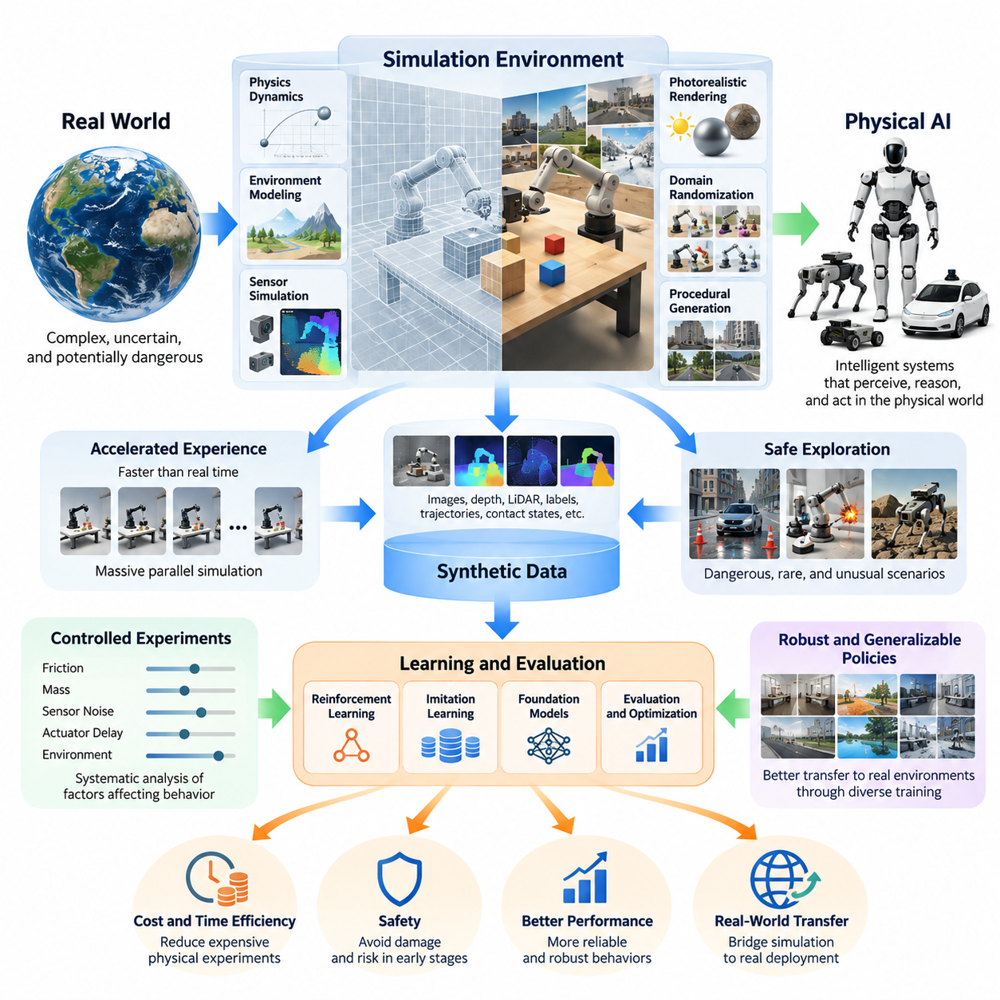
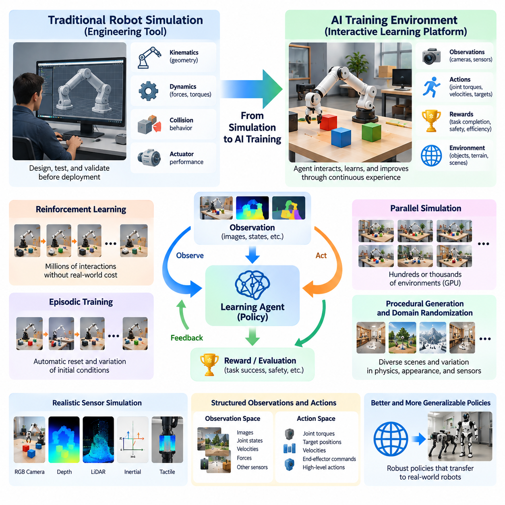
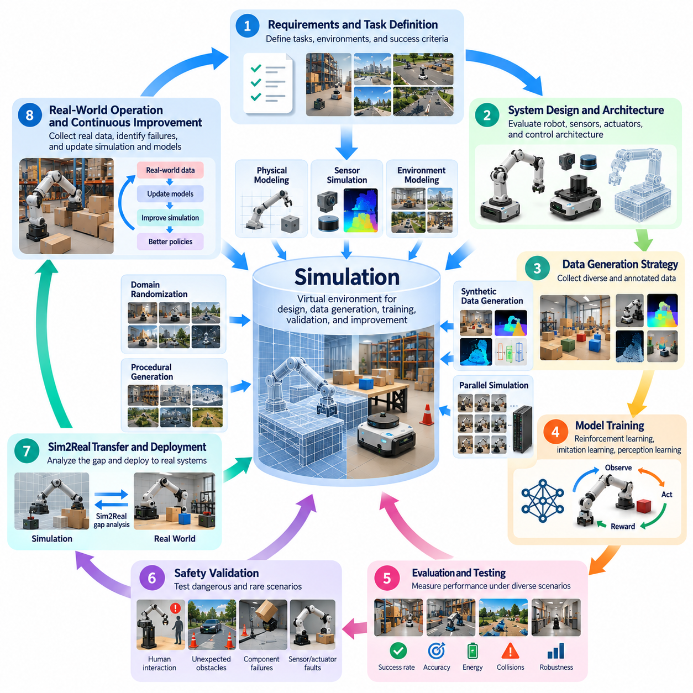
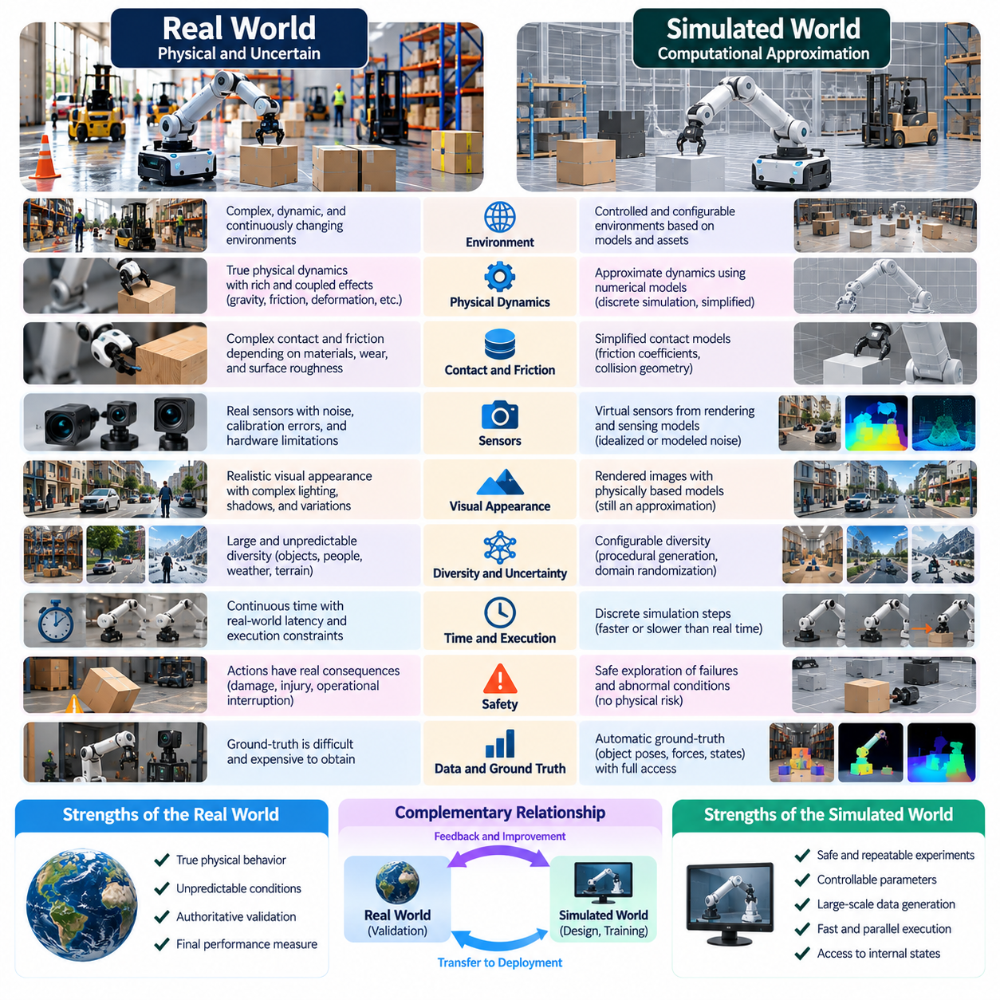
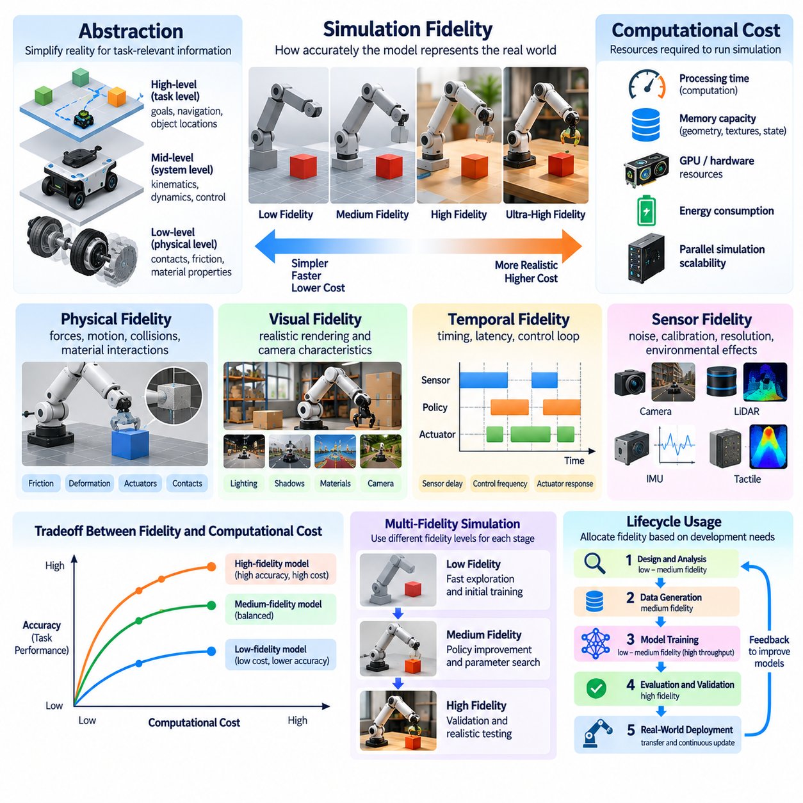
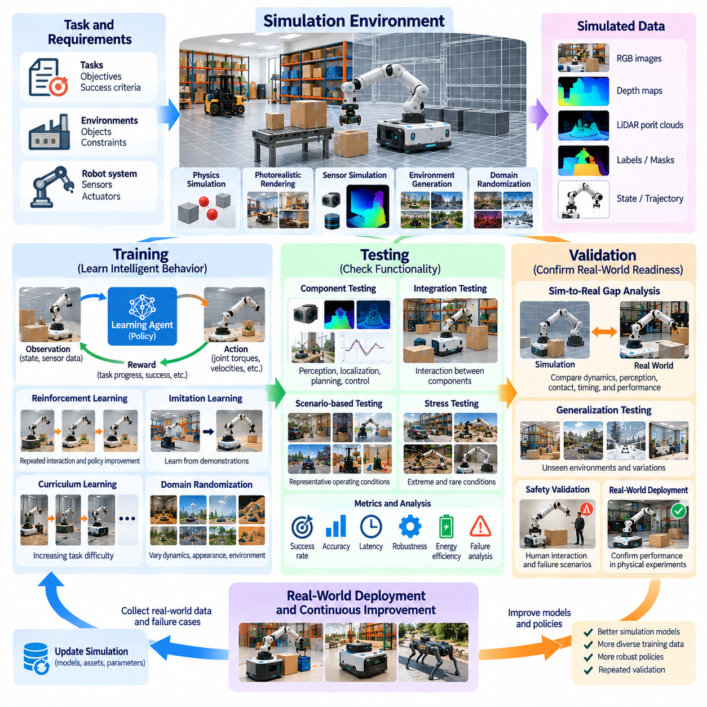
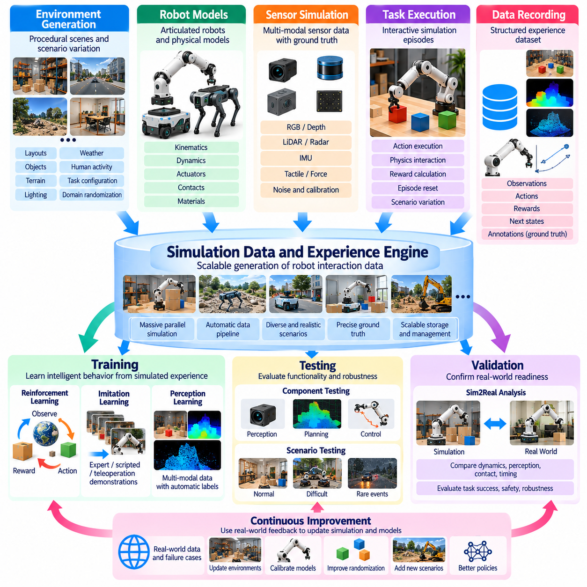
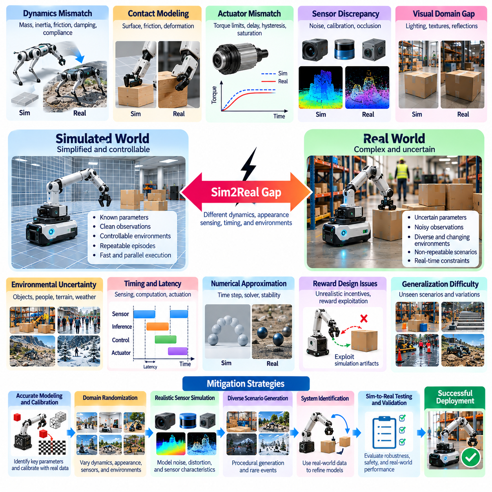
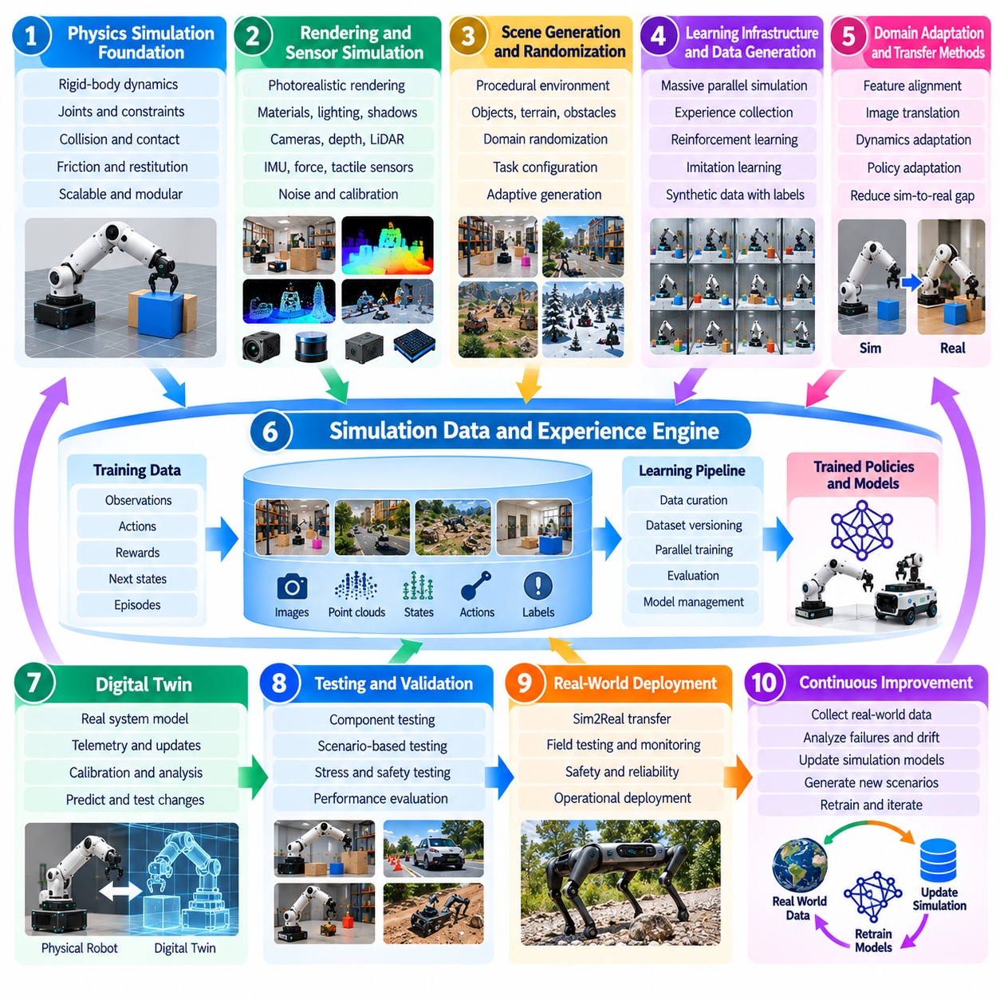

**Volume 05. Simulation and Sim2Real Transfer**

# Chapter 00. Introduction

## 00.01. Why Simulation Matters for Physical AI

{width="7.268055555555556in" height="7.268055555555556in"}

피지컬 인공지능(Physical AI)은 디지털 정보(Digital Information)를 처리하는 인공지능에서 물리적 세계(Physical World)를 인식하고 추론하며 행동하는 지능형 시스템(Intelligent Systems)으로의 근본적인 전환을 의미한다. 순수한 디지털 응용 시스템과 달리 피지컬 인공지능은 중력(Gravity), 마찰(Friction), 관성(Inertia), 불확실성(Uncertainty), 실시간 상호작용(Real-Time Interaction)의 제약 조건에서 작동해야 한다. 시뮬레이션(Simulation)은 지능형 기계가 실제 운영 환경에 진입하기 전에 이러한 물리적 관계를 탐색할 수 있는 계산 환경(Computational Environment)을 제공한다.

시뮬레이션의 중요성은 물리적 세계에서 직접 학습하는 과정의 어려움에서 비롯된다. 로봇(Robot), 자율주행차(Autonomous Vehicle), 지능형 기계(Intelligent Machine)는 신뢰할 수 있는 행동을 개발하기 위해 광범위한 경험이 필요하지만, 실제 환경에서의 실험은 비용과 시간이 많이 소요되고 잠재적으로 위험하다. 실패한 실험은 장비 손상, 운영 중단 또는 안전 위험을 초래할 수 있다. 시뮬레이션은 실제 시스템을 불필요한 위험에 노출하지 않으면서 반복적인 실험을 가능하게 하여 이러한 제약을 줄인다.

전통적인 로봇 개발은 분석 모델(Analytical Model), 수동으로 설계된 제어기(Controller), 통제된 실험실 환경에 크게 의존하였다. 현대의 피지컬 인공지능은 강화학습(Reinforcement Learning), 모방학습(Imitation Learning), 파운데이션 모델(Foundation Model), 적응형 의사결정(Adaptive Decision-Making)을 점점 더 많이 활용한다. 이러한 접근 방식에는 방대한 양의 상호작용 데이터(Interaction Data)가 필요하다. 시뮬레이션은 다양한 운영 조건에서 학습, 평가, 최적화를 지원하는 가상 경험(Virtual Experience)을 생성함으로써 개발 과정을 변화시킨다.

시뮬레이션 환경(Simulation Environment)은 수학적 모델(Mathematical Model)과 계산 절차(Computational Procedure)를 통해 물리적 현실의 특정 측면을 표현한다. 로봇 운동학(Kinematics), 강체 동역학(Rigid-Body Dynamics), 충돌(Collision), 접촉력(Contact Force), 액추에이터 응답(Actuator Response), 센서 측정(Sensor Measurement)을 재현할 수 있다. 응용 분야에 따라 조명, 재질, 지형, 날씨, 인간 활동도 모델링할 수 있다. 목표는 반드시 완벽한 현실 재현이 아니라 의도한 공학적 작업과 학습 작업에 충분한 정확도를 확보하는 것이다.

시뮬레이션의 주요 장점 중 하나는 물리적 시간(Physical Time)의 제약을 넘어 경험 수집(Experience Collection)을 가속할 수 있다는 점이다. 실제 로봇은 기계적 제약과 운영 조건을 준수하면서 동작을 순차적으로 실행해야 한다. 반면 시뮬레이션 로봇은 계산 자원이 허용하는 경우 실제 시간보다 빠르게 작동할 수 있다. 또한 수천 개의 독립적인 환경을 동시에 실행하여 대량의 학습 궤적(Training Trajectory)을 생성하고 다양한 제어 전략(Control Strategy)을 효율적으로 탐색할 수 있다.

대규모 병렬 시뮬레이션(Massive Parallel Simulation)은 지능형 에이전트(Intelligent Agent)가 환경과의 반복적인 상호작용을 통해 성능을 개선하는 강화학습에서 특히 중요하다. 각 시뮬레이션 에피소드(Simulation Episode)는 관측(Observation), 행동(Action), 보상(Reward), 결과 상태(Resulting State)를 제공한다. 여러 환경에서 동시에 경험을 수집하면 학습 시스템이 다양한 상황을 더욱 빠르게 경험할 수 있다. 이러한 기능은 고도화된 피지컬 인공지능 정책(Physical AI Policy)을 개발하는 중요한 계산 기반이 된다.

시뮬레이션은 현실에서 안전하게 재현하기 어려운 위험하거나 비정상적인 상황을 체계적으로 탐색할 수 있도록 한다. 자율주행차는 갑작스러운 장애물, 예측하지 못한 보행자 움직임, 악화된 도로 조건을 경험할 수 있다. 산업용 로봇(Industrial Robot)은 부품 고장, 예상하지 못한 접촉, 비정상적인 적재물 동작을 경험할 수 있다. 이러한 시나리오(Scenario)는 위험한 실제 실험 없이 복구 전략(Recovery Strategy)과 안전 메커니즘(Safety Mechanism)을 개발하도록 지원한다.

또 다른 핵심적인 기여는 합성 학습 데이터(Synthetic Training Data)의 생성이다. 가상 환경(Virtual Environment)은 카메라 영상(Camera Image), 깊이 측정(Depth Measurement), 라이다 포인트 클라우드(LiDAR Point Cloud), 레이더 관측(Radar Observation), 관성 측정(Inertial Measurement), 로봇 상태 정보(Robot State Information)를 생성할 수 있다. 시뮬레이션 세계의 내부 상태를 알고 있으므로 정확한 주석(Annotation)을 자동으로 생성할 수 있다. 따라서 객체 위치, 의미 레이블(Semantic Label), 분할 마스크(Segmentation Mask), 궤적, 접촉 상태를 광범위한 수작업 레이블링 없이 확보할 수 있다.

합성 데이터(Synthetic Data)는 실제 관측 데이터를 확보하는 데 비용이 많이 들거나, 드물게 발생하거나, 주석을 작성하기 어려운 경우 특히 유용하다. 피지컬 인공지능 시스템은 서로 다른 객체 구성, 조명 조건, 환경, 센서 특성을 포함하는 학습 사례가 필요하다. 시뮬레이션은 정확한 정답 정보(Ground Truth)를 유지하면서 이러한 요소를 체계적으로 변화시킬 수 있다. 이러한 기능은 인식 학습(Perception Training), 멀티모달 학습(Multimodal Learning), 변화하는 조건에서 작동해야 하는 강건한 모델(Robust Model)의 개발을 지원한다.

그러나 시뮬레이션은 단순히 더 많은 데이터를 생성하는 수단이 아니다. 개별 변수(Variable)를 독립적으로 변경할 수 있는 통제된 실험 환경(Controlled Experimental Environment)도 제공한다. 연구자는 마찰, 질량, 센서 잡음(Sensor Noise), 액추에이터 지연(Actuator Delay), 환경 기하구조(Environmental Geometry)의 변화가 시스템 동작에 미치는 영향을 조사할 수 있다. 이러한 통제 실험은 실패 메커니즘(Failure Mechanism)에 대한 이해를 높이고 학습 알고리즘의 한계와 물리 모델의 부정확성을 구분하는 데 도움이 된다.

도메인 랜덤화(Domain Randomization)는 학습 과정에서 시뮬레이션 매개변수(Simulation Parameter)를 의도적으로 변화시켜 이러한 원리를 확장한다. 지능형 에이전트를 하나의 가상 환경에만 노출하는 대신 물리적 현실의 다양한 가능한 형태를 학습 과정에 제시한다. 외관, 동역학, 기하구조, 센서 동작의 변화는 정책이 더욱 일반화 가능한 정보(Generalizable Information)에 의존하도록 유도한다. 그 결과 실제 환경으로의 전이(Transfer)에 필요한 강건성이 향상될 수 있지만, 성공적인 전이를 위해서는 여전히 실증적 검증(Empirical Verification)이 필요하다.

사실적 렌더링(Photorealistic Rendering)은 실제 센서 측정과 유사한 시각적 관측(Visual Observation)을 재현함으로써 시뮬레이션에 또 다른 중요한 차원을 제공한다. 현실적인 조명, 반사, 그림자, 표면 재질, 카메라 특성은 합성 시각 데이터(Synthetic Visual Data)의 활용성을 높일 수 있다. 그러나 시각적 사실성(Visual Realism)만으로 물리적 정확성(Physical Accuracy)이 보장되는 것은 아니다. 설득력 있는 가상 장면이라도 접촉 동역학(Contact Dynamics), 액추에이터 동작, 센서 타이밍(Sensor Timing)이 부정확하면 실제 환경에서의 성능에 부정적인 영향을 줄 수 있다.

따라서 시각적 충실도(Visual Fidelity)와 물리적 충실도(Physical Fidelity)의 구분은 매우 중요하다. 시각적 충실도는 렌더링된 관측과 실제 센서 출력 사이의 유사성을 의미하며, 물리적 충실도는 시뮬레이션된 운동, 힘, 상호작용의 정확성을 의미한다. 응용 분야마다 이러한 특성의 요구 수준은 다르다. 인식 시스템(Perception System)은 현실적인 영상 생성(Image Formation)을 강조할 수 있지만, 보행 제어기(Locomotion Controller)는 접촉 역학(Contact Mechanics)과 액추에이터 동역학(Actuator Dynamics)에 더욱 크게 의존할 수 있다.

시뮬레이션은 계산적 표현(Computational Representation)을 실제 물리적 자산(Physical Asset) 및 운영 환경과 연결하는 디지털 트윈(Digital Twin)도 지원한다. 디지털 트윈은 기하구조, 물리적 매개변수, 센서 정보, 운영 텔레메트리(Operational Telemetry)를 통합하여 실제 시스템의 상태와 동작을 표현할 수 있다. 적절하게 동기화(Synchronization)되고 보정(Calibration)되면 성능 분석, 고장 조사, 예지보전(Predictive Maintenance), 실제 적용 이전의 운영 변경안 평가를 지원할 수 있다.

이러한 장점에도 불구하고 시뮬레이션 환경은 실제 환경과 필연적으로 차이가 발생한다. 일반적으로 시뮬레이션-현실 격차(Simulation-to-Reality Gap), 즉 Sim2Real 격차(Sim2Real Gap)라고 부르는 이러한 차이는 부정확한 동역학, 불완전한 환경 모델, 센서 결함, 모델링되지 않은 외란(Unmodeled Disturbance), 계산 타이밍의 차이에서 발생할 수 있다. 따라서 시뮬레이션에서 성공적으로 작동한 정책도 실제 배포(Deployment) 이후 예상하지 못한 동작을 보일 수 있다. 이러한 격차를 이해하는 것은 시뮬레이션 결과를 해석하고 신뢰할 수 있는 전이 전략을 설계하는 데 필수적이다.

Sim2Real 격차를 줄이기 위해서는 물리 모델링(Physical Modeling), 시스템 식별(System Identification), 도메인 랜덤화, 도메인 적응(Domain Adaptation), 실제 환경 검증(Real-World Validation)을 통합적으로 활용해야 한다. 실제 로봇에서 측정한 데이터는 시뮬레이션 매개변수를 보정하는 데 사용할 수 있으며, 예측된 동작과 관측된 동작 사이의 차이는 모델링의 취약점을 드러낸다. 이러한 반복 과정은 시뮬레이션이 물리적 실험을 지원하고 실제 환경의 증거가 시뮬레이션 품질을 지속적으로 개선하는 피드백 관계(Feedback Relationship)를 형성한다.

시뮬레이션은 피지컬 인공지능 생명주기(Physical AI Lifecycle) 전반의 시험(Testing)과 검증(Validation)에서도 중요하다. 개발자는 반복 가능한 시나리오를 사용하여 내비게이션 정확도(Navigation Accuracy), 조작 성공률(Manipulation Success Rate), 보행 안정성(Locomotion Stability), 충돌 회피(Collision Avoidance), 복구 동작(Recovery Behavior)을 평가할 수 있다. 표준화된 벤치마크 환경(Benchmark Environment)은 일관된 조건에서 대안 알고리즘을 비교할 수 있도록 한다. 다만 시뮬레이션 기반 결과는 실제 물리적 시험을 대체하기보다 보완해야 하며, 특히 안전 필수 동작(Safety-Critical Behavior)의 검증에서는 더욱 그렇다.

시뮬레이션의 가치는 개별 로봇을 넘어 여러 자율 에이전트(Autonomous Agent)가 상호작용하는 복잡한 시스템으로 확장된다. 창고, 공장, 교통 네트워크(Transportation Network), 협력 로봇 군집(Coordinated Robot Fleet)에는 개별 실험만으로 분석하기 어려운 상호작용이 존재한다. 시뮬레이션은 다수의 물리적 기계를 공유 환경에 배치하기 전에 교통 혼잡, 작업 할당(Task Allocation), 통신 지연(Communication Delay), 자원 충돌(Resource Conflict), 집단 행동(Collective Behavior)을 조사할 수 있도록 한다.

시뮬레이션은 피지컬 인공지능 개발의 경제성(Economics)도 변화시킨다. 고품질 가상 환경을 구축하려면 모델링, 소프트웨어 인프라(Software Infrastructure), 컴퓨팅(Computing), 검증에 상당한 투자가 필요하지만, 반복적인 하드웨어 실험을 줄이고 개발 주기(Development Cycle)를 단축할 수 있다. 경제적 가치는 모델 재사용성(Model Reusability), 계산 효율성(Computational Efficiency), 예측 유용성(Predictive Usefulness)에 따라 달라진다. 시뮬레이션 플랫폼(Simulation Platform)은 다양한 알고리즘, 로봇 구성, 배포 시나리오를 지원할 때 특히 높은 가치를 제공한다.

시뮬레이션의 장기적인 중요성은 공학적 검증 도구(Engineering Verification Tool)에서 통합 학습 및 경험 인프라(Integrated Learning and Experience Infrastructure)로 발전한다는 점에 있다. 피지컬 인공지능 시스템은 시뮬레이션 환경을 활용하여 기술을 습득하고, 의사결정을 평가하며, 익숙하지 않은 상황을 탐색하고, 실제 배포 이전에 동작을 개선할 수 있다. 실제 환경 데이터 수집(Real-World Data Collection) 및 지속적인 검증(Continuous Validation)과 결합된 시뮬레이션은 물리적 현실과 안전하고 효율적이며 적응적으로 상호작용하는 지능형 기계 개발을 위한 확장 가능한 기반(Scalable Foundation)을 제공한다.

## 00.02. From Robot Simulation to AI Training Environment

{width="7.268055555555556in" height="7.268055555555556in"}

로봇 시뮬레이션(Robot Simulation)은 전통적으로 실제 배포(Physical Deployment) 이전에 로봇 시스템(Robotic System)을 설계, 시험, 검증하기 위한 공학적 도구(Engineering Tool)로 활용되어 왔다. 엔지니어들은 가상 모델(Virtual Model)을 사용하여 기계 구조(Mechanical Structure), 관절 운동(Joint Movement), 액추에이터 성능(Actuator Performance), 충돌 동작(Collision Behavior)을 분석하였다. 이러한 환경은 주로 결정론적 분석(Deterministic Analysis)과 사전에 정의된 운동 시퀀스(Predefined Motion Sequence)를 지원하였다. 피지컬 인공지능(Physical AI)의 등장으로 시뮬레이션은 지능형 에이전트(Intelligent Agent)가 지속적인 상호작용을 통해 능력을 습득하는 동적 학습 환경(Dynamic Training Environment)으로 확장되었다.

전통적인 로봇 시뮬레이터(Robot Simulator)는 물리 시스템(Physical System)에 대한 수학적 기술(Mathematical Description)을 중심으로 개발되었다. 운동학 모델(Kinematic Model)은 로봇 구성 요소 사이의 기하학적 관계를 표현하고, 동역학 모델(Dynamic Model)은 힘, 토크(Torque), 그에 따른 운동을 설명하였다. 엔지니어들은 매니퓰레이터(Manipulator)가 목표 위치에 도달하는지 또는 모바일 로봇(Mobile Robot)이 계획된 궤적(Planned Trajectory)을 따라 이동하는지 검증할 수 있었다. 그러나 이러한 응용은 일반적으로 제어 전략(Control Strategy)이 자율적 경험을 통해 학습되는 것이 아니라 이미 설계되어 있다고 가정하였다.

인공지능 학습 환경(AI Training Environment)으로의 전환은 시뮬레이션의 역할을 근본적으로 변화시킨다. 단순히 로봇의 예상 동작을 재현하는 대신 시뮬레이터는 에이전트가 환경 조건을 관측하고, 행동을 선택하며, 그 결과로부터 학습하는 상호작용 세계(Interactive World)가 된다. 이러한 상호작용은 인식(Perception), 의사결정(Decision-Making), 물리적 행동(Physical Behavior) 사이에 피드백 과정(Feedback Process)을 형성한다. 따라서 환경은 정확한 동역학뿐 아니라 반복적인 탐색(Exploration), 학습 신호(Learning Signal), 측정 가능한 작업 결과(Task Outcome)도 지원해야 한다.

인공지능 학습 환경은 일반적으로 시뮬레이션 로봇(Simulated Robot), 주변 세계의 표현(World Representation), 관측 시스템(Observation System), 행동 인터페이스(Action Interface), 행동 평가 메커니즘(Behavior Evaluation Mechanism)으로 구성된다. 로봇은 카메라 영상(Camera Image), 관절 위치(Joint Position), 속도(Velocity), 힘 측정(Force Measurement), 기타 센서 정보(Sensory Information)를 수신할 수 있다. 학습 알고리즘(Learning Algorithm)은 이러한 관측을 기반으로 시뮬레이션 세계에 영향을 주는 행동을 생성한다. 그 결과 발생하는 상태 변화(State Change)는 이후 의사결정과 학습 갱신(Learning Update)을 위한 새로운 정보를 제공한다.

강화학습(Reinforcement Learning)은 에이전트와 환경 사이의 광범위한 상호작용이 필요하므로 이러한 전환을 이끄는 주요 기술 중 하나가 되었다. 학습 과정에서 에이전트는 행동을 수행하고 보상(Reward) 또는 벌점(Penalty)을 받으며 정책(Policy)을 점진적으로 개선한다. 시뮬레이션 환경은 실제 로봇의 운영 시간을 동일하게 소비하지 않고도 수백만 번의 상호작용을 생성할 수 있다. 이를 통해 실제 하드웨어(Real Hardware)에서 직접 학습하기에는 비용이 높거나 시간이 오래 걸리거나 위험한 복잡한 제어 동작(Control Behavior)을 연구할 수 있다.

보상 함수(Reward Function)의 설계는 기존 시뮬레이션과 인공지능 중심 학습(AI-Oriented Training)을 구분하는 중요한 요소이다. 전통적인 시뮬레이션은 사전에 정의된 궤적이나 제어기가 허용 가능한 결과를 생성하는지 평가한다. 반면 강화학습 환경은 행동 개선을 유도하는 수치적 피드백(Numerical Feedback)을 제공한다. 보상은 작업 완료(Task Completion), 에너지 효율(Energy Efficiency), 운동 안정성(Movement Stability), 충돌 회피(Collision Avoidance), 조작 정확도(Manipulation Accuracy)를 나타낼 수 있다. 잘못 설계된 보상은 의도하지 않은 행동(Unintended Behavior)을 유발할 수 있으므로 보상 설계(Reward Engineering)는 핵심 개발 활동이 된다.

현대적인 학습 환경에는 관측(Observation)과 행동(Action)에 대한 구조화된 정의도 필요하다. 관측 공간(Observation Space)은 에이전트가 수신하는 정보를 결정하며, 행동 공간(Action Space)은 에이전트가 생성할 수 있는 명령을 규정한다. 행동은 관절 토크(Joint Torque), 목표 속도(Target Velocity), 말단효과기 위치(End-Effector Position), 상위 수준의 행동 결정(Higher-Level Behavioral Decision)을 나타낼 수 있다. 이러한 표현 방식(Representation)의 선택은 학습 효율(Learning Efficiency), 제어 성능(Control Performance), 학습된 정책을 실제 로봇 플랫폼(Physical Robotic Platform)으로 전이하는 능력에 큰 영향을 미친다.

또 다른 주요 발전은 에피소드 기반 학습(Episodic Training)과 자동 환경 초기화(Automated Environment Resetting)의 도입이다. 학습 에피소드(Training Episode)는 초기 구성(Initial Configuration)에서 시작하여 작업이 완료되거나 실패가 발생하거나 종료 조건(Termination Condition)에 도달할 때까지 계속된다. 이후 시뮬레이터는 로봇과 환경을 초기화하여 새로운 경험을 시작한다. 자동 초기화(Automated Reset)는 사람의 개입 없이 지속적인 학습을 가능하게 하며 초기 상태(Initial State), 객체 배치(Object Arrangement), 운영 조건(Operating Condition)의 체계적인 변화를 지원한다.

병렬 실행(Parallel Execution)은 현대적인 인공지능 학습 환경을 기존 공학 시뮬레이터와 구분하는 또 다른 특징이다. 단일 가상 로봇을 실행하는 대신 학습 플랫폼(Training Platform)은 수백 또는 수천 개의 독립적인 시뮬레이션 인스턴스(Simulation Instance)를 유지할 수 있다. 각 인스턴스는 공통 학습 알고리즘을 공유하면서 서로 다른 경험을 생성한다. GPU 가속(GPU Acceleration)과 벡터화 연산(Vectorized Computation)은 경험 처리량(Experience Throughput)을 크게 증가시켜 강화학습 시스템이 실용적인 개발 기간 안에 광범위한 행동 공간(Behavioral Space)을 탐색하도록 한다.

시뮬레이션의 발전은 절차적 환경 생성(Procedural Environment Generation)도 도입하였다. 모든 학습 장면(Training Scene)을 수동으로 구성하는 대신 개발자는 방, 창고, 지형, 장애물, 객체, 작업 구성을 자동으로 생성할 수 있다. 절차적 생성(Procedural Generation)은 지능형 에이전트가 경험할 수 있는 상황의 다양성을 확대한다. 또한 일반화 가능한 행동(Generalizable Behavior)을 학습하기보다 특정 상황을 암기하도록 유도할 수 있는 제한된 수작업 시나리오(Handcrafted Scenario)에 대한 의존성을 줄인다.

도메인 랜덤화(Domain Randomization)는 시뮬레이션 매개변수(Simulation Parameter)에 통제된 변화를 도입하여 절차적 생성을 보완한다. 로봇 질량(Robot Mass), 마찰계수(Friction Coefficient), 액추에이터 특성(Actuator Characteristic), 센서 잡음(Sensor Noise), 조명 조건(Lighting Condition), 객체 속성(Object Property)은 학습 에피소드마다 달라질 수 있다. 이러한 변화는 학습 시스템을 실제 물리적 환경에서 발생하는 차이와 유사한 불확실성(Uncertainty)에 노출한다. 목표는 하나의 이상화된 시뮬레이션 구성(Idealized Simulation Configuration)에 의존하지 않고 다양한 조건에서 효과적으로 작동하는 정책을 개발하는 것이다.

현실적인 센서 시뮬레이션(Realistic Sensor Simulation)의 통합은 인공지능 학습 환경을 인식 기반 로보틱스(Perception-Driven Robotics)에 더욱 적합하게 만들었다. 가상 카메라(Virtual Camera)는 RGB 영상(RGB Image), 깊이 측정(Depth Measurement), 모션 블러(Motion Blur), 조명 효과(Lighting Effect)를 재현할 수 있으며, 시뮬레이션된 라이다(LiDAR)와 관성 센서(Inertial Sensor)는 보완적인 관측 정보를 제공한다. 이러한 데이터 스트림(Data Stream)은 공통 가상 환경에서 인식 및 제어 시스템(Perception and Control System)의 학습을 가능하게 한다. 그러나 활용 가치는 시뮬레이션 측정값이 실제 센서 특성을 얼마나 적절하게 표현하는지에 따라 달라진다.

인공지능 학습 환경은 강화학습을 넘어 모방학습(Imitation Learning)과 시연 기반 학습(Demonstration-Based Training)도 지원하도록 확장되고 있다. 전문가 궤적(Expert Trajectory)은 스크립트 기반 제어기(Scripted Controller), 최적화 기법(Optimization Method), 가상 원격조작(Virtual Teleoperation)을 통해 시뮬레이션에서 기록할 수 있다. 이러한 시연(Demonstration)은 학습 시스템이 모방할 수 있는 성공적인 행동 사례를 제공한다. 시연과 상호작용 학습(Interactive Learning)을 결합하면 탐색 요구량(Exploration Requirement)을 줄이고 복잡한 조작(Manipulation), 내비게이션(Navigation), 보행(Locomotion) 기술의 습득을 가속할 수 있다.

로봇 파운데이션 모델(Robot Foundation Model)과 비전-언어-행동 모델(Vision-Language-Action Model, VLA Model)의 등장은 시뮬레이션 인프라(Simulation Infrastructure)에 추가적인 요구사항을 제시한다. 이러한 모델은 시각적 관측(Visual Observation), 언어 명령(Language Instruction), 물리적 행동(Physical Action)을 통합하여 다양한 작업을 수행한다. 시뮬레이션은 언어 조건부 행동(Language-Conditioned Behavior)을 연습하고 평가할 수 있는 통제된 시나리오를 제공한다. 또한 작업 설명(Task Description), 환경 관측(Environmental Observation), 행동 시퀀스(Action Sequence), 실행 결과(Execution Outcome)를 연결하는 멀티모달 학습 사례(Multimodal Training Example)를 생성할 수 있다.

이러한 발전의 중요한 결과 중 하나는 시뮬레이션과 데이터 엔지니어링(Data Engineering)의 융합(Convergence)이다. 현대적인 학습 플랫폼은 관측, 행동, 보상, 궤적, 실패, 환경 매개변수를 구조화된 형식(Structured Format)으로 기록해야 한다. 이러한 기록은 데이터셋 구축(Dataset Construction), 오프라인 학습(Offline Learning), 성능 분석(Performance Analysis), 재현 가능한 실험(Reproducible Experimentation)을 지원한다. 따라서 시뮬레이션은 상호작용 학습 환경인 동시에 피지컬 인공지능 개발을 위한 확장 가능한 합성 경험(Synthetic Experience)의 공급원이 된다.

정교함이 증가하더라도 인공지능 학습 환경은 가상 시스템과 실제 물리 시스템 사이의 차이를 완전히 제거할 수 없다. 접촉 동역학(Contact Dynamics), 재료 변형(Material Deformation), 액추에이터 지연(Actuator Delay), 센서 결함(Sensor Imperfection), 예측하기 어려운 환경 상호작용(Environmental Interaction)은 부정확하게 표현될 수 있다. 시뮬레이션에서만 학습한 정책은 현실에는 존재하지 않는 모델링 오류(Modeling Error)를 이용할 수 있다. 따라서 시뮬레이션 개발에는 보정(Calibration), 시스템 식별(System Identification), 불확실성 모델링(Uncertainty Modeling), 실제 환경 성능 평가(Real-World Performance Evaluation)가 포함되어야 한다.

시뮬레이션과 물리적 실험(Physical Experimentation)의 관계는 점점 더 양방향(Bidirectional)으로 발전하고 있다. 실제 로봇의 측정값은 시뮬레이션 동역학(Simulated Dynamics)과 센서 모델(Sensor Model)을 갱신하는 데 활용할 수 있으며, 시뮬레이션은 실제 배포 이전에 유망한 정책과 잠재적으로 위험한 운영 조건을 식별할 수 있다. 물리적 운영 중 관측된 실패는 가상 환경에서 재구성되어 향후 학습에 반영될 수 있다. 이러한 반복적인 정보 교환(Iterative Exchange)은 시뮬레이션 경험과 실제 환경의 증거를 연결하는 지속적 개선 과정(Continuous Improvement Process)을 형성한다.

디지털 트윈 기술(Digital Twin Technology)은 가상 모델을 실제 운영 중인 로봇 시스템과 연결하여 이러한 관계를 강화한다. 디지털 트윈(Digital Twin)은 물리적 기하구조(Physical Geometry), 액추에이터 특성, 센서 측정값, 실시간 텔레메트리(Real-Time Telemetry)를 통합하여 실제 로봇이나 시설을 표현할 수 있다. 이러한 모델은 시나리오 평가(Scenario Evaluation), 운영 최적화(Operational Optimization), 고장 분석(Failure Analysis)을 지원할 수 있다. 학습 인프라와 통합되면 배포된 기계에서 수집한 정보를 사용하여 학습 환경을 적응적으로 조정할 기회를 제공한다.

로봇 시뮬레이션에서 인공지능 학습 환경으로의 전환은 로봇 지능(Robotic Intelligence)의 평가 방식도 변화시킨다. 전통적인 시뮬레이션은 주로 궤적 정확도(Trajectory Accuracy), 기계적 실현 가능성(Mechanical Feasibility), 제어기 안정성(Controller Stability)을 강조하였다. 반면 인공지능 중심 플랫폼은 작업 성공률(Task Success Rate), 학습 효율, 일반화(Generalization), 강건성(Robustness), 예상하지 못한 사건으로부터의 복구 능력(Recovery Capability)도 측정해야 한다. 향상된 시뮬레이션 성능이 의미 있는 실제 물리적 능력으로 이어지는지 판단하려면 표준화된 벤치마크(Standardized Benchmark)와 재현 가능한 평가 절차(Reproducible Evaluation Procedure)가 필요하다.

궁극적으로 시뮬레이션은 로봇 동작을 수동적으로 표현하는 도구(Passive Representation Tool)에서 체화 지능(Embodied Intelligence)을 개발하기 위한 능동적 계산 인프라(Active Computational Infrastructure)로 발전하고 있다. 그 목적은 공학적 설계 검증을 넘어 경험 생성(Experience Generation), 자율 학습(Autonomous Learning), 일반화 평가(Generalization Evaluation), 배포 준비도(Deployment Readiness) 향상으로 확장된다. 물리 모델링(Physical Modeling), 확장 가능한 컴퓨팅(Scalable Computing), 합성 데이터(Synthetic Data), 실제 환경 피드백(Real-World Feedback)을 결합함으로써 인공지능 학습 환경은 더욱 적응적이고 높은 능력을 갖춘 피지컬 인공지능 시스템(Physical AI System)을 개발하기 위한 기반을 제공한다.

## 00.03. Simulation in the Physical AI Lifecycle

{width="7.268055555555556in" height="7.268055555555556in"}

시뮬레이션(Simulation)은 시스템 설계(System Design), 데이터 생성(Data Generation), 모델 학습(Model Training), 검증(Validation), 배포(Deployment), 지속적 개선(Continuous Improvement)을 연결하면서 피지컬 인공지능 생명주기(Physical AI Lifecycle) 전반에서 핵심적인 역할을 수행한다. 기존 소프트웨어 개발과 달리 피지컬 인공지능(Physical AI)은 지능형 알고리즘(Intelligent Algorithm)과 물리적 환경(Physical Environment) 사이의 상호작용을 고려해야 한다. 시뮬레이션은 실제 실행 이전에 이러한 상호작용을 분석할 수 있는 통제된 계산 기반(Computational Foundation)을 제공하여 개발 위험을 줄이고 실험과 시스템 개선을 가속한다.

피지컬 인공지능 생명주기는 운영 요구사항(Operational Requirements), 목표 환경(Target Environment), 예상 동작(Expected Behavior)을 정의하는 것에서 시작된다. 엔지니어는 로봇이 수행할 작업, 직면할 물리적 제약(Physical Constraints), 성공 여부를 결정하는 성능 기준(Performance Criteria)을 식별해야 한다. 시뮬레이션은 대안적인 시스템 개념(System Concept)을 가상으로 탐색할 수 있도록 하여 이러한 초기 단계를 지원한다. 초기 실험을 통해 하드웨어(Hardware)와 시스템 통합(System Integration)에 상당한 투자를 하기 전에 제안된 기능의 기술적 실현 가능성(Technical Feasibility)을 확인할 수 있다.

시스템 아키텍처 설계(System Architecture Design) 단계에서 시뮬레이션은 기계 구조(Mechanical Structure), 센서(Sensor), 액추에이터(Actuator), 컴퓨팅 플랫폼(Computing Platform), 제어 알고리즘(Control Algorithm) 사이의 관계를 평가하는 데 도움을 준다. 엔지니어는 로봇 구성(Robot Configuration)을 비교하고, 도달 가능한 작업 공간(Reachable Workspace)을 분석하며, 운동 요구사항(Motion Requirements)을 추정하고, 잠재적인 설계 한계(Design Limitations)를 식별할 수 있다. 이러한 가상 평가(Virtual Evaluation)는 하드웨어와 소프트웨어를 독립적으로 개발하는 대신 물리적 구성 요소와 지능형 제어 전략을 함께 최적화하는 하드웨어-소프트웨어 공동 설계(Hardware-Software Co-Design)를 지원한다.

물리 모델링(Physical Modeling)은 생명주기 시뮬레이션(Lifecycle Simulation)의 필수적인 기반을 형성한다. 로봇 기하구조(Robot Geometry), 질량 분포(Mass Distribution), 관절 제약(Joint Constraints), 접촉 특성(Contact Properties), 액추에이터 동역학(Actuator Dynamics), 환경 특성(Environmental Characteristics)을 충분한 정확도로 표현해야 한다. 이러한 모델을 통해 개발자는 물리 시스템이 명령과 외부 외란(External Disturbances)에 어떻게 반응하는지 예측할 수 있다. 모델의 유용성은 보정 품질(Calibration Quality), 수치적 안정성(Numerical Stability), 모델링된 현상이 의도한 응용 분야와 얼마나 관련되어 있는지에 따라 달라진다.

센서 시뮬레이션(Sensor Simulation)은 피지컬 인공지능 시스템이 인식(Perception)과 환경 이해(Environmental Understanding)에 의존할 때 중요해진다. 가상 카메라(Virtual Camera), 라이다 센서(LiDAR Sensor), 레이더 시스템(Radar System), 관성 측정 장치(Inertial Measurement Unit, IMU), 촉각 센서(Tactile Sensor)는 시뮬레이션 조건에 대응하는 관측 정보(Observation)를 생성할 수 있다. 개발자는 센서 구성이 객체 탐지(Object Detection), 위치 추정(Localization), 지도 작성(Mapping), 제어(Control)에 미치는 영향을 조사할 수 있다. 이를 통해 실제 시제품(Physical Prototype)이 완전히 준비되기 전에 센서 배치(Sensor Placement)와 인식 알고리즘(Perception Algorithm)을 조기에 평가할 수 있다.

시뮬레이션은 데이터 수집 전략(Data Collection Strategy)의 개발도 지원한다. 피지컬 인공지능은 학습과 평가를 위해 관측 정보, 행동(Action), 궤적(Trajectory), 환경 상태(Environmental State), 작업 결과(Task Outcome)가 필요하다. 가상 환경(Virtual Environment)은 이러한 기록을 체계적으로 생성하면서 자동 정답 주석(Automatic Ground-Truth Annotation)을 제공할 수 있다. 장면 구성(Scene Composition)과 운영 조건(Operating Conditions)을 제어함으로써 개발자는 일반적인 상황, 어려운 상호작용, 드문 사건(Rare Event)을 포함하는 데이터셋(Dataset)을 생성할 수 있으며, 이를 통해 광범위한 실제 환경 실험의 필요성을 줄일 수 있다.

모델 학습 단계(Model Training Stage)에서 시뮬레이션은 상호작용 기반 경험 생성 환경(Interactive Experience-Generation Environment)이 된다. 강화학습 에이전트(Reinforcement Learning Agent)는 반복적인 에피소드(Episode)를 통해 행동을 탐색하고, 보상(Reward)을 받으며, 정책(Policy)을 개선할 수 있다. 모방학습 시스템(Imitation Learning System)은 시뮬레이션 시연(Simulated Demonstration)을 활용하여 유용한 행동을 습득하고, 인식 모델(Perception Model)은 합성 센서 관측(Synthetic Sensor Observation)으로부터 학습할 수 있다. 이러한 접근 방식은 하드웨어가 완전히 준비되기 전에 학습을 시작할 수 있도록 하며 필요한 물리적 실험의 양을 줄일 수 있다.

대규모 병렬 시뮬레이션(Massive Parallel Simulation)은 다수의 독립적인 환경을 동시에 실행하여 학습 단계를 더욱 가속한다. GPU 기반 물리 엔진(GPU-Based Physics Engine)과 벡터화 시뮬레이션 아키텍처(Vectorized Simulation Architecture)는 실용적인 시간 내에 대량의 경험 데이터를 생성할 수 있다. 서로 다른 로봇 상태(Robot State), 작업 구성(Task Configuration), 환경 조건(Environmental Conditions)을 동시에 탐색할 수 있다. 그러나 계산 처리량(Computational Throughput)은 물리적 정확성(Physical Accuracy), 메모리 요구사항(Memory Requirements), 시뮬레이션 상호작용의 복잡성과 균형을 이루어야 한다.

도메인 랜덤화(Domain Randomization)는 학습 시스템을 외관(Appearance), 동역학(Dynamics), 환경 조건의 변화에 노출함으로써 생명주기 학습(Lifecycle Training)에 기여한다. 마찰계수(Friction Coefficient), 객체 질량(Object Mass), 조명(Lighting), 센서 잡음(Sensor Noise), 액추에이터 지연(Actuator Delay), 지형 특성(Terrain Properties)은 학습 에피소드마다 달라질 수 있다. 이러한 가변성(Variability)은 정책이 하나의 이상화된 환경을 넘어 효과적으로 작동하도록 유도한다. 신중하게 설계된 랜덤화 분포(Randomization Distribution)는 강건성(Robustness)을 향상시킬 수 있지만, 과도하거나 비현실적인 변화는 학습 효율(Learning Efficiency)을 저하시킬 수 있다.

학습 이후 시뮬레이션은 학습된 행동(Learned Behavior)을 평가하기 위한 반복 가능한 환경(Repeatable Environment)을 제공한다. 개발자는 작업 완료율(Task Completion Rate), 궤적 정확도(Trajectory Accuracy), 에너지 소비(Energy Consumption), 충돌 빈도(Collision Frequency), 복구 성능(Recovery Performance), 제어 안정성(Control Stability)을 측정할 수 있다. 표준화된 시나리오(Standardized Scenario)는 서로 다른 알고리즘과 모델 버전(Model Version) 사이의 의미 있는 비교를 가능하게 한다. 통제된 조건에서 반복적으로 평가하면 제한된 실제 물리적 시험에서 발견되지 않을 수 있는 취약점을 식별하는 데 도움이 된다.

안전 검증(Safety Validation)은 또 다른 핵심 생명주기 단계이다. 피지컬 인공지능 시스템은 사람, 장비, 인프라(Infrastructure), 예측하기 어려운 장애물 근처에서 작동할 수 있다. 시뮬레이션은 실제 환경을 불필요한 위험에 노출하지 않으면서 잠재적으로 위험한 조건을 분석할 수 있도록 한다. 비상 정지(Emergency Stop), 센서 고장(Sensor Failure), 액추에이터 결함(Actuator Fault), 통신 중단(Communication Interruption), 예상하지 못한 상호작용을 체계적으로 도입할 수 있다. 이러한 실험은 안전 공학(Safety Engineering)을 지원하지만, 이것만으로 실제 환경에서의 완전한 안전성을 입증할 수는 없다.

시뮬레이션에서 실제 물리적 배포로 전환하려면 시뮬레이션-현실 격차(Simulation-to-Reality Gap, Sim2Real Gap)를 신중하게 분석해야 한다. 시뮬레이션 시스템과 실제 시스템 사이의 차이는 접촉 동역학(Contact Dynamics), 센서 보정(Sensor Calibration), 기계적 마모(Mechanical Wear), 액추에이터 동작(Actuator Behavior), 지연시간(Latency), 환경 불확실성(Environmental Uncertainty)에서 발생할 수 있다. 가상 환경에서 우수한 성능을 보이는 정책도 실제 하드웨어에서는 다르게 작동할 수 있다. 따라서 개발자는 시뮬레이션 예측(Simulation Prediction)과 실제 측정값(Physical Measurement)을 비교하고 운영 신뢰성(Operational Reliability)에 영향을 주는 차이를 식별해야 한다.

시스템 식별(System Identification)과 보정(Calibration)은 이러한 차이를 줄이기 위한 메커니즘을 제공한다. 실제 로봇에서 수집한 측정값은 질량, 마찰 매개변수(Friction Parameter), 액추에이터 응답 특성(Actuator Response Characteristics), 센서 잡음 분포(Sensor Noise Distribution), 통신 지연(Communication Delay)을 추정하는 데 사용할 수 있다. 갱신된 매개변수는 시뮬레이션 실험의 현실 적합성(Real-World Relevance)을 향상시킨다. 운영 조건과 하드웨어 특성은 시간이 지남에 따라 변화할 수 있으므로 이 과정은 반복적으로 수행되며 모델을 주기적으로 재평가해야 한다.

실제 배포(Physical Deployment)가 시뮬레이션 기여의 끝을 의미하지는 않는다. 시운전(Commissioning) 단계에서 시뮬레이션은 구성 시험(Configuration Testing), 운영 계획(Operational Planning), 예상 작업 부하(Expected Workload)의 평가를 지원할 수 있다. 엔지니어는 실제 기계에 변경 사항을 적용하기 전에 대안적인 내비게이션 경로(Navigation Route), 조작 시퀀스(Manipulation Sequence), 작업 일정(Task Schedule)을 검토할 수 있다. 이러한 접근 방식은 운영 중단, 충돌, 예상하지 못한 동작이 상당한 운영상의 결과를 초래할 수 있는 산업 환경(Industrial Environment)에서 특히 유용하다.

디지털 트윈(Digital Twin)은 가상 표현(Virtual Representation)을 배포된 시스템의 측정값과 연결하여 생명주기 시뮬레이션을 지속적인 운영 단계로 확장한다. 로봇 텔레메트리(Robot Telemetry), 센서 관측(Sensor Observation), 장비 상태(Equipment Status), 환경 정보(Environmental Information)는 가상 모델(Virtual Model)을 갱신하는 데 활용할 수 있다. 동기화(Synchronization)와 모델 충실도(Model Fidelity)가 충분하다면 디지털 트윈은 상태 모니터링(Condition Monitoring), 성능 분석(Performance Analysis), 고장 조사(Failure Investigation), 물리적 공정에 즉시 영향을 주지 않는 운영 변경안 평가를 지원할 수 있다.

실제 배포 환경에서 수집한 운영 데이터(Operational Data)는 지속적 학습(Continuous Learning)의 기회를 제공한다. 실패(Failure), 비정상적인 관측(Unusual Observation), 예상하지 못한 접촉(Unexpected Contact), 어려운 작업 구성(Difficult Task Configuration)을 시뮬레이션에서 재구성할 수 있다. 개발자는 이러한 사건을 중심으로 추가 학습 시나리오(Training Scenario)를 생성하고 수정된 정책(Revised Policy)을 재배포(Redeployment)하기 전에 평가할 수 있다. 이러한 피드백 루프(Feedback Loop)는 시뮬레이션을 초기 배포 이전에만 사용하는 도구가 아니라 피지컬 인공지능 개발 과정에서 지속적으로 발전하는 구성 요소로 전환한다.

플릿 규모 피지컬 인공지능(Fleet-Scale Physical AI)은 추가적인 생명주기 요구사항(Lifecycle Requirements)을 도입한다. 여러 로봇은 환경을 공유하고 중앙 집중형 서비스(Centralized Service)와 통신하며 변화하는 운영 조건에서 작업을 조정할 수 있다. 시뮬레이션은 플릿 상호작용(Fleet Interaction), 교통 혼잡(Traffic Congestion), 자원 충돌(Resource Conflict), 통신 제약(Communication Constraints)을 재현할 수 있다. 이러한 실험은 대규모 운영 환경에 적용하기 전에 작업 스케줄링 전략(Scheduling Strategy), 협조 알고리즘(Coordination Algorithm), 인프라 변경 사항을 평가하는 데 도움이 된다.

생명주기 시뮬레이션은 소프트웨어 업데이트(Software Update)와 회귀 시험(Regression Testing)도 지원한다. 새로운 인식 모델(Perception Model), 계획 알고리즘(Planning Algorithm), 제어 정책(Control Policy)은 일부 동작을 개선하면서 다른 동작의 성능을 의도하지 않게 저하시킬 수 있다. 자동화된 시뮬레이션 시험(Automated Simulation Test)은 이전에 식별된 실패 사례(Failure Case)와 표준화된 운영 시나리오를 재실행할 수 있다. 소프트웨어 버전(Software Version) 간 성능 비교는 행동 변화에 대한 근거를 제공하며 업데이트가 통제된 물리적 평가(Controlled Physical Evaluation)를 수행할 준비가 되었는지 판단하는 데 도움이 된다.

효과적인 생명주기 통합(Lifecycle Integration)을 위해서는 일관된 데이터 관리(Data Management), 버전 관리(Version Control), 재현 가능한 실험(Reproducible Experimentation)이 필요하다. 시뮬레이션 자산(Simulation Asset), 물리적 매개변수(Physical Parameter), 랜덤화 설정(Randomization Setting), 모델 체크포인트(Model Checkpoint), 평가 시나리오(Evaluation Scenario), 성능 지표(Performance Metric)는 개발 단계 전반에서 추적 가능해야 한다. 이러한 관리 체계가 없으면 실험 간 차이를 해석하기 어려워질 수 있다. 재현성(Reproducibility)은 엔지니어링 팀이 실패를 조사하고 대안을 비교하며 개발 의사결정(Development Decision)에 대한 신뢰를 유지할 수 있도록 한다.

시뮬레이션의 장기적인 가치는 설계 가정(Design Assumption), 학습 과정(Learning Process), 물리적 증거(Physical Evidence), 운영 개선(Operational Improvement)을 통합된 엔지니어링 워크플로(Unified Engineering Workflow) 안에서 연결하는 데 있다. 각 생명주기 단계는 이후의 시뮬레이션 모델과 개발 의사결정을 개선하는 데 활용할 수 있는 정보를 생성한다. 가상 실험(Virtual Experimentation)과 실제 환경 검증(Real-World Validation)을 통합함으로써 피지컬 인공지능 조직(Physical AI Organization)은 점점 더 복잡해지는 지능형 물리 시스템(Intelligent Physical System) 전반에서 강건성(Robustness), 추적 가능성(Traceability), 배포 준비도(Deployment Readiness)를 향상시키면서 혁신을 가속할 수 있다.

## 00.04. Real World vs Simulated World

{width="7.268055555555556in" height="7.268055555555556in"}

현실 세계(Real World)와 시뮬레이션 세계(Simulated World)는 피지컬 인공지능(Physical AI)을 개발하기 위한 근본적으로 서로 다른 두 가지 환경을 나타낸다. 현실 세계는 복잡한 물리적 과정(Physical Process), 불확실한 조건(Uncertain Conditions), 지속적으로 변화하는 상호작용(Interaction)에 의해 지배된다. 반면 시뮬레이션 세계는 수학적 모델(Mathematical Model), 디지털 자산(Digital Asset), 수치 알고리즘(Numerical Algorithm)으로 구성된 계산적 근사(Computational Approximation)이다. 두 환경의 차이를 이해하는 것은 가상 환경에서 학습한 능력을 실제 물리적 운영으로 전이할 수 있는 신뢰성 높은 지능형 시스템(Intelligent System)을 설계하는 데 필수적이다.

현실 세계에는 계산 모델(Computational Model)로 완전히 표현할 수 없는 방대한 물리적 현상(Physical Phenomena)이 상호작용하고 있다. 중력(Gravity), 마찰(Friction), 변형(Deformation), 진동(Vibration), 온도(Temperature), 습도(Humidity), 재료 특성(Material Properties)은 로봇 시스템(Robotic System)의 동작에 영향을 미친다. 이러한 효과는 비선형적(Nonlinear)이고 예측하기 어려운 방식으로 상호작용하는 경우가 많다. 시뮬레이션은 특정 응용 분야에서 가장 중요하다고 판단되는 특성을 유지하면서 실용적인 계산 성능(Computational Performance)을 확보하기 위해 일부 물리적 현상을 단순화한다.

물리적 환경(Physical Environment)에는 불완전한 정보(Incomplete Information)와 자연적 변동성(Natural Variability)에서 발생하는 불확실성(Uncertainty)도 존재한다. 창고에서 작동하는 로봇은 예상하지 못한 장애물, 변화하는 바닥 상태, 이동하는 작업자, 적재물 무게의 변화를 경험할 수 있다. 실외 로봇(Outdoor Robot)은 날씨, 지형, 조도(Illumination), 환경 외란(Environmental Disturbance)으로 인한 추가적인 불확실성에 직면한다. 시뮬레이션 환경(Simulated Environment)은 이러한 불확실성 중 일부를 재현할 수 있지만, 변동성은 궁극적으로 환경 구축에 사용된 모델과 확률분포(Probability Distribution)에 의해 결정된다.

주요 차이점 중 하나는 물리 동역학(Physical Dynamics)의 표현 방식에 있다. 실제 로봇은 기계 구조(Mechanical Structure), 액추에이터(Actuator), 접촉 표면(Contact Surface), 외력(External Force) 사이의 연속적인 상호작용을 통해 작동한다. 시뮬레이터(Simulator)는 이산 수치 적분(Discrete Numerical Integration)과 단순화된 물리 방정식(Physical Equation)을 사용하여 이러한 상호작용을 근사한다. 현대적인 물리 엔진(Physics Engine)은 다양한 동작을 정확하게 재현할 수 있지만, 수치적 근사(Numerical Approximation), 접촉 솔버(Contact Solver), 매개변수 오차(Parameter Error)는 까다로운 로봇 작업에서 중요한 차이를 발생시킬 수 있다.

접촉(Contact)과 마찰(Friction)은 물리적 현실을 재현하는 어려움을 잘 보여준다. 현실 세계에서 접촉 동작(Contact Behavior)은 표면 거칠기(Surface Roughness), 재료 순응성(Material Compliance), 온도, 마모(Wear), 미세 변형(Microscopic Deformation)에 따라 달라진다. 시뮬레이션 접촉 모델(Simulated Contact Model)은 일반적으로 단순화된 마찰계수(Friction Coefficient), 충돌 기하구조(Collision Geometry), 구속 방정식(Constraint Equation)에 의존한다. 이러한 근사는 기본적인 내비게이션(Navigation)에는 충분할 수 있지만, 정밀 조작(Precision Manipulation), 동적 보행(Dynamic Locomotion), 변형 가능한 재료(Deformable Material)를 다루는 작업에는 부적절할 수 있다.

센서(Sensor)의 표현은 또 다른 중요한 차이를 만든다. 실제 카메라(Camera), 라이다(LiDAR), 레이더(Radar), 관성 측정 장치(Inertial Measurement Unit, IMU)는 잡음(Noise), 보정 오차(Calibration Error), 온도 변화, 진동, 하드웨어 제약(Hardware Limitation)의 영향을 받는다. 시뮬레이션 센서(Simulated Sensor)는 가상 기하구조(Virtual Geometry)와 렌더링(Rendering) 또는 센싱 모델(Sensing Model)을 기반으로 측정값을 생성한다. 잡음과 불완전성(Imperfection)을 계산적으로 도입할 수 있지만, 특히 비정상적인 환경 조건에서는 실제 센서의 전체 통계적 특성(Statistical Behavior)을 재현하기 어렵다.

시각적 외관(Visual Appearance)은 시뮬레이션 환경과 실제 환경 사이에서 상당한 차이를 보일 수 있다. 실제 영상(Real Image)에는 복잡한 조명 상호작용(Lighting Interaction), 반사(Reflection), 그림자(Shadow), 모션 블러(Motion Blur), 노출 변화(Exposure Variation), 재료의 불완전성(Material Imperfection)이 포함된다. 사실적 렌더링(Photorealistic Rendering)은 물리 기반 모델(Physically Based Model)과 고급 그래픽 기술(Advanced Graphics Techniques)을 사용하여 이러한 효과를 재현하려고 한다. 그러나 시각적으로 설득력 있는 영상이 반드시 실제 기하구조, 물리 동역학 또는 센서 특성의 정확한 표현을 보장하는 것은 아니다.

환경 다양성(Environmental Diversity)은 또 다른 근본적인 과제이다. 실제 운영 환경(Operating Environment)에는 사용 가능한 시뮬레이션 데이터셋(Simulation Dataset)에 포함되지 않은 객체, 사람, 구조물, 사건이 존재할 수 있다. 신중하게 구축된 가상 세계(Virtual World)에서도 드문 구성이나 예상하지 못한 상호작용이 누락될 수 있다. 절차적 장면 생성(Procedural Scene Generation)과 도메인 랜덤화(Domain Randomization)는 시뮬레이션 다양성을 확대하지만, 실제 배포(Deployment) 중 발생하는 모든 상황을 완전히 포함한다고 보장할 수는 없다. 따라서 일반화(Generalization)는 피지컬 인공지능의 핵심 요구사항으로 남는다.

시간(Time)과 계산 실행(Computational Execution)도 두 세계를 구분하는 요소이다. 물리 시스템(Physical System)은 연속적으로 변화하지만, 시뮬레이터는 이산적인 계산 단계(Discrete Computational Step)를 통해 상태를 갱신한다. 시뮬레이션은 모델 복잡도(Model Complexity)와 사용 가능한 하드웨어에 따라 실제 시간보다 빠르거나 느리게 실행될 수 있다. 제어 주파수(Control Frequency), 통신 지연(Communication Latency), 센서 동기화(Sensor Synchronization), 수치 적분 간격(Numerical Integration Interval)은 시스템 동작에 영향을 줄 수 있다. 비현실적인 타이밍 가정(Timing Assumption)에서 학습한 정책(Policy)은 실제 로봇에 배포되었을 때 불안정하거나 성능이 저하될 수 있다.

현실 세계에서는 모든 행동(Action)이 직접적인 결과를 초래한다. 잘못된 명령은 장비 손상, 인명 피해 또는 운영 중단을 발생시킬 수 있다. 시뮬레이션은 실패한 행동(Unsuccessful Action), 공격적인 기동(Aggressive Maneuver), 비정상적인 조건(Abnormal Condition)을 탐색하기 위한 더 안전한 환경을 제공한다. 그러나 가상 환경에서의 안전성(Virtual Safety)이 실제 물리적 안전성(Physical Safety)을 의미하지는 않는다. 시뮬레이션 충돌을 회피하는 제어기(Controller)도 모델링되지 않은 장애물, 센싱 오류(Sensing Error), 예상하지 못한 기계적 동작(Mechanical Behavior)에 직면하면 실패할 수 있다.

시뮬레이션은 현실 세계에서 쉽게 제공할 수 없는 장점을 가진다. 개발자는 환경을 초기화(Reset)하고, 동일한 실험을 반복하며, 물리적 매개변수(Physical Parameter)를 변경하고, 실제로는 측정하기 어려운 내부 상태(Internal State)를 관측할 수 있다. 정확한 객체 위치(Object Position), 접촉력(Contact Force), 시뮬레이션 궤적(Simulated Trajectory)과 같은 정답 정보(Ground-Truth Information)에 직접 접근할 수 있다. 이러한 기능은 통제된 실험(Controlled Experimentation), 재현성(Reproducibility), 효율적인 학습(Efficient Learning)을 지원하며, 시뮬레이션을 물리적 시험(Physical Testing)의 중요한 보완 수단으로 만든다.

그러나 현실 세계는 실제 시스템 성능(Actual System Performance)에 대한 권위 있는 실증적 증거(Empirical Evidence)를 제공한다. 물리적 실험(Physical Experiment)은 시뮬레이션 모델이 간과할 수 있는 기계적 백래시(Mechanical Backlash), 구조적 유연성(Structural Flexibility), 액추에이터 포화(Actuator Saturation), 전기적 간섭(Electrical Interference), 환경 외란(Environmental Disturbance)을 드러낸다. 실제 배포 중 수집한 측정값은 예측된 동작과 관측된 동작 사이의 차이를 밝혀낼 수 있다. 이러한 증거는 시뮬레이션에서 확보한 능력이 실제 운영 조건에서도 신뢰할 수 있는지 판단하는 데 필수적이다.

두 환경 사이의 차이는 통합적으로 시뮬레이션-현실 격차(Simulation-to-Reality Gap), 즉 Sim2Real 격차(Sim2Real Gap)라고 한다. 이러한 격차는 시각적 외관, 기하구조(Geometry), 물리 동역학, 센서 특성(Sensor Characteristics), 액추에이터 동작, 타이밍(Timing), 작업 성능(Task Performance)에서 발생할 수 있다. 격차의 크기는 로봇, 환경, 시뮬레이션 아키텍처(Simulation Architecture), 평가 기준(Evaluation Criteria)에 따라 달라진다. 작은 시각적 차이가 어떤 작업에서는 중요하지 않을 수 있지만, 정밀한 시각 인식(Visual Recognition)에 의존하는 다른 작업에서는 결정적인 영향을 미칠 수 있다.

Sim2Real 격차를 줄이기 위해서는 현실의 모든 측면을 재현하려고 하기보다 적절한 모델링 충실도(Modeling Fidelity)를 선택해야 한다. 내비게이션 시스템(Navigation System)은 기하구조, 장애물 움직임(Obstacle Motion), 센서 특성을 우선시할 수 있으며, 조작 시스템(Manipulation System)은 정확한 접촉 동역학과 객체 속성(Object Properties)이 필요할 수 있다. 보행 제어기(Locomotion Controller)는 마찰, 순응성(Compliance), 액추에이터 응답(Actuator Response)에 크게 의존할 수 있다. 따라서 시뮬레이션 설계는 작업 성공(Task Success)에 가장 큰 영향을 미치는 물리적 요소와 인지적 요소(Perceptual Factors)를 강조해야 한다.

도메인 랜덤화(Domain Randomization)는 단일 기준 환경(Nominal Environment) 대신 다양한 시뮬레이션 변형(Simulated Variation)에 학습 시스템을 노출하여 불확실성에 대응한다. 물리적 매개변수, 조명, 텍스처(Texture), 센서 잡음, 객체 구성(Object Configuration), 액추에이터 특성은 사전에 정의된 분포(Predefined Distribution)에서 샘플링(Sampling)할 수 있다. 이러한 접근 방식은 정책이 시뮬레이션과 현실 사이의 차이를 견디도록 유도한다. 그러나 비현실적인 변화는 실제 환경에서의 강건성(Real-World Robustness)을 향상시키지 못하면서 학습을 복잡하게 만들 수 있으므로 랜덤화 범위(Randomization Range)를 신중하게 선택해야 한다.

도메인 적응(Domain Adaptation)은 시뮬레이션 데이터와 실제 데이터의 분포 차이(Data Distribution Difference)를 줄이는 보완적인 접근 방식이다. 시각적 표현(Visual Representation), 센서 특징(Sensor Feature), 동역학 모델(Dynamics Model), 학습된 정책(Learned Policy)은 실제 물리적 환경에서 수집한 정보를 사용하여 조정할 수 있다. 응용 분야에 따라 적응(Adaptation)은 학습 중, 배포 이전 또는 통제된 운영(Controlled Operation) 중에 수행될 수 있다. 효과는 실제 관측 데이터(Real-World Observation)의 가용성과 품질, 적응 과정(Adaptation Process)의 안정성에 따라 달라진다.

시스템 식별(System Identification)은 물리적 측정값(Physical Measurement)과 시뮬레이션 모델(Simulation Model) 사이에 직접적인 연결을 형성한다. 엔지니어는 실험 데이터(Experimental Data)로부터 질량, 마찰계수, 액추에이터 매개변수(Actuator Parameter), 센서 특성 및 기타 물리량을 추정할 수 있다. 이러한 추정값은 예측 정확도(Predictive Accuracy)를 높이기 위해 시뮬레이터에 반영된다. 반복적인 보정(Calibration)을 통해 하드웨어 특성이 변화함에 따라 가상 모델도 발전할 수 있지만, 일부 물리적 효과는 여전히 정확하게 식별하거나 표현하기 어려울 수 있다.

디지털 트윈(Digital Twin)은 물리 시스템과 연결된 계산적 표현(Computational Representation)을 유지함으로써 현실 세계와 시뮬레이션 세계 사이의 관계를 더욱 강화한다. 운영 텔레메트리(Operational Telemetry), 센서 측정값(Sensor Measurement), 장비 상태(Equipment State)는 가상 모델을 갱신하여 현재 상태 분석(Current Condition Analysis)과 대안 행동(Alternative Action)의 평가를 가능하게 한다. 동기화(Synchronization)와 충실도(Fidelity)가 충분한 경우 디지털 트윈은 운영 계획(Operational Planning), 고장 조사(Fault Investigation), 성능 최적화(Performance Optimization)를 지원한다. 그러나 정확성은 여전히 모델 품질(Model Quality)과 신뢰할 수 있는 데이터 통합(Reliable Data Integration)에 의존한다.

따라서 현실 세계와 시뮬레이션 세계의 관계는 경쟁적 관계(Competitive Relationship)가 아니라 상호 보완적 관계(Complementary Relationship)로 이해해야 한다. 시뮬레이션은 확장 가능한 실험(Scalable Experimentation), 합성 데이터 생성(Synthetic Data Generation), 체계적인 탐색(Systematic Exploration)을 가능하게 하며, 물리적 환경은 실증적 검증(Empirical Validation)을 제공하고 모델링의 한계(Modeling Limitation)를 드러낸다. 신뢰할 수 있는 피지컬 인공지능 개발 과정(Physical AI Development Process)은 반복적인 학습, 시험, 보정, 배포 피드백(Deployment Feedback)을 통해 두 환경을 결합한다. 이러한 지속적인 정보 교환(Continuous Exchange)은 시뮬레이션을 고립된 가상 표현에서 현실 세계 지능(Real-World Intelligence)을 위한 지속적으로 발전하는 공학적 기반(Evolving Engineering Foundation)으로 전환한다.

## 00.05. Fidelity Abstraction and Computational Cost

{width="7.268055555555556in" height="7.268055555555556in"}

시뮬레이션 충실도(Simulation Fidelity)는 계산 모델(Computational Model)이 물리 시스템(Physical System)의 동작과 특성을 얼마나 정확하게 재현하는지를 나타낸다. 피지컬 인공지능(Physical AI)에서 충실도(Fidelity)는 시뮬레이션 경험(Simulated Experience)이 학습(Training), 시험(Testing), 배포(Deployment)에 유용한 정보를 제공할 수 있는지에 영향을 미친다. 높은 충실도(High Fidelity)는 중요한 물리적 현상(Physical Phenomena)의 표현을 개선할 수 있지만, 일반적으로 추가적인 계산 자원(Computational Resources)이 필요하다. 따라서 적절한 충실도 수준(Fidelity Level)을 선택하는 것은 최대한의 현실성(Maximum Realism)을 추구하는 문제가 아니라 근본적인 엔지니어링 의사결정(Engineering Decision)이다.

추상화(Abstraction)는 특정 작업에 필요한 정보를 유지하면서 물리적 현실(Physical Reality)을 단순화하는 과정이다. 시뮬레이션은 유용한 학습을 지원하기 위해 모든 미시적 상호작용(Microscopic Interaction)을 재현할 필요가 없다. 예를 들어, 창고를 주행하는 자율이동로봇(Autonomous Mobile Robot)은 정확한 장애물 기하구조(Obstacle Geometry)와 운동 동역학(Motion Dynamics)이 필요하지만, 바닥 재료의 상세한 분자 구조(Molecular Structure)까지 표현할 필요는 없다. 효과적인 추상화(Effective Abstraction)는 지능형 행동(Intelligent Behavior)에 영향을 미치는 관계를 유지하면서 계산 복잡도(Computational Complexity)를 줄인다.

충실도와 추상화 사이의 관계는 목표 응용 분야(Target Application)에 크게 의존한다. 정밀 조립(Precision Assembly)을 수행하는 로봇 매니퓰레이터(Robotic Manipulator)는 상세한 접촉 역학(Contact Mechanics), 관절 순응성(Joint Compliance), 액추에이터 동역학(Actuator Dynamics)이 필요할 수 있다. 자율이동로봇은 내비게이션 기하구조(Navigation Geometry), 바퀴-지면 상호작용(Wheel-Ground Interaction), 센서 측정값(Sensor Measurements)을 우선시할 수 있다. 비행 로봇(Aerial Robot)은 공기역학적 힘(Aerodynamic Forces)과 환경 외란(Environmental Disturbances)에 의존할 수 있다. 각 응용 분야에는 물리적 세부 표현(Physical Detail)과 계산 효율성(Computational Efficiency) 사이의 서로 다른 균형이 필요하다.

물리적 충실도(Physical Fidelity)는 시뮬레이션된 힘(Force), 운동(Motion), 충돌(Collision), 재료 상호작용(Material Interaction)의 정확성과 관련된다. 고충실도 물리 모델(High-Fidelity Physics Model)은 비선형 마찰(Nonlinear Friction), 탄성 변형(Elastic Deformation), 복잡한 접촉 제약(Contact Constraints), 상세한 액추에이터 특성(Actuator Characteristics)을 포함할 수 있다. 이러한 모델은 까다로운 물리적 상호작용에 대한 예측 정확도(Prediction Accuracy)를 향상시킬 수 있다. 그러나 다수의 물체, 접촉 또는 변형 가능한 구조(Deformable Structure)를 동시에 평가해야 하는 경우 계산 요구사항이 증가하여 시뮬레이션 속도(Simulation Speed)가 제한될 수 있다.

시각적 충실도(Visual Fidelity)는 렌더링된 영상(Rendered Image)과 실제 물리 센서(Physical Sensor)가 생성한 관측값 사이의 유사성을 의미한다. 사실적 렌더링(Photorealistic Rendering)은 조명(Lighting), 그림자(Shadow), 반사(Reflection), 재료 텍스처(Material Texture), 카메라 효과(Camera Effects)를 재현할 수 있다. 이러한 특성은 시각 정보(Visual Information)에 의존하는 인식 시스템(Perception System)에 중요하다. 그러나 높은 시각적 충실도가 정확한 물리 동역학(Physical Dynamics)을 보장하지는 않으며, 주로 고유수용감각 측정값(Proprioceptive Measurements)에 기반한 정책(Policy)을 학습할 때 정교한 렌더링은 제한적인 이점만 제공할 수 있다.

시간적 충실도(Temporal Fidelity)는 시뮬레이터(Simulator)가 물리적 과정(Physical Process)과 제어 상호작용(Control Interaction)의 시간적 특성을 얼마나 정확하게 표현하는지를 나타낸다. 실제 로봇은 연속 동역학(Continuous Dynamics), 이산적인 센서 갱신(Discrete Sensor Update), 통신 지연(Communication Delay), 액추에이터 응답 시간(Actuator Response Time)을 통해 작동한다. 시뮬레이션은 수치 적분 단계(Numerical Integration Step)와 스케줄링된 계산(Scheduled Computation)을 사용하여 이러한 과정을 근사한다. 부정확한 타이밍(Inaccurate Timing)은 비현실적인 제어 동작을 발생시킬 수 있으므로, 시간적 충실도는 고속 조작(High-Speed Manipulation), 보행(Locomotion), 안전 필수 제어(Safety-Critical Control)에서 특히 중요하다.

센서 충실도(Sensor Fidelity)는 시뮬레이션 측정 과정(Simulated Measurement Process)의 정확성을 나타낸다. 카메라(Camera), 라이다 시스템(LiDAR System), 관성 센서(Inertial Sensor), 힘 센서(Force Sensor)는 잡음(Noise), 보정 오차(Calibration Error), 제한된 해상도(Limited Resolution), 환경 민감도(Environmental Sensitivity)를 가진다. 고충실도 센서 모델(High-Fidelity Sensor Model)은 광학적 표현(Optical Representation), 기하학적 표현(Geometric Representation), 통계적 표현(Statistical Representation)을 통해 이러한 특성을 재현하려고 한다. 그러나 센서의 복잡도가 증가하면 계산 비용(Computational Cost)도 증가하며, 특히 여러 고해상도 센서(High-Resolution Sensor)가 동시에 작동할 때 이러한 부담이 커진다.

계산 비용(Computational Cost)에는 시뮬레이션 실행에 필요한 처리 시간(Processing Time), 메모리 용량(Memory Capacity), 에너지 소비(Energy Consumption), 하드웨어 자원(Hardware Resources)이 포함된다. 상세한 물리 모델은 수치 계산(Numerical Calculation)을 요구하고, 사실적인 렌더링은 상당한 그래픽 처리(Graphics Processing)를 필요로 한다. 대규모 환경(Large Environment)은 기하구조(Geometry), 텍스처(Texture), 상태 정보(State Information)로 인해 메모리 사용량(Memory Usage)을 증가시킨다. 이러한 요구사항은 피지컬 인공지능 학습이 수천 개의 병렬 시뮬레이션 인스턴스(Parallel Simulation Instances)를 포함할 때 특히 중요해진다.

시뮬레이션 처리량(Simulation Throughput)은 주어진 계산 시간(Computation Time) 동안 생성할 수 있는 시뮬레이션 경험(Simulated Experience)의 양을 측정한다. 강화학습(Reinforcement Learning)은 반복적인 상호작용(Repeated Interaction)을 통해 정책을 개선하므로 높은 처리량(High Throughput)의 이점을 얻는 경우가 많다. 단순화된 환경(Simplified Environment)은 매우 상세한 시뮬레이션보다 훨씬 많은 학습 에피소드(Training Episode)를 생성할 수 있다. 그러나 부정확한 동역학(Inaccurate Dynamics)으로 인해 학습 알고리즘(Learning Algorithm)이 실제 환경에서 실패하는 행동을 습득한다면 처리량 증가가 반드시 유익한 것은 아니다.

따라서 충실도와 계산 비용 사이의 절충 관계(Tradeoff)는 단순한 기술적 문제가 아니라 전략적 문제이기도 하다. 개발자는 어떤 시뮬레이션 현상(Simulated Phenomena)이 작업 성능(Task Performance)과 전이 신뢰성(Transfer Reliability)에 가장 크게 기여하는지 판단해야 한다. 계산 자원은 이러한 핵심 요소(Critical Factors)에 집중하고, 영향력이 작은 세부 사항은 단순화해야 한다. 이러한 작업 지향적 접근 방식(Task-Oriented Approach)은 실제 학습 목표(Practical Learning Objectives)를 고려하지 않고 모델 복잡도(Model Complexity)를 일률적으로 증가시키는 것보다 더 유용한 학습 환경(Training Environment)을 제공할 수 있다.

다중 충실도 시뮬레이션(Multi-Fidelity Simulation)은 서로 다른 상세 수준(Detail Level)의 모델을 결합하여 이러한 문제에 대응한다. 저충실도 환경(Low-Fidelity Environment)은 빠른 탐색(Rapid Exploration), 초기 정책 학습(Initial Policy Training), 광범위한 매개변수 탐색(Parameter Search)을 지원할 수 있다. 이후 고충실도 환경(High-Fidelity Environment)은 유망한 정책(Promising Policy)을 더욱 현실적인 조건에서 평가할 수 있다. 이러한 단계적 접근 방식(Progressive Approach)은 개발 요구사항에 따라 계산 자원을 배분하면서 전체 학습 과정에서 고비용 시뮬레이션에 대한 의존도를 줄인다.

계층적 추상화(Hierarchical Abstraction)는 시뮬레이션 복잡도를 제어하는 또 다른 메커니즘을 제공한다. 상위 수준(High Level)에서 로봇 행동(Robot Behavior)은 작업 상태(Task State), 내비게이션 의사결정(Navigation Decision), 단순화된 운동 모델(Simplified Motion Model)로 표현할 수 있다. 하위 수준(Lower Level)에는 관절 동역학(Joint Dynamics), 액추에이터 제어(Actuator Control), 접촉 상호작용(Contact Interaction)이 포함될 수 있다. 특정 실험에 필요한 정보에 따라 서로 다른 추상화 수준(Abstraction Level)을 활성화할 수 있다. 이러한 아키텍처(Architecture)는 필요한 경우 상세한 물리 분석(Physical Analysis)을 유지하면서 효율적인 추론(Efficient Reasoning)을 지원한다.

적응형 충실도(Adaptive Fidelity)는 실행 중 시뮬레이션의 상세 수준을 동적으로 변경함으로써 이러한 개념을 확장한다. 시뮬레이터는 자유 운동(Free Motion) 중에는 단순화된 동역학(Simplified Dynamics)을 사용하고, 객체가 상호작용할 때는 더욱 상세한 접촉 계산(Contact Calculation)을 수행할 수 있다. 렌더링 품질(Rendering Quality)도 센서 관련성(Sensor Relevance)이나 학습 목표(Training Objective)에 따라 달라질 수 있다. 이러한 적응형 전략(Adaptive Strategy)은 효율성을 향상시킬 수 있지만, 충실도 수준 사이의 전환(Transition)은 수치적 불안정성(Numerical Instability)이나 일관되지 않은 물리적 동작(Inconsistent Physical Behavior)을 방지하도록 신중하게 관리해야 한다.

수치 적분 시간 간격(Numerical Integration Time Step)은 정확도(Accuracy)와 계산 비용을 결정하는 주요 요소이다. 더 작은 시간 간격(Smaller Time Step)은 빠른 동역학(Rapid Dynamics)과 접촉 사건(Contact Event)의 표현을 개선할 수 있지만, 시뮬레이션 시간 1초당 더 많은 계산을 요구한다. 더 큰 시간 간격(Larger Time Step)은 계산 요구량을 줄이지만 불안정성(Instability)이나 부정확한 운동(Inaccurate Motion)을 유발할 수 있다. 적절한 적분 간격(Integration Interval)을 선택하려면 시스템 동역학(System Dynamics), 솔버 특성(Solver Characteristics), 학습 에이전트(Learning Agent)가 사용하는 제어 주파수(Control Frequency)를 고려해야 한다.

충돌 탐지(Collision Detection)와 접촉 해석(Contact Resolution)은 로봇 시뮬레이션의 계산 작업 부하(Computational Workload)에서 큰 비중을 차지하는 경우가 많다. 복잡한 기하학적 모델(Geometric Model)은 광범위한 교차 검사(Intersection Testing)를 요구하며, 접촉 솔버(Contact Solver)는 물리적 제약(Physical Constraints)을 만족하는 힘을 계산해야 한다. 단순화된 충돌 형상(Simplified Collision Shape)은 일부 작업에 큰 영향을 주지 않으면서 계산 요구량을 줄일 수 있다. 그러나 정확한 접촉 기하구조(Contact Geometry)가 필수적인 경우 지나친 단순화는 파지 동작(Grasping Behavior), 바퀴-지면 상호작용(Wheel-Ground Interaction), 보행 안정성(Locomotion Stability)을 왜곡할 수 있다.

GPU 가속(GPU Acceleration)과 병렬 컴퓨팅(Parallel Computing)은 많은 계산을 동시에 처리하여 상세한 시뮬레이션의 실질적인 비용을 줄일 수 있다. GPU 상주 물리 엔진(GPU-Resident Physics Engine)은 프로세서 간 데이터 전송(Data Transfer)을 최소화하고 대규모 독립 환경 배치(Independent Environment Batch)를 지원한다. 그러나 메모리 대역폭(Memory Bandwidth), 동기화 요구사항(Synchronization Requirements), 불규칙한 접촉 계산(Irregular Contact Computation)은 확장 효율성(Scaling Efficiency)을 제한할 수 있다. 따라서 하드웨어 가속(Hardware Acceleration)은 신중한 모델 단순화(Model Simplification)의 필요성을 제거하는 것이 아니라 이를 보완한다.

충실도가 시뮬레이션-현실 전이(Simulation-to-Reality Transfer, Sim2Real Transfer)에 미치는 영향은 특히 중요하다. 시각적으로 현실적인 환경이라도 액추에이터 동역학이나 접촉 역학(Contact Mechanics)이 부정확하면 전이 성능(Transfer Performance)이 저하될 수 있다. 반대로 비교적 단순한 시뮬레이터라도 목표 행동(Target Behavior)을 지배하는 변수(Variables)를 정확하게 포착한다면 성공적인 전이를 지원할 수 있다. 따라서 충실도는 시각적 외관(Visual Appearance)이나 모델 복잡도만이 아니라 실제 환경 성능(Real-World Performance)에 미치는 영향을 기준으로 평가해야 한다.

민감도 분석(Sensitivity Analysis)은 어떤 시뮬레이션 매개변수(Simulation Parameter)에 더 높은 모델링 정확도(Modeling Accuracy)가 필요한지 식별하는 데 도움이 된다. 개발자는 마찰(Friction), 질량(Mass), 지연시간(Latency), 센서 잡음(Sensor Noise) 및 기타 특성을 변화시켜 정책 성능(Policy Performance)에 미치는 영향을 측정할 수 있다. 작업 결과(Task Outcome)에 큰 영향을 미치는 매개변수는 상세한 보정(Detailed Calibration)이 필요할 수 있으며, 영향력이 작은 변수는 근사적으로 표현할 수 있다. 이러한 증거 기반 모델링 자원 배분(Evidence-Based Allocation of Modeling Effort)은 계산 효율성을 높이고 더욱 신뢰성 있는 엔지니어링 의사결정을 지원한다.

선택한 추상화가 물리 시스템의 핵심 동작(Essential Behavior)을 보존하는지 판단하려면 검증(Validation)이 필요하다. 시뮬레이션 궤적(Simulated Trajectory), 힘(Force), 센서 측정값(Sensor Measurement), 작업 결과(Task Outcome)를 실험 관측값(Experimental Observation)과 비교해야 한다. 이러한 차이는 추가적인 충실도가 필요한 영역이나 기존의 복잡성이 실질적인 이점을 거의 제공하지 않는 영역을 드러낸다. 반복적인 검증(Repeated Validation)을 통해 시뮬레이션 모델은 하드웨어 변화(Hardware Change), 학습 목표(Learning Objective), 운영 요구사항(Operational Requirements)에 맞추어 발전할 수 있다.

궁극적으로 효과적인 피지컬 인공지능 시뮬레이션(Physical AI Simulation)은 통합된 개발 전략(Unified Development Strategy) 안에서 충실도(Fidelity), 추상화(Abstraction), 계산 비용(Computational Cost)의 균형을 유지해야 한다. 최대 현실성(Maximum Realism)은 모든 상황에서 달성할 수 있는 것도 아니며 항상 바람직한 것도 아니다. 가장 가치 있는 시뮬레이터는 학습과 배포에 중요한 현상을 재현하면서 실용적인 계산 비용으로 경험 데이터를 생성하는 시스템이다. 이러한 균형은 확장 가능한 학습(Scalable Training), 의미 있는 검증(Meaningful Validation), 시뮬레이션 환경(Simulated Environment)에서 지능형 물리 시스템(Intelligent Physical System)으로의 신뢰성 높은 전이(Reliable Transfer)를 가능하게 한다.

## 00.06. Simulation for Training Testing and Validation

{width="7.268055555555556in" height="7.268055555555556in"}

시뮬레이션(Simulation)은 피지컬 인공지능 생명주기(Physical AI Lifecycle)에서 서로 밀접하게 관련되어 있지만 구별되는 세 가지 활동인 학습(Training), 시험(Testing), 검증(Validation)을 지원한다. 학습은 경험(Experience)을 통해 지능형 행동(Intelligent Behavior)을 개발하고, 시험은 시스템 구성 요소(System Component)와 정책(Policy)이 의도한 대로 작동하는지 확인하며, 검증은 개발된 기능이 운영 요구사항(Operational Requirements)을 충족하는지 판단한다. 이러한 활동은 가상 환경(Virtual Environment)과 계산 인프라(Computational Infrastructure)를 공유하지만, 서로 다른 목표(Objectives), 실험 절차(Experimental Procedures), 평가 기준(Evaluation Criteria)을 필요로 한다.

학습 단계에서 시뮬레이션은 로봇이 인식(Perception), 계획(Planning), 제어(Control) 능력을 습득할 수 있는 상호작용 환경(Interactive Environment)을 제공한다. 학습 에이전트(Learning Agent)는 환경 상태(Environmental State)를 관측하고, 행동(Action)을 실행하며, 성능에 대한 피드백(Feedback)을 받는다. 반복적인 상호작용(Repeated Interaction)을 통해 지속적인 물리적 실험(Physical Experimentation) 없이 모델을 개선할 수 있다. 이러한 접근 방식은 큰 행동 공간(Action Space), 불확실한 환경(Uncertain Environment), 실제 환경에서 직접 탐색하기에 비용이 높거나 위험한 행동이 포함된 복잡한 작업에서 특히 유용하다.

강화학습(Reinforcement Learning)은 에이전트(Agent)와 환경(Environment) 사이의 반복적인 상호작용을 통해 경험 데이터를 생성하는 데 시뮬레이션을 활용한다. 정책(Policy)은 관측 정보(Observation)를 기반으로 행동을 선택하고, 보상 함수(Reward Function)는 작업 목표(Task Objective)를 향한 진행 정도를 평가한다. 에피소드(Episode)는 자동으로 재시작할 수 있으므로 다양한 행동을 광범위하게 탐색할 수 있다. 학습 효과(Training Effectiveness)는 보상 설계(Reward Design), 환경 다양성(Environment Diversity), 물리 모델링 정확도(Physical Modeling Accuracy), 경험 생성(Experience Generation)에 사용할 수 있는 계산 처리량(Computational Throughput)에 따라 달라진다.

모방학습(Imitation Learning)은 원하는 행동(Desired Behavior)의 시연(Demonstration)을 활용하는 또 다른 시뮬레이션 기반 학습(Simulation-Based Training) 접근 방식이다. 이러한 시연은 전문가 제어기(Expert Controller), 인간 원격조작(Human Teleoperation), 기록된 로봇 궤적(Recorded Robot Trajectory), 스크립트 기반 시뮬레이션 절차(Scripted Simulation Procedure)에서 얻을 수 있다. 학습 알고리즘(Learning Algorithm)은 관측-행동 시퀀스(Observation-Action Sequence)에서 행동 패턴(Behavioral Pattern)을 추출하고 새로운 상황에서 이를 재현한다. 시뮬레이션은 시연을 반복하고 수정하며 확장할 수 있도록 하여 비용이 높은 실제 데이터 수집(Physical Data Collection)에 대한 의존도를 줄인다.

합성 데이터 생성(Synthetic Data Generation)은 인식 모델(Perception Model)과 멀티모달 피지컬 인공지능 시스템(Multimodal Physical AI System)의 학습을 지원한다. 시뮬레이션 카메라(Simulated Camera), 깊이 센서(Depth Sensor), 라이다 장치(LiDAR Device), 촉각 센서(Tactile Sensor)는 정확한 주석(Annotation)이 포함된 관측 데이터를 생성할 수 있다. 객체 식별 정보(Object Identity), 분할 마스크(Segmentation Mask), 자세(Pose), 거리(Distance), 접촉 상태(Contact State)를 자동으로 획득할 수 있다. 이러한 데이터셋(Dataset)은 학습 확장성(Training Scalability)을 향상시키지만, 유용성은 시뮬레이션 관측값이 실제 배포(Real-World Deployment) 중 발생하는 다양한 변화를 얼마나 잘 표현하는지에 따라 달라진다.

커리큘럼 학습(Curriculum Learning)은 난이도(Difficulty)가 점진적으로 증가하도록 학습 시나리오(Training Scenario)를 구성한다. 로봇은 처음에 장애물이 없는 환경(Obstacle-Free Environment)에서 기본적인 움직임(Basic Motion)을 학습한 다음, 복잡한 공간(Cluttered Space), 이동 장애물(Moving Obstacle), 복잡한 조작 작업(Complex Manipulation Task)으로 진행할 수 있다. 시뮬레이션은 이러한 진행 과정을 체계적으로 제어할 수 있도록 한다. 학습 성능(Learning Performance)에 따라 작업 난이도(Task Difficulty)를 조정하면 학습 안정성(Training Stability)을 개선하고 제한 없는 탐색(Unrestricted Exploration)만으로는 습득하기 어려운 능력을 학습하는 데 도움이 된다.

도메인 랜덤화(Domain Randomization)는 에피소드마다 물리적 매개변수(Physical Parameter)와 환경 조건(Environmental Condition)을 변화시켜 학습을 강화한다. 마찰(Friction), 질량(Mass), 조명(Lighting), 센서 잡음(Sensor Noise), 액추에이터 지연(Actuator Delay), 객체 배치(Object Placement), 지형 특성(Terrain Characteristics)은 선택된 분포(Selected Distribution)에서 샘플링(Sampling)할 수 있다. 이러한 과정은 단일 시뮬레이션 구성(Simulated Configuration)에 대한 과도한 의존을 방지한다. 그러나 비현실적인 변동성(Unrealistic Variability)은 실제 물리적 강건성(Physical Robustness)을 개선하지 못하면서 학습 효율(Learning Efficiency)을 저하시킬 수 있으므로 랜덤화는 현실적으로 가능한 운영 조건(Plausible Operating Conditions)과 관련성을 유지해야 한다.

시험(Testing)은 개발자가 특정 구성 요소(Component) 또는 통합된 동작(Integrated Behavior)이 사양(Specification)에 따라 작동하는지 체계적으로 확인하는 단계에서 시작된다. 학습과 달리 시험은 주로 기존 능력(Existing Capability)을 측정해야 하며 이를 최적화하는 과정이 되어서는 안 된다. 시뮬레이션은 사전에 정의된 시나리오(Predefined Scenario)를 반복적으로 실행할 수 있도록 하여 실패(Failure)를 더 쉽게 재현하고 조사할 수 있게 한다. 학습 조건(Training Conditions)과 시험 조건(Testing Conditions)을 분리하는 것은 중요하다. 평가 시나리오(Evaluation Scenario)에 반복적으로 노출되면 일반화 성능(Generalization Performance)에 대한 잘못된 추정이 발생할 수 있기 때문이다.

구성 요소 수준 시험(Component-Level Testing)은 인식(Perception), 위치 추정(Localization), 궤적 계획(Trajectory Planning), 저수준 제어(Low-Level Control)와 같은 개별 기능을 검사한다. 가상 센서 스트림(Virtual Sensor Stream)은 객체 탐지 알고리즘(Object Detection Algorithm)을 시험하는 데 사용할 수 있으며, 시뮬레이션 로봇 상태(Simulated Robot State)는 운동 제어기(Motion Controller)와 안전 감시기(Safety Monitor)를 평가하는 데 활용할 수 있다. 엔지니어는 구성 요소를 분리하고 통제된 외란(Controlled Disturbance)을 도입하여 실패 메커니즘(Failure Mechanism)을 식별할 수 있다. 이러한 접근 방식은 완전한 하드웨어 통합(Hardware Integration) 이전에 초기 디버깅(Early Debugging)을 지원하고 소프트웨어 결함(Software Defect)을 식별하는 비용을 줄인다.

통합 시험(Integration Testing)은 완전한 로봇 시스템(Complete Robotic System)으로 작동하는 구성 요소 사이의 상호작용을 평가한다. 인식 오류(Perception Error)는 계획 의사결정(Planning Decision)에 영향을 줄 수 있으며, 제어 지연(Control Delay)은 정상적인 궤적(Valid Trajectory)의 실행 결과를 변화시킬 수 있다. 시뮬레이션은 조정된 센서 모델(Sensor Model), 계산 모델(Computation Model), 액추에이터 모델(Actuator Model)을 통해 이러한 의존 관계(Dependency)를 재현한다. 개발자는 실제 하드웨어에서 동일한 시험을 수행하기 전에 인터페이스 불일치(Interface Mismatch), 타이밍 문제(Timing Problem), 예상하지 못한 시스템 상호작용(System Interaction)을 조사할 수 있다.

시나리오 기반 시험(Scenario-Based Testing)은 대표적인 운영 조건(Representative Operating Conditions)에서 로봇 동작을 평가한다. 자율이동로봇(Autonomous Mobile Robot)은 좁은 통로(Narrow Passage), 횡단하는 보행자(Crossing Pedestrian), 예상하지 못한 장애물(Unexpected Obstacle), 변화하는 바닥 표면(Changing Floor Surface)을 마주할 수 있다. 로봇 매니퓰레이터(Robotic Manipulator)는 객체 정렬 오차(Object Misalignment), 불확실한 파지 지점(Uncertain Grasp Point), 가변 적재 하중(Variable Payload)에 직면할 수 있다. 신중하게 설계된 시나리오는 시스템이 현실적인 운영 과제(Operational Challenge)에 어떻게 대응하는지 보여준다. 시험 범위(Test Coverage)에는 정상적인 활동, 어려운 조건, 발생 가능한 비정상 사건(Plausible Abnormal Event)이 포함되어야 한다.

스트레스 시험(Stress Testing)은 시나리오 기반 평가를 운영 한계(Operational Limit)까지 확장한다. 개발자는 로봇 속도(Robot Speed), 환경 밀도(Environmental Density), 적재 하중 변화(Payload Variation), 센서 성능 저하(Sensor Degradation), 통신 지연(Communication Latency)을 증가시켜 시스템 회복탄력성(System Resilience)을 검사할 수 있다. 시뮬레이션은 이러한 실험을 실제 물리적 시험보다 더 안전하고 반복 가능하게 만든다. 스트레스 시험은 성능 저하(Performance Degradation), 불안정한 제어 동작(Unstable Control Behavior), 자원 병목(Resource Bottleneck)을 드러낼 수 있지만, 시뮬레이션에서 관찰된 실패와 성공은 모델의 한계(Model Limitations)를 고려하여 해석해야 한다.

결함 주입 시험(Fault Injection Testing)은 시뮬레이션 시스템(Simulated System)에 비정상 조건(Abnormal Condition)을 의도적으로 도입한다. 센서 신호 손실(Sensor Dropout), 액추에이터 포화(Actuator Saturation), 네트워크 중단(Network Interruption), 위치 추정 오류(Localization Error), 예상하지 못한 접촉 사건(Unexpected Contact Event)을 체계적으로 재현할 수 있다. 개발자는 결함 탐지(Fault Detection), 복구 절차(Recovery Procedure), 비상 대응(Emergency Response)이 설계대로 작동하는지 평가할 수 있다. 이러한 시험은 안전 공학(Safety Engineering)과 회복탄력성 평가(Resilience Assessment)를 지원하지만, 모든 가능한 고장 조건에서 실제 시스템의 안전성을 독립적으로 입증할 수는 없다.

검증(Validation)은 완전한 피지컬 인공지능 시스템(Physical AI System)이 의도된 실제 목적(Intended Real-World Purpose)에 적합한지를 판단한다는 점에서 시험과 구별된다. 로봇은 개별 기능 시험(Functional Test)을 통과하더라도 운영 요구사항(Operational Requirements)을 충족하지 못할 수 있다. 따라서 검증은 작업 성공(Task Success), 신뢰성(Reliability), 안전성(Safety), 효율성(Efficiency), 환경 적합성(Environmental Suitability)을 고려한다. 시뮬레이션은 통제된 근거(Controlled Evidence)를 제공하지만, 최종 검증(Final Validation)에는 일반적으로 시뮬레이션 성능이 실제 운영 조건(Actual Operating Conditions)으로 전이되는지 확인하는 물리적 실험(Physical Experiment)이 필요하다.

정량적 지표(Quantitative Metrics)는 학습 결과(Training Outcome)를 비교하고 시스템 성능(System Performance)을 평가하기 위한 기반을 제공한다. 작업 완료율(Task Completion Rate), 충돌 빈도(Collision Frequency), 위치 추정 오차(Localization Error), 궤적 편차(Trajectory Deviation), 에너지 소비(Energy Consumption), 복구 시간(Recovery Time)이 대표적인 예이다. 지표는 목표 응용 분야(Intended Application)에 맞게 설정하고 시나리오 전반에서 일관되게 측정해야 한다. 단일 종합 점수(Aggregate Score)는 중요한 취약점을 감출 수 있으므로 성능 분포(Performance Distribution), 실패 유형(Failure Category), 어려운 조건에서의 성능을 함께 분석하는 것이 유용하다.

통계적 평가(Statistical Evaluation)는 피지컬 인공지능의 동작이 초기 조건(Initial Conditions), 환경 외란(Environmental Disturbances), 확률적 정책(Stochastic Policy)에 따라 달라질 수 있기 때문에 필요하다. 반복적인 시뮬레이션 시험(Repeated Simulation Trial)을 통해 평균 성능(Average Performance), 변동성(Variability), 신뢰구간(Confidence Interval)을 추정할 수 있다. 평가는 여러 난수 시드(Random Seed)와 대표적인 시나리오 분포(Representative Scenario Distribution)를 포함해야 한다. 많은 표본 수(Large Sample Count)는 통계적 정밀도(Statistical Precision)를 향상시키지만, 부정확한 시뮬레이션 모델(Inaccurate Simulation Model)이나 불완전한 시험 범위(Incomplete Test Coverage)에서 발생하는 체계적 편향(Systematic Bias)을 제거하지는 못한다.

회귀 시험(Regression Testing)은 모델과 소프트웨어가 발전하는 동안 시스템 성능을 보호한다. 인식 네트워크(Perception Network), 계획 알고리즘(Planning Algorithm), 제어 정책(Control Policy)의 업데이트는 의도하지 않은 새로운 실패를 발생시킬 수 있다. 자동화된 시뮬레이션 파이프라인(Automated Simulation Pipeline)은 기존 시나리오(Established Scenario)를 재실행하고 이전 버전(Previous Version)과 결과를 비교할 수 있다. 작업 성공률(Task Success Rate), 안전 관련 지표(Safety-Related Metrics), 계산 성능(Computational Performance)의 변화는 추가 조사의 계기가 될 수 있다. 이러한 방식은 지속적인 개발(Continuous Development) 과정에서 행동 일관성(Behavioral Consistency)을 유지하는 데 도움이 된다.

시뮬레이션 기반 검증(Simulation-Based Validation)은 가상 예측(Virtual Prediction)을 실제 물리적 실험의 측정값과 비교할 때 더욱 신뢰할 수 있게 된다. 엔지니어는 운동 궤적(Motion Trajectory), 접촉력(Contact Force), 센서 출력(Sensor Output), 작업 결과(Task Outcome), 응답 시간(Response Time)의 차이를 분석할 수 있다. 이러한 불일치(Discrepancy)는 모델링 취약점(Modeling Weakness)을 식별하고 재보정(Recalibration) 또는 추가 시험(Additional Testing)의 방향을 제시한다. 반복적인 비교(Iterative Comparison)는 두 환경이 동일하다고 가정하지 않으면서 시뮬레이션 근거(Simulated Evidence)와 실제 동작(Real-World Behavior) 사이의 관계를 강화한다.

완전한 평가 전략(Complete Evaluation Strategy)은 학습 환경(Training Environment), 독립적인 시험 모음(Independent Test Suite), 물리적 검증(Physical Validation), 배포 피드백(Deployment Feedback)을 결합한다. 학습은 능력(Capability)을 생성하고, 시험은 결함(Defect)과 성능 한계(Performance Limitation)를 식별하며, 검증은 운영 적합성(Operational Suitability)에 대한 근거를 확립한다. 현장 관측(Field Observation)은 이후 새로운 시뮬레이션 시나리오가 되는 새로운 실패 유형(Failure Mode)을 밝혀낼 수 있다. 이러한 지속적인 순환 과정(Continuous Cycle)을 통해 피지컬 인공지능 시스템은 신뢰성(Reliability), 강건성(Robustness), 배포 준비도(Deployment Readiness)에 대한 추적 가능한 근거(Traceable Evidence)를 유지하면서 지속적으로 개선될 수 있다.

## 00.07. Simulation as a Data and Experience Engine

{width="7.268055555555556in" height="7.268055555555556in"}

시뮬레이션(Simulation)은 물리적 동작(Physical Behavior)을 재현하는 도구에서 피지컬 인공지능(Physical AI)을 위한 확장 가능한 데이터 및 경험 엔진(Data and Experience Engine)으로 발전하고 있다. 지능형 로봇(Intelligent Robot)은 인식(Perception), 계획(Planning), 제어(Control)를 학습하기 위해 광범위한 상호작용 이력(Interaction History)이 필요하다. 이러한 경험을 실제 물리적 환경(Physical Environment)에서만 수집하는 것은 비용이 높고 시간이 많이 소요되며 잠재적으로 위험하다. 시뮬레이션은 통제된 가상 상호작용(Virtual Interaction)을 통해 구조화된 관측 정보(Structured Observation), 행동(Action), 보상(Reward), 결과(Outcome)를 생성하는 계산 인프라(Computational Infrastructure)를 제공한다.

시뮬레이션 기반 데이터 엔진(Simulation-Based Data Engine)은 환경 생성(Environment Generation), 로봇 모델(Robot Model), 센서 에뮬레이션(Sensor Emulation), 작업 실행(Task Execution), 자동 기록(Automated Recording)을 통합된 파이프라인(Unified Pipeline)으로 결합한다. 각 시뮬레이션 에피소드(Simulated Episode)는 로봇, 주변 객체(Surrounding Object), 환경 조건(Environmental Condition), 작업 결과(Task Result)에 관한 정보를 생성한다. 이러한 기록은 재사용 가능한 학습 자산(Reusable Training Asset)으로 저장할 수 있다. 데이터 생성을 학습 워크플로(Learning Workflow)와 직접 연결함으로써 시뮬레이션은 계산 실험(Computational Experiment)을 지능형 행동 개발(Intelligent Behavior Development)을 위한 지속적으로 확장되는 자원으로 전환한다.

경험 생성(Experience Generation)은 시간에 따른 행동의 결과를 포착한다는 점에서 기존의 합성 데이터 생성(Synthetic Data Generation)과 구별된다. 정적인 렌더링 영상(Static Rendered Image)은 객체 인식(Object Recognition)을 지원할 수 있지만, 상호작용형 시뮬레이션 에피소드(Interactive Simulation Episode)는 접촉 이후 객체가 어떻게 움직이는지 또는 로봇이 외란(Disturbance)에 어떻게 반응하는지를 보여준다. 이러한 시간적 관계(Temporal Relationship)는 제어(Control)와 의사결정(Decision-Making)을 학습하는 데 필수적이다. 따라서 경험 데이터셋(Experience Dataset)에는 상태 전이(State Transition), 행동 시퀀스(Action Sequence), 피드백 신호(Feedback Signal), 작업 결과(Task Outcome)가 포함된다.

강화학습(Reinforcement Learning)은 경험 엔진으로서 시뮬레이션의 중요성을 보여준다. 에이전트(Agent)는 정책(Policy)을 반복적으로 실행하고, 결과 상태(Resulting State)를 관측하며, 목표를 향한 진행 정도를 나타내는 보상을 받는다. 복잡한 행동이 형성되기까지 수백만 번의 상호작용이 필요할 수 있다. 시뮬레이션은 실제 로봇을 지속적으로 작동시키지 않고도 자동 초기화(Automated Reset), 병렬 실행(Parallel Execution), 체계적인 탐색(Systematic Exploration)을 가능하게 한다. 생성된 경험의 품질(Experience Quality)은 작업 설계(Task Design), 물리적 정확도(Physical Accuracy), 환경 다양성(Environmental Diversity)에 따라 달라진다.

대규모 병렬 시뮬레이션(Massive Parallel Simulation)은 수천 개의 독립적인 환경(Independent Environment)을 동시에 실행하여 경험 생산량(Experience Production)을 증가시킨다. 각 환경에는 서로 다른 로봇 구성(Robot Configuration), 객체 배치(Object Arrangement), 초기 조건(Initial Condition), 외란(Disturbance)이 포함될 수 있다. GPU 기반 물리 엔진(GPU-Based Physics Engine)과 벡터화 실행 아키텍처(Vectorized Execution Architecture)는 대규모 상호작용 배치(Interaction Batch)를 처리하여 처리량(Throughput)을 향상시킨다. 이러한 확장성(Scalability)은 학습 시스템이 실용적인 개발 시간 내에 더욱 광범위한 행동 분포(Behavior Distribution)를 탐색할 수 있도록 한다.

합성 센서 데이터(Synthetic Sensor Data)는 시뮬레이션 기반 데이터 엔진(Simulation-Driven Data Engine)의 또 다른 주요 출력이다. 가상 카메라(Virtual Camera), 깊이 센서(Depth Sensor), 라이다 시스템(LiDAR System), 촉각 센서(Tactile Sensor)는 알려진 환경 상태(Environmental State)와 연결된 관측 정보를 생성한다. 자동 주석(Automatic Annotation)에는 객체 식별 정보(Object Identity), 분할 마스크(Segmentation Mask), 깊이 맵(Depth Map), 자세(Pose), 속도(Velocity), 접촉 정보(Contact Information)가 포함될 수 있다. 이러한 레이블(Label)은 수동 주석(Manual Annotation)의 필요성을 줄이고 지도학습(Supervised Learning), 인식 벤치마킹(Perception Benchmarking), 멀티모달 모델 개발(Multimodal Model Development)을 지원한다.

정확한 정답 정보(Ground-Truth Information)를 생성할 수 있다는 점은 시뮬레이션을 많은 실제 데이터 수집 방법(Real-World Collection Method)과 구별한다. 실제 측정값(Physical Measurement)에는 잡음(Noise), 가림(Occlusion), 보정 오차(Calibration Error), 불완전한 관측(Incomplete Observation)이 포함되는 경우가 많다. 시뮬레이터(Simulator)는 정확한 객체 자세(Object Pose), 관절 상태(Joint State), 충돌 사건(Collision Event), 작용한 힘(Applied Force)과 같은 내부 변수(Internal Variable)를 제공할 수 있다. 이러한 기록은 모델 학습(Model Training)과 진단 분석(Diagnostic Analysis)을 지원하지만, 현실에 대한 정확도는 기본 시뮬레이션 가정(Simulation Assumption)의 한계에 영향을 받는다.

절차적 환경 생성(Procedural Environment Generation)은 학습에 사용할 수 있는 경험의 범위를 확장한다. 장면 배치(Scene Layout), 객체 범주(Object Category), 조명 조건(Lighting Condition), 지형 특성(Terrain Property), 작업 구성(Task Configuration)은 매개변수화된 설명(Parameterized Description)을 기반으로 자동 생성할 수 있다. 이를 통해 수동으로 구축한 가상 환경(Manually Constructed Virtual Environment)에 대한 의존도를 줄일 수 있다. 절차적 다양성(Procedural Diversity)은 정책이 익숙하지 않은 조건의 조합에 노출되도록 돕지만, 의미 있는 범위 확보(Coverage)를 위해서는 장면의 현실적 타당성(Scene Plausibility)과 작업 관련성(Task Relevance)을 신중하게 관리해야 한다.

도메인 랜덤화(Domain Randomization)는 에피소드마다 물리적 매개변수(Physical Parameter)와 인지적 매개변수(Perceptual Parameter)를 변화시켜 절차적 생성(Procedural Generation)을 보완한다. 마찰계수(Friction Coefficient), 객체 질량(Object Mass), 액추에이터 지연(Actuator Delay), 카메라 위치(Camera Position), 재료 텍스처(Material Texture), 센서 잡음(Sensor Noise)은 정의된 분포(Defined Distribution)에서 샘플링(Sampling)할 수 있다. 이러한 변화는 동일한 작업에 대한 여러 가능한 구현 조건을 포함하는 경험 데이터셋(Experience Dataset)을 생성한다. 이러한 분포로부터 학습하면 실제 물리적 배포(Physical Deployment) 중 발생하는 불확실성(Uncertainty)에 대한 강건성(Robustness)을 향상시킬 수 있다.

경험 엔진(Experience Engine)은 성공적인 일상 작업(Routine Operation)에만 집중하지 않고 어렵고 드물게 발생하는 상황도 생성해야 한다. 드문 충돌(Rare Collision), 불안정한 파지(Unstable Grasp), 예상하지 못한 장애물(Unexpected Obstacle), 복구 동작(Recovery Maneuver)은 가치 있는 학습 신호(Learning Signal)를 제공할 수 있다. 시뮬레이션은 실제 장비를 의도적으로 위험한 조건에 노출하지 않으면서 이러한 사건을 목표 지향적으로 생성할 수 있다. 그러나 합성 실패 시나리오(Synthetic Failure Scenario)는 비현실적인 가정(Unrealistic Assumption)에 기반한 행동을 학습시키지 않도록 물리적 타당성(Physical Plausibility)을 유지해야 한다.

커리큘럼 학습(Curriculum Learning)은 에이전트의 발전하는 능력(Evolving Capability)에 따라 경험 생성을 구성한다. 초기 환경(Initial Environment)은 단순한 움직임(Simple Movement), 예측 가능한 객체(Predictable Object), 제한된 외란(Limited Disturbance)을 강조할 수 있다. 성능이 향상되면 경험 엔진은 더욱 복잡한 작업(Complex Task)과 불확실한 조건(Uncertain Condition)을 도입한다. 자동화된 커리큘럼 메커니즘(Automated Curriculum Mechanism)은 성공률(Success Rate)이나 기타 학습 지표(Learning Indicator)를 활용하여 난이도를 조정할 수 있다. 이를 통해 모델 성능(Model Performance)과 새롭게 생성되는 경험 분포(Experience Distribution) 사이에 피드백 관계(Feedback Relationship)가 형성된다.

모방학습(Imitation Learning)도 시뮬레이션으로 생성한 시연(Simulation-Generated Demonstration)을 활용할 수 있다. 전문가 제어기(Expert Controller), 스크립트 기반 계획기(Scripted Planner), 최적화 알고리즘(Optimization Algorithm), 원격조작 가상 로봇(Teleoperated Virtual Robot)은 원하는 행동을 보여주는 궤적(Trajectory)을 생성할 수 있다. 이러한 시연은 지도 정책 학습(Supervised Policy Learning)을 위한 관측-행동 쌍(Observation-Action Pair)을 제공한다. 시뮬레이션은 초기 조건을 변경하고, 성공 사례(Successful Example)를 재실행하며, 변형 사례(Variation)를 생성할 수 있으므로 실제 데이터 수집 비용(Physical Collection Cost)을 비례적으로 증가시키지 않고 시연 데이터셋(Demonstration Dataset)을 확장할 수 있다.

경험 품질(Experience Quality)은 경험 수량(Experience Quantity)만큼 중요하다. 중복되거나 비현실적이거나 잘못 레이블링된 상호작용(Incorrectly Labeled Interaction)을 포함하는 대규모 데이터셋은 학습에 제한적인 이점만 제공할 수 있다. 자동 필터링(Automated Filtering)은 유효하지 않은 궤적(Invalid Trajectory), 수치적 불안정성(Numerical Instability), 불완전한 에피소드(Incomplete Episode), 중복 기록(Duplicated Record)을 제거할 수 있다. 품질 평가(Quality Assessment)는 작업 관련성(Task Relevance), 행동 다양성(Behavioral Diversity), 물리적 일관성(Physical Consistency), 주석 정확성(Annotation Correctness)을 고려할 수 있다. 효과적인 데이터 큐레이션(Data Curation)은 시뮬레이션 처리량 증가가 불필요한 저장 요구량(Storage Demand)이 아니라 유용한 정보로 이어지도록 한다.

데이터 다양성(Data Diversity)과 범위 확보(Data Coverage)는 명시적으로 측정해야 한다. 개발자는 로봇 상태(Robot State), 객체 구성(Object Configuration), 행동 빈도(Action Frequency), 환경 매개변수(Environmental Parameter), 실패 범주(Failure Category)의 분포를 분석할 수 있다. 범위 공백(Coverage Gap)은 학습 데이터에서 충분히 표현되지 않은 상황을 나타낸다. 이후 목표 지향적 시뮬레이션(Targeted Simulation)을 통해 이러한 취약점을 보완하는 추가 에피소드(Additional Episode)를 생성할 수 있다. 이러한 폐쇄 루프 과정(Closed-Loop Process)은 데이터셋 분석(Dataset Analysis)을 향후 경험 수집(Experience Collection)의 방향을 결정하는 능동적인 메커니즘(Active Mechanism)으로 전환한다.

실제 환경 배포(Real-World Deployment)는 시뮬레이션 기반 데이터 엔진을 개선하기 위한 필수적인 피드백(Feedback)을 제공한다. 실제 로봇은 가상 모델(Virtual Model)이 예상하지 못한 환경 조건(Environmental Condition), 기계적 변화(Mechanical Variation), 상호작용 패턴(Interaction Pattern)을 경험한다. 기록된 실패(Recorded Failure)와 비정상적인 관측(Unusual Observation)은 시뮬레이션 시나리오(Simulation Scenario)로 재구성할 수 있다. 개발자는 모델을 갱신하고 관련 경험을 생성하며 정책을 재학습(Retraining)할 수 있다. 물리적 운영(Physical Operation)과 가상 경험 생성(Virtual Generation) 사이의 이러한 연결은 시뮬레이션 데이터와 실제 데이터 사이의 체계적인 차이(Systematic Difference)를 줄이는 데 도움이 된다.

능동학습(Active Learning)은 예상 학습 가치(Expected Training Value)에 따라 경험을 선택함으로써 효율성을 더욱 향상시킨다. 경험 엔진은 에피소드를 균일하게 생성하는 대신 불확실한 상태(Uncertain State), 성능이 낮은 작업(Poorly Performing Task), 충분히 표현되지 않은 환경 조건(Underrepresented Environmental Condition)을 우선시할 수 있다. 모델 예측(Model Prediction)과 평가 결과(Evaluation Result)는 이후 시뮬레이션 구성(Simulation Configuration)을 결정하는 데 활용된다. 이러한 접근 방식은 정보 가치가 높은 상호작용(Informative Interaction)에 계산 자원(Computational Resource)을 집중하지만, 경험 가치(Experience Value)를 정확하게 추정하는 것은 여전히 중요한 과제이다.

확장 가능한 데이터 엔진(Scalable Data Engine)을 위해서는 저장(Storage), 인덱싱(Indexing), 버전 관리(Versioning), 검색(Retrieval)을 위한 신뢰성 높은 인프라(Reliable Infrastructure)가 필요하다. 시뮬레이션 출력(Simulation Output)에는 영상(Image), 포인트 클라우드(Point Cloud), 궤적(Trajectory), 행동(Action), 보상(Reward), 메타데이터(Metadata), 환경 매개변수(Environment Parameter)가 포함될 수 있다. 일관된 스키마(Consistent Schema)와 동기화된 타임스탬프(Synchronized Timestamp)는 학습 중 이러한 모달리티(Modality)를 결합할 수 있도록 한다. 시뮬레이터 버전(Simulator Version), 난수 시드(Random Seed), 자산 구성(Asset Configuration), 정책 체크포인트(Policy Checkpoint)를 추적하면 재현성(Reproducibility)을 확보하고 예상하지 못한 학습 결과(Unexpected Learning Outcome)의 원인을 식별하는 데 도움이 된다.

시뮬레이션으로 생성한 경험(Simulation-Generated Experience)은 데이터가 다양한 작업(Task), 환경(Environment), 로봇 형태(Robot Embodiment)에 걸쳐 있을 때 파운데이션 모델(Foundation Model)과 범용 로봇 정책(Generalist Robot Policy)을 지원할 수 있다. 멀티모달 데이터셋(Multimodal Dataset)은 시각적 관측(Visual Observation), 언어 명령(Language Instruction), 고유수용감각 상태(Proprioceptive State), 행동 궤적(Action Trajectory)을 연결할 수 있다. 이러한 정보는 전이 가능한 표현(Transferable Representation)과 작업 조건부 행동(Task-Conditioned Behavior)의 학습을 지원한다. 그러나 시뮬레이션 규모(Simulated Scale)만으로 하드웨어 플랫폼(Hardware Platform)이나 익숙하지 않은 실제 환경 전반에 걸친 일반화(Generalization)가 보장되는 것은 아니다.

평가(Evaluation)는 학습에 사용되는 경험 생성(Experience Generation)과 독립적으로 유지되어야 한다. 동일한 시뮬레이션 시나리오(Simulated Scenario)에 반복적으로 노출된 정책은 전이 가능한 능력(Transferable Capability)을 개발하지 못하더라도 높은 가상 성능(Virtual Performance)을 달성할 수 있다. 별도의 평가 환경(Evaluation Environment), 학습에서 제외된 구성(Held-Out Configuration), 물리적 시험(Physical Test)은 과적합(Overfitting)을 식별하는 데 도움이 된다. 시뮬레이션 지표(Simulation Metric)와 함께 실제 작업 성공률(Real-World Task Success)을 측정하면 추가로 생성된 경험이 가상 학습 분포(Virtual Training Distribution)를 넘어 의미 있는 개선을 제공하는지 판단할 수 있다.

궁극적으로 데이터 및 경험 엔진으로서의 시뮬레이션(Simulation as a Data and Experience Engine)은 환경 생성(Environment Generation), 상호작용(Interaction), 학습(Learning), 평가(Evaluation), 실제 환경 피드백(Real-World Feedback)을 지속적인 개발 순환 과정(Continuous Development Cycle)으로 연결한다. 그 가치는 단순히 대규모 데이터셋(Large Dataset)을 생산하는 데 있는 것이 아니라 다양하고 관련성이 높으며 물리적으로 의미 있는 경험(Physically Meaningful Experience)을 생성하는 데 있다. 체계적인 데이터 큐레이션(Systematic Data Curation)과 물리적 검증(Physical Validation)이 뒷받침될 때 이러한 접근 방식은 피지컬 인공지능 시스템의 적응성(Adaptability), 신뢰성(Reliability), 일반화 성능(Generalization Performance)을 향상시키기 위한 확장 가능한 기반(Scalable Foundation)을 제공한다.

## 00.08. Core Challenges of Sim2Real

{width="7.268055555555556in" height="7.268055555555556in"}

시뮬레이션-현실 전이(Sim2Real Transfer)는 시뮬레이션 환경(Simulated Environment)에서 개발한 능력을 실제 물리적 로봇 시스템(Physical Robotic System)으로 이전하는 과정이다. 핵심적인 과제는 시뮬레이션이 근사 모델(Approximation)을 통해 현실을 표현하는 반면, 실제 환경의 동작은 복잡하고 불확실한 상호작용(Interaction)에서 발생한다는 점이다. 가상 환경에서 우수한 성능을 달성한 정책(Policy)도 실제 배포(Deployment) 이후 실패할 수 있다. 이러한 차이의 원인을 이해하는 것은 통제된 학습 환경(Controlled Training Environment)을 넘어 신뢰성 있게 작동하는 피지컬 인공지능(Physical AI) 시스템을 개발하는 데 필수적이다.

시뮬레이션-현실 격차(Simulation-to-Reality Gap)는 물리 동역학(Physical Dynamics), 센싱(Sensing), 구동(Actuation), 환경 조건(Environmental Conditions), 계산 실행(Computational Execution)의 차이에서 발생한다. 이러한 차이는 독립적으로 발생하는 경우가 드물며, 한 구성 요소(Component)의 오류가 다른 구성 요소의 동작에 영향을 줄 수 있다. 작은 인식 오류(Perception Error)가 잘못된 계획 결정(Planning Decision)을 초래할 수 있으며, 부정확한 액추에이터 모델(Actuator Model)은 정상적으로 작동하던 제어기(Controller)를 불안정하게 만들 수 있다. 따라서 성공적인 전이를 위해서는 서로 연결된 불확실성(Interconnected Uncertainties)에 대한 시스템 수준의 이해(System-Level Understanding)가 필요하다.

동역학 불일치(Dynamics Mismatch)는 가장 지속적으로 나타나는 Sim2Real 과제 중 하나이다. 시뮬레이터(Simulator)는 수학적 모델(Mathematical Model)을 사용하여 질량 분포(Mass Distribution), 관성(Inertia), 마찰(Friction), 감쇠(Damping), 관절 순응성(Joint Compliance), 외력(External Force)을 근사한다. 실제 로봇에는 백래시(Backlash), 진동(Vibration), 마모(Wear), 제조 공차(Manufacturing Tolerance)와 같은 추가적인 영향이 존재한다. 작은 매개변수 오차(Parameter Error)는 반복적인 상호작용 과정에서 누적되어 예측 궤적(Predicted Trajectory)과 실제 궤적(Actual Trajectory) 사이에 상당한 차이를 발생시킬 수 있으며, 특히 동적 보행(Dynamic Locomotion)과 조작(Manipulation)에서 이러한 문제가 두드러진다.

접촉 모델링(Contact Modeling)은 특히 해결하기 어려운 전이 문제를 발생시킨다. 실제 접촉(Real Contact)은 표면 거칠기(Surface Roughness), 재료 변형(Material Deformation), 마찰 상태 전이(Frictional Transition), 미시적 상호작용(Microscopic Interaction)에 따라 달라지며, 이를 계산적으로 재현하려면 상당한 비용이 필요하다. 단순화된 접촉 솔버(Contact Solver)는 비현실적인 힘(Unrealistic Force)을 생성하거나 실제 환경에서는 실패하는 안정적인 파지(Stable Grasp)를 만들어낼 수 있다. 파지(Grasping), 밀기(Pushing), 보행(Walking), 변형 가능한 객체(Deformable Object)를 다루는 작업은 성공적인 행동이 접촉 동역학(Contact Dynamics)에 직접적으로 의존하기 때문에 이러한 부정확성에 특히 민감하다.

액추에이터 불일치(Actuator Mismatch)는 실제 배포 실패(Deployment Failure)의 또 다른 원인이다. 실제 모터(Motor)와 동력 전달 장치(Transmission)는 토크 한계(Torque Limit), 포화(Saturation), 히스테리시스(Hysteresis), 열적 영향(Thermal Effect), 응답 지연(Response Delay), 비선형 효율 특성(Nonlinear Efficiency Characteristics)을 가진다. 시뮬레이션 모델은 액추에이터가 즉시 반응하는 이상화된 토크 명령(Idealized Torque Command)이나 위치 명령(Position Command)으로 표현할 수 있다. 이러한 가정에서 학습한 정책은 물리적으로 불가능한 움직임을 요구할 수 있다. 따라서 정확한 액추에이터 특성 분석(Actuator Characterization)과 현실적인 명령 제약(Command Constraints)은 신뢰성 높은 전이를 위해 중요하다.

센서 불일치(Sensor Discrepancy)는 로봇이 주변 환경을 해석하는 방식에 영향을 미친다. 실제 카메라(Camera), 라이다 시스템(LiDAR System), 관성 센서(Inertial Sensor), 힘 센서(Force Sensor)는 잡음(Noise), 보정 드리프트(Calibration Drift), 가림(Occlusion), 간섭(Interference), 환경 민감도(Environmental Sensitivity)의 영향을 받는다. 시뮬레이션 관측값(Simulated Observation)은 실제 측정값보다 깨끗하고 일관성이 높을 수 있다. 정확한 가상 관측(Virtual Observation)에 의존하는 정책은 불완전한 실제 신호(Real-World Signal)에 노출되었을 때 취약해질 수 있으므로 현실적인 센싱 모델(Sensing Model)과 강건한 인식(Robust Perception)이 필수적이다.

시각적 도메인 격차(Visual Domain Gap)는 카메라 기반 피지컬 인공지능(Camera-Based Physical AI)에서 특히 중요하다. 시뮬레이션 영상(Simulated Image)은 조명(Illumination), 반사(Reflection), 그림자(Shadow), 텍스처(Texture), 노출(Exposure), 모션 블러(Motion Blur) 측면에서 실제 관측값과 차이를 보일 수 있다. 사실적 렌더링(Photorealistic Rendering)조차 실제 카메라 특성(Physical Camera Characteristics)과 완전히 일치한다고 보장할 수 없다. 인식 네트워크(Perception Network)는 의미 있는 객체 특성(Object Properties) 대신 합성 영상의 외관(Synthetic Appearance)에 연관된 지름길 학습(Shortcut Learning)을 수행할 수 있으며, 이로 인해 실제 배포 중 익숙하지 않은 장면(Unfamiliar Scene)을 인식하는 능력이 저하될 수 있다.

환경 불확실성(Environmental Uncertainty)은 센서와 동역학의 차이를 넘어선다. 실제 운영 공간(Operating Space)에는 학습 시뮬레이션(Training Simulation)에 존재하지 않을 수 있는 예상하지 못한 장애물(Unexpected Obstacle), 변화하는 표면(Changing Surface), 이동하는 사람(Moving People), 객체 변동성(Object Variability), 외란(Disturbance)이 포함된다. 정책은 단순화된 환경 가정(Simplified Environmental Assumption)에 과적합(Overfitting)되어 익숙하지 않은 구성(Unfamiliar Configuration)을 마주하면 실패할 수 있다. 절차적 생성(Procedural Generation)과 도메인 랜덤화(Domain Randomization)는 환경 범위(Coverage)를 확대하지만, 유한한 시뮬레이션 데이터셋(Simulated Dataset)으로 가능한 모든 실제 상황을 표현할 수는 없다.

타이밍 및 지연시간 불일치(Timing and Latency Mismatch)는 폐루프 제어(Closed-Loop Control)에 상당한 영향을 미칠 수 있다. 시뮬레이터는 센싱(Sensing), 정책 추론(Policy Inference), 구동(Actuation)을 이상화된 동기화 조건(Idealized Synchronization Conditions)에서 실행하는 경우가 많다. 실제 시스템에는 통신 지연(Communication Delay), 가변적인 계산 시간(Variable Computation Time), 비동기 센서(Asynchronous Sensor), 액추에이터 응답 한계(Actuator Response Limitation)가 존재한다. 이러한 영향은 고주파 제어기(High-Frequency Controller)를 불안정하게 만들거나 반응 속도(Reaction Speed)를 저하시킬 수 있다. 따라서 Sim2Real 개발에서는 배포된 제어 파이프라인(Deployed Control Pipeline)의 전체 타이밍 동작(Timing Behavior)을 고려해야 한다.

수치적 근사(Numerical Approximation)는 추가적인 불일치를 발생시킨다. 물리 엔진(Physics Engine)은 유한한 적분 시간 간격(Finite Integration Step), 근사 충돌 탐지(Approximate Collision Detection), 반복적 구속조건 솔버(Iterative Constraint Solver)를 사용한다. 정확도(Accuracy)는 시간 간격(Time Step) 선택, 솔버 설정(Solver Settings), 시뮬레이션 상호작용(Simulated Interaction)의 복잡도에 따라 달라진다. 수치 정밀도(Numerical Precision)를 높이면 현실성을 개선할 수 있지만 계산 비용(Computational Cost)도 증가한다. 개발자는 더 정밀한 시뮬레이션이 항상 필요하다고 가정하기보다 어떤 수치 오차(Numerical Error)가 정책 동작에 실질적으로 영향을 미치는지 식별해야 한다.

현실 격차(Reality Gap)는 강화학습 보상 설계(Reinforcement Learning Reward Design)에도 어려움을 발생시킨다. 시뮬레이션 보상(Simulated Reward)은 환경 모델(Environment Model)의 불완전성을 악용하는 행동을 유도할 수 있다. 에이전트(Agent)는 비현실적인 접촉력(Unrealistic Contact Force), 불안정한 운동 패턴(Unstable Motion Pattern), 실제 하드웨어에서 불가능한 지름길(Shortcut)을 발견할 수 있다. 이러한 보상 악용(Reward Exploitation)은 전이 가능한 능력(Transferable Competence) 없이도 인상적인 학습 결과(Training Result)를 만들어낼 수 있다. 신중한 보상 함수 설계(Reward Formulation)와 물리적 실현 가능성 검사(Physical Feasibility Check)는 이러한 실패를 줄이는 데 도움이 된다.

도메인 랜덤화(Domain Randomization)는 불확실한 시뮬레이션 매개변수(Simulation Parameter)에 대응하기 위해 널리 사용되는 방법이다. 학습 환경(Training Environment)은 에피소드마다 마찰(Friction), 질량(Mass), 조명(Lighting), 센서 잡음(Sensor Noise), 액추에이터 특성(Actuator Characteristics), 객체 구성(Object Configuration)을 변화시킨다. 목표는 현실적으로 가능한 다양한 물리적 조건(Physical Conditions)을 견딜 수 있는 정책을 생성하는 것이다. 그러나 효과적인 랜덤화 분포(Randomization Distribution)를 선택하는 것은 어렵다. 범위가 너무 좁으면 실제 조건을 포함하지 못하고, 지나치게 넓으면 학습 속도를 늦추거나 불필요하게 보수적인 행동(Conservative Behavior)을 유발할 수 있다.

시스템 식별(System Identification)은 실제 물리적 측정값(Physical Measurement)으로부터 시뮬레이션 매개변수를 추정하여 불확실성을 줄이려는 접근 방식이다. 실험 궤적(Experimental Trajectory), 모터 응답(Motor Response), 접촉 관측(Contact Observation), 센서 기록(Sensor Recording)은 모델 보정(Model Calibration)에 활용할 수 있다. 그러나 서로 다른 매개변수 조합(Parameter Combination)이 유사한 관측 동작(Observed Behavior)을 생성할 수 있으므로 매개변수 식별(Parameter Identification)이 모호해질 수 있다. 또한 하드웨어가 마모되거나 운영 조건(Operating Conditions)이 변화하면 모델이 실제 상태와 맞지 않게 될 수 있으므로 주기적인 재보정(Recalibration)과 불확실성 평가(Uncertainty Assessment)가 필요하다.

도메인 적응(Domain Adaptation)은 시뮬레이션 데이터와 실제 데이터 표현(Data Representation) 사이의 차이를 해결한다. 시각적 특징(Visual Feature), 관측 분포(Observation Distribution), 동역학 모델(Dynamics Model), 정책(Policy)은 실제 물리 데이터를 활용하여 조정할 수 있다. 대표성 있는 실제 데이터 샘플(Representative Real-World Sample)을 확보할 수 있다면 적응을 통해 전이 성능(Transfer Performance)을 개선할 수 있지만, 이러한 샘플을 수집하는 과정은 비용이 높거나 위험할 수 있다. 또한 적절하게 통제되지 않은 적응(Uncontrolled Adaptation)은 이전에 신뢰성 있게 작동하던 행동의 성능을 저하시킬 수 있으므로 평가(Evaluation)와 배포 안전장치(Deployment Safeguard)가 필요하다.

실제 환경 학습 데이터(Real-World Training Data)의 부족은 여전히 실질적인 제약이다. 물리적 실험(Physical Experiment)에는 장비(Equipment), 감독(Supervision), 유지보수(Maintenance), 운영 시간(Operational Time)이 필요하며, 실패는 하드웨어 손상(Hardware Damage)이나 안전 위험(Safety Hazard)을 초래할 수 있다. 이러한 제약은 보정(Calibration)과 적응(Adaptation)에 사용할 수 있는 상호작용 횟수를 제한한다. 따라서 효율적인 Sim2Real 방법은 목표 지향적 실험(Targeted Experiment), 능동학습(Active Learning), 신중하게 선택된 검증 시나리오(Validation Scenario)를 통해 제한된 물리적 경험(Physical Experience)에서 최대한 많은 정보를 추출해야 한다.

안전성(Safety)은 전이 과정에서 무시할 수 없는 제약을 도입한다. 시뮬레이션에서 허용되는 탐색 전략(Exploration Strategy)도 실제 로봇에서는 위험할 수 있다. 예상하지 못한 접촉(Unexpected Contact), 불안정한 움직임(Unstable Movement), 잘못된 인식(Incorrect Perception)은 사람과 장비를 위협할 수 있다. 배포 절차(Deployment Procedure)에는 보수적인 운영 한계(Conservative Operating Limit), 비상 대응(Emergency Response), 모니터링(Monitoring), 단계적 시험(Staged Testing)이 포함되어야 한다. 시뮬레이션은 가치 있는 근거(Evidence)를 제공하지만, 실제 물리적 안전성(Physical Safety)은 적절한 현실 환경 검증(Real-World Verification)을 통해 확립해야 한다.

평가(Evaluation) 자체도 중요한 과제이다. 높은 시뮬레이션 성능(Simulation Performance)이 성공적인 전이(Successful Transfer)를 입증하지는 않기 때문이다. 정책은 다양한 물리적 조건(Physical Conditions), 하드웨어 변형(Hardware Variations), 대표적인 작업(Representative Tasks)에 걸쳐 평가해야 한다. 평가 지표(Metrics)에는 작업 성공률(Task Success Rate), 강건성(Robustness), 충돌 빈도(Collision Frequency), 에너지 소비(Energy Consumption), 복구 동작(Recovery Behavior)이 포함될 수 있다. 시뮬레이션 결과와 실제 결과를 비교하면 체계적인 불일치(Systematic Discrepancy)를 식별할 수 있으며, 반복 시험(Repeated Trial)은 단일 시연(Single Demonstration)으로 확인할 수 없는 변동성(Variability)을 드러낸다.

하드웨어 다양성(Hardware Diversity)은 서로 다른 로봇 플랫폼(Robotic Platform) 사이에서 학습된 정책을 전이하는 과정을 복잡하게 만든다. 로봇 형태(Morphology), 관절 구성(Joint Configuration), 액추에이터 용량(Actuator Capacity), 센서 배치(Sensor Placement), 제어 인터페이스(Control Interface)의 차이는 동일한 명령의 의미를 변화시킬 수 있다. 두 로봇이 유사한 작업을 수행하더라도 한 로봇을 위해 학습한 정책이 다른 로봇으로 직접 일반화(Generalization)되지 않을 수 있다. 형태 인식 표현(Morphology-Aware Representation)과 적응형 제어 아키텍처(Adaptable Control Architecture)는 전이를 개선할 수 있지만, 플랫폼 간 신뢰성(Cross-Platform Reliability)은 여전히 검증이 필요하다.

시뮬레이션과 실제 물리적 배포 사이의 지속적인 피드백(Continuous Feedback)은 이러한 문제를 줄이기 위한 실용적인 경로를 제공한다. 실제 환경에서 발생한 실패(Real-World Failure)는 기록하고 가상으로 재구성하여 수정된 학습 시나리오(Revised Training Scenario)에 반영할 수 있다. 갱신된 물리 모델(Physics Model), 센서 분포(Sensor Distribution), 정책은 재배포(Redeployment) 전에 평가할 수 있다. 이러한 반복 과정(Iterative Process)은 Sim2Real을 일회성 전이 문제(One-Time Transfer Problem)에서 물리적 증거(Physical Evidence)에 기반한 지속적인 엔지니어링 순환 과정(Ongoing Engineering Cycle)으로 전환한다.

궁극적으로 Sim2Real의 핵심 과제는 시뮬레이션과 현실 사이의 모든 차이를 제거하는 것이 아니라 남아 있는 차이가 작업 성능(Task Performance)이나 안전성(Safety)을 저해하지 않도록 보장하는 것이다. 효과적인 해결책(Effective Solution)은 적절한 모델 충실도(Model Fidelity), 불확실성 인식 학습(Uncertainty-Aware Training), 보정(Calibration), 도메인 적응(Domain Adaptation), 엄격한 물리적 검증(Rigorous Physical Validation)을 결합한다. 시뮬레이션을 현실의 완벽한 대체물(Perfect Substitute)이 아니라 지속적으로 발전하는 근사 모델(Evolving Approximation)로 다룸으로써 피지컬 인공지능 시스템은 더욱 신뢰성 있고 확장 가능한 실제 환경 배포(Reliable and Scalable Real-World Deployment)를 달성할 수 있다.

## 00.09. Roadmap of Simulation and Sim2Real

{width="7.268055555555556in" height="7.268055555555556in"}

피지컬 인공지능(Physical AI)을 위한 시뮬레이션 및 시뮬레이션-현실 전이 로드맵(Simulation and Sim2Real Roadmap)은 가상 환경(Virtual Environment), 학습 인프라(Learning Infrastructure), 전이 방법(Transfer Method), 실제 환경 검증(Real-World Validation)의 단계적인 발전 방향을 설명한다. 이 로드맵의 목표는 점차 고도화되는 시뮬레이션 기술(Simulation Technology)을 신뢰성 높은 로봇 지능(Robotic Intelligence)과 연결하는 것이다. 시뮬레이션을 독립적인 엔지니어링 도구(Engineering Tool)로 취급하는 대신, 자율 물리 시스템(Autonomous Physical System)의 설계(Design), 학습(Training), 평가(Evaluation), 개선(Improvement)을 위한 지속적인 기반으로 설정한다.

첫 번째 기반은 정확하고 계산 효율적인 물리 시뮬레이션(Physics Simulation)이다. 강체 동역학(Rigid-Body Dynamics), 관절 구속조건(Joint Constraints), 충돌 탐지(Collision Detection), 접촉 응답(Contact Response), 마찰(Friction), 반발계수(Restitution)는 로봇이 환경과 상호작용하는 방식을 결정한다. 이러한 모델은 불필요한 계산 복잡도(Computational Complexity)를 증가시키지 않으면서 작업과 관련된 물리적 동작(Task-Relevant Physical Behavior)을 포착해야 한다. 적절한 시뮬레이션 충실도(Simulation Fidelity)를 선택하려면 수치적 안정성(Numerical Stability), 물리적 정확도(Physical Accuracy), 실행 속도(Execution Speed), 후속 학습 알고리즘(Downstream Learning Algorithm)의 요구사항 사이에서 균형을 유지해야 한다.

물리 시뮬레이션 개발(Physics Simulation Development)은 점차 모듈성(Modularity)과 확장 가능한 실행(Scalable Execution)을 강조하고 있다. 로봇 작업(Robotic Task)에 따라 단순화된 이동로봇 동역학(Mobile Robot Dynamics)부터 반복적인 접촉을 포함하는 복잡한 조작(Complex Manipulation)에 이르기까지 서로 다른 수준의 상세도가 필요하다. 현대적인 시뮬레이션 아키텍처(Simulation Architecture)는 물리 모델(Physical Model), 솔버 구성(Solver Configuration), 제어 인터페이스(Control Interface)를 분리한다. 이러한 유연성(Flexibility)을 통해 개발자는 가상 로봇(Virtual Robot)과 학습 시스템(Learning System) 사이의 일관된 인터페이스를 유지하면서 정확도와 계산 비용(Computational Cost)을 조정할 수 있다.

사실적 렌더링(Photorealistic Rendering)은 시뮬레이션 인프라(Simulation Infrastructure)의 다음 주요 기능을 형성한다. 물리 기반 재질(Physically Based Material), 현실적인 조명(Realistic Illumination), 그림자(Shadow), 반사(Reflection), 카메라 광학(Camera Optics)은 실제 센서 측정값(Physical Sensor Measurement)과 유사한 관측 정보를 생성하는 데 도움이 된다. 이러한 렌더링은 비전 기반 인식(Vision-Based Perception)과 멀티모달 로봇 학습(Multimodal Robotic Learning)에 중요하다. 그러나 시각적 현실성(Visual Realism)은 주관적인 영상 품질(Subjective Image Quality)만으로 판단하기보다 후속 작업 성능(Downstream Task Performance)에 기여하는 정도를 기준으로 평가해야 한다.

센서 시뮬레이션(Sensor Simulation)은 렌더링을 로봇 인식(Robotic Perception)의 더욱 광범위한 표현으로 확장한다. 가상 카메라(Virtual Camera), 깊이 센서(Depth Sensor), 라이다(LiDAR), 관성측정장치(Inertial Measurement Unit), 힘 센서(Force Sensor), 촉각 장치(Tactile Device)는 동기화된 관측 정보(Synchronized Observation)를 생성한다. 현실적인 잡음(Noise), 보정 오차(Calibration Error), 가림(Occlusion), 타이밍 영향(Timing Effect)은 관련성이 있을 때 모델에 반영해야 한다. 이러한 모달리티(Modality)를 결합하면 여러 불완전한 정보원(Information Source)을 통해 복잡한 환경을 해석해야 하는 학습 시스템을 지원할 수 있다.

도메인 랜덤화(Domain Randomization)는 시뮬레이션 기반 학습(Simulation-Based Learning)에 통제된 다양성(Controlled Diversity)을 도입한다. 물리적 매개변수(Physical Parameter), 객체 배치(Object Arrangement), 조명 조건(Lighting Condition), 센서 특성(Sensor Characteristics), 액추에이터 속성(Actuator Properties)은 학습 에피소드(Training Episode)마다 달라질 수 있다. 이를 통해 정책(Policy)은 불확실성(Uncertainty) 속에서도 효과적으로 유지되는 행동을 학습하도록 유도된다. 로드맵은 수동으로 선택한 랜덤화 범위(Manually Selected Randomization Range)에서 물리적 측정값(Physical Measurement)과 실제 배포 실패(Deployment Failure)를 기반으로 하는 데이터 기반 분포(Data-Driven Distribution)로 발전하는 방향을 제시한다.

절차적 장면 생성(Procedural Scene Generation)은 대규모 환경(Environment)과 작업 구성(Task Configuration)을 생성하여 랜덤화를 보완한다. 객체(Object), 장애물(Obstacle), 지형(Terrain), 로봇 초기 조건(Robot Starting Condition)은 정의된 제약조건(Defined Constraint)에 따라 자동으로 배치할 수 있다. 이러한 기능은 수동으로 구축한 시나리오(Manually Constructed Scenario)를 넘어 학습 범위(Training Coverage)를 확장한다. 향후 시스템은 평가 과정에서 발견된 충분히 표현되지 않은 조건(Underrepresented Condition)과 어려운 상호작용(Difficult Interaction)을 목표로 하는 적응형 생성 메커니즘(Adaptive Generation Mechanism)을 통해 더욱 큰 이점을 얻을 수 있다.

도메인 적응(Domain Adaptation)은 합성 관측(Synthetic Observation)과 실제 물리적 관측(Physical Observation) 사이에 남아 있는 차이를 해결한다. 특징 정렬(Feature Alignment), 영상 변환(Image Translation), 표현 학습(Representation Learning), 불일치 최소화(Discrepancy Minimization)는 시뮬레이션과 현실 사이의 분포 변화(Distribution Shift)를 줄일 수 있다. 적응은 픽셀 수준(Pixel Level), 특징 수준(Feature Level), 동역학 수준(Dynamics Level), 정책 수준(Policy Level)에서 수행될 수 있다. 효과적인 방법은 물리적으로 일관성이 없는 관측을 생성하거나 이전에 학습한 행동의 성능을 저하시키는 변환을 피하면서 작업 관련 정보(Task-Relevant Information)를 보존해야 한다.

학습 작업량(Learning Workload)이 증가함에 따라 시뮬레이션 처리량(Simulation Throughput)은 핵심적인 고려사항이 된다. 대규모 병렬 시뮬레이션(Massive Parallel Simulation)은 많은 로봇 인스턴스(Robot Instance)와 환경을 동시에 실행하여 강화학습(Reinforcement Learning)과 정책 최적화(Policy Optimization)를 위한 경험(Experience)을 생성한다. GPU 가속(GPU Acceleration), 벡터화 계산(Vectorized Computation), 자동 환경 초기화(Automated Environment Reset)는 효율성을 향상시킨다. 그러나 경험 생성(Experience Generation)을 확장하는 과정에서도 신뢰성 높은 전이(Reliable Transfer)를 지원할 수 있도록 충분한 물리적 충실도(Physical Fidelity)와 의미 있는 다양성(Meaningful Diversity)을 유지해야 한다.

병렬 경험 수집(Parallel Experience Collection)에는 관측(Observation), 행동(Action), 보상(Reward), 에피소드 종료(Episode Termination), 정책 업데이트(Policy Update)를 위한 조정된 인프라(Coordinated Infrastructure)가 필요하다. 학습 시스템은 과도한 동기화(Synchronization)나 통신 오버헤드(Communication Overhead)를 발생시키지 않으면서 대량의 상호작용 데이터(Interaction Data)를 처리해야 한다. 효율적인 파이프라인(Efficient Pipeline)은 재현 가능한 실험(Reproducible Experiment)을 유지하면서 시뮬레이션 실행(Simulation Execution)과 최적화(Optimization)를 분리할 수 있다. 수집된 경험이 정책 개선(Policy Improvement)에 유용한 정보를 제공하지 못한다면 높은 처리량만으로는 충분하지 않다.

디지털 트윈(Digital Twin)은 일반적인 시뮬레이션 환경(Generic Simulation Environment)과 특정 물리 시스템(Specific Physical System) 사이의 연결 역할을 수행한다. 디지털 트윈은 실제 로봇이나 시설(Facility)의 구성(Configuration), 운영 상태(Operating State), 관련 동역학(Relevant Dynamics)을 표현한다. 물리적 측정값(Physical Measurement)을 사용하여 매개변수를 갱신할 수 있으며, 가상 실험(Virtual Experiment)을 통해 가능한 결과를 예측할 수 있다. 이러한 관계는 보정(Calibration), 운영 분석(Operational Analysis), 결함 조사(Fault Investigation), 실제 장비에 변경사항을 적용하기 전의 평가를 지원한다.

효과적인 디지털 트윈(Effective Digital Twin)을 향한 로드맵에는 시뮬레이션 상태(Simulated State)와 실제 물리적 상태(Physical State) 사이의 동기화(Synchronization)를 강화하는 과정이 포함된다. 로봇 원격측정 데이터(Robot Telemetry), 센서 측정값(Sensor Measurement), 유지보수 기록(Maintenance Record), 환경 관측(Environmental Observation)은 모델 업데이트(Model Update)에 활용할 수 있다. 필요한 동기화 주기(Synchronization Frequency)는 응용 분야(Application)와 사용 가능한 인프라에 따라 달라진다. 유용한 디지털 트윈(Useful Digital Twin)은 현실과 완벽하게 일치할 필요는 없지만, 의도된 엔지니어링 의사결정(Engineering Decision)에 충분한 정확도를 유지해야 한다.

합성 데이터 생성(Synthetic Data Generation)은 시뮬레이션의 활용 범위를 상호작용형 정책 학습(Interactive Policy Training)에서 인식(Perception)과 파운데이션 모델 개발(Foundation Model Development)로 확장한다. 가상 환경은 영상(Image), 깊이 맵(Depth Map), 포인트 클라우드(Point Cloud), 분할 레이블(Segmentation Label), 객체 자세(Object Pose), 행동 궤적(Action Trajectory)을 생성할 수 있다. 자동 주석(Automatic Annotation)은 대규모 데이터셋(Large Dataset)을 구축하는 비용을 줄인다. 효과적인 합성 데이터 파이프라인(Synthetic Data Pipeline)은 절차적 생성(Procedural Generation), 다양성 평가(Diversity Assessment), 품질 필터링(Quality Filtering), 대표적인 실제 관측값(Representative Physical Observation)에 대한 검증을 결합한다.

데이터 엔진(Data Engine)은 합성 데이터 생성(Synthetic Generation)을 실제 물리적 데이터 수집(Physical Data Collection) 및 지속적인 학습(Continuous Learning)과 연결한다. 실제 환경에서 발생한 실패(Real-World Failure)는 누락된 시뮬레이션 시나리오(Missing Simulation Scenario)를 식별하는 데 활용할 수 있으며, 가상 실험(Virtual Experiment)은 이러한 취약점을 해결하기 위한 추가 사례(Additional Example)를 생성할 수 있다. 데이터셋 버전 관리(Dataset Versioning), 메타데이터 관리(Metadata Management), 재현 가능한 구성(Reproducible Configuration)은 체계적인 개선(Systematic Improvement)을 지원한다. 이러한 폐쇄 루프 아키텍처(Closed-Loop Architecture)는 시뮬레이션을 광범위한 피지컬 인공지능 개발 생명주기(Physical AI Development Lifecycle)의 능동적인 구성 요소(Active Component)로 전환한다.

시뮬레이션-현실 격차 분석(Sim2Real Gap Analysis)은 정책이 실제 배포 단계(Deployment Stage)에 가까워질수록 더욱 중요해진다. 개발자는 동역학(Dynamics), 인식(Perception), 구동(Actuation), 타이밍(Timing), 환경 상호작용(Environmental Interaction)의 차이를 정량화(Quantification)해야 한다. 통제된 물리적 실험(Controlled Physical Experiment)은 시뮬레이션 예측(Simulation Prediction)과 비교할 기준 측정값(Reference Measurement)을 제공한다. 식별된 불일치(Identified Discrepancy)는 모델 보정(Model Calibration), 도메인 랜덤화(Domain Randomization), 도메인 적응(Domain Adaptation)의 방향을 결정한다. 전이 준비도(Transfer Readiness)는 시뮬레이션 성능만이 아니라 측정 가능한 작업 결과(Measurable Task Outcome)를 통해 평가해야 한다.

벤치마크 환경(Benchmark Environment)은 시뮬레이션 기술(Simulation Technology)과 학습 알고리즘(Learning Algorithm)의 발전을 평가하기 위한 일관된 방법을 확립한다. 표준화된 작업(Standardized Task), 시나리오 분포(Scenario Distribution), 성능 지표(Performance Metric), 재현 가능한 구성(Reproducible Configuration)은 의미 있는 비교를 가능하게 한다. 벤치마크(Benchmark)는 작업 성공(Task Success), 강건성(Robustness), 안전성(Safety), 효율성(Efficiency), 전이 성능(Transfer Performance)을 평가해야 한다. 또한 표준화된 환경에서 우수한 결과를 얻었다고 해서 익숙하지 않은 실제 물리적 환경에서 신뢰성 높은 운영이 보장되는 것은 아니므로 벤치마크의 한계도 인식해야 한다.

안전성(Safety)과 검증(Validation)은 시뮬레이션 기능(Simulation Capability)의 발전과 함께 고도화되어야 한다. 가상 시험(Virtual Testing)은 실제 물리 시스템을 동일한 위험에 노출하지 않으면서 충돌(Collision), 센서 고장(Sensor Failure), 통신 중단(Communication Interruption), 비정상 운영 조건(Abnormal Operating Condition)을 재현할 수 있다. 그러나 시뮬레이션 근거(Simulation Evidence)만으로 물리적 안전성(Physical Safety)을 독립적으로 입증할 수는 없다. 사람이나 고가 장비(Valuable Equipment)가 포함된 환경에 자율 시스템(Autonomous System)을 배포하기 전에는 단계적 하드웨어 실험(Staged Hardware Experiment), 운영 제약(Operational Constraint), 모니터링(Monitoring), 비상 대응 메커니즘(Emergency Mechanism)이 필수적이다.

사례 연구(Case Study)는 시뮬레이션 방법(Simulation Method)을 실제 운영 결과(Operational Outcome)와 연결하는 데 필요한 실질적인 근거(Practical Evidence)를 제공한다. 이동로봇 내비게이션(Mobile Navigation), 로봇 조작(Robotic Manipulation), 보행(Locomotion), 산업 자동화(Industrial Automation)는 물리적 충실도(Physics Fidelity), 렌더링(Rendering), 랜덤화(Randomization), 적응(Adaptation)에 대한 서로 다른 요구사항을 보여준다. 비교 연구(Comparative Study)는 어떤 모델링 개선(Modeling Improvement)이 측정 가능한 전이 이점(Measurable Transfer Benefit)을 제공하는지 밝힐 수 있다. 또한 개발 시간(Development Time), 계산 자원(Computational Resource), 신뢰성(Reliability), 유지보수(Maintenance)와 관련된 엔지니어링 절충관계(Engineering Tradeoff)를 드러낸다.

장기적인 발전 방향(Long-Term Direction)은 물리 시뮬레이션(Physics Simulation), 렌더링(Rendering), 절차적 생성(Procedural Generation), 병렬 학습(Parallel Learning), 디지털 트윈(Digital Twin), 자동화된 평가(Automated Evaluation)를 결합하는 통합 시뮬레이션 플랫폼(Integrated Simulation Platform)을 지향한다. 이러한 플랫폼은 실제 물리적 피드백(Physical Feedback)을 활용하여 모델을 개선하고 목표 지향적 학습 경험(Targeted Training Experience)을 생성할 수 있다. 학습 기반 월드 모델(Learned World Model)과 적응형 시뮬레이션(Adaptive Simulation)의 발전은 효율성을 더욱 향상시킬 수 있지만, 예측 결과(Prediction Result)에 대한 독립적인 검증(Independent Verification)이 필요하다. 통합 과정에서는 상호운용성(Interoperability), 추적 가능성(Traceability), 신뢰할 수 있는 성능(Dependable Performance)을 우선해야 한다.

궁극적으로 시뮬레이션 및 시뮬레이션-현실 전이 로드맵(Simulation and Sim2Real Roadmap)은 정확한 가상 모델링(Accurate Virtual Modeling)에서 물리적 근거(Physical Evidence)에 기반하여 지속적으로 개선되는 피지컬 인공지능 시스템(Physical AI System)으로 발전하는 방향을 제시한다. 각각의 기능은 학습 조건(Training Condition)을 넘어 일반화(Generalization)할 수 있는 로봇 지능(Robotic Intelligence)을 개발한다는 공통 목표에 기여한다. 발전을 위해서는 확장 가능한 계산(Scalable Computation), 현실적인 불확실성(Realistic Uncertainty), 체계적인 평가(Systematic Evaluation), 책임 있는 배포(Responsible Deployment)를 결합해야 한다. 시뮬레이션은 예측(Prediction)과 경험(Experience)이 실제 환경의 자율성(Real-World Autonomy)을 입증 가능한 수준으로 개선할 때 가장 큰 가치를 발휘한다.
