**Volume 05. Simulation and Sim2Real Transfer**

# Chapter 01. Physics Simulation Fundamentals

## 01.01. Physical System Modeling

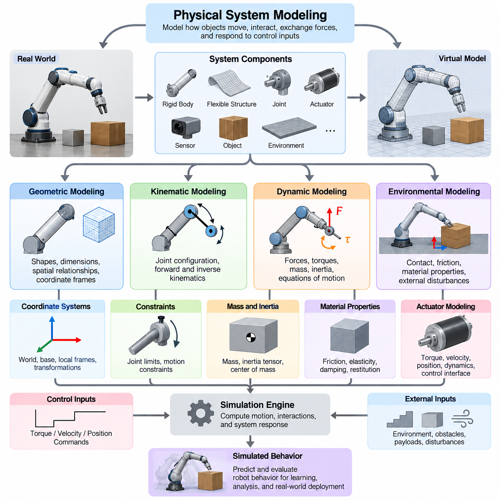{width="7.268055555555556in" height="7.268055555555556in"}

Physical system modeling provides the foundation for constructing virtual representations of robots, machines, and their surrounding environments. In Physical AI, a physical model describes how objects move, interact, exchange forces, and respond to control inputs. By translating real-world mechanisms into mathematical and computational representations, simulation enables intelligent systems to learn and evaluate behaviors before operating in physical environments.

A physical system consists of interconnected components whose behavior follows physical principles. These components may include rigid bodies, flexible structures, joints, actuators, sensors, and environmental objects. Modeling begins by identifying the relevant components, their physical properties, and their interactions. The resulting representation must capture the essential behavior of the system while remaining computationally manageable for simulation and learning.

The first modeling decision concerns the boundary of the system. A robot may be modeled independently, or its representation may include the floor, surrounding obstacles, manipulated objects, and external disturbances. The selected boundary determines which interactions are explicitly simulated and which are treated as external inputs. Appropriate boundary selection prevents unnecessary complexity while preserving the physical relationships required for meaningful analysis.

Physical models are commonly organized into geometric, kinematic, dynamic, and environmental representations. Geometric models describe shapes, dimensions, and spatial relationships. Kinematic models represent motion without directly considering the forces responsible for it. Dynamic models explain motion through forces, torques, masses, and inertial properties. Environmental models describe the physical conditions under which the system operates.

Geometric modeling establishes the spatial structure of a simulated physical system. Robot components are represented using primitive shapes, polygon meshes, or detailed computer-aided design geometry. Each component is associated with a coordinate frame that defines its position and orientation relative to other components. Geometric representations support collision detection, spatial reasoning, visualization, and the computation of physical interactions between objects.

Coordinate systems provide the mathematical framework for expressing physical relationships. A robot typically contains a world coordinate frame, a base frame, and multiple local frames attached to individual links or sensors. Transformations between frames describe relative translations and rotations. Consistent coordinate conventions are essential because incorrect frame definitions can introduce significant errors into motion prediction, sensor interpretation, and control execution.

Kinematic modeling describes how the configuration of a physical system determines its motion. For articulated robots, joint variables define the relative positions of connected links. Forward kinematics computes the pose of a robot component from its joint configuration, while inverse kinematics determines joint configurations that satisfy a desired pose. These relationships are fundamental to manipulation, locomotion, trajectory generation, and coordinated robotic movement.

Dynamic modeling extends kinematic descriptions by incorporating the physical causes of motion. Newtonian mechanics relates forces to linear acceleration, while rotational dynamics relates torques to angular acceleration through inertia. In robotic systems, these relationships are combined into equations describing the evolution of joint positions, velocities, and accelerations. Dynamic models allow simulation engines to predict how robots respond to commands and disturbances.

Mass and inertia are essential parameters in physical system modeling. Mass determines resistance to translational acceleration, while the inertia tensor characterizes resistance to rotational acceleration about different axes. The center of mass influences balance, stability, and the distribution of gravitational effects. Incorrect inertial parameters can produce unrealistic acceleration, unstable locomotion, inaccurate manipulation forces, and significant discrepancies between simulation and reality.

Physical systems also contain constraints that restrict possible motion. Mechanical joints may permit rotation around a single axis, translation along a specified direction, or combinations of permitted movements. Constraint equations describe these relationships mathematically and prevent simulated components from moving in physically inconsistent ways. Accurate constraint modeling is especially important for articulated manipulators, mobile mechanisms, and humanoid robots.

Environmental interaction introduces additional modeling requirements. A robot may contact floors, walls, tools, payloads, or other moving objects. Contact models determine when surfaces interact and how forces arise from penetration prevention, friction, and impact. These interactions strongly influence locomotion, grasping, pushing, and manipulation. Even small inaccuracies in contact modeling can produce substantial differences in observed robot behavior.

Material properties determine how physical objects respond to interaction. Rigid materials may be approximated as nondeformable bodies, while compliant materials require representations of elasticity, damping, or deformation. Friction coefficients influence sliding and traction, and restitution parameters describe energy recovery during collisions. Selecting suitable material models is necessary when simulating robotic grippers, tires, compliant joints, and interactions with delicate objects.

Actuators connect control commands to physical motion. An actuator model translates commanded torque, velocity, position, or electrical input into mechanical output. Real actuators exhibit torque limits, response delays, saturation, friction, and efficiency losses. These characteristics influence achievable acceleration, tracking accuracy, and stability. Including relevant actuator behavior prevents simulation from assuming unrealistically perfect execution of control commands.

Physical system modeling must also account for external forces and disturbances. Gravity acts continuously on physical bodies, while aerodynamic drag, rolling resistance, vibration, and environmental loading may affect specific applications. Mobile robots experience variations in terrain resistance, and aerial robots respond to aerodynamic forces and wind. Disturbance models allow developers to evaluate controller robustness under operating conditions that differ from ideal assumptions.

A complete simulation model requires a representation of system state. State variables typically include positions, orientations, velocities, and other quantities needed to predict future behavior. Control inputs describe externally commanded actions, while model parameters represent physical characteristics such as mass, friction, and actuator properties. The simulation evolves the state over time according to mathematical equations and numerical integration procedures.

Model fidelity determines how closely simulated behavior approximates the real physical system. High-fidelity models may incorporate detailed contact mechanics, flexible-body deformation, thermal effects, and complex actuator dynamics. Simplified models neglect selected phenomena to improve computational efficiency. The appropriate fidelity depends on the intended application, since a navigation simulator and a precision manipulation simulator may require different levels of physical detail.

Computational efficiency is particularly important when physical models support reinforcement learning and large-scale AI training. Thousands of simulated environments may need to execute simultaneously to generate sufficient experience. Detailed models can improve realism but reduce simulation throughput. Effective modeling therefore requires balancing physical accuracy, numerical stability, memory consumption, and execution speed according to the learning or evaluation objective.

Parameter identification connects mathematical models with measurable physical behavior. Parameters such as inertia, joint friction, motor response, and contact stiffness can be estimated from experiments performed on real hardware. Measured trajectories and actuator responses are compared with simulated predictions to identify discrepancies. Repeated parameter adjustment improves agreement between the physical system and its computational representation.

Model validation determines whether a simulation reproduces relevant real-world behavior with acceptable accuracy. Validation experiments may compare joint trajectories, acceleration profiles, energy consumption, contact forces, and task completion outcomes. Testing should cover multiple operating conditions rather than a single nominal configuration. A model that performs accurately in one scenario may still fail when payloads, speeds, surfaces, or disturbances change.

Uncertainty is unavoidable because physical parameters vary and mathematical models cannot represent every real-world phenomenon. Manufacturing tolerances, component wear, temperature changes, and measurement errors introduce differences between nominal and actual behavior. These uncertainties can be represented using parameter ranges or probabilistic distributions. Such representations support sensitivity analysis, robust control development, and more reliable simulation-based learning.

Physical system models also provide a foundation for digital twins and simulation-to-real transfer. A digital twin may combine geometric and dynamic representations with measurements from an operating physical system. Updated parameters and observed states help maintain consistency between virtual and real environments. This connection enables predictive analysis, controller evaluation, fault investigation, and systematic improvement of robotic performance.

Ultimately, physical system modeling transforms the complexity of the real world into structured representations that computational systems can analyze and simulate. Its effectiveness depends not on reproducing every physical detail, but on preserving the mechanisms that determine task-relevant behavior. Accurate, efficient, and validated models form the foundation for physics simulation, scalable Physical AI training, and reliable transfer from virtual experience to real-world operation.

## 01.02. Kinematics Dynamics and State Representation

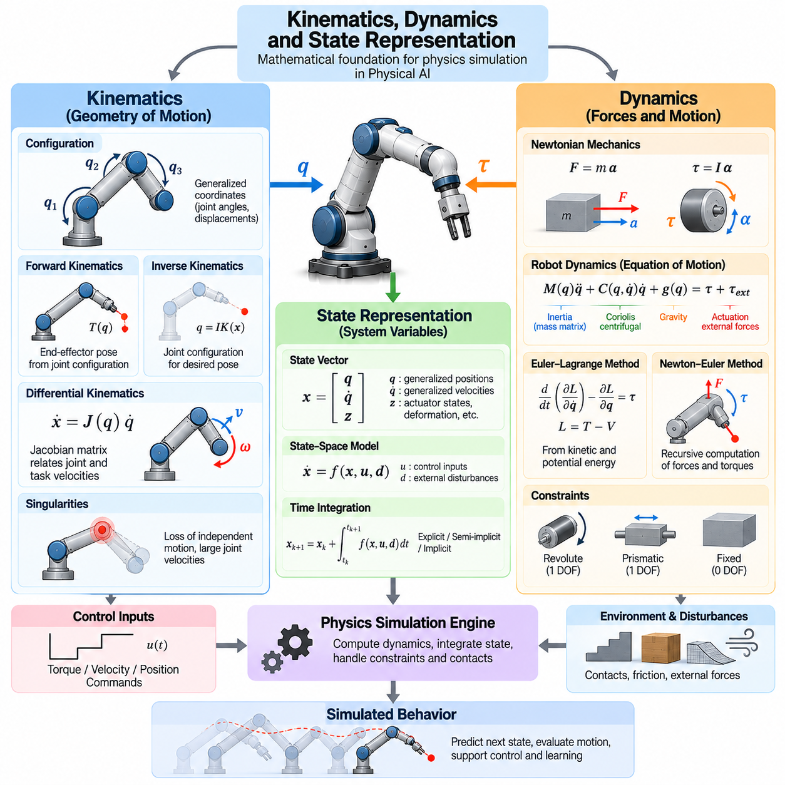{width="7.268055555555556in" height="7.268055555555556in"}

Kinematics, dynamics, and state representation form the mathematical foundation of physics simulation for Physical AI. Kinematics describes how physical systems move, dynamics explains the forces and torques responsible for motion, and state representation organizes the variables required to predict system behavior. Together, these concepts enable simulation engines to reproduce robotic motion, evaluate control strategies, and generate physically meaningful training experiences.

Kinematics focuses on the geometric relationships between moving components without explicitly considering the forces that produce motion. A robot configuration is typically described by generalized coordinates representing joint angles, linear displacements, or body poses. These coordinates determine the spatial arrangement of mechanical components. Kinematic models provide essential information for motion planning, collision avoidance, manipulation, and coordinated movement.

The distinction between configuration and state is fundamental to robotic simulation. Configuration specifies the geometric arrangement of a system at a particular instant, while state includes additional information needed to predict its future evolution. For a mechanical system, state commonly contains generalized positions and velocities. Depending on the application, it may also include actuator states, internal deformation variables, or other dynamic quantities.

Coordinate frames establish consistent references for describing positions and orientations. A world frame provides a global reference, while body and joint frames describe local relationships within the robot. Transformations between frames combine translations and rotations to represent relative poses. Accurate frame management is essential for integrating mechanical models, sensor measurements, motion planning algorithms, and simulated control systems.

Forward kinematics determines the position and orientation of a robot component from its joint configuration. In a serial manipulator, transformations associated with individual joints are combined to calculate the end-effector pose. This relationship enables simulation systems to determine where tools, sensors, and mechanical components are located. Forward kinematics also supports collision checking, workspace analysis, and visualization of articulated motion.

Inverse kinematics addresses the complementary problem of determining joint configurations that achieve a desired end-effector pose. Solutions may be unique, multiple, or unavailable depending on robot geometry and physical constraints. Numerical methods are often required for complex articulated systems. Inverse kinematics supports robotic manipulation, trajectory planning, humanoid positioning, and coordinated whole-body movement within simulated environments.

Differential kinematics describes how joint velocities relate to the linear and angular velocities of robot components. The Jacobian matrix provides the mathematical mapping between generalized velocities and task-space motion. It also connects external forces and torques through corresponding transpose relationships. Jacobian-based representations are widely used in velocity control, force control, singularity analysis, and optimization-based robotic motion planning.

Kinematic singularities occur when a robot loses the ability to generate independent motion in certain task-space directions. Near a singular configuration, small desired changes in end-effector motion may require excessively large joint velocities. Simulation allows these configurations to be identified before deployment. Singularity-aware planning and control can improve numerical stability, motion feasibility, and operational safety.

Dynamics extends kinematic descriptions by introducing the physical mechanisms that generate motion. Newton\'s laws relate forces to translational acceleration, while rotational dynamics connects applied torques with angular acceleration and inertia. For articulated robots, dynamic equations combine inertial, gravitational, velocity-dependent, and externally applied effects. These relationships determine how a simulated robot accelerates and responds to control commands.

Robot dynamics is commonly expressed using generalized coordinates and equations of motion. The mass matrix describes configuration-dependent inertia, while velocity-dependent terms capture Coriolis and centrifugal effects. Gravitational terms represent forces associated with body weight, and generalized inputs represent actuator torques or forces. Such formulations provide a systematic basis for predicting motion and designing model-based controllers.

The Euler--Lagrange formulation derives equations of motion from kinetic and potential energy. Generalized coordinates describe the system configuration, and energy relationships determine its dynamic evolution. This approach is particularly useful for interconnected mechanical systems with multiple joints. It provides a structured method for deriving robot dynamics while accommodating constraints and complex mechanical relationships.

Newton--Euler methods offer another approach to dynamic modeling by directly applying force and moment balance to individual bodies. Recursive algorithms efficiently propagate velocities, accelerations, forces, and torques through articulated structures. These methods are especially valuable for computationally demanding robotics applications. Their efficiency supports real-time control, inverse dynamics calculations, and large-scale simulation.

State-space representation provides a unified framework for describing dynamic systems. A state vector contains the variables required to determine future evolution when control inputs and external influences are known. The governing model expresses the time derivative of the state as a function of the current state, control inputs, and relevant parameters. This representation connects physical simulation with estimation, control theory, and reinforcement learning.

The choice of state variables depends on the physical system and simulation objective. A mobile robot may require planar position, heading, linear velocity, and angular velocity. A manipulator typically uses joint positions and velocities, while an aerial robot requires three-dimensional position, orientation, and translational and rotational velocities. More detailed models may include motor currents, battery states, flexible-body deformation, or thermal variables.

Orientation representation requires special attention because three-dimensional rotation cannot be described globally by a nonsingular set of three independent coordinates. Euler angles provide an intuitive representation but contain singularities. Rotation matrices avoid local parameterization singularities but require orthogonality constraints. Unit quaternions offer a compact alternative with normalization requirements and are widely used in robotic simulation and state estimation.

Physical simulators evolve continuous-time dynamics through discrete numerical updates. At each simulation step, the engine evaluates forces, accelerations, constraints, and control inputs before updating the system state. Integration methods approximate the resulting motion over a finite time interval. The selected integration method and time step influence numerical accuracy, computational cost, and stability, particularly during rapid motion or contact events.

State estimation becomes necessary when the true physical state cannot be measured directly. Sensors provide partial and noisy observations of position, velocity, orientation, and other quantities. Estimation algorithms combine measurements with dynamic predictions to reconstruct the underlying state. Simulated sensors and estimators enable developers to evaluate how uncertainty, measurement delays, and incomplete observations influence robotic control performance.

The distinction between state and observation is particularly important in Physical AI learning environments. A simulator may internally maintain complete physical state information, while a robot policy receives only camera images, proprioceptive measurements, or selected sensor signals. Training with unrealistic access to hidden state variables can produce policies that fail during real-world deployment. Observation design must therefore reflect the intended sensing capabilities.

Hybrid dynamic systems combine continuous physical evolution with discrete changes in operating conditions. Walking robots alternate between contact and flight phases, manipulators transition between free motion and object contact, and mobile robots may switch between traction and slipping. Each operating mode can follow different dynamic relationships. Accurate simulation requires consistent handling of these transitions and their associated state changes.

Kinematic and dynamic constraints must remain consistent throughout simulation. Joint limits restrict allowable configurations, velocity limits constrain motion rates, and actuator limits determine achievable forces or torques. Contact constraints introduce additional restrictions when objects interact. Violating these relationships can create physically impossible trajectories, numerical instability, or unrealistic learning experiences. Constraint-aware modeling preserves mechanical feasibility.

State representation also influences computational efficiency and learning performance. Excessively detailed states increase memory requirements and processing costs, while insufficient representations omit information needed for accurate prediction. Effective state design preserves the variables relevant to system evolution and task objectives. Structured representations can support scalable parallel simulation, efficient policy learning, and meaningful comparisons between simulated and real behavior.

Ultimately, kinematics, dynamics, and state representation provide complementary descriptions of physical behavior. Kinematics establishes the geometry of motion, dynamics explains its physical causes, and state representation organizes the information needed for prediction and control. Their consistent integration enables reliable physics simulation and supports the development of Physical AI systems capable of transferring learned behavior into complex real-world environments.

## 01.03. Rigid Body and Multibody Dynamics

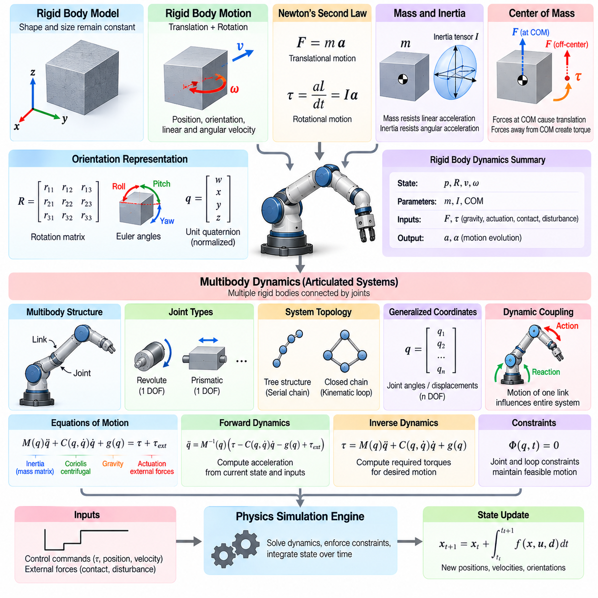{width="7.268055555555556in" height="7.268055555555556in"}

Rigid body dynamics provides a fundamental framework for describing the motion of physical objects under applied forces and torques. In physics simulation for Physical AI, a rigid body is an idealized object whose shape and dimensions remain unchanged during motion. This assumption simplifies mechanical analysis while preserving essential translational and rotational behavior, making rigid body models suitable for robots, vehicles, tools, and many environmental objects.

A rigid body\'s motion consists of translation and rotation. Translational motion describes the displacement of its center of mass, while rotational motion describes changes in orientation around that center. Together, these motions determine the body\'s position and orientation in three-dimensional space. Physics engines represent this behavior using position, orientation, linear velocity, and angular velocity, enabling continuous prediction of physical movement.

Newton\'s second law establishes the relationship between applied force, mass, and translational acceleration. The net external force acting on a rigid body determines the acceleration of its center of mass. Rotational motion follows corresponding angular momentum principles, where applied torque changes angular momentum. These relationships form the foundation of rigid body simulation and enable realistic responses to gravity, actuation, contact forces, and disturbances.

Mass and inertia characterize how rigid bodies resist changes in motion. Mass determines resistance to linear acceleration, while the inertia tensor describes resistance to angular acceleration about different directions. The inertia tensor depends on the body\'s geometry and mass distribution. Accurate inertial properties are essential for reproducing realistic acceleration, rotational response, balance, and energy transfer in robotic systems.

The center of mass serves as a reference point for analyzing rigid body motion. Forces applied through this point produce translational acceleration without directly generating torque about the center of mass. Forces applied away from it create moments that influence rotation. In robotic manipulation and locomotion, center-of-mass location strongly affects stability, load distribution, and the ability to maintain balance under changing external conditions.

Rigid body orientation can be represented using rotation matrices, Euler angles, or unit quaternions. Rotation matrices provide direct transformations between coordinate frames, while quaternions offer compact representations suitable for numerical integration. Orientation must evolve consistently with angular velocity during simulation. Appropriate representation and normalization prevent numerical errors that could otherwise distort rotational motion over extended simulation periods.

Multibody dynamics extends rigid body principles to systems containing multiple interconnected bodies. Robots commonly consist of links connected through joints that constrain relative motion. These connections form articulated mechanical structures whose components influence one another dynamically. Multibody models are essential for robotic manipulators, humanoids, quadrupeds, mobile robots with suspension systems, and other mechanisms involving coordinated movement.

A multibody system can be represented as a collection of rigid links and mechanical joints. Each link has geometric and inertial properties, while joints define permitted relative motion. Revolute joints allow rotation around specified axes, and prismatic joints permit translation along defined directions. More complex connections may provide multiple degrees of freedom. The resulting structure determines the system\'s mobility and dynamic behavior.

The topology of a multibody system describes how its components are connected. Tree-structured mechanisms contain branches without closed kinematic loops, while closed-chain mechanisms include interconnected paths that impose additional constraints. Tree structures are common in manipulators and humanoid models, whereas closed chains appear in parallel robots and certain suspension mechanisms. Topology influences equation formulation, computational complexity, and solver selection.

Generalized coordinates provide a compact representation of multibody configuration. Instead of independently describing every rigid body\'s position and orientation, the model uses variables corresponding to the system\'s independent degrees of freedom. Joint angles and displacements determine the relative configurations of connected links. This representation reduces redundant variables and supports efficient computation of articulated motion.

The equations of multibody motion describe the combined effects of inertia, velocity-dependent forces, gravity, actuation, and external interactions. The mass matrix represents coupled inertial behavior, while Coriolis and centrifugal terms capture effects associated with motion. Gravity contributes configuration-dependent forces, and actuator inputs generate commanded movement. These equations allow simulation engines to predict how interconnected robot components accelerate together.

Dynamic coupling is a defining characteristic of articulated systems. Motion or acceleration of one link can influence forces and motion throughout the mechanism. For example, accelerating a manipulator arm may generate reaction forces at its base, while moving a humanoid arm can affect whole-body balance. Accurate multibody dynamics captures these interactions and supports coordinated control strategies that consider the entire mechanical structure.

Forward dynamics determines system acceleration from the current configuration, velocity, applied forces, and actuator commands. Simulation engines use forward dynamics to predict the next physical state. Inverse dynamics addresses the complementary problem of calculating the forces or torques required to produce specified accelerations. Both formulations are important for robotic control, trajectory tracking, motion optimization, and physically consistent simulation.

Recursive Newton--Euler algorithms provide efficient methods for calculating articulated-body forces and torques. These algorithms propagate motion information through a kinematic structure and accumulate forces in the reverse direction. Their computational efficiency makes them suitable for real-time robotic applications. Related articulated-body algorithms support forward dynamics without explicitly constructing and inverting a full system mass matrix.

Joint constraints determine how forces and motion propagate between connected bodies. Ideal joints restrict selected relative movements while allowing specified degrees of freedom. Constraint forces maintain these relationships during simulation and may be calculated using specialized numerical solvers. Joint limits introduce additional restrictions that prevent configurations outside mechanical operating ranges. Accurate constraint enforcement is necessary for stable articulated motion.

External forces introduce interactions between multibody systems and their environments. Gravity acts on individual links, while contact forces arise when robot components touch surfaces or objects. Friction, impact, and external loads influence the resulting motion. During walking or manipulation, changing contact conditions can alter the effective dynamic constraints, requiring simulation engines to update interaction relationships as physical events occur.

Floating-base dynamics is particularly important for mobile and legged robots. Unlike fixed-base manipulators, these systems have bodies whose positions and orientations are not permanently constrained to the environment. A humanoid or quadruped may move its base freely while establishing temporary contacts through its feet. Floating-base models combine base motion with joint dynamics to represent whole-body behavior and environmental interactions.

Contact-rich multibody simulation presents significant numerical challenges. Multiple simultaneous contacts can create tightly coupled constraints, especially when friction and impact are involved. Small integration errors may produce unrealistic penetration, oscillation, or instability. Physics engines address these challenges using contact solvers, constraint stabilization, and carefully selected integration methods. Solver accuracy must be balanced against computational performance.

Energy and momentum principles provide valuable tools for evaluating dynamic consistency. In the absence of external work and dissipative effects, an isolated mechanical system should conserve appropriate energy and momentum quantities. Friction and damping dissipate mechanical energy, while actuators can add or remove energy through work. Monitoring these relationships helps identify modeling errors, unstable numerical integration, and unrealistic physical behavior.

Model fidelity depends on the assumptions used to represent mechanical components. Rigid body models neglect structural deformation, making them efficient but potentially insufficient for soft materials, flexible links, or highly compliant mechanisms. Additional models may introduce elasticity, damping, or flexible-body effects when required. Selecting the appropriate abstraction depends on the robot\'s physical characteristics and the accuracy demanded by its intended tasks.

Rigid body and multibody dynamics are central to simulation-based learning and Sim2Real transfer. Accurate representations of inertia, joint coupling, contact behavior, and actuation enable policies to learn physically feasible actions. However, discrepancies in physical parameters or solver behavior can cause learned policies to perform differently on real hardware. Calibration, validation, and uncertainty-aware training help reduce these differences and improve transfer reliability.

Ultimately, rigid body dynamics describes the motion of individual mechanical objects, while multibody dynamics explains the coordinated behavior of interconnected structures. Their integration provides the computational foundation for simulating robotic manipulation, locomotion, balance, and physical interaction. Reliable models enable Physical AI systems to explore complex behaviors in simulation while developing the physical consistency required for successful real-world operation.

## 01.04. Constraint and Joint Modeling

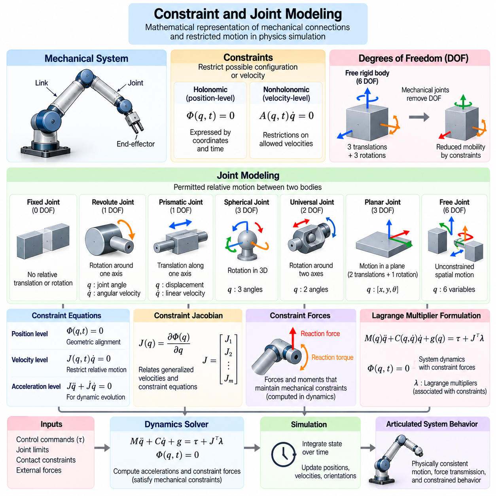{width="7.268055555555556in" height="7.268055555555556in"}

Constraint and joint modeling provides the mathematical foundation for representing mechanical connections and restricted motion in physics simulation. In Physical AI, robots consist of interconnected bodies whose relative movements are governed by joints, structural limitations, and environmental interactions. Accurate constraint models ensure that simulated mechanisms behave consistently with their physical designs while supporting realistic motion, force transmission, and control.

A constraint defines a mathematical relationship that restricts the possible configurations or velocities of a mechanical system. Without constraints, individual rigid bodies can translate and rotate independently in three-dimensional space. Mechanical connections reduce these freedoms by enforcing specific geometric or motion relationships. Constraint modeling allows simulation engines to represent articulated structures without treating every component as an unconstrained object.

Constraints are commonly classified as holonomic and nonholonomic relationships. Holonomic constraints can be expressed as equations involving generalized coordinates and possibly time. Nonholonomic constraints typically impose restrictions on allowable velocities that cannot be reduced to equivalent position-only relationships. This distinction is important for modeling articulated mechanisms, wheeled vehicles, rolling contacts, and other systems with restricted mobility.

Joint modeling translates physical mechanical connections into computational representations. A joint specifies the permitted relative motion between two connected bodies and determines which movements must be restricted. The joint definition typically includes attachment frames, motion axes, coordinate conventions, and allowable degrees of freedom. Correct joint configuration is essential for reproducing realistic robot geometry, mechanical behavior, and actuator interactions.

A fixed joint prevents relative translation and rotation between connected bodies. It is commonly used to represent rigidly attached components such as structural brackets, sensor mounts, and permanently assembled mechanisms. Although the connected bodies may be represented separately for geometric or organizational purposes, the fixed joint requires them to maintain a constant relative transformation throughout simulation.

A revolute joint permits rotation around a specified axis while restricting the remaining relative degrees of freedom. Revolute joints are fundamental to robotic manipulators, humanoid limbs, steering mechanisms, and articulated mobile robots. Their state is commonly represented by joint angle and angular velocity. Realistic revolute joint models may also incorporate angular limits, friction, damping, compliance, and actuator-generated torque.

A prismatic joint allows translation along a defined axis while preventing other relative movements. Such joints appear in linear actuators, telescoping mechanisms, lifting systems, and robotic positioning stages. The joint state is represented by displacement and linear velocity. Accurate prismatic joint simulation requires appropriate travel limits, force constraints, friction characteristics, and alignment between the permitted translation axis and connected bodies.

More complex joints provide additional degrees of freedom. Spherical joints permit three-dimensional rotation, while universal joints allow rotation around two intersecting axes. Planar joints permit motion within a plane, and free joints allow unrestricted spatial movement. These joint types support the modeling of robotic shoulders, mechanical couplings, mobile bases, and floating-body systems requiring multiple independent motion coordinates.

Degrees of freedom determine the number of independent variables required to describe a mechanical system\'s configuration. A free rigid body in three-dimensional space has six degrees of freedom, consisting of three translations and three rotations. Mechanical joints remove selected freedoms through constraints. Determining the independent degrees of freedom is essential for selecting generalized coordinates and constructing efficient multibody dynamic models.

Constraint equations establish the relationships that connected bodies must satisfy. Position-level constraints enforce geometric alignment, while velocity-level constraints restrict relative motion rates. Acceleration-level relationships describe how these restrictions influence dynamic evolution. Simulation engines use these equations to calculate admissible motion and the forces necessary to maintain mechanical connections during operation.

Constraint Jacobians provide a mathematical connection between generalized velocities and constraint equations. They describe how changes in system motion affect constraint satisfaction. In constrained dynamics, Jacobian matrices are used to compute reaction forces and formulate coupled equations of motion. Their structure strongly influences solver efficiency, numerical conditioning, and the stability of complex articulated mechanisms.

Constraint forces arise when mechanical connections prevent otherwise possible motion. A revolute joint, for example, transmits forces and selected moments while permitting rotation around its designated axis. These reaction forces maintain the required relationship between connected bodies. Constraint forces are generally determined as part of the dynamic solution rather than prescribed independently, allowing the simulation to satisfy mechanical restrictions.

Lagrange multipliers provide a systematic method for incorporating constraints into equations of motion. Each multiplier is associated with a constraint and contributes generalized forces through the constraint Jacobian. The resulting formulation couples system acceleration with constraint enforcement. This approach is widely used in multibody dynamics because it provides a mathematically consistent representation of joint reactions and constrained motion.

Joint limits represent physical boundaries on allowable movement. Rotational joints may have minimum and maximum angles, while prismatic joints have finite travel distances. When a joint approaches its limit, the simulation must prevent prohibited motion and calculate the corresponding reaction. Joint limits may be implemented using hard constraints, compliant stops, or penalty-based forces, depending on the desired physical fidelity.

Mechanical joints often exhibit friction, damping, and compliance that influence their dynamic behavior. Joint friction resists relative movement, damping dissipates energy according to motion, and compliance permits limited elastic deformation. These effects may arise from bearings, seals, structural flexibility, and transmission mechanisms. Including appropriate joint properties improves the realism of simulated motion and the accuracy of controller evaluation.

Actuated joints combine mechanical constraints with externally generated forces or torques. A motor may command joint position, velocity, or torque, but its achievable response depends on actuator characteristics and physical limitations. Simulation models must distinguish between the joint\'s permitted motion and the actuator\'s ability to produce that motion. This separation is important for realistic motor control, trajectory tracking, and dynamic interaction.

Closed-chain mechanisms introduce additional modeling challenges because multiple connected paths constrain the same mechanical structure. Parallel robots, four-bar linkages, and certain suspension systems contain such relationships. Their constraints must remain mutually consistent throughout motion. Redundant or incompatible equations can produce numerical difficulties, requiring careful coordinate selection, constraint reduction, or specialized solution methods.

Contact constraints differ from permanent joint constraints because they become active only when objects interact. A robot foot touching the ground may temporarily restrict motion, while lifting the foot removes those restrictions. Contact constraints often include unilateral conditions that prevent penetration without requiring surfaces to remain connected. Friction introduces additional restrictions on tangential forces and possible sliding behavior.

Constraint enforcement is a central responsibility of physics solvers. Numerical methods may solve coupled equations directly, apply iterative corrections, or use impulse-based formulations. Common approaches include projected iterative methods, sequential impulses, and complementarity-based formulations. Solver selection depends on system size, contact complexity, computational resources, and the accuracy required for simulation.

Numerical integration can introduce constraint drift, where connected bodies gradually violate their intended geometric relationships. Even small errors may accumulate during long simulations or under high loads. Constraint stabilization methods introduce corrective terms or projection procedures to restore consistency. Appropriate solver tolerances and integration time steps are necessary to control drift without creating excessive artificial stiffness or instability.

Constraint modeling also affects simulation scalability and computational performance. Highly constrained mechanisms require additional equations and solver iterations, increasing computational cost. Redundant constraints may create ill-conditioned systems that are difficult to solve efficiently. Reduced-coordinate formulations can eliminate some explicit constraints, while maximal-coordinate approaches offer flexibility for complex contact interactions. Selecting an appropriate formulation is important for large-scale Physical AI training.

Accurate joint and constraint models are essential for successful Sim2Real transfer. Incorrect joint axes, unrealistic limits, excessive stiffness, or missing friction can cause simulated robots to behave differently from physical hardware. Calibration using measured joint motion, actuator response, and reaction forces helps identify these discrepancies. Validation across multiple operating conditions improves confidence that learned control policies will remain effective after deployment.

Ultimately, constraint and joint modeling transforms collections of independent rigid bodies into mechanically meaningful robotic systems. Constraints define allowable relationships, joints establish structured motion, and numerical solvers maintain these relationships during dynamic simulation. Their consistent integration enables reliable modeling of manipulators, mobile robots, humanoids, and complex mechanisms while providing a foundation for physically realistic learning and control.

## 01.05. Collision Detection and Response

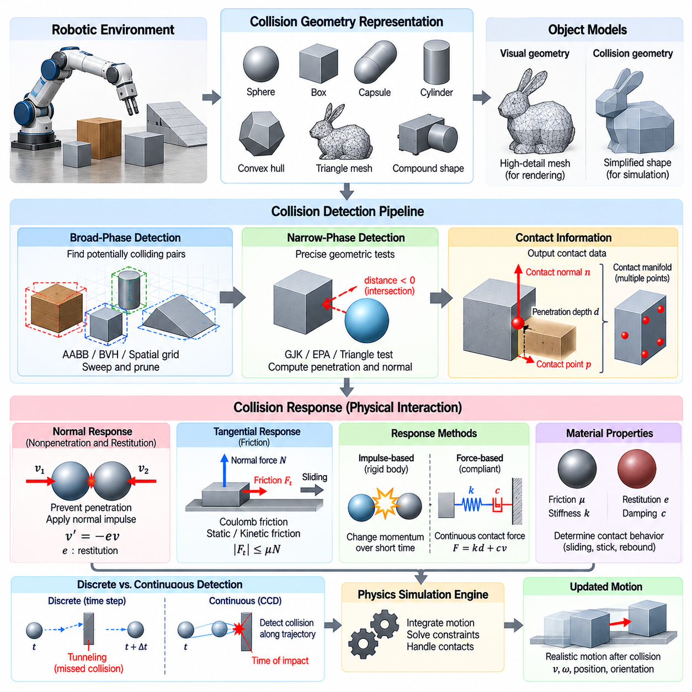{width="7.268055555555556in" height="7.268055555555556in"}

Collision detection and response are fundamental components of physics simulation that determine when physical objects interact and how their motion changes after contact. In Physical AI, robots operate in environments containing obstacles, surfaces, tools, and moving objects. Accurate collision modeling enables simulation engines to reproduce physical interactions, prevent unrealistic penetration, and support reliable training of perception, planning, and control systems.

Collision detection identifies whether geometric objects overlap or are approaching contact. Collision response determines the forces, impulses, or positional corrections required to resolve the interaction. Although these processes are closely related, they serve different computational purposes. Detection establishes the geometric conditions of contact, while response applies physical principles to determine the resulting changes in motion and momentum.

The geometric representation of objects strongly influences collision detection accuracy and computational cost. Simple primitives such as spheres, boxes, capsules, and cylinders allow efficient intersection tests. Complex objects may require convex hulls, triangle meshes, or compound collision shapes. Simulation engines often use simplified collision geometry independently of visual geometry to preserve computational efficiency without losing essential physical interactions.

Collision detection commonly uses a hierarchical process consisting of broad-phase and narrow-phase analysis. Broad-phase detection identifies potentially interacting object pairs using inexpensive spatial tests. Narrow-phase detection performs more detailed geometric calculations on the selected pairs. This separation reduces unnecessary computation and enables simulation engines to handle large environments containing many moving bodies and static obstacles.

Broad-phase collision detection relies on spatial organization techniques that quickly eliminate distant object pairs. Axis-aligned bounding boxes, bounding volume hierarchies, spatial grids, and sweep-and-prune algorithms are widely used. These methods exploit geometric proximity and spatial coherence between simulation steps. Efficient broad-phase algorithms are particularly important for large robotic environments and massively parallel simulation.

Narrow-phase collision detection determines whether candidate objects actually intersect and calculates relevant contact information. Depending on the geometry, algorithms may compute separation distance, penetration depth, contact normals, and contact points. Convex collision detection frequently uses methods such as the Gilbert--Johnson--Keerthi algorithm. Additional procedures can estimate penetration geometry when intersecting convex shapes must be resolved.

Contact geometry provides the information required for physically meaningful collision response. A contact point identifies the location of interaction, while the contact normal defines the direction along which objects resist penetration. Penetration depth measures the extent of geometric overlap. Multiple contact points may form a contact manifold that approximates the interaction between extended surfaces and supports stable force distribution.

Discrete collision detection evaluates object configurations at selected simulation time steps. This approach is computationally efficient but may miss collisions when fast-moving objects pass through thin obstacles between updates. The resulting phenomenon is known as tunneling. Reducing the simulation time step can mitigate this problem, but it increases computational cost and does not always provide a complete solution.

Continuous collision detection addresses tunneling by considering motion over a time interval rather than evaluating only isolated configurations. It estimates whether objects collide along their trajectories and may calculate the time of impact. This approach is valuable for rapidly moving robotic components, projectiles, and high-speed manipulation. However, continuous detection introduces additional geometric computation and may require conservative approximations.

Collision response translates detected contact conditions into changes in physical motion. When two rigid bodies collide, their relative velocity and effective mass determine how impulses influence their subsequent movement. Collision solvers calculate impulses or contact forces that prevent further penetration and satisfy appropriate momentum relationships. The resulting response depends on mass distribution, inertia, contact geometry, and material properties.

Normal contact response primarily addresses motion perpendicular to the contacting surfaces. A nonpenetration condition prevents bodies from moving into one another, while contact impulses modify relative normal velocity. Restitution determines the degree of rebound during impact. A perfectly inelastic normal collision has no separating rebound velocity, whereas an ideal elastic collision preserves kinetic energy under appropriate assumptions.

Tangential collision response models frictional interaction along contacting surfaces. Friction opposes relative sliding and influences traction, grasp stability, and object manipulation. Coulomb friction models commonly distinguish static and kinetic friction, although numerical implementations may approximate their behavior. Accurate tangential response is essential for mobile robots, legged locomotion, robotic gripping, and contact-rich manipulation tasks.

Collision response may be formulated using forces or impulses. Force-based approaches calculate contact forces over time, often using compliant contact models with stiffness and damping. Impulse-based approaches apply momentum changes over short intervals and are common in rigid-body simulation. Each formulation involves tradeoffs between numerical stability, physical realism, and computational efficiency, particularly during simultaneous contacts.

Penalty-based collision response allows limited penetration and generates restoring forces proportional to penetration depth or related deformation measures. Damping terms may reduce oscillation and dissipate energy during contact. This approach is relatively straightforward and can approximate compliant interactions. However, excessive stiffness may require small integration steps, while insufficient stiffness can produce unrealistic penetration.

Constraint-based collision response treats nonpenetration as a mathematical restriction on allowable motion. Contact solvers determine forces or impulses that satisfy these restrictions while respecting friction and other dynamic relationships. Complementarity formulations represent the condition that separating objects exert no compressive contact force. Such methods provide a structured framework for rigid contact but can become computationally demanding in complex environments.

Multiple simultaneous collisions introduce coupling between contact constraints. A robot standing on several contact points or manipulating an object with multiple fingers requires consistent distribution of reaction forces. Solving each contact independently may produce unrealistic motion or instability. Iterative methods, sequential impulses, and projected solvers approximate coupled contact behavior while balancing accuracy and computational cost.

Collision filtering improves simulation efficiency by excluding object pairs that should not interact. Robots may contain adjacent links whose collision geometry overlaps by design, while sensors or decorative components may not require physical contact processing. Collision groups, masks, and explicit exclusion rules define which interactions are evaluated. Appropriate filtering prevents unnecessary computation and avoids unintended forces within articulated mechanisms.

Self-collision detection identifies contact between components belonging to the same robot. It is important for manipulators, humanoids, and other articulated systems with large workspaces. Self-collision constraints prevent mechanically impossible configurations and reduce the risk of physical damage. However, collision filtering must distinguish meaningful self-contact from neighboring links that are intentionally connected or permitted to remain close.

Collision modeling becomes especially challenging when objects have complex geometry or deformable surfaces. Triangle meshes can represent detailed environments but may require substantial computation for contact queries. Convex decomposition and simplified collision proxies offer practical alternatives. Deformable objects introduce additional requirements because their shapes change under applied forces, making contact detection and response dependent on evolving geometry.

Numerical stability is a major consideration in collision response. Large penetration depths, inconsistent contact normals, excessive restitution, or poorly selected solver parameters can generate oscillation and artificial energy. Contact stabilization, warm starting, adaptive stepping, and appropriate solver tolerances can improve behavior. Validation should examine both physical accuracy and stability across different velocities, loads, and contact configurations.

Collision detection and response directly influence simulation-based learning and Sim2Real transfer. Policies trained with unrealistic contact behavior may exploit numerical artifacts or learn actions that fail on physical hardware. Accurate collision geometry, friction parameters, restitution, and solver settings reduce these risks. Comparing simulated and measured contact outcomes helps identify discrepancies and improve the reliability of transferred robotic behaviors.

Ultimately, collision detection determines when and where physical objects interact, while collision response determines how those interactions alter motion. Their integration enables physics engines to reproduce contact-rich robotic behavior, including navigation, locomotion, grasping, and manipulation. Reliable collision modeling provides a critical foundation for physically consistent simulation, scalable Physical AI training, and safe real-world robotic operation.

## 01.06. Contact Friction and Restitution

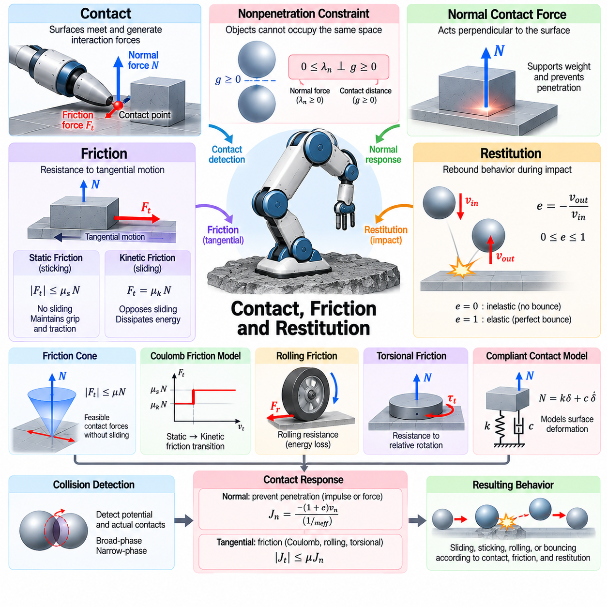{width="7.268055555555556in" height="7.268055555555556in"}

Contact, friction, and restitution are fundamental physical phenomena that determine how objects interact when their surfaces meet. In Physical AI simulation, these mechanisms govern whether a robot maintains stable contact, slides across a surface, or rebounds after impact. Accurate modeling is essential for robotic locomotion, grasping, manipulation, and navigation because small errors in contact behavior can produce significant differences between simulated and real-world performance.

Contact occurs when the surfaces of two physical bodies reach a common boundary and begin transmitting interaction forces. In rigid body simulation, contact is typically represented through geometric contact points, surface normals, and relative velocities. Although real materials deform microscopically during interaction, rigid body models approximate these effects using contact constraints, impulses, or compliant force relationships.

Normal contact forces act perpendicular to the interacting surfaces and prevent objects from penetrating one another. Their magnitude depends on external loading, dynamic acceleration, and the surrounding mechanical constraints. A robot standing on the ground experiences normal forces that support its weight, while a manipulator pressing against an object generates contact forces determined by its commanded motion and mechanical configuration.

The nonpenetration principle establishes that solid objects cannot occupy the same physical space under ideal rigid body assumptions. Numerical simulation represents this condition through unilateral constraints that permit separation but resist compression. Contact forces become active when surfaces interact and disappear when separation occurs. This behavior is commonly expressed through complementarity conditions connecting contact distance and normal force.

Friction describes resistance to relative tangential motion between contacting surfaces. It enables wheeled robots to generate traction, legged robots to maintain stable footholds, and robotic grippers to hold objects securely. Without friction, many common robotic actions would become physically impossible. Friction behavior depends on surface materials, normal loading, relative motion, contamination, and environmental conditions.

Static friction prevents relative sliding when tangential forces remain within the available friction limit. In a simplified Coulomb model, the maximum static friction force is proportional to the normal contact force. This relationship defines a range of forces that can be supported without slipping. Static friction is particularly important for maintaining robot balance, preventing wheel slip, and stabilizing grasped objects.

Kinetic friction acts when contacting surfaces slide relative to one another. Its magnitude is commonly approximated using a kinetic friction coefficient multiplied by the normal force. Unlike static friction, kinetic friction generally opposes ongoing sliding motion and dissipates mechanical energy. Real surfaces may exhibit velocity-dependent friction, making constant-coefficient models insufficient for precision robotic applications.

The Coulomb friction model provides a widely used approximation for contact behavior in rigid body dynamics. It distinguishes sticking and sliding states through friction limits associated with normal force. Although computationally convenient, this model neglects several effects observed in real materials, including surface adhesion, microscopic deformation, temperature dependence, and variations in friction with sliding velocity.

A friction cone describes the range of tangential contact forces that can be supported without sliding. Its orientation follows the contact normal, while its opening depends on the friction coefficient. Forces inside the cone correspond to feasible sticking conditions, whereas forces beyond the boundary require sliding or changes in contact loading. Friction cones are central to robotic grasp analysis, locomotion planning, and contact force optimization.

Rolling friction and rolling resistance influence the motion of wheels, rollers, and spherical objects. Even when ideal rolling occurs without gross sliding, energy losses arise from material deformation, internal damping, and surface interactions. These losses create resistance to rolling motion. Accurate rolling resistance models are important for estimating mobile robot energy consumption, required drive torque, and low-speed movement behavior.

Torsional friction describes resistance to relative rotation around the contact normal. It becomes important when objects twist against supporting surfaces or when robotic fingers apply rotational moments during grasping. Simplified point-contact models may omit torsional effects, while extended contact models can represent them explicitly. Including torsional friction improves predictions of grasp stability and rotational object manipulation.

Restitution characterizes the rebound behavior of objects during impact. The coefficient of restitution relates relative normal velocities before and after collision under specified impact conditions. A coefficient near zero represents highly inelastic impact, while a value near one indicates nearly elastic rebound. Real restitution depends on materials, impact velocity, contact geometry, and energy dissipation during deformation.

Impact dynamics differs from sustained contact because collision forces may act over very short intervals. Impulse-based models represent these interactions through changes in momentum rather than resolving every detail of the force history. Contact impulses depend on relative velocity, effective mass, restitution, and active constraints. These formulations enable efficient simulation of collisions involving rigid robotic components and environmental objects.

Compliant contact models represent surface deformation through stiffness and damping relationships. Spring-damper formulations generate restoring forces from penetration depth and relative normal velocity. More advanced nonlinear contact models account for geometry-dependent deformation and material behavior. Such approaches are useful when modeling soft surfaces, robotic fingertips, compliant feet, or interactions where deformation significantly influences force transmission.

Contact damping represents energy dissipation associated with deformation and relative motion during interaction. It reduces oscillations and influences settling behavior after impact. Excessive damping can suppress realistic rebound, while insufficient damping may produce prolonged vibration. Selecting damping parameters requires consideration of material properties, numerical integration stability, and the physical time scales of contact events.

Stick-slip transitions occur when contact behavior alternates between static adhesion and sliding. These transitions can produce discontinuous motion, vibration, and control difficulties. Precision manipulators, robotic grippers, and slow-moving mechanisms may exhibit stick-slip effects that influence positioning accuracy. Advanced friction models may include velocity-dependent behavior, presliding displacement, or hysteresis to reproduce these phenomena.

Contact behavior is strongly coupled with robot dynamics and control. A legged robot must regulate ground reaction forces to maintain balance, while a wheeled robot must limit drive torque to avoid excessive slip. Manipulators must coordinate normal and tangential forces to maintain stable grasps. Contact-aware control strategies therefore incorporate friction limits, contact states, and force constraints into motion planning and feedback control.

Numerical contact solvers must handle multiple simultaneous interactions while maintaining stability and computational efficiency. Contact constraints can become strongly coupled when a robot stands on several feet or manipulates an object through multiple contact points. Iterative solvers approximate consistent force distributions, while complementarity-based methods enforce contact conditions mathematically. Solver settings influence penetration, friction accuracy, and convergence.

Material parameter calibration is essential for realistic contact simulation. Friction coefficients, restitution, stiffness, and damping can be estimated through controlled experiments involving sliding, impact, compression, and rolling. Measurements should reflect relevant surfaces, loads, and operating velocities. Parameter identification reduces discrepancies between simulation predictions and observed physical behavior, improving model reliability.

Contact models often contain uncertainty because surface properties change with wear, temperature, moisture, contamination, and manufacturing variation. A friction coefficient measured under one condition may not remain valid during deployment. Domain randomization can expose learning systems to plausible variations in contact parameters. Robust policies should maintain acceptable performance across these variations rather than depending on one idealized contact configuration.

Contact, friction, and restitution directly influence Sim2Real transfer in Physical AI. Unrealistic friction can produce unstable walking or inaccurate grasping, while incorrect restitution can distort collision recovery and object manipulation. Simulation validation should compare measured and predicted contact forces, slip behavior, rebound velocities, and energy losses. These comparisons help identify model limitations and guide improvements in physical parameter estimation.

Ultimately, contact determines when objects exchange forces, friction governs resistance to tangential motion, and restitution describes energy recovery during impact. Their combined behavior establishes the physical foundation for stable locomotion, reliable manipulation, and realistic environmental interaction. Accurate and computationally efficient models enable Physical AI systems to learn contact-rich behaviors in simulation and transfer them more reliably to physical robots.

## 01.07. Compliance Elasticity and Damping

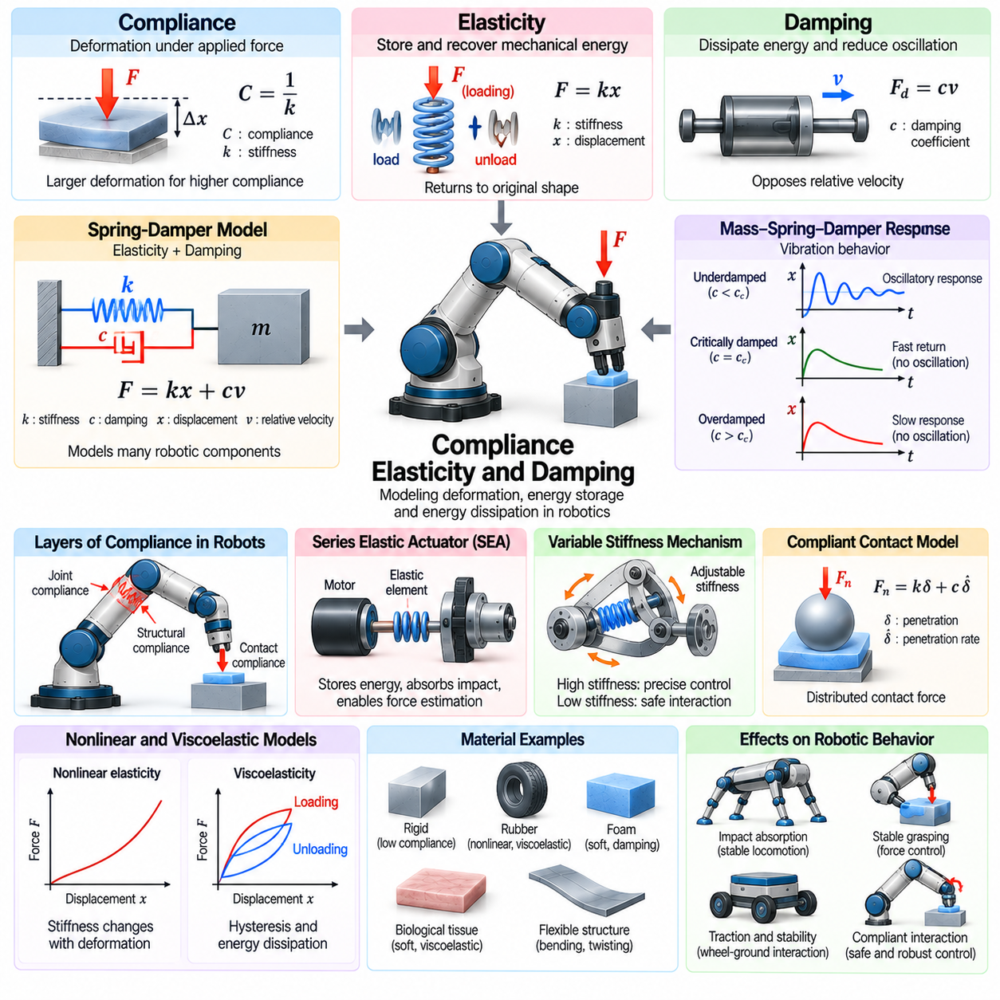{width="7.268055555555556in" height="7.268055555555556in"}

Compliance, elasticity, and damping describe how mechanical systems deform, store energy, and dissipate motion under applied forces. In Physical AI simulation, these properties extend ideal rigid body models by representing flexible joints, compliant contacts, and energy losses. Accurate modeling is essential for robots interacting with uncertain environments because mechanical flexibility influences stability, force transmission, impact absorption, and control performance.

Compliance describes the displacement or deformation produced by an applied force and is conceptually the inverse of stiffness. A highly compliant component deforms significantly under relatively small loads, while a stiff component resists deformation. Robotic systems use compliance to accommodate positioning errors, distribute contact forces, and reduce impact severity. Appropriate compliance improves physical interaction without requiring perfectly accurate environmental models.

Elasticity describes the ability of a material or mechanical component to recover its original configuration after deformation. Elastic behavior stores mechanical energy during loading and releases it during unloading. Under small deformation, many components can be approximated using linear elastic relationships. More complex materials require nonlinear models because their stiffness changes with deformation, loading direction, or operating conditions.

Hooke\'s law provides a basic mathematical representation of linear elasticity by relating restoring force to displacement through a stiffness coefficient. In rotational systems, an equivalent relationship connects restoring torque to angular displacement. These models are commonly used for springs, flexible joints, and compliant mechanisms. Although simple, linear spring models provide an efficient foundation for representing mechanical deformation in robotic simulation.

Damping describes mechanisms that dissipate mechanical energy and reduce oscillatory motion. Viscous damping models commonly represent resistive force as proportional to relative velocity, while rotational damping produces torque opposing angular motion. Damping influences how quickly a disturbed system returns toward equilibrium. Without sufficient damping, elastic components may oscillate excessively, causing unstable contact behavior and reduced control accuracy.

A spring-damper model combines elastic energy storage with velocity-dependent energy dissipation. The spring generates restoring force based on displacement, while the damper resists relative motion. This combination approximates many robotic components, including suspension systems, compliant joints, and contact interfaces. Appropriate stiffness and damping parameters determine the resulting transient response, vibration amplitude, and settling time.

Mass-spring-damper systems provide a fundamental framework for analyzing mechanical vibration. Their behavior depends on mass, stiffness, damping, and external excitation. Depending on damping magnitude, the response may be underdamped, critically damped, or overdamped. These operating regimes determine whether a system oscillates, returns rapidly to equilibrium, or responds slowly without oscillation, making them important for mechanical and controller design.

Compliance can be introduced at different levels of a robotic mechanism. Joint compliance allows limited deformation between connected links, structural compliance represents bending or twisting of mechanical members, and contact compliance models local surface deformation. Each level influences system dynamics differently. Selecting the appropriate representation requires understanding where deformation occurs and how strongly it affects the robot\'s intended tasks.

Series elastic actuators introduce intentional mechanical compliance between a motor and its driven load. An elastic element stores energy, filters impact forces, and enables indirect force estimation through measured deformation. These properties are useful in legged robots, collaborative manipulators, and systems requiring safe physical interaction. However, additional compliance introduces dynamic modes that must be considered in actuator control and simulation.

Variable stiffness mechanisms allow robotic systems to modify their mechanical resistance to deformation. By adjusting spring preload, transmission geometry, or antagonistic actuation, a robot can change its effective stiffness during operation. High stiffness supports precise positioning, while lower stiffness can improve impact tolerance and interaction safety. Modeling variable stiffness requires representing both mechanical adjustment mechanisms and their dynamic consequences.

Contact compliance is particularly important when robotic components interact with surfaces that deform under loading. Real contacts distribute forces over finite areas rather than idealized mathematical points. Compliant contact models approximate this behavior through penetration-dependent restoring forces and damping. Their parameters influence contact duration, peak impact force, energy dissipation, and the stability of simulated grasping or locomotion.

Nonlinear elasticity becomes important when deformation is large or material response differs from linear assumptions. Rubber, polymers, flexible structures, and soft robotic components may exhibit strain-dependent stiffness and complex loading behavior. Hyperelastic material models can represent certain nonlinear elastic responses, while other constitutive models capture additional effects. Model complexity should reflect the deformation range and accuracy required by the application.

Viscoelasticity combines elastic energy storage with time-dependent dissipative behavior. Viscoelastic materials may exhibit stress relaxation, creep, and hysteresis under sustained or cyclic loading. These effects are common in polymers, elastomers, and compliant robotic interfaces. Spring-damper networks, such as Kelvin--Voigt and Maxwell models, provide simplified representations of viscoelastic response over selected operating conditions.

Hysteresis occurs when the mechanical response depends on the history of loading and unloading rather than only the current deformation. Energy may be dissipated during repeated deformation cycles, producing different force-displacement paths. Hysteresis affects precision positioning, compliant actuation, and repeated contact interactions. Accurate simulation may require internal state variables or experimentally identified nonlinear constitutive relationships.

Structural flexibility introduces additional dynamic behavior beyond ideal rigid body motion. Long manipulator links, lightweight frames, and flexible transmissions may bend or vibrate under acceleration and external loading. These deformations can influence end-effector positioning and controller stability. Flexible multibody models represent such effects using modal approximations, finite elements, or reduced-order elastic coordinates.

Finite element methods provide detailed representations of deformation by dividing structures into interconnected computational elements. Material properties and boundary conditions determine how these elements respond to loading. Such models can capture distributed stress, strain, and deformation that simplified spring models cannot reproduce. However, their computational cost may be substantial, especially in real-time or massively parallel robotic simulation.

Damping models require careful physical interpretation because different mechanisms produce different energy losses. Viscous damping depends on velocity, structural damping approximates internal material dissipation, and frictional damping arises from sliding interactions. Rayleigh damping is sometimes used in structural simulations as a convenient matrix-based approximation. Selecting inappropriate damping models can distort vibration frequencies, transient response, and energy behavior.

Numerical integration strongly influences the stability of compliant mechanical simulations. High stiffness introduces fast dynamic modes that may require small time steps when explicit integration is used. Implicit integration can improve stability for stiff systems but generally requires more computation per step. Solver selection must consider stiffness ratios, damping characteristics, contact interactions, and the computational constraints of large-scale simulation.

Compliance and damping directly affect robotic control strategies. Position control may become inaccurate when structural deformation is significant, while force and impedance control intentionally regulate interaction stiffness and damping. Admittance control converts measured forces into commanded motion through a desired dynamic relationship. Accurate simulation must distinguish physical mechanical compliance from controller-generated compliance to evaluate their combined behavior.

Mechanical parameter identification is essential for calibrating compliant models. Stiffness can be estimated from measured force-displacement relationships, while damping can be inferred from transient decay, frequency response, or controlled excitation experiments. Nonlinear and viscoelastic systems may require measurements across multiple loads and frequencies. Calibration should reproduce both steady-state deformation and time-dependent dynamic behavior.

Uncertainty in compliance, elasticity, and damping can create substantial differences between simulated and physical robots. Manufacturing tolerances, temperature changes, material aging, and mechanical wear alter effective stiffness and energy dissipation. Domain randomization can expose learning policies to plausible parameter variations. Robust training should account for changes in mechanical response rather than relying on one precisely tuned simulation model.

Compliance, elasticity, and damping are particularly important for Sim2Real transfer in contact-rich robotic tasks. Excessively rigid simulations may underestimate deformation and overestimate impact forces, while inaccurate damping may distort settling and vibration behavior. Validation should compare measured and simulated force-displacement curves, oscillation frequencies, transient responses, and contact outcomes. These measurements reveal whether the selected model captures the dominant physical effects.

Ultimately, compliance determines how mechanical systems deform under load, elasticity governs recoverable energy storage, and damping controls energy dissipation. Their combined behavior shapes the dynamic response of joints, structures, actuators, and contact interfaces. Physically grounded models enable safer interaction, more reliable control, and realistic simulation-based learning, strengthening the transfer of Physical AI capabilities from virtual environments to real robotic systems.

## 01.08. Actuator and Drive System Models

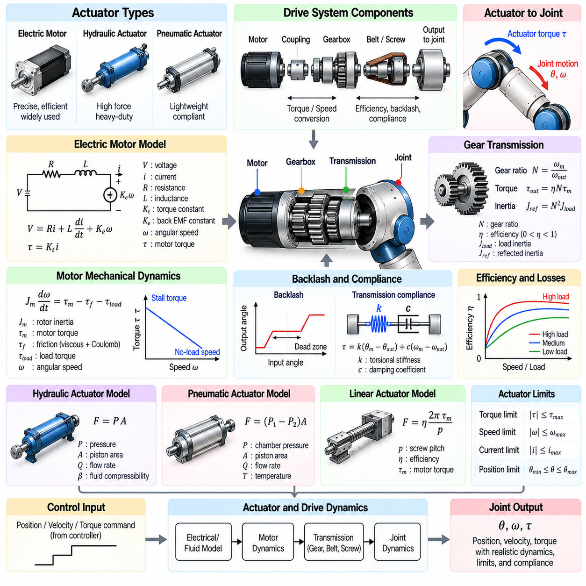{width="7.268055555555556in" height="7.268055555555556in"}

Actuator and drive system models describe how robotic systems convert electrical, hydraulic, or pneumatic energy into mechanical motion and force. In Physical AI simulation, these models connect high-level control commands with the physical behavior of motors, transmissions, and joints. Accurate actuator representation is essential because real robots cannot produce arbitrary torque, velocity, or acceleration, and their responses depend on physical limits and dynamic characteristics.

An actuator generates mechanical effort, while a drive system transfers and regulates that effort to the robot mechanism. Electric motors, hydraulic cylinders, and pneumatic actuators operate through different physical principles but share the purpose of producing controlled motion. Drive system models may include power electronics, gearboxes, belts, screws, brakes, and mechanical couplings. Their combined behavior determines the effective force and motion available at the output.

Electric motor models are widely used in robotic simulation because electric drives dominate many industrial and mobile robotic applications. Motor torque is generally related to electrical current, while rotational speed influences back electromotive force. Electrical resistance, inductance, and motor constants determine the relationship between voltage, current, and torque. These properties introduce dynamic behavior that simplified ideal torque sources cannot represent.

Brushless DC motors and permanent magnet synchronous motors are common choices for modern robotic actuation. Their electromagnetic behavior depends on rotor position, phase currents, magnetic flux, and electronic commutation. Detailed models may represent three-phase electrical dynamics, while simplified models approximate torque generation using current commands. The appropriate modeling level depends on whether the simulation targets motion control or detailed drive behavior.

Motor mechanical dynamics describe the relationship between generated torque, rotor inertia, friction, and angular acceleration. The motor rotor stores kinetic energy and resists rapid changes in speed. Mechanical losses arise from bearings, seals, and internal friction. Accurate rotor dynamics become particularly important during rapid acceleration, direction reversal, and high-frequency control, where actuator response may differ substantially from idealized commands.

Gear transmissions modify the relationship between motor speed and output torque. A reduction gearbox increases available output torque while decreasing output speed, subject to mechanical efficiency and operating limits. Gear ratio also changes the effective reflected inertia observed at the driven joint. Accurate transmission modeling must account for these transformations because they influence acceleration, torque requirements, and the dynamic response of articulated robots.

Transmission efficiency represents energy losses during mechanical power transfer. Gear friction, bearing resistance, lubrication, and internal deformation reduce the power delivered to the output. Efficiency may vary with speed, load, temperature, and direction of power flow. Assuming constant efficiency can be adequate for preliminary simulation, but detailed models may be required when evaluating energy consumption, regenerative operation, or low-speed performance.

Backlash occurs when mechanical clearance allows limited relative movement before transmission components engage. It commonly appears in gearboxes, couplings, and mechanical linkages. Backlash can produce dead zones, impact during direction reversal, and positioning errors. Simulation models may represent it using piecewise contact relationships or deadband functions. Its influence becomes significant in precision manipulation and rapidly reversing drive systems.

Transmission compliance describes elastic deformation between an actuator and its mechanical load. Flexible shafts, belts, gear teeth, and couplings may store energy under torque. This behavior introduces additional oscillatory modes and can reduce positioning accuracy. A two-inertia model connected through spring-damper elements provides a useful approximation. Such models are important when evaluating resonance, vibration suppression, and high-performance joint control.

Hydraulic actuator models represent motion generated by pressurized fluid acting on pistons or rotary mechanisms. Their dynamics depend on pressure, flow rate, fluid compressibility, valve behavior, and mechanical loading. Hydraulic systems can generate high forces and are used in heavy-duty robotic equipment. Accurate simulation must capture pressure dynamics and flow limitations, particularly when rapid load changes influence actuator responsiveness.

Pneumatic actuators use compressed gas to generate mechanical motion. Their behavior depends on chamber pressure, gas compressibility, valve flow, temperature, and external loading. Pneumatic systems often exhibit nonlinear dynamics because pressure and volume change during movement. Their natural compliance can support safe interaction, but precise positioning may be difficult. Simulation models should represent pressure evolution and force generation consistently.

Linear actuators convert electrical or fluid power into translational motion. Electric linear drives may use ball screws, lead screws, or belt mechanisms to transform motor rotation into displacement. Their force capability depends on motor torque, transmission geometry, efficiency, and mechanical limits. Friction, backlash, and screw compliance influence accuracy. These effects are relevant to robotic lifting, positioning, and telescoping mechanisms.

Actuator saturation limits the mechanical effort available from a drive system. Electric motors have current, voltage, speed, and torque constraints, while hydraulic and pneumatic actuators have pressure and flow limitations. Commands exceeding these limits cannot be reproduced physically. Simulation models must enforce realistic saturation behavior to prevent control policies from exploiting impossible actuation and producing misleading performance predictions.

Torque-speed characteristics describe how available actuator effort changes with operating velocity. Electric motors may deliver approximately constant torque over one region and decreasing torque at higher speeds due to voltage and power constraints. Gear ratios shift the operating range observed at the output. Modeling these characteristics is essential for predicting acceleration, climbing capability, maximum speed, and sustained robotic performance.

Thermal behavior influences actuator performance during prolonged operation. Electrical resistance, copper losses, magnetic losses, and mechanical friction generate heat within motor and drive components. Temperature affects efficiency, allowable current, and component reliability. Thermal protection may reduce available torque when temperature limits are approached. Including simplified thermal dynamics supports realistic evaluation of continuous operation and duty-cycle limitations.

Drive electronics regulate the electrical power delivered to motors. Inverters, motor controllers, and current regulators convert high-level commands into controlled phase currents or voltages. Their behavior introduces switching effects, control bandwidth limitations, and response delays. Detailed power electronic models may be unnecessary for mechanical simulation, but simplified representations of current control dynamics and saturation improve actuator realism.

Actuator control commonly uses nested feedback loops for current, velocity, and position regulation. Inner current loops control torque production, while outer loops regulate motion according to desired trajectories. Each loop has finite bandwidth and may introduce delay or filtering. Simulation models should distinguish commanded torque from actual generated torque. This distinction is important for evaluating stability, tracking performance, and interaction with compliant mechanisms.

Friction and disturbance effects can significantly influence low-speed actuator behavior. Static friction, Coulomb friction, viscous damping, and nonlinear effects such as the Stribeck phenomenon may cause motion irregularities. Load-dependent friction and mechanical hysteresis can introduce additional uncertainty. Appropriate friction models improve predictions of startup torque, small-position corrections, and precision movement under varying mechanical loads.

Energy consumption models connect actuator motion with electrical or fluid power requirements. Mechanical output power depends on force and velocity or torque and angular speed, while input power also includes conversion losses. Regenerative braking may recover energy during deceleration or externally driven motion. Accurate energy modeling supports battery sizing, thermal analysis, mission planning, and efficiency optimization for autonomous robotic systems.

Actuator parameter identification uses experimental measurements to estimate motor constants, inertia, friction, transmission efficiency, and dynamic response. Tests may include current-to-torque measurements, speed sweeps, step responses, and controlled load experiments. Identified parameters should be validated across different operating conditions. This process helps ensure that simulated drive behavior matches actual hardware rather than relying exclusively on nominal specifications.

Actuator models introduce important uncertainty into Sim2Real transfer. Manufacturing variation, wear, temperature, voltage fluctuations, and unmodeled control delays can change drive performance. Domain randomization can expose learning policies to plausible variations in torque limits, friction, efficiency, and response bandwidth. Robust training should account for these differences while preserving physically achievable actuator behavior and safe operating constraints.

Ultimately, actuator and drive system models connect control decisions with the mechanical capabilities of real robotic hardware. Motors generate effort, transmissions modify its delivery, and drive controllers regulate the resulting motion under physical and operational constraints. Accurate integration of electrical, mechanical, thermal, and control dynamics enables realistic simulation, reliable policy training, and stronger transfer of Physical AI capabilities to deployed robotic systems.

## 01.09. Wheel Track and Legged Contact Models

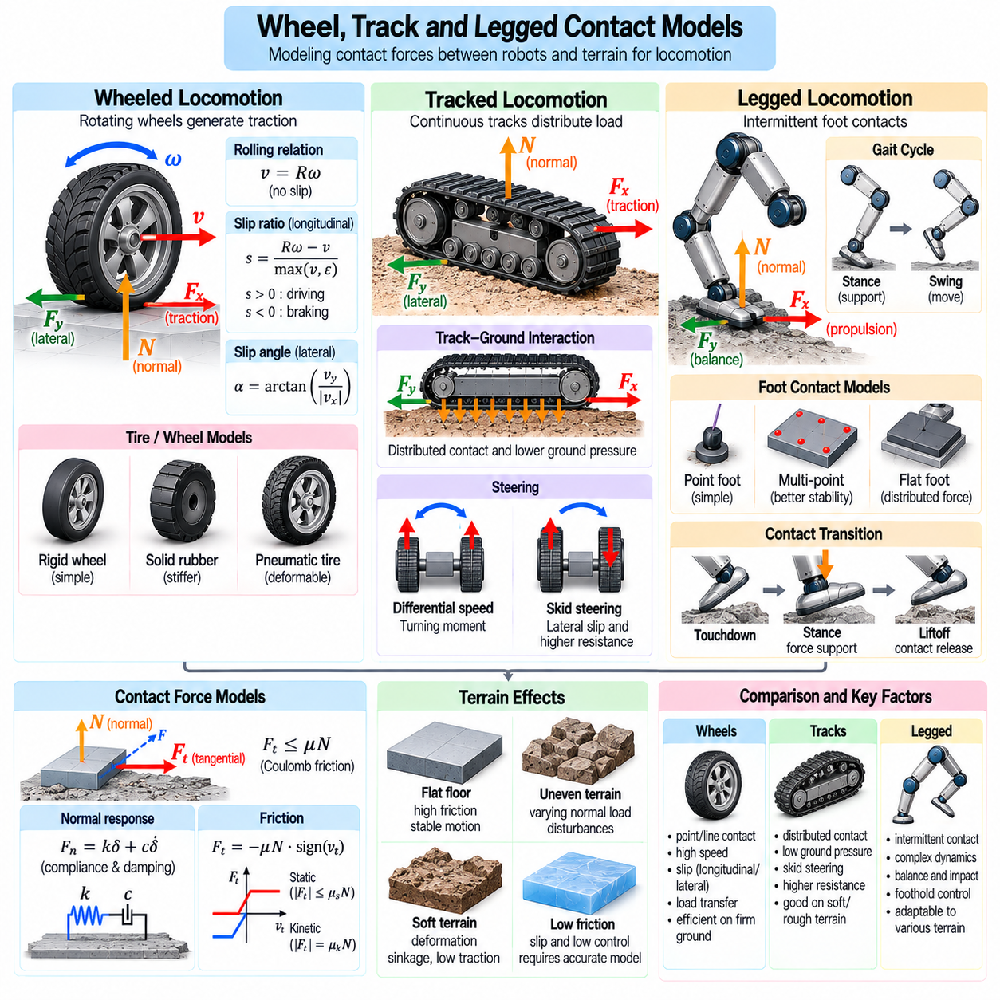{width="7.268055555555556in" height="7.268055555555556in"}

Wheel, track, and legged contact models describe how mobile robots exchange forces with supporting terrain during locomotion. These interactions determine traction, stability, propulsion, and energy consumption. In Physical AI simulation, contact models must represent both the geometry of the locomotion mechanism and the mechanical properties of the ground. Accurate representation is essential for predicting mobility across smooth floors, uneven surfaces, and deformable terrain.

Wheeled locomotion relies on contact forces generated between rotating wheels and supporting surfaces. The contact interface transmits normal loads, longitudinal traction, and lateral forces that influence vehicle motion. Simplified models treat wheels as rigid circular bodies with idealized point contacts. More detailed approaches account for tire deformation, finite contact patches, friction variation, and dynamic loading during acceleration or turning.

The rolling constraint describes the relationship between wheel rotation and translational motion when slipping is negligible. Under ideal pure rolling, forward velocity is determined by wheel angular velocity and effective rolling radius. This relationship forms the foundation of wheeled robot kinematics. However, real wheels experience longitudinal and lateral slip, particularly during rapid acceleration, braking, cornering, or operation on low-friction terrain.

Longitudinal slip occurs when wheel circumferential speed differs from the corresponding ground-relative velocity. Positive driving slip develops when the wheel rotates faster than the vehicle advances, while braking slip occurs when rotation decreases relative to forward motion. Slip influences traction generation and energy losses. Realistic simulation requires continuous treatment of slip near zero speed, where conventional slip-ratio definitions may become numerically unstable.

Lateral slip describes sideways motion relative to the wheel\'s intended rolling direction. It arises during steering, cornering, external disturbances, and insufficient lateral friction. Tire models relate lateral force to slip angle, normal load, and surface characteristics. Simplified linear relationships are useful for small slip angles, while nonlinear models are needed near traction limits or during aggressive maneuvers.

Tire deformation changes the effective contact geometry and influences force generation. Pneumatic tires exhibit radial compliance, lateral flexibility, and hysteretic energy losses. Solid rubber wheels and rigid industrial wheels have different stiffness and contact characteristics. Detailed tire models may include contact patch deformation, relaxation dynamics, and load-dependent friction, while simplified models prioritize computational efficiency for large-scale simulation.

Wheel-ground interaction is strongly influenced by load transfer during acceleration, braking, and turning. Changes in vehicle acceleration redistribute normal forces among wheels, modifying available traction. Suspension stiffness, damping, chassis geometry, and center-of-mass position determine this redistribution. Contact models must interact consistently with vehicle dynamics to predict wheel lift, traction loss, and rollover tendencies.

Tracked locomotion distributes vehicle weight over an extended contact region rather than a small number of wheel contacts. Continuous tracks can improve mobility on soft ground by reducing average ground pressure and distributing traction forces. Track models must represent belt motion, contact with supporting rollers, and interaction with terrain. Simplified models approximate tracks as distributed contact elements, while detailed models resolve individual links.

Track-ground interaction involves longitudinal shear, lateral resistance, and deformation of the supporting surface. During steering, differential track speeds create turning moments through complex contact forces. Skid steering introduces substantial lateral sliding and energy dissipation. Accurate simulation must consider distributed friction and changing normal pressure because simplified rigid contact assumptions may underestimate turning resistance or misrepresent terrain disturbance.

Track tension and internal mechanical behavior also influence locomotion performance. Flexible track belts experience deformation, vibration, and changing contact geometry as they move around sprockets and rollers. Excessive tension increases mechanical losses, while insufficient tension can affect engagement and tracking stability. Detailed multibody models capture these effects, but reduced-order representations are often preferable for reinforcement learning workloads.

Legged locomotion relies on intermittent contact between robotic feet and the environment. Unlike wheeled systems, legged robots repeatedly establish and release support contacts while transferring body weight between limbs. Contact forces determine balance, propulsion, and disturbance recovery. Accurate models must represent foot geometry, touchdown conditions, stance duration, and transitions between supporting and swinging phases.

Foot-ground contact can be represented using point contacts, multiple discrete contact points, or distributed contact surfaces. Point-foot models simplify force calculations but cannot directly represent all rotational contact moments. Flat-foot models support broader contact regions and more complex force distributions. The appropriate representation depends on foot geometry, task requirements, and the level of fidelity needed for balance and manipulation.

The stance phase occurs when a foot maintains supporting contact with the ground, while the swing phase moves the foot toward its next placement. Contact transitions introduce discontinuities in constraints and may generate impact impulses. Simulation must detect touchdown and liftoff consistently while avoiding unrealistic penetration or artificial energy generation. These transitions strongly influence gait stability and the quality of learned locomotion policies.

Ground reaction forces support the robot\'s weight and generate the accelerations required for movement. Their distribution depends on body configuration, joint torques, contact geometry, and friction constraints. During multi-leg support, several contact force distributions may satisfy the same overall motion requirements. Contact-aware controllers and physics solvers must therefore determine feasible forces that preserve balance without violating traction limits.

Legged robots require sufficient friction to prevent foot slipping during stance. The available tangential force depends on the normal load and the local friction coefficient. Contact force optimization commonly uses friction cone constraints to maintain physically feasible support forces. On uneven terrain, contact normals vary between feet, requiring the controller to account for local surface orientation when planning body motion.

Compliant feet and leg structures influence touchdown behavior and force transmission. Elastic elements can absorb impact energy, reduce peak forces, and improve adaptation to irregular surfaces. Damping controls oscillations and settling after contact. However, excessive compliance may reduce positioning precision or introduce unstable dynamic modes. Simulation models should capture the dominant mechanical response without unnecessary computational complexity.

Deformable terrain introduces additional challenges for wheels, tracks, and legs. Soil, sand, mud, and granular materials may compress, shear, or permanently deform under loading. Traction depends on penetration depth, contact pressure, shear resistance, and terrain history. Terramechanics models approximate these relationships, while particle-based or continuum methods can provide greater detail at substantially higher computational cost.

Terrain deformation can create persistent changes that influence subsequent contacts. Wheel ruts, track impressions, and foot indentations alter local geometry and load-bearing behavior. Robots operating repeatedly over the same region may therefore encounter terrain conditions different from their initial state. Simulation systems must balance persistent terrain modeling against memory requirements and computational efficiency, especially in parallel training environments.

Contact modeling becomes particularly challenging when locomotion mechanisms combine different mobility principles. Wheel-legged robots alternate between rolling and stepping, while tracked robots with articulated suspensions combine distributed ground contact with body reconfiguration. Hybrid contact models must represent changing contact modes and mechanical constraints. Accurate transitions are essential for evaluating obstacle traversal and multimodal locomotion strategies.

Numerical stability is critical because locomotion involves frequent contact changes and potentially large force variations. Contact stiffness, friction parameters, solver iterations, and integration time steps influence simulation accuracy. Excessively stiff models may produce numerical instability, while overly compliant models can distort support behavior. Solver settings should be evaluated against physical measurements rather than selected solely for simulation speed.

Model calibration requires experimental measurements of traction, slip, contact forces, and terrain response. Wheeled robots can be tested through acceleration, braking, and cornering experiments, while tracked robots require evaluation of turning resistance and distributed traction. Legged robots benefit from force measurements during touchdown and stance. Calibration across different loads and surfaces helps identify the limits of simplified contact assumptions.

Wheel, track, and legged contact models directly affect Sim2Real transfer because locomotion policies depend on realistic ground interaction. Incorrect friction, terrain stiffness, or contact geometry can produce unstable walking, excessive wheel slip, or inaccurate tracked steering. Domain randomization can improve robustness to uncertain terrain properties, but it cannot fully compensate for fundamentally incorrect contact dynamics. Validation against real locomotion data remains essential.

Ultimately, wheeled contact models emphasize rolling and tire forces, tracked models represent distributed traction and shear, and legged models capture intermittent support and impact dynamics. Each locomotion mechanism requires an appropriate balance between physical fidelity and computational cost. Integrating these models with robot dynamics, control, and terrain simulation enables Physical AI systems to develop reliable mobility behaviors that transfer more effectively to real environments.

## 01.10. Manipulator and Whole Body Dynamics

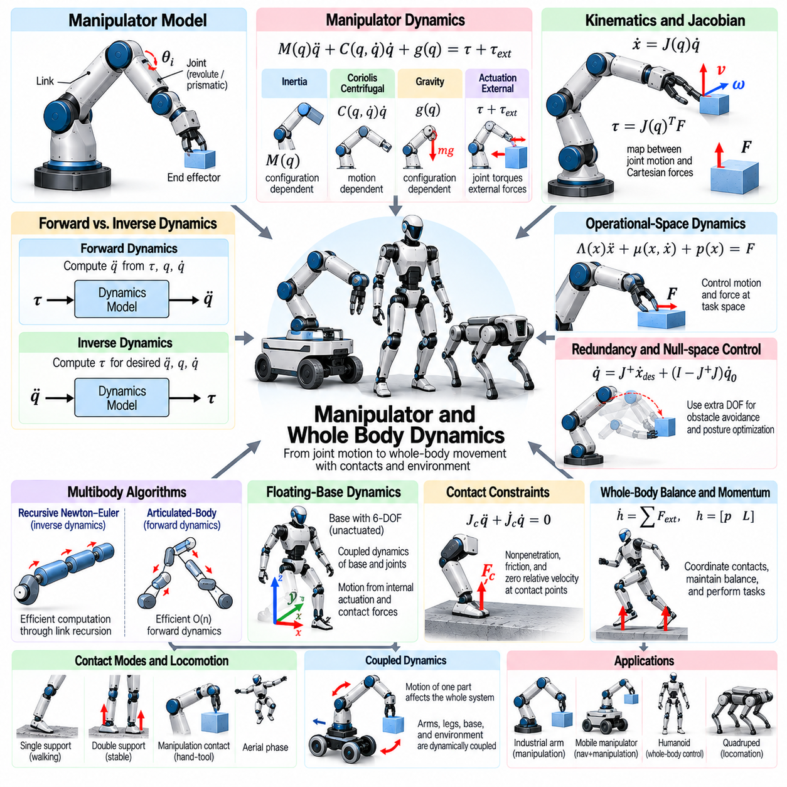{width="7.268055555555556in" height="7.268055555555556in"}

Manipulator and whole-body dynamics describe how robotic joints, links, and floating bases move under applied forces and torques. These models connect actuator commands with motion, inertia, gravity, and environmental interaction. In Physical AI simulation, accurate dynamics are essential for predicting manipulation forces, coordinated movement, balance, and contact behavior across industrial arms, mobile manipulators, humanoids, and legged robots.

A robotic manipulator consists of interconnected rigid bodies linked through revolute, prismatic, or more complex joints. Its configuration is represented by generalized coordinates describing joint positions and, when necessary, base motion. Joint velocities and accelerations define the evolving mechanical state. Dynamic models calculate how actuator torques, external forces, and mechanical constraints determine the resulting movement.

Manipulator dynamics are commonly expressed through equations involving an inertia matrix, velocity-dependent forces, gravitational loading, and generalized joint torques. The inertia matrix captures how mass distribution affects acceleration, while Coriolis and centrifugal terms describe motion-dependent interactions. Gravity contributes configuration-dependent loading. Together, these components establish the relationship between commanded effort and achievable motion.

The inertia matrix of a manipulator changes as its joints move because the spatial distribution of mass changes with configuration. Extending an arm may increase rotational inertia around its base, while folding the arm can reduce it. Dynamic coupling also allows motion at one joint to influence forces required at another. Accurate simulation must preserve these relationships to reproduce realistic acceleration and coordinated multi-joint behavior.

Forward dynamics calculates joint accelerations from applied torques, current positions, velocities, and external forces. It forms the computational foundation of physics-based robot simulation. Inverse dynamics instead determines the torques required to produce specified accelerations along a desired trajectory. Both formulations are important for evaluating controllers, generating reference motions, and identifying actuator requirements.

Efficient multibody algorithms make high-dimensional robot simulation computationally practical. Recursive Newton--Euler methods calculate inverse dynamics through linked force and motion propagation. Articulated-body algorithms efficiently compute forward dynamics without explicitly constructing and inverting a full inertia matrix. These approaches are particularly valuable for robots with many joints and large-scale parallel simulation workloads.

Kinematic Jacobians connect joint velocities to the linear and angular velocities of robot links or end effectors. Their transposes map externally applied spatial forces into generalized joint torques. Jacobians therefore provide an essential bridge between Cartesian interaction forces and joint-space dynamics. They support force control, contact modeling, operational-space control, and analysis of manipulability.

Operational-space dynamics describe motion and forces directly at an end effector rather than exclusively through joint coordinates. Effective inertia in Cartesian space depends on the robot configuration and Jacobian structure. This formulation helps controllers regulate tool acceleration, interaction force, and compliance. It is especially useful for assembly, surface following, and manipulation tasks requiring precise physical interaction.

Redundant manipulators possess more controllable degrees of freedom than are required for a particular end-effector task. This redundancy allows alternative joint configurations while maintaining the same tool position or orientation. Null-space control can exploit remaining motion freedom for obstacle avoidance, joint-limit avoidance, or posture optimization. Dynamic consistency becomes important when primary task forces must remain unaffected by secondary objectives.

Whole-body dynamics extends manipulator modeling to robots whose arms, legs, torso, and base interact as a coupled mechanical system. Humanoids and mobile manipulators must coordinate multiple contact points while maintaining balance and performing tasks. Motion of one body segment changes the momentum and loading of others. A whole-body model therefore captures interactions that independent joint or limb models cannot represent accurately.

Floating-base dynamics are required when a robot\'s main body is not rigidly attached to the environment. The base typically has six spatial degrees of freedom describing translation and orientation. Unlike actuated joints, floating-base coordinates are not directly driven by independent motors. Their acceleration results from gravity, internal actuation, and external contact forces, making contact modeling essential for physically consistent simulation.

The equations of motion for floating-base robots combine actuated joint dynamics with unactuated base dynamics. Joint torques influence overall motion through internal mechanical coupling, but cannot directly create net external momentum. Ground contacts and other environmental interactions provide forces that support or accelerate the body. This distinction is fundamental for simulating humanoid balance, legged locomotion, and aerial phases of movement.

Contact constraints restrict allowable motion when robotic feet, hands, or tools interact with the environment. During stable support, selected contact points may be required to maintain approximately zero relative velocity. Contact forces must satisfy nonpenetration and friction conditions. Constrained dynamics methods solve for accelerations and interaction forces while accounting for the active contact configuration.

Whole-body balance depends on the relationship between gravitational loading, inertial effects, and environmental support forces. The center of mass provides a useful representation of overall body motion, while the support region describes available contact geometry. Static stability concepts are useful for slow movement, but dynamic balance requires consideration of momentum, acceleration, and changing contacts during locomotion or manipulation.

Centroidal dynamics describe the evolution of a robot\'s total linear and angular momentum around its center of mass. External forces determine changes in linear momentum, while external moments govern angular momentum. This reduced representation is valuable for planning balance and locomotion without resolving every joint interaction at the planning level. Full-body dynamics remains necessary to verify that planned motions are mechanically achievable.

Whole-body control coordinates multiple objectives under physical constraints. A robot may need to maintain foot contact, regulate center-of-mass motion, position an end effector, and avoid joint limits simultaneously. Optimization-based controllers can distribute actuator torques and contact forces among these objectives. Task priorities and feasibility constraints determine how competing requirements are resolved during operation.

Manipulation tasks introduce external forces that alter the dynamics of the entire robot. When a humanoid pushes an object, the reaction force affects its arm, torso, and supporting feet. A mobile manipulator lifting a heavy payload may experience substantial changes in balance and effective inertia. Accurate simulation must propagate these forces throughout the connected mechanical system rather than treating manipulation as an isolated arm movement.

Closed-chain mechanisms arise when multiple robotic limbs or manipulators connect to the same object or environmental structure. Such configurations introduce additional geometric and dynamic constraints. Cooperative manipulation, dual-arm grasping, and multi-contact support are common examples. Simulation must maintain constraint consistency while distributing internal forces appropriately, particularly when redundant contacts create multiple feasible force solutions.

Joint limits, actuator saturation, and mechanical compliance constrain achievable whole-body motion. A dynamically feasible trajectory must respect torque limits, velocity bounds, contact friction, and collision restrictions. Flexible transmissions and compliant joints can introduce additional states and oscillatory behavior. Including these limitations prevents simulated controllers from relying on physically impossible movements or unrealistically rigid interactions.

Numerical integration and constraint solving strongly influence the stability of articulated robot simulation. Rapid contact changes, high joint stiffness, and coupled mechanical constraints can produce challenging numerical conditions. Solver accuracy must be balanced against computational cost, especially for reinforcement learning environments containing thousands of robot instances. Stable simulation also requires consistent handling of contact impulses and energy behavior.

Model calibration involves identifying link masses, centers of mass, inertia tensors, joint friction, and actuator characteristics. Experimental trajectories and measured joint torques can reveal discrepancies between simulated and physical dynamics. Payload variation and contact experiments provide additional validation. Reliable identification is important because even small inertial or friction errors can accumulate during coordinated whole-body movement.

Manipulator and whole-body dynamics are central to Sim2Real transfer because learned policies depend on accurate force and motion relationships. Incorrect inertia, contact constraints, or actuator limits can produce unrealistic manipulation or unstable balance. Domain randomization improves robustness to uncertain parameters, while hardware validation identifies systematic modeling errors. Physically grounded dynamics ultimately enable coordinated, contact-aware robotic behavior to transfer more reliably from simulation to reality.

## 01.11. Aerial and Flight Dynamics

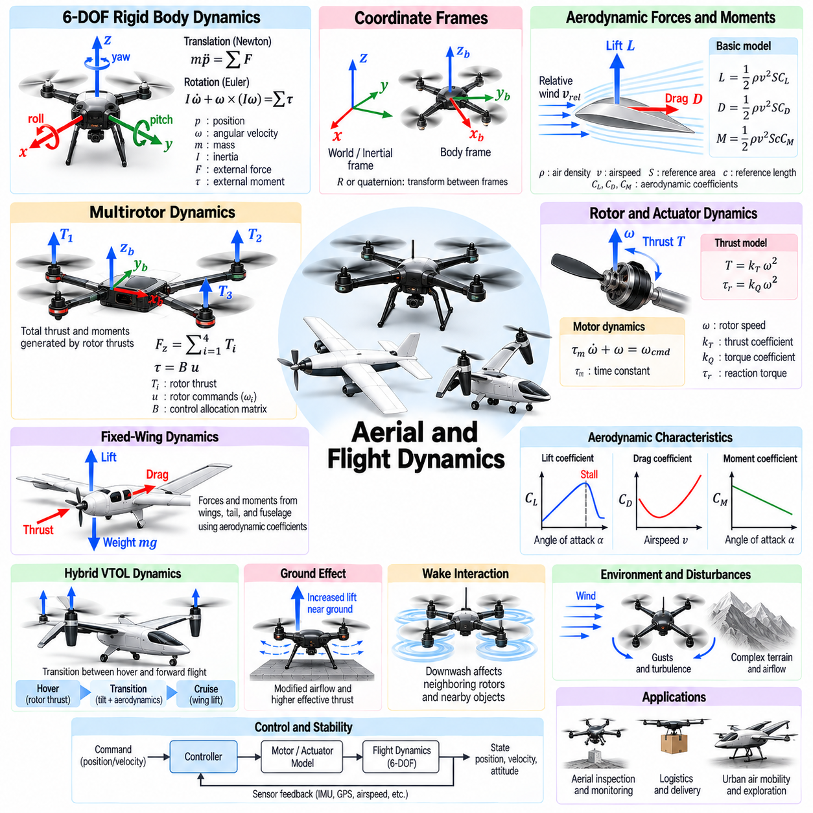{width="7.268055555555556in" height="7.268055555555556in"}

Aerial and flight dynamics describe how flying robots move through the atmosphere under aerodynamic forces, propulsion, gravity, and control inputs. Unlike ground robots, aerial systems must continuously manage forces and moments to maintain controlled flight. In Physical AI simulation, accurate flight models are essential for predicting stability, maneuverability, energy consumption, and environmental interaction across multirotor drones, fixed-wing aircraft, and hybrid aerial robots.

Flight dynamics are commonly represented using six degrees of freedom describing three-dimensional translation and rotation. Position and orientation define the vehicle configuration, while linear and angular velocities describe its motion. Newton--Euler equations relate external forces and moments to translational and rotational acceleration. These equations provide the mathematical foundation for simulating aircraft movement under propulsion, aerodynamic loading, and disturbances.

Coordinate systems are essential for describing aerial motion consistently. An inertial or navigation frame represents position and global movement, while a body-fixed frame describes forces and velocities relative to the aircraft. Rotation matrices or quaternions transform quantities between frames. Quaternions are particularly useful for aggressive maneuvers because they avoid the singularities associated with certain Euler-angle representations.

Aerodynamic forces arise from the interaction between moving aircraft surfaces and surrounding air. Lift, drag, and aerodynamic moments depend on airspeed, air density, geometry, and flow conditions. Lift generally acts perpendicular to the relative airflow, while drag opposes relative motion. Accurate simulation must account for changing aerodynamic conditions because vehicle behavior can vary substantially with speed, attitude, and maneuver intensity.

Multirotor aircraft generate thrust through rotating propellers driven by electric motors. Each rotor produces an aerodynamic force and a reaction torque related to its rotational speed and operating conditions. Differential rotor thrust enables attitude control and translational maneuvering. Simplified models commonly approximate thrust and reaction torque using quadratic relationships with rotor speed, while detailed models incorporate aerodynamic interactions and transient effects.

The arrangement of rotors determines how individual thrust forces contribute to total vehicle force and moment. A control allocation model maps desired collective thrust and body torques into individual motor commands. Rotor geometry, rotation direction, and actuator constraints influence the achievable control authority. Accurate allocation is particularly important when evaluating aggressive maneuvers, actuator saturation, or asymmetric propulsion configurations.

Rotor dynamics introduce delays between commanded motor input and actual aerodynamic thrust. Motor inertia, electronic speed controllers, electrical limits, and aerodynamic loading influence rotor acceleration and deceleration. First-order response models provide efficient approximations, while detailed electromechanical models capture additional behavior. Ignoring these dynamics can produce unrealistically fast attitude responses and misleading controller performance.

Fixed-wing aircraft generate lift primarily through airflow over their wings. Their dynamics depend on forward airspeed, angle of attack, sideslip angle, and aerodynamic coefficients. Wings, fuselage, and tail surfaces contribute different forces and moments. Unlike hovering multirotors, conventional fixed-wing aircraft generally require sufficient airspeed to maintain lift, making airspeed management fundamental to stable flight.

Aerodynamic coefficients describe how lift, drag, and moments change with flight conditions. They may be obtained from wind tunnel measurements, computational fluid dynamics, or flight experiments. Simplified models use analytical approximations or lookup tables indexed by relevant variables. Their validity is often limited to specific operating regions, so extrapolation beyond measured conditions can produce inaccurate predictions.

Stall occurs when airflow separation causes a substantial reduction in lift as the angle of attack exceeds a critical range. Stall behavior depends on wing geometry, Reynolds number, turbulence, and aircraft motion. Simplified aerodynamic models may not accurately reproduce post-stall dynamics. Simulation intended for recovery training or aggressive flight must represent the relevant nonlinear aerodynamic effects and their associated uncertainties.

Hybrid vertical takeoff and landing aircraft combine rotor-based vertical lift with wing-supported forward flight. Their dynamics change significantly during transitions between hovering and cruising. Rotor thrust, aerodynamic lift, and control surface effectiveness vary with airspeed and configuration. Accurate transition models must capture coupled propulsion and aerodynamic forces to evaluate stability and control authority throughout the flight envelope.

Ground effect modifies aerodynamic performance when an aircraft operates close to a supporting surface. Rotorcraft may experience increased effective lift or altered induced flow near the ground, depending on configuration and operating conditions. This phenomenon influences takeoff, landing, and low-altitude hovering. Simplified ground-effect models can improve realism, although complex surface geometry and rotor interactions may require higher-fidelity methods.

Propeller wake interactions influence thrust production and vehicle stability. Airflow generated by one rotor can affect neighboring rotors, supporting structures, or nearby objects. These interactions become important for compact multirotors, coaxial propulsion systems, and vehicles operating near walls. Detailed flow simulation is computationally expensive, so reduced-order aerodynamic models are often used for real-time training.

Wind introduces external disturbances that influence vehicle motion and aerodynamic loading. Steady wind changes the relationship between ground velocity and air-relative velocity, while gusts generate time-varying forces and moments. Turbulence can produce rapid fluctuations that challenge attitude stabilization. Simulation environments may represent wind using deterministic profiles, stochastic processes, or spatially varying flow fields.

Atmospheric conditions affect flight performance through changes in air density, temperature, pressure, and turbulence. Reduced air density can decrease rotor thrust and wing lift under otherwise similar operating conditions. Temperature also influences propulsion efficiency and battery performance. Environment-aware simulation helps evaluate flight behavior across different altitudes, weather conditions, and operational environments.

Flight control systems commonly use hierarchical feedback structures. Inner loops regulate angular rates and attitude, while outer loops control position, velocity, or trajectory tracking. Controllers may employ proportional-integral-derivative methods, geometric control, or model predictive control. Their effectiveness depends on accurate estimates of vehicle state, actuator capability, and disturbance behavior.

Underactuation is a defining characteristic of many aerial robots. A conventional quadrotor cannot independently command arbitrary translational forces and rotational moments because thrust direction depends on vehicle orientation. Position control therefore requires coordinated attitude changes and thrust modulation. Dynamic models must preserve these constraints to prevent simulated policies from exploiting physically impossible flight behavior.

Payloads and mechanical attachments alter aerial vehicle mass distribution and inertia. Carrying an object can shift the center of mass, change rotational response, and increase propulsion requirements. Suspended payloads introduce additional pendulum dynamics and coupling between aircraft and load motion. Accurate simulation is important for aerial manipulation, delivery operations, and cooperative transportation involving multiple vehicles.

Aerial contact dynamics become relevant during landing, docking, perching, and physical manipulation. Contact forces can rapidly change vehicle momentum and disturb attitude stability. Landing gear compliance and damping influence impact absorption and rebound behavior. Simulation must combine flight dynamics with collision detection and contact constraints to represent transitions between free flight and supported interaction.

Numerical integration must handle coupled translational, rotational, actuator, and aerodynamic dynamics. Fast attitude changes and rotor response may require smaller time steps than slower position dynamics. Quaternion normalization and consistent coordinate transformations help maintain numerical accuracy. Simulation fidelity should be balanced against computational cost, particularly when training thousands of aerial agents in parallel.

Flight model calibration requires measurements of mass, inertia, thrust curves, motor response, and aerodynamic coefficients. Controlled flight tests can reveal discrepancies in acceleration, angular response, power consumption, and disturbance rejection. System identification methods estimate parameters from recorded sensor and actuator data. Validation across different flight regimes is necessary because a model calibrated for hovering may perform poorly during rapid forward flight.

Aerial dynamics strongly influence Sim2Real transfer because learned flight policies depend on realistic propulsion, aerodynamic forces, and disturbances. Incorrect thrust models or underestimated actuator delays can produce unstable behavior on physical hardware. Domain randomization can improve robustness to variations in wind, mass, inertia, and motor performance. However, systematic modeling errors still require experimental validation and refinement.

Ultimately, aerial and flight dynamics integrate rigid body motion, aerodynamic forces, propulsion, actuator behavior, and environmental disturbances into a unified simulation framework. Different aircraft configurations require different levels of aerodynamic and mechanical fidelity. Physically grounded models enable reliable flight control, autonomous navigation, aerial manipulation, and safer transfer of Physical AI capabilities from simulation to real-world flying robots.

## 01.12. Sensor and Noise Models

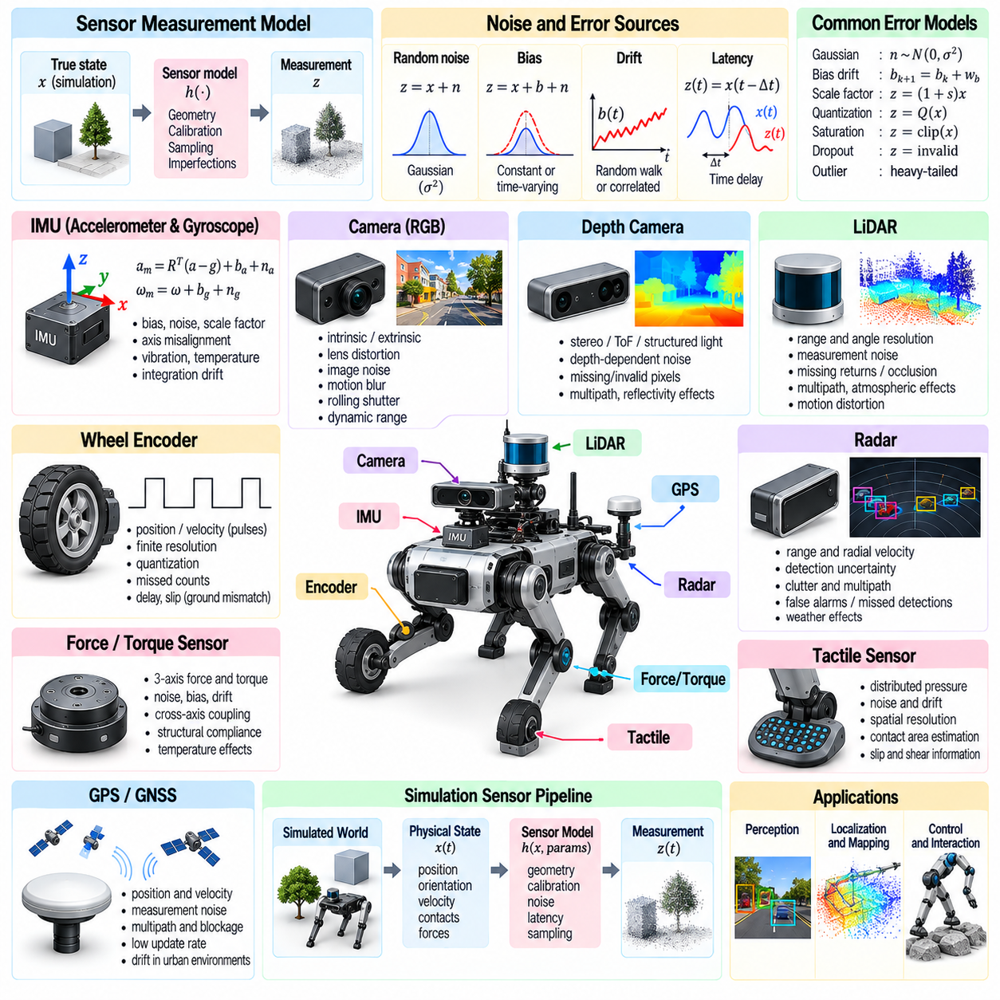{width="7.268055555555556in" height="7.268055555555556in"}

Sensor and noise models describe how robotic systems observe physical environments through imperfect measurement processes. Sensors convert physical quantities into electrical or digital signals, but their outputs differ from ideal states because of noise, bias, latency, and hardware limitations. In Physical AI simulation, realistic sensor modeling is essential for training perception, localization, state estimation, and control systems that remain reliable under real-world uncertainty.

A sensor model transforms the true physical state of a simulated system into an observable measurement. This transformation may include coordinate conversion, sampling, calibration parameters, quantization, and measurement uncertainty. Ideal models provide exact observations, while realistic models reproduce limitations found in physical hardware. The appropriate fidelity depends on the sensor type, intended application, and sensitivity of the robot\'s decision-making process.

Measurement noise represents random fluctuations that affect sensor readings even when the underlying physical quantity remains constant. Gaussian noise is frequently used because it provides a convenient approximation for many electronic measurement processes. Its magnitude is commonly characterized by variance or standard deviation. However, real sensor errors may exhibit non-Gaussian distributions, correlated disturbances, and operating-condition dependence.

Sensor bias introduces a systematic offset between measured and true values. Bias may remain approximately constant during short experiments or evolve gradually because of temperature changes, aging, and environmental conditions. Bias drift can be represented through random-walk or correlated stochastic processes. Accurate simulation should distinguish bias from independent measurement noise because these errors affect estimation and calibration differently.

Inertial measurement units combine accelerometers and gyroscopes to estimate motion. Accelerometers measure specific force, which includes the effects of non-gravitational acceleration and sensor orientation relative to gravity. Gyroscopes measure angular velocity and are affected by bias, noise, scale-factor errors, and axis misalignment. These imperfections accumulate during inertial integration, producing position and orientation drift without external corrections.

Accelerometer models must account for gravity compensation, coordinate alignment, saturation, and dynamic vibration. High-frequency mechanical oscillations can contaminate measurements and introduce estimation errors. Gyroscope measurements may also contain temperature-dependent bias and vibration-induced disturbances. Realistic inertial simulation therefore requires consistent treatment of rigid-body motion, sensor mounting geometry, and time-dependent error processes.

Wheel encoders measure rotational displacement or velocity using discrete pulses or digital position readings. Their outputs are affected by finite resolution, quantization, missed counts, and sampling delays. Encoder measurements may accurately describe wheel rotation while failing to represent actual ground displacement during slipping. Simulation must preserve this distinction because wheel odometry errors often originate from contact dynamics rather than encoder electronics.

Camera models describe the transformation from three-dimensional scene geometry into image measurements. Intrinsic parameters determine focal length, principal point, and image scaling, while extrinsic parameters describe camera position and orientation. Realistic models may include radial distortion, tangential distortion, exposure variation, and limited dynamic range. These properties influence visual perception and geometric reconstruction.

Image sensor noise arises from photon statistics, electronic readout, dark current, and analog-to-digital conversion. Lighting conditions influence the relative importance of these effects. Motion blur occurs when objects or cameras move during exposure, while rolling shutter introduces geometric distortion because image rows are captured at different times. These phenomena are important when simulating high-speed navigation and visual control.

Depth cameras estimate scene distance using structured light, stereo vision, or time-of-flight principles. Their measurements contain depth-dependent uncertainty, invalid pixels, multipath interference, and sensitivity to surface reflectivity. Transparent, reflective, and dark materials may produce unreliable observations. Simulated depth measurements should represent these failure modes when policies depend on precise obstacle distances or object geometry.

LiDAR sensors estimate distance by measuring reflected laser signals across scanning directions. Their models include angular resolution, range limits, beam divergence, and measurement uncertainty. Reflectivity, incidence angle, atmospheric conditions, and occlusion influence return quality. More detailed models reproduce missing returns, multiple reflections, motion distortion, and scan timing effects that influence mapping and localization.

Radar sensors measure range and may estimate radial velocity through Doppler effects. Their performance depends on target reflectivity, antenna characteristics, signal processing, and environmental interference. Radar observations can include clutter, multipath reflections, and false detections. Simulation must represent uncertainty in both detection and measurement because radar-based tracking depends on the statistical structure of observations.

Force and torque sensors measure mechanical interaction at joints, wrists, or contact interfaces. Their readings are influenced by structural compliance, calibration errors, cross-axis coupling, and thermal drift. Tactile sensors additionally capture distributed pressure or deformation across contact surfaces. Realistic models are important for grasping, assembly, compliant manipulation, and contact-aware locomotion where small measurement errors can alter control behavior.

Sensor timing is a fundamental part of measurement realism. Different sensors operate at different sampling frequencies and may deliver measurements after variable processing delays. Timestamp errors and asynchronous acquisition can produce inconsistencies between observations. Simulation should distinguish physical sampling time from data availability time, particularly when combining cameras, inertial sensors, encoders, and force measurements.

Noise correlation matters when multiple sensors share environmental or mechanical disturbances. Vibration may simultaneously affect cameras and inertial sensors, while temperature changes may influence several electronic components. Treating every error as independent can underestimate uncertainty and overstate fusion performance. Joint sensor models can represent shared disturbances and cross-sensor dependencies when they materially affect estimation accuracy.

Sensor fusion combines measurements with complementary characteristics to estimate states that individual sensors cannot reliably observe. Inertial sensors provide high-rate motion information but accumulate drift, while cameras and LiDAR can provide environmental corrections. Kalman filtering, factor graphs, and optimization-based estimators depend on measurement models and uncertainty assumptions. Unrealistic noise statistics can lead to inconsistent confidence estimates.

Calibration errors create systematic discrepancies between sensor coordinate frames and the robot\'s physical geometry. Small rotational or translational offsets may produce significant errors during rapid motion or long-range observation. Time-offset calibration is equally important for sensors operating asynchronously. Simulation can introduce controlled calibration perturbations to evaluate whether estimation and control systems tolerate realistic installation errors.

Sensor failures extend beyond continuous measurement noise. Temporary dropout, communication interruption, saturation, corrupted packets, and intermittent detection may produce missing or invalid observations. These failures often occur in bursts rather than independently. Training environments should model plausible fault patterns and recovery behavior so robotic policies do not assume uninterrupted access to every measurement channel.

Domain randomization can vary sensor noise levels, bias, calibration offsets, latency, and environmental sensitivity across simulation episodes. This encourages perception and control systems to operate under uncertain measurement conditions. However, randomization distributions should reflect plausible hardware behavior. Excessively broad or physically inconsistent perturbations may reduce learning efficiency without improving real-world robustness.

Sensor model calibration requires experimental characterization under representative operating conditions. Static measurements reveal bias and noise statistics, while controlled motion experiments identify scale factors, timing offsets, and dynamic errors. Temperature and vibration testing can expose dependencies that simple laboratory calibration misses. Recorded datasets provide a basis for comparing simulated observations with measurements from physical hardware.

Numerical implementation must preserve the distinction between simulation state and sensor observation. Controllers should receive measurements generated at realistic rates rather than unrestricted access to perfect simulator variables. Noise generation must also support reproducible experiments through controlled random seeds. Efficient sensor pipelines are especially important when large numbers of simulated robots produce high-bandwidth visual and geometric data.

Sensor and noise models directly influence Sim2Real transfer because learned policies may exploit unrealistic observation precision or timing. Incorrect noise, missing distortion, or idealized synchronization can produce failures when deployed on physical robots. Combining calibrated measurement models, targeted randomization, and hardware validation reduces these discrepancies. Realistic sensing ultimately connects simulated physical dynamics with dependable perception and autonomous decision-making.

## 01.13. Time Integration and Numerical Stability

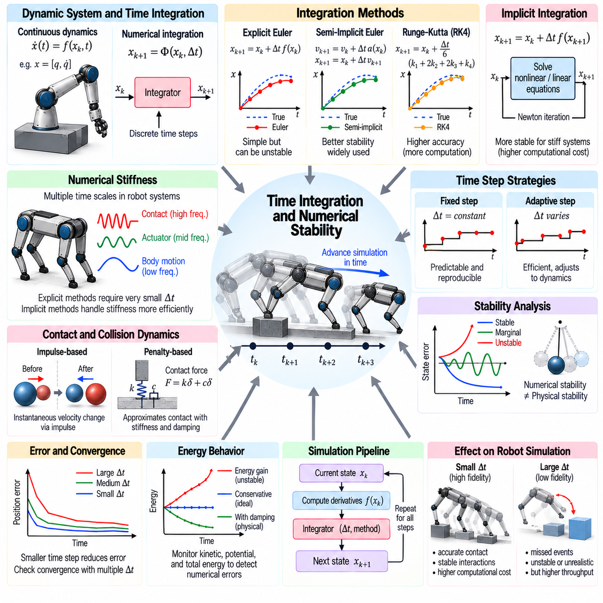{width="7.268055555555556in" height="7.268055555555556in"}

Time integration and numerical stability determine how a physics simulator advances a robotic system from one state to the next. Continuous equations of motion must be approximated through discrete computational steps. The selected integration method, time-step size, and solver accuracy influence trajectory fidelity, energy behavior, and contact stability. These factors are fundamental to reliable Physical AI simulation and Sim2Real transfer.

A dynamic system is commonly represented by differential equations describing changes in position, velocity, and other state variables. Numerical integration estimates future states from current conditions and computed derivatives. Because exact analytical solutions are rarely available for complex robots, simulation engines repeatedly perform these approximations. Numerical errors accumulate over time and may alter the predicted physical behavior.

Explicit Euler integration updates the system state using derivatives evaluated at the beginning of each time step. Its simplicity and low computational cost make it useful for basic models and educational simulations. However, explicit Euler can become unstable when modeling stiff springs, high-frequency vibrations, or strong contact forces. Reducing the time step improves accuracy but increases the number of required calculations.

Semi-implicit Euler integration updates velocity before using the new velocity to advance position. This method often provides better stability than explicit Euler for mechanical systems at comparable computational cost. It is widely used in real-time rigid-body simulation because it can produce reasonable motion with relatively simple calculations. Nevertheless, its accuracy and stability still depend on time-step selection and system properties.

Higher-order integration methods improve accuracy by evaluating system derivatives at multiple points within a time interval. Runge--Kutta methods are widely used for smooth dynamic systems and can reduce truncation error compared with first-order schemes. Their computational cost increases with the number of derivative evaluations. In systems with frequent impacts or discontinuous contact forces, higher-order accuracy may be limited by event handling.

Implicit integration methods evaluate future-state relationships through equations that must be solved numerically. These approaches are often more stable for stiff mechanical systems, including compliant contacts and highly damped structures. Their main disadvantage is the additional computational effort required by nonlinear or linear equation solvers. Stability benefits must therefore be balanced against solver convergence and execution time.

Numerical stiffness arises when a system contains dynamic processes operating at substantially different time scales. A robot may combine slow body movement with rapid actuator response, stiff transmissions, and high-frequency contact oscillations. Explicit integration can require extremely small time steps to remain stable. Implicit or specialized integration techniques can handle these systems more efficiently when their additional complexity is justified.

Time-step size controls the temporal resolution of a simulation. Smaller steps can improve the representation of rapid motion, contact transitions, and actuator dynamics, but increase computational cost. Larger steps improve throughput while potentially missing important events or producing excessive numerical error. Appropriate time steps depend on the fastest relevant dynamics and the accuracy requirements of the intended application.

Fixed-step integration uses a constant simulation interval, supporting predictable execution and reproducible experiments. Adaptive-step integration changes the interval according to estimated numerical error or local dynamic conditions. Adaptive methods can improve efficiency for systems with varying motion complexity. However, variable step sizes complicate synchronization with controllers, sensors, and parallel simulation environments.

Local truncation error describes the approximation error introduced during an individual integration step, while global error reflects accumulated deviations across multiple steps. Numerical convergence testing examines whether simulation results approach a consistent solution as the time step decreases. Comparing trajectories at several resolutions helps distinguish integration artifacts from genuine physical behavior. A visually plausible trajectory alone does not establish numerical accuracy.

Stability analysis examines whether numerical errors remain bounded during simulation. A physically stable mechanical system may become unstable under an unsuitable integration scheme or excessive time step. Conversely, numerical damping can suppress motion that should remain physically observable. Simulation developers must distinguish numerical stability from physical stability because artificially smooth trajectories may conceal incorrect dynamic behavior.

Energy conservation provides an important diagnostic for numerical integration. In ideal conservative systems, total mechanical energy should remain constant, while friction and damping produce physically justified dissipation. Some integration schemes introduce artificial energy gain or loss over time. Monitoring kinetic, potential, and dissipated energy helps identify integration errors, unstable constraints, and unrealistic contact responses.

Contact and collision dynamics create discontinuities that challenge conventional integration methods. Impacts may produce abrupt velocity changes represented through impulses rather than smooth acceleration. Penalty-based contact models approximate interaction using stiffness and damping, while constraint-based methods solve contact conditions directly. Each approach introduces different numerical requirements, stability limitations, and computational tradeoffs.

Constraint stabilization is necessary when numerical integration allows joint or contact constraints to drift away from their intended conditions. Position correction and velocity-level stabilization can reduce accumulated violations. However, aggressive correction may introduce artificial forces or energy. Constraint solvers must balance accuracy, convergence, and physical consistency, particularly in closed-chain mechanisms and multi-contact robotic systems.

Friction introduces nonlinear and sometimes nonsmooth behavior into contact simulation. Transitions between sticking and sliding can cause abrupt changes in force direction and magnitude. Simplified friction laws may produce oscillations or solver instability near zero relative velocity. Regularization techniques can improve numerical behavior, but excessive smoothing may distort traction, grasping, or locomotion performance.

Iterative solvers approximate contact forces and joint constraints through repeated numerical updates. Their accuracy depends on convergence criteria, iteration count, conditioning, and constraint coupling. Insufficient iterations may produce penetration, joint drift, or unrealistic force distributions. Increasing iterations can improve consistency but reduces simulation throughput, especially when many robots interact with complex environments.

Substepping divides a larger simulation interval into smaller internal integration steps. This technique improves the treatment of fast dynamics while allowing controllers or rendering systems to operate at lower frequencies. It is particularly useful for stiff contacts, rapid actuator motion, and high-speed collisions. The number of substeps should be selected through stability testing rather than assuming that more steps always guarantee accuracy.

Multirate simulation assigns different update frequencies to processes with different dynamic requirements. Fast actuator and contact calculations may operate at higher rates than perception, planning, or supervisory control. This approach can reduce computational cost without ignoring important physical dynamics. However, communication between update rates must preserve timing consistency and avoid introducing artificial delays or unstable feedback.

Rotational integration requires special care because three-dimensional orientation does not behave like an unconstrained Euclidean vector. Quaternion-based representations avoid certain singularities but require normalization to preserve valid rotations. Lie-group integration methods can maintain rotational structure more directly. Incorrect orientation updates may introduce drift, distort angular momentum, or destabilize controllers during aggressive robotic motion.

Parallel physics simulation introduces additional numerical considerations. Thousands of environments may execute simultaneously on GPUs, where floating-point precision and reduction order can influence results. Small differences in arithmetic operations may grow in chaotic or contact-rich systems. Reproducibility therefore requires controlled random seeds, documented solver settings, and awareness of hardware-dependent numerical behavior.

Numerical validation should include free motion, oscillation, impact, friction, and constrained multibody benchmarks. Analytical solutions provide reference results where available, while high-resolution numerical solutions support more complex cases. Sensitivity studies should vary time steps, solver iterations, contact stiffness, and integration schemes. Consistent results across these tests provide stronger evidence of simulation reliability.

Time integration and numerical stability directly influence Sim2Real transfer because learned policies may exploit artifacts that do not exist in physical hardware. Excessive penetration, artificial damping, or unstable contact impulses can distort control behavior. Reliable simulation requires physically appropriate integration, calibrated parameters, convergence testing, and experimental validation. Numerical correctness is therefore a foundation for trustworthy Physical AI learning and deployment.

## 01.14. Physics Engine Architecture and Solvers

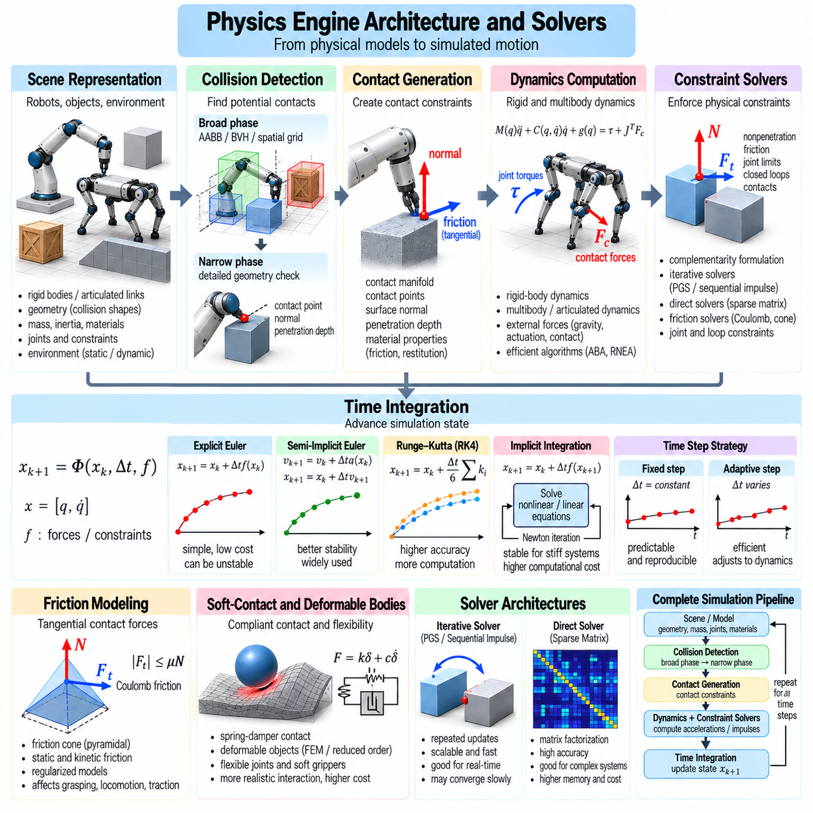{width="7.268055555555556in" height="7.268055555555556in"}

A physics engine provides the computational architecture required to simulate motion, forces, collisions, and constraints in robotic systems. It transforms physical models into executable numerical procedures that advance simulated states over time. In Physical AI, engine architecture influences simulation accuracy, computational throughput, scalability, and reproducibility. These properties determine how effectively simulation supports robot design, control development, and learning.

A typical physics engine separates scene representation, collision detection, dynamics computation, constraint solving, and numerical integration. Each subsystem performs a distinct function while exchanging information through a coordinated simulation pipeline. Robot geometry, mass properties, joint definitions, and environmental parameters establish the physical scene. The engine then evaluates interactions and updates system states according to the selected numerical methods.

Scene representation organizes rigid bodies, articulated mechanisms, static environments, and collision geometries into computational structures. Hierarchical transformations describe the relationships between connected components. Physical properties include mass, inertia, friction, restitution, and joint parameters. Efficient data organization is important because large robotic environments may contain thousands of interacting objects and complex mechanical assemblies.

Collision detection identifies geometric configurations that may produce physical contact. Broad-phase algorithms efficiently eliminate object pairs that cannot intersect, while narrow-phase algorithms calculate detailed contact information for potential collisions. Bounding volume hierarchies, spatial partitioning, and geometric distance calculations reduce unnecessary computation. Collision detection quality directly influences contact accuracy and overall simulation performance.

Contact generation converts detected geometric intersections or near-contact configurations into constraints or force models. Contact points, surface normals, penetration depths, and material properties determine the interaction conditions. Multiple contact points may form a contact manifold representing an extended interface. Stable contact generation requires temporal consistency because abrupt changes in contact geometry can introduce artificial impulses and numerical instability.

Rigid-body dynamics calculates the acceleration of objects under external forces, gravity, and applied torques. Multibody dynamics extends these calculations to connected robotic links and articulated mechanisms. Efficient recursive algorithms exploit mechanical structure to reduce computational complexity. The engine must coordinate these calculations with joint constraints and environmental contacts to produce physically consistent motion.

Constraint solvers enforce mechanical relationships such as fixed joints, revolute joints, contact nonpenetration, and friction limits. These conditions restrict allowable positions, velocities, and forces. Solvers determine constraint impulses or forces that satisfy the equations of motion while respecting physical limitations. Their numerical behavior strongly affects joint stability, contact penetration, and force distribution across robotic mechanisms.

Complementarity formulations represent unilateral contact conditions by coupling separation distance and normal contact force. A contact can transmit compressive force while active but cannot pull separated bodies together. Linear complementarity problems provide one mathematical framework for simplified rigid contact systems. More general nonlinear formulations are needed when friction, complex geometry, or additional mechanical effects are included.

Iterative constraint solvers approximate solutions through repeated updates rather than direct matrix factorization. Projected Gauss--Seidel methods are commonly associated with sequential impulse techniques used in real-time physics engines. Their computational efficiency makes them attractive for interactive simulation. However, convergence can deteriorate when constraints are strongly coupled, contact networks are dense, or mass ratios become extreme.

Direct solvers use matrix factorization to compute solutions for assembled mechanical equations. They can provide accurate results for suitably structured systems but may require substantial memory and computational resources. Sparse matrix methods improve efficiency by exploiting the limited connectivity of many mechanical systems. Solver selection depends on matrix conditioning, problem size, constraint structure, and the required accuracy.

Articulated-body solvers exploit the tree structure of robot mechanisms to calculate forward dynamics efficiently. Recursive Newton--Euler algorithms similarly support inverse dynamics calculations. Closed kinematic chains and environmental contacts introduce additional constraints beyond the underlying articulation tree. Physics engines must integrate articulated-body algorithms with constraint solvers to handle humanoids, manipulators, and mobile robots.

Friction solvers approximate the relationship between normal contact forces and tangential resistance. Coulomb friction models impose limits on tangential forces, while regularized models provide smoother numerical behavior. Friction cones may be approximated using pyramidal constraints to simplify computation. These approximations influence sliding, grasp stability, wheel traction, and the realism of contact-rich manipulation.

Soft-contact and compliant-body models represent deformation through springs, dampers, finite elements, or reduced-order mechanical approximations. They are useful for simulating flexible grippers, compliant joints, and deformable environments. Such models introduce additional degrees of freedom and potentially stiff dynamics. Physics engines must balance deformation fidelity against numerical stability and computational cost.

Numerical integration advances positions, velocities, and internal states using forces and accelerations calculated by the dynamics system. Explicit, semi-implicit, and implicit integration schemes offer different accuracy and stability characteristics. Contact impulses and constraint corrections must be incorporated consistently. Integration choices interact with solver settings, making engine performance dependent on the complete numerical pipeline.

Simulation scheduling determines the order in which collision detection, force evaluation, constraint solving, and state updates occur. Different execution orders can produce different numerical behavior, particularly when contacts change rapidly. Substepping improves the resolution of fast interactions, while multirate execution supports components operating at different frequencies. Consistent scheduling is essential for reproducible controller evaluation.

CPU-based engines often exploit multithreading and optimized sparse computations for complex articulated systems. GPU-based engines process many independent environments simultaneously through parallel kernels. Data layout, memory access patterns, and workload distribution strongly influence performance. GPU acceleration is particularly valuable for reinforcement learning, where thousands of robotic simulations may be executed concurrently.

Batch simulation introduces architectural requirements beyond those of a single interactive environment. State arrays, collision structures, and solver operations must support efficient parallel execution. Independent environments can often be processed without communication, although complex contact scenes may create uneven workloads. Efficient batching reduces simulation overhead and enables large-scale policy training with extensive environment variation.

Differentiable physics engines provide gradients of simulated outcomes with respect to states, controls, or model parameters. These gradients support trajectory optimization, system identification, and learning-based control. However, discontinuous collisions, friction transitions, and changing contact modes complicate differentiation. Practical approaches may use smooth approximations, implicit differentiation, or specialized contact formulations.

Physics engine interfaces connect simulation with robot descriptions, control software, sensors, and learning frameworks. Standardized representations of joints, links, actuators, and collision geometry improve portability between tools. However, engines may interpret contact parameters, joint limits, and actuator commands differently. Model conversion therefore requires validation rather than assuming identical physical behavior across simulation platforms.

Numerical robustness depends on collision tolerances, solver convergence, mass scaling, time-step selection, and constraint stabilization. Poorly conditioned systems may exhibit jitter, penetration, joint drift, or artificial energy generation. Increasing solver iterations can improve some results but cannot correct fundamentally inconsistent models. Benchmarking must evaluate stability and physical accuracy alongside execution speed.

Engine validation requires comparison against analytical mechanics, controlled experiments, and established robotics benchmarks. Tests should include free motion, articulated dynamics, impacts, friction, and sustained multi-contact interactions. Cross-engine comparisons can reveal implementation differences, although agreement between engines does not guarantee physical correctness. Experimental measurements remain essential for assessing real-world fidelity.

Physics engine architecture directly influences Sim2Real transfer because numerical approximations shape the behaviors learned in simulation. Unrealistic contacts, inaccurate actuator interfaces, or unstable constraints can create policies that fail on physical hardware. Careful solver configuration, calibrated models, and systematic validation reduce these discrepancies. A reliable physics engine provides the computational foundation for scalable and trustworthy Physical AI development.

## 01.15. System Identification and Parameter Calibration

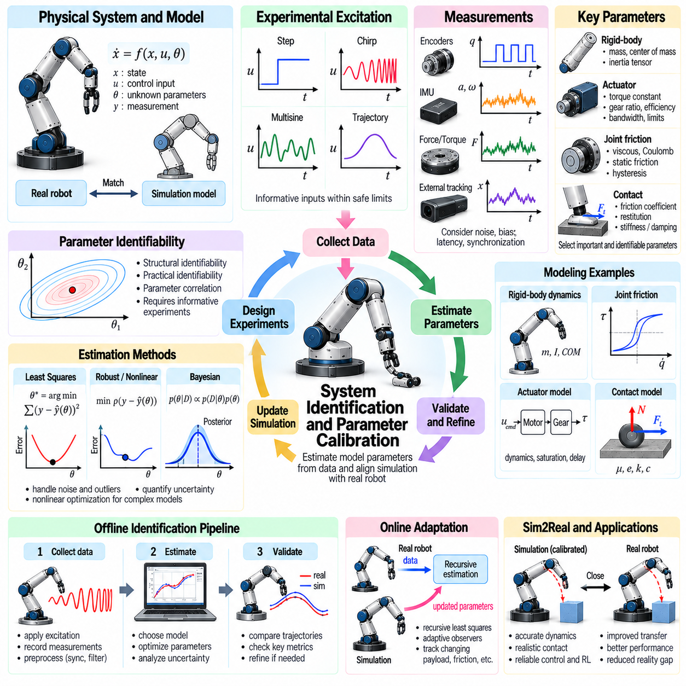{width="7.268055555555556in" height="7.268055555555556in"}

System identification and parameter calibration establish the relationship between mathematical robot models and the behavior of physical hardware. Simulation models contain parameters describing mass, inertia, friction, actuator response, and contact properties. These quantities are often uncertain or change during operation. System identification estimates them from observed data, while calibration adjusts simulation settings to reproduce measured behavior with sufficient accuracy.

A physical system can be represented through dynamic equations connecting states, control inputs, unknown parameters, and measured outputs. System identification seeks parameter values that explain the observed response to controlled excitation. The process requires a suitable model structure, informative experiments, and reliable measurements. Even sophisticated optimization cannot recover accurate parameters when essential physical effects are absent from the model.

Parameter identification begins by determining which quantities influence the intended robotic task. Relevant parameters may include link masses, centers of mass, inertia tensors, joint friction, motor constants, transmission ratios, and contact stiffness. Estimating every parameter independently is often unnecessary or impossible. Sensitivity analysis helps prioritize quantities that significantly affect motion, control performance, and simulation fidelity.

Identifiability describes whether unknown parameters can be uniquely determined from available observations. Different parameter combinations may produce nearly identical system responses, making individual values difficult to distinguish. Structural identifiability concerns the mathematical model, while practical identifiability depends on noise, experiment duration, and excitation quality. Poor identifiability can produce unstable estimates despite small prediction errors.

Experimental excitation must generate motion that reveals the effects of unknown parameters. Slowly varying commands may identify static friction and low-frequency response, while faster trajectories expose inertia, damping, and actuator bandwidth. Excitation signals can include steps, chirps, multisine inputs, and carefully designed trajectories. Experiments must remain within safe operating limits while providing sufficient information for estimation.

Measurement quality directly influences identification accuracy. Joint encoders, inertial sensors, force sensors, and external tracking systems provide complementary observations of robot behavior. Their noise, bias, latency, and calibration errors must be considered during parameter estimation. Synchronizing control commands with measurements is particularly important because timing offsets can resemble dynamic delays or incorrect actuator parameters.

Rigid-body parameter identification focuses on mass distribution and inertial properties. Link masses, centers of mass, and inertia tensors determine gravitational loads, acceleration response, and coupling between joints. Dynamic regressors can express certain robot equations linearly in combinations of inertial parameters. However, not every individual parameter is independently observable, and estimated values must satisfy physical consistency constraints.

Joint friction identification characterizes resistance arising from bearings, seals, transmissions, and mechanical interfaces. Common models include viscous friction, Coulomb friction, static friction, and velocity-dependent effects. Friction may also exhibit hysteresis, temperature dependence, and direction asymmetry. Accurate estimation requires measurements across different velocities, loads, and motion directions rather than relying on a single operating condition.

Actuator calibration identifies the relationship between commanded inputs and generated mechanical motion or torque. Motor torque constants, electrical resistance, current limits, gearbox efficiency, and controller bandwidth may influence this relationship. Internal drive controllers can introduce filtering, saturation, and nonlinear behavior. Identification experiments should distinguish actuator dynamics from the dynamics of the connected mechanical structure.

Contact parameter calibration addresses friction coefficients, restitution, stiffness, damping, and surface compliance. These properties strongly influence locomotion, grasping, manipulation, and collision behavior. Contact parameters are often difficult to estimate because their effects depend on normal load, sliding velocity, material condition, and contact geometry. Controlled pushing, sliding, impact, and compression experiments provide useful calibration evidence.

Least-squares estimation minimizes discrepancies between measured outputs and model predictions. Weighted least squares accounts for different measurement uncertainties, while robust loss functions reduce sensitivity to outliers. Nonlinear optimization is frequently required when contact, friction, or actuator models contain nonlinear parameters. The quality of the resulting estimates depends on initialization, numerical conditioning, and the suitability of the objective function.

Bayesian identification represents uncertain parameters through probability distributions rather than single numerical values. Prior knowledge can constrain physically plausible ranges, while experimental measurements update parameter beliefs. Posterior uncertainty helps determine whether additional experiments are necessary. This approach is especially valuable when data are limited, measurements are noisy, or several parameter combinations explain the observations.

Online system identification updates parameter estimates while a robot operates. Recursive least squares, adaptive observers, and filtering methods can track gradual changes in payload, friction, or actuator characteristics. Online estimation must distinguish genuine parameter variation from transient disturbances and sensor noise. Rapid or poorly constrained adaptation may destabilize control, making confidence monitoring and parameter bounds important.

Calibration workflows often alternate between physical experiments and simulation-based optimization. Recorded control inputs are replayed in simulation, and predicted trajectories are compared with measured responses. Parameter updates reduce discrepancies in positions, velocities, forces, or task outcomes. Repeating this process across diverse experiments helps prevent calibration from becoming overly specialized to a single trajectory.

Multiobjective calibration considers several physical behaviors simultaneously rather than minimizing one trajectory error. A parameter set that reproduces joint positions may still predict incorrect contact forces or energy consumption. Combining motion, force, timing, and actuator measurements produces stronger constraints. Objective weights should reflect measurement reliability and application priorities rather than being selected solely for numerical convenience.

Parameter sensitivity analysis measures how changes in model parameters influence predicted outputs. Highly sensitive parameters require accurate calibration because small errors can produce substantial behavioral differences. Weakly sensitive parameters may remain uncertain without significantly affecting the target task. Sensitivity matrices also reveal correlations that complicate estimation and guide the design of additional experiments.

Overfitting occurs when calibrated parameters reproduce a limited experimental dataset but fail under new operating conditions. Validation should therefore use trajectories, payloads, speeds, and contact configurations excluded from parameter estimation. Residual analysis can reveal systematic model errors that parameter adjustment alone cannot resolve. Persistent discrepancies may indicate missing flexibility, backlash, thermal effects, or unmodeled controller dynamics.

Physical consistency is essential when optimizing simulation parameters. Estimated masses must remain positive, inertia tensors must satisfy mechanical feasibility conditions, and friction parameters should respect plausible material behavior. Unconstrained optimization may reduce numerical prediction error by producing impossible physical properties. Appropriate parameterizations and constrained optimization preserve realism while improving model agreement.

Domain randomization complements calibration by representing uncertainty that cannot be eliminated through measurement. Calibrated parameter distributions can define realistic ranges for mass, friction, actuator delay, and contact behavior. Training across these ranges reduces dependence on one nominal model. However, randomization should not substitute for correcting systematic modeling errors or validating the underlying physical assumptions.

Large-scale identification benefits from automated data collection, experiment management, and reproducible optimization pipelines. Metadata should record hardware configuration, sensor calibration, environmental conditions, and software versions. Parameter estimates should be associated with uncertainty and validation results. Version-controlled models enable engineers to determine whether simulation improvements arise from calibration changes or modifications to engine behavior.

System identification and parameter calibration form a continuous feedback process between physical robots and simulation environments. As hardware ages, payloads change, or operating conditions evolve, previously calibrated models may lose accuracy. Periodic reidentification and targeted validation maintain agreement with physical behavior. This process reduces the Sim2Real gap and provides a more reliable foundation for Physical AI learning, control, and deployment.

## 01.16. Robot Physics Model Validation [w/Code]

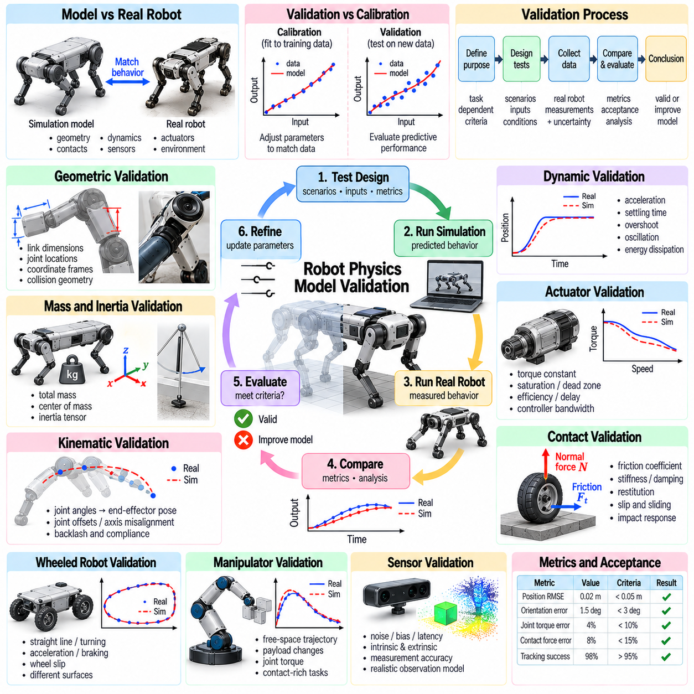{width="7.268055555555556in" height="7.268055555555556in"}

Robot physics model validation determines whether a simulated robot reproduces the physical behavior of its real-world counterpart with sufficient accuracy for its intended application. A model may contain detailed geometry, dynamics, actuators, and contact properties yet still produce incorrect motion. Validation compares predicted behavior against trusted references and experimental measurements. Its purpose is to establish confidence in simulation results rather than merely demonstrate visually plausible movement.

Validation differs from model calibration because it evaluates predictive performance using evidence that was not used to estimate model parameters. Calibration adjusts uncertain quantities to improve agreement with observed behavior, while validation examines whether those adjustments generalize to new conditions. Keeping identification and validation datasets separate prevents misleading conclusions. A model that reproduces its calibration experiments is not necessarily reliable for unseen robotic tasks.

The validation process begins by defining the intended use of the physics model. A mobile robot intended for navigation requires accurate wheel-ground interaction and vehicle motion, while a manipulator performing assembly requires reliable joint dynamics and contact forces. Validation criteria should therefore reflect the relevant physical mechanisms. Universal accuracy across every possible operating condition is rarely practical or necessary.

A structured validation framework establishes reference measurements, test scenarios, evaluation metrics, and acceptance criteria before experiments begin. Reference data may come from analytical mechanics, calibrated instruments, or carefully controlled hardware tests. Each test should specify initial conditions, control inputs, environmental properties, and measurement uncertainty. Documented procedures make results reproducible and support meaningful comparisons between model versions.

Geometric validation verifies that robot dimensions, coordinate frames, joint locations, and collision representations match physical hardware. Small geometric errors can alter contact timing, kinematic reach, and mechanical leverage. Computer-aided design data provide useful references but may not capture manufacturing tolerances or assembly deviations. Physical measurements are especially important for components whose geometry strongly influences contact behavior.

Mass and inertia validation examines whether simulated bodies reproduce gravitational loading and acceleration response. Total mass, center of mass, and inertia tensors affect stability, joint torques, and dynamic coupling. Static weighing and center-of-mass measurements provide initial evidence, while controlled acceleration tests reveal inertial discrepancies. Physically consistent parameters must satisfy positive mass and feasible inertia relationships.

Kinematic validation compares predicted positions and orientations with measurements obtained from joint encoders or external tracking systems. Forward kinematics should reproduce the observed relationship between joint configurations and end-effector poses. Joint offsets, axis misalignment, backlash, and mechanical compliance can introduce systematic errors. Testing multiple configurations helps distinguish constant calibration offsets from configuration-dependent modeling deficiencies.

Dynamic validation evaluates the robot response to known forces, torques, and motion commands. Controlled experiments can measure acceleration, settling time, overshoot, oscillation frequency, and energy dissipation. Comparing complete response trajectories reveals errors that static measurements cannot detect. Experiments should cover different speeds, loads, and directions because friction and actuator dynamics may vary significantly across operating conditions.

Actuator validation examines the relationship between commanded inputs and actual mechanical outputs. Motor current, torque, velocity, acceleration, and controller response provide evidence about drive-system behavior. Saturation, dead zones, transmission efficiency, and control-loop delays should be represented when they influence task performance. Testing actuators separately from the complete robot can help isolate electrical and mechanical modeling errors.

Contact validation is essential because small errors in friction, stiffness, restitution, or collision geometry can produce large differences in robotic behavior. Controlled sliding, pushing, compression, and impact experiments reveal different aspects of contact response. Normal force, slip distance, rebound velocity, and contact duration provide useful comparison quantities. Validation should include transitions between sticking, sliding, impact, and sustained contact.

For wheeled robots, validation should examine straight-line motion, turning, acceleration, braking, and wheel slip under representative loads. Wheel radius, effective rolling resistance, tire deformation, and ground friction influence these behaviors. Measured trajectories and wheel encoder readings help distinguish drivetrain errors from contact-model discrepancies. Tests on multiple surfaces reveal whether the model generalizes beyond one friction condition.

For manipulators, validation should include free-space trajectories, payload changes, joint reversals, and contact-rich tasks. End-effector tracking error, joint torque, settling behavior, and interaction forces provide complementary evidence. A model that performs well in free space may fail during grasping or assembly because contact dynamics are insufficiently represented. Validation must therefore cover the operating modes required by the intended task.

Sensor validation ensures that simulated observations reflect the behavior of physical measurement systems. Noise, bias, latency, sampling frequency, and calibration offsets influence state estimation and feedback control. Comparing sensor outputs under synchronized conditions helps identify measurement-model discrepancies. Controllers should be evaluated using realistic simulated observations rather than unrestricted access to ideal physical states.

Quantitative validation requires metrics that capture both average performance and important failure conditions. Root mean square error, maximum deviation, trajectory alignment error, and frequency-response differences measure different aspects of model agreement. Contact applications may require force error, penetration depth, or slip-rate metrics. Metrics should be normalized when necessary and interpreted relative to sensor uncertainty and application requirements.

Statistical validation evaluates variation across repeated experiments rather than relying on a single successful trial. Physical measurements contain noise, environmental variation, and hardware-dependent disturbances. Confidence intervals and error distributions help determine whether simulation discrepancies are meaningful. Repeated tests also reveal whether the model reproduces variability, not merely the average response, which is important for robust Physical AI training.

Numerical convergence testing separates physical modeling errors from artifacts introduced by integration and solver settings. Repeating simulations with smaller time steps, additional solver iterations, or tighter tolerances reveals sensitivity to numerical configuration. If predictions change substantially with numerical resolution, model validation is premature. Stable numerical behavior is necessary before discrepancies can be attributed confidently to physical parameters.

Sensitivity analysis identifies which uncertain parameters most strongly influence validation outcomes. Changes in mass, friction, actuator delay, or contact stiffness may affect different experiments in different ways. Parameter perturbations help reveal poorly constrained properties and guide additional measurements. Validation should also identify interactions between parameters because individually acceptable values may produce inaccurate behavior when combined.

Residual analysis examines differences between measured and simulated outputs over time. Random residuals consistent with measurement uncertainty suggest better agreement than systematic deviations linked to velocity, load, or contact state. Persistent patterns may reveal missing backlash, flexible structures, thermal drift, or controller dynamics. Correcting model structure is often more effective than repeatedly tuning parameters to compensate for omitted physics.

Validation coverage should include nominal operation, boundary conditions, and credible failure scenarios. High payloads, low-friction surfaces, rapid direction changes, and actuator saturation can expose weaknesses hidden during routine tests. Safety-critical behavior requires particular attention because small prediction errors may lead to unstable control or unexpected contact. Acceptance criteria should be tied to the consequences of model inaccuracies.

Automated validation pipelines improve consistency by replaying standardized experiments and comparing outputs against reference datasets. Each result should record model parameters, physics engine version, solver settings, time step, and hardware configuration. Regression tests can detect changes introduced by software updates or model revisions. Version-controlled validation reports provide traceability and prevent performance improvements in one scenario from concealing degradation elsewhere.

Robot physics model validation supports Sim2Real transfer by identifying discrepancies before learned controllers are deployed on physical hardware. A validated model does not guarantee success in every environment, but it provides evidence that relevant physical behaviors are represented within defined limits. Combining independent experiments, numerical convergence checks, uncertainty analysis, and continuous regression testing creates a reliable foundation for Physical AI development and deployment.
