**Volume 05. Simulation and Sim2Real Transfer**


# Chapter 02. Photorealistic Rendering

##  

## 02.01. Rendering for Physical AI

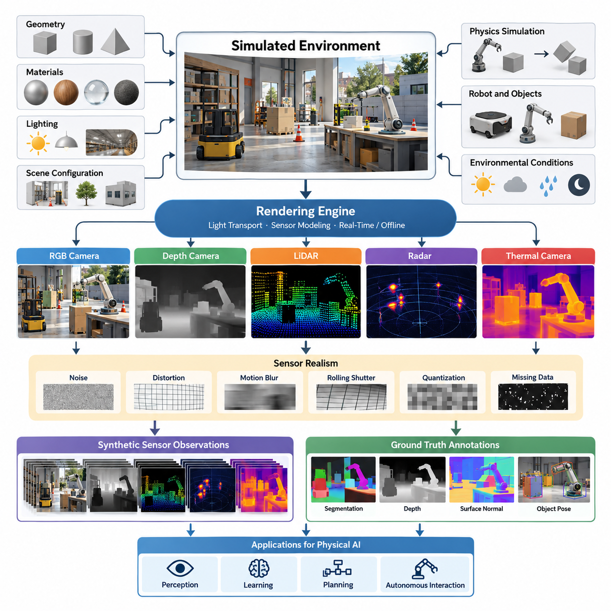{width="7.268055555555556in" height="7.268055555555556in"}

Rendering for Physical AI is the process of generating synthetic visual observations that approximate how intelligent machines perceive the physical world. Unlike conventional computer graphics, which primarily emphasizes visual presentation, rendering for Physical AI supports perception, learning, planning, and autonomous interaction. Its purpose is to transform simulated environments into sensor observations that are sufficiently realistic and informative for developing intelligent physical systems.

Physical AI systems depend on visual information to understand objects, surfaces, obstacles, spatial relationships, and environmental conditions. Autonomous mobile robots, manipulators, humanoids, and autonomous vehicles use camera observations to estimate their surroundings and select appropriate actions. Rendering provides a controlled method for reproducing these observations without requiring continuous access to physical hardware or real-world environments.

The rendering process begins with a virtual representation of the environment containing geometric models, materials, lighting sources, cameras, and scene configurations. A rendering engine calculates how light interacts with surfaces and how these interactions appear from a particular sensor viewpoint. The resulting images represent simulated observations that can be supplied directly to perception algorithms, learning systems, and robotic control architectures.

Photorealistic rendering seeks to reproduce visual characteristics that closely resemble those captured by real cameras. These characteristics include surface reflections, shadows, transparency, illumination variation, texture detail, and atmospheric effects. Realistic rendering becomes particularly important when artificial intelligence models depend on subtle visual features, such as object boundaries, material appearance, depth cues, and surface conditions.

Rendering fidelity is not determined solely by the visual attractiveness of an image. For Physical AI, the most important criterion is whether simulated observations preserve the information required for successful real-world behavior. A visually impressive image may still produce misleading sensor characteristics, while a simplified rendering may adequately support a specific task. Rendering quality must therefore be evaluated in relation to downstream perception and control performance.

A central distinction exists between rendering for human visualization and rendering for machine perception. Human observers often tolerate small geometric inconsistencies or unrealistic camera effects, whereas machine learning models may respond strongly to such differences. Changes in texture statistics, illumination distributions, image noise, or object appearance can alter learned representations and reduce the reliability of models transferred from simulation to physical environments.

Rendering is closely connected to physics simulation, although the two processes serve different purposes. Physics engines calculate motion, contact, forces, and interactions between objects, while rendering engines generate observations of the resulting simulated states. Their synchronization enables a robot to perceive consequences of its actions, allowing visual feedback to participate in closed-loop learning, decision-making, and control.

Accurate geometric representation provides the foundation for meaningful visual simulation. Three-dimensional models describe object shapes, spatial dimensions, surface orientation, and structural relationships. In robotic applications, geometry must also correspond to collision models and physical interaction boundaries. Significant inconsistencies between rendered geometry and physical geometry can create misleading visual evidence during manipulation or navigation tasks.

Material representation determines how virtual surfaces interact with incident light. Metallic objects, transparent materials, painted surfaces, rubber components, and rough industrial structures exhibit different reflection and absorption characteristics. Physically based material models help reproduce these differences using parameters associated with roughness, reflectance, transparency, and other optical properties relevant to machine vision.

Lighting strongly influences the appearance of simulated environments and the information available to visual algorithms. Directional illumination, artificial lighting, indirect reflections, and environmental light produce different image distributions. Shadows may reveal object geometry and spatial relationships, but they can also introduce ambiguities. Realistic lighting simulation helps train perception systems to operate across varying illumination conditions.

Camera modeling connects the virtual scene to the observation characteristics of actual robotic sensors. A simulated camera must account for intrinsic parameters, image resolution, field of view, lens distortion, and sensor orientation. Additional effects such as exposure, dynamic range, motion blur, and rolling shutter behavior may become important when robots move rapidly or operate under challenging environmental conditions.

Rendering for Physical AI extends beyond conventional RGB images. Depth cameras, LiDAR systems, radar sensors, and thermal cameras require different models of environmental interaction and measurement generation. Depth rendering estimates visible surface distances, while LiDAR simulation models range measurements along emitted sensing directions. These sensor representations enable the development of multimodal perception systems within virtual environments.

Sensor realism requires the simulation of imperfections rather than ideal measurements alone. Real sensors experience noise, calibration errors, missing measurements, saturation, and environmental interference. Synthetic observations that omit these effects may create unrealistic expectations during model training. Introducing calibrated sensor imperfections helps reduce discrepancies between simulated observations and measurements obtained from physical robotic platforms.

One of the most important applications of rendering is synthetic training data generation. Simulated scenes can produce large collections of images accompanied by accurate annotations, including segmentation masks, object poses, bounding boxes, depth maps, and semantic labels. These annotations are generated directly from scene information, reducing manual labeling requirements and supporting scalable training of computer vision and robotic perception models.

Rendering also supports systematic variation of environmental conditions. Developers can modify illumination, camera viewpoints, object arrangements, material properties, and background appearances while preserving task objectives. Such controlled variation enables models to encounter diverse visual situations during training. It also provides a foundation for domain randomization, which aims to improve robustness against previously unseen real-world conditions.

The relationship between photorealism and generalization is complex. Increasing visual realism can reduce some differences between simulated and real images, but it does not automatically guarantee successful transfer. Models may still depend on artificial correlations or encounter environmental conditions absent from training. Effective simulation strategies therefore combine realistic rendering, calibrated sensor models, environmental diversity, and real-world validation.

Rendering performance introduces an important engineering tradeoff. Advanced lighting calculations and physically accurate optical effects may require substantial computational resources. However, reinforcement learning and large-scale synthetic data generation often demand thousands of simultaneous simulation instances. Rendering architectures must balance visual fidelity, computational throughput, memory consumption, and the observation requirements of individual learning tasks.

Rasterization, ray tracing, and path tracing represent different approaches to image generation. Rasterization efficiently converts scene geometry into image pixels, making it suitable for high-throughput applications. Ray tracing models selected light transport effects, including reflections and shadows. Path tracing can reproduce more comprehensive global illumination behavior, although its computational requirements are generally higher.

Modern simulation platforms increasingly combine multiple rendering techniques within unified environments. High-fidelity rendering may be used to generate training datasets or evaluate difficult perception scenarios, while faster rendering configurations support large-scale policy learning. This separation allows developers to allocate computational resources according to the objectives of each simulation stage rather than requiring identical rendering quality everywhere.

Rendering must also preserve temporal consistency when supporting robotic learning. Sequential observations should correspond to physically plausible object motion, camera movement, illumination changes, and sensor timing. Inconsistent visual transitions can distort motion estimation, visual tracking, and action-conditioned prediction. Synchronization between simulation time, physics updates, rendering frames, and control commands is therefore essential.

Realistic scene construction is particularly important in industrial and logistics applications. Warehouses, manufacturing facilities, and construction environments contain complex arrangements of machinery, reflective surfaces, transparent barriers, repetitive structures, and moving equipment. Reproducing these characteristics enables developers to examine perception failures and evaluate robotic behavior under conditions resembling intended deployment environments.

Validation of rendering quality requires comparison with observations collected from real sensors. Developers can compare image statistics, feature distributions, depth measurements, and task-specific perception results. Calibration procedures adjust scene parameters, material properties, lighting configurations, and camera models to reduce meaningful discrepancies. The ultimate objective is not merely image similarity but improved reliability during real-world operation.

Rendering becomes more valuable when integrated with automated simulation and data-generation pipelines. Scene generation tools can create environments, configure sensors, execute simulated trajectories, and export synchronized observations with ground-truth annotations. Automated quality checks can identify invalid images, inconsistent labels, and unrealistic sensor outputs, enabling repeatable experimentation across large datasets and simulation campaigns.

The future of rendering for Physical AI involves closer integration between graphics engines, physical simulation, neural representations, and learning-based scene generation. Neural rendering and generative techniques may help reconstruct complex environments or create diverse visual experiences. Nevertheless, their outputs must remain geometrically, temporally, and physically consistent when used to train systems that interact with real objects.

Ultimately, rendering for Physical AI functions as a bridge between virtual environments and physical perception. Its effectiveness depends on accurate scene representation, realistic sensor behavior, computational efficiency, and alignment with robotic learning objectives. When combined with physics simulation, synthetic data generation, and systematic Sim2Real validation, rendering becomes a foundational capability for developing reliable and adaptable intelligent machines.

피지컬 AI(Physical AI)를 위한 렌더링(Rendering)은 지능형 기계(Intelligent Machine)가 물리적 세계(Physical World)를 인식하는 방식을 근사하는 합성 시각 관측(Synthetic Visual Observation)을 생성하는 과정이다. 시각적 표현을 주로 강조하는 기존 컴퓨터 그래픽스(Computer Graphics)와 달리, 피지컬 AI를 위한 렌더링은 인식(Perception), 학습(Learning), 계획(Planning), 자율적 상호작용(Autonomous Interaction)을 지원한다. 그 목적은 시뮬레이션 환경(Simulated Environment)을 지능형 물리 시스템(Intelligent Physical System)의 개발에 충분히 현실적이고 유용한 센서 관측(Sensor Observation)으로 변환하는 것이다.

피지컬 AI 시스템은 객체(Object), 표면(Surface), 장애물(Obstacle), 공간적 관계(Spatial Relationship), 환경 조건(Environmental Condition)을 이해하기 위해 시각 정보(Visual Information)에 의존한다. 자율이동로봇(Autonomous Mobile Robot), 매니퓰레이터(Manipulator), 휴머노이드(Humanoid), 자율주행차량(Autonomous Vehicle)은 카메라 관측(Camera Observation)을 활용하여 주변 환경을 추정하고 적절한 행동(Action)을 선택한다. 렌더링은 실제 하드웨어(Physical Hardware)나 현실 환경에 지속적으로 접근하지 않고도 이러한 관측을 재현할 수 있는 통제된 방법을 제공한다.

렌더링 과정(Rendering Process)은 기하학적 모델(Geometric Model), 재질(Material), 광원(Light Source), 카메라(Camera), 장면 구성(Scene Configuration)을 포함하는 가상 환경 표현(Virtual Environment Representation)에서 시작된다. 렌더링 엔진(Rendering Engine)은 빛이 표면과 상호작용하는 방식과 이러한 상호작용이 특정 센서 시점(Sensor Viewpoint)에서 어떻게 나타나는지를 계산한다. 생성된 영상은 시뮬레이션 관측(Simulated Observation)을 나타내며, 인식 알고리즘(Perception Algorithm), 학습 시스템(Learning System), 로봇 제어 아키텍처(Robotic Control Architecture)에 직접 입력될 수 있다.

포토리얼리스틱 렌더링(Photorealistic Rendering)은 실제 카메라(Real Camera)가 촬영한 영상과 매우 유사한 시각적 특성(Visual Characteristic)을 재현하는 것을 목표로 한다. 이러한 특성에는 표면 반사(Surface Reflection), 그림자(Shadow), 투명도(Transparency), 조명 변화(Illumination Variation), 텍스처 세부정보(Texture Detail), 대기 효과(Atmospheric Effect)가 포함된다. 인공지능 모델(Artificial Intelligence Model)이 객체 경계(Object Boundary), 재질 외관(Material Appearance), 깊이 단서(Depth Cue), 표면 상태(Surface Condition)와 같은 미세한 시각적 특징에 의존할 때 사실적인 렌더링은 특히 중요해진다.

렌더링 충실도(Rendering Fidelity)는 영상의 시각적 아름다움만으로 결정되지 않는다. 피지컬 AI에서 가장 중요한 기준은 시뮬레이션 관측이 성공적인 현실 세계 행동(Real-World Behavior)에 필요한 정보를 보존하는지 여부이다. 시각적으로 인상적인 영상이라도 잘못된 센서 특성(Sensor Characteristic)을 생성할 수 있으며, 반대로 단순화된 렌더링(Simplified Rendering)이 특정 작업(Task)을 충분히 지원할 수도 있다. 따라서 렌더링 품질(Rendering Quality)은 후속 인식 및 제어 성능(Downstream Perception and Control Performance)과의 관계에서 평가되어야 한다.

인간 시각화(Human Visualization)를 위한 렌더링과 기계 인식(Machine Perception)을 위한 렌더링 사이에는 중요한 차이가 존재한다. 인간 관찰자(Human Observer)는 작은 기하학적 불일치(Geometric Inconsistency)나 비현실적인 카메라 효과(Camera Effect)를 어느 정도 허용하지만, 머신러닝 모델(Machine Learning Model)은 이러한 차이에 민감하게 반응할 수 있다. 텍스처 통계(Texture Statistics), 조명 분포(Illumination Distribution), 영상 잡음(Image Noise), 객체 외관(Object Appearance)의 변화는 학습된 표현(Learned Representation)을 변경하고 시뮬레이션에서 물리적 환경으로 전이된 모델의 신뢰성을 감소시킬 수 있다.

렌더링은 물리 시뮬레이션(Physics Simulation)과 밀접하게 연결되어 있지만, 두 과정은 서로 다른 목적을 수행한다. 물리 엔진(Physics Engine)은 객체 사이의 운동(Motion), 접촉(Contact), 힘(Force), 상호작용(Interaction)을 계산하며, 렌더링 엔진은 이러한 시뮬레이션 상태(Simulated State)에 대한 관측을 생성한다. 두 엔진의 동기화(Synchronization)를 통해 로봇은 자신의 행동 결과를 인식할 수 있으며, 시각적 피드백(Visual Feedback)이 폐루프 학습(Closed-Loop Learning), 의사결정(Decision-Making), 제어(Control)에 참여할 수 있다.

정확한 기하학적 표현(Geometric Representation)은 의미 있는 시각 시뮬레이션(Visual Simulation)의 기반을 제공한다. 3차원 모델(Three-Dimensional Model)은 객체 형상(Object Shape), 공간 치수(Spatial Dimension), 표면 방향(Surface Orientation), 구조적 관계(Structural Relationship)를 설명한다. 로봇 응용 분야에서는 기하학적 구조가 충돌 모델(Collision Model) 및 물리적 상호작용 경계(Physical Interaction Boundary)와도 일치해야 한다. 렌더링 기하학(Rendered Geometry)과 물리 기하학(Physical Geometry) 사이의 큰 불일치는 조작(Manipulation)이나 내비게이션(Navigation) 작업에서 잘못된 시각적 정보를 생성할 수 있다.

재질 표현(Material Representation)은 가상 표면(Virtual Surface)이 입사광(Incident Light)과 상호작용하는 방식을 결정한다. 금속 객체(Metallic Object), 투명 재질(Transparent Material), 도장 표면(Painted Surface), 고무 부품(Rubber Component), 거친 산업 구조물(Rough Industrial Structure)은 서로 다른 반사 및 흡수 특성(Reflection and Absorption Characteristics)을 나타낸다. 물리 기반 재질 모델(Physically Based Material Model)은 거칠기(Roughness), 반사율(Reflectance), 투명도(Transparency), 기타 광학적 속성(Optical Property)과 관련된 매개변수를 사용하여 이러한 차이를 재현하는 데 도움을 준다.

조명(Lighting)은 시뮬레이션 환경의 외관과 시각 알고리즘(Visual Algorithm)이 활용할 수 있는 정보에 큰 영향을 미친다. 방향성 조명(Directional Illumination), 인공조명(Artificial Lighting), 간접 반사(Indirect Reflection), 환경광(Environmental Light)은 서로 다른 영상 분포(Image Distribution)를 생성한다. 그림자는 객체의 기하학적 구조와 공간적 관계를 드러낼 수 있지만, 동시에 모호성(Ambiguity)을 유발할 수도 있다. 사실적인 조명 시뮬레이션(Lighting Simulation)은 다양한 조명 조건에서 작동하는 인식 시스템(Perception System)의 학습을 지원한다.

카메라 모델링(Camera Modeling)은 가상 장면(Virtual Scene)을 실제 로봇 센서(Robotic Sensor)의 관측 특성과 연결한다. 시뮬레이션 카메라(Simulated Camera)는 내부 매개변수(Intrinsic Parameter), 영상 해상도(Image Resolution), 시야각(Field of View), 렌즈 왜곡(Lens Distortion), 센서 방향(Sensor Orientation)을 고려해야 한다. 노출(Exposure), 동적 범위(Dynamic Range), 모션 블러(Motion Blur), 롤링 셔터(Rolling Shutter)와 같은 추가 효과는 로봇이 빠르게 이동하거나 까다로운 환경 조건에서 작동할 때 중요해질 수 있다.

피지컬 AI를 위한 렌더링은 일반적인 RGB 영상(RGB Image)을 넘어 다양한 센서로 확장된다. 깊이 카메라(Depth Camera), 라이다(LiDAR), 레이더(Radar), 열화상 카메라(Thermal Camera)는 환경과의 상호작용 및 측정 생성에 서로 다른 모델을 요구한다. 깊이 렌더링(Depth Rendering)은 관측 가능한 표면까지의 거리를 추정하며, 라이다 시뮬레이션(LiDAR Simulation)은 방출된 감지 방향을 따라 거리 측정(Range Measurement)을 모델링한다. 이러한 센서 표현은 가상 환경에서 다중모달 인식 시스템(Multimodal Perception System)의 개발을 가능하게 한다.

센서 현실성(Sensor Realism)을 확보하려면 이상적인 측정값뿐 아니라 불완전성(Imperfection)도 시뮬레이션해야 한다. 실제 센서는 잡음(Noise), 보정 오차(Calibration Error), 측정 누락(Missing Measurement), 포화(Saturation), 환경 간섭(Environmental Interference)을 경험한다. 이러한 효과를 생략한 합성 관측(Synthetic Observation)은 모델 학습(Model Training) 과정에서 비현실적인 기대를 형성할 수 있다. 보정된 센서 불완전성(Calibrated Sensor Imperfection)을 도입하면 시뮬레이션 관측과 실제 로봇 플랫폼(Physical Robotic Platform)에서 획득한 측정값 사이의 차이를 줄이는 데 도움이 된다.

렌더링의 가장 중요한 응용 분야 중 하나는 합성 학습 데이터 생성(Synthetic Training Data Generation)이다. 시뮬레이션 장면(Simulated Scene)은 분할 마스크(Segmentation Mask), 객체 자세(Object Pose), 경계 상자(Bounding Box), 깊이 맵(Depth Map), 의미론적 레이블(Semantic Label)을 포함한 정확한 주석(Annotation)과 함께 대규모 영상 데이터를 생성할 수 있다. 이러한 주석은 장면 정보(Scene Information)에서 직접 생성되므로 수작업 레이블링(Manual Labeling)의 필요성을 줄이고 컴퓨터 비전(Computer Vision) 및 로봇 인식 모델(Robotic Perception Model)의 확장 가능한 학습을 지원한다.

렌더링은 환경 조건(Environmental Condition)의 체계적인 변화도 지원한다. 개발자는 작업 목표(Task Objective)를 유지하면서 조명(Illumination), 카메라 시점(Camera Viewpoint), 객체 배치(Object Arrangement), 재질 속성(Material Property), 배경 외관(Background Appearance)을 변경할 수 있다. 이러한 통제된 변화(Controlled Variation)를 통해 모델은 학습 과정에서 다양한 시각적 상황을 경험한다. 또한 이전에 관측하지 못한 실제 환경 조건에 대한 강건성(Robustness)을 향상시키는 도메인 랜덤화(Domain Randomization)의 기반을 제공한다.

포토리얼리즘(Photorealism)과 일반화(Generalization) 사이의 관계는 복잡하다. 시각적 현실성(Visual Realism)을 높이면 시뮬레이션 영상과 실제 영상 사이의 일부 차이를 줄일 수 있지만, 성공적인 전이(Transfer)를 자동으로 보장하지는 않는다. 모델은 여전히 인위적인 상관관계(Artificial Correlation)에 의존하거나 학습 과정에 포함되지 않은 환경 조건을 경험할 수 있다. 따라서 효과적인 시뮬레이션 전략(Simulation Strategy)은 사실적인 렌더링, 보정된 센서 모델(Calibrated Sensor Model), 환경 다양성(Environmental Diversity), 실제 환경 검증(Real-World Validation)을 결합해야 한다.

렌더링 성능(Rendering Performance)은 중요한 공학적 절충 관계(Engineering Tradeoff)를 발생시킨다. 고급 조명 계산(Advanced Lighting Calculation)과 물리적으로 정확한 광학 효과(Physically Accurate Optical Effect)는 상당한 계산 자원(Computational Resource)을 요구할 수 있다. 그러나 강화학습(Reinforcement Learning)과 대규모 합성 데이터 생성(Large-Scale Synthetic Data Generation)은 수천 개의 동시 시뮬레이션 인스턴스(Simulation Instance)를 필요로 하는 경우가 많다. 따라서 렌더링 아키텍처(Rendering Architecture)는 시각적 충실도(Visual Fidelity), 계산 처리량(Computational Throughput), 메모리 사용량(Memory Consumption), 개별 학습 작업의 관측 요구사항(Observation Requirement) 사이에서 균형을 유지해야 한다.

래스터화(Rasterization), 광선 추적(Ray Tracing), 경로 추적(Path Tracing)은 서로 다른 영상 생성(Image Generation) 접근법을 나타낸다. 래스터화는 장면 기하학(Scene Geometry)을 영상 픽셀(Image Pixel)로 효율적으로 변환하므로 높은 처리량이 필요한 응용 분야에 적합하다. 광선 추적은 반사(Reflection)와 그림자(Shadow)를 포함한 특정 광 전달 효과(Light Transport Effect)를 모델링한다. 경로 추적은 더욱 포괄적인 전역 조명(Global Illumination) 동작을 재현할 수 있지만, 일반적으로 계산 요구량이 더 높다.

현대적인 시뮬레이션 플랫폼(Simulation Platform)은 점차 여러 렌더링 기술(Rendering Technique)을 통합 환경(Unified Environment)에서 결합하고 있다. 고충실도 렌더링(High-Fidelity Rendering)은 학습 데이터셋(Training Dataset)을 생성하거나 어려운 인식 시나리오(Perception Scenario)를 평가하는 데 사용될 수 있으며, 더 빠른 렌더링 구성(Rendering Configuration)은 대규모 정책 학습(Policy Learning)을 지원한다. 이러한 분리는 모든 단계에서 동일한 렌더링 품질을 요구하는 대신, 각 시뮬레이션 단계(Simulation Stage)의 목적에 따라 계산 자원을 배분할 수 있도록 한다.

로봇 학습(Robotic Learning)을 지원하는 렌더링은 시간적 일관성(Temporal Consistency)도 유지해야 한다. 연속적인 관측(Sequential Observation)은 물리적으로 타당한 객체 운동(Object Motion), 카메라 이동(Camera Movement), 조명 변화(Illumination Change), 센서 타이밍(Sensor Timing)에 대응해야 한다. 일관성이 없는 시각적 전환(Visual Transition)은 운동 추정(Motion Estimation), 시각 추적(Visual Tracking), 행동 조건부 예측(Action-Conditioned Prediction)을 왜곡할 수 있다. 따라서 시뮬레이션 시간(Simulation Time), 물리 업데이트(Physics Update), 렌더링 프레임(Rendering Frame), 제어 명령(Control Command) 사이의 동기화가 필수적이다.

사실적인 장면 구성(Realistic Scene Construction)은 산업 및 물류 응용 분야(Industrial and Logistics Application)에서 특히 중요하다. 창고(Warehouse), 제조 시설(Manufacturing Facility), 건설 환경(Construction Environment)에는 기계 장비(Machinery), 반사 표면(Reflective Surface), 투명 장벽(Transparent Barrier), 반복 구조(Repetitive Structure), 이동 장비(Moving Equipment)가 복잡하게 배치되어 있다. 이러한 특성을 재현하면 개발자는 실제 배포 환경(Deployment Environment)과 유사한 조건에서 인식 실패(Perception Failure)를 조사하고 로봇 동작(Robotic Behavior)을 평가할 수 있다.

렌더링 품질(Rendering Quality)의 검증(Validation)에는 실제 센서(Real Sensor)에서 수집한 관측과의 비교가 필요하다. 개발자는 영상 통계(Image Statistics), 특징 분포(Feature Distribution), 깊이 측정값(Depth Measurement), 작업별 인식 결과(Task-Specific Perception Result)를 비교할 수 있다. 보정 절차(Calibration Procedure)는 의미 있는 불일치를 줄이기 위해 장면 매개변수(Scene Parameter), 재질 속성(Material Property), 조명 구성(Lighting Configuration), 카메라 모델(Camera Model)을 조정한다. 궁극적인 목표는 단순한 영상 유사성(Image Similarity)이 아니라 실제 환경에서의 작동 신뢰성(Operational Reliability)을 향상시키는 것이다.

렌더링은 자동화된 시뮬레이션 및 데이터 생성 파이프라인(Automated Simulation and Data Generation Pipeline)과 통합될 때 더욱 높은 가치를 제공한다. 장면 생성 도구(Scene Generation Tool)는 환경을 생성하고 센서를 구성하며 시뮬레이션 궤적(Simulated Trajectory)을 실행하고, 정답 주석(Ground-Truth Annotation)이 포함된 동기화 관측(Synchronized Observation)을 출력할 수 있다. 자동 품질 검사(Automated Quality Check)는 유효하지 않은 영상, 일관성이 없는 레이블, 비현실적인 센서 출력을 식별하여 대규모 데이터셋과 시뮬레이션 작업 전반에서 반복 가능한 실험(Reproducible Experiment)을 가능하게 한다.

피지컬 AI를 위한 렌더링의 미래는 그래픽스 엔진(Graphics Engine), 물리 시뮬레이션(Physics Simulation), 신경망 기반 표현(Neural Representation), 학습 기반 장면 생성(Learning-Based Scene Generation) 사이의 더욱 긴밀한 통합을 포함한다. 신경망 렌더링(Neural Rendering)과 생성형 기술(Generative Technique)은 복잡한 환경을 재구성하거나 다양한 시각적 경험(Visual Experience)을 생성하는 데 도움을 줄 수 있다. 그러나 실제 객체와 상호작용하는 시스템을 학습시키는 데 사용하려면 그 출력은 기하학적(Geometric), 시간적(Temporal), 물리적(Physical) 일관성을 유지해야 한다.

궁극적으로 피지컬 AI를 위한 렌더링은 가상 환경(Virtual Environment)과 물리적 인식(Physical Perception)을 연결하는 가교 역할을 수행한다. 그 효과는 정확한 장면 표현(Scene Representation), 사실적인 센서 동작(Sensor Behavior), 계산 효율성(Computational Efficiency), 로봇 학습 목표(Robotic Learning Objective)와의 정합성(Alignment)에 달려 있다. 렌더링은 물리 시뮬레이션, 합성 데이터 생성(Synthetic Data Generation), 체계적인 시뮬레이션-현실 전이 검증(Sim2Real Validation)과 결합될 때 신뢰성과 적응성을 갖춘 지능형 기계(Intelligent Machine)를 개발하기 위한 핵심 기반 기술(Foundational Technology)이 된다.

##  

## 02.02. Rasterization Ray Tracing and Path Tracing

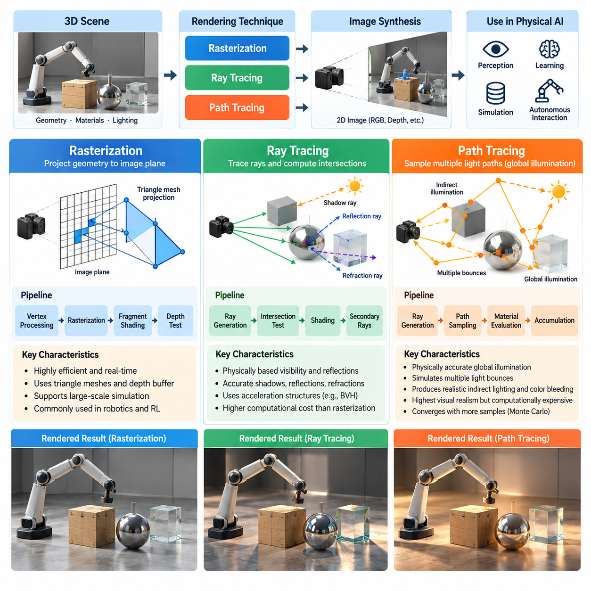{width="7.268055555555556in" height="7.268055555555556in"}

Rasterization, ray tracing, and path tracing are three fundamental rendering techniques used to transform three-dimensional scenes into visual observations for Physical AI systems. Each technique follows a different computational approach to determining how geometry, materials, and illumination contribute to image formation. Understanding their characteristics is essential for selecting rendering architectures that balance visual realism, computational efficiency, and robotic learning requirements.

Rasterization is a graphics technique that projects three-dimensional geometric primitives onto a two-dimensional image plane. Objects are typically represented as triangular meshes, which are transformed through camera projection and converted into pixel fragments. Visibility is determined using depth information, allowing the renderer to identify surfaces closest to the camera. This approach is highly efficient and forms the foundation of many real-time graphics pipelines.

The rasterization pipeline typically includes geometric transformation, primitive assembly, clipping, rasterization, fragment shading, and framebuffer operations. Vertex shaders transform object coordinates into camera and projection spaces, while fragment shaders calculate surface appearance. Depth buffers resolve visibility between overlapping surfaces. Modern graphics processors execute these operations in parallel, enabling high frame rates even in geometrically complex environments.

Rasterization is particularly valuable for Physical AI applications requiring rapid generation of visual observations. Reinforcement learning environments may simulate thousands of robots simultaneously, making rendering throughput a critical requirement. Rasterization can generate RGB images, depth maps, segmentation masks, and other visual representations efficiently. Its predictable computational structure makes it suitable for large-scale simulation and repeated policy training.

However, conventional rasterization does not directly simulate complete light transport. Reflections, indirect illumination, refraction, and soft shadows often require approximations or additional rendering techniques. Screen-space reflections, shadow maps, ambient occlusion, and environment maps can improve realism, but their accuracy depends on implementation assumptions. These limitations may become significant when robotic perception relies on complex optical effects.

Ray tracing approaches image generation by following simulated light rays through a virtual environment. In common camera-based implementations, rays originate from the camera and travel into the scene to identify intersections with geometric surfaces. At each intersection, the renderer evaluates material properties and illumination contributions. Additional rays may be generated to estimate shadows, reflections, or refractions, producing more physically consistent visual effects.

A primary advantage of ray tracing is its ability to model visibility and optical interactions using geometric ray intersections. Reflections from metallic surfaces, refraction through transparent objects, and shadows produced by complex geometry can be represented more accurately than with many conventional rasterization approximations. These capabilities are important in industrial environments containing polished machinery, glass barriers, reflective floors, and transparent components.

Efficient ray tracing depends heavily on acceleration structures that reduce the number of geometric intersection tests. Bounding volume hierarchies organize scene geometry into spatially related groups, allowing rays to bypass large regions that cannot contain relevant intersections. Modern graphics processors also provide specialized hardware acceleration for ray traversal and intersection calculations, making real-time ray tracing increasingly practical.

Despite these improvements, ray tracing generally requires more computation than conventional rasterization for comparable scene complexity and image resolution. Each pixel may require multiple rays, and reflective or transparent surfaces can introduce additional ray interactions. Performance depends on scene geometry, material complexity, ray depth, sampling strategy, and acceleration structure efficiency. These factors must be considered when designing robotic simulation pipelines.

Path tracing extends ray-based rendering by estimating the transport of light through multiple interactions with scene surfaces. Instead of evaluating only selected optical effects, path tracing samples possible light propagation paths involving reflection, transmission, and indirect illumination. By accumulating contributions from many sampled paths, it approximates solutions to the rendering equation and produces images with physically plausible global illumination.

The rendering equation describes how outgoing radiance depends on emitted light and incoming radiance reflected from surrounding directions. Path tracing evaluates this relationship numerically using Monte Carlo integration. Randomly sampled paths approximate complex lighting interactions that would otherwise require prohibitively expensive deterministic calculations. As the number of samples increases, the estimated image generally converges toward the expected lighting solution.

Path tracing can reproduce subtle visual phenomena such as color bleeding, diffuse interreflection, soft shadows, and complex indirect illumination. These effects influence how objects appear under realistic environmental conditions. In robotics, such details may affect object recognition, surface classification, pose estimation, and visual navigation, especially when perception models depend on illumination-sensitive features or reflective materials.

The principal limitation of path tracing is its computational cost. High-quality images may require many samples per pixel, particularly in scenes containing indirect lighting, glossy surfaces, or difficult illumination configurations. Insufficient sampling produces stochastic image noise, which can interfere with visual perception algorithms. Increasing sample counts improves image quality but reduces rendering throughput and simulation scalability.

Denoising techniques help address the computational burden of path tracing by reconstructing cleaner images from relatively small numbers of samples. Temporal accumulation, spatial filtering, and neural denoising can suppress sampling noise while preserving important visual structures. However, denoising may introduce artifacts, remove fine details, or alter image statistics. Such effects require careful evaluation when rendered images are used for machine learning.

The distinction between ray tracing and path tracing is primarily related to the scope and sampling of light transport. Ray tracing is a general technique for evaluating ray interactions with geometry, while path tracing is a stochastic light transport algorithm built upon ray tracing operations. A ray-traced renderer may calculate selected reflection and shadow effects, whereas a path tracer typically estimates broader global illumination through sampled light paths.

Hybrid rendering combines rasterization and ray tracing to balance computational efficiency and visual fidelity. Rasterization handles primary visibility and much of the scene shading, while ray tracing provides selected reflections, shadows, or indirect illumination. This architecture can achieve realistic observations without the full computational expense of path tracing. Hybrid approaches are particularly useful when Physical AI systems require interactive simulation with improved optical realism.

Rendering technique selection should reflect the requirements of the target robotic task. Navigation systems operating in ordinary indoor environments may perform adequately with rasterized images and calibrated sensor models. Manipulation systems handling transparent or reflective objects may benefit from ray-traced optical effects. High-fidelity synthetic dataset generation may justify path tracing when accurate illumination is more important than rendering speed.

Different rendering methods also influence the characteristics of synthetic training data. Rasterization may produce systematic visual approximations, while ray tracing and path tracing can introduce more realistic optical interactions. Nevertheless, physically sophisticated rendering does not automatically guarantee better learning performance. Geometry accuracy, camera calibration, sensor noise, material parameters, and environmental diversity remain essential components of simulation realism.

For reinforcement learning, rendering efficiency directly influences experience collection throughput. If every simulation step requires an expensive rendering operation, the number of training transitions generated per second may decrease substantially. Many robotic policies therefore use simplified visual observations during early training and higher-fidelity rendering during evaluation or targeted fine-tuning. This strategy allocates computational resources according to learning objectives.

Rendering pipelines must also support accurate synchronization between physics simulation and visual observation generation. Object positions, camera poses, articulated robot configurations, and environmental states should correspond to the same simulation timestamp. Motion blur and rolling shutter effects may require sampling scene states across exposure intervals. These considerations apply regardless of whether rasterization, ray tracing, or path tracing generates the final image.

Synthetic sensor generation introduces additional requirements beyond ordinary visual rendering. Depth cameras require accurate geometric distance measurements, while RGB cameras require realistic optical and electronic response characteristics. Segmentation outputs must preserve object identities independently of appearance. Ray-based methods can support geometric sensing, but realistic LiDAR, radar, and thermal simulation requires additional sensor-specific physical models.

Rendering fidelity can be evaluated by comparing synthetic images with measurements collected from real environments. Image intensity distributions, reflection patterns, shadow boundaries, feature descriptors, and perception model outputs provide complementary indicators of similarity. Task-level evaluation is particularly important because improvements in visual appearance do not necessarily translate into better robot behavior or successful Sim2Real transfer.

Computational architecture strongly influences the practical deployment of rendering techniques. GPU memory capacity, scene complexity, parallel execution efficiency, and data transfer overhead determine achievable simulation throughput. Large-scale Physical AI platforms may employ rasterization for massive parallel environments while reserving ray tracing or path tracing for selected high-fidelity scenarios. Such configurations support both scalability and detailed validation.

Emerging neural rendering methods provide additional opportunities to improve efficiency and scene reconstruction. Learned representations can approximate complex appearance or reconstruct environments from captured observations. Neural techniques may complement conventional rasterization and ray-based rendering, although maintaining geometric consistency, temporal stability, and physically meaningful sensor outputs remains challenging. Their usefulness depends on measurable improvements in downstream robotic tasks.

Ultimately, rasterization, ray tracing, and path tracing should be understood as complementary technologies rather than competing universal solutions. Rasterization provides efficient image generation, ray tracing improves the representation of selected optical interactions, and path tracing offers comprehensive stochastic light transport simulation. Their strategic combination enables Physical AI developers to construct scalable, realistic, and task-appropriate visual simulation environments.

래스터화(Rasterization), 광선 추적(Ray Tracing), 경로 추적(Path Tracing)은 3차원 장면(Three-Dimensional Scene)을 피지컬 AI(Physical AI) 시스템을 위한 시각적 관측(Visual Observation)으로 변환하는 세 가지 핵심 렌더링 기술(Rendering Technique)이다. 각 기술은 기하학적 구조(Geometry), 재질(Material), 조명(Illumination)이 영상 형성(Image Formation)에 기여하는 방식을 계산하기 위해 서로 다른 계산 접근법(Computational Approach)을 사용한다. 이러한 기술의 특성을 이해하는 것은 시각적 현실성(Visual Realism), 계산 효율성(Computational Efficiency), 로봇 학습 요구사항(Robotic Learning Requirement) 사이에서 균형을 유지하는 렌더링 아키텍처(Rendering Architecture)를 선택하는 데 필수적이다.

래스터화(Rasterization)는 3차원 기하학적 기본 요소(Geometric Primitive)를 2차원 영상 평면(Image Plane)에 투영하는 그래픽스 기술(Graphics Technique)이다. 객체(Object)는 일반적으로 삼각형 메시(Triangular Mesh)로 표현되며, 카메라 투영(Camera Projection)을 통해 변환된 후 픽셀 조각(Pixel Fragment)으로 변환된다. 가시성(Visibility)은 깊이 정보(Depth Information)를 사용하여 결정되며, 렌더러(Renderer)는 카메라에 가장 가까운 표면을 식별한다. 이러한 접근법은 매우 효율적이며 많은 실시간 그래픽스 파이프라인(Real-Time Graphics Pipeline)의 기반을 형성한다.

래스터화 파이프라인(Rasterization Pipeline)은 일반적으로 기하학적 변환(Geometric Transformation), 기본 요소 조립(Primitive Assembly), 클리핑(Clipping), 래스터화, 프래그먼트 셰이딩(Fragment Shading), 프레임버퍼 연산(Framebuffer Operation)을 포함한다. 정점 셰이더(Vertex Shader)는 객체 좌표(Object Coordinate)를 카메라 및 투영 공간(Camera and Projection Space)으로 변환하며, 프래그먼트 셰이더(Fragment Shader)는 표면 외관(Surface Appearance)을 계산한다. 깊이 버퍼(Depth Buffer)는 중첩된 표면 사이의 가시성을 결정한다. 현대 그래픽 처리 장치(Graphics Processing Unit, GPU)는 이러한 연산을 병렬로 실행하여 기하학적으로 복잡한 환경에서도 높은 프레임 속도(Frame Rate)를 구현한다.

래스터화는 시각적 관측(Visual Observation)을 빠르게 생성해야 하는 피지컬 AI 응용 분야에서 특히 유용하다. 강화학습 환경(Reinforcement Learning Environment)은 수천 개의 로봇을 동시에 시뮬레이션할 수 있으므로 렌더링 처리량(Rendering Throughput)이 핵심 요구사항이 된다. 래스터화는 RGB 영상(RGB Image), 깊이 맵(Depth Map), 분할 마스크(Segmentation Mask), 기타 시각적 표현(Visual Representation)을 효율적으로 생성할 수 있다. 예측 가능한 계산 구조(Computational Structure)는 대규모 시뮬레이션(Large-Scale Simulation)과 반복적인 정책 학습(Policy Training)에 적합하다.

그러나 기존 래스터화(Conventional Rasterization)는 완전한 광 전달(Light Transport)을 직접 시뮬레이션하지 않는다. 반사(Reflection), 간접 조명(Indirect Illumination), 굴절(Refraction), 부드러운 그림자(Soft Shadow)는 근사화(Approximation) 또는 추가 렌더링 기술을 필요로 하는 경우가 많다. 화면 공간 반사(Screen-Space Reflection), 그림자 맵(Shadow Map), 주변광 차폐(Ambient Occlusion), 환경 맵(Environment Map)은 현실성을 향상시킬 수 있지만, 정확도는 구현상의 가정(Implementation Assumption)에 따라 달라진다. 이러한 한계는 로봇 인식(Robotic Perception)이 복잡한 광학 효과(Optical Effect)에 의존할 때 중요해질 수 있다.

광선 추적(Ray Tracing)은 가상 환경(Virtual Environment)에서 시뮬레이션된 광선(Ray)을 추적하여 영상을 생성한다. 일반적인 카메라 기반 구현(Camera-Based Implementation)에서는 광선이 카메라에서 출발하여 장면 내부로 진행하면서 기하학적 표면(Geometric Surface)과의 교차점(Intersection)을 식별한다. 각 교차점에서 렌더러는 재질 속성(Material Property)과 조명 기여도(Illumination Contribution)를 평가한다. 그림자, 반사, 굴절을 추정하기 위해 추가 광선을 생성할 수 있으며, 이를 통해 물리적으로 더욱 일관된 시각 효과(Visual Effect)를 구현한다.

광선 추적의 주요 장점은 기하학적 광선 교차(Geometric Ray Intersection)를 사용하여 가시성과 광학적 상호작용(Optical Interaction)을 모델링할 수 있다는 점이다. 금속 표면(Metallic Surface)의 반사, 투명 객체(Transparent Object)를 통한 굴절, 복잡한 기하학적 구조가 만드는 그림자는 기존 래스터화 근사 기법보다 정확하게 표현될 수 있다. 이러한 기능은 광택이 있는 기계 장비(Polished Machinery), 유리 장벽(Glass Barrier), 반사 바닥(Reflective Floor), 투명 부품(Transparent Component)이 존재하는 산업 환경(Industrial Environment)에서 중요하다.

효율적인 광선 추적은 기하학적 교차 검사(Geometric Intersection Test)의 횟수를 줄이는 가속 구조(Acceleration Structure)에 크게 의존한다. 경계 볼륨 계층 구조(Bounding Volume Hierarchy, BVH)는 장면 기하학(Scene Geometry)을 공간적으로 연관된 그룹으로 구성하여 광선이 관련 교차점을 포함하지 않는 넓은 영역을 건너뛸 수 있도록 한다. 현대 그래픽 처리 장치는 광선 탐색(Ray Traversal)과 교차 계산(Intersection Calculation)을 위한 특수 하드웨어 가속(Hardware Acceleration)도 제공하므로 실시간 광선 추적(Real-Time Ray Tracing)의 실용성이 점차 높아지고 있다.

이러한 개선에도 불구하고 광선 추적은 일반적으로 동일한 수준의 장면 복잡도(Scene Complexity)와 영상 해상도(Image Resolution)에서 기존 래스터화보다 더 많은 계산을 요구한다. 각 픽셀(Pixel)은 여러 광선을 필요로 할 수 있으며, 반사 또는 투명 표면은 추가적인 광선 상호작용(Ray Interaction)을 발생시킬 수 있다. 성능은 장면 기하학, 재질 복잡도(Material Complexity), 광선 깊이(Ray Depth), 샘플링 전략(Sampling Strategy), 가속 구조 효율성(Acceleration Structure Efficiency)에 따라 달라진다. 로봇 시뮬레이션 파이프라인(Robotic Simulation Pipeline)을 설계할 때 이러한 요소를 고려해야 한다.

경로 추적(Path Tracing)은 장면 표면(Scene Surface)과 여러 차례 상호작용하는 빛의 전달을 추정하여 광선 기반 렌더링(Ray-Based Rendering)을 확장한다. 선택된 광학 효과만 평가하는 대신, 경로 추적은 반사(Reflection), 투과(Transmission), 간접 조명(Indirect Illumination)을 포함하는 가능한 광 전파 경로(Light Propagation Path)를 샘플링한다. 여러 샘플링 경로의 기여도를 누적하여 렌더링 방정식(Rendering Equation)의 해를 근사하고, 물리적으로 타당한 전역 조명(Global Illumination)을 갖춘 영상을 생성한다.

렌더링 방정식(Rendering Equation)은 방출된 빛(Emitted Light)과 주변 방향에서 입사하여 반사되는 복사휘도(Incoming Radiance)에 따라 출사 복사휘도(Outgoing Radiance)가 어떻게 결정되는지를 설명한다. 경로 추적은 몬테카를로 적분(Monte Carlo Integration)을 사용하여 이러한 관계를 수치적으로 평가한다. 무작위로 샘플링된 경로(Randomly Sampled Path)는 결정론적 계산(Deterministic Calculation)으로 처리하기에는 계산 비용이 매우 높은 복잡한 조명 상호작용을 근사한다. 샘플 수(Sample Count)가 증가할수록 추정 영상은 일반적으로 기대되는 조명 해(Lighting Solution)에 수렴한다.

경로 추적은 색 번짐(Color Bleeding), 확산 상호반사(Diffuse Interreflection), 부드러운 그림자(Soft Shadow), 복잡한 간접 조명(Indirect Illumination)과 같은 미세한 시각 현상(Visual Phenomenon)을 재현할 수 있다. 이러한 효과는 현실적인 환경 조건에서 객체가 나타나는 방식에 영향을 준다. 로봇 분야에서는 특히 인식 모델(Perception Model)이 조명에 민감한 특징(Illumination-Sensitive Feature)이나 반사 재질(Reflective Material)에 의존할 때 객체 인식(Object Recognition), 표면 분류(Surface Classification), 자세 추정(Pose Estimation), 시각 내비게이션(Visual Navigation)에 영향을 미칠 수 있다.

경로 추적의 주요 한계는 높은 계산 비용(Computational Cost)이다. 고품질 영상(High-Quality Image)은 특히 간접 조명, 광택 표면(Glossy Surface), 복잡한 조명 구성(Lighting Configuration)이 포함된 장면에서 픽셀당 많은 샘플(Samples per Pixel)을 필요로 할 수 있다. 샘플링이 충분하지 않으면 확률적 영상 잡음(Stochastic Image Noise)이 발생하여 시각 인식 알고리즘(Visual Perception Algorithm)을 방해할 수 있다. 샘플 수를 늘리면 영상 품질은 향상되지만 렌더링 처리량과 시뮬레이션 확장성(Simulation Scalability)은 감소한다.

잡음 제거 기술(Denoising Technique)은 상대적으로 적은 샘플로부터 더 깨끗한 영상을 재구성하여 경로 추적의 계산 부담을 줄이는 데 도움을 준다. 시간적 누적(Temporal Accumulation), 공간 필터링(Spatial Filtering), 신경망 기반 잡음 제거(Neural Denoising)는 중요한 시각적 구조(Visual Structure)를 보존하면서 샘플링 잡음(Sampling Noise)을 억제할 수 있다. 그러나 잡음 제거는 인공적인 영상 왜곡(Artifact)을 발생시키거나 미세한 세부정보를 제거하고 영상 통계(Image Statistics)를 변경할 수 있다. 따라서 렌더링 영상을 머신러닝(Machine Learning)에 사용할 때 이러한 효과를 신중하게 평가해야 한다.

광선 추적과 경로 추적의 차이는 주로 광 전달(Light Transport)의 범위와 샘플링 방식(Sampling Method)에 있다. 광선 추적은 광선과 기하학적 구조 사이의 상호작용을 평가하는 일반적인 기술이며, 경로 추적은 광선 추적 연산(Ray Tracing Operation)을 기반으로 구축된 확률적 광 전달 알고리즘(Stochastic Light Transport Algorithm)이다. 광선 추적 렌더러(Ray-Traced Renderer)는 선택된 반사와 그림자 효과를 계산할 수 있지만, 경로 추적기(Path Tracer)는 일반적으로 샘플링된 광 경로를 통해 더욱 광범위한 전역 조명을 추정한다.

하이브리드 렌더링(Hybrid Rendering)은 계산 효율성과 시각적 충실도(Visual Fidelity)의 균형을 유지하기 위해 래스터화와 광선 추적을 결합한다. 래스터화는 기본 가시성(Primary Visibility)과 장면 셰이딩(Scene Shading)의 상당 부분을 처리하고, 광선 추적은 선택된 반사, 그림자, 간접 조명을 제공한다. 이러한 아키텍처는 경로 추적의 전체 계산 비용을 부담하지 않으면서 사실적인 관측을 생성할 수 있다. 하이브리드 접근법(Hybrid Approach)은 광학적 현실성(Optical Realism)을 개선하면서 상호작용형 시뮬레이션(Interactive Simulation)을 유지해야 하는 피지컬 AI 시스템에 특히 유용하다.

렌더링 기술의 선택은 대상 로봇 작업(Target Robotic Task)의 요구사항을 반영해야 한다. 일반적인 실내 환경(Indoor Environment)에서 작동하는 내비게이션 시스템(Navigation System)은 래스터화 영상(Rasterized Image)과 보정된 센서 모델(Calibrated Sensor Model)만으로도 충분한 성능을 달성할 수 있다. 투명하거나 반사성이 있는 객체를 다루는 조작 시스템(Manipulation System)은 광선 추적 기반 광학 효과의 이점을 얻을 수 있다. 고충실도 합성 데이터셋 생성(High-Fidelity Synthetic Dataset Generation)에서는 렌더링 속도보다 정확한 조명이 중요할 경우 경로 추적을 사용하는 것이 타당할 수 있다.

서로 다른 렌더링 방법(Rendering Method)은 합성 학습 데이터(Synthetic Training Data)의 특성에도 영향을 미친다. 래스터화는 체계적인 시각적 근사 오차(Systematic Visual Approximation)를 생성할 수 있는 반면, 광선 추적과 경로 추적은 더욱 현실적인 광학적 상호작용(Optical Interaction)을 도입할 수 있다. 그러나 물리적으로 정교한 렌더링(Physically Sophisticated Rendering)이 반드시 더 나은 학습 성능(Learning Performance)을 보장하는 것은 아니다. 기하학적 정확도(Geometry Accuracy), 카메라 보정(Camera Calibration), 센서 잡음(Sensor Noise), 재질 매개변수(Material Parameter), 환경 다양성(Environmental Diversity)은 여전히 시뮬레이션 현실성(Simulation Realism)의 필수 요소이다.

강화학습(Reinforcement Learning)에서는 렌더링 효율성(Rendering Efficiency)이 경험 수집 처리량(Experience Collection Throughput)에 직접적인 영향을 미친다. 모든 시뮬레이션 단계(Simulation Step)에서 비용이 높은 렌더링 연산을 수행해야 한다면 초당 생성되는 학습 전이(Training Transition)의 수가 크게 감소할 수 있다. 따라서 많은 로봇 정책(Robotic Policy)은 초기 학습 단계에서 단순화된 시각 관측(Simplified Visual Observation)을 사용하고, 평가(Evaluation)나 목표 지향적 미세조정(Targeted Fine-Tuning) 단계에서 고충실도 렌더링을 사용한다. 이러한 전략은 학습 목표에 따라 계산 자원을 배분한다.

렌더링 파이프라인(Rendering Pipeline)은 물리 시뮬레이션(Physics Simulation)과 시각 관측 생성(Visual Observation Generation) 사이의 정확한 동기화(Synchronization)도 지원해야 한다. 객체 위치(Object Position), 카메라 자세(Camera Pose), 관절형 로봇 구성(Articulated Robot Configuration), 환경 상태(Environmental State)는 동일한 시뮬레이션 타임스탬프(Simulation Timestamp)에 대응해야 한다. 모션 블러(Motion Blur)와 롤링 셔터(Rolling Shutter) 효과는 노출 구간(Exposure Interval)에 걸쳐 장면 상태(Scene State)를 샘플링해야 할 수도 있다. 이러한 고려사항은 최종 영상을 생성하는 기술이 래스터화, 광선 추적, 경로 추적 중 무엇인지와 관계없이 적용된다.

합성 센서 생성(Synthetic Sensor Generation)은 일반적인 시각 렌더링(Visual Rendering)을 넘어서는 추가 요구사항을 포함한다. 깊이 카메라(Depth Camera)는 정확한 기하학적 거리 측정(Geometric Distance Measurement)이 필요하며, RGB 카메라(RGB Camera)는 현실적인 광학 및 전자적 응답 특성(Optical and Electronic Response Characteristic)을 요구한다. 분할 출력(Segmentation Output)은 외관과 관계없이 객체 식별 정보(Object Identity)를 보존해야 한다. 광선 기반 방법(Ray-Based Method)은 기하학적 센싱(Geometric Sensing)을 지원할 수 있지만, 현실적인 라이다(LiDAR), 레이더(Radar), 열화상(Thermal) 시뮬레이션에는 추가적인 센서별 물리 모델(Sensor-Specific Physical Model)이 필요하다.

렌더링 충실도(Rendering Fidelity)는 합성 영상(Synthetic Image)을 실제 환경에서 수집한 측정값(Real-World Measurement)과 비교하여 평가할 수 있다. 영상 강도 분포(Image Intensity Distribution), 반사 패턴(Reflection Pattern), 그림자 경계(Shadow Boundary), 특징 기술자(Feature Descriptor), 인식 모델 출력(Perception Model Output)은 유사성을 평가하는 상호보완적인 지표(Complementary Indicator)를 제공한다. 시각적 외관의 개선이 반드시 더 나은 로봇 동작(Robot Behavior)이나 성공적인 시뮬레이션-현실 전이(Sim2Real Transfer)로 이어지는 것은 아니므로 작업 수준 평가(Task-Level Evaluation)가 특히 중요하다.

계산 아키텍처(Computational Architecture)는 렌더링 기술의 실제 적용에 큰 영향을 미친다. GPU 메모리 용량(GPU Memory Capacity), 장면 복잡도(Scene Complexity), 병렬 실행 효율성(Parallel Execution Efficiency), 데이터 전송 오버헤드(Data Transfer Overhead)는 달성 가능한 시뮬레이션 처리량(Simulation Throughput)을 결정한다. 대규모 피지컬 AI 플랫폼(Large-Scale Physical AI Platform)은 대량 병렬 환경(Massive Parallel Environment)에 래스터화를 사용하면서 선택된 고충실도 시나리오(High-Fidelity Scenario)에 광선 추적이나 경로 추적을 적용할 수 있다. 이러한 구성은 확장성(Scalability)과 정밀한 검증(Detailed Validation)을 동시에 지원한다.

새롭게 발전하는 신경망 렌더링(Neural Rendering) 방법은 효율성 향상과 장면 재구성(Scene Reconstruction)을 위한 추가적인 기회를 제공한다. 학습된 표현(Learned Representation)은 복잡한 외관(Complex Appearance)을 근사하거나 수집된 관측(Captured Observation)으로부터 환경을 재구성할 수 있다. 신경망 기반 기술(Neural Technique)은 기존 래스터화 및 광선 기반 렌더링(Ray-Based Rendering)을 보완할 수 있지만, 기하학적 일관성(Geometric Consistency), 시간적 안정성(Temporal Stability), 물리적으로 의미 있는 센서 출력(Physically Meaningful Sensor Output)을 유지하는 것은 여전히 어려운 과제이다. 이러한 기술의 유용성은 후속 로봇 작업(Downstream Robotic Task)에서 측정 가능한 성능 향상에 달려 있다.

궁극적으로 래스터화(Rasterization), 광선 추적(Ray Tracing), 경로 추적(Path Tracing)은 서로 경쟁하는 보편적 해결책(Universal Solution)이 아니라 상호보완적인 기술(Complementary Technology)로 이해해야 한다. 래스터화는 효율적인 영상 생성(Efficient Image Generation)을 제공하고, 광선 추적은 선택된 광학적 상호작용(Optical Interaction)의 표현을 개선하며, 경로 추적은 포괄적인 확률적 광 전달 시뮬레이션(Stochastic Light Transport Simulation)을 제공한다. 이러한 기술의 전략적 결합(Strategic Combination)을 통해 피지컬 AI 개발자는 확장 가능하고 현실적이며 작업 목적에 적합한 시각 시뮬레이션 환경(Visual Simulation Environment)을 구축할 수 있다.

##  

## 02.03. Physically Based Rendering

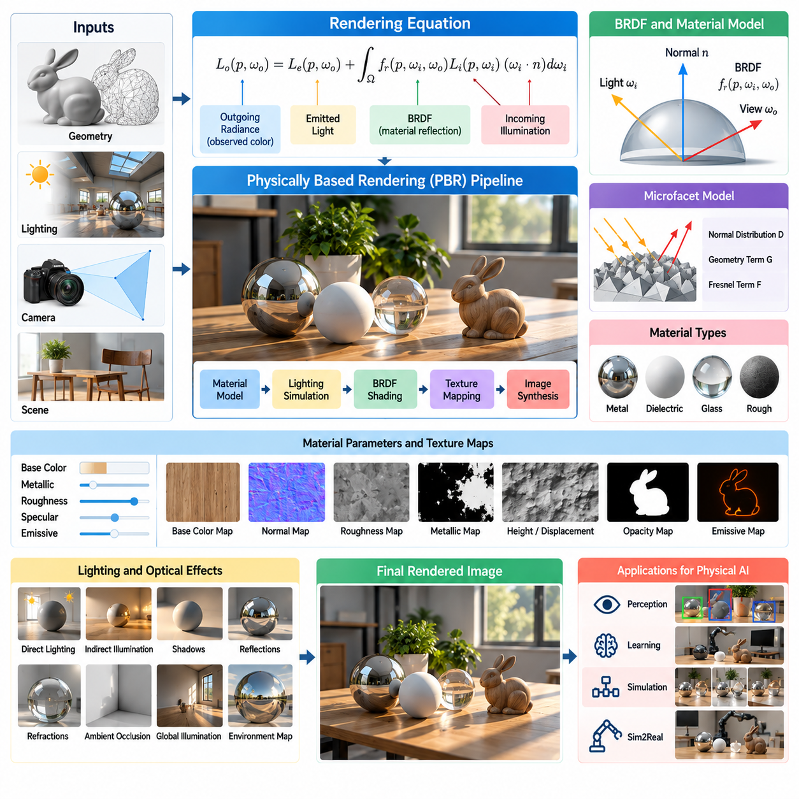{width="7.268055555555556in" height="7.268055555555556in"}

Physically Based Rendering (PBR) is a rendering methodology that uses principles of optics and material physics to generate realistic visual representations of three-dimensional environments. Rather than relying primarily on artistic approximations, PBR models how light interacts with surfaces through reflection, absorption, and transmission. For Physical AI, this approach provides consistent visual observations that support perception training, synthetic data generation, and simulation-to-reality transfer.

The fundamental objective of PBR is to reproduce the relationship between illumination, material properties, surface geometry, and observed appearance. A material should respond consistently when lighting conditions or camera viewpoints change. This consistency is particularly important for robotic systems operating across diverse environments, where perception algorithms must recognize objects despite variations in illumination, orientation, and surrounding visual conditions.

PBR is closely associated with the rendering equation, which describes the balance of light arriving at and leaving a surface. Outgoing radiance consists of emitted light and reflected contributions from incoming illumination. The reflected component depends on surface orientation, incident light direction, viewing direction, and material reflectance. Rendering algorithms approximate this relationship to calculate physically plausible pixel intensities.

A central component of PBR is the Bidirectional Reflectance Distribution Function (BRDF), which describes how incident light is reflected toward different viewing directions. The BRDF captures directional reflection behavior and provides a mathematical foundation for material shading. Different BRDF models represent diffuse, glossy, and metallic surfaces with varying levels of accuracy and computational complexity.

Physically plausible BRDF models generally follow energy conservation and reciprocity. Energy conservation prevents a passive surface from reflecting more energy than it receives, while reciprocity expresses symmetry when incident and outgoing light directions are exchanged. These properties help maintain consistent material behavior across illumination conditions and prevent unrealistic brightness changes in rendered observations.

Microfacet theory provides a widely used foundation for modern PBR material models. Instead of treating a surface as perfectly smooth, microfacet models represent it as a distribution of microscopic reflective facets. The orientation distribution of these facets determines the appearance of highlights and reflections. Rough surfaces scatter reflected light broadly, while smooth surfaces produce concentrated specular reflections.

The microfacet reflection model commonly combines a normal distribution function, a geometric visibility term, and a Fresnel reflection term. The normal distribution function describes microscopic surface orientation, while the geometry term accounts for masking and shadowing between microfacets. The Fresnel term describes how reflectance changes with viewing angle, particularly near grazing directions.

Surface roughness is one of the most influential parameters in physically based material representation. Low roughness produces sharp reflections and concentrated highlights, while high roughness creates broad reflections and visually diffuse appearances. In robotic perception, roughness affects feature visibility, object recognition, and material classification. Accurate roughness modeling is especially important for polished machinery, metallic tools, and industrial floors.

Metallic and dielectric materials exhibit fundamentally different reflection characteristics. Metals typically produce wavelength-dependent specular reflections and absorb much of the transmitted light. Dielectrics, including plastics, ceramics, and glass, generally exhibit surface reflections together with absorption or transmission within the material. PBR workflows often represent these differences through metallic and roughness parameters combined with base color information.

The metallic-roughness workflow provides a practical method for authoring physically based materials. Base color describes diffuse reflectance for nonmetals and contributes to specular coloration for metals. Metallic values distinguish conductive and dielectric behavior, while roughness controls the distribution of reflected light. This compact parameterization supports efficient material creation across large simulated environments.

An alternative material representation uses specular and glossiness parameters. Specular information describes reflection strength and color, while glossiness expresses surface smoothness. Although both workflows can represent similar appearances, their parameter definitions and authoring procedures differ. Consistent material conversion is necessary when transferring assets between rendering engines or robotic simulation platforms.

Texture maps introduce spatial variation into material properties. Base color maps represent surface coloration, normal maps modify shading orientation, roughness maps control local reflection behavior, and metallic maps describe conductive regions. Additional maps may represent displacement, opacity, or emissive properties. These textures allow simulated objects to exhibit realistic details without requiring excessively complex geometry.

Normal mapping is particularly useful for representing small surface features such as scratches, grooves, and manufactured textures. By modifying the shading normal independently of geometric shape, a renderer can reproduce detailed lighting variations at relatively low computational cost. However, normal maps do not necessarily modify physical collision geometry, creating potential inconsistencies between visual appearance and actual contact behavior.

Lighting and material models must operate within compatible radiometric assumptions. Light intensity, spectral characteristics, exposure, and color transformations influence the final rendered image. PBR materials cannot produce physically meaningful appearances if illumination values are inconsistent or arbitrary. Consequently, realistic rendering requires coordinated calibration of light sources, environment illumination, camera response, and material parameters.

Image-based lighting provides an effective mechanism for reproducing complex environmental illumination. High-dynamic-range environment maps capture directional lighting information from real or synthetic surroundings. These maps can illuminate virtual objects with realistic reflections and ambient contributions. For Physical AI, image-based lighting helps recreate factories, warehouses, outdoor environments, and other operational settings.

PBR also supports the simulation of transparent and translucent materials, although these require models beyond simple opaque surface reflection. Refraction, absorption, transmission, and internal scattering influence the appearance of glass, liquids, and polymers. Such materials present challenges for robotic vision because object boundaries and depth cues may become ambiguous. Accurate optical modeling can improve synthetic observations for transparent-object manipulation.

Subsurface scattering describes the transport of light beneath a material surface before it exits at another location. This phenomenon contributes to the appearance of skin, wax, certain plastics, and biological materials. Although computationally expensive, subsurface scattering can be relevant to humanoid robotics, healthcare environments, and human-centered perception systems where realistic biological appearance influences visual interpretation.

For Physical AI, PBR must be integrated with accurate geometry and sensor simulation. A physically plausible material alone does not guarantee realistic camera observations. Lens distortion, exposure, sensor noise, dynamic range, and image processing can significantly alter recorded appearance. Rendering pipelines must therefore connect optical surface models with calibrated camera models to reproduce the observations received by deployed robotic systems.

Material calibration is an important step in reducing the visual Sim2Real gap. Real objects can be photographed under controlled illumination, allowing developers to estimate reflectance, roughness, and color characteristics. These parameters can then be assigned to corresponding virtual assets. Comparisons between real and rendered images help identify discrepancies caused by lighting, geometry, camera response, or material assumptions.

PBR contributes directly to synthetic data generation by enabling consistent material behavior across diverse scenes. A virtual object can be rendered under different illumination conditions, viewpoints, and environmental configurations while preserving its underlying optical properties. This capability supports training datasets that expose perception models to realistic appearance variation without requiring repeated physical data collection.

However, increasing physical realism does not always improve machine learning performance. Incorrect material parameters, simplified geometry, limited lighting diversity, or unrealistic camera processing can still produce substantial domain gaps. Moreover, highly realistic synthetic datasets may contain systematic biases absent from real environments. Effective training therefore combines PBR with domain randomization, real-world calibration, and task-specific evaluation.

Computational efficiency remains an important consideration when integrating PBR into large-scale simulation. Complex BRDF evaluations, multiple light sources, environment reflections, and advanced transmission effects increase rendering costs. Real-time engines commonly use approximations, precomputed lighting, and simplified material models. High-fidelity offline rendering may employ path tracing when accurate light transport is more important than simulation throughput.

The appropriate level of PBR complexity depends on the robotic task and its sensitivity to optical effects. Navigation policies may require consistent surface appearance and shadow behavior without detailed spectral rendering. Industrial manipulation systems handling reflective or transparent components may benefit from more sophisticated material models. Rendering fidelity should therefore be selected according to measurable perception and control requirements.

Validation of PBR for Physical AI should extend beyond subjective image quality. Useful measurements include reflectance consistency, material classification accuracy, feature matching performance, object detection reliability, and real-world task success. Controlled comparisons can determine whether improved material realism reduces perception errors or enhances Sim2Real transfer. Such evaluations connect rendering quality directly to robotic system performance.

Ultimately, Physically Based Rendering provides a systematic foundation for reproducing material appearance through physically motivated optical models. By combining BRDF formulations, microfacet theory, material textures, calibrated illumination, and realistic sensor processing, PBR enables more consistent synthetic visual observations. Its greatest value in Physical AI emerges when physical plausibility, computational efficiency, and real-world robotic performance are optimized together.

물리 기반 렌더링(Physically Based Rendering, PBR)은 광학(Optics)과 재질 물리학(Material Physics)의 원리를 활용하여 3차원 환경(Three-Dimensional Environment)의 사실적인 시각적 표현(Visual Representation)을 생성하는 렌더링 방법론(Rendering Methodology)이다. PBR은 주로 예술적 근사화(Artistic Approximation)에 의존하는 대신, 빛이 반사(Reflection), 흡수(Absorption), 투과(Transmission)를 통해 표면과 상호작용하는 방식을 모델링한다. 피지컬 AI(Physical AI)에서 이러한 접근법은 인식 학습(Perception Training), 합성 데이터 생성(Synthetic Data Generation), 시뮬레이션-현실 전이(Sim2Real Transfer)를 지원하는 일관된 시각적 관측(Visual Observation)을 제공한다.

PBR의 근본적인 목적은 조명(Illumination), 재질 속성(Material Property), 표면 기하학(Surface Geometry), 관측된 외관(Observed Appearance) 사이의 관계를 재현하는 것이다. 재질은 조명 조건이나 카메라 시점(Camera Viewpoint)이 변화하더라도 일관된 반응을 보여야 한다. 이러한 일관성(Consistency)은 다양한 환경에서 작동하는 로봇 시스템(Robotic System)에 특히 중요하며, 인식 알고리즘(Perception Algorithm)은 조명, 방향(Orientation), 주변 시각 조건(Surrounding Visual Condition)이 달라지더라도 객체를 인식할 수 있어야 한다.

PBR은 표면에 도달하는 빛과 표면에서 나가는 빛의 균형을 설명하는 렌더링 방정식(Rendering Equation)과 밀접하게 관련된다. 출사 복사휘도(Outgoing Radiance)는 방출된 빛(Emitted Light)과 입사 조명(Incoming Illumination)에서 반사된 기여 성분으로 구성된다. 반사 성분(Reflected Component)은 표면 방향(Surface Orientation), 입사광 방향(Incident Light Direction), 관측 방향(Viewing Direction), 재질 반사율(Material Reflectance)에 따라 달라진다. 렌더링 알고리즘(Rendering Algorithm)은 이러한 관계를 근사하여 물리적으로 타당한 픽셀 강도(Pixel Intensity)를 계산한다.

PBR의 핵심 구성요소는 양방향 반사 분포 함수(Bidirectional Reflectance Distribution Function, BRDF)이며, 이는 입사광(Incident Light)이 서로 다른 관측 방향으로 어떻게 반사되는지를 설명한다. BRDF는 방향성 반사 특성(Directional Reflection Behavior)을 표현하고 재질 셰이딩(Material Shading)을 위한 수학적 기반(Mathematical Foundation)을 제공한다. 서로 다른 BRDF 모델(BRDF Model)은 확산 표면(Diffuse Surface), 광택 표면(Glossy Surface), 금속 표면(Metallic Surface)을 다양한 정확도(Accuracy)와 계산 복잡도(Computational Complexity)로 표현한다.

물리적으로 타당한 BRDF 모델은 일반적으로 에너지 보존(Energy Conservation)과 상반성(Reciprocity)을 따른다. 에너지 보존은 수동적인 표면(Passive Surface)이 입사한 에너지보다 더 많은 에너지를 반사하지 못하도록 제한하며, 상반성은 입사광 방향과 출사광 방향을 서로 바꾸었을 때 나타나는 대칭성(Symmetry)을 의미한다. 이러한 특성은 다양한 조명 조건에서 일관된 재질 동작(Material Behavior)을 유지하고 렌더링된 관측에서 비현실적인 밝기 변화(Unrealistic Brightness Change)를 방지하는 데 도움을 준다.

미세면 이론(Microfacet Theory)은 현대 PBR 재질 모델의 널리 사용되는 기반을 제공한다. 미세면 모델(Microfacet Model)은 표면을 완벽하게 매끄러운 것으로 취급하는 대신, 미세한 반사 면(Microscopic Reflective Facet)의 분포로 표현한다. 이러한 미세면의 방향 분포(Orientation Distribution)는 하이라이트(Highlight)와 반사(Reflection)의 외관을 결정한다. 거친 표면(Rough Surface)은 반사광을 넓게 산란시키는 반면, 매끄러운 표면(Smooth Surface)은 집중된 정반사(Specular Reflection)를 생성한다.

미세면 반사 모델(Microfacet Reflection Model)은 일반적으로 법선 분포 함수(Normal Distribution Function), 기하학적 가시성 항(Geometric Visibility Term), 프레넬 반사 항(Fresnel Reflection Term)을 결합한다. 법선 분포 함수는 미세한 표면 방향(Microscopic Surface Orientation)을 설명하며, 기하학 항(Geometry Term)은 미세면 사이의 가림(Masking)과 그림자 형성(Shadowing)을 고려한다. 프레넬 항(Fresnel Term)은 특히 스침각(Grazing Angle) 부근에서 관측 각도(Viewing Angle)에 따라 반사율이 어떻게 변화하는지를 설명한다.

표면 거칠기(Surface Roughness)는 물리 기반 재질 표현(Physically Based Material Representation)에서 가장 영향력 있는 매개변수 중 하나이다. 낮은 거칠기는 선명한 반사(Sharp Reflection)와 집중된 하이라이트를 생성하며, 높은 거칠기는 넓게 퍼진 반사와 시각적으로 확산된 외관(Diffuse Appearance)을 형성한다. 로봇 인식(Robotic Perception)에서 거칠기는 특징 가시성(Feature Visibility), 객체 인식(Object Recognition), 재질 분류(Material Classification)에 영향을 미친다. 정확한 거칠기 모델링(Roughness Modeling)은 광택이 있는 기계 장비(Polished Machinery), 금속 공구(Metallic Tool), 산업용 바닥(Industrial Floor)에서 특히 중요하다.

금속 재질(Metallic Material)과 유전체 재질(Dielectric Material)은 근본적으로 서로 다른 반사 특성(Reflection Characteristic)을 나타낸다. 금속은 일반적으로 파장 의존적 정반사(Wavelength-Dependent Specular Reflection)를 생성하고 투과되는 빛의 상당 부분을 흡수한다. 플라스틱(Plastic), 세라믹(Ceramic), 유리(Glass)를 포함하는 유전체는 일반적으로 표면 반사와 함께 재질 내부의 흡수 또는 투과를 나타낸다. PBR 워크플로(PBR Workflow)는 기본 색상(Base Color) 정보와 결합된 금속성(Metallic) 및 거칠기(Roughness) 매개변수를 통해 이러한 차이를 표현하는 경우가 많다.

금속성-거칠기 워크플로(Metallic-Roughness Workflow)는 물리 기반 재질(Physically Based Material)을 제작하기 위한 실용적인 방법을 제공한다. 기본 색상(Base Color)은 비금속(Nonmetal)의 확산 반사율(Diffuse Reflectance)을 설명하며, 금속의 정반사 색상(Specular Coloration)에도 기여한다. 금속성 값(Metallic Value)은 도체(Conductor)와 유전체(Dielectric)의 동작을 구분하고, 거칠기는 반사광 분포(Reflected Light Distribution)를 제어한다. 이러한 간결한 매개변수화(Parameterization)는 대규모 시뮬레이션 환경(Simulated Environment)에서 효율적인 재질 생성을 지원한다.

대안적인 재질 표현(Material Representation)은 정반사(Specular)와 광택도(Glossiness) 매개변수를 사용한다. 정반사 정보(Specular Information)는 반사 강도(Reflection Strength)와 색상을 설명하며, 광택도는 표면의 매끄러움(Surface Smoothness)을 나타낸다. 두 워크플로 모두 유사한 외관을 표현할 수 있지만, 매개변수 정의(Parameter Definition)와 제작 절차(Authoring Procedure)는 서로 다르다. 렌더링 엔진(Rendering Engine)이나 로봇 시뮬레이션 플랫폼(Robotic Simulation Platform) 사이에서 자산(Asset)을 전송할 때는 일관된 재질 변환(Material Conversion)이 필요하다.

텍스처 맵(Texture Map)은 재질 속성에 공간적 변화(Spatial Variation)를 도입한다. 기본 색상 맵(Base Color Map)은 표면 색상을 표현하고, 법선 맵(Normal Map)은 셰이딩 방향(Shading Orientation)을 수정하며, 거칠기 맵(Roughness Map)은 국소적인 반사 동작(Local Reflection Behavior)을 제어하고, 금속성 맵(Metallic Map)은 도전성 영역(Conductive Region)을 설명한다. 추가적인 맵은 변위(Displacement), 불투명도(Opacity), 발광 속성(Emissive Property)을 표현할 수 있다. 이러한 텍스처는 지나치게 복잡한 기하학적 구조 없이도 시뮬레이션 객체에 사실적인 세부정보를 제공한다.

법선 매핑(Normal Mapping)은 긁힘(Scratch), 홈(Groove), 제조 표면 텍스처(Manufactured Texture)와 같은 작은 표면 특징(Surface Feature)을 표현하는 데 특히 유용하다. 기하학적 형상(Geometric Shape)과 독립적으로 셰이딩 법선(Shading Normal)을 수정함으로써 렌더러는 상대적으로 낮은 계산 비용으로 세밀한 조명 변화(Lighting Variation)를 재현할 수 있다. 그러나 법선 맵은 반드시 물리적 충돌 기하학(Physical Collision Geometry)을 수정하는 것은 아니므로 시각적 외관과 실제 접촉 동작(Contact Behavior) 사이에 불일치가 발생할 수 있다.

조명 모델(Lighting Model)과 재질 모델(Material Model)은 서로 호환되는 복사측정학적 가정(Radiometric Assumption) 아래에서 작동해야 한다. 광도(Light Intensity), 스펙트럼 특성(Spectral Characteristic), 노출(Exposure), 색상 변환(Color Transformation)은 최종 렌더링 영상(Rendered Image)에 영향을 미친다. 조명 값(Illumination Value)이 일관되지 않거나 임의로 설정된다면 PBR 재질은 물리적으로 의미 있는 외관을 생성할 수 없다. 따라서 사실적인 렌더링에는 광원(Light Source), 환경 조명(Environment Illumination), 카메라 응답(Camera Response), 재질 매개변수(Material Parameter)의 통합적인 보정(Calibration)이 필요하다.

영상 기반 조명(Image-Based Lighting, IBL)은 복잡한 환경 조명(Environmental Illumination)을 재현하는 효과적인 방법을 제공한다. 고동적 범위 환경 맵(High-Dynamic-Range Environment Map)은 실제 또는 합성 주변 환경에서 방향성 조명 정보(Directional Lighting Information)를 포착한다. 이러한 맵은 사실적인 반사와 주변광 기여(Ambient Contribution)를 통해 가상 객체(Virtual Object)를 조명할 수 있다. 피지컬 AI에서 영상 기반 조명은 공장(Factory), 창고(Warehouse), 실외 환경(Outdoor Environment), 기타 운영 환경(Operational Setting)을 재현하는 데 도움을 준다.

PBR은 투명 재질(Transparent Material)과 반투명 재질(Translucent Material)의 시뮬레이션도 지원하지만, 이러한 재질에는 단순한 불투명 표면 반사(Opaque Surface Reflection)를 넘어서는 모델이 필요하다. 굴절(Refraction), 흡수(Absorption), 투과(Transmission), 내부 산란(Internal Scattering)은 유리, 액체(Liquid), 고분자 재질(Polymer)의 외관에 영향을 미친다. 이러한 재질은 객체 경계(Object Boundary)와 깊이 단서(Depth Cue)가 모호해질 수 있으므로 로봇 비전(Robotic Vision)에 어려움을 제공한다. 정확한 광학 모델링(Optical Modeling)은 투명 객체 조작(Transparent-Object Manipulation)을 위한 합성 관측(Synthetic Observation)을 개선할 수 있다.

표면하 산란(Subsurface Scattering)은 빛이 재질 표면 아래로 이동한 후 다른 위치에서 빠져나오는 광 전달(Light Transport) 현상을 설명한다. 이러한 현상은 피부(Skin), 왁스(Wax), 특정 플라스틱(Plastic), 생물학적 재질(Biological Material)의 외관에 기여한다. 표면하 산란은 계산 비용이 높지만, 사실적인 생물학적 외관(Biological Appearance)이 시각적 해석(Visual Interpretation)에 영향을 미치는 휴머노이드 로봇공학(Humanoid Robotics), 의료 환경(Healthcare Environment), 인간 중심 인식 시스템(Human-Centered Perception System)에서 중요할 수 있다.

피지컬 AI에서 PBR은 정확한 기하학적 구조(Geometry) 및 센서 시뮬레이션(Sensor Simulation)과 통합되어야 한다. 물리적으로 타당한 재질(Physically Plausible Material)만으로는 사실적인 카메라 관측(Camera Observation)을 보장할 수 없다. 렌즈 왜곡(Lens Distortion), 노출(Exposure), 센서 잡음(Sensor Noise), 동적 범위(Dynamic Range), 영상 처리(Image Processing)는 기록된 외관을 크게 변화시킬 수 있다. 따라서 렌더링 파이프라인(Rendering Pipeline)은 광학적 표면 모델(Optical Surface Model)을 보정된 카메라 모델(Calibrated Camera Model)과 연결하여 실제 배포된 로봇 시스템이 수신하는 관측을 재현해야 한다.

재질 보정(Material Calibration)은 시각적 시뮬레이션-현실 격차(Visual Sim2Real Gap)를 줄이는 중요한 단계이다. 실제 객체를 통제된 조명(Controlled Illumination) 아래에서 촬영하면 개발자는 반사율(Reflectance), 거칠기(Roughness), 색상 특성(Color Characteristic)을 추정할 수 있다. 이러한 매개변수는 대응하는 가상 자산(Virtual Asset)에 할당될 수 있다. 실제 영상(Real Image)과 렌더링 영상(Rendered Image)을 비교하면 조명, 기하학적 구조, 카메라 응답, 재질 가정(Material Assumption)으로 인해 발생하는 불일치를 식별하는 데 도움이 된다.

PBR은 다양한 장면에서 일관된 재질 동작(Material Behavior)을 구현함으로써 합성 데이터 생성(Synthetic Data Generation)에 직접적으로 기여한다. 가상 객체(Virtual Object)는 기본적인 광학 속성(Optical Property)을 유지하면서 서로 다른 조명 조건, 시점(Viewpoint), 환경 구성(Environmental Configuration)에서 렌더링될 수 있다. 이러한 기능은 반복적인 실제 데이터 수집(Physical Data Collection) 없이도 인식 모델(Perception Model)이 현실적인 외관 변화(Appearance Variation)를 경험하도록 하는 학습 데이터셋(Training Dataset)을 지원한다.

그러나 물리적 현실성(Physical Realism)을 높인다고 해서 항상 머신러닝 성능(Machine Learning Performance)이 향상되는 것은 아니다. 잘못된 재질 매개변수(Material Parameter), 단순화된 기하학적 구조(Simplified Geometry), 제한된 조명 다양성(Lighting Diversity), 비현실적인 카메라 처리(Camera Processing)는 여전히 상당한 도메인 격차(Domain Gap)를 발생시킬 수 있다. 또한 매우 사실적인 합성 데이터셋에도 실제 환경에는 존재하지 않는 체계적 편향(Systematic Bias)이 포함될 수 있다. 따라서 효과적인 학습(Effective Training)은 PBR을 도메인 랜덤화(Domain Randomization), 실제 환경 보정(Real-World Calibration), 작업별 평가(Task-Specific Evaluation)와 결합해야 한다.

계산 효율성(Computational Efficiency)은 PBR을 대규모 시뮬레이션(Large-Scale Simulation)에 통합할 때 중요한 고려사항이다. 복잡한 BRDF 평가(BRDF Evaluation), 다중 광원(Multiple Light Source), 환경 반사(Environment Reflection), 고급 투과 효과(Advanced Transmission Effect)는 렌더링 비용(Rendering Cost)을 증가시킨다. 실시간 엔진(Real-Time Engine)은 일반적으로 근사화(Approximation), 사전 계산된 조명(Precomputed Lighting), 단순화된 재질 모델(Simplified Material Model)을 사용한다. 고충실도 오프라인 렌더링(High-Fidelity Offline Rendering)은 시뮬레이션 처리량(Simulation Throughput)보다 정확한 광 전달이 중요할 때 경로 추적(Path Tracing)을 사용할 수 있다.

적절한 PBR 복잡도(PBR Complexity)는 로봇 작업(Robotic Task)과 광학 효과(Optical Effect)에 대한 민감도(Sensitivity)에 따라 달라진다. 내비게이션 정책(Navigation Policy)은 세밀한 스펙트럼 렌더링(Spectral Rendering) 없이도 일관된 표면 외관(Surface Appearance)과 그림자 동작(Shadow Behavior)을 필요로 할 수 있다. 반사성 또는 투명 부품을 다루는 산업용 조작 시스템(Industrial Manipulation System)은 더욱 정교한 재질 모델(Material Model)의 이점을 얻을 수 있다. 따라서 렌더링 충실도(Rendering Fidelity)는 측정 가능한 인식 및 제어 요구사항(Perception and Control Requirement)에 따라 선택되어야 한다.

피지컬 AI를 위한 PBR 검증(PBR Validation)은 주관적인 영상 품질(Subjective Image Quality)을 넘어 확장되어야 한다. 유용한 측정 지표(Measurement Metric)에는 반사율 일관성(Reflectance Consistency), 재질 분류 정확도(Material Classification Accuracy), 특징 매칭 성능(Feature Matching Performance), 객체 탐지 신뢰성(Object Detection Reliability), 실제 작업 성공률(Real-World Task Success)이 포함된다. 통제된 비교 실험(Controlled Comparison)은 개선된 재질 현실성(Material Realism)이 인식 오류(Perception Error)를 줄이거나 시뮬레이션-현실 전이 성능(Sim2Real Transfer Performance)을 향상시키는지 판단할 수 있다. 이러한 평가는 렌더링 품질을 로봇 시스템 성능(Robotic System Performance)과 직접 연결한다.

궁극적으로 물리 기반 렌더링(Physically Based Rendering)은 물리적 원리에 기반한 광학 모델(Physically Motivated Optical Model)을 통해 재질 외관(Material Appearance)을 재현하는 체계적인 기반을 제공한다. BRDF 공식화(BRDF Formulation), 미세면 이론(Microfacet Theory), 재질 텍스처(Material Texture), 보정된 조명(Calibrated Illumination), 사실적인 센서 처리(Realistic Sensor Processing)를 결합함으로써 PBR은 더욱 일관된 합성 시각 관측(Synthetic Visual Observation)을 가능하게 한다. 피지컬 AI에서 PBR의 가장 큰 가치는 물리적 타당성(Physical Plausibility), 계산 효율성(Computational Efficiency), 실제 로봇 성능(Real-World Robotic Performance)을 함께 최적화할 때 나타난다.

##  

## 02.04. Materials Textures and Surface Properties

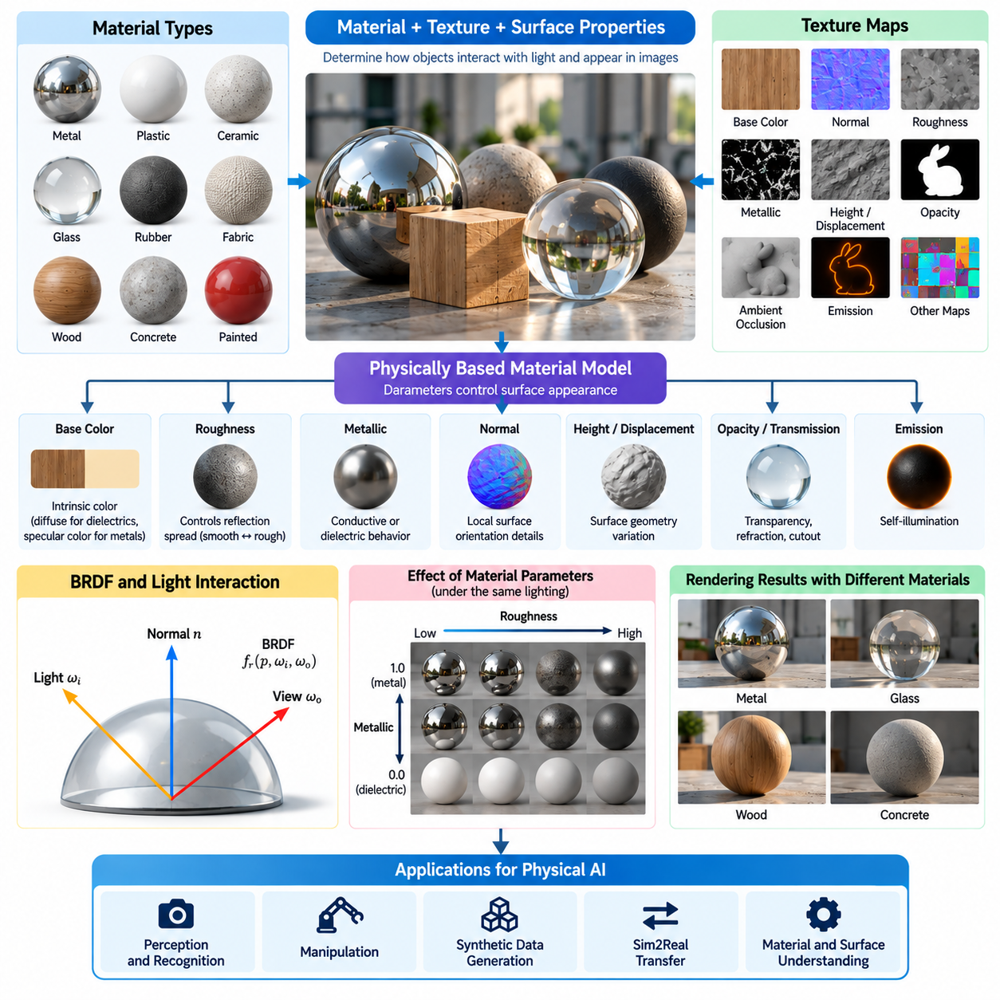{width="7.268055555555556in" height="7.268055555555556in"}

Materials, textures, and surface properties are fundamental components of photorealistic rendering for Physical AI. They determine how virtual objects interact with illumination and how their visual appearance changes across viewing conditions. Accurate representation of these characteristics enables synthetic environments to reproduce important visual cues found in real-world robotics, supporting perception training, object recognition, manipulation, and reliable Sim2Real transfer.

A material describes the optical behavior of a surface, including its reflection, absorption, transmission, and scattering characteristics. Different materials respond differently to incident light because of their physical composition and microscopic structure. Metals, plastics, ceramics, glass, rubber, and fabrics exhibit distinctive appearances. Rendering systems represent these differences through parameterized material models that approximate real optical interactions.

Textures provide spatial variation within a material by assigning different properties to locations across an object\'s surface. A texture may describe color, roughness, metallic behavior, transparency, or local surface orientation. Without textures, complex objects often appear artificially uniform. Detailed texture information allows simulated environments to reproduce scratches, stains, manufacturing patterns, wear, and other features that influence robotic visual perception.

Surface properties connect the optical appearance of materials to their geometric and physical characteristics. Roughness, reflectance, transparency, and microscopic surface structure influence image formation, while friction, compliance, and adhesion influence physical interaction. Although visual and mechanical properties are modeled separately in many simulation engines, their consistency is important when robots learn to associate visual observations with expected contact behavior.

Physically Based Rendering provides a systematic framework for representing material appearance through parameters motivated by optical physics. Common material models use base color, metallicity, roughness, and surface normal information. These parameters interact with illumination and camera orientation to produce realistic shading. Consistent material definitions help preserve object appearance when virtual assets are transferred between simulation scenes.

Base color represents the intrinsic coloration associated with a material under a defined rendering convention. For dielectric surfaces, it commonly describes diffuse reflectance, while metallic materials use color information to characterize wavelength-dependent specular reflection. Base color should not contain baked shadows or illumination artifacts when physically based lighting is expected to calculate those effects independently.

Roughness determines how microscopic surface irregularities distribute reflected light. Smooth surfaces produce concentrated highlights and sharp reflections, while rough surfaces scatter reflections across wider angular regions. Roughness strongly affects the appearance of polished metal, painted machinery, concrete, and industrial flooring. In Physical AI, accurate roughness representation helps perception systems distinguish objects and interpret surface conditions.

Metallic properties distinguish conductive materials from dielectric materials in common rendering workflows. Metallic surfaces exhibit colored specular reflections and generally lack the diffuse reflection characteristic of nonmetallic surfaces. Dielectric materials such as plastic, wood, and ceramics exhibit different reflection behavior. Correct metallic classification prevents unrealistic appearances and improves the consistency of synthetic training images.

Normal maps encode local variations in surface orientation without changing the underlying geometric mesh. They allow renderers to reproduce small scratches, grooves, embossed patterns, and manufactured surface details efficiently. These features influence highlights and local shading, which can affect visual feature extraction. However, normal mapping does not automatically modify collision geometry or the physical contact characteristics of a simulated object.

Bump mapping and displacement mapping provide additional methods for representing surface detail. Bump mapping modifies shading calculations to approximate small height variations, while displacement mapping changes actual geometric surface positions. Displacement can improve silhouettes, occlusion, and geometric realism but requires additional computational resources. Selecting the appropriate technique depends on whether visual appearance or physical geometry is important for the robotic task.

Texture coordinates establish the relationship between two-dimensional texture images and three-dimensional object surfaces. UV mapping assigns texture locations to mesh vertices and determines how material details appear across geometry. Poor UV layouts may introduce stretching, discontinuities, or inconsistent texture resolution. Such artifacts can create unrealistic visual patterns that interfere with perception models trained on synthetic images.

Texture resolution influences both visual fidelity and computational performance. High-resolution textures preserve fine details but increase GPU memory consumption and data transfer requirements. Lower-resolution textures reduce resource demands but may remove features important for recognition or inspection. Mipmapping and texture filtering help manage resolution changes across viewing distances while reducing aliasing and improving rendering stability.

Surface reflectance is often described using a Bidirectional Reflectance Distribution Function, which relates incoming illumination to reflected radiance. Different reflectance models reproduce diffuse, glossy, or specular behavior. Physically plausible models enforce energy conservation and represent directional reflection characteristics. These principles help maintain consistent material appearance under varying illumination and camera viewpoints.

Transparent materials introduce additional rendering challenges because light may pass through, reflect from, or refract within the material. Glass panels, transparent containers, protective covers, and liquids can create complex visual observations. Their appearance depends on refractive index, absorption, surface roughness, and surrounding geometry. Accurate modeling is important for robots handling transparent objects or navigating environments containing glass barriers.

Translucent and subsurface-scattering materials require models that account for light entering a surface and emerging from nearby locations. Skin, wax, certain plastics, and biological materials exhibit these effects. Such materials can influence visual recognition in humanoid robotics and healthcare applications. Simplified approximations may be sufficient for some tasks, while detailed optical models are useful when appearance strongly affects perception.

Surface wear and environmental contamination introduce variations that are frequently encountered in real robotic deployments. Scratches, dust, oil, corrosion, fingerprints, and moisture can modify reflectance and texture appearance. Simulated materials should represent these variations when they affect target tasks. Including realistic wear patterns helps perception systems handle objects that differ from idealized manufacturing models.

Procedural textures generate surface patterns algorithmically rather than relying exclusively on stored image files. Noise functions, mathematical patterns, and rule-based generators can reproduce concrete, wood, terrain, corrosion, and other material variations. Procedural approaches support large-scale environment generation and controlled diversity. They are particularly useful when creating many simulation instances with different surface appearances.

Material randomization provides a mechanism for improving robustness during synthetic data generation. Developers can vary base color, roughness, texture patterns, reflectance, and surface contamination while preserving task-relevant object properties. These variations expose learning models to broader appearance distributions. However, randomization ranges should remain physically plausible when unrealistic combinations could produce misleading training signals.

Material libraries and asset management systems help maintain consistency across complex simulation environments. Standardized material definitions can be reused across robots, objects, buildings, and industrial equipment. Metadata may include optical parameters, texture references, physical material categories, and calibration information. Version-controlled material assets improve reproducibility and reduce inconsistencies between training and evaluation environments.

Visual surface properties should be coordinated with physics simulation parameters whenever robotic behavior depends on material interaction. A visually rough surface may suggest high friction, but actual friction depends on the contacting materials and environmental conditions. Similarly, visually soft materials may have different mechanical stiffness values. Simulation pipelines should explicitly maintain relationships between optical appearance and physical contact properties.

Material calibration involves estimating rendering parameters from observations of real surfaces. Controlled photography, reflectance measurements, and calibrated illumination can provide reference information for base color, roughness, and reflection behavior. These measurements support the creation of digital material representations that resemble physical assets. Calibration reduces systematic visual differences between simulated and real robotic environments.

Synthetic material realism must also account for camera and sensor characteristics. Exposure, white balance, lens effects, image processing, and sensor noise can alter how material properties appear in captured images. A physically accurate surface model may still produce unrealistic observations if camera response is incorrect. Consequently, material rendering and sensor simulation should be validated together rather than treated as independent components.

Material quality can be evaluated through image similarity, reflectance consistency, feature stability, and downstream perception performance. Comparisons between rendered and real observations can identify incorrect texture statistics, unrealistic highlights, or missing surface variations. Task-level metrics are particularly important because improved visual appearance does not necessarily guarantee better robotic behavior. Evaluation should prioritize the visual characteristics that influence operational success.

Computational constraints influence how material complexity is implemented in large-scale Physical AI simulation. Detailed texture maps, complex shading models, and advanced optical effects increase memory and rendering costs. Efficient systems may use texture compression, material instancing, simplified shaders, and level-of-detail strategies. These techniques help preserve useful visual information while supporting high-throughput simulation and synthetic data generation.

Ultimately, materials, textures, and surface properties provide the connection between virtual geometry and realistic visual perception. Their accurate representation requires coordinated optical models, texture information, geometric detail, physical interaction parameters, and sensor calibration. When combined with systematic validation and controlled variation, these components enable scalable synthetic environments that support robust perception, effective learning, and reliable deployment of Physical AI systems.

재질(Material), 텍스처(Texture), 표면 속성(Surface Property)은 피지컬 AI(Physical AI)를 위한 포토리얼리스틱 렌더링(Photorealistic Rendering)의 핵심 구성요소이다. 이들은 가상 객체(Virtual Object)가 조명(Illumination)과 상호작용하는 방식과 관측 조건(Viewing Condition)에 따라 시각적 외관(Visual Appearance)이 변화하는 방식을 결정한다. 이러한 특성을 정확하게 표현하면 합성 환경(Synthetic Environment)이 실제 로봇공학(Real-World Robotics)에서 발견되는 중요한 시각적 단서(Visual Cue)를 재현할 수 있으며, 인식 학습(Perception Training), 객체 인식(Object Recognition), 조작(Manipulation), 신뢰성 높은 시뮬레이션-현실 전이(Sim2Real Transfer)를 지원한다.

재질(Material)은 반사(Reflection), 흡수(Absorption), 투과(Transmission), 산란(Scattering) 특성을 포함하는 표면의 광학적 동작(Optical Behavior)을 설명한다. 서로 다른 재질은 물리적 구성(Physical Composition)과 미세 구조(Microscopic Structure)가 다르기 때문에 입사광(Incident Light)에 서로 다르게 반응한다. 금속(Metal), 플라스틱(Plastic), 세라믹(Ceramic), 유리(Glass), 고무(Rubber), 직물(Fabric)은 각각 고유한 외관을 나타낸다. 렌더링 시스템(Rendering System)은 실제 광학적 상호작용(Optical Interaction)을 근사하는 매개변수화된 재질 모델(Parameterized Material Model)을 통해 이러한 차이를 표현한다.

텍스처(Texture)는 객체 표면(Object Surface)의 위치에 따라 서로 다른 속성을 할당함으로써 재질 내부에 공간적 변화(Spatial Variation)를 제공한다. 텍스처는 색상(Color), 거칠기(Roughness), 금속성(Metallic Behavior), 투명도(Transparency), 국소 표면 방향(Local Surface Orientation)을 표현할 수 있다. 텍스처가 없으면 복잡한 객체도 인위적으로 균일하게 보이는 경우가 많다. 세밀한 텍스처 정보(Texture Information)는 시뮬레이션 환경이 긁힘(Scratch), 얼룩(Stain), 제조 패턴(Manufacturing Pattern), 마모(Wear), 기타 로봇 시각 인식(Robotic Visual Perception)에 영향을 미치는 특징을 재현할 수 있도록 한다.

표면 속성(Surface Property)은 재질의 광학적 외관(Optical Appearance)을 기하학적 및 물리적 특성(Geometric and Physical Characteristic)과 연결한다. 거칠기(Roughness), 반사율(Reflectance), 투명도(Transparency), 미세 표면 구조(Microscopic Surface Structure)는 영상 형성(Image Formation)에 영향을 미치며, 마찰(Friction), 컴플라이언스(Compliance), 접착력(Adhesion)은 물리적 상호작용(Physical Interaction)에 영향을 미친다. 많은 시뮬레이션 엔진(Simulation Engine)에서 시각적 속성과 기계적 속성(Mechanical Property)은 별도로 모델링되지만, 로봇이 시각적 관측을 예상되는 접촉 동작(Contact Behavior)과 연관 지어 학습할 때는 두 속성의 일관성(Consistency)이 중요하다.

물리 기반 렌더링(Physically Based Rendering, PBR)은 광학 물리학(Optical Physics)에 기반한 매개변수를 통해 재질 외관(Material Appearance)을 표현하는 체계적인 프레임워크(Framework)를 제공한다. 일반적인 재질 모델(Material Model)은 기본 색상(Base Color), 금속성(Metallicity), 거칠기(Roughness), 표면 법선 정보(Surface Normal Information)를 사용한다. 이러한 매개변수는 조명과 카메라 방향(Camera Orientation)에 따라 상호작용하여 사실적인 셰이딩(Shading)을 생성한다. 일관된 재질 정의(Material Definition)는 가상 자산(Virtual Asset)이 서로 다른 시뮬레이션 장면(Simulation Scene)으로 전송될 때 객체 외관을 유지하는 데 도움을 준다.

기본 색상(Base Color)은 정의된 렌더링 규약(Rendering Convention) 아래에서 재질과 연관된 고유 색상(Intrinsic Coloration)을 나타낸다. 유전체 표면(Dielectric Surface)의 경우 일반적으로 확산 반사율(Diffuse Reflectance)을 설명하며, 금속 재질(Metallic Material)에서는 파장 의존적 정반사(Wavelength-Dependent Specular Reflection)를 특성화하는 데 색상 정보가 사용된다. 물리 기반 조명(Physically Based Lighting)이 이러한 효과를 독립적으로 계산하도록 설계된 경우, 기본 색상에는 미리 포함된 그림자(Baked Shadow)나 조명 인공물(Illumination Artifact)이 들어가지 않아야 한다.

거칠기(Roughness)는 미세한 표면 불규칙성(Microscopic Surface Irregularity)이 반사광(Reflected Light)을 어떻게 분포시키는지를 결정한다. 매끄러운 표면(Smooth Surface)은 집중된 하이라이트(Highlight)와 선명한 반사(Sharp Reflection)를 생성하며, 거친 표면(Rough Surface)은 더 넓은 각도 범위로 반사광을 산란시킨다. 거칠기는 광택 금속(Polished Metal), 도장된 기계 장비(Painted Machinery), 콘크리트(Concrete), 산업용 바닥(Industrial Flooring)의 외관에 큰 영향을 미친다. 피지컬 AI에서 정확한 거칠기 표현(Roughness Representation)은 인식 시스템(Perception System)이 객체를 구분하고 표면 상태(Surface Condition)를 해석하는 데 도움을 준다.

금속성 속성(Metallic Property)은 일반적인 렌더링 워크플로(Rendering Workflow)에서 도전성 재질(Conductive Material)과 유전체 재질(Dielectric Material)을 구분한다. 금속 표면(Metallic Surface)은 색상이 있는 정반사(Colored Specular Reflection)를 나타내며, 일반적으로 비금속 표면(Nonmetallic Surface)의 특징인 확산 반사(Diffuse Reflection)가 거의 없다. 플라스틱, 목재(Wood), 세라믹과 같은 유전체 재질은 서로 다른 반사 동작(Reflection Behavior)을 나타낸다. 정확한 금속성 분류(Metallic Classification)는 비현실적인 외관을 방지하고 합성 학습 영상(Synthetic Training Image)의 일관성을 향상시킨다.

법선 맵(Normal Map)은 기본 기하학적 메시(Geometric Mesh)를 변경하지 않고 국소적인 표면 방향(Local Surface Orientation)의 변화를 인코딩(Encoding)한다. 이를 통해 렌더러(Renderer)는 작은 긁힘, 홈(Groove), 양각 패턴(Embossed Pattern), 제조 표면 세부정보(Manufactured Surface Detail)를 효율적으로 재현할 수 있다. 이러한 특징은 하이라이트와 국소 셰이딩(Local Shading)에 영향을 미치며, 시각적 특징 추출(Visual Feature Extraction)에도 영향을 줄 수 있다. 그러나 법선 매핑(Normal Mapping)은 충돌 기하학(Collision Geometry)이나 시뮬레이션 객체의 물리적 접촉 특성(Physical Contact Characteristic)을 자동으로 변경하지 않는다.

범프 매핑(Bump Mapping)과 변위 매핑(Displacement Mapping)은 표면 세부정보(Surface Detail)를 표현하는 추가적인 방법을 제공한다. 범프 매핑은 작은 높이 변화(Height Variation)를 근사하기 위해 셰이딩 계산(Shading Calculation)을 수정하는 반면, 변위 매핑은 실제 기하학적 표면 위치(Geometric Surface Position)를 변경한다. 변위는 실루엣(Silhouette), 가림(Occlusion), 기하학적 현실성(Geometric Realism)을 개선할 수 있지만 추가적인 계산 자원(Computational Resource)이 필요하다. 적절한 기술의 선택은 로봇 작업(Robotic Task)에서 시각적 외관과 물리적 기하학 중 무엇이 중요한지에 따라 달라진다.

텍스처 좌표(Texture Coordinate)는 2차원 텍스처 영상(Two-Dimensional Texture Image)과 3차원 객체 표면(Three-Dimensional Object Surface) 사이의 관계를 설정한다. UV 매핑(UV Mapping)은 메시 정점(Mesh Vertex)에 텍스처 위치(Texture Location)를 할당하고 재질 세부정보가 기하학적 구조 전반에 어떻게 나타나는지를 결정한다. 부적절한 UV 배치(UV Layout)는 늘어짐(Stretching), 불연속성(Discontinuity), 일관되지 않은 텍스처 해상도(Texture Resolution)를 발생시킬 수 있다. 이러한 인공물(Artifact)은 합성 영상으로 학습한 인식 모델(Perception Model)을 방해하는 비현실적인 시각 패턴(Visual Pattern)을 생성할 수 있다.

텍스처 해상도(Texture Resolution)는 시각적 충실도(Visual Fidelity)와 계산 성능(Computational Performance)에 모두 영향을 미친다. 고해상도 텍스처(High-Resolution Texture)는 미세한 세부정보를 보존하지만 GPU 메모리 사용량(GPU Memory Consumption)과 데이터 전송 요구량(Data Transfer Requirement)을 증가시킨다. 저해상도 텍스처(Low-Resolution Texture)는 자원 요구량을 줄이지만 인식(Recognition)이나 검사(Inspection)에 중요한 특징을 제거할 수 있다. 밉매핑(Mipmapping)과 텍스처 필터링(Texture Filtering)은 관측 거리에 따른 해상도 변화를 관리하면서 에일리어싱(Aliasing)을 줄이고 렌더링 안정성(Rendering Stability)을 향상시키는 데 도움을 준다.

표면 반사율(Surface Reflectance)은 입사 조명(Incoming Illumination)과 반사 복사휘도(Reflected Radiance) 사이의 관계를 나타내는 양방향 반사 분포 함수(Bidirectional Reflectance Distribution Function, BRDF)를 사용하여 설명하는 경우가 많다. 서로 다른 반사 모델(Reflectance Model)은 확산 반사(Diffuse Reflection), 광택 반사(Glossy Reflection), 정반사(Specular Reflection)를 재현한다. 물리적으로 타당한 모델(Physically Plausible Model)은 에너지 보존(Energy Conservation)을 준수하고 방향성 반사 특성(Directional Reflection Characteristic)을 표현한다. 이러한 원리는 다양한 조명과 카메라 시점(Camera Viewpoint)에서 일관된 재질 외관을 유지하는 데 도움을 준다.

투명 재질(Transparent Material)은 빛이 재질을 통과하거나 표면에서 반사되거나 내부에서 굴절될 수 있기 때문에 추가적인 렌더링 과제(Rendering Challenge)를 발생시킨다. 유리 패널(Glass Panel), 투명 용기(Transparent Container), 보호 덮개(Protective Cover), 액체(Liquid)는 복잡한 시각적 관측(Visual Observation)을 생성할 수 있다. 이러한 재질의 외관은 굴절률(Refractive Index), 흡수(Absorption), 표면 거칠기(Surface Roughness), 주변 기하학(Surrounding Geometry)에 따라 달라진다. 정확한 모델링은 투명 객체를 취급하거나 유리 장벽(Glass Barrier)이 존재하는 환경에서 이동하는 로봇에 중요하다.

반투명 재질(Translucent Material)과 표면하 산란 재질(Subsurface-Scattering Material)은 빛이 표면 내부로 들어갔다가 인접한 위치에서 다시 나오는 현상을 고려하는 모델을 필요로 한다. 피부(Skin), 왁스(Wax), 특정 플라스틱, 생물학적 재질(Biological Material)은 이러한 효과를 나타낸다. 이러한 재질은 휴머노이드 로봇공학(Humanoid Robotics)과 의료 응용 분야(Healthcare Application)의 시각 인식(Visual Recognition)에 영향을 미칠 수 있다. 일부 작업에는 단순화된 근사화(Simplified Approximation)만으로 충분하지만, 외관이 인식에 큰 영향을 미치는 경우에는 정교한 광학 모델(Optical Model)이 유용하다.

표면 마모(Surface Wear)와 환경 오염(Environmental Contamination)은 실제 로봇 배포 환경(Real Robotic Deployment Environment)에서 자주 발생하는 변화를 유발한다. 긁힘(Scratch), 먼지(Dust), 기름(Oil), 부식(Corrosion), 지문(Fingerprint), 습기(Moisture)는 반사율과 텍스처 외관(Texture Appearance)을 변화시킬 수 있다. 시뮬레이션 재질(Simulated Material)은 이러한 변화가 대상 작업(Target Task)에 영향을 미칠 때 이를 표현해야 한다. 사실적인 마모 패턴(Wear Pattern)을 포함하면 인식 시스템이 이상적인 제조 모델(Idealized Manufacturing Model)과 다른 객체를 처리하는 데 도움이 된다.

절차적 텍스처(Procedural Texture)는 저장된 영상 파일(Image File)에만 의존하지 않고 알고리즘(Algorithm)을 통해 표면 패턴(Surface Pattern)을 생성한다. 잡음 함수(Noise Function), 수학적 패턴(Mathematical Pattern), 규칙 기반 생성기(Rule-Based Generator)는 콘크리트, 목재, 지형(Terrain), 부식 및 기타 재질 변화를 재현할 수 있다. 절차적 접근법(Procedural Approach)은 대규모 환경 생성(Large-Scale Environment Generation)과 통제된 다양성(Controlled Diversity)을 지원한다. 특히 서로 다른 표면 외관을 가진 다수의 시뮬레이션 인스턴스(Simulation Instance)를 생성할 때 유용하다.

재질 랜덤화(Material Randomization)는 합성 데이터 생성(Synthetic Data Generation) 과정에서 강건성(Robustness)을 향상시키는 방법을 제공한다. 개발자는 작업과 관련된 객체 속성(Task-Relevant Object Property)을 유지하면서 기본 색상, 거칠기, 텍스처 패턴, 반사율, 표면 오염(Surface Contamination)을 변화시킬 수 있다. 이러한 변화는 학습 모델(Learning Model)이 더 넓은 외관 분포(Appearance Distribution)를 경험하도록 한다. 그러나 비현실적인 조합이 잘못된 학습 신호(Misleading Training Signal)를 생성할 수 있는 경우 랜덤화 범위(Randomization Range)는 물리적으로 타당해야 한다.

재질 라이브러리(Material Library)와 자산 관리 시스템(Asset Management System)은 복잡한 시뮬레이션 환경 전반에서 일관성을 유지하는 데 도움을 준다. 표준화된 재질 정의(Standardized Material Definition)는 로봇, 객체, 건물(Building), 산업 장비(Industrial Equipment)에 재사용될 수 있다. 메타데이터(Metadata)에는 광학 매개변수(Optical Parameter), 텍스처 참조(Texture Reference), 물리적 재질 범주(Physical Material Category), 보정 정보(Calibration Information)가 포함될 수 있다. 버전 관리된 재질 자산(Version-Controlled Material Asset)은 재현성(Reproducibility)을 향상시키고 학습 환경(Training Environment)과 평가 환경(Evaluation Environment) 사이의 불일치를 줄인다.

로봇 동작(Robotic Behavior)이 재질 상호작용(Material Interaction)에 의존하는 경우 시각적 표면 속성(Visual Surface Property)은 물리 시뮬레이션 매개변수(Physics Simulation Parameter)와 조정되어야 한다. 시각적으로 거친 표면은 높은 마찰(High Friction)을 암시할 수 있지만, 실제 마찰은 접촉하는 재질(Contacting Material)과 환경 조건(Environmental Condition)에 따라 달라진다. 마찬가지로 시각적으로 부드러운 재질도 서로 다른 기계적 강성(Mechanical Stiffness)을 가질 수 있다. 시뮬레이션 파이프라인(Simulation Pipeline)은 광학적 외관과 물리적 접촉 속성(Physical Contact Property) 사이의 관계를 명시적으로 유지해야 한다.

재질 보정(Material Calibration)은 실제 표면(Real Surface)의 관측으로부터 렌더링 매개변수(Rendering Parameter)를 추정하는 과정이다. 통제된 촬영(Controlled Photography), 반사율 측정(Reflectance Measurement), 보정된 조명(Calibrated Illumination)은 기본 색상, 거칠기, 반사 동작(Reflection Behavior)에 대한 참조 정보(Reference Information)를 제공할 수 있다. 이러한 측정값은 물리적 자산(Physical Asset)과 유사한 디지털 재질 표현(Digital Material Representation)의 생성을 지원한다. 보정은 시뮬레이션 환경과 실제 로봇 환경 사이의 체계적인 시각적 차이(Systematic Visual Difference)를 줄인다.

합성 재질 현실성(Synthetic Material Realism)은 카메라 및 센서 특성(Camera and Sensor Characteristic)도 고려해야 한다. 노출(Exposure), 화이트 밸런스(White Balance), 렌즈 효과(Lens Effect), 영상 처리(Image Processing), 센서 잡음(Sensor Noise)은 촬영된 영상에서 재질 속성이 나타나는 방식을 변화시킬 수 있다. 물리적으로 정확한 표면 모델(Physically Accurate Surface Model)이라도 카메라 응답(Camera Response)이 부정확하면 비현실적인 관측을 생성할 수 있다. 따라서 재질 렌더링(Material Rendering)과 센서 시뮬레이션(Sensor Simulation)은 독립적인 구성요소로 취급하기보다 함께 검증해야 한다.

재질 품질(Material Quality)은 영상 유사성(Image Similarity), 반사율 일관성(Reflectance Consistency), 특징 안정성(Feature Stability), 후속 인식 성능(Downstream Perception Performance)을 통해 평가할 수 있다. 렌더링 관측(Rendered Observation)과 실제 관측(Real Observation)을 비교하면 잘못된 텍스처 통계(Texture Statistics), 비현실적인 하이라이트(Unrealistic Highlight), 누락된 표면 변화(Missing Surface Variation)를 식별할 수 있다. 시각적 외관의 개선이 반드시 더 나은 로봇 동작을 보장하지는 않으므로 작업 수준 지표(Task-Level Metric)가 특히 중요하다. 평가는 운영 성공(Operational Success)에 영향을 미치는 시각적 특성을 우선해야 한다.

계산 제약(Computational Constraint)은 대규모 피지컬 AI 시뮬레이션(Large-Scale Physical AI Simulation)에서 재질 복잡도(Material Complexity)를 구현하는 방식에 영향을 미친다. 세밀한 텍스처 맵(Texture Map), 복잡한 셰이딩 모델(Shading Model), 고급 광학 효과(Advanced Optical Effect)는 메모리 및 렌더링 비용(Memory and Rendering Cost)을 증가시킨다. 효율적인 시스템은 텍스처 압축(Texture Compression), 재질 인스턴싱(Material Instancing), 단순화된 셰이더(Simplified Shader), 세부 수준 전략(Level-of-Detail Strategy)을 사용할 수 있다. 이러한 기술은 유용한 시각 정보를 보존하면서 높은 처리량의 시뮬레이션(High-Throughput Simulation)과 합성 데이터 생성을 지원한다.

궁극적으로 재질(Material), 텍스처(Texture), 표면 속성(Surface Property)은 가상 기하학(Virtual Geometry)과 사실적인 시각 인식(Realistic Visual Perception)을 연결하는 역할을 한다. 이를 정확하게 표현하려면 광학 모델(Optical Model), 텍스처 정보(Texture Information), 기하학적 세부정보(Geometric Detail), 물리적 상호작용 매개변수(Physical Interaction Parameter), 센서 보정(Sensor Calibration)의 통합적인 조정이 필요하다. 이러한 구성요소가 체계적인 검증(Systematic Validation) 및 통제된 변화(Controlled Variation)와 결합되면 강건한 인식(Robust Perception), 효과적인 학습(Effective Learning), 피지컬 AI 시스템의 신뢰성 높은 배포(Reliable Deployment)를 지원하는 확장 가능한 합성 환경(Scalable Synthetic Environment)을 구축할 수 있다.

##  

## 02.05. Lighting Shadows and Environment Illumination

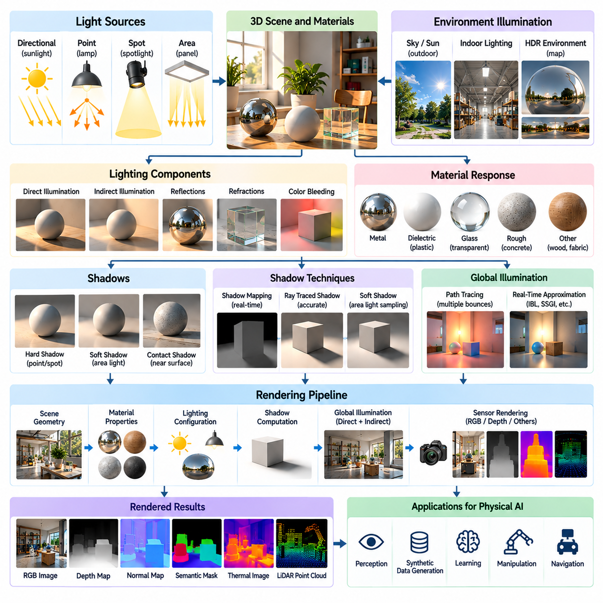{width="7.268055555555556in" height="7.268055555555556in"}

Lighting, shadows, and environment illumination are essential components of photorealistic rendering for Physical AI. They determine how light interacts with objects, surfaces, and surrounding geometry to produce visual observations. Realistic illumination is important because robotic perception depends on brightness, contrast, reflections, and shadow patterns. Accurate lighting simulation supports synthetic data generation, perception training, and reliable Sim2Real transfer.

Lighting simulation aims to reproduce the physical behavior of illumination in real environments. Light propagates from sources, interacts with materials, and reaches virtual cameras after reflection, absorption, or transmission. The resulting image depends on source intensity, direction, spectral composition, and surrounding geometry. Physically motivated lighting models help preserve consistent appearance when robots operate under changing environmental conditions.

Light sources in rendering systems are commonly represented as directional, point, spot, and area lights. Directional lights approximate distant sources such as sunlight, while point lights emit illumination from a localized position. Spotlights concentrate energy within a defined angular region. Area lights represent extended emitting surfaces and produce more realistic illumination gradients and soft shadows.

Directional lighting is particularly useful for simulating outdoor robotic environments. Sunlight can be approximated using a nearly parallel light field because of the sun\'s large distance from the scene. Its direction changes with geographic location, time of day, and season. Accurate solar positioning influences shadow orientation, object contrast, and illumination intensity, which can affect outdoor navigation and visual localization.

Point lights and spotlights are commonly used to represent artificial illumination in factories, warehouses, laboratories, and indoor service environments. Their intensity generally decreases with distance according to geometric spreading. Real fixtures may also exhibit directional emission patterns and nonuniform spectral characteristics. Modeling these properties improves the realism of simulated inspection and manipulation tasks.

Area lighting provides a more physically plausible representation of extended light sources such as ceiling panels, windows, and industrial luminaires. Unlike idealized point sources, area lights illuminate objects from multiple directions. This produces gradual brightness transitions and soft shadow boundaries. Such effects are important when robotic vision systems must identify object edges and surface features under realistic indoor lighting.

The intensity of illumination should be expressed using consistent photometric or radiometric quantities. Radiometric measurements describe physical electromagnetic energy, while photometric measurements account for human visual sensitivity. Rendering engines may use radiance, irradiance, luminous intensity, or illuminance depending on their architecture. Consistent unit conversion and calibration are necessary when reproducing measured lighting conditions.

Light color and spectral composition influence the observed appearance of materials. Daylight, fluorescent lamps, LEDs, and industrial lighting systems can exhibit different spectral power distributions. Two light sources with similar perceived color may produce different camera responses when illuminating particular materials. Spectral modeling can therefore be important for robotic inspection, color classification, and material recognition.

Shadows are formed when objects obstruct light traveling toward other surfaces. They provide visual information about geometry, spatial relationships, object contact, and illumination direction. Hard shadows typically result from small apparent light sources, while extended sources produce penumbrae and gradual shadow transitions. Accurate shadow representation helps perception algorithms interpret object boundaries and three-dimensional structure.

Shadow mapping is a widely used technique for generating shadows in real-time rasterization pipelines. The scene is rendered from the light source to construct a depth representation, which is compared with camera-visible surfaces. Although computationally efficient, shadow mapping can introduce aliasing, incorrect self-shadowing, and resolution-dependent artifacts. Filtering and bias adjustment reduce these limitations but require careful configuration.

Ray-traced shadows determine light visibility through geometric intersection tests between surfaces and light sources. This approach can produce more accurate occlusion and naturally represent soft shadows when extended light sources are sampled. However, multiple visibility queries increase computational cost. Hybrid rendering systems often combine rasterization with ray-traced shadows to improve visual fidelity without sacrificing real-time performance.

Direct illumination describes light reaching a surface directly from an emitting source. Indirect illumination results from light reflecting or transmitting through other surfaces before reaching the observed location. Both components contribute to realistic scene appearance. Indirect illumination can brighten regions outside direct light paths and introduce color bleeding between nearby surfaces with different reflectance characteristics.

Global illumination models the combined effects of direct and indirect light transport throughout an environment. Path tracing estimates these interactions by sampling multiple light paths, while real-time systems often employ approximations or precomputed lighting. Global illumination improves spatial coherence and material appearance, particularly in enclosed environments containing reflective surfaces and complex geometry.

Ambient occlusion approximates the reduction of environmental illumination in geometrically enclosed regions. It emphasizes contact areas, corners, crevices, and closely spaced surfaces, improving perceived depth. Screen-space ambient occlusion provides an efficient approximation but may produce artifacts or omit geometry outside the camera view. Ambient occlusion should not be treated as a complete substitute for physically modeled indirect illumination.

Environment illumination represents light arriving from the surrounding world rather than individual local fixtures. Outdoor environments receive contributions from the sky, atmosphere, terrain, and nearby structures. Indoor environments receive reflected illumination from walls, floors, ceilings, and equipment. Modeling these contributions is necessary for reproducing realistic brightness distributions and reflections across complex robotic scenes.

Image-based lighting uses environment maps to represent directional illumination captured from real or synthetic surroundings. High-dynamic-range images preserve bright light sources and subtle environmental contributions. These maps can illuminate virtual objects while generating realistic reflections and shading. Image-based lighting is particularly useful when reconstructing real operational environments for synthetic data generation.

Sky and atmospheric models support realistic outdoor illumination across different environmental conditions. Solar elevation, atmospheric scattering, cloud cover, haze, and weather influence the distribution of daylight. Changes in these factors alter image contrast, shadow sharpness, and color temperature. Outdoor robotic simulation benefits from representing these variations when training perception systems for changing weather and lighting conditions.

Dynamic lighting introduces temporal changes caused by moving light sources, changing weather, artificial lighting controls, and moving objects. Robots may encounter flickering lamps, passing vehicle headlights, or sudden transitions between indoor and outdoor spaces. Such variations can affect exposure control and feature tracking. Simulation should reproduce relevant temporal lighting behavior when robustness to illumination changes is a training objective.

Lighting interacts strongly with camera exposure, dynamic range, and image processing. Bright regions may saturate sensors, while poorly illuminated areas may contain substantial noise or insufficient detail. Automatic exposure and white balance can modify the apparent brightness and color of the scene. Consequently, lighting realism must be evaluated together with camera and sensor models rather than through rendered images alone.

Lighting randomization is an important technique for improving the generalization of Physical AI perception models. Training environments can vary source positions, intensities, colors, shadow patterns, and environmental illumination. Controlled variation helps models learn features that remain stable across lighting conditions. However, unrealistic illumination distributions may reduce training relevance, making physically plausible parameter ranges important.

Accurate lighting simulation also supports robotic manipulation and inspection. Shadows and highlights can reveal surface curvature, object orientation, and contact relationships. Conversely, strong reflections or insufficient illumination may obscure important features. Synthetic datasets should include both favorable and challenging lighting configurations so that perception systems can handle realistic operational variability.

Lighting calibration involves comparing simulated illumination with measurements from real environments. Reference photographs, calibrated cameras, light meters, and measured fixture characteristics can support parameter estimation. Developers can adjust source intensity, position, spectral properties, and environment maps to reduce discrepancies. Calibration is especially valuable when synthetic images must reproduce a specific factory, warehouse, or inspection station.

Rendering performance imposes practical limits on lighting fidelity in large-scale simulation. Multiple dynamic lights, shadow calculations, indirect illumination, and complex reflections increase GPU workload. Real-time systems may use light culling, shadow caching, precomputed illumination, and simplified shading models. High-fidelity rendering can be reserved for targeted validation or synthetic dataset production when computational cost is justified.

Lighting quality should be evaluated through both image-level and task-level measurements. Image comparisons can examine brightness distributions, shadow boundaries, color consistency, and reflection patterns. Robotic evaluations can measure object detection accuracy, localization stability, manipulation success, and robustness under changing illumination. These measurements help determine whether improved lighting realism produces meaningful gains in Sim2Real performance.

Ultimately, lighting, shadows, and environment illumination form an integrated system that determines how virtual environments are visually perceived. Their realistic simulation requires coordinated light source models, shadow generation, global illumination, environment maps, and camera response. By combining physical accuracy with computational efficiency and controlled variation, Physical AI developers can create visual environments that support robust perception and reliable real-world robotic operation.

조명(Lighting), 그림자(Shadow), 환경 조명(Environment Illumination)은 피지컬 AI(Physical AI)를 위한 사실적 렌더링(Photorealistic Rendering)의 핵심 구성요소이다. 이들은 빛이 객체(Object), 표면(Surface), 주변 기하학적 구조(Surrounding Geometry)와 상호작용하여 시각적 관측(Visual Observation)을 생성하는 방식을 결정한다. 로봇 인식(Robotic Perception)은 밝기(Brightness), 대비(Contrast), 반사(Reflection), 그림자 패턴(Shadow Pattern)에 의존하므로 사실적인 조명이 중요하다. 정확한 조명 시뮬레이션(Lighting Simulation)은 합성 데이터 생성(Synthetic Data Generation), 인식 학습(Perception Training), 신뢰성 높은 시뮬레이션-현실 전이(Sim2Real Transfer)를 지원한다.

조명 시뮬레이션(Lighting Simulation)은 실제 환경에서 나타나는 빛의 물리적 동작(Physical Behavior)을 재현하는 것을 목표로 한다. 빛은 광원(Light Source)에서 전파되어 재질(Material)과 상호작용하고, 반사(Reflection), 흡수(Absorption), 투과(Transmission)를 거쳐 가상 카메라(Virtual Camera)에 도달한다. 최종 영상은 광원 강도(Source Intensity), 방향(Direction), 스펙트럼 구성(Spectral Composition), 주변 기하학적 구조에 따라 달라진다. 물리적 원리에 기반한 조명 모델(Physically Motivated Lighting Model)은 로봇이 변화하는 환경 조건(Environmental Condition)에서 작동할 때 일관된 외관(Appearance)을 유지하도록 돕는다.

렌더링 시스템(Rendering System)의 광원은 일반적으로 방향광(Directional Light), 점광원(Point Light), 스포트라이트(Spotlight), 면광원(Area Light)으로 표현된다. 방향광은 태양광(Sunlight)과 같은 먼 광원을 근사하며, 점광원은 국소적인 위치에서 빛을 방출한다. 스포트라이트는 정의된 각도 영역(Angular Region) 안에 에너지를 집중시킨다. 면광원은 넓은 발광 표면(Emitting Surface)을 표현하며 더욱 사실적인 조명 기울기(Illumination Gradient)와 부드러운 그림자(Soft Shadow)를 생성한다.

방향성 조명(Directional Lighting)은 실외 로봇 환경(Outdoor Robotic Environment)을 시뮬레이션하는 데 특히 유용하다. 태양은 장면(Scene)에서 매우 멀리 떨어져 있으므로 태양광은 거의 평행한 광장(Parallel Light Field)으로 근사할 수 있다. 태양광의 방향은 지리적 위치(Geographic Location), 시간대(Time of Day), 계절(Season)에 따라 변화한다. 정확한 태양 위치(Solar Positioning)는 그림자 방향(Shadow Orientation), 객체 대비(Object Contrast), 조명 강도(Illumination Intensity)에 영향을 미치며, 이는 실외 내비게이션(Outdoor Navigation)과 시각적 위치 추정(Visual Localization)에 영향을 줄 수 있다.

점광원(Point Light)과 스포트라이트(Spotlight)는 공장(Factory), 창고(Warehouse), 연구실(Laboratory), 실내 서비스 환경(Indoor Service Environment)의 인공조명(Artificial Illumination)을 표현하는 데 일반적으로 사용된다. 광원 강도는 기하학적 확산(Geometric Spreading)에 따라 거리가 증가할수록 감소한다. 실제 조명기구(Lighting Fixture)는 방향성 방출 패턴(Directional Emission Pattern)과 불균일한 스펙트럼 특성(Nonuniform Spectral Characteristic)을 나타낼 수도 있다. 이러한 속성을 모델링하면 시뮬레이션된 검사(Inspection) 및 조작 작업(Manipulation Task)의 현실성이 향상된다.

면광원(Area Light)은 천장 조명 패널(Ceiling Panel), 창문(Window), 산업용 조명기구(Industrial Luminaire)와 같이 넓은 광원을 더욱 물리적으로 타당하게 표현한다. 이상적인 점광원과 달리 면광원은 여러 방향에서 객체를 비춘다. 이로 인해 점진적인 밝기 변화(Brightness Transition)와 부드러운 그림자 경계(Shadow Boundary)가 형성된다. 이러한 효과는 로봇 비전 시스템(Robotic Vision System)이 사실적인 실내 조명 조건에서 객체 모서리(Object Edge)와 표면 특징(Surface Feature)을 식별해야 할 때 중요하다.

조명 강도(Illumination Intensity)는 일관된 측광량(Photometric Quantity) 또는 복사측정량(Radiometric Quantity)을 사용하여 표현해야 한다. 복사측정(Radiometry)은 물리적인 전자기 에너지(Electromagnetic Energy)를 설명하며, 측광(Photometry)은 인간의 시각적 감도(Human Visual Sensitivity)를 고려한다. 렌더링 엔진(Rendering Engine)은 아키텍처(Architecture)에 따라 복사휘도(Radiance), 복사조도(Irradiance), 광도(Luminous Intensity), 조도(Illuminance)를 사용할 수 있다. 측정된 조명 조건(Measured Lighting Condition)을 재현하려면 일관된 단위 변환(Unit Conversion)과 보정(Calibration)이 필요하다.

빛의 색상(Light Color)과 스펙트럼 구성(Spectral Composition)은 재질(Material)의 관측된 외관(Observed Appearance)에 영향을 미친다. 주광(Daylight), 형광등(Fluorescent Lamp), 발광다이오드(LED), 산업용 조명 시스템(Industrial Lighting System)은 서로 다른 분광 출력 분포(Spectral Power Distribution)를 나타낼 수 있다. 지각되는 색상(Perceived Color)이 비슷한 두 광원도 특정 재질을 비출 때 서로 다른 카메라 응답(Camera Response)을 생성할 수 있다. 따라서 스펙트럼 모델링(Spectral Modeling)은 로봇 검사(Robotic Inspection), 색상 분류(Color Classification), 재질 인식(Material Recognition)에 중요할 수 있다.

그림자(Shadow)는 객체가 다른 표면으로 이동하는 빛을 차단할 때 형성된다. 그림자는 기하학적 구조(Geometry), 공간적 관계(Spatial Relationship), 객체 접촉(Object Contact), 조명 방향(Illumination Direction)에 관한 시각 정보를 제공한다. 뚜렷한 그림자(Hard Shadow)는 일반적으로 겉보기 크기가 작은 광원에서 발생하며, 넓은 광원은 반그림자(Penumbra)와 점진적인 그림자 전이(Shadow Transition)를 생성한다. 정확한 그림자 표현(Shadow Representation)은 인식 알고리즘(Perception Algorithm)이 객체 경계(Object Boundary)와 3차원 구조(Three-Dimensional Structure)를 해석하는 데 도움을 준다.

그림자 매핑(Shadow Mapping)은 실시간 래스터화 파이프라인(Real-Time Rasterization Pipeline)에서 그림자를 생성하는 데 널리 사용되는 기술이다. 광원의 시점에서 장면을 렌더링하여 깊이 표현(Depth Representation)을 구성한 후 카메라에 보이는 표면(Camera-Visible Surface)과 비교한다. 계산 효율성(Computational Efficiency)은 높지만 그림자 매핑은 에일리어싱(Aliasing), 잘못된 자체 그림자 형성(Incorrect Self-Shadowing), 해상도 의존적 인공물(Resolution-Dependent Artifact)을 발생시킬 수 있다. 필터링(Filtering)과 바이어스 조정(Bias Adjustment)은 이러한 한계를 줄이지만 신중한 설정이 필요하다.

광선 추적 그림자(Ray-Traced Shadow)는 표면과 광원 사이의 기하학적 교차 검사(Geometric Intersection Test)를 통해 빛의 가시성(Light Visibility)을 결정한다. 이 접근법은 더욱 정확한 가림(Occlusion)을 생성하며, 넓은 광원을 샘플링할 경우 부드러운 그림자를 자연스럽게 표현할 수 있다. 그러나 여러 차례의 가시성 검사(Visibility Query)는 계산 비용(Computational Cost)을 증가시킨다. 하이브리드 렌더링 시스템(Hybrid Rendering System)은 실시간 성능(Real-Time Performance)을 유지하면서 시각적 충실도(Visual Fidelity)를 향상시키기 위해 래스터화(Rasterization)와 광선 추적 그림자를 결합하는 경우가 많다.

직접 조명(Direct Illumination)은 발광원(Emitting Source)에서 표면으로 직접 도달하는 빛을 의미한다. 간접 조명(Indirect Illumination)은 빛이 관측 위치에 도달하기 전에 다른 표면에서 반사되거나 투과되어 발생한다. 두 구성요소 모두 사실적인 장면 외관(Realistic Scene Appearance)에 기여한다. 간접 조명은 직접광이 도달하지 않는 영역을 밝게 만들고, 서로 다른 반사 특성(Reflectance Characteristic)을 가진 인접 표면 사이에서 색 번짐(Color Bleeding)을 발생시킬 수 있다.

전역 조명(Global Illumination)은 환경 전체에서 발생하는 직접 및 간접 광 전달(Light Transport)의 결합 효과를 모델링한다. 경로 추적(Path Tracing)은 여러 광 경로(Light Path)를 샘플링하여 이러한 상호작용을 추정하는 반면, 실시간 시스템(Real-Time System)은 근사화(Approximation) 또는 사전 계산된 조명(Precomputed Lighting)을 사용하는 경우가 많다. 전역 조명은 특히 반사 표면(Reflective Surface)과 복잡한 기하학적 구조(Complex Geometry)가 포함된 밀폐 환경(Enclosed Environment)에서 공간적 일관성(Spatial Coherence)과 재질 외관(Material Appearance)을 개선한다.

주변광 차폐(Ambient Occlusion)는 기하학적으로 둘러싸인 영역에서 환경 조명(Environmental Illumination)이 감소하는 현상을 근사한다. 이 기술은 접촉 영역(Contact Area), 모서리(Corner), 틈새(Crevice), 서로 가까이 위치한 표면을 강조하여 지각되는 깊이(Perceived Depth)를 개선한다. 화면 공간 주변광 차폐(Screen-Space Ambient Occlusion, SSAO)는 효율적인 근사화를 제공하지만 인공물(Artifact)을 생성하거나 카메라 시야(Camera View) 밖의 기하학적 구조를 누락할 수 있다. 주변광 차폐를 물리적으로 모델링된 간접 조명(Physically Modeled Indirect Illumination)의 완전한 대체 기술로 취급해서는 안 된다.

환경 조명(Environment Illumination)은 개별적인 국소 조명기구(Local Fixture)가 아니라 주변 세계(Surrounding World)에서 도달하는 빛을 나타낸다. 실외 환경(Outdoor Environment)은 하늘(Sky), 대기(Atmosphere), 지형(Terrain), 인근 구조물(Nearby Structure)로부터 조명을 받는다. 실내 환경(Indoor Environment)은 벽(Wall), 바닥(Floor), 천장(Ceiling), 장비(Equipment)에서 반사된 조명을 받는다. 이러한 기여를 모델링하는 것은 복잡한 로봇 장면(Robotic Scene)에서 사실적인 밝기 분포(Brightness Distribution)와 반사를 재현하는 데 필요하다.

영상 기반 조명(Image-Based Lighting, IBL)은 실제 또는 합성 주변 환경에서 포착한 방향성 조명(Directional Illumination)을 표현하기 위해 환경 맵(Environment Map)을 사용한다. 고동적 범위 영상(High-Dynamic-Range Image, HDR Image)은 밝은 광원과 미세한 환경 조명 기여(Environmental Illumination Contribution)를 보존한다. 이러한 맵은 가상 객체(Virtual Object)를 조명하면서 사실적인 반사와 셰이딩(Shading)을 생성할 수 있다. 영상 기반 조명은 합성 데이터 생성(Synthetic Data Generation)을 위해 실제 운영 환경(Operational Environment)을 재구성할 때 특히 유용하다.

하늘 및 대기 모델(Sky and Atmospheric Model)은 다양한 환경 조건에서 사실적인 실외 조명(Outdoor Illumination)을 지원한다. 태양 고도(Solar Elevation), 대기 산란(Atmospheric Scattering), 구름량(Cloud Cover), 연무(Haze), 날씨(Weather)는 주광 분포(Daylight Distribution)에 영향을 미친다. 이러한 요소의 변화는 영상 대비(Image Contrast), 그림자 선명도(Shadow Sharpness), 색온도(Color Temperature)를 변화시킨다. 실외 로봇 시뮬레이션(Outdoor Robotic Simulation)은 변화하는 날씨와 조명 조건에 대응하는 인식 시스템을 학습할 때 이러한 변화를 표현함으로써 이점을 얻는다.

동적 조명(Dynamic Lighting)은 이동하는 광원(Moving Light Source), 변화하는 날씨, 인공조명 제어(Artificial Lighting Control), 움직이는 객체(Moving Object)로 인해 발생하는 시간적 변화(Temporal Change)를 도입한다. 로봇은 깜박이는 조명(Flickering Lamp), 지나가는 차량의 전조등(Vehicle Headlight), 실내와 실외 사이의 갑작스러운 전환(Sudden Transition)을 경험할 수 있다. 이러한 변화는 노출 제어(Exposure Control)와 특징 추적(Feature Tracking)에 영향을 미칠 수 있다. 조명 변화에 대한 강건성(Robustness)이 학습 목표인 경우 시뮬레이션은 관련된 시간적 조명 동작(Temporal Lighting Behavior)을 재현해야 한다.

조명은 카메라 노출(Camera Exposure), 동적 범위(Dynamic Range), 영상 처리(Image Processing)와 밀접하게 상호작용한다. 밝은 영역(Bright Region)은 센서 포화(Sensor Saturation)를 일으킬 수 있으며, 조명이 부족한 영역(Poorly Illuminated Region)은 상당한 잡음(Noise)이나 불충분한 세부정보(Insufficient Detail)를 포함할 수 있다. 자동 노출(Automatic Exposure)과 자동 화이트 밸런스(Automatic White Balance)는 장면의 겉보기 밝기(Apparent Brightness)와 색상을 변화시킬 수 있다. 따라서 조명 현실성(Lighting Realism)은 렌더링 영상만으로 평가하기보다 카메라 및 센서 모델(Camera and Sensor Model)과 함께 평가해야 한다.

조명 랜덤화(Lighting Randomization)는 피지컬 AI 인식 모델(Physical AI Perception Model)의 일반화 성능(Generalization Performance)을 향상시키는 중요한 기술이다. 학습 환경(Training Environment)은 광원 위치(Source Position), 강도(Intensity), 색상(Color), 그림자 패턴(Shadow Pattern), 환경 조명을 변화시킬 수 있다. 통제된 변화(Controlled Variation)는 모델이 다양한 조명 조건에서 안정적으로 유지되는 특징(Stable Feature)을 학습하도록 돕는다. 그러나 비현실적인 조명 분포(Unrealistic Illumination Distribution)는 학습의 관련성(Training Relevance)을 감소시킬 수 있으므로 물리적으로 타당한 매개변수 범위(Physically Plausible Parameter Range)가 중요하다.

정확한 조명 시뮬레이션(Accurate Lighting Simulation)은 로봇 조작(Robotic Manipulation)과 검사(Inspection)도 지원한다. 그림자와 하이라이트(Highlight)는 표면 곡률(Surface Curvature), 객체 방향(Object Orientation), 접촉 관계(Contact Relationship)를 드러낼 수 있다. 반대로 강한 반사(Strong Reflection)나 불충분한 조명(Insufficient Illumination)은 중요한 특징을 가릴 수 있다. 합성 데이터셋(Synthetic Dataset)은 인식 시스템이 현실적인 운영 변동성(Operational Variability)을 처리할 수 있도록 유리한 조명 구성(Favorable Lighting Configuration)과 어려운 조명 구성(Challenging Lighting Configuration)을 모두 포함해야 한다.

조명 보정(Lighting Calibration)은 시뮬레이션된 조명을 실제 환경에서 측정한 값과 비교하는 과정이다. 참조 사진(Reference Photograph), 보정된 카메라(Calibrated Camera), 조도계(Light Meter), 측정된 조명기구 특성(Measured Fixture Characteristic)은 매개변수 추정(Parameter Estimation)을 지원할 수 있다. 개발자는 불일치를 줄이기 위해 광원 강도(Source Intensity), 위치(Position), 스펙트럼 속성(Spectral Property), 환경 맵(Environment Map)을 조정할 수 있다. 보정은 합성 영상이 특정 공장, 창고 또는 검사 작업장(Inspection Station)을 재현해야 할 때 특히 유용하다.

렌더링 성능(Rendering Performance)은 대규모 시뮬레이션(Large-Scale Simulation)에서 조명 충실도(Lighting Fidelity)에 실질적인 한계를 부여한다. 다수의 동적 광원(Dynamic Light), 그림자 계산(Shadow Calculation), 간접 조명(Indirect Illumination), 복잡한 반사(Complex Reflection)는 GPU 작업 부하(GPU Workload)를 증가시킨다. 실시간 시스템은 광원 컬링(Light Culling), 그림자 캐싱(Shadow Caching), 사전 계산된 조명(Precomputed Illumination), 단순화된 셰이딩 모델(Simplified Shading Model)을 사용할 수 있다. 계산 비용이 정당화되는 경우 고충실도 렌더링(High-Fidelity Rendering)을 목표 지향적 검증(Targeted Validation)이나 합성 데이터셋 제작(Synthetic Dataset Production)에 선택적으로 사용할 수 있다.

조명 품질(Lighting Quality)은 영상 수준 측정(Image-Level Measurement)과 작업 수준 측정(Task-Level Measurement)을 모두 통해 평가해야 한다. 영상 비교(Image Comparison)는 밝기 분포(Brightness Distribution), 그림자 경계(Shadow Boundary), 색상 일관성(Color Consistency), 반사 패턴(Reflection Pattern)을 분석할 수 있다. 로봇 평가(Robotic Evaluation)는 객체 탐지 정확도(Object Detection Accuracy), 위치 추정 안정성(Localization Stability), 조작 성공률(Manipulation Success Rate), 조명 변화에 대한 강건성(Robustness)을 측정할 수 있다. 이러한 측정은 향상된 조명 현실성이 시뮬레이션-현실 전이 성능(Sim2Real Performance)에 의미 있는 개선을 제공하는지 판단하는 데 도움을 준다.

궁극적으로 조명(Lighting), 그림자(Shadow), 환경 조명(Environment Illumination)은 가상 환경(Virtual Environment)이 시각적으로 인식되는 방식을 결정하는 통합 시스템(Integrated System)을 형성한다. 이러한 요소를 사실적으로 시뮬레이션하려면 광원 모델(Light Source Model), 그림자 생성(Shadow Generation), 전역 조명(Global Illumination), 환경 맵(Environment Map), 카메라 응답(Camera Response)을 통합적으로 조정해야 한다. 물리적 정확성(Physical Accuracy), 계산 효율성(Computational Efficiency), 통제된 변화(Controlled Variation)를 결합함으로써 피지컬 AI 개발자는 강건한 인식(Robust Perception)과 신뢰성 높은 실제 로봇 운영(Reliable Real-World Robotic Operation)을 지원하는 시각 환경(Visual Environment)을 구축할 수 있다.

##  

## 02.06. Camera Optics and Lens Modeling

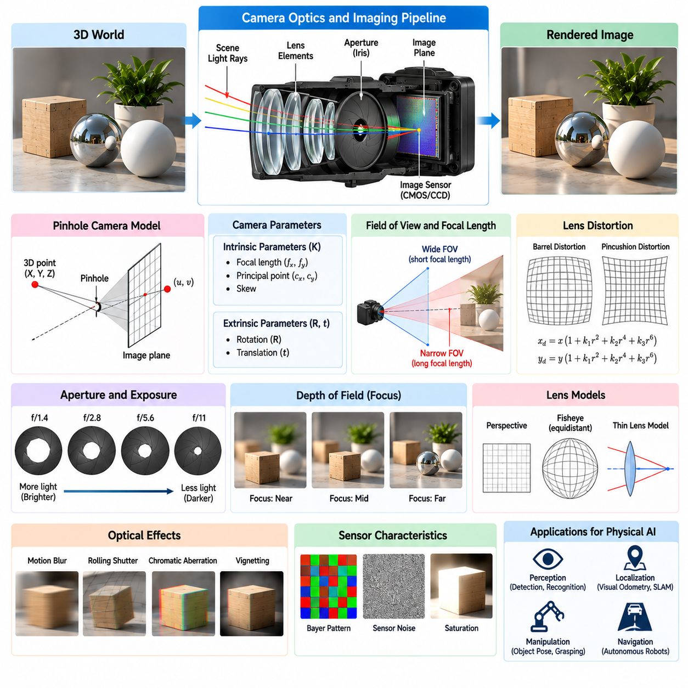{width="7.268055555555556in" height="7.268055555555556in"}

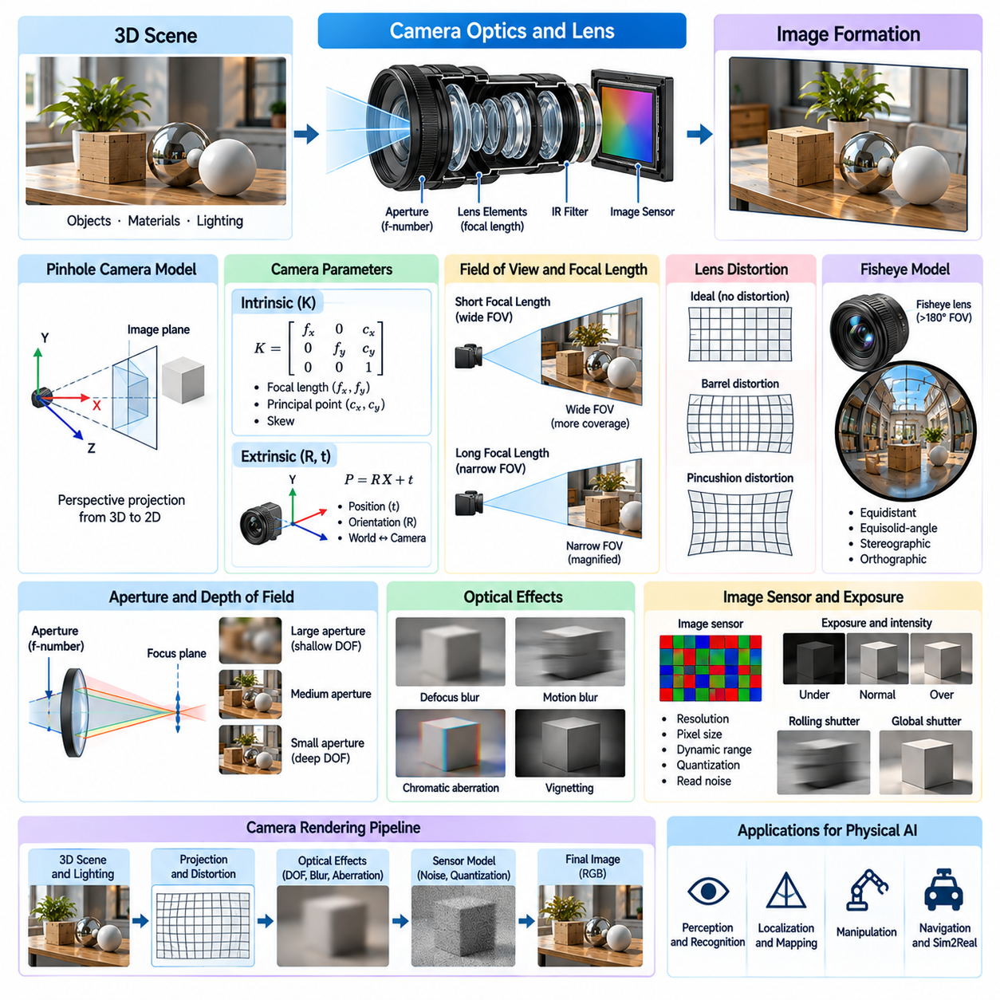{width="7.268055555555556in" height="7.268055555555556in"}

Camera optics and lens modeling are essential components of photorealistic rendering for Physical AI. Virtual cameras must reproduce how real optical systems project three-dimensional environments onto image sensors. Their characteristics influence geometry, sharpness, brightness, and image distortion. Accurate camera simulation enables synthetic visual observations to resemble real robotic sensor data, supporting perception training, visual localization, manipulation, and Sim2Real transfer.

A camera forms an image by collecting light from a scene and directing it toward a photosensitive sensor. The resulting observation depends on lens geometry, focal length, aperture, sensor dimensions, and optical alignment. Simplified rendering cameras often use idealized projection models, while physical cameras introduce additional optical effects. Understanding these differences is necessary when designing realistic robotic vision simulation pipelines.

The pinhole camera model provides a mathematical foundation for perspective projection. It assumes that light passes through a single idealized point before reaching the image plane. Three-dimensional scene coordinates are projected into two-dimensional image coordinates using camera intrinsic and extrinsic parameters. Although computationally efficient, this model does not directly represent lens distortion, defocus, or other physical optical imperfections.

Camera intrinsic parameters describe the internal geometric relationship between incoming light and image coordinates. They typically include focal lengths expressed in pixels, principal point coordinates, and sometimes skew. These parameters are commonly organized into a camera intrinsic matrix. Accurate intrinsic calibration is important for image rectification, three-dimensional reconstruction, visual odometry, and geometric consistency between simulated and real observations.

Extrinsic parameters describe the position and orientation of a camera relative to a world or robot coordinate frame. They define the rigid transformation between scene geometry and the camera reference frame. In robotic systems, camera extrinsics may change as joints move or mobile platforms navigate. Accurate transformation management ensures that rendered images remain synchronized with robot kinematics and simulated environmental geometry.

Focal length determines the relationship between scene depth and projected image scale. Short focal lengths generally produce wider fields of view, while longer focal lengths provide narrower viewing angles and greater image magnification. The actual field of view also depends on sensor dimensions. Matching focal length and sensor size is necessary when synthetic images must reproduce the geometric characteristics of a deployed robotic camera.

Field of view determines how much of the environment can be observed in a single image. Wide-angle cameras provide broad spatial coverage but may introduce stronger distortion and reduced detail per angular region. Narrow-angle cameras offer greater spatial resolution for distant objects but cover smaller regions. Camera selection and simulation should therefore reflect the perception range, navigation requirements, and manipulation workspace of the target robot.

Lens distortion causes deviations from ideal perspective projection. Radial distortion produces barrel or pincushion effects, while tangential distortion can arise from lens and sensor misalignment. These effects alter the apparent positions of image features and straight lines. Distortion models commonly use polynomial coefficients that can be estimated through camera calibration and applied to synthetic images.

Wide-angle and fisheye lenses require specialized projection models because their angular coverage may exceed the practical range of conventional perspective cameras. Equidistant, equisolid-angle, stereographic, and orthographic fisheye mappings describe different relationships between incident ray angle and image radius. Correct model selection is important for panoramic perception, mobile robot navigation, and omnidirectional sensing.

Lens aperture controls the amount of light reaching the image sensor and influences depth of field. A larger aperture generally admits more light but produces a shallower depth of field, while a smaller aperture increases the range of distances that appear acceptably sharp. Aperture is commonly expressed through the f-number, which relates focal length to entrance pupil diameter. Realistic aperture modeling supports accurate image brightness and defocus simulation.

Depth of field describes the range of object distances that appear sufficiently sharp for a given focus setting. Objects outside this range produce defocus blur, often represented through a circle of confusion. Depth of field depends on focal length, aperture, focus distance, and sensor geometry. In robotic perception, defocus can influence feature detection, object boundaries, and the reliability of depth estimation.

Thin-lens models extend ideal pinhole projection by representing image formation through a finite aperture and simplified focusing geometry. Rays passing through different aperture positions converge near the focal plane, while points outside the focal plane form blurred image regions. This approach provides a practical balance between optical realism and computational cost. More detailed lens models may trace rays through multiple refractive elements.

Real photographic lenses contain multiple optical elements designed to control aberrations and improve image quality. Their performance depends on element curvature, refractive index, spacing, coatings, and mechanical alignment. Detailed optical simulation can reproduce complex lens behavior, but it requires additional calibration data and computation. For many robotic tasks, simplified calibrated models provide sufficient accuracy.

Chromatic aberration occurs because different wavelengths of light refract by different amounts within optical materials. This can produce color fringes near high-contrast edges or changes in focus across color channels. Longitudinal and lateral chromatic aberrations affect image formation differently. Although often subtle, these effects may influence high-precision inspection and feature matching when synthetic imagery is compared with real camera measurements.

Other optical aberrations include spherical aberration, coma, astigmatism, and field curvature. These imperfections cause spatially varying blur, asymmetric point images, or differences in sharpness across the sensor. Their visibility depends on lens design, aperture, focus distance, and image position. Modeling relevant aberrations can improve the realism of simulated cameras used in demanding visual inspection or localization applications.

Vignetting describes the reduction of image brightness toward the edges of the field of view. It may result from geometric light falloff, optical obstruction, or sensor angular response. Vignetting creates spatial intensity variations even when observing a uniformly illuminated surface. Synthetic camera models can reproduce this behavior through calibrated attenuation functions, improving consistency with real image measurements.

The point spread function describes how an optical system represents an ideal point source on the image sensor. It captures the combined influence of diffraction, aberrations, and defocus on image sharpness. Spatially varying point spread functions can model changes in optical quality across the image. Related measures, such as the modulation transfer function, characterize how effectively an optical system preserves contrast at different spatial frequencies.

Diffraction imposes a fundamental limit on optical resolution because light behaves as a wave when passing through finite apertures. Very small apertures increase depth of field but can reduce sharpness through diffraction blur. This creates a tradeoff between focus tolerance and spatial detail. For robotic cameras performing precision measurement, optical resolution must be evaluated together with sensor pixel size and image processing.

Sensor dimensions and pixel pitch influence the sampling of projected optical information. Smaller pixels can capture finer spatial variations when sufficient optical resolution and illumination are available, but they may also collect fewer photons per exposure. Camera simulation should account for the relationship between lens resolution, pixel sampling, and image noise. Ignoring these interactions may produce unrealistically sharp synthetic observations.

Focus mechanisms introduce additional variation into camera behavior. Fixed-focus cameras maintain a predetermined focus setting, while autofocus systems adjust lens position according to scene content or control algorithms. Focus transitions may temporarily change image sharpness and feature visibility. Simulating these effects can be useful for robotic systems that inspect objects at varying distances or operate with adjustable optical assemblies.

Camera calibration connects mathematical projection models with the behavior of physical imaging systems. Calibration procedures estimate intrinsic parameters, distortion coefficients, and camera pose using known geometric references. Reprojection error provides an indicator of model agreement with measured observations. However, low calibration error does not guarantee that all optical effects are accurately represented, particularly under changing focus or temperature conditions.

Camera optics must also be coordinated with exposure, shutter behavior, and sensor processing. Lens transmission influences the light reaching the sensor, while exposure time and electronic gain determine recorded brightness. Rolling shutter, motion blur, and noise can interact with optical distortion and focus. A realistic synthetic camera therefore requires an integrated imaging pipeline rather than an isolated geometric projection model.

Multi-camera robotic systems introduce additional calibration requirements. Stereo cameras, surround-view systems, and camera arrays depend on accurate relative poses and synchronized observations. Small errors in baseline, orientation, or lens distortion can affect triangulation and depth reconstruction. Simulation should preserve these relationships when generating synthetic data for stereo matching, visual navigation, and sensor fusion.

Validation of camera optics should compare simulated and real observations under controlled geometric and illumination conditions. Calibration targets, edge patterns, point sources, and representative operational scenes can reveal differences in projection, distortion, sharpness, and brightness. Task-level evaluation should also measure effects on detection, localization, and reconstruction accuracy. These comparisons help prioritize optical effects that materially influence robotic performance.

Ultimately, camera optics and lens modeling establish the connection between virtual scene geometry and realistic image formation. Accurate simulation requires coordinated projection models, lens distortion, aperture, focus, optical aberrations, sensor sampling, and calibration. By balancing physical fidelity with computational efficiency, Physical AI developers can generate synthetic camera observations that support robust perception and reliable real-world robotic operation.

카메라 광학(Camera Optics)과 렌즈 모델링(Lens Modeling)은 피지컬 AI(Physical AI)를 위한 사실적 렌더링(Photorealistic Rendering)의 핵심 구성요소이다. 가상 카메라(Virtual Camera)는 실제 광학 시스템(Optical System)이 3차원 환경(Three-Dimensional Environment)을 영상 센서(Image Sensor)에 투영하는 방식을 재현해야 한다. 이러한 특성은 기하학적 구조(Geometry), 선명도(Sharpness), 밝기(Brightness), 영상 왜곡(Image Distortion)에 영향을 미친다. 정확한 카메라 시뮬레이션(Camera Simulation)은 합성 시각 관측(Synthetic Visual Observation)이 실제 로봇 센서 데이터(Real Robotic Sensor Data)와 유사하도록 하여 인식 학습(Perception Training), 시각적 위치 추정(Visual Localization), 조작(Manipulation), 시뮬레이션-현실 전이(Sim2Real Transfer)를 지원한다.

카메라는 장면(Scene)에서 빛을 수집하고 감광 센서(Photosensitive Sensor)로 전달하여 영상을 형성한다. 최종 관측 결과는 렌즈 기하학(Lens Geometry), 초점거리(Focal Length), 조리개(Aperture), 센서 크기(Sensor Dimension), 광학적 정렬(Optical Alignment)에 따라 달라진다. 단순화된 렌더링 카메라(Rendering Camera)는 이상적인 투영 모델(Idealized Projection Model)을 사용하는 경우가 많지만, 실제 카메라(Physical Camera)는 추가적인 광학 효과(Optical Effect)를 발생시킨다. 이러한 차이를 이해하는 것은 사실적인 로봇 비전 시뮬레이션 파이프라인(Robotic Vision Simulation Pipeline)을 설계하는 데 필요하다.

핀홀 카메라 모델(Pinhole Camera Model)은 원근 투영(Perspective Projection)을 위한 수학적 기반(Mathematical Foundation)을 제공한다. 이 모델은 빛이 하나의 이상적인 점(Idealized Point)을 통과한 후 영상 평면(Image Plane)에 도달한다고 가정한다. 3차원 장면 좌표(Three-Dimensional Scene Coordinate)는 카메라 내부 매개변수(Intrinsic Parameter)와 외부 매개변수(Extrinsic Parameter)를 사용하여 2차원 영상 좌표(Two-Dimensional Image Coordinate)로 투영된다. 계산 효율성(Computational Efficiency)은 높지만 렌즈 왜곡(Lens Distortion), 초점 흐림(Defocus), 기타 물리적 광학 결함(Optical Imperfection)을 직접 표현하지는 않는다.

카메라 내부 매개변수(Camera Intrinsic Parameter)는 입사광(Incoming Light)과 영상 좌표(Image Coordinate) 사이의 내부 기하학적 관계(Internal Geometric Relationship)를 설명한다. 일반적으로 픽셀 단위의 초점거리(Focal Length in Pixels), 주점 좌표(Principal Point Coordinate), 경우에 따라 비직교도(Skew)를 포함한다. 이러한 매개변수는 일반적으로 카메라 내부 행렬(Camera Intrinsic Matrix)로 구성된다. 정확한 내부 매개변수 보정(Intrinsic Calibration)은 영상 정렬(Image Rectification), 3차원 재구성(Three-Dimensional Reconstruction), 시각적 주행 거리 추정(Visual Odometry), 시뮬레이션 관측과 실제 관측 사이의 기하학적 일관성(Geometric Consistency)에 중요하다.

외부 매개변수(Extrinsic Parameter)는 세계 좌표계(World Coordinate Frame) 또는 로봇 좌표계(Robot Coordinate Frame)에 대한 카메라의 위치(Position)와 방향(Orientation)을 설명한다. 이는 장면 기하학(Scene Geometry)과 카메라 기준 좌표계(Camera Reference Frame) 사이의 강체 변환(Rigid Transformation)을 정의한다. 로봇 시스템(Robotic System)에서는 관절(Joint)이 움직이거나 이동 플랫폼(Mobile Platform)이 주행함에 따라 카메라 외부 매개변수가 변화할 수 있다. 정확한 변환 관리(Transformation Management)는 렌더링 영상(Rendered Image)이 로봇 운동학(Robot Kinematics) 및 시뮬레이션 환경 기하학(Simulated Environmental Geometry)과 동기화되도록 보장한다.

초점거리(Focal Length)는 장면 깊이(Scene Depth)와 투영된 영상 크기(Projected Image Scale) 사이의 관계를 결정한다. 짧은 초점거리는 일반적으로 넓은 시야각(Field of View)을 제공하며, 긴 초점거리는 좁은 시야각과 높은 영상 확대율(Image Magnification)을 제공한다. 실제 시야각은 센서 크기(Sensor Dimension)에도 영향을 받는다. 합성 영상(Synthetic Image)이 실제 배포된 로봇 카메라(Deployed Robotic Camera)의 기하학적 특성(Geometric Characteristic)을 재현해야 하는 경우 초점거리와 센서 크기를 일치시키는 것이 필요하다.

시야각(Field of View, FOV)은 단일 영상에서 관측할 수 있는 환경의 범위를 결정한다. 광각 카메라(Wide-Angle Camera)는 넓은 공간 범위(Spatial Coverage)를 제공하지만 더 강한 왜곡(Distortion)과 각도 영역당 세부정보 감소(Reduced Detail per Angular Region)를 발생시킬 수 있다. 협각 카메라(Narrow-Angle Camera)는 먼 객체에 대해 높은 공간 해상도(Spatial Resolution)를 제공하지만 관측 범위는 좁다. 따라서 카메라 선택(Camera Selection)과 시뮬레이션은 대상 로봇(Target Robot)의 인식 거리(Perception Range), 내비게이션 요구사항(Navigation Requirement), 조작 작업 공간(Manipulation Workspace)을 반영해야 한다.

렌즈 왜곡(Lens Distortion)은 이상적인 원근 투영(Ideal Perspective Projection)에서 벗어나는 현상을 발생시킨다. 방사 왜곡(Radial Distortion)은 배럴 왜곡(Barrel Distortion) 또는 핀쿠션 왜곡(Pincushion Distortion)을 생성하며, 접선 왜곡(Tangential Distortion)은 렌즈와 센서 사이의 정렬 오차(Misalignment)로 인해 발생할 수 있다. 이러한 효과는 영상 특징(Image Feature)과 직선(Straight Line)의 겉보기 위치(Apparent Position)를 변화시킨다. 왜곡 모델(Distortion Model)은 일반적으로 카메라 보정(Camera Calibration)을 통해 추정하고 합성 영상에 적용할 수 있는 다항식 계수(Polynomial Coefficient)를 사용한다.

광각 렌즈(Wide-Angle Lens)와 어안 렌즈(Fisheye Lens)는 일반적인 원근 카메라(Perspective Camera)의 실용적인 범위를 넘어서는 각도 범위(Angular Coverage)를 가질 수 있으므로 특수한 투영 모델(Projection Model)이 필요하다. 등거리 투영(Equidistant Projection), 등입체각 투영(Equisolid-Angle Projection), 입체 투영(Stereographic Projection), 직교 어안 투영(Orthographic Fisheye Projection)은 입사 광선 각도(Incident Ray Angle)와 영상 반경(Image Radius) 사이의 서로 다른 관계를 설명한다. 올바른 모델 선택은 파노라마 인식(Panoramic Perception), 이동 로봇 내비게이션(Mobile Robot Navigation), 전방위 센싱(Omnidirectional Sensing)에 중요하다.

렌즈 조리개(Lens Aperture)는 영상 센서(Image Sensor)에 도달하는 빛의 양을 제어하고 피사계 심도(Depth of Field)에 영향을 미친다. 큰 조리개(Larger Aperture)는 일반적으로 더 많은 빛을 받아들이지만 피사계 심도를 얕게 만들며, 작은 조리개(Smaller Aperture)는 허용 가능한 선명도를 유지하는 거리 범위를 넓힌다. 조리개는 일반적으로 초점거리와 입사동공 직경(Entrance Pupil Diameter)의 관계를 나타내는 조리개값(F-Number)으로 표현된다. 사실적인 조리개 모델링(Aperture Modeling)은 정확한 영상 밝기(Image Brightness)와 초점 흐림 시뮬레이션(Defocus Simulation)을 지원한다.

피사계 심도(Depth of Field)는 특정 초점 설정(Focus Setting)에서 충분히 선명하게 나타나는 객체 거리(Object Distance)의 범위를 설명한다. 이 범위를 벗어난 객체는 초점 흐림(Defocus Blur)을 발생시키며, 이는 일반적으로 착란원(Circle of Confusion)으로 표현된다. 피사계 심도는 초점거리(Focal Length), 조리개(Aperture), 초점 거리(Focus Distance), 센서 기하학(Sensor Geometry)에 따라 달라진다. 로봇 인식(Robotic Perception)에서 초점 흐림은 특징 탐지(Feature Detection), 객체 경계(Object Boundary), 깊이 추정(Depth Estimation)의 신뢰성(Reliability)에 영향을 미칠 수 있다.

얇은 렌즈 모델(Thin-Lens Model)은 유한한 조리개(Finite Aperture)와 단순화된 초점 형성 기하학(Focusing Geometry)을 통해 영상 형성을 표현함으로써 이상적인 핀홀 투영(Ideal Pinhole Projection)을 확장한다. 서로 다른 조리개 위치(Aperture Position)를 통과한 광선(Ray)은 초점 평면(Focal Plane) 근처에서 수렴하며, 초점 평면 밖의 점은 흐릿한 영상 영역(Blurred Image Region)을 형성한다. 이 접근법은 광학적 현실성(Optical Realism)과 계산 비용(Computational Cost) 사이의 실용적인 균형을 제공한다. 더욱 정교한 렌즈 모델(Detailed Lens Model)은 여러 굴절 요소(Refractive Element)를 통과하는 광선을 추적할 수 있다.

실제 사진 렌즈(Photographic Lens)는 수차(Aberration)를 제어하고 영상 품질(Image Quality)을 개선하도록 설계된 여러 광학 요소(Optical Element)로 구성된다. 렌즈 성능(Lens Performance)은 요소 곡률(Element Curvature), 굴절률(Refractive Index), 간격(Spacing), 코팅(Coating), 기계적 정렬(Mechanical Alignment)에 따라 달라진다. 정교한 광학 시뮬레이션(Detailed Optical Simulation)은 복잡한 렌즈 동작(Lens Behavior)을 재현할 수 있지만 추가적인 보정 데이터(Calibration Data)와 계산이 필요하다. 많은 로봇 작업에서는 단순화되고 보정된 모델(Simplified Calibrated Model)만으로도 충분한 정확도를 제공할 수 있다.

색수차(Chromatic Aberration)는 서로 다른 파장(Wavelength)의 빛이 광학 재질(Optical Material) 내부에서 서로 다른 정도로 굴절되기 때문에 발생한다. 이로 인해 대비가 높은 경계(High-Contrast Edge) 주변에 색 번짐(Color Fringe)이 나타나거나 색상 채널(Color Channel)마다 초점이 달라질 수 있다. 종색수차(Longitudinal Chromatic Aberration)와 횡색수차(Lateral Chromatic Aberration)는 영상 형성에 서로 다른 영향을 미친다. 이러한 효과는 일반적으로 미세하지만 합성 영상과 실제 카메라 측정값을 비교하는 고정밀 검사(High-Precision Inspection) 및 특징 매칭(Feature Matching)에 영향을 줄 수 있다.

기타 광학 수차(Optical Aberration)에는 구면수차(Spherical Aberration), 코마수차(Coma), 비점수차(Astigmatism), 상면만곡(Field Curvature)이 포함된다. 이러한 결함은 공간적으로 변화하는 흐림(Spatially Varying Blur), 비대칭 점 영상(Asymmetric Point Image), 센서 영역에 따른 선명도 차이(Sharpness Difference)를 발생시킨다. 수차의 가시성(Visibility)은 렌즈 설계(Lens Design), 조리개, 초점 거리, 영상 위치(Image Position)에 따라 달라진다. 관련 수차를 모델링하면 까다로운 시각 검사(Visual Inspection)나 위치 추정(Localization) 응용 분야에 사용되는 시뮬레이션 카메라의 현실성을 향상시킬 수 있다.

비네팅(Vignetting)은 시야각(Field of View)의 가장자리로 갈수록 영상 밝기(Image Brightness)가 감소하는 현상을 설명한다. 이는 기하학적 광량 감소(Geometric Light Falloff), 광학적 차폐(Optical Obstruction), 센서 각도 응답(Sensor Angular Response)으로 인해 발생할 수 있다. 비네팅은 균일하게 조명된 표면(Uniformly Illuminated Surface)을 관측하더라도 공간적 강도 변화(Spatial Intensity Variation)를 생성한다. 합성 카메라 모델(Synthetic Camera Model)은 보정된 감쇠 함수(Calibrated Attenuation Function)를 통해 이러한 동작을 재현하여 실제 영상 측정값(Real Image Measurement)과의 일관성을 향상시킬 수 있다.

점 확산 함수(Point Spread Function, PSF)는 광학 시스템(Optical System)이 이상적인 점광원(Ideal Point Source)을 영상 센서에 어떻게 표현하는지를 설명한다. 이 함수는 회절(Diffraction), 수차(Aberration), 초점 흐림(Defocus)이 영상 선명도(Image Sharpness)에 미치는 결합 효과를 나타낸다. 공간 가변 점 확산 함수(Spatially Varying Point Spread Function)는 영상 전체에서 광학 품질(Optical Quality)이 변화하는 현상을 모델링할 수 있다. 관련 지표인 변조 전달 함수(Modulation Transfer Function, MTF)는 광학 시스템이 서로 다른 공간 주파수(Spatial Frequency)에서 대비(Contrast)를 얼마나 효과적으로 보존하는지를 특성화한다.

회절(Diffraction)은 빛이 유한한 조리개(Finite Aperture)를 통과할 때 파동(Wave)으로 동작하기 때문에 광학 해상도(Optical Resolution)에 근본적인 한계를 부여한다. 매우 작은 조리개는 피사계 심도(Depth of Field)를 증가시키지만 회절 흐림(Diffraction Blur)으로 인해 선명도를 감소시킬 수 있다. 이는 초점 허용 범위(Focus Tolerance)와 공간적 세부정보(Spatial Detail) 사이의 상충관계(Tradeoff)를 형성한다. 정밀 측정(Precision Measurement)을 수행하는 로봇 카메라에서는 광학 해상도를 센서 픽셀 크기(Sensor Pixel Size) 및 영상 처리(Image Processing)와 함께 평가해야 한다.

센서 크기(Sensor Dimension)와 픽셀 피치(Pixel Pitch)는 투영된 광학 정보(Projected Optical Information)의 샘플링(Sampling)에 영향을 미친다. 작은 픽셀(Smaller Pixel)은 충분한 광학 해상도와 조명이 확보된 경우 더 미세한 공간적 변화(Spatial Variation)를 포착할 수 있지만, 노출당 수집하는 광자(Photon)의 수가 더 적을 수도 있다. 카메라 시뮬레이션은 렌즈 해상도(Lens Resolution), 픽셀 샘플링(Pixel Sampling), 영상 잡음(Image Noise) 사이의 관계를 고려해야 한다. 이러한 상호작용을 무시하면 비현실적으로 선명한 합성 관측(Synthetic Observation)이 생성될 수 있다.

초점 조절 메커니즘(Focus Mechanism)은 카메라 동작(Camera Behavior)에 추가적인 변화를 도입한다. 고정 초점 카메라(Fixed-Focus Camera)는 미리 결정된 초점 설정(Focus Setting)을 유지하는 반면, 자동 초점 시스템(Autofocus System)은 장면 내용(Scene Content)이나 제어 알고리즘(Control Algorithm)에 따라 렌즈 위치(Lens Position)를 조정한다. 초점 전환(Focus Transition)은 일시적으로 영상 선명도(Image Sharpness)와 특징 가시성(Feature Visibility)을 변화시킬 수 있다. 이러한 효과의 시뮬레이션은 서로 다른 거리의 객체를 검사하거나 조절 가능한 광학 장치(Adjustable Optical Assembly)를 사용하는 로봇 시스템에 유용할 수 있다.

카메라 보정(Camera Calibration)은 수학적 투영 모델(Mathematical Projection Model)을 실제 영상 시스템(Physical Imaging System)의 동작과 연결한다. 보정 절차(Calibration Procedure)는 알려진 기하학적 기준(Known Geometric Reference)을 사용하여 내부 매개변수(Intrinsic Parameter), 왜곡 계수(Distortion Coefficient), 카메라 자세(Camera Pose)를 추정한다. 재투영 오차(Reprojection Error)는 모델과 측정된 관측값(Measured Observation) 사이의 일치 정도를 나타내는 지표(Indicator)를 제공한다. 그러나 보정 오차가 낮다고 해서 모든 광학 효과가 정확하게 표현된다는 의미는 아니며, 특히 초점이나 온도 조건(Temperature Condition)이 변화하는 경우에는 더욱 그렇다.

카메라 광학(Camera Optics)은 노출(Exposure), 셔터 동작(Shutter Behavior), 센서 처리(Sensor Processing)와도 조정되어야 한다. 렌즈 투과율(Lens Transmission)은 센서에 도달하는 빛에 영향을 미치며, 노출 시간(Exposure Time)과 전자적 이득(Electronic Gain)은 기록된 밝기(Recorded Brightness)를 결정한다. 롤링 셔터(Rolling Shutter), 모션 블러(Motion Blur), 잡음(Noise)은 광학 왜곡(Optical Distortion) 및 초점(Focus)과 상호작용할 수 있다. 따라서 사실적인 합성 카메라(Realistic Synthetic Camera)는 독립적인 기하학적 투영 모델(Isolated Geometric Projection Model)이 아니라 통합된 영상 형성 파이프라인(Integrated Imaging Pipeline)을 필요로 한다.

다중 카메라 로봇 시스템(Multi-Camera Robotic System)은 추가적인 보정 요구사항(Calibration Requirement)을 발생시킨다. 스테레오 카메라(Stereo Camera), 서라운드 뷰 시스템(Surround-View System), 카메라 배열(Camera Array)은 정확한 상대 자세(Relative Pose)와 동기화된 관측(Synchronized Observation)에 의존한다. 기준선 거리(Baseline), 방향(Orientation), 렌즈 왜곡(Lens Distortion)의 작은 오차도 삼각측량(Triangulation)과 깊이 재구성(Depth Reconstruction)에 영향을 미칠 수 있다. 시뮬레이션은 스테레오 매칭(Stereo Matching), 시각 내비게이션(Visual Navigation), 센서 융합(Sensor Fusion)을 위한 합성 데이터를 생성할 때 이러한 관계를 보존해야 한다.

카메라 광학 검증(Camera Optics Validation)은 통제된 기하학적 및 조명 조건(Controlled Geometric and Illumination Condition)에서 시뮬레이션 관측(Simulated Observation)과 실제 관측(Real Observation)을 비교해야 한다. 보정 타깃(Calibration Target), 경계 패턴(Edge Pattern), 점광원(Point Source), 대표적인 운영 장면(Representative Operational Scene)은 투영(Projection), 왜곡(Distortion), 선명도(Sharpness), 밝기(Brightness)의 차이를 드러낼 수 있다. 작업 수준 평가(Task-Level Evaluation)는 탐지(Detection), 위치 추정(Localization), 재구성 정확도(Reconstruction Accuracy)에 미치는 영향도 측정해야 한다. 이러한 비교는 로봇 성능(Robotic Performance)에 실질적으로 영향을 미치는 광학 효과(Optical Effect)의 우선순위를 결정하는 데 도움을 준다.

궁극적으로 카메라 광학(Camera Optics)과 렌즈 모델링(Lens Modeling)은 가상 장면 기하학(Virtual Scene Geometry)과 사실적인 영상 형성(Realistic Image Formation) 사이의 연결을 확립한다. 정확한 시뮬레이션에는 투영 모델(Projection Model), 렌즈 왜곡(Lens Distortion), 조리개(Aperture), 초점(Focus), 광학 수차(Optical Aberration), 센서 샘플링(Sensor Sampling), 보정(Calibration)의 통합적인 조정이 필요하다. 물리적 충실도(Physical Fidelity)와 계산 효율성(Computational Efficiency)의 균형을 유지함으로써 피지컬 AI 개발자는 강건한 인식(Robust Perception)과 신뢰성 높은 실제 로봇 운영(Reliable Real-World Robotic Operation)을 지원하는 합성 카메라 관측(Synthetic Camera Observation)을 생성할 수 있다.

##  

## 02.07. Exposure Dynamic Range and Motion Blur

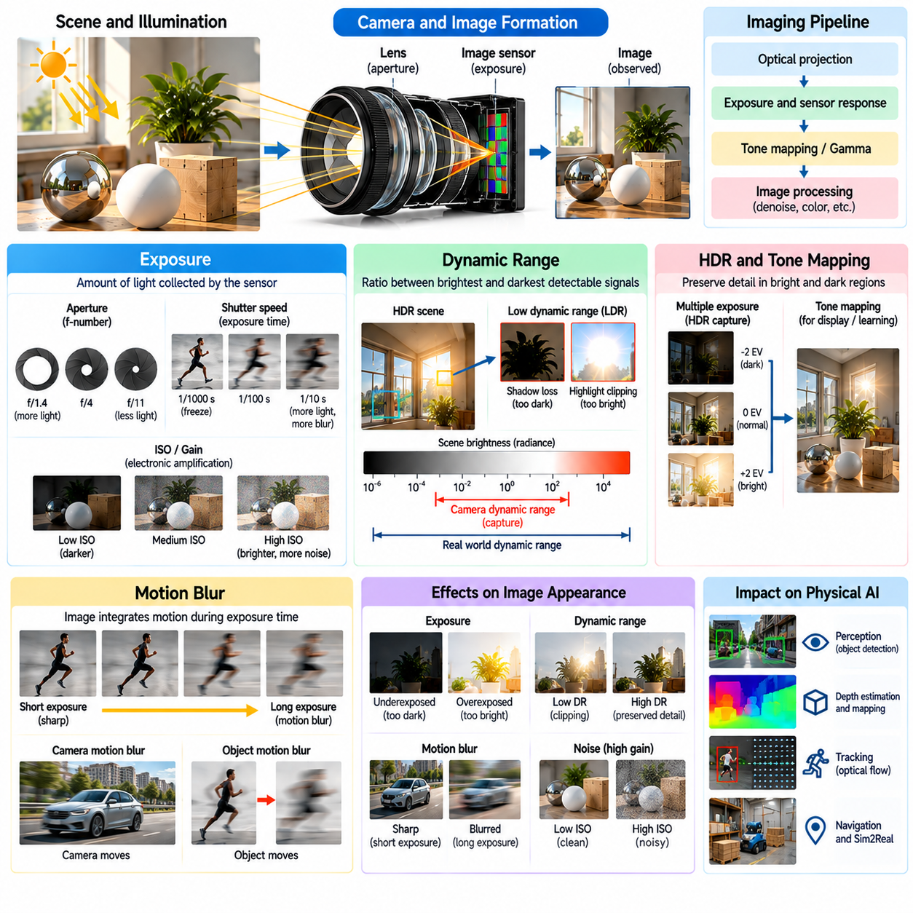{width="7.268055555555556in" height="7.268055555555556in"}

Exposure, dynamic range, and motion blur are fundamental characteristics of camera image formation that strongly influence visual observations in Physical AI. They determine how light is accumulated, how brightness variations are recorded, and how movement appears in captured images. Realistic simulation of these effects is essential for generating synthetic camera data that supports robust perception, visual tracking, robotic navigation, and reliable Sim2Real transfer.

Exposure describes the amount of light accumulated by an image sensor during image acquisition. It depends primarily on exposure time, lens aperture, and scene illumination, while electronic gain affects the recorded signal brightness. Correct exposure determines whether image features remain visible across different lighting conditions. In robotic systems, exposure settings directly influence object detection, feature extraction, and visual localization accuracy.

Exposure time defines the duration over which the sensor integrates incoming photons. Longer exposure times increase the collected light signal but also increase the likelihood of motion blur when objects or cameras move. Shorter exposures reduce motion-related image degradation but may produce darker observations with lower signal-to-noise ratios. This tradeoff is particularly important for mobile robots, drones, and high-speed manipulation systems.

Lens aperture controls the quantity of light reaching the sensor by adjusting the effective opening of the optical system. A larger aperture generally increases light collection while reducing depth of field. A smaller aperture increases the range of distances appearing sharp but may require longer exposure times or higher electronic gain. Camera simulation should reproduce these interactions rather than treating image brightness as an independent rendering parameter.

Electronic gain amplifies the sensor signal after photon collection and can increase the apparent brightness of recorded images. However, gain does not increase the number of collected photons and may amplify existing noise. Analog and digital gain can affect image statistics differently. Realistic synthetic camera models should distinguish optical exposure from electronic amplification when reproducing low-light robotic observations.

Dynamic range describes the ratio between the largest and smallest detectable light signals that a camera can represent with useful detail. Real environments frequently contain both bright and dark regions, creating significant challenges for image sensors. Limited dynamic range can cause highlight clipping or loss of shadow detail. These effects influence robotic perception when objects appear near windows, reflective machinery, or poorly illuminated spaces.

High Dynamic Range imaging extends the range of scene brightness that can be represented in a final image. Cameras may combine multiple exposures, use specialized sensor architectures, or apply computational reconstruction techniques. HDR processing can preserve details in shadows and highlights, but it may introduce artifacts when objects move between exposures. Simulation must reproduce the relevant acquisition and processing mechanisms.

Tone mapping converts high-dynamic-range radiometric information into values suitable for display or downstream image processing. Global tone mapping applies a common transformation across the image, while local operators adapt to spatial brightness differences. These transformations affect contrast, color appearance, and feature visibility. Synthetic images should use tone mapping behavior consistent with the target robotic camera pipeline.

Gamma correction and color transfer functions further influence the relationship between physical scene brightness and encoded pixel values. Linear radiometric values should not be confused with nonlinear image representations. Incorrect color-space handling can distort brightness relationships and alter training data statistics. Maintaining consistent transformations is essential when comparing rendered observations with real camera measurements.

Automatic exposure control adjusts camera settings in response to changing scene brightness. Algorithms may analyze average luminance, image histograms, selected regions, or exposure priorities. Sudden transitions between bright and dark environments can produce temporary overexposure or underexposure. Modeling exposure adaptation helps prepare robotic perception systems for realistic illumination changes during operation.

Exposure adaptation also introduces temporal behavior into image sequences. Camera brightness may change gradually as control algorithms update exposure time or gain. These transitions influence feature matching, optical flow, and visual odometry. Synthetic sequences generated with fixed exposure may fail to reproduce these effects. Time-dependent exposure models therefore improve realism for robots navigating dynamic lighting environments.

Motion blur occurs when scene content moves relative to the camera during the exposure interval. Instead of recording a single instantaneous configuration, the sensor integrates light from multiple positions over time. The resulting image contains spatially distributed intensity patterns along the direction of apparent motion. Motion blur can obscure edges, reduce texture contrast, and degrade the accuracy of visual perception algorithms.

Camera motion and object motion produce different sources of blur. Translational and rotational camera movement can affect large portions of an image, while independently moving objects may produce localized blur. The magnitude and direction of blur depend on exposure duration, relative velocity, scene depth, and projection geometry. Accurate simulation requires motion information from both the robot and its surrounding environment.

Motion blur can be modeled by integrating rendered radiance across multiple timestamps within an exposure interval. A renderer samples intermediate scene states and combines their contributions according to the shutter response. Increasing temporal sample counts generally improves accuracy but increases computational cost. Simplified post-processing methods may approximate blur efficiently, although they can fail near occlusions and rapidly changing geometry.

Global shutter cameras expose all image pixels over approximately the same time interval. This produces a consistent temporal reference across the image, although motion blur can still occur during exposure. Global shutter sensors are often useful for high-speed robotics because they avoid many geometric distortions associated with sequential sensor readout. Their simulation should still account for finite exposure duration and sensor response.

Rolling shutter cameras expose or read out different image rows at different times. During camera or object motion, this temporal offset can produce skew, bending, stretching, or other geometric distortions. Rolling shutter effects are particularly noticeable during rapid rotation or vibration. Accurate simulation requires associating image regions with their corresponding acquisition times rather than rendering the entire image at one timestamp.

Rolling shutter distortion and motion blur are related but distinct phenomena. Motion blur results from integrating light over a finite exposure interval, while rolling shutter distortion results from differences in acquisition timing across the image. A rolling shutter camera can exhibit both effects simultaneously. Separating these mechanisms in simulation is important for evaluating visual odometry, feature tracking, and geometric reconstruction.

The shutter response function describes how incoming light is weighted during exposure. An ideal rectangular shutter integrates light uniformly, while practical electronic or mechanical shutters may exhibit different temporal characteristics. Shutter timing also interacts with frame rate and sensor readout duration. These parameters determine the temporal structure of captured observations and should be represented when accurate camera dynamics are required.

Motion blur interacts with depth of field, optical aberrations, and sensor sampling. Defocused regions may exhibit different blur characteristics from sharply focused objects, while image processing can modify the appearance of motion trails. Downsampling and compression may further suppress fine details. Realistic camera simulation should consider these combined effects when generating training data for visually demanding robotic tasks.

Exposure and motion blur also influence the reliability of depth estimation and multi-camera perception. Stereo matching depends on consistent image features across camera views, while visual SLAM relies on stable correspondences over time. Excessive blur or exposure mismatch can reduce matching accuracy and increase localization uncertainty. Synthetic evaluation should reproduce these conditions to identify perception failures before real-world deployment.

Lighting flicker introduces additional temporal complexity into camera observations. LED drivers, fluorescent lighting, and periodically modulated light sources may create brightness variations that interact with exposure and rolling shutter timing. These interactions can produce banding or inconsistent illumination across frames. Simulating relevant flicker frequencies and acquisition timing helps evaluate robots operating under industrial lighting systems.

Exposure randomization can improve robustness by varying shutter duration, aperture, gain, brightness response, and dynamic range during synthetic data generation. Motion blur randomization can introduce different camera velocities, object motions, and temporal integration settings. However, parameter combinations should reflect plausible camera hardware behavior. Physically constrained variation is more useful than arbitrary image degradation when preparing models for deployment.

Camera calibration should include radiometric and temporal characteristics in addition to geometric parameters. Exposure response curves, saturation limits, noise behavior, shutter timing, and readout duration can be estimated through controlled measurements. These values provide reference parameters for synthetic camera models. Calibration helps reduce systematic differences between rendered image sequences and observations captured by real robotic cameras.

Validation should compare synthetic and real images across controlled illumination, exposure, and motion conditions. Useful measurements include intensity distributions, highlight saturation, shadow visibility, blur extent, rolling shutter deformation, and feature tracking stability. Task-level testing can assess object detection, visual localization, and navigation performance. These evaluations determine whether simulated camera effects improve practical Sim2Real transfer.

Computational constraints influence the fidelity of exposure and motion blur simulation. Accurate temporal integration may require rendering multiple scene states for each output frame, increasing GPU workload and memory traffic. Large-scale reinforcement learning environments may use simplified approximations, while high-fidelity synthetic datasets can justify more detailed models. Rendering complexity should be allocated according to the sensitivity of downstream robotic tasks.

Ultimately, exposure, dynamic range, and motion blur connect optical image formation with the temporal and electronic behavior of real camera sensors. Their accurate simulation requires coordinated modeling of illumination, aperture, exposure control, sensor response, shutter timing, and scene motion. Integrating these effects into Physical AI rendering pipelines produces more realistic visual observations and supports robust robotic perception under challenging real-world conditions.

노출(Exposure), 동적 범위(Dynamic Range), 모션 블러(Motion Blur)는 피지컬 AI(Physical AI)의 시각적 관측(Visual Observation)에 큰 영향을 미치는 카메라 영상 형성(Camera Image Formation)의 기본 특성이다. 이들은 빛이 축적되는 방식, 밝기 변화(Brightness Variation)가 기록되는 방식, 움직임이 촬영 영상(Captured Image)에 나타나는 방식을 결정한다. 이러한 효과를 사실적으로 시뮬레이션하는 것은 강건한 인식(Robust Perception), 시각적 추적(Visual Tracking), 로봇 내비게이션(Robotic Navigation), 신뢰성 높은 시뮬레이션-현실 전이(Sim2Real Transfer)를 지원하는 합성 카메라 데이터(Synthetic Camera Data)를 생성하는 데 필수적이다.

노출(Exposure)은 영상 획득(Image Acquisition) 과정에서 영상 센서(Image Sensor)가 축적하는 빛의 양을 설명한다. 노출은 주로 노출 시간(Exposure Time), 렌즈 조리개(Lens Aperture), 장면 조명(Scene Illumination)에 따라 달라지며, 전자적 이득(Electronic Gain)은 기록된 신호 밝기(Recorded Signal Brightness)에 영향을 미친다. 적절한 노출은 다양한 조명 조건(Lighting Condition)에서 영상 특징(Image Feature)이 가시성을 유지하도록 결정한다. 로봇 시스템(Robotic System)에서 노출 설정(Exposure Setting)은 객체 탐지(Object Detection), 특징 추출(Feature Extraction), 시각적 위치 추정 정확도(Visual Localization Accuracy)에 직접적인 영향을 미친다.

노출 시간(Exposure Time)은 센서가 입사 광자(Incoming Photon)를 적분하는 시간적 길이(Duration)를 정의한다. 긴 노출 시간(Longer Exposure Time)은 수집되는 광 신호(Light Signal)를 증가시키지만 객체(Object)나 카메라(Camera)가 움직일 때 모션 블러(Motion Blur)가 발생할 가능성도 높인다. 짧은 노출 시간(Shorter Exposure Time)은 움직임으로 인한 영상 품질 저하(Motion-Related Image Degradation)를 줄이지만 신호 대 잡음비(Signal-to-Noise Ratio)가 낮은 어두운 관측 영상(Darker Observation)을 생성할 수 있다. 이러한 상충관계(Tradeoff)는 이동 로봇(Mobile Robot), 드론(Drone), 고속 조작 시스템(High-Speed Manipulation System)에서 특히 중요하다.

렌즈 조리개(Lens Aperture)는 광학 시스템(Optical System)의 유효 개구부(Effective Opening)를 조절하여 센서에 도달하는 빛의 양을 제어한다. 큰 조리개(Larger Aperture)는 일반적으로 광 수집량(Light Collection)을 증가시키지만 피사계 심도(Depth of Field)를 감소시킨다. 작은 조리개(Smaller Aperture)는 선명하게 보이는 거리 범위를 넓히지만 더 긴 노출 시간이나 높은 전자적 이득이 필요할 수 있다. 카메라 시뮬레이션(Camera Simulation)은 영상 밝기(Image Brightness)를 독립적인 렌더링 매개변수(Rendering Parameter)로 취급하기보다 이러한 상호작용을 재현해야 한다.

전자적 이득(Electronic Gain)은 광자 수집(Photon Collection) 이후 센서 신호(Sensor Signal)를 증폭하여 기록 영상(Recorded Image)의 겉보기 밝기(Apparent Brightness)를 증가시킬 수 있다. 그러나 이득(Gain)은 수집된 광자의 수를 증가시키지 않으며 기존 잡음(Noise)을 함께 증폭할 수 있다. 아날로그 이득(Analog Gain)과 디지털 이득(Digital Gain)은 영상 통계(Image Statistics)에 서로 다른 영향을 미칠 수 있다. 사실적인 합성 카메라 모델(Synthetic Camera Model)은 저조도 로봇 관측(Low-Light Robotic Observation)을 재현할 때 광학적 노출(Optical Exposure)과 전자적 증폭(Electronic Amplification)을 구분해야 한다.

동적 범위(Dynamic Range)는 카메라가 유용한 세부정보(Useful Detail)를 유지하면서 표현할 수 있는 최대 검출 광 신호(Largest Detectable Light Signal)와 최소 검출 광 신호(Smallest Detectable Light Signal) 사이의 비율을 설명한다. 실제 환경(Real Environment)은 밝은 영역(Bright Region)과 어두운 영역(Dark Region)을 동시에 포함하는 경우가 많아 영상 센서(Image Sensor)에 상당한 어려움을 발생시킨다. 제한된 동적 범위(Limited Dynamic Range)는 밝은 영역 클리핑(Highlight Clipping)이나 그림자 세부정보 손실(Loss of Shadow Detail)을 유발할 수 있다. 이러한 효과는 창문(Window), 반사성 기계(Reflective Machinery), 조명이 부족한 공간(Poorly Illuminated Space) 근처의 객체를 인식할 때 로봇 인식(Robotic Perception)에 영향을 미친다.

고동적 범위 영상(High Dynamic Range Imaging, HDR Imaging)은 최종 영상(Final Image)에서 표현할 수 있는 장면 밝기(Scene Brightness)의 범위를 확장한다. 카메라는 다중 노출(Multiple Exposure)을 결합하거나 특수 센서 아키텍처(Specialized Sensor Architecture)를 사용하거나 계산적 재구성 기법(Computational Reconstruction Technique)을 적용할 수 있다. HDR 처리(HDR Processing)는 그림자와 밝은 영역의 세부정보를 보존할 수 있지만 노출 사이에 객체가 움직이면 인공물(Artifact)이 발생할 수 있다. 시뮬레이션은 관련된 영상 획득 및 처리 메커니즘(Acquisition and Processing Mechanism)을 재현해야 한다.

톤 매핑(Tone Mapping)은 고동적 범위 복사측정 정보(High-Dynamic-Range Radiometric Information)를 디스플레이(Display) 또는 후속 영상 처리(Downstream Image Processing)에 적합한 값으로 변환한다. 전역 톤 매핑(Global Tone Mapping)은 영상 전체에 공통 변환(Common Transformation)을 적용하며, 국소 톤 매핑 연산자(Local Tone Mapping Operator)는 공간적 밝기 차이(Spatial Brightness Difference)에 적응한다. 이러한 변환은 대비(Contrast), 색상 외관(Color Appearance), 특징 가시성(Feature Visibility)에 영향을 미친다. 합성 영상(Synthetic Image)은 대상 로봇 카메라 파이프라인(Target Robotic Camera Pipeline)과 일치하는 톤 매핑 동작을 사용해야 한다.

감마 보정(Gamma Correction)과 색상 전달 함수(Color Transfer Function)는 물리적 장면 밝기(Physical Scene Brightness)와 부호화된 픽셀값(Encoded Pixel Value) 사이의 관계에 추가적인 영향을 미친다. 선형 복사측정값(Linear Radiometric Value)을 비선형 영상 표현(Nonlinear Image Representation)과 혼동해서는 안 된다. 잘못된 색 공간 처리(Incorrect Color-Space Handling)는 밝기 관계(Brightness Relationship)를 왜곡하고 학습 데이터 통계(Training Data Statistics)를 변화시킬 수 있다. 렌더링된 관측(Rendered Observation)을 실제 카메라 측정값(Real Camera Measurement)과 비교할 때 일관된 변환(Consistent Transformation)을 유지하는 것이 필수적이다.

자동 노출 제어(Automatic Exposure Control)는 변화하는 장면 밝기(Scene Brightness)에 대응하여 카메라 설정(Camera Setting)을 조정한다. 알고리즘(Algorithm)은 평균 휘도(Average Luminance), 영상 히스토그램(Image Histogram), 선택 영역(Selected Region), 노출 우선순위(Exposure Priority)를 분석할 수 있다. 밝은 환경과 어두운 환경 사이의 갑작스러운 전환(Sudden Transition)은 일시적인 과다 노출(Overexposure)이나 노출 부족(Underexposure)을 발생시킬 수 있다. 노출 적응(Exposure Adaptation)을 모델링하면 로봇 인식 시스템(Robotic Perception System)이 실제 운영 중 발생하는 조명 변화(Illumination Change)에 대비하도록 지원할 수 있다.

노출 적응(Exposure Adaptation)은 영상 시퀀스(Image Sequence)에 시간적 동작(Temporal Behavior)도 도입한다. 제어 알고리즘(Control Algorithm)이 노출 시간(Exposure Time)이나 이득(Gain)을 갱신함에 따라 카메라 밝기(Camera Brightness)는 점진적으로 변화할 수 있다. 이러한 전환은 특징 매칭(Feature Matching), 광학 흐름(Optical Flow), 시각적 주행 거리 추정(Visual Odometry)에 영향을 미친다. 고정 노출(Fixed Exposure)로 생성된 합성 시퀀스(Synthetic Sequence)는 이러한 효과를 재현하지 못할 수 있다. 따라서 시간 의존적 노출 모델(Time-Dependent Exposure Model)은 동적인 조명 환경(Dynamic Lighting Environment)을 주행하는 로봇의 시뮬레이션 현실성을 향상시킨다.

모션 블러(Motion Blur)는 노출 구간(Exposure Interval) 동안 장면 내용(Scene Content)이 카메라에 대해 상대적으로 움직일 때 발생한다. 센서는 단일 순간의 구성(Instantaneous Configuration)을 기록하는 대신 시간에 따라 여러 위치에서 들어오는 빛을 적분한다. 그 결과 영상에는 겉보기 움직임 방향(Direction of Apparent Motion)을 따라 공간적으로 분포된 강도 패턴(Spatially Distributed Intensity Pattern)이 나타난다. 모션 블러는 경계(Edge)를 불분명하게 만들고 텍스처 대비(Texture Contrast)를 감소시키며 시각적 인식 알고리즘(Visual Perception Algorithm)의 정확도를 저하시킬 수 있다.

카메라 움직임(Camera Motion)과 객체 움직임(Object Motion)은 서로 다른 흐림 원인(Source of Blur)을 생성한다. 병진 운동(Translational Motion)과 회전 운동(Rotational Motion)에 따른 카메라 움직임은 영상의 넓은 영역에 영향을 미칠 수 있지만 독립적으로 움직이는 객체는 국소적인 흐림(Localized Blur)을 생성할 수 있다. 흐림의 크기(Magnitude)와 방향(Direction)은 노출 시간(Exposure Duration), 상대 속도(Relative Velocity), 장면 깊이(Scene Depth), 투영 기하학(Projection Geometry)에 따라 달라진다. 정확한 시뮬레이션에는 로봇과 주변 환경(Surrounding Environment) 모두의 움직임 정보(Motion Information)가 필요하다.

모션 블러(Motion Blur)는 노출 구간(Exposure Interval) 내 여러 시점(Timestamp)에 걸쳐 렌더링된 복사휘도(Rendered Radiance)를 적분하여 모델링할 수 있다. 렌더러(Renderer)는 중간 장면 상태(Intermediate Scene State)를 샘플링하고 셔터 응답(Shutter Response)에 따라 각 상태의 기여를 결합한다. 시간 샘플 수(Temporal Sample Count)를 늘리면 일반적으로 정확도(Accuracy)는 향상되지만 계산 비용(Computational Cost)도 증가한다. 단순화된 후처리 기법(Post-Processing Method)은 흐림을 효율적으로 근사할 수 있지만 가림(Occlusion)이나 빠르게 변화하는 기하학적 구조(Rapidly Changing Geometry) 근처에서는 실패할 수 있다.

글로벌 셔터 카메라(Global Shutter Camera)는 모든 영상 픽셀(Image Pixel)을 거의 동일한 시간 구간(Time Interval) 동안 노출한다. 따라서 영상 전체에서 일관된 시간 기준(Consistent Temporal Reference)을 제공하지만 노출 중 모션 블러(Motion Blur)는 여전히 발생할 수 있다. 글로벌 셔터 센서(Global Shutter Sensor)는 순차적 센서 판독(Sequential Sensor Readout)과 관련된 여러 기하학적 왜곡(Geometric Distortion)을 방지하므로 고속 로봇 시스템(High-Speed Robotics)에 유용한 경우가 많다. 글로벌 셔터 시뮬레이션에서도 유한한 노출 시간(Finite Exposure Duration)과 센서 응답(Sensor Response)을 고려해야 한다.

롤링 셔터 카메라(Rolling Shutter Camera)는 서로 다른 영상 행(Image Row)을 서로 다른 시점에 노출하거나 판독한다. 카메라 또는 객체가 움직이는 동안 이러한 시간적 오프셋(Temporal Offset)은 기울어짐(Skew), 휘어짐(Bending), 늘어남(Stretching), 기타 기하학적 왜곡(Geometric Distortion)을 발생시킬 수 있다. 롤링 셔터 효과(Rolling Shutter Effect)는 빠른 회전(Rapid Rotation)이나 진동(Vibration) 중에 특히 두드러진다. 정확한 시뮬레이션을 위해서는 전체 영상을 하나의 시점에서 렌더링하기보다 영상 영역(Image Region)을 해당 획득 시점(Acquisition Time)과 연결해야 한다.

롤링 셔터 왜곡(Rolling Shutter Distortion)과 모션 블러(Motion Blur)는 서로 관련되어 있지만 구별되는 현상이다. 모션 블러는 유한한 노출 구간(Finite Exposure Interval) 동안 빛을 적분하여 발생하며, 롤링 셔터 왜곡은 영상 전체에 걸친 획득 시점(Acquisition Timing)의 차이로 인해 발생한다. 롤링 셔터 카메라(Rolling Shutter Camera)는 두 효과를 동시에 나타낼 수 있다. 시뮬레이션에서 이러한 메커니즘을 분리하는 것은 시각적 주행 거리 추정(Visual Odometry), 특징 추적(Feature Tracking), 기하학적 재구성(Geometric Reconstruction)을 평가하는 데 중요하다.

셔터 응답 함수(Shutter Response Function)는 노출(Exposure) 중 입사광(Incoming Light)에 적용되는 시간적 가중치(Temporal Weighting)를 설명한다. 이상적인 직사각형 셔터(Ideal Rectangular Shutter)는 빛을 균일하게 적분하지만 실제 전자식 셔터(Electronic Shutter)나 기계식 셔터(Mechanical Shutter)는 서로 다른 시간적 특성(Temporal Characteristic)을 나타낼 수 있다. 셔터 타이밍(Shutter Timing)은 프레임 속도(Frame Rate) 및 센서 판독 시간(Sensor Readout Duration)과도 상호작용한다. 이러한 매개변수는 촬영된 관측(Captured Observation)의 시간적 구조(Temporal Structure)를 결정하므로 정확한 카메라 동역학(Camera Dynamics)이 요구될 때 표현해야 한다.

모션 블러(Motion Blur)는 피사계 심도(Depth of Field), 광학 수차(Optical Aberration), 센서 샘플링(Sensor Sampling)과 상호작용한다. 초점이 맞지 않은 영역(Defocused Region)은 선명하게 초점이 맞은 객체(Sharply Focused Object)와 서로 다른 흐림 특성(Blur Characteristic)을 나타낼 수 있으며, 영상 처리(Image Processing)는 움직임 흔적(Motion Trail)의 외관을 변화시킬 수 있다. 다운샘플링(Downsampling)과 압축(Compression)은 미세한 세부정보(Fine Detail)를 추가로 감소시킬 수 있다. 사실적인 카메라 시뮬레이션(Camera Simulation)은 시각적으로 까다로운 로봇 작업(Visually Demanding Robotic Task)을 위한 학습 데이터(Training Data)를 생성할 때 이러한 결합 효과를 고려해야 한다.

노출(Exposure)과 모션 블러(Motion Blur)는 깊이 추정(Depth Estimation)과 다중 카메라 인식(Multi-Camera Perception)의 신뢰성에도 영향을 미친다. 스테레오 매칭(Stereo Matching)은 카메라 시점(Camera View) 사이에서 일관된 영상 특징(Image Feature)에 의존하며, 시각적 동시 위치 추정 및 지도 작성(Visual Simultaneous Localization and Mapping, Visual SLAM)은 시간에 따른 안정적인 대응 관계(Stable Correspondence)에 의존한다. 과도한 흐림(Excessive Blur)이나 노출 불일치(Exposure Mismatch)는 매칭 정확도(Matching Accuracy)를 감소시키고 위치 추정 불확실성(Localization Uncertainty)을 증가시킬 수 있다. 합성 평가(Synthetic Evaluation)는 실제 환경 배포(Real-World Deployment) 전에 인식 실패(Perception Failure)를 식별할 수 있도록 이러한 조건을 재현해야 한다.

조명 깜박임(Lighting Flicker)은 카메라 관측(Camera Observation)에 추가적인 시간적 복잡성(Temporal Complexity)을 도입한다. LED 구동기(LED Driver), 형광등(Fluorescent Lighting), 주기적으로 변조되는 광원(Periodically Modulated Light Source)은 노출 및 롤링 셔터 타이밍(Rolling Shutter Timing)과 상호작용하는 밝기 변화(Brightness Variation)를 생성할 수 있다. 이러한 상호작용은 밴딩(Banding)이나 프레임 간 불일치 조명(Inconsistent Illumination Across Frames)을 발생시킬 수 있다. 관련 깜박임 주파수(Flicker Frequency)와 영상 획득 타이밍(Acquisition Timing)을 시뮬레이션하면 산업용 조명 시스템(Industrial Lighting System)에서 작동하는 로봇을 평가하는 데 도움이 된다.

노출 랜덤화(Exposure Randomization)는 합성 데이터 생성(Synthetic Data Generation) 과정에서 셔터 지속시간(Shutter Duration), 조리개(Aperture), 이득(Gain), 밝기 응답(Brightness Response), 동적 범위(Dynamic Range)를 변화시켜 강건성(Robustness)을 향상시킬 수 있다. 모션 블러 랜덤화(Motion Blur Randomization)는 서로 다른 카메라 속도(Camera Velocity), 객체 움직임(Object Motion), 시간적 적분 설정(Temporal Integration Setting)을 도입할 수 있다. 그러나 매개변수 조합(Parameter Combination)은 실제 카메라 하드웨어(Camera Hardware)의 타당한 동작을 반영해야 한다. 배포를 위한 모델을 준비할 때 물리적으로 제약된 변화(Physically Constrained Variation)는 임의적인 영상 품질 저하(Arbitrary Image Degradation)보다 유용하다.

카메라 보정(Camera Calibration)은 기하학적 매개변수(Geometric Parameter)뿐 아니라 복사측정 특성(Radiometric Characteristic)과 시간적 특성(Temporal Characteristic)도 포함해야 한다. 노출 응답 곡선(Exposure Response Curve), 포화 한계(Saturation Limit), 잡음 특성(Noise Behavior), 셔터 타이밍(Shutter Timing), 판독 시간(Readout Duration)은 통제된 측정(Controlled Measurement)을 통해 추정할 수 있다. 이러한 값은 합성 카메라 모델(Synthetic Camera Model)의 기준 매개변수(Reference Parameter)를 제공한다. 보정은 렌더링된 영상 시퀀스(Rendered Image Sequence)와 실제 로봇 카메라(Real Robotic Camera)에서 촬영한 관측 사이의 체계적인 차이(Systematic Difference)를 줄이는 데 도움을 준다.

검증(Validation)은 통제된 조명(Illumination), 노출(Exposure), 움직임(Motion) 조건에서 합성 영상(Synthetic Image)과 실제 영상(Real Image)을 비교해야 한다. 유용한 측정 지표(Measurement Metric)에는 강도 분포(Intensity Distribution), 밝은 영역 포화(Highlight Saturation), 그림자 가시성(Shadow Visibility), 흐림 범위(Blur Extent), 롤링 셔터 변형(Rolling Shutter Deformation), 특징 추적 안정성(Feature Tracking Stability)이 포함된다. 작업 수준 시험(Task-Level Testing)은 객체 탐지(Object Detection), 시각적 위치 추정(Visual Localization), 내비게이션 성능(Navigation Performance)을 평가할 수 있다. 이러한 평가는 시뮬레이션된 카메라 효과(Simulated Camera Effect)가 실질적인 시뮬레이션-현실 전이(Sim2Real Transfer)를 개선하는지 판단한다.

계산 제약(Computational Constraint)은 노출 및 모션 블러 시뮬레이션(Exposure and Motion Blur Simulation)의 충실도(Fidelity)에 영향을 미친다. 정확한 시간적 적분(Temporal Integration)은 출력 프레임(Output Frame)마다 여러 장면 상태(Scene State)를 렌더링해야 할 수 있으므로 GPU 작업 부하(GPU Workload)와 메모리 트래픽(Memory Traffic)이 증가한다. 대규모 강화학습 환경(Large-Scale Reinforcement Learning Environment)은 단순화된 근사화(Simplified Approximation)를 사용할 수 있지만 고충실도 합성 데이터셋(High-Fidelity Synthetic Dataset)은 더욱 상세한 모델(Detailed Model)을 정당화할 수 있다. 렌더링 복잡도(Rendering Complexity)는 후속 로봇 작업(Downstream Robotic Task)의 민감도(Sensitivity)에 따라 할당해야 한다.

궁극적으로 노출(Exposure), 동적 범위(Dynamic Range), 모션 블러(Motion Blur)는 광학적 영상 형성(Optical Image Formation)을 실제 카메라 센서(Real Camera Sensor)의 시간적 및 전자적 동작(Temporal and Electronic Behavior)과 연결한다. 이러한 요소를 정확하게 시뮬레이션하려면 조명(Illumination), 조리개(Aperture), 노출 제어(Exposure Control), 센서 응답(Sensor Response), 셔터 타이밍(Shutter Timing), 장면 움직임(Scene Motion)을 통합적으로 모델링해야 한다. 이러한 효과를 피지컬 AI 렌더링 파이프라인(Physical AI Rendering Pipeline)에 통합하면 더욱 사실적인 시각적 관측(Visual Observation)을 생성하고 까다로운 실제 환경 조건(Challenging Real-World Condition)에서 강건한 로봇 인식(Robust Robotic Perception)을 지원할 수 있다.

##  

## 02.08. RGB and Depth Camera Simulation

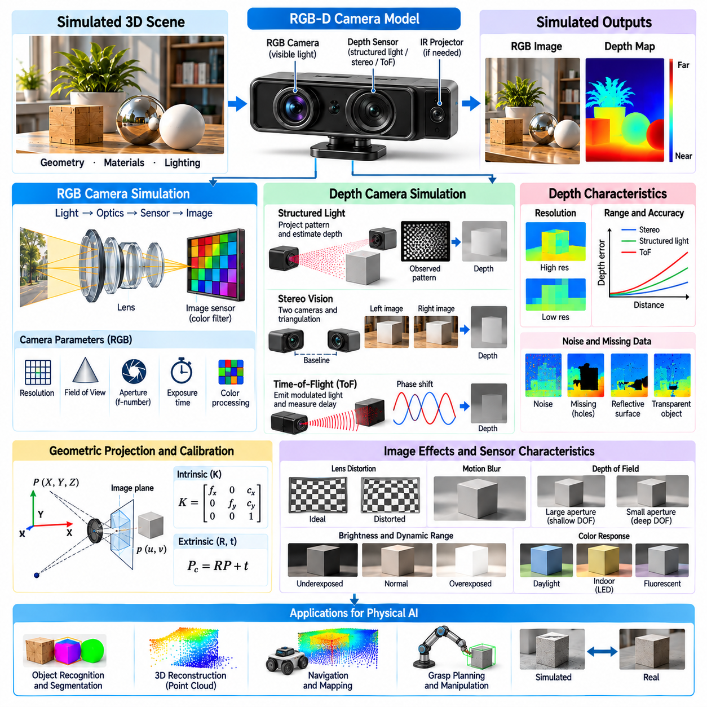{width="7.268055555555556in" height="7.268055555555556in"}

RGB and depth camera simulation is a fundamental component of photorealistic rendering for Physical AI. RGB cameras capture visual appearance, while depth cameras estimate the spatial distance between sensors and observed surfaces. Together, they provide complementary information for robotic perception, navigation, and manipulation. Accurate simulation must reproduce geometric projection, optical behavior, sensor limitations, and environmental interactions to support reliable Sim2Real transfer.

RGB camera simulation models the formation of color images through interactions among illumination, materials, optics, and image sensors. Rendered observations depend on surface reflectance, lighting conditions, camera exposure, and color processing. Physically based rendering provides a foundation for generating realistic RGB data. However, visual realism alone does not guarantee correspondence with actual robotic cameras unless sensor-specific characteristics are also represented.

Depth cameras generate measurements describing the three-dimensional structure of observed environments. Unlike RGB images, which primarily encode appearance, depth images associate pixels with geometric distance measurements. Depending on the sensor model, depth may represent distance along the optical axis or range along a viewing ray. This distinction is important when converting simulated measurements into point clouds or comparing them with real sensor outputs.

RGB-D cameras combine color and depth sensing within a coordinated imaging system. Their outputs support object segmentation, three-dimensional reconstruction, pose estimation, and robotic grasp planning. Simulated RGB-D observations must preserve geometric alignment between color pixels and depth measurements. Inaccurate calibration or synchronization can introduce inconsistencies that reduce the effectiveness of perception models trained on synthetic data.

Perspective projection is commonly used to simulate RGB cameras and many depth sensors. Camera intrinsic parameters determine focal length, principal point, and pixel coordinate relationships. Extrinsic parameters define camera position and orientation relative to the robot or environment. Consistent projection models ensure that simulated images, depth maps, and geometric annotations correspond to the same physical scene configuration.

Depth rendering can be implemented using rasterized depth buffers or ray-based geometric intersection calculations. Rasterization efficiently estimates visible surface depth during conventional graphics rendering. Ray casting determines the intersection distance between sensor rays and scene geometry. Both approaches can produce idealized depth measurements, but additional processing is required to reproduce the behavior and limitations of physical depth cameras.

Structured-light depth cameras project known illumination patterns onto surfaces and infer depth from observed pattern deformation. Their performance depends on projector geometry, camera calibration, surface reflectance, and ambient illumination. Highly reflective, transparent, or dark materials may reduce measurement reliability. Realistic simulation should represent pattern projection, visibility, correspondence estimation, and potential reconstruction failures.

Stereo depth cameras estimate distance by identifying corresponding image features across two camera views. Disparity between matched features is converted into depth using camera focal length and stereo baseline. Accuracy depends on calibration, image texture, lighting, and matching algorithms. Textureless surfaces, repetitive patterns, and occlusions can produce uncertain or invalid depth estimates that should be represented in synthetic observations.

Time-of-Flight cameras estimate distance from the travel time or phase shift of emitted and reflected light. Direct Time-of-Flight systems measure photon arrival timing, while indirect systems commonly estimate phase differences in modulated illumination. Their measurements depend on signal strength, integration time, reflectivity, and ambient interference. Simulating these mechanisms improves realism beyond ideal geometric depth rendering.

Depth sensor resolution determines the spatial density of available distance measurements. Lower-resolution depth maps may miss narrow structures, small objects, or detailed surface geometry. Sensor sampling also interacts with camera field of view and distance, causing spatial coverage to vary across the scene. Realistic depth simulation should reproduce the resolution and sampling characteristics of the intended hardware.

Depth accuracy and precision generally vary with measurement distance and sensing technology. Stereo depth uncertainty often increases rapidly with distance because small disparity errors produce larger depth errors. Time-of-Flight and structured-light systems exhibit different range-dependent error patterns. Synthetic depth generation should use technology-specific uncertainty models rather than assuming uniform measurement accuracy throughout the observable volume.

Depth noise can arise from photon statistics, electronic circuitry, correspondence errors, multipath reflections, and reconstruction algorithms. Noise characteristics may depend on distance, material properties, viewing angle, and illumination. Simple Gaussian perturbations provide an initial approximation but rarely capture all physical effects. More realistic models introduce spatially varying noise, correlated errors, quantization, and invalid measurements.

Missing depth measurements are common near reflective surfaces, transparent objects, dark materials, and occlusion boundaries. Sensors may return invalid values when reflected signals are insufficient or ambiguous. These missing regions create characteristic patterns in depth images. Simulation should reproduce plausible measurement dropout instead of assigning perfect depth to every visible surface, particularly when training models for real-world manipulation.

Depth discontinuities introduce additional challenges at object boundaries. A sensor pixel may observe contributions from surfaces at different distances, creating mixed measurements or unstable reconstruction. Filtering algorithms can further modify edge positions and generate smoothing artifacts. Accurate boundary modeling is important for robotic grasping, obstacle detection, and segmentation because these applications depend on reliable geometric separation.

Multipath interference occurs when emitted light reaches a sensor after reflecting from multiple surfaces. The resulting signal may represent a mixture of different optical paths rather than the direct surface distance. This phenomenon can produce systematic depth errors in corners, reflective environments, and enclosed spaces. Time-of-Flight simulation may require additional light transport modeling when multipath behavior materially affects the target application.

Ambient illumination influences depth sensing differently across technologies. Strong sunlight can interfere with active infrared systems, while insufficient visible texture can degrade passive stereo matching. Artificial lighting and reflective materials may introduce additional interference. Simulated environments should therefore connect depth sensor behavior with lighting and material models instead of treating depth acquisition as independent of scene appearance.

RGB and depth cameras may operate at different resolutions, frame rates, and exposure settings. Their measurements can also originate from physically separated optical centers. Registration transforms depth samples into the RGB camera coordinate system or vice versa. Accurate simulation requires preserving camera intrinsics, relative extrinsics, and temporal synchronization to prevent artificial alignment errors or unrealistically perfect correspondence.

Temporal behavior is important when simulating RGB-D sensors mounted on moving robots. Camera motion, object movement, rolling shutter, and processing latency can cause discrepancies between color and depth observations. Depth reconstruction may introduce additional delays or filtering effects. Synchronization models should represent these characteristics when synthetic sequences are intended for visual tracking, mapping, or dynamic manipulation.

Point clouds can be reconstructed from depth images using camera calibration and geometric back-projection. Each valid depth pixel contributes a three-dimensional point in the sensor coordinate frame. Transformations then express these points relative to the robot or world. The resulting geometry supports collision avoidance, object reconstruction, and scene understanding. Depth noise and missing measurements propagate directly into point cloud quality.

Synthetic RGB-D data can provide automatically aligned annotations for supervised learning. Object identities, segmentation masks, surface normals, poses, and geometric relationships can be extracted from the simulation scene. These annotations support training for semantic segmentation, pose estimation, grasp prediction, and three-dimensional perception. Their usefulness depends on consistent coordinate frames and realistic sensor observations.

Domain randomization improves RGB-D model robustness by varying illumination, materials, camera parameters, object arrangements, and sensor noise. RGB and depth perturbations should remain physically consistent whenever they originate from shared environmental conditions. For example, changing surface reflectance may affect both image brightness and active depth reliability. Independent randomization can otherwise generate unrealistic combinations that weaken Sim2Real transfer.

Sensor calibration connects simulated RGB-D measurements with physical hardware. Calibration procedures estimate intrinsic parameters, lens distortion, relative camera poses, depth scale, and systematic measurement biases. Controlled reference scenes can reveal deviations in depth accuracy and registration. Hardware measurements should guide simulation parameters whenever a specific sensor model is targeted for robotic deployment.

Validation requires comparing synthetic and real RGB-D observations across representative scenes and operating conditions. Image-level evaluation can examine color distributions, depth errors, invalid-pixel patterns, edge artifacts, and alignment quality. Task-level evaluation measures object detection, pose estimation, mapping accuracy, and grasp success. These comparisons help identify which simulation improvements contribute meaningful gains in robotic performance.

Computational efficiency is a major consideration when generating RGB-D observations for large-scale Physical AI training. Rasterized depth buffers offer fast geometric measurements, while detailed structured-light or Time-of-Flight simulation requires additional processing. Hybrid pipelines can combine efficient depth rendering with calibrated sensor effects. Rendering fidelity should be selected according to application requirements, available hardware, and validation objectives.

Ultimately, RGB and depth camera simulation connects visual appearance with measurable three-dimensional geometry. Realistic implementation requires coordinated modeling of projection, optics, depth sensing principles, noise, calibration, and temporal behavior. By integrating physically plausible sensor imperfections with accurate scene rendering, Physical AI systems can generate synthetic RGB-D data that improves perception robustness and supports reliable operation in real environments.

RGB 카메라(RGB Camera)와 깊이 카메라(Depth Camera) 시뮬레이션은 피지컬 AI(Physical AI)를 위한 사실적 렌더링(Photorealistic Rendering)의 기본 구성요소이다. RGB 카메라는 시각적 외관(Visual Appearance)을 포착하는 반면, 깊이 카메라는 센서(Sensor)와 관측된 표면(Observed Surface) 사이의 공간적 거리(Spatial Distance)를 추정한다. 두 센서는 상호보완적인 정보(Complementary Information)를 제공하여 로봇 인식(Robotic Perception), 내비게이션(Navigation), 조작(Manipulation)을 지원한다. 정확한 시뮬레이션은 신뢰성 높은 시뮬레이션-현실 전이(Sim2Real Transfer)를 위해 기하학적 투영(Geometric Projection), 광학적 동작(Optical Behavior), 센서 한계(Sensor Limitation), 환경적 상호작용(Environmental Interaction)을 재현해야 한다.

RGB 카메라 시뮬레이션(RGB Camera Simulation)은 조명(Illumination), 재질(Material), 광학계(Optics), 영상 센서(Image Sensor) 사이의 상호작용을 통해 컬러 영상(Color Image)이 형성되는 과정을 모델링한다. 렌더링된 관측(Rendered Observation)은 표면 반사율(Surface Reflectance), 조명 조건(Lighting Condition), 카메라 노출(Camera Exposure), 색상 처리(Color Processing)에 따라 달라진다. 물리 기반 렌더링(Physically Based Rendering)은 사실적인 RGB 데이터(RGB Data)를 생성하기 위한 기반을 제공한다. 그러나 센서별 특성(Sensor-Specific Characteristic)이 함께 표현되지 않으면 시각적 현실성(Visual Realism)만으로 실제 로봇 카메라(Actual Robotic Camera)와의 일치성을 보장할 수 없다.

깊이 카메라(Depth Camera)는 관측 환경(Observed Environment)의 3차원 구조(Three-Dimensional Structure)를 설명하는 측정값을 생성한다. 주로 외관(Appearance)을 부호화하는 RGB 영상(RGB Image)과 달리 깊이 영상(Depth Image)은 픽셀(Pixel)에 기하학적 거리 측정값(Geometric Distance Measurement)을 연결한다. 센서 모델(Sensor Model)에 따라 깊이(Depth)는 광축(Optical Axis)을 따른 거리 또는 관측 광선(Viewing Ray)을 따른 거리(Range)를 나타낼 수 있다. 이러한 구분은 시뮬레이션 측정값(Simulated Measurement)을 포인트 클라우드(Point Cloud)로 변환하거나 실제 센서 출력(Real Sensor Output)과 비교할 때 중요하다.

RGB-D 카메라(RGB-D Camera)는 컬러 센싱(Color Sensing)과 깊이 센싱(Depth Sensing)을 하나의 조정된 영상 시스템(Coordinated Imaging System)으로 결합한다. 이러한 출력은 객체 분할(Object Segmentation), 3차원 재구성(Three-Dimensional Reconstruction), 자세 추정(Pose Estimation), 로봇 파지 계획(Robotic Grasp Planning)을 지원한다. 시뮬레이션된 RGB-D 관측(Simulated RGB-D Observation)은 컬러 픽셀(Color Pixel)과 깊이 측정값(Depth Measurement) 사이의 기하학적 정렬(Geometric Alignment)을 유지해야 한다. 부정확한 보정(Calibration)이나 동기화(Synchronization)는 불일치(Inconsistency)를 발생시켜 합성 데이터(Synthetic Data)로 학습한 인식 모델(Perception Model)의 효과를 감소시킬 수 있다.

원근 투영(Perspective Projection)은 RGB 카메라와 많은 깊이 센서(Depth Sensor)를 시뮬레이션하는 데 일반적으로 사용된다. 카메라 내부 매개변수(Camera Intrinsic Parameter)는 초점거리(Focal Length), 주점(Principal Point), 픽셀 좌표 관계(Pixel Coordinate Relationship)를 결정한다. 외부 매개변수(Extrinsic Parameter)는 로봇(Robot) 또는 환경(Environment)에 대한 카메라 위치(Position)와 방향(Orientation)을 정의한다. 일관된 투영 모델(Consistent Projection Model)은 시뮬레이션 영상(Simulated Image), 깊이 맵(Depth Map), 기하학적 주석(Geometric Annotation)이 동일한 물리적 장면 구성(Physical Scene Configuration)에 대응하도록 보장한다.

깊이 렌더링(Depth Rendering)은 래스터화된 깊이 버퍼(Rasterized Depth Buffer) 또는 광선 기반 기하학적 교차 계산(Ray-Based Geometric Intersection Calculation)을 사용하여 구현할 수 있다. 래스터화(Rasterization)는 기존 그래픽 렌더링(Conventional Graphics Rendering) 과정에서 가시 표면 깊이(Visible Surface Depth)를 효율적으로 추정한다. 광선 투사(Ray Casting)는 센서 광선(Sensor Ray)과 장면 기하학(Scene Geometry) 사이의 교차 거리(Intersection Distance)를 결정한다. 두 접근법 모두 이상화된 깊이 측정값(Idealized Depth Measurement)을 생성할 수 있지만 실제 깊이 카메라(Physical Depth Camera)의 동작과 한계를 재현하려면 추가 처리가 필요하다.

구조광 깊이 카메라(Structured-Light Depth Camera)는 알려진 조명 패턴(Illumination Pattern)을 표면에 투영하고 관측된 패턴 변형(Pattern Deformation)으로부터 깊이를 추정한다. 성능은 프로젝터 기하학(Projector Geometry), 카메라 보정(Camera Calibration), 표면 반사율(Surface Reflectance), 주변 조명(Ambient Illumination)에 따라 달라진다. 반사율이 높은 재질(Highly Reflective Material), 투명 재질(Transparent Material), 어두운 재질(Dark Material)은 측정 신뢰성(Measurement Reliability)을 감소시킬 수 있다. 사실적인 시뮬레이션은 패턴 투영(Pattern Projection), 가시성(Visibility), 대응 관계 추정(Correspondence Estimation), 잠재적인 재구성 실패(Reconstruction Failure)를 표현해야 한다.

스테레오 깊이 카메라(Stereo Depth Camera)는 두 카메라 시점(Camera View)에서 대응하는 영상 특징(Image Feature)을 식별하여 거리를 추정한다. 매칭된 특징 사이의 시차(Disparity)는 카메라 초점거리(Camera Focal Length)와 스테레오 기준선 거리(Stereo Baseline)를 사용하여 깊이로 변환된다. 정확도(Accuracy)는 보정(Calibration), 영상 텍스처(Image Texture), 조명(Lighting), 매칭 알고리즘(Matching Algorithm)에 따라 달라진다. 텍스처가 없는 표면(Textureless Surface), 반복 패턴(Repetitive Pattern), 가림(Occlusion)은 불확실하거나 유효하지 않은 깊이 추정값(Depth Estimate)을 생성할 수 있으며, 이러한 현상은 합성 관측(Synthetic Observation)에 표현되어야 한다.

비행시간 카메라(Time-of-Flight Camera, ToF Camera)는 방출된 빛과 반사된 빛의 이동 시간(Travel Time) 또는 위상차(Phase Shift)를 이용하여 거리를 추정한다. 직접 비행시간 시스템(Direct Time-of-Flight System)은 광자 도착 시간(Photon Arrival Timing)을 측정하며, 간접 비행시간 시스템(Indirect Time-of-Flight System)은 일반적으로 변조된 조명(Modulated Illumination)의 위상차(Phase Difference)를 추정한다. 측정값은 신호 강도(Signal Strength), 적분 시간(Integration Time), 반사율(Reflectivity), 주변 간섭(Ambient Interference)에 따라 달라진다. 이러한 메커니즘을 시뮬레이션하면 이상적인 기하학적 깊이 렌더링(Ideal Geometric Depth Rendering)을 넘어 현실성을 향상시킬 수 있다.

깊이 센서 해상도(Depth Sensor Resolution)는 사용 가능한 거리 측정값(Distance Measurement)의 공간적 밀도(Spatial Density)를 결정한다. 저해상도 깊이 맵(Lower-Resolution Depth Map)은 좁은 구조물(Narrow Structure), 작은 객체(Small Object), 세밀한 표면 기하학(Detailed Surface Geometry)을 놓칠 수 있다. 센서 샘플링(Sensor Sampling)은 카메라 시야각(Camera Field of View) 및 거리(Distance)와도 상호작용하여 장면 전체의 공간적 관측 범위(Spatial Coverage)를 변화시킨다. 사실적인 깊이 시뮬레이션(Depth Simulation)은 대상 하드웨어(Target Hardware)의 해상도와 샘플링 특성(Sampling Characteristic)을 재현해야 한다.

깊이 정확도(Depth Accuracy)와 정밀도(Depth Precision)는 일반적으로 측정 거리(Measurement Distance)와 센싱 기술(Sensing Technology)에 따라 달라진다. 스테레오 깊이 불확실성(Stereo Depth Uncertainty)은 작은 시차 오차(Disparity Error)가 먼 거리에서 더 큰 깊이 오차(Depth Error)를 발생시키므로 거리에 따라 빠르게 증가하는 경우가 많다. 비행시간 시스템(Time-of-Flight System)과 구조광 시스템(Structured-Light System)은 서로 다른 거리 의존적 오차 패턴(Range-Dependent Error Pattern)을 나타낸다. 합성 깊이 생성(Synthetic Depth Generation)은 관측 가능한 공간 전체(Observable Volume)에서 균일한 측정 정확도를 가정하기보다 기술별 불확실성 모델(Technology-Specific Uncertainty Model)을 사용해야 한다.

깊이 잡음(Depth Noise)은 광자 통계(Photon Statistics), 전자 회로(Electronic Circuitry), 대응 관계 오차(Correspondence Error), 다중 경로 반사(Multipath Reflection), 재구성 알고리즘(Reconstruction Algorithm)에서 발생할 수 있다. 잡음 특성(Noise Characteristic)은 거리(Distance), 재질 속성(Material Property), 관측 각도(Viewing Angle), 조명(Illumination)에 따라 달라질 수 있다. 단순한 가우시안 교란(Gaussian Perturbation)은 초기 근사화(Initial Approximation)를 제공하지만 모든 물리적 효과를 포착하는 경우는 드물다. 더욱 사실적인 모델은 공간 가변 잡음(Spatially Varying Noise), 상관 오차(Correlated Error), 양자화(Quantization), 유효하지 않은 측정값(Invalid Measurement)을 도입한다.

깊이 측정값 누락(Missing Depth Measurement)은 반사 표면(Reflective Surface), 투명 객체(Transparent Object), 어두운 재질(Dark Material), 가림 경계(Occlusion Boundary) 근처에서 흔히 발생한다. 반사 신호(Reflected Signal)가 충분하지 않거나 모호한 경우 센서는 유효하지 않은 값(Invalid Value)을 반환할 수 있다. 이러한 누락 영역(Missing Region)은 깊이 영상(Depth Image)에 특징적인 패턴(Characteristic Pattern)을 형성한다. 시뮬레이션은 모든 가시 표면(Visible Surface)에 완벽한 깊이를 할당하는 대신 타당한 측정 누락(Measurement Dropout)을 재현해야 하며, 특히 실제 환경 조작(Real-World Manipulation)을 위한 모델 학습에서 중요하다.

깊이 불연속(Depth Discontinuity)은 객체 경계(Object Boundary)에서 추가적인 어려움을 발생시킨다. 하나의 센서 픽셀(Sensor Pixel)이 서로 다른 거리의 표면(Surface)에서 발생한 신호를 함께 관측하여 혼합 측정값(Mixed Measurement)이나 불안정한 재구성(Unstable Reconstruction)을 생성할 수 있다. 필터링 알고리즘(Filtering Algorithm)은 경계 위치(Edge Position)를 추가로 변경하거나 평활화 인공물(Smoothing Artifact)을 발생시킬 수 있다. 정확한 경계 모델링(Boundary Modeling)은 신뢰성 높은 기하학적 분리(Geometric Separation)에 의존하는 로봇 파지(Robotic Grasping), 장애물 탐지(Obstacle Detection), 분할(Segmentation)에 중요하다.

다중 경로 간섭(Multipath Interference)은 방출된 빛이 여러 표면에서 반사된 후 센서에 도달할 때 발생한다. 그 결과 신호(Signal)는 직접적인 표면 거리(Direct Surface Distance)가 아니라 서로 다른 광학 경로(Optical Path)의 혼합을 나타낼 수 있다. 이러한 현상은 모서리(Corner), 반사 환경(Reflective Environment), 밀폐 공간(Enclosed Space)에서 체계적인 깊이 오차(Systematic Depth Error)를 발생시킬 수 있다. 다중 경로 동작(Multipath Behavior)이 대상 응용 분야(Target Application)에 실질적인 영향을 미치는 경우 비행시간 시뮬레이션(Time-of-Flight Simulation)은 추가적인 광 전달 모델링(Light Transport Modeling)이 필요할 수 있다.

주변 조명(Ambient Illumination)은 기술에 따라 깊이 센싱(Depth Sensing)에 서로 다른 영향을 미친다. 강한 태양광(Strong Sunlight)은 능동 적외선 시스템(Active Infrared System)에 간섭을 일으킬 수 있으며, 가시 텍스처(Visible Texture)가 부족하면 수동 스테레오 매칭(Passive Stereo Matching)의 성능이 저하될 수 있다. 인공조명(Artificial Lighting)과 반사성 재질(Reflective Material)은 추가적인 간섭(Interference)을 발생시킬 수 있다. 따라서 시뮬레이션 환경(Simulated Environment)은 깊이 획득(Depth Acquisition)을 장면 외관(Scene Appearance)과 독립적으로 취급하기보다 깊이 센서 동작(Depth Sensor Behavior)을 조명 및 재질 모델(Lighting and Material Model)과 연결해야 한다.

RGB 카메라와 깊이 카메라는 서로 다른 해상도(Resolution), 프레임 속도(Frame Rate), 노출 설정(Exposure Setting)으로 작동할 수 있다. 또한 측정값은 물리적으로 분리된 광학 중심(Optical Center)에서 생성될 수 있다. 정합(Registration)은 깊이 샘플(Depth Sample)을 RGB 카메라 좌표계(RGB Camera Coordinate System)로 변환하거나 그 반대로 변환한다. 정확한 시뮬레이션은 인위적인 정렬 오차(Artificial Alignment Error) 또는 비현실적으로 완벽한 대응 관계(Unrealistically Perfect Correspondence)를 방지하기 위해 카메라 내부 매개변수(Camera Intrinsics), 상대 외부 매개변수(Relative Extrinsics), 시간적 동기화(Temporal Synchronization)를 유지해야 한다.

시간적 동작(Temporal Behavior)은 움직이는 로봇(Moving Robot)에 장착된 RGB-D 센서(RGB-D Sensor)를 시뮬레이션할 때 중요하다. 카메라 움직임(Camera Motion), 객체 움직임(Object Movement), 롤링 셔터(Rolling Shutter), 처리 지연(Processing Latency)은 컬러 관측(Color Observation)과 깊이 관측(Depth Observation) 사이에 불일치를 발생시킬 수 있다. 깊이 재구성(Depth Reconstruction)은 추가적인 지연(Delay)이나 필터링 효과(Filtering Effect)를 도입할 수도 있다. 합성 시퀀스(Synthetic Sequence)가 시각적 추적(Visual Tracking), 지도 작성(Mapping), 동적 조작(Dynamic Manipulation)을 목적으로 하는 경우 동기화 모델(Synchronization Model)은 이러한 특성을 표현해야 한다.

포인트 클라우드(Point Cloud)는 카메라 보정(Camera Calibration)과 기하학적 역투영(Geometric Back-Projection)을 사용하여 깊이 영상(Depth Image)으로부터 재구성할 수 있다. 유효한 각 깊이 픽셀(Valid Depth Pixel)은 센서 좌표계(Sensor Coordinate Frame)에서 하나의 3차원 점(Three-Dimensional Point)을 생성한다. 이후 좌표 변환(Transformation)을 통해 이러한 점을 로봇 좌표계(Robot Coordinate Frame) 또는 세계 좌표계(World Coordinate Frame)로 표현한다. 결과 기하학(Resulting Geometry)은 충돌 회피(Collision Avoidance), 객체 재구성(Object Reconstruction), 장면 이해(Scene Understanding)를 지원한다. 깊이 잡음(Depth Noise)과 측정값 누락(Missing Measurement)은 포인트 클라우드 품질(Point Cloud Quality)에 직접적인 영향을 미친다.

합성 RGB-D 데이터(Synthetic RGB-D Data)는 지도 학습(Supervised Learning)을 위해 자동으로 정렬된 주석(Automatically Aligned Annotation)을 제공할 수 있다. 객체 식별 정보(Object Identity), 분할 마스크(Segmentation Mask), 표면 법선(Surface Normal), 자세(Pose), 기하학적 관계(Geometric Relationship)는 시뮬레이션 장면(Simulation Scene)에서 추출할 수 있다. 이러한 주석은 의미론적 분할(Semantic Segmentation), 자세 추정(Pose Estimation), 파지 예측(Grasp Prediction), 3차원 인식(Three-Dimensional Perception)을 위한 학습을 지원한다. 주석의 유용성은 일관된 좌표계(Consistent Coordinate Frame)와 사실적인 센서 관측(Realistic Sensor Observation)에 달려 있다.

도메인 랜덤화(Domain Randomization)는 조명(Illumination), 재질(Material), 카메라 매개변수(Camera Parameter), 객체 배치(Object Arrangement), 센서 잡음(Sensor Noise)을 변화시켜 RGB-D 모델의 강건성(Model Robustness)을 향상시킨다. RGB 교란(RGB Perturbation)과 깊이 교란(Depth Perturbation)이 공통 환경 조건(Shared Environmental Condition)에서 발생하는 경우 가능한 한 물리적 일관성(Physical Consistency)을 유지해야 한다. 예를 들어 표면 반사율(Surface Reflectance)의 변화는 영상 밝기(Image Brightness)와 능동 깊이 센싱의 신뢰성(Active Depth Reliability) 모두에 영향을 미칠 수 있다. 반대로 독립적인 랜덤화(Independent Randomization)는 비현실적인 조합(Unrealistic Combination)을 생성하여 시뮬레이션-현실 전이(Sim2Real Transfer)를 약화시킬 수 있다.

센서 보정(Sensor Calibration)은 시뮬레이션된 RGB-D 측정값(Simulated RGB-D Measurement)을 실제 하드웨어(Physical Hardware)와 연결한다. 보정 절차(Calibration Procedure)는 내부 매개변수(Intrinsic Parameter), 렌즈 왜곡(Lens Distortion), 상대 카메라 자세(Relative Camera Pose), 깊이 스케일(Depth Scale), 체계적인 측정 편향(Systematic Measurement Bias)을 추정한다. 통제된 기준 장면(Controlled Reference Scene)은 깊이 정확도(Depth Accuracy)와 정합(Registration)의 편차(Deviation)를 드러낼 수 있다. 로봇 배포(Robotic Deployment)를 위해 특정 센서 모델(Specific Sensor Model)을 대상으로 하는 경우 하드웨어 측정값(Hardware Measurement)을 시뮬레이션 매개변수(Simulation Parameter)의 기준으로 활용해야 한다.

검증(Validation)은 대표적인 장면(Representative Scene)과 운영 조건(Operating Condition)에서 합성 RGB-D 관측(Synthetic RGB-D Observation)과 실제 RGB-D 관측(Real RGB-D Observation)을 비교해야 한다. 영상 수준 평가(Image-Level Evaluation)는 색상 분포(Color Distribution), 깊이 오차(Depth Error), 유효하지 않은 픽셀 패턴(Invalid-Pixel Pattern), 경계 인공물(Edge Artifact), 정렬 품질(Alignment Quality)을 분석할 수 있다. 작업 수준 평가(Task-Level Evaluation)는 객체 탐지(Object Detection), 자세 추정(Pose Estimation), 지도 작성 정확도(Mapping Accuracy), 파지 성공률(Grasp Success)을 측정한다. 이러한 비교는 어떤 시뮬레이션 개선(Simulation Improvement)이 로봇 성능(Robotic Performance)에 의미 있는 향상을 제공하는지 식별하는 데 도움을 준다.

계산 효율성(Computational Efficiency)은 대규모 피지컬 AI 학습(Large-Scale Physical AI Training)을 위한 RGB-D 관측을 생성할 때 중요한 고려사항이다. 래스터화된 깊이 버퍼(Rasterized Depth Buffer)는 빠른 기하학적 측정(Geometric Measurement)을 제공하지만, 정교한 구조광 시뮬레이션(Structured-Light Simulation)이나 비행시간 시뮬레이션(Time-of-Flight Simulation)은 추가 처리가 필요하다. 하이브리드 파이프라인(Hybrid Pipeline)은 효율적인 깊이 렌더링(Efficient Depth Rendering)과 보정된 센서 효과(Calibrated Sensor Effect)를 결합할 수 있다. 렌더링 충실도(Rendering Fidelity)는 응용 분야 요구사항(Application Requirement), 사용 가능한 하드웨어(Available Hardware), 검증 목표(Validation Objective)에 따라 선택해야 한다.

궁극적으로 RGB 및 깊이 카메라 시뮬레이션(RGB and Depth Camera Simulation)은 시각적 외관(Visual Appearance)을 측정 가능한 3차원 기하학(Measurable Three-Dimensional Geometry)과 연결한다. 사실적인 구현(Realistic Implementation)을 위해서는 투영(Projection), 광학계(Optics), 깊이 센싱 원리(Depth Sensing Principle), 잡음(Noise), 보정(Calibration), 시간적 동작(Temporal Behavior)을 통합적으로 모델링해야 한다. 물리적으로 타당한 센서 결함(Physically Plausible Sensor Imperfection)을 정확한 장면 렌더링(Accurate Scene Rendering)과 결합함으로써 피지컬 AI 시스템(Physical AI System)은 인식 강건성(Perception Robustness)을 향상시키고 실제 환경(Real Environment)에서 신뢰성 높은 운영(Reliable Operation)을 지원하는 합성 RGB-D 데이터(Synthetic RGB-D Data)를 생성할 수 있다.

##  

## 02.09. LiDAR Radar and Thermal Simulation

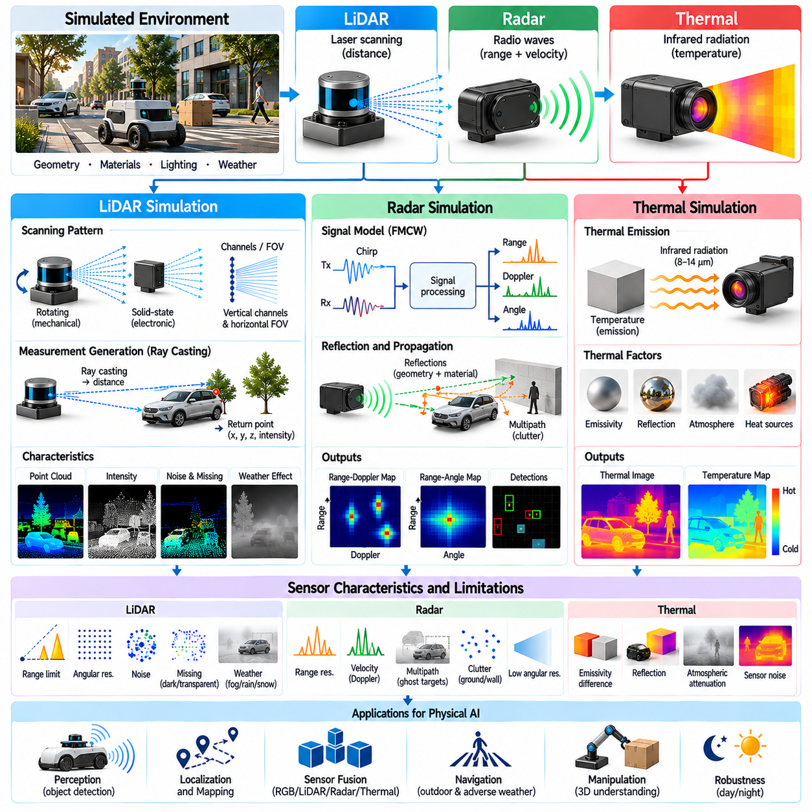{width="7.268055555555556in" height="7.268055555555556in"}

LiDAR, radar, and thermal simulation extend Physical AI perception beyond conventional RGB and depth imaging. These sensors observe geometric, electromagnetic, and thermal properties that visible-light cameras cannot fully capture. Their complementary measurements improve environmental awareness under darkness, adverse weather, and complex operating conditions. Realistic simulation supports sensor fusion, autonomous navigation, object detection, and reliable Sim2Real transfer.

LiDAR measures distance by emitting laser energy and detecting reflected signals from surrounding surfaces. Most robotic LiDAR systems estimate range using pulse travel time or related optical measurement techniques. Repeated measurements across different directions produce spatial representations of the environment. Simulated LiDAR must reproduce scanning geometry, beam propagation, surface interaction, and measurement uncertainty rather than generating ideal point clouds alone.

LiDAR scanning patterns depend on sensor architecture and mechanical or electronic beam steering. Rotating scanners generate repeated angular sweeps, while solid-state devices may use fixed or programmable scanning patterns. Angular resolution, vertical channel arrangement, field of view, and scanning frequency determine point distribution. These characteristics influence obstacle detection, localization accuracy, and the visibility of small environmental features.

Ray casting provides a computationally efficient foundation for LiDAR simulation. Each simulated laser beam intersects scene geometry to determine the distance to visible surfaces. The resulting measurements can be converted into three-dimensional points using sensor calibration and coordinate transformations. However, ideal geometric intersections do not reproduce intensity variation, beam divergence, multipath effects, or material-dependent detection failures.

Laser reflection depends on surface reflectance, incidence angle, wavelength, and material structure. Dark surfaces may return weak signals, while highly reflective materials can produce strong returns or receiver saturation. Transparent and specular surfaces may redirect or transmit laser energy. Physically plausible LiDAR simulation should represent these interactions when they affect obstacle detection, mapping, or robotic manipulation.

LiDAR intensity measurements provide additional information beyond geometric distance. Return intensity depends on transmitted energy, propagation losses, target reflectivity, and receiver characteristics. Different sensors may apply proprietary normalization or automatic gain adjustments. Simulated intensity values should therefore be calibrated against the intended hardware rather than treated as universal material reflectance measurements.

LiDAR noise includes range uncertainty, angular error, quantization, missed detections, and spurious returns. Measurement quality often changes with distance, incidence angle, and received signal strength. Beam divergence can cause multiple surfaces to contribute to a single measurement, especially near object boundaries. Realistic noise models improve the usefulness of synthetic point clouds for perception training and localization testing.

Atmospheric conditions introduce additional LiDAR limitations. Fog, rain, snow, dust, and airborne particles can scatter or attenuate laser energy before it reaches the intended target. These interactions may reduce detection range or create false returns. Weather-aware simulation should consider particle properties, wavelength, and propagation distance, while avoiding overly simplified assumptions that all adverse conditions affect every LiDAR sensor equally.

Radar operates by transmitting radio-frequency electromagnetic waves and analyzing signals reflected from objects. Unlike optical sensors, radar can provide range and radial velocity information through propagation delay and Doppler frequency shifts. Its longer wavelengths can improve operation under certain visibility limitations. Radar simulation is particularly valuable for autonomous vehicles, mobile robots, and outdoor perception systems.

Frequency-modulated continuous-wave radar commonly estimates target distance from the frequency difference between transmitted and received chirps. Doppler processing provides radial velocity, while antenna arrays support angular estimation. Range resolution depends strongly on signal bandwidth, whereas angular resolution depends on antenna aperture and processing. Accurate simulation should reflect these physical and signal-processing relationships.

Radar reflections depend on target geometry, material electromagnetic properties, surface orientation, and operating frequency. Radar cross section describes how strongly an object scatters energy toward the receiver under specified conditions. Metallic structures may generate strong reflections, while other materials exhibit frequency-dependent penetration or attenuation. Radar simulation must account for these effects to reproduce realistic target visibility.

Radar measurements are influenced by multipath propagation, clutter, interference, and limited angular resolution. Reflections from floors, walls, and nearby structures can create ghost targets or ambiguous detections. Small objects may be difficult to distinguish from surrounding clutter. Synthetic radar data should represent these limitations rather than assuming every geometric object produces a precise and independent detection.

Radar outputs may include range-Doppler maps, range-angle representations, detection lists, or sparse point clouds. These formats represent different stages of signal processing and contain different information. Simulation can operate at the electromagnetic signal level or approximate processed detections. The appropriate abstraction depends on whether the objective is waveform development, perception training, or system-level robotic validation.

Thermal cameras measure infrared radiation associated with the temperature and emissivity of observed surfaces. Unlike conventional RGB cameras, they do not require visible illumination to produce images. Thermal observations depend on emitted radiation, reflected environmental radiation, atmospheric transmission, and sensor response. Their simulation is valuable for nighttime navigation, equipment inspection, human detection, and industrial monitoring.

Thermal radiation is governed by physical relationships between temperature, wavelength, and emitted energy. Planck\'s law describes spectral radiance, while the Stefan-Boltzmann law relates total emitted power to temperature for ideal blackbody surfaces. Real materials behave differently according to spectral emissivity. Accurate thermal rendering must therefore distinguish surface temperature from apparent infrared brightness.

Surface emissivity determines how efficiently a material emits thermal radiation relative to an ideal blackbody. Painted surfaces, metals, glass, and polymers can exhibit substantially different emissivity characteristics. Low-emissivity materials may reflect surrounding thermal radiation and appear misleadingly warm or cold. Thermal simulation should account for these effects when generating synthetic inspection or detection imagery.

Temperature distributions across objects depend on heat generation, conduction, convection, radiation, and environmental exposure. Motors, batteries, electronic components, and mechanical joints may develop characteristic thermal patterns during operation. Thermal rendering becomes more realistic when surface temperatures are derived from thermal models or measured data rather than assigned as arbitrary colors.

Thermal sensor behavior includes detector noise, limited spatial resolution, calibration drift, and nonuniform pixel response. Infrared cameras may perform nonuniformity correction and temperature-dependent signal processing. Their outputs can represent radiometric measurements or contrast-enhanced imagery. Simulated thermal images should reproduce the relevant sensor pipeline, including saturation, noise, and image processing artifacts.

Environmental conditions influence thermal observations through atmospheric absorption, humidity, reflected radiation, and background temperature. Outdoor surfaces may retain heat after sunset, while indoor machinery creates localized thermal gradients. Rain, wind, and changing ambient temperatures alter heat transfer and apparent contrast. Realistic thermal simulation should consider these temporal and environmental dependencies.

Multimodal simulation combines LiDAR, radar, thermal cameras, and conventional imaging sensors within a shared virtual environment. Each modality observes different physical properties and may respond differently to the same object. Consistent geometry, materials, motion, and environmental conditions are necessary for coherent synthetic observations. This consistency supports sensor fusion algorithms that exploit complementary information.

Sensor placement and calibration determine how multimodal measurements relate spatially. Extrinsic transformations define relative sensor positions and orientations, while intrinsic parameters describe modality-specific measurement geometry. Incorrect calibration can create inconsistent object locations across point clouds, radar detections, and thermal images. Simulation should preserve these relationships while allowing controlled calibration errors for robustness testing.

Temporal synchronization is equally important because sensors operate at different frequencies and acquisition patterns. A rotating LiDAR accumulates measurements over time, radar processing integrates signals across chirps, and thermal cameras capture frames with finite exposure intervals. Moving objects can therefore appear at different positions across modalities. Accurate simulation should reproduce timestamps, latency, and motion-related acquisition effects.

Domain randomization can improve multimodal perception robustness by varying environmental conditions, material properties, sensor noise, and hardware parameters. However, variations should preserve physical relationships between modalities. For example, changing surface temperature affects thermal emission but does not automatically imply a corresponding change in radar reflectivity. Physically constrained randomization helps prevent unrealistic training correlations.

Validation requires comparing simulated sensor outputs with measurements from representative real environments. LiDAR evaluation may examine range errors, return intensity, point density, and dropout patterns. Radar evaluation can assess detection probability, range-Doppler characteristics, clutter, and false alarms. Thermal evaluation can examine radiometric consistency, temperature contrast, and spatial noise. Task-level testing determines whether these similarities improve robotic performance.

Computational efficiency requires selecting appropriate levels of physical detail. Ray-based LiDAR rendering is relatively efficient, while waveform-level radar simulation and coupled thermal modeling can be substantially more expensive. Hybrid pipelines may combine geometric rendering with calibrated statistical sensor models. Detailed physical simulation should be concentrated on scenarios where simplified approximations fail to reproduce important operational behavior.

Ultimately, LiDAR, radar, and thermal simulation enable Physical AI systems to perceive environments through complementary sensing principles. Realistic implementation requires coordinated models of wave propagation, material interaction, sensor electronics, environmental effects, and temporal behavior. By balancing physical fidelity with computational scalability, multimodal simulation supports robust perception, reliable sensor fusion, and safer robotic operation under challenging real-world conditions.

라이다(LiDAR), 레이더(Radar), 열화상 시뮬레이션(Thermal Simulation)은 피지컬 AI(Physical AI)의 인식 능력을 기존 RGB 및 깊이 영상(RGB and Depth Imaging)의 범위를 넘어 확장한다. 이러한 센서는 가시광선 카메라(Visible-Light Camera)가 완전히 포착할 수 없는 기하학적 특성(Geometric Property), 전자기적 특성(Electromagnetic Property), 열적 특성(Thermal Property)을 관측한다. 상호보완적인 측정 정보(Complementary Measurement)는 어둠(Darkness), 악천후(Adverse Weather), 복잡한 운영 조건(Complex Operating Condition)에서 환경 인식(Environmental Awareness)을 향상시킨다. 사실적인 시뮬레이션(Realistic Simulation)은 센서 융합(Sensor Fusion), 자율 내비게이션(Autonomous Navigation), 객체 탐지(Object Detection), 신뢰성 높은 시뮬레이션-현실 전이(Sim2Real Transfer)를 지원한다.

라이다(LiDAR)는 레이저 에너지(Laser Energy)를 방출하고 주변 표면(Surrounding Surface)에서 반사된 신호(Reflected Signal)를 검출하여 거리를 측정한다. 대부분의 로봇 라이다 시스템(Robotic LiDAR System)은 펄스 이동 시간(Pulse Travel Time) 또는 관련 광학 측정 기술(Optical Measurement Technique)을 사용하여 거리(Range)를 추정한다. 서로 다른 방향에서 반복적으로 수행되는 측정은 환경의 공간적 표현(Spatial Representation)을 생성한다. 시뮬레이션된 라이다(Simulated LiDAR)는 이상적인 포인트 클라우드(Ideal Point Cloud)를 생성하는 데 그치지 않고 스캐닝 기하학(Scanning Geometry), 빔 전파(Beam Propagation), 표면 상호작용(Surface Interaction), 측정 불확실성(Measurement Uncertainty)을 재현해야 한다.

라이다 스캐닝 패턴(LiDAR Scanning Pattern)은 센서 아키텍처(Sensor Architecture)와 기계식 또는 전자식 빔 조향(Mechanical or Electronic Beam Steering)에 따라 달라진다. 회전형 스캐너(Rotating Scanner)는 반복적인 각도 스윕(Angular Sweep)을 생성하는 반면, 고체형 장치(Solid-State Device)는 고정되거나 프로그래밍 가능한 스캐닝 패턴(Programmable Scanning Pattern)을 사용할 수 있다. 각도 해상도(Angular Resolution), 수직 채널 배열(Vertical Channel Arrangement), 시야각(Field of View), 스캐닝 주파수(Scanning Frequency)는 포인트 분포(Point Distribution)를 결정한다. 이러한 특성은 장애물 탐지(Obstacle Detection), 위치 추정 정확도(Localization Accuracy), 작은 환경 특징(Small Environmental Feature)의 가시성에 영향을 미친다.

광선 투사(Ray Casting)는 라이다 시뮬레이션(LiDAR Simulation)을 위한 계산 효율적인 기반(Computationally Efficient Foundation)을 제공한다. 시뮬레이션된 각 레이저 빔(Laser Beam)은 장면 기하학(Scene Geometry)과 교차하여 가시 표면(Visible Surface)까지의 거리를 결정한다. 결과 측정값(Resulting Measurement)은 센서 보정(Sensor Calibration)과 좌표 변환(Coordinate Transformation)을 사용하여 3차원 점(Three-Dimensional Point)으로 변환할 수 있다. 그러나 이상적인 기하학적 교차(Ideal Geometric Intersection)만으로는 강도 변화(Intensity Variation), 빔 발산(Beam Divergence), 다중 경로 효과(Multipath Effect), 재질 의존적 검출 실패(Material-Dependent Detection Failure)를 재현할 수 없다.

레이저 반사(Laser Reflection)는 표면 반사율(Surface Reflectance), 입사각(Incidence Angle), 파장(Wavelength), 재질 구조(Material Structure)에 따라 달라진다. 어두운 표면(Dark Surface)은 약한 반사 신호(Weak Return Signal)를 생성할 수 있으며, 반사율이 높은 재질(Highly Reflective Material)은 강한 반사 신호(Strong Return) 또는 수신기 포화(Receiver Saturation)를 발생시킬 수 있다. 투명 표면(Transparent Surface)과 정반사 표면(Specular Surface)은 레이저 에너지를 다른 방향으로 반사하거나 투과시킬 수 있다. 물리적으로 타당한 라이다 시뮬레이션(Physically Plausible LiDAR Simulation)은 이러한 상호작용이 장애물 탐지, 지도 작성(Mapping), 로봇 조작(Robotic Manipulation)에 영향을 미칠 때 이를 표현해야 한다.

라이다 강도 측정값(LiDAR Intensity Measurement)은 기하학적 거리(Geometric Distance) 이외의 추가 정보를 제공한다. 반사 강도(Return Intensity)는 송신 에너지(Transmitted Energy), 전파 손실(Propagation Loss), 대상 반사율(Target Reflectivity), 수신기 특성(Receiver Characteristic)에 따라 달라진다. 서로 다른 센서는 독자적인 정규화(Proprietary Normalization) 또는 자동 이득 조정(Automatic Gain Adjustment)을 적용할 수 있다. 따라서 시뮬레이션된 강도값(Simulated Intensity Value)은 보편적인 재질 반사율(Universal Material Reflectance) 측정값으로 취급하기보다 대상 하드웨어(Intended Hardware)를 기준으로 보정해야 한다.

라이다 잡음(LiDAR Noise)에는 거리 불확실성(Range Uncertainty), 각도 오차(Angular Error), 양자화(Quantization), 검출 누락(Missed Detection), 허위 반사 신호(Spurious Return)가 포함된다. 측정 품질(Measurement Quality)은 거리(Distance), 입사각(Incidence Angle), 수신 신호 강도(Received Signal Strength)에 따라 달라지는 경우가 많다. 빔 발산(Beam Divergence)은 특히 객체 경계(Object Boundary) 근처에서 여러 표면이 하나의 측정값에 기여하도록 만들 수 있다. 사실적인 잡음 모델(Realistic Noise Model)은 인식 학습(Perception Training)과 위치 추정 시험(Localization Testing)을 위한 합성 포인트 클라우드(Synthetic Point Cloud)의 유용성을 향상시킨다.

대기 조건(Atmospheric Condition)은 라이다에 추가적인 한계를 발생시킨다. 안개(Fog), 비(Rain), 눈(Snow), 먼지(Dust), 공기 중 입자(Airborne Particle)는 레이저 에너지가 목표물(Intended Target)에 도달하기 전에 산란(Scattering)시키거나 감쇠(Attenuation)시킬 수 있다. 이러한 상호작용은 검출 거리(Detection Range)를 감소시키거나 허위 반사 신호(False Return)를 생성할 수 있다. 날씨 인식 시뮬레이션(Weather-Aware Simulation)은 입자 특성(Particle Property), 파장(Wavelength), 전파 거리(Propagation Distance)를 고려해야 하며, 모든 악조건이 모든 라이다 센서에 동일한 영향을 미친다는 지나치게 단순화된 가정을 피해야 한다.

레이더(Radar)는 무선 주파수 전자기파(Radio-Frequency Electromagnetic Wave)를 송신하고 객체에서 반사된 신호를 분석하여 작동한다. 광학 센서(Optical Sensor)와 달리 레이더는 전파 지연(Propagation Delay)과 도플러 주파수 편이(Doppler Frequency Shift)를 통해 거리(Range)와 방사 방향 속도(Radial Velocity) 정보를 제공할 수 있다. 상대적으로 긴 파장(Longer Wavelength)은 특정 가시성 제한 조건(Visibility Limitation)에서 작동 성능을 향상시킬 수 있다. 레이더 시뮬레이션(Radar Simulation)은 자율주행 차량(Autonomous Vehicle), 이동 로봇(Mobile Robot), 실외 인식 시스템(Outdoor Perception System)에 특히 유용하다.

주파수 변조 연속파 레이더(Frequency-Modulated Continuous-Wave Radar, FMCW Radar)는 일반적으로 송신 처프(Transmitted Chirp)와 수신 처프(Received Chirp) 사이의 주파수 차이(Frequency Difference)로 목표물 거리(Target Distance)를 추정한다. 도플러 처리(Doppler Processing)는 방사 방향 속도를 제공하며, 안테나 배열(Antenna Array)은 각도 추정(Angular Estimation)을 지원한다. 거리 해상도(Range Resolution)는 신호 대역폭(Signal Bandwidth)에 크게 의존하는 반면, 각도 해상도(Angular Resolution)는 안테나 개구(Antenna Aperture)와 신호 처리(Signal Processing)에 따라 달라진다. 정확한 시뮬레이션은 이러한 물리적 관계와 신호 처리 관계를 반영해야 한다.

레이더 반사(Radar Reflection)는 대상 기하학(Target Geometry), 재질의 전자기적 특성(Material Electromagnetic Property), 표면 방향(Surface Orientation), 작동 주파수(Operating Frequency)에 따라 달라진다. 레이더 단면적(Radar Cross Section, RCS)은 특정 조건에서 객체가 수신기 방향으로 에너지를 얼마나 강하게 산란시키는지를 설명한다. 금속 구조물(Metallic Structure)은 강한 반사를 생성할 수 있으며, 다른 재질은 주파수 의존적 투과(Frequency-Dependent Penetration) 또는 감쇠(Attenuation)를 나타낸다. 레이더 시뮬레이션은 사실적인 목표물 가시성(Target Visibility)을 재현하기 위해 이러한 효과를 고려해야 한다.

레이더 측정값(Radar Measurement)은 다중 경로 전파(Multipath Propagation), 클러터(Clutter), 간섭(Interference), 제한된 각도 해상도(Limited Angular Resolution)의 영향을 받는다. 바닥(Floor), 벽(Wall), 주변 구조물(Nearby Structure)에서 발생하는 반사는 유령 표적(Ghost Target)이나 모호한 검출(Ambiguous Detection)을 생성할 수 있다. 작은 객체(Small Object)는 주변 클러터와 구별하기 어려울 수 있다. 합성 레이더 데이터(Synthetic Radar Data)는 모든 기하학적 객체가 정확하고 독립적인 검출값(Independent Detection)을 생성한다고 가정하기보다 이러한 한계를 표현해야 한다.

레이더 출력(Radar Output)에는 거리-도플러 맵(Range-Doppler Map), 거리-각도 표현(Range-Angle Representation), 검출 목록(Detection List), 희소 포인트 클라우드(Sparse Point Cloud)가 포함될 수 있다. 이러한 형식은 신호 처리(Signal Processing)의 서로 다른 단계를 나타내며 서로 다른 정보를 포함한다. 시뮬레이션은 전자기 신호 수준(Electromagnetic Signal Level)에서 수행하거나 처리된 검출값(Processed Detection)을 근사할 수 있다. 적절한 추상화 수준(Abstraction Level)은 목표가 파형 개발(Waveform Development), 인식 학습(Perception Training), 시스템 수준 로봇 검증(System-Level Robotic Validation) 중 무엇인지에 따라 달라진다.

열화상 카메라(Thermal Camera)는 관측 표면(Observed Surface)의 온도(Temperature)와 방사율(Emissivity)에 관련된 적외선 복사(Infrared Radiation)를 측정한다. 기존 RGB 카메라와 달리 열화상 카메라는 영상을 생성하는 데 가시광 조명(Visible Illumination)이 필요하지 않다. 열화상 관측(Thermal Observation)은 방출 복사(Emitted Radiation), 반사된 환경 복사(Reflected Environmental Radiation), 대기 투과율(Atmospheric Transmission), 센서 응답(Sensor Response)에 따라 달라진다. 열화상 시뮬레이션은 야간 내비게이션(Nighttime Navigation), 장비 검사(Equipment Inspection), 사람 탐지(Human Detection), 산업 모니터링(Industrial Monitoring)에 유용하다.

열복사(Thermal Radiation)는 온도(Temperature), 파장(Wavelength), 방출 에너지(Emitted Energy) 사이의 물리적 관계에 의해 결정된다. 플랑크 법칙(Planck\'s Law)은 분광 복사휘도(Spectral Radiance)를 설명하며, 슈테판-볼츠만 법칙(Stefan-Boltzmann Law)은 이상적인 흑체 표면(Ideal Blackbody Surface)의 온도와 총 방출 전력(Total Emitted Power) 사이의 관계를 나타낸다. 실제 재질(Real Material)은 분광 방사율(Spectral Emissivity)에 따라 서로 다르게 동작한다. 따라서 정확한 열화상 렌더링(Thermal Rendering)은 표면 온도(Surface Temperature)와 겉보기 적외선 밝기(Apparent Infrared Brightness)를 구분해야 한다.

표면 방사율(Surface Emissivity)은 이상적인 흑체(Ideal Blackbody)에 비해 재질이 열복사(Thermal Radiation)를 얼마나 효율적으로 방출하는지를 결정한다. 도장 표면(Painted Surface), 금속(Metal), 유리(Glass), 고분자 재질(Polymer)은 상당히 다른 방사율 특성(Emissivity Characteristic)을 나타낼 수 있다. 낮은 방사율(Low Emissivity)을 가진 재질은 주변 열복사(Surrounding Thermal Radiation)를 반사하여 실제보다 따뜻하거나 차갑게 보일 수 있다. 열화상 시뮬레이션은 합성 검사 영상(Synthetic Inspection Imagery)이나 탐지 영상(Detection Imagery)을 생성할 때 이러한 효과를 고려해야 한다.

객체 전체의 온도 분포(Temperature Distribution)는 열 발생(Heat Generation), 전도(Conduction), 대류(Convection), 복사(Radiation), 환경 노출(Environmental Exposure)에 따라 달라진다. 모터(Motor), 배터리(Battery), 전자 부품(Electronic Component), 기계 관절(Mechanical Joint)은 작동 중 특징적인 열 패턴(Thermal Pattern)을 형성할 수 있다. 표면 온도(Surface Temperature)를 임의의 색상(Arbitrary Color)으로 지정하는 대신 열 모델(Thermal Model)이나 측정 데이터(Measured Data)에서 도출하면 열화상 렌더링의 현실성이 향상된다.

열화상 센서 동작(Thermal Sensor Behavior)에는 검출기 잡음(Detector Noise), 제한된 공간 해상도(Limited Spatial Resolution), 보정 드리프트(Calibration Drift), 불균일한 픽셀 응답(Nonuniform Pixel Response)이 포함된다. 적외선 카메라(Infrared Camera)는 비균일성 보정(Nonuniformity Correction)과 온도 의존적 신호 처리(Temperature-Dependent Signal Processing)를 수행할 수 있다. 출력은 복사측정값(Radiometric Measurement) 또는 대비가 향상된 영상(Contrast-Enhanced Imagery)을 나타낼 수 있다. 시뮬레이션된 열화상 영상(Simulated Thermal Image)은 포화(Saturation), 잡음(Noise), 영상 처리 인공물(Image Processing Artifact)을 포함하여 관련 센서 파이프라인(Sensor Pipeline)을 재현해야 한다.

환경 조건(Environmental Condition)은 대기 흡수(Atmospheric Absorption), 습도(Humidity), 반사 복사(Reflected Radiation), 배경 온도(Background Temperature)를 통해 열화상 관측(Thermal Observation)에 영향을 미친다. 실외 표면(Outdoor Surface)은 일몰 후에도 열을 유지할 수 있으며, 실내 기계(Indoor Machinery)는 국소적인 온도 기울기(Localized Thermal Gradient)를 생성한다. 비(Rain), 바람(Wind), 주변 온도(Ambient Temperature)의 변화는 열전달(Heat Transfer)과 겉보기 대비(Apparent Contrast)를 변화시킨다. 사실적인 열화상 시뮬레이션은 이러한 시간적 및 환경적 의존성(Temporal and Environmental Dependency)을 고려해야 한다.

다중모달 시뮬레이션(Multimodal Simulation)은 라이다(LiDAR), 레이더(Radar), 열화상 카메라(Thermal Camera), 기존 영상 센서(Conventional Imaging Sensor)를 공유된 가상 환경(Shared Virtual Environment) 안에서 결합한다. 각 모달리티(Modality)는 서로 다른 물리적 특성(Physical Property)을 관측하며 동일한 객체에도 서로 다르게 반응할 수 있다. 일관된 기하학적 구조(Geometry), 재질(Material), 움직임(Motion), 환경 조건(Environmental Condition)은 정합성 있는 합성 관측(Coherent Synthetic Observation)을 위해 필요하다. 이러한 일관성은 상호보완적인 정보를 활용하는 센서 융합 알고리즘(Sensor Fusion Algorithm)을 지원한다.

센서 배치(Sensor Placement)와 보정(Calibration)은 다중모달 측정값(Multimodal Measurement)이 공간적으로 어떻게 연관되는지를 결정한다. 외부 변환(Extrinsic Transformation)은 센서 사이의 상대 위치(Relative Position)와 방향(Orientation)을 정의하며, 내부 매개변수(Intrinsic Parameter)는 모달리티별 측정 기하학(Modality-Specific Measurement Geometry)을 설명한다. 부정확한 보정(Incorrect Calibration)은 포인트 클라우드(Point Cloud), 레이더 검출(Radar Detection), 열화상 영상(Thermal Image) 사이에서 일관되지 않은 객체 위치(Object Location)를 생성할 수 있다. 시뮬레이션은 이러한 관계를 유지하면서 강건성 시험(Robustness Testing)을 위한 통제된 보정 오차(Controlled Calibration Error)를 허용해야 한다.

시간적 동기화(Temporal Synchronization)도 중요하다. 센서마다 작동 주파수(Operating Frequency)와 영상 획득 패턴(Acquisition Pattern)이 다르기 때문이다. 회전형 라이다(Rotating LiDAR)는 시간에 걸쳐 측정값을 축적하고, 레이더 처리(Radar Processing)는 여러 처프(Chirp)에 걸쳐 신호를 적분하며, 열화상 카메라(Thermal Camera)는 유한한 노출 구간(Finite Exposure Interval) 동안 프레임(Frame)을 획득한다. 따라서 움직이는 객체(Moving Object)는 모달리티마다 서로 다른 위치에 나타날 수 있다. 정확한 시뮬레이션은 타임스탬프(Timestamp), 지연 시간(Latency), 움직임 관련 획득 효과(Motion-Related Acquisition Effect)를 재현해야 한다.

도메인 랜덤화(Domain Randomization)는 환경 조건(Environmental Condition), 재질 속성(Material Property), 센서 잡음(Sensor Noise), 하드웨어 매개변수(Hardware Parameter)를 변화시켜 다중모달 인식의 강건성(Multimodal Perception Robustness)을 향상시킬 수 있다. 그러나 이러한 변화는 모달리티 사이의 물리적 관계(Physical Relationship)를 유지해야 한다. 예를 들어 표면 온도(Surface Temperature)의 변화는 열 방출(Thermal Emission)에 영향을 미치지만 반드시 레이더 반사율(Radar Reflectivity)의 변화로 이어지는 것은 아니다. 물리적으로 제약된 랜덤화(Physically Constrained Randomization)는 비현실적인 학습 상관관계(Unrealistic Training Correlation)를 방지하는 데 도움이 된다.

검증(Validation)은 시뮬레이션된 센서 출력(Simulated Sensor Output)을 대표적인 실제 환경(Representative Real Environment)에서 측정한 값과 비교해야 한다. 라이다 평가(LiDAR Evaluation)는 거리 오차(Range Error), 반사 강도(Return Intensity), 포인트 밀도(Point Density), 측정 누락 패턴(Dropout Pattern)을 분석할 수 있다. 레이더 평가(Radar Evaluation)는 검출 확률(Detection Probability), 거리-도플러 특성(Range-Doppler Characteristic), 클러터(Clutter), 오경보(False Alarm)를 평가할 수 있다. 열화상 평가(Thermal Evaluation)는 복사측정 일관성(Radiometric Consistency), 온도 대비(Temperature Contrast), 공간 잡음(Spatial Noise)을 분석할 수 있다. 작업 수준 시험(Task-Level Testing)은 이러한 유사성이 로봇 성능(Robotic Performance)을 향상시키는지 판단한다.

계산 효율성(Computational Efficiency)을 확보하려면 적절한 물리적 상세 수준(Level of Physical Detail)을 선택해야 한다. 광선 기반 라이다 렌더링(Ray-Based LiDAR Rendering)은 비교적 효율적이지만 파형 수준 레이더 시뮬레이션(Waveform-Level Radar Simulation)과 연성 열 모델링(Coupled Thermal Modeling)은 훨씬 높은 계산 비용(Computational Cost)을 요구할 수 있다. 하이브리드 파이프라인(Hybrid Pipeline)은 기하학적 렌더링(Geometric Rendering)과 보정된 통계적 센서 모델(Calibrated Statistical Sensor Model)을 결합할 수 있다. 상세한 물리 시뮬레이션(Detailed Physical Simulation)은 단순화된 근사화(Simplified Approximation)가 중요한 운영 동작(Operational Behavior)을 재현하지 못하는 시나리오(Scenario)에 집중해야 한다.

궁극적으로 라이다(LiDAR), 레이더(Radar), 열화상 시뮬레이션(Thermal Simulation)은 피지컬 AI 시스템(Physical AI System)이 상호보완적인 센싱 원리(Complementary Sensing Principle)를 통해 환경을 인식할 수 있도록 한다. 사실적인 구현(Realistic Implementation)을 위해서는 파동 전파(Wave Propagation), 재질 상호작용(Material Interaction), 센서 전자회로(Sensor Electronics), 환경적 효과(Environmental Effect), 시간적 동작(Temporal Behavior)에 대한 통합적인 모델이 필요하다. 물리적 충실도(Physical Fidelity)와 계산 확장성(Computational Scalability)의 균형을 유지함으로써 다중모달 시뮬레이션(Multimodal Simulation)은 강건한 인식(Robust Perception), 신뢰성 높은 센서 융합(Reliable Sensor Fusion), 까다로운 실제 환경 조건(Challenging Real-World Condition)에서 더욱 안전한 로봇 운영(Safer Robotic Operation)을 지원한다.

##  

## 02.10. Sensor Noise and Imperfection Modeling

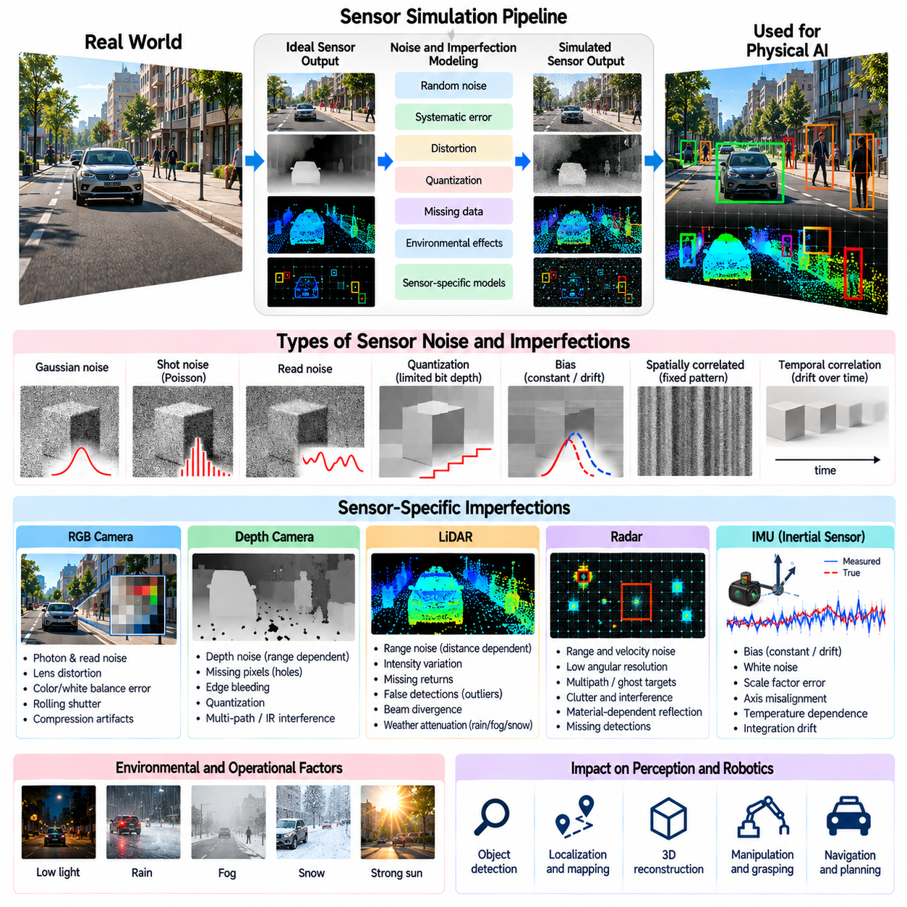{width="7.268055555555556in" height="7.268055555555556in"}

Sensor noise and imperfection modeling is essential for producing realistic observations in Physical AI simulation. Real sensors introduce uncertainty, distortion, delay, and measurement failures that are absent from ideal rendering pipelines. These imperfections influence perception, localization, mapping, and control performance. Accurate simulation must represent both stochastic noise and systematic errors to improve robustness and support reliable Sim2Real transfer.

Sensor imperfections arise from physical sensing mechanisms, electronic components, manufacturing tolerances, environmental conditions, and signal processing. Their effects vary across cameras, LiDAR, radar, inertial sensors, and force sensors. Some errors fluctuate randomly, while others remain correlated over time or operating conditions. Understanding these distinctions is necessary for constructing realistic sensor models rather than applying arbitrary perturbations.

Random noise represents unpredictable measurement variations caused by processes such as photon arrival statistics, thermal agitation, and electronic interference. It is often approximated using Gaussian distributions, although actual sensor noise may be asymmetric, signal-dependent, or heavy-tailed. Appropriate models should reflect the underlying sensing physics and observed measurement statistics instead of assuming identical noise characteristics for every sensor.

Systematic errors introduce repeatable deviations between measured values and true physical quantities. Examples include calibration offsets, scale-factor errors, geometric distortion, and temperature-dependent bias. Unlike independent random noise, systematic errors can persist across many measurements and produce accumulated estimation errors. Simulation should represent these effects explicitly when evaluating long-duration robotic operation.

Bias describes a persistent displacement of sensor measurements from their expected true values. A depth camera may consistently overestimate distance, while an inertial sensor may report nonzero angular velocity when stationary. Bias can remain approximately constant or change gradually with temperature and time. Realistic models should distinguish fixed bias, slowly varying bias, and transient calibration errors.

Gaussian noise is widely used because it provides a computationally efficient approximation for many measurement processes. Its magnitude is typically characterized by variance or standard deviation. However, realistic uncertainty may depend on signal intensity, measurement range, viewing angle, or sensor temperature. Heteroscedastic noise models allow uncertainty to change with operating conditions and often reproduce physical measurements more accurately.

Shot noise arises from the statistical variation in the number of detected photons or other discrete events. In image sensors, photon counts approximately follow Poisson statistics under suitable conditions. Consequently, noise magnitude changes with illumination and exposure. Simulating shot noise helps reproduce low-light image degradation and prevents synthetic cameras from producing unrealistically clean observations.

Read noise originates from electronic circuits involved in converting sensor signals into digital measurements. It may include amplifier noise, reset noise, and analog-to-digital conversion effects. Unlike photon shot noise, some read-noise components remain significant even when little light reaches the sensor. Camera simulation should combine these contributions with exposure and gain models to reproduce realistic image statistics.

Quantization introduces errors when continuous physical measurements are represented using finite digital resolution. Analog-to-digital converters map signal amplitudes into discrete values, potentially losing subtle variations. Limited bit depth can produce banding, reduced dynamic range, or small measurement discontinuities. Quantization models should reflect the resolution and encoding characteristics of the target sensor hardware.

Spatially correlated noise occurs when neighboring measurements share common error sources. Image sensors may exhibit fixed-pattern noise, row-dependent offsets, or column artifacts. Depth cameras can produce locally correlated reconstruction errors, while LiDAR measurements may share calibration inaccuracies. Independent pixelwise noise cannot reproduce these structures, making correlation modeling important for realistic synthetic data.

Temporal noise correlation describes dependencies between measurement errors across successive observations. Sensor drift, thermal changes, filtering, and electronic instability can generate slowly evolving errors. A first-order stochastic process or random-walk model may approximate these behaviors. Temporal correlation is particularly important for robotic localization because persistent errors can accumulate rather than cancel through repeated measurements.

Inertial measurement units exhibit characteristic imperfections in accelerometer and gyroscope outputs. These include white noise, bias instability, scale-factor errors, axis misalignment, and temperature sensitivity. Integrated acceleration and angular velocity errors can cause substantial position and orientation drift. Realistic IMU simulation is therefore critical for evaluating state estimation, sensor fusion, and autonomous navigation.

LiDAR noise depends on range, reflectivity, incidence angle, atmospheric conditions, and receiver sensitivity. Measurements may contain range fluctuations, missing returns, false detections, and angular inaccuracies. Beam divergence can introduce mixed measurements near object boundaries. A realistic LiDAR model should combine geometric ray interactions with probabilistic detection and calibrated error distributions.

Depth camera imperfections differ according to sensing technology. Stereo systems experience correspondence errors and disparity uncertainty, structured-light systems suffer from pattern detection failures, and Time-of-Flight cameras may exhibit multipath interference and phase-related errors. Depth uncertainty frequently changes with distance and material properties. Sensor-specific modeling is more effective than applying uniform noise to ideal depth maps.

Radar measurements contain uncertainty associated with range estimation, Doppler processing, angular resolution, clutter, and multipath propagation. Reflections may create ghost targets or false detections, while weak objects can remain undetected. Noise models should distinguish signal-level effects from errors introduced during target extraction. This distinction is important when simulating radar point clouds or processed detection lists.

Thermal cameras exhibit detector noise, nonuniform response, calibration drift, and temperature-dependent measurement uncertainty. Pixel sensitivity differences may create fixed-pattern artifacts, while nonuniformity correction can introduce additional processing effects. Apparent temperature also depends on emissivity and reflected environmental radiation. Thermal simulation should distinguish sensor imperfections from physical variations in observed radiation.

Measurement dropout occurs when a sensor fails to provide valid information for a particular location or time. Causes include insufficient signal strength, occlusion, saturation, communication failures, and reconstruction instability. Dropout may be spatially clustered or temporally persistent rather than independent. Realistic simulation should preserve these patterns because missing observations directly influence robotic decision-making.

Outliers represent measurements that deviate substantially from the expected error distribution. They can arise from incorrect feature matching, multipath reflections, interference, or sensor processing failures. Although relatively infrequent, outliers can destabilize estimation algorithms that assume Gaussian uncertainty. Synthetic testing should include physically plausible outlier mechanisms to evaluate robust filtering and fault rejection.

Sensor saturation occurs when physical signals exceed the measurable range of a device. Camera pixels may clip under intense illumination, force sensors may reach load limits, and inertial sensors may exceed acceleration or angular-rate ranges. Saturation produces nonlinear errors that cannot be represented by ordinary additive noise. Simulated sensors should enforce realistic measurement limits and report clipped values appropriately.

Timing imperfections include latency, sampling jitter, timestamp errors, and synchronization offsets. Different sensors may report observations corresponding to different physical moments. These discrepancies become particularly important during rapid robot motion or dynamic object interaction. Accurate simulation should model acquisition time separately from processing and delivery time to evaluate synchronization-sensitive perception and control.

Calibration uncertainty affects the relationship between sensor measurements and physical coordinate systems. Intrinsic parameter errors can distort projection geometry, while extrinsic errors introduce spatial misalignment between sensors. Small calibration deviations may produce significant fusion errors at long distances. Simulation can introduce controlled parameter uncertainty to assess calibration sensitivity and online correction algorithms.

Environmental factors influence sensor noise through temperature, humidity, vibration, electromagnetic interference, and contamination. Camera lenses may accumulate dust, LiDAR windows may become obstructed, and mechanical vibration may affect inertial measurements. These effects often change gradually and interact with operating conditions. Environmental imperfection models should therefore represent plausible dependencies rather than arbitrary degradation.

Noise parameters should be estimated from empirical measurements whenever representative hardware is available. Calibration datasets can characterize bias, variance, spatial correlation, temporal drift, and failure probabilities. Controlled experiments across temperature, distance, illumination, and motion conditions reveal operating-dependent behavior. Statistical fitting and validation help ensure that simulated imperfections remain consistent with physical observations.

Domain randomization can extend calibrated noise models by varying parameters within plausible uncertainty ranges. Different simulated sensor instances may exhibit distinct biases, sensitivities, and failure characteristics. However, excessive randomization can generate unrealistic observations that reduce training effectiveness. Parameter distributions should reflect manufacturing variation, environmental uncertainty, and expected deployment conditions.

Validation should compare real and synthetic sensor outputs using statistical and task-level metrics. Useful measures include error distributions, autocorrelation, spatial covariance, dropout frequency, outlier rates, and calibration residuals. Downstream evaluation should examine localization drift, mapping consistency, detection accuracy, and control stability. Matching noise statistics is valuable, but improved robotic performance remains the ultimate objective.

Ultimately, sensor noise and imperfection modeling transforms ideal simulation outputs into observations that better approximate physical hardware. Effective models combine stochastic processes, systematic biases, environmental dependencies, temporal behavior, and failure mechanisms. By calibrating these effects against real measurements and balancing fidelity with computational efficiency, Physical AI simulation can improve perception robustness, uncertainty awareness, and reliable real-world deployment.

센서 잡음 및 불완전성 모델링(Sensor Noise and Imperfection Modeling)은 피지컬 AI(Physical AI) 시뮬레이션에서 사실적인 관측(Realistic Observation)을 생성하는 데 필수적이다. 실제 센서(Real Sensor)는 이상적인 렌더링 파이프라인(Ideal Rendering Pipeline)에는 존재하지 않는 불확실성(Uncertainty), 왜곡(Distortion), 지연(Delay), 측정 실패(Measurement Failure)를 발생시킨다. 이러한 불완전성(Imperfection)은 인식(Perception), 위치 추정(Localization), 지도 작성(Mapping), 제어 성능(Control Performance)에 영향을 미친다. 정확한 시뮬레이션은 강건성(Robustness)을 향상시키고 신뢰성 높은 시뮬레이션-현실 전이(Sim2Real Transfer)를 지원하기 위해 확률적 잡음(Stochastic Noise)과 체계적 오차(Systematic Error)를 모두 표현해야 한다.

센서 불완전성(Sensor Imperfection)은 물리적 센싱 메커니즘(Physical Sensing Mechanism), 전자 부품(Electronic Component), 제조 공차(Manufacturing Tolerance), 환경 조건(Environmental Condition), 신호 처리(Signal Processing)에서 발생한다. 이러한 영향은 카메라(Camera), 라이다(LiDAR), 레이더(Radar), 관성 센서(Inertial Sensor), 힘 센서(Force Sensor)에 따라 달라진다. 일부 오차는 무작위로 변동하지만 다른 오차는 시간이나 작동 조건에 걸쳐 상관관계(Correlation)를 유지한다. 이러한 차이를 이해하는 것은 임의적인 교란(Arbitrary Perturbation)을 적용하는 대신 사실적인 센서 모델(Realistic Sensor Model)을 구성하는 데 필요하다.

무작위 잡음(Random Noise)은 광자 도착 통계(Photon Arrival Statistics), 열적 요동(Thermal Agitation), 전자기 간섭(Electronic Interference)과 같은 과정에서 발생하는 예측 불가능한 측정 변동(Measurement Variation)을 나타낸다. 무작위 잡음은 가우시안 분포(Gaussian Distribution)로 근사되는 경우가 많지만 실제 센서 잡음은 비대칭적(Asymmetric)이거나 신호 의존적(Signal-Dependent)이거나 두꺼운 꼬리 분포(Heavy-Tailed Distribution)를 가질 수 있다. 적절한 모델은 모든 센서에 동일한 잡음 특성(Noise Characteristic)을 가정하기보다 기본적인 센싱 물리(Sensing Physics)와 관측된 측정 통계(Measurement Statistics)를 반영해야 한다.

체계적 오차(Systematic Error)는 측정값(Measured Value)과 실제 물리량(True Physical Quantity) 사이에 반복적으로 나타나는 편차(Deviation)를 발생시킨다. 대표적인 예로는 보정 오프셋(Calibration Offset), 스케일 계수 오차(Scale-Factor Error), 기하학적 왜곡(Geometric Distortion), 온도 의존적 편향(Temperature-Dependent Bias)이 있다. 독립적인 무작위 잡음(Independent Random Noise)과 달리 체계적 오차는 여러 측정에 걸쳐 지속되며 누적 추정 오차(Accumulated Estimation Error)를 발생시킬 수 있다. 장시간 로봇 운영(Long-Duration Robotic Operation)을 평가할 때 시뮬레이션은 이러한 효과를 명시적으로 표현해야 한다.

편향(Bias)은 센서 측정값이 예상되는 실제 값(Expected True Value)에서 지속적으로 벗어나는 현상을 설명한다. 깊이 카메라(Depth Camera)는 거리를 일관되게 과대평가할 수 있으며, 관성 센서(Inertial Sensor)는 정지 상태에서도 0이 아닌 각속도(Angular Velocity)를 보고할 수 있다. 편향은 거의 일정하게 유지되거나 온도(Temperature)와 시간(Time)에 따라 점진적으로 변화할 수 있다. 사실적인 모델은 고정 편향(Fixed Bias), 서서히 변화하는 편향(Slowly Varying Bias), 일시적인 보정 오차(Transient Calibration Error)를 구분해야 한다.

가우시안 잡음(Gaussian Noise)은 다양한 측정 과정(Measurement Process)에 대해 계산 효율적인 근사화(Computationally Efficient Approximation)를 제공하므로 널리 사용된다. 잡음의 크기(Noise Magnitude)는 일반적으로 분산(Variance) 또는 표준편차(Standard Deviation)로 표현된다. 그러나 실제 불확실성(Uncertainty)은 신호 강도(Signal Intensity), 측정 거리(Measurement Range), 관측 각도(Viewing Angle), 센서 온도(Sensor Temperature)에 따라 달라질 수 있다. 이분산성 잡음 모델(Heteroscedastic Noise Model)은 작동 조건에 따라 불확실성이 변화하도록 하며 실제 물리적 측정(Physical Measurement)을 더욱 정확하게 재현하는 경우가 많다.

샷 잡음(Shot Noise)은 검출된 광자(Detected Photon) 또는 기타 이산 사건(Discrete Event)의 수에서 발생하는 통계적 변동(Statistical Variation)에 기인한다. 영상 센서(Image Sensor)에서 광자 수(Photon Count)는 적절한 조건에서 대략 포아송 통계(Poisson Statistics)를 따른다. 따라서 잡음의 크기는 조명(Illumination)과 노출(Exposure)에 따라 변화한다. 샷 잡음 시뮬레이션(Shot Noise Simulation)은 저조도 영상 품질 저하(Low-Light Image Degradation)를 재현하고 합성 카메라(Synthetic Camera)가 비현실적으로 깨끗한 관측을 생성하는 것을 방지하는 데 도움이 된다.

판독 잡음(Read Noise)은 센서 신호(Sensor Signal)를 디지털 측정값(Digital Measurement)으로 변환하는 전자 회로(Electronic Circuit)에서 발생한다. 여기에는 증폭기 잡음(Amplifier Noise), 리셋 잡음(Reset Noise), 아날로그-디지털 변환 효과(Analog-to-Digital Conversion Effect)가 포함될 수 있다. 광자 샷 잡음(Photon Shot Noise)과 달리 일부 판독 잡음 성분(Read-Noise Component)은 센서에 도달하는 빛이 매우 적을 때도 상당한 영향을 미친다. 카메라 시뮬레이션(Camera Simulation)은 사실적인 영상 통계(Image Statistics)를 재현하기 위해 이러한 성분을 노출 및 이득 모델(Exposure and Gain Model)과 결합해야 한다.

양자화(Quantization)는 연속적인 물리적 측정값(Continuous Physical Measurement)을 유한한 디지털 해상도(Finite Digital Resolution)로 표현할 때 오차를 발생시킨다. 아날로그-디지털 변환기(Analog-to-Digital Converter)는 신호 진폭(Signal Amplitude)을 이산 값(Discrete Value)으로 변환하며, 이 과정에서 미세한 변화(Subtle Variation)가 손실될 수 있다. 제한된 비트 깊이(Limited Bit Depth)는 밴딩(Banding), 동적 범위 감소(Reduced Dynamic Range), 작은 측정 불연속(Measurement Discontinuity)을 발생시킬 수 있다. 양자화 모델(Quantization Model)은 대상 센서 하드웨어(Target Sensor Hardware)의 해상도와 부호화 특성(Encoding Characteristic)을 반영해야 한다.

공간적 상관 잡음(Spatially Correlated Noise)은 인접한 측정값(Neighboring Measurement)이 공통된 오차 원인(Common Error Source)을 공유할 때 발생한다. 영상 센서(Image Sensor)는 고정 패턴 잡음(Fixed-Pattern Noise), 행 의존적 오프셋(Row-Dependent Offset), 열 방향 인공물(Column Artifact)을 나타낼 수 있다. 깊이 카메라(Depth Camera)는 국소적으로 상관된 재구성 오차(Locally Correlated Reconstruction Error)를 생성할 수 있으며, 라이다 측정값(LiDAR Measurement)은 공통된 보정 부정확성(Calibration Inaccuracy)을 가질 수 있다. 독립적인 픽셀 단위 잡음(Independent Pixelwise Noise)은 이러한 구조를 재현할 수 없으므로 사실적인 합성 데이터(Synthetic Data)를 위해 상관관계 모델링(Correlation Modeling)이 중요하다.

시간적 잡음 상관관계(Temporal Noise Correlation)는 연속적인 관측(Successive Observation) 사이에서 측정 오차(Measurement Error)가 서로 의존하는 특성을 설명한다. 센서 드리프트(Sensor Drift), 열적 변화(Thermal Change), 필터링(Filtering), 전자적 불안정성(Electronic Instability)은 서서히 변화하는 오차를 발생시킬 수 있다. 1차 확률 과정(First-Order Stochastic Process) 또는 랜덤 워크 모델(Random-Walk Model)은 이러한 동작을 근사할 수 있다. 시간적 상관관계는 지속적인 오차가 반복 측정으로 상쇄되지 않고 누적될 수 있기 때문에 로봇 위치 추정(Robotic Localization)에서 특히 중요하다.

관성 측정 장치(Inertial Measurement Unit, IMU)는 가속도계(Accelerometer)와 자이로스코프(Gyroscope) 출력에서 특징적인 불완전성을 나타낸다. 여기에는 백색 잡음(White Noise), 편향 불안정성(Bias Instability), 스케일 계수 오차(Scale-Factor Error), 축 정렬 오차(Axis Misalignment), 온도 민감도(Temperature Sensitivity)가 포함된다. 가속도(Acceleration)와 각속도(Angular Velocity)의 적분 오차(Integration Error)는 상당한 위치 및 방향 드리프트(Position and Orientation Drift)를 발생시킬 수 있다. 따라서 사실적인 IMU 시뮬레이션은 상태 추정(State Estimation), 센서 융합(Sensor Fusion), 자율 내비게이션(Autonomous Navigation)을 평가하는 데 필수적이다.

라이다 잡음(LiDAR Noise)은 거리(Range), 반사율(Reflectivity), 입사각(Incidence Angle), 대기 조건(Atmospheric Condition), 수신기 감도(Receiver Sensitivity)에 따라 달라진다. 측정값에는 거리 변동(Range Fluctuation), 반사 신호 누락(Missing Return), 허위 검출(False Detection), 각도 부정확성(Angular Inaccuracy)이 포함될 수 있다. 빔 발산(Beam Divergence)은 객체 경계(Object Boundary) 근처에서 혼합 측정값(Mixed Measurement)을 발생시킬 수 있다. 사실적인 라이다 모델(Realistic LiDAR Model)은 기하학적 광선 상호작용(Geometric Ray Interaction)을 확률적 검출(Probabilistic Detection) 및 보정된 오차 분포(Calibrated Error Distribution)와 결합해야 한다.

깊이 카메라의 불완전성(Depth Camera Imperfection)은 센싱 기술(Sensing Technology)에 따라 다르게 나타난다. 스테레오 시스템(Stereo System)은 대응 관계 오차(Correspondence Error)와 시차 불확실성(Disparity Uncertainty)을 경험하고, 구조광 시스템(Structured-Light System)은 패턴 검출 실패(Pattern Detection Failure)를 겪으며, 비행시간 카메라(Time-of-Flight Camera)는 다중 경로 간섭(Multipath Interference)과 위상 관련 오차(Phase-Related Error)를 나타낼 수 있다. 깊이 불확실성(Depth Uncertainty)은 거리와 재질 속성(Material Property)에 따라 자주 변화한다. 센서별 모델링(Sensor-Specific Modeling)은 이상적인 깊이 맵(Ideal Depth Map)에 균일한 잡음을 적용하는 것보다 효과적이다.

레이더 측정값(Radar Measurement)에는 거리 추정(Range Estimation), 도플러 처리(Doppler Processing), 각도 해상도(Angular Resolution), 클러터(Clutter), 다중 경로 전파(Multipath Propagation)와 관련된 불확실성이 포함된다. 반사 신호(Reflection)는 유령 표적(Ghost Target)이나 허위 검출(False Detection)을 생성할 수 있으며, 약한 객체 신호(Weak Object Signal)는 검출되지 않을 수 있다. 잡음 모델(Noise Model)은 신호 수준 효과(Signal-Level Effect)와 목표물 추출(Target Extraction) 과정에서 발생하는 오차를 구분해야 한다. 이러한 구분은 레이더 포인트 클라우드(Radar Point Cloud)나 처리된 검출 목록(Processed Detection List)을 시뮬레이션할 때 중요하다.

열화상 카메라(Thermal Camera)는 검출기 잡음(Detector Noise), 불균일한 응답(Nonuniform Response), 보정 드리프트(Calibration Drift), 온도 의존적 측정 불확실성(Temperature-Dependent Measurement Uncertainty)을 나타낸다. 픽셀 감도 차이(Pixel Sensitivity Difference)는 고정 패턴 인공물(Fixed-Pattern Artifact)을 생성할 수 있으며, 비균일성 보정(Nonuniformity Correction)은 추가적인 처리 효과(Processing Effect)를 도입할 수 있다. 겉보기 온도(Apparent Temperature)는 방사율(Emissivity)과 반사된 환경 복사(Reflected Environmental Radiation)에도 영향을 받는다. 열화상 시뮬레이션(Thermal Simulation)은 센서 불완전성과 관측된 복사 에너지(Observed Radiation)의 물리적 변화를 구분해야 한다.

측정 누락(Measurement Dropout)은 센서가 특정 위치(Location) 또는 시점(Time)에 유효한 정보(Valid Information)를 제공하지 못할 때 발생한다. 원인에는 불충분한 신호 강도(Insufficient Signal Strength), 가림(Occlusion), 포화(Saturation), 통신 실패(Communication Failure), 재구성 불안정성(Reconstruction Instability)이 포함된다. 측정 누락은 독립적으로 발생하기보다 공간적으로 군집화(Spatially Clustered)되거나 시간적으로 지속(Temporally Persistent)될 수 있다. 누락된 관측(Missing Observation)은 로봇 의사결정(Robotic Decision-Making)에 직접적인 영향을 미치므로 사실적인 시뮬레이션은 이러한 패턴을 유지해야 한다.

이상치(Outlier)는 예상되는 오차 분포(Expected Error Distribution)에서 크게 벗어나는 측정값을 나타낸다. 이상치는 잘못된 특징 매칭(Incorrect Feature Matching), 다중 경로 반사(Multipath Reflection), 간섭(Interference), 센서 처리 실패(Sensor Processing Failure)에서 발생할 수 있다. 발생 빈도가 상대적으로 낮더라도 이상치는 가우시안 불확실성(Gaussian Uncertainty)을 가정하는 추정 알고리즘(Estimation Algorithm)을 불안정하게 만들 수 있다. 합성 시험(Synthetic Testing)은 강건한 필터링(Robust Filtering)과 결함 제거(Fault Rejection)를 평가하기 위해 물리적으로 타당한 이상치 발생 메커니즘(Outlier Mechanism)을 포함해야 한다.

센서 포화(Sensor Saturation)는 물리적 신호(Physical Signal)가 장치의 측정 가능 범위(Measurable Range)를 초과할 때 발생한다. 카메라 픽셀(Camera Pixel)은 강한 조명(Intense Illumination)에서 클리핑(Clipping)될 수 있고, 힘 센서(Force Sensor)는 하중 한계(Load Limit)에 도달할 수 있으며, 관성 센서(Inertial Sensor)는 가속도 또는 각속도 범위(Acceleration or Angular-Rate Range)를 초과할 수 있다. 포화는 일반적인 가산 잡음(Additive Noise)으로 표현할 수 없는 비선형 오차(Nonlinear Error)를 발생시킨다. 시뮬레이션된 센서는 사실적인 측정 한계(Measurement Limit)를 적용하고 제한된 측정값(Clipped Value)을 적절하게 출력해야 한다.

타이밍 불완전성(Timing Imperfection)에는 지연 시간(Latency), 샘플링 지터(Sampling Jitter), 타임스탬프 오차(Timestamp Error), 동기화 오프셋(Synchronization Offset)이 포함된다. 서로 다른 센서는 서로 다른 물리적 시점(Physical Moment)에 해당하는 관측값을 보고할 수 있다. 이러한 불일치는 빠른 로봇 움직임(Rapid Robot Motion)이나 동적 객체 상호작용(Dynamic Object Interaction) 중에 특히 중요해진다. 정확한 시뮬레이션은 동기화에 민감한 인식 및 제어(Synchronization-Sensitive Perception and Control)를 평가하기 위해 획득 시점(Acquisition Time)을 처리 시간(Processing Time) 및 전달 시간(Delivery Time)과 분리하여 모델링해야 한다.

보정 불확실성(Calibration Uncertainty)은 센서 측정값(Sensor Measurement)과 물리적 좌표계(Physical Coordinate System) 사이의 관계에 영향을 미친다. 내부 매개변수 오차(Intrinsic Parameter Error)는 투영 기하학(Projection Geometry)을 왜곡할 수 있으며, 외부 매개변수 오차(Extrinsic Error)는 센서 사이의 공간적 정렬 불일치(Spatial Misalignment)를 발생시킨다. 작은 보정 편차(Calibration Deviation)도 먼 거리에서는 상당한 융합 오차(Fusion Error)를 생성할 수 있다. 시뮬레이션은 보정 민감도(Calibration Sensitivity)와 온라인 보정 알고리즘(Online Correction Algorithm)을 평가하기 위해 통제된 매개변수 불확실성(Controlled Parameter Uncertainty)을 도입할 수 있다.

환경 요인(Environmental Factor)은 온도(Temperature), 습도(Humidity), 진동(Vibration), 전자기 간섭(Electromagnetic Interference), 오염(Contamination)을 통해 센서 잡음(Sensor Noise)에 영향을 미친다. 카메라 렌즈(Camera Lens)에는 먼지가 축적될 수 있고, 라이다 보호창(LiDAR Window)은 가려질 수 있으며, 기계적 진동(Mechanical Vibration)은 관성 측정값(Inertial Measurement)에 영향을 줄 수 있다. 이러한 효과는 점진적으로 변화하며 작동 조건(Operating Condition)과 상호작용하는 경우가 많다. 따라서 환경적 불완전성 모델(Environmental Imperfection Model)은 임의적인 성능 저하(Arbitrary Degradation)보다 타당한 의존 관계(Plausible Dependency)를 표현해야 한다.

대표적인 하드웨어(Representative Hardware)를 사용할 수 있다면 잡음 매개변수(Noise Parameter)는 가능한 한 실측 데이터(Empirical Measurement)에서 추정해야 한다. 보정 데이터셋(Calibration Dataset)은 편향(Bias), 분산(Variance), 공간적 상관관계(Spatial Correlation), 시간적 드리프트(Temporal Drift), 실패 확률(Failure Probability)을 특성화할 수 있다. 온도, 거리, 조명, 움직임 조건에 걸친 통제된 실험(Controlled Experiment)은 작동 조건 의존적 동작(Operating-Dependent Behavior)을 드러낸다. 통계적 피팅(Statistical Fitting)과 검증(Validation)은 시뮬레이션된 불완전성이 실제 물리적 관측(Physical Observation)과 일관성을 유지하도록 지원한다.

도메인 랜덤화(Domain Randomization)는 타당한 불확실성 범위(Plausible Uncertainty Range) 내에서 매개변수를 변화시켜 보정된 잡음 모델(Calibrated Noise Model)을 확장할 수 있다. 서로 다른 시뮬레이션 센서 인스턴스(Simulated Sensor Instance)는 각기 다른 편향(Bias), 감도(Sensitivity), 실패 특성(Failure Characteristic)을 나타낼 수 있다. 그러나 과도한 랜덤화(Excessive Randomization)는 비현실적인 관측(Unrealistic Observation)을 생성하여 학습 효과(Training Effectiveness)를 감소시킬 수 있다. 매개변수 분포(Parameter Distribution)는 제조 편차(Manufacturing Variation), 환경적 불확실성(Environmental Uncertainty), 예상 배포 조건(Expected Deployment Condition)을 반영해야 한다.

검증(Validation)은 통계적 지표(Statistical Metric)와 작업 수준 지표(Task-Level Metric)를 사용하여 실제 센서 출력(Real Sensor Output)과 합성 센서 출력(Synthetic Sensor Output)을 비교해야 한다. 유용한 측정 지표에는 오차 분포(Error Distribution), 자기상관(Autocorrelation), 공간 공분산(Spatial Covariance), 측정 누락 빈도(Dropout Frequency), 이상치 발생률(Outlier Rate), 보정 잔차(Calibration Residual)가 포함된다. 후속 평가(Downstream Evaluation)는 위치 추정 드리프트(Localization Drift), 지도 작성 일관성(Mapping Consistency), 탐지 정확도(Detection Accuracy), 제어 안정성(Control Stability)을 분석해야 한다. 잡음 통계(Noise Statistics)를 일치시키는 것은 중요하지만 궁극적인 목표는 로봇 성능(Robotic Performance)의 향상이다.

궁극적으로 센서 잡음 및 불완전성 모델링(Sensor Noise and Imperfection Modeling)은 이상적인 시뮬레이션 출력(Ideal Simulation Output)을 실제 물리적 하드웨어(Physical Hardware)에 더욱 근접한 관측값으로 변환한다. 효과적인 모델은 확률 과정(Stochastic Process), 체계적 편향(Systematic Bias), 환경적 의존성(Environmental Dependency), 시간적 동작(Temporal Behavior), 실패 메커니즘(Failure Mechanism)을 결합한다. 이러한 효과를 실제 측정값(Real Measurement)을 기준으로 보정하고 물리적 충실도(Physical Fidelity)와 계산 효율성(Computational Efficiency)의 균형을 유지함으로써 피지컬 AI 시뮬레이션은 인식 강건성(Perception Robustness), 불확실성 인식(Uncertainty Awareness), 신뢰성 높은 실제 환경 배포(Reliable Real-World Deployment)를 향상시킬 수 있다.

##  

## 02.11. Asset Scene and Environment Realism

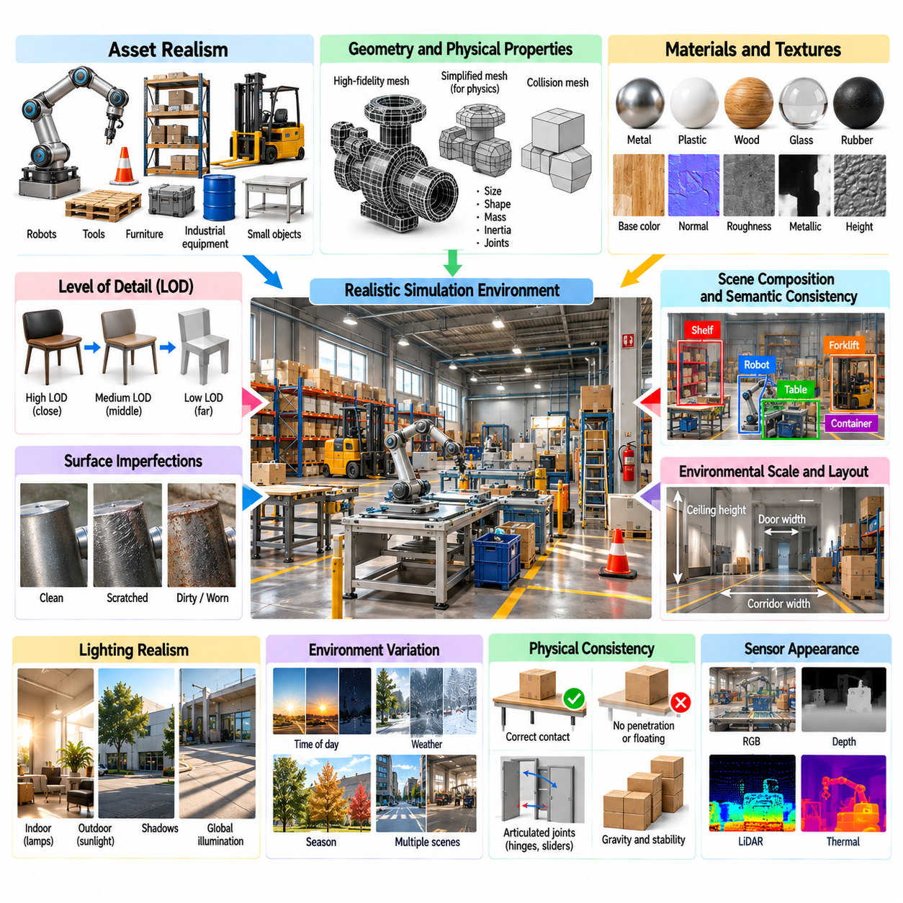{width="7.268055555555556in" height="7.268055555555556in"}

Asset, scene, and environment realism determines how accurately simulated worlds represent the physical conditions encountered by autonomous robots. Realistic environments require more than visually convincing objects because geometry, materials, spatial organization, and physical interactions jointly influence perception and behavior. High-quality simulation assets support reliable synthetic data generation, robotic training, evaluation, and Sim2Real transfer across diverse operational settings.

Digital assets represent the objects, structures, surfaces, and equipment that populate virtual environments. Their realism depends on geometric accuracy, material properties, physical dimensions, and functional characteristics. A visually detailed model may still be unsuitable for robotics if its collision geometry or mass distribution is incorrect. Asset development should therefore consider both rendering fidelity and the physical behavior required by downstream robotic tasks.

Geometric fidelity describes how closely a digital model reproduces the shape and dimensions of its physical counterpart. Important features include surface curvature, edges, gaps, joints, and contact regions. Small geometric differences can substantially affect grasp planning, collision detection, and navigation through confined spaces. Simulation assets should preserve task-relevant geometric details while avoiding unnecessary complexity that increases computational cost.

Mesh topology and geometric resolution influence rendering quality and simulation stability. High-resolution meshes capture detailed appearance but increase memory consumption and processing requirements. Simplified meshes improve efficiency but may remove important contact features or visual landmarks. A practical asset pipeline often separates visual meshes from collision meshes, allowing each representation to satisfy its specific accuracy and performance requirements.

Level-of-detail techniques adjust geometric complexity according to viewing distance and task requirements. Distant objects can use simplified representations, while nearby manipulation targets may require detailed geometry. However, abrupt transitions between detail levels can introduce visual artifacts or unstable perception features. Consistent level-of-detail management improves rendering scalability without unnecessarily compromising robotic observation quality.

Material realism is essential because surface properties determine how objects interact with light and sensors. Physically based materials describe characteristics such as roughness, metallic response, reflectance, transparency, and surface normals. These properties influence RGB appearance and may affect depth, LiDAR, radar, and thermal measurements. Material definitions should therefore remain consistent with the sensing modalities used in the simulated environment.

Texture maps provide spatial variation in color, roughness, surface relief, and other material properties. High-quality textures can reproduce scratches, stains, manufacturing patterns, and natural irregularities. However, excessive texture detail may create unrealistic visual statistics or obscure task-relevant features. Texture resolution and appearance should reflect the intended camera distance, sensor resolution, and environmental conditions.

Surface imperfections contribute significantly to perceived environmental realism. Real objects exhibit wear, dust, fingerprints, corrosion, deformation, and manufacturing variation. These details influence visual recognition and sometimes physical contact behavior. Procedural variation can generate diverse asset appearances without manually creating every instance. Such variation should remain physically plausible and appropriate to the object\'s operational context.

Scene composition determines how individual assets form coherent operational environments. Object placement, orientation, scale, and spatial relationships should reflect realistic usage patterns. Industrial facilities contain organized workstations, storage areas, and movement corridors, while domestic spaces exhibit different arrangements. Accurate scene composition helps robots learn meaningful contextual relationships rather than relying on arbitrary object distributions.

Semantic consistency ensures that simulated objects appear in locations and configurations compatible with their functions. Tools should be positioned near relevant work areas, containers should support plausible contents, and doors should connect accessible spaces. Semantic relationships influence task planning, object search, and language-conditioned robotic behavior. Realistic environments must therefore represent functional context in addition to visual appearance.

Physical consistency requires assets to obey appropriate constraints involving gravity, support, collision, and mechanical articulation. Objects should rest on supporting surfaces without unintended penetration or floating. Hinges, sliders, and movable components must follow plausible kinematic relationships. Inconsistent physical configurations can produce misleading training examples and reduce the transferability of learned manipulation policies.

Environmental scale and spatial layout directly affect robotic navigation and interaction. Corridor widths, doorway dimensions, ceiling heights, and obstacle clearances determine feasible movement. Incorrect scale can distort sensor observations and motion planning requirements. Simulation environments should use consistent physical units and dimensions derived from representative operational settings whenever accurate deployment correspondence is required.

Lighting realism interacts strongly with asset and scene realism. Surface appearance changes according to illumination direction, intensity, spectrum, and shadow formation. Indoor environments may combine daylight, artificial lighting, and reflective surfaces, creating complex visual conditions. Realistic scene generation should coordinate material definitions with lighting configurations to reproduce the appearance variations encountered by physical cameras.

Environmental dynamics introduce changes that cannot be captured by static scene models alone. People, vehicles, machinery, doors, and movable objects create time-dependent spatial configurations. Dynamic assets should follow plausible trajectories and interaction rules. Realistic motion patterns are important for obstacle avoidance, prediction, and human-robot interaction because robots must respond to evolving environments rather than fixed arrangements.

Weather and atmospheric conditions modify both environmental appearance and sensor behavior. Rain, fog, snow, dust, and changing sunlight can alter visibility, surface reflectance, and ground conditions. Wet surfaces may produce different reflections and friction characteristics from dry surfaces. Environment simulation should connect visual weather effects with relevant physical and sensor-level consequences.

Terrain realism is particularly important for mobile robots operating outdoors or across uneven surfaces. Ground geometry may include slopes, steps, gravel, mud, vegetation, and irregular obstacles. These features influence wheel traction, suspension response, and locomotion stability. Terrain models should represent both visible structure and mechanical properties, enabling meaningful evaluation of mobility and navigation performance.

Asset diversity supports generalization by exposing robots to multiple object shapes, sizes, colors, and material variations. A single canonical model rarely captures the variability encountered in real deployments. Procedural generation and asset libraries can introduce controlled diversity while preserving semantic and physical constraints. The objective is to represent plausible environmental variation rather than maximizing randomness without regard to realism.

Procedural scene generation enables scalable creation of virtual environments from configurable rules and asset collections. Parameters may control room dimensions, object arrangements, lighting conditions, clutter density, and operational layouts. Constraint-based generation prevents physically impossible or semantically inconsistent configurations. Such pipelines are valuable for producing large training datasets and systematic evaluation scenarios.

Digital twins provide a higher level of correspondence between simulated environments and specific physical facilities. Their assets and layouts may be derived from CAD models, architectural plans, laser scans, or photogrammetry. Digital twins support robot deployment preparation, workflow optimization, and operational testing. Maintaining realism requires updating the virtual representation when physical equipment, layouts, or operating conditions change.

Photogrammetry and three-dimensional scanning can reconstruct real-world geometry and appearance from measured observations. These techniques provide detailed environmental assets but may introduce incomplete surfaces, noisy geometry, or inconsistent material estimates. Additional processing is often necessary to create collision models and physically meaningful properties. Reconstructed assets should be validated before use in robotic training or safety-critical testing.

Scene realism also depends on accurately representing clutter, occlusion, and environmental complexity. Real workplaces contain cables, packaging, tools, temporary obstacles, and partially visible objects. These elements challenge perception and motion planning but are frequently omitted from simplified simulations. Controlled clutter generation can expose robotic systems to realistic ambiguity while maintaining reproducible experimental conditions.

Asset and environment validation should compare simulated scenes with representative physical settings. Geometric measurements, material appearance, object distributions, lighting statistics, and sensor observations provide useful evaluation criteria. Task-level comparisons can examine grasp success, navigation efficiency, collision frequency, and perception accuracy. Validation helps distinguish improvements in visual appearance from changes that genuinely enhance robotic performance.

Computational efficiency remains a major consideration when constructing detailed virtual worlds. Large asset collections, complex materials, dynamic objects, and high-resolution geometry increase rendering and physics workloads. Asset instancing, spatial partitioning, texture streaming, and selective simplification can reduce these costs. Simulation fidelity should be allocated according to task sensitivity and the expected contribution of each environmental detail.

Domain randomization and realism should be treated as complementary strategies rather than competing objectives. Realistic baseline scenes establish plausible geometry, materials, and functional relationships, while controlled randomization expands environmental coverage. Excessive variation can produce impossible configurations, whereas insufficient variation encourages overfitting. Balanced scene generation supports both physical credibility and robust generalization.

Ultimately, asset, scene, and environment realism connects detailed virtual content with the physical and semantic structure of real robotic workplaces. Effective simulation integrates accurate geometry, materials, lighting, dynamics, spatial relationships, and environmental variability. By combining validated assets with scalable procedural generation and task-aware fidelity management, Physical AI systems can develop stronger perception, planning, and control capabilities for reliable real-world operation.

에셋(Asset), 장면(Scene), 환경의 현실성(Environment Realism)은 시뮬레이션된 세계(Simulated World)가 자율 로봇(Autonomous Robot)이 마주하는 물리적 조건(Physical Condition)을 얼마나 정확하게 표현하는지를 결정한다. 사실적인 환경(Realistic Environment)은 시각적으로 설득력 있는 객체(Visually Convincing Object) 이상의 요소를 필요로 한다. 기하학적 구조(Geometry), 재질(Material), 공간 구성(Spatial Organization), 물리적 상호작용(Physical Interaction)이 함께 인식(Perception)과 동작(Behavior)에 영향을 미치기 때문이다. 고품질 시뮬레이션 에셋(High-Quality Simulation Asset)은 다양한 운영 환경(Operational Setting)에서 신뢰성 높은 합성 데이터 생성(Synthetic Data Generation), 로봇 학습(Robotic Training), 평가(Evaluation), 시뮬레이션-현실 전이(Sim2Real Transfer)를 지원한다.

디지털 에셋(Digital Asset)은 가상 환경(Virtual Environment)을 구성하는 객체(Object), 구조물(Structure), 표면(Surface), 장비(Equipment)를 표현한다. 에셋의 현실성(Asset Realism)은 기하학적 정확도(Geometric Accuracy), 재질 속성(Material Property), 물리적 치수(Physical Dimension), 기능적 특성(Functional Characteristic)에 따라 달라진다. 시각적으로 정교한 모델(Visually Detailed Model)이라도 충돌 기하학(Collision Geometry)이나 질량 분포(Mass Distribution)가 부정확하면 로봇 공학(Robotics)에 적합하지 않을 수 있다. 따라서 에셋 개발(Asset Development)은 렌더링 충실도(Rendering Fidelity)와 후속 로봇 작업(Downstream Robotic Task)에 필요한 물리적 동작(Physical Behavior)을 모두 고려해야 한다.

기하학적 충실도(Geometric Fidelity)는 디지털 모델(Digital Model)이 실제 대응 객체(Physical Counterpart)의 형상(Shape)과 치수(Dimension)를 얼마나 정확하게 재현하는지를 설명한다. 중요한 특징에는 표면 곡률(Surface Curvature), 모서리(Edge), 간극(Gap), 관절(Joint), 접촉 영역(Contact Region)이 포함된다. 작은 기하학적 차이(Geometric Difference)도 파지 계획(Grasp Planning), 충돌 탐지(Collision Detection), 협소 공간 내비게이션(Navigation Through Confined Spaces)에 상당한 영향을 미칠 수 있다. 시뮬레이션 에셋(Simulation Asset)은 계산 비용(Computational Cost)을 증가시키는 불필요한 복잡성을 피하면서 작업 관련 기하학적 세부정보(Task-Relevant Geometric Detail)를 보존해야 한다.

메시 토폴로지(Mesh Topology)와 기하학적 해상도(Geometric Resolution)는 렌더링 품질(Rendering Quality)과 시뮬레이션 안정성(Simulation Stability)에 영향을 미친다. 고해상도 메시(High-Resolution Mesh)는 세밀한 외관(Detailed Appearance)을 표현하지만 메모리 사용량(Memory Consumption)과 처리 요구사항(Processing Requirement)을 증가시킨다. 단순화된 메시(Simplified Mesh)는 효율성을 향상시키지만 중요한 접촉 특징(Contact Feature)이나 시각적 랜드마크(Visual Landmark)를 제거할 수 있다. 실용적인 에셋 파이프라인(Asset Pipeline)은 시각적 메시(Visual Mesh)와 충돌 메시(Collision Mesh)를 분리하여 각 표현이 고유한 정확도 및 성능 요구사항(Accuracy and Performance Requirement)을 충족하도록 한다.

상세 수준 기법(Level-of-Detail Technique, LOD)은 관측 거리(Viewing Distance)와 작업 요구사항(Task Requirement)에 따라 기하학적 복잡도(Geometric Complexity)를 조정한다. 먼 객체(Distant Object)는 단순화된 표현(Simplified Representation)을 사용할 수 있지만 가까운 조작 대상(Nearby Manipulation Target)은 상세한 기하학적 구조(Detailed Geometry)가 필요할 수 있다. 그러나 상세 수준 사이의 급격한 전환(Abrupt Transition)은 시각적 인공물(Visual Artifact)이나 불안정한 인식 특징(Unstable Perception Feature)을 발생시킬 수 있다. 일관된 상세 수준 관리(Level-of-Detail Management)는 로봇 관측 품질(Robotic Observation Quality)을 불필요하게 저하시키지 않으면서 렌더링 확장성(Rendering Scalability)을 향상시킨다.

재질 현실성(Material Realism)은 표면 속성(Surface Property)이 객체와 빛 및 센서 사이의 상호작용을 결정하기 때문에 필수적이다. 물리 기반 재질(Physically Based Material)은 거칠기(Roughness), 금속성 반응(Metallic Response), 반사율(Reflectance), 투명도(Transparency), 표면 법선(Surface Normal)과 같은 특성을 설명한다. 이러한 속성은 RGB 외관(RGB Appearance)에 영향을 미치며 깊이(Depth), 라이다(LiDAR), 레이더(Radar), 열화상(Thermal) 측정값에도 영향을 줄 수 있다. 따라서 재질 정의(Material Definition)는 시뮬레이션 환경에서 사용되는 센싱 모달리티(Sensing Modality)와 일관성을 유지해야 한다.

텍스처 맵(Texture Map)은 색상(Color), 거칠기(Roughness), 표면 요철(Surface Relief), 기타 재질 속성(Material Property)의 공간적 변화(Spatial Variation)를 제공한다. 고품질 텍스처(High-Quality Texture)는 긁힘(Scratch), 얼룩(Stain), 제조 패턴(Manufacturing Pattern), 자연적인 불규칙성(Natural Irregularity)을 재현할 수 있다. 그러나 과도한 텍스처 세부정보(Excessive Texture Detail)는 비현실적인 시각 통계(Visual Statistics)를 생성하거나 작업 관련 특징(Task-Relevant Feature)을 가릴 수 있다. 텍스처 해상도(Texture Resolution)와 외관(Appearance)은 의도된 카메라 거리(Camera Distance), 센서 해상도(Sensor Resolution), 환경 조건(Environmental Condition)을 반영해야 한다.

표면 불완전성(Surface Imperfection)은 환경의 지각적 현실성(Perceived Environmental Realism)에 상당히 기여한다. 실제 객체(Real Object)는 마모(Wear), 먼지(Dust), 지문(Fingerprint), 부식(Corrosion), 변형(Deformation), 제조 편차(Manufacturing Variation)를 나타낸다. 이러한 세부정보는 시각적 인식(Visual Recognition)에 영향을 미치며 경우에 따라 물리적 접촉 동작(Physical Contact Behavior)에도 영향을 준다. 절차적 변형(Procedural Variation)은 모든 인스턴스(Instance)를 수작업으로 생성하지 않고도 다양한 에셋 외관(Asset Appearance)을 만들 수 있다. 이러한 변형은 물리적으로 타당해야 하며 객체의 운영 맥락(Operational Context)에 적합해야 한다.

장면 구성(Scene Composition)은 개별 에셋(Individual Asset)이 일관된 운영 환경(Coherent Operational Environment)을 형성하는 방식을 결정한다. 객체 배치(Object Placement), 방향(Orientation), 크기(Scale), 공간적 관계(Spatial Relationship)는 현실적인 사용 패턴(Realistic Usage Pattern)을 반영해야 한다. 산업 시설(Industrial Facility)에는 체계적으로 구성된 작업대(Workstation), 보관 구역(Storage Area), 이동 통로(Movement Corridor)가 존재하는 반면, 가정 환경(Domestic Environment)은 서로 다른 배치 구조(Arrangement)를 나타낸다. 정확한 장면 구성은 로봇이 임의적인 객체 분포(Arbitrary Object Distribution)에 의존하지 않고 의미 있는 맥락적 관계(Contextual Relationship)를 학습하도록 지원한다.

의미적 일관성(Semantic Consistency)은 시뮬레이션된 객체가 해당 기능(Function)에 적합한 위치와 구성(Configuration)으로 존재하도록 보장한다. 도구(Tool)는 관련 작업 영역(Work Area) 근처에 배치되어야 하고, 용기(Container)는 타당한 내용물(Plausible Content)을 수용해야 하며, 문(Door)은 접근 가능한 공간(Accessible Space)을 연결해야 한다. 의미적 관계(Semantic Relationship)는 작업 계획(Task Planning), 객체 탐색(Object Search), 언어 조건부 로봇 동작(Language-Conditioned Robotic Behavior)에 영향을 미친다. 따라서 사실적인 환경은 시각적 외관(Visual Appearance)뿐 아니라 기능적 맥락(Functional Context)도 표현해야 한다.

물리적 일관성(Physical Consistency)을 확보하려면 에셋이 중력(Gravity), 지지(Support), 충돌(Collision), 기계적 관절 운동(Mechanical Articulation)에 관한 적절한 제약조건(Constraint)을 따라야 한다. 객체는 의도하지 않은 관통(Penetration)이나 공중 부유(Floating) 없이 지지 표면(Supporting Surface) 위에 놓여야 한다. 힌지(Hinge), 슬라이더(Slider), 이동 가능한 구성요소(Movable Component)는 타당한 운동학적 관계(Kinematic Relationship)를 따라야 한다. 일관성이 없는 물리적 구성(Physical Configuration)은 오해를 유발하는 학습 사례(Misleading Training Example)를 생성하고 학습된 조작 정책(Learned Manipulation Policy)의 전이 가능성(Transferability)을 감소시킬 수 있다.

환경 규모(Environmental Scale)와 공간 배치(Spatial Layout)는 로봇 내비게이션(Robotic Navigation)과 상호작용(Interaction)에 직접적인 영향을 미친다. 복도 폭(Corridor Width), 출입문 치수(Doorway Dimension), 천장 높이(Ceiling Height), 장애물 여유 공간(Obstacle Clearance)은 실현 가능한 움직임(Feasible Movement)을 결정한다. 부정확한 스케일(Incorrect Scale)은 센서 관측(Sensor Observation)과 동작 계획 요구사항(Motion Planning Requirement)을 왜곡할 수 있다. 정확한 실제 배포 대응성(Deployment Correspondence)이 요구되는 경우 시뮬레이션 환경은 대표적인 운영 환경(Representative Operational Setting)에서 도출한 일관된 물리 단위(Physical Unit)와 치수(Dimension)를 사용해야 한다.

조명 현실성(Lighting Realism)은 에셋 및 장면 현실성(Asset and Scene Realism)과 강하게 상호작용한다. 표면 외관(Surface Appearance)은 조명 방향(Illumination Direction), 강도(Intensity), 스펙트럼(Spectrum), 그림자 형성(Shadow Formation)에 따라 달라진다. 실내 환경(Indoor Environment)은 자연광(Daylight), 인공조명(Artificial Lighting), 반사 표면(Reflective Surface)을 결합하여 복잡한 시각적 조건(Visual Condition)을 생성할 수 있다. 사실적인 장면 생성(Scene Generation)은 실제 카메라(Physical Camera)가 경험하는 외관 변화(Appearance Variation)를 재현하기 위해 재질 정의(Material Definition)와 조명 구성(Lighting Configuration)을 조정해야 한다.

환경 동역학(Environmental Dynamics)은 정적 장면 모델(Static Scene Model)만으로는 포착할 수 없는 변화를 도입한다. 사람(People), 차량(Vehicle), 기계(Machinery), 문(Door), 이동 가능한 객체(Movable Object)는 시간 의존적 공간 구성(Time-Dependent Spatial Configuration)을 생성한다. 동적 에셋(Dynamic Asset)은 타당한 궤적(Trajectory)과 상호작용 규칙(Interaction Rule)을 따라야 한다. 사실적인 움직임 패턴(Realistic Motion Pattern)은 장애물 회피(Obstacle Avoidance), 예측(Prediction), 인간-로봇 상호작용(Human-Robot Interaction)에 중요하다. 로봇은 고정된 배치가 아니라 지속적으로 변화하는 환경(Evolving Environment)에 대응해야 하기 때문이다.

날씨와 대기 조건(Weather and Atmospheric Condition)은 환경 외관(Environmental Appearance)과 센서 동작(Sensor Behavior)을 모두 변화시킨다. 비(Rain), 안개(Fog), 눈(Snow), 먼지(Dust), 변화하는 태양광(Changing Sunlight)은 가시성(Visibility), 표면 반사율(Surface Reflectance), 지면 상태(Ground Condition)를 변화시킬 수 있다. 젖은 표면(Wet Surface)은 건조한 표면(Dry Surface)과 다른 반사 특성(Reflection Characteristic) 및 마찰 특성(Friction Characteristic)을 나타낼 수 있다. 환경 시뮬레이션(Environment Simulation)은 시각적 날씨 효과(Visual Weather Effect)를 관련 물리적 결과(Physical Consequence) 및 센서 수준 결과(Sensor-Level Consequence)와 연결해야 한다.

지형 현실성(Terrain Realism)은 실외(Outdoor) 또는 불균일한 표면(Uneven Surface)에서 작동하는 이동 로봇(Mobile Robot)에 특히 중요하다. 지면 기하학(Ground Geometry)에는 경사면(Slope), 계단(Step), 자갈(Gravel), 진흙(Mud), 식생(Vegetation), 불규칙한 장애물(Irregular Obstacle)이 포함될 수 있다. 이러한 특징은 바퀴 접지력(Wheel Traction), 서스펜션 응답(Suspension Response), 이동 안정성(Locomotion Stability)에 영향을 미친다. 지형 모델(Terrain Model)은 가시적 구조(Visible Structure)와 기계적 특성(Mechanical Property)을 모두 표현하여 이동 성능(Mobility Performance)과 내비게이션 성능(Navigation Performance)을 의미 있게 평가할 수 있도록 해야 한다.

에셋 다양성(Asset Diversity)은 로봇을 다양한 객체 형상(Object Shape), 크기(Size), 색상(Color), 재질 변형(Material Variation)에 노출하여 일반화(Generalization)를 지원한다. 하나의 표준 모델(Canonical Model)만으로는 실제 배포(Real Deployment)에서 발생하는 변동성(Variability)을 충분히 포착하기 어렵다. 절차적 생성(Procedural Generation)과 에셋 라이브러리(Asset Library)는 의미적 및 물리적 제약조건(Semantic and Physical Constraint)을 유지하면서 통제된 다양성(Controlled Diversity)을 도입할 수 있다. 목표는 현실성을 고려하지 않고 무작위성(Randomness)을 극대화하는 것이 아니라 타당한 환경 변화(Plausible Environmental Variation)를 표현하는 것이다.

절차적 장면 생성(Procedural Scene Generation)은 구성 가능한 규칙(Configurable Rule)과 에셋 컬렉션(Asset Collection)을 활용하여 가상 환경(Virtual Environment)을 확장 가능하게 생성한다. 매개변수(Parameter)는 방의 치수(Room Dimension), 객체 배치(Object Arrangement), 조명 조건(Lighting Condition), 잡동사니 밀도(Clutter Density), 운영 배치(Operational Layout)를 제어할 수 있다. 제약조건 기반 생성(Constraint-Based Generation)은 물리적으로 불가능하거나 의미적으로 일관되지 않은 구성(Physically Impossible or Semantically Inconsistent Configuration)을 방지한다. 이러한 파이프라인은 대규모 학습 데이터셋(Large Training Dataset)과 체계적인 평가 시나리오(Systematic Evaluation Scenario)를 생성하는 데 유용하다.

디지털 트윈(Digital Twin)은 시뮬레이션 환경(Simulated Environment)과 특정 물리적 시설(Physical Facility) 사이에 더 높은 수준의 대응 관계(Correspondence)를 제공한다. 디지털 트윈의 에셋과 배치(Asset and Layout)는 CAD 모델(CAD Model), 건축 도면(Architectural Plan), 레이저 스캔(Laser Scan), 사진측량(Photogrammetry)에서 도출될 수 있다. 디지털 트윈은 로봇 배포 준비(Robot Deployment Preparation), 작업 흐름 최적화(Workflow Optimization), 운영 시험(Operational Testing)을 지원한다. 현실성을 유지하려면 실제 장비(Physical Equipment), 배치(Layout), 운영 조건(Operating Condition)이 변경될 때 가상 표현(Virtual Representation)을 갱신해야 한다.

사진측량(Photogrammetry)과 3차원 스캐닝(Three-Dimensional Scanning)은 측정된 관측(Measured Observation)으로부터 실제 환경의 기하학적 구조(Real-World Geometry)와 외관(Appearance)을 재구성할 수 있다. 이러한 기술은 상세한 환경 에셋(Environmental Asset)을 제공하지만 불완전한 표면(Incomplete Surface), 잡음이 포함된 기하학(Noisy Geometry), 일관되지 않은 재질 추정(Inconsistent Material Estimate)을 발생시킬 수 있다. 충돌 모델(Collision Model)과 물리적으로 의미 있는 속성(Physically Meaningful Property)을 생성하려면 추가 처리가 필요한 경우가 많다. 재구성된 에셋(Reconstructed Asset)은 로봇 학습(Robotic Training)이나 안전 중요 시험(Safety-Critical Testing)에 사용하기 전에 검증해야 한다.

장면 현실성(Scene Realism)은 잡동사니(Clutter), 가림(Occlusion), 환경 복잡성(Environmental Complexity)을 정확하게 표현하는 데도 의존한다. 실제 작업장(Real Workplace)에는 케이블(Cable), 포장재(Packaging), 도구(Tool), 임시 장애물(Temporary Obstacle), 부분적으로 보이는 객체(Partially Visible Object)가 존재한다. 이러한 요소는 인식(Perception)과 동작 계획(Motion Planning)에 어려움을 주지만 단순화된 시뮬레이션(Simplified Simulation)에서는 자주 생략된다. 통제된 잡동사니 생성(Controlled Clutter Generation)은 재현 가능한 실험 조건(Reproducible Experimental Condition)을 유지하면서 로봇 시스템을 현실적인 모호성(Realistic Ambiguity)에 노출할 수 있다.

에셋 및 환경 검증(Asset and Environment Validation)은 시뮬레이션된 장면(Simulated Scene)을 대표적인 물리적 환경(Representative Physical Setting)과 비교해야 한다. 기하학적 측정(Geometric Measurement), 재질 외관(Material Appearance), 객체 분포(Object Distribution), 조명 통계(Lighting Statistics), 센서 관측(Sensor Observation)은 유용한 평가 기준(Evaluation Criterion)을 제공한다. 작업 수준 비교(Task-Level Comparison)는 파지 성공률(Grasp Success), 내비게이션 효율성(Navigation Efficiency), 충돌 빈도(Collision Frequency), 인식 정확도(Perception Accuracy)를 분석할 수 있다. 검증은 시각적 외관의 개선과 실제 로봇 성능(Robotic Performance)을 향상시키는 변화를 구분하는 데 도움을 준다.

계산 효율성(Computational Efficiency)은 상세한 가상 세계(Detailed Virtual World)를 구축할 때 여전히 중요한 고려사항이다. 대규모 에셋 컬렉션(Large Asset Collection), 복잡한 재질(Complex Material), 동적 객체(Dynamic Object), 고해상도 기하학(High-Resolution Geometry)은 렌더링 및 물리 연산 부하(Rendering and Physics Workload)를 증가시킨다. 에셋 인스턴싱(Asset Instancing), 공간 분할(Spatial Partitioning), 텍스처 스트리밍(Texture Streaming), 선택적 단순화(Selective Simplification)는 이러한 비용을 줄일 수 있다. 시뮬레이션 충실도(Simulation Fidelity)는 작업 민감도(Task Sensitivity)와 각 환경 세부정보(Environmental Detail)의 예상 기여도(Expected Contribution)에 따라 배분해야 한다.

도메인 랜덤화(Domain Randomization)와 현실성(Realism)은 서로 경쟁하는 목표가 아니라 상호보완적인 전략(Complementary Strategy)으로 다루어야 한다. 사실적인 기준 장면(Realistic Baseline Scene)은 타당한 기하학(Geometry), 재질(Material), 기능적 관계(Functional Relationship)를 확립하며, 통제된 랜덤화(Controlled Randomization)는 환경적 적용 범위(Environmental Coverage)를 확장한다. 과도한 변형(Excessive Variation)은 불가능한 구성(Impossible Configuration)을 생성할 수 있고, 불충분한 변형(Insufficient Variation)은 과적합(Overfitting)을 유발한다. 균형 잡힌 장면 생성(Balanced Scene Generation)은 물리적 신뢰성(Physical Credibility)과 강건한 일반화(Robust Generalization)를 모두 지원한다.

궁극적으로 에셋, 장면, 환경의 현실성(Asset, Scene, and Environment Realism)은 상세한 가상 콘텐츠(Detailed Virtual Content)를 실제 로봇 작업장(Real Robotic Workplace)의 물리적 및 의미적 구조(Physical and Semantic Structure)와 연결한다. 효과적인 시뮬레이션(Effective Simulation)은 정확한 기하학(Geometry), 재질(Material), 조명(Lighting), 동역학(Dynamics), 공간적 관계(Spatial Relationship), 환경적 다양성(Environmental Variability)을 통합한다. 검증된 에셋(Validated Asset)을 확장 가능한 절차적 생성(Scalable Procedural Generation) 및 작업 인식 기반 충실도 관리(Task-Aware Fidelity Management)와 결합함으로써 피지컬 AI 시스템(Physical AI System)은 신뢰성 높은 실제 환경 운영(Reliable Real-World Operation)을 위한 더욱 강력한 인식(Perception), 계획(Planning), 제어(Control) 역량을 개발할 수 있다.

##  

## 02.12. Visual Fidelity vs Rendering Performance

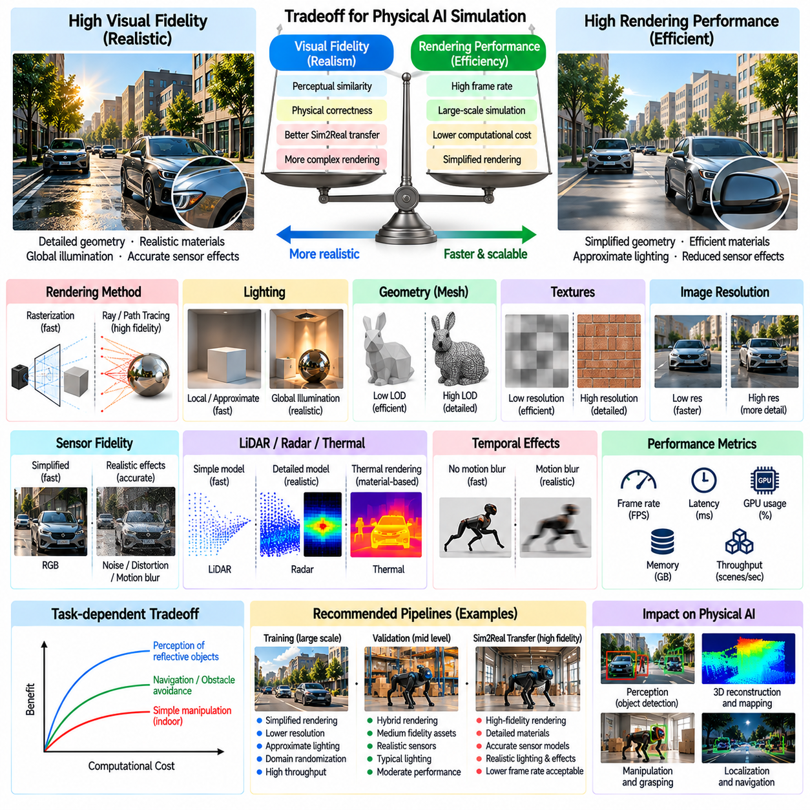{width="7.268055555555556in" height="7.268055555555556in"}

Visual fidelity and rendering performance represent a fundamental tradeoff in Physical AI simulation. High-fidelity rendering reproduces complex lighting, materials, geometry, and sensor effects, while high-performance rendering enables rapid observation generation and large-scale training. The appropriate balance depends on robotic tasks, perception requirements, and computational resources. Maximizing visual realism does not always produce the most effective simulation pipeline.

Visual fidelity describes how closely synthetic images resemble observations captured by physical sensors. It includes geometric accuracy, material appearance, illumination, shadows, reflections, and sensor imperfections. However, perceptual similarity alone is insufficient for evaluating simulation quality. A rendering feature becomes valuable when it improves the accuracy of robotic perception, decision-making, or transfer to real environments.

Rendering performance is commonly measured through frame rate, frame latency, GPU utilization, memory consumption, and simulation throughput. These metrics describe different aspects of computational efficiency. High frame rates may be achieved with limited scene complexity, while large-scale training requires consistent throughput across many parallel environments. Performance evaluation should therefore reflect the complete simulation workload.

Rendering complexity increases as geometric detail, texture resolution, lighting accuracy, and sensor fidelity improve. Ray tracing and path tracing can reproduce sophisticated light transport but often require greater computational resources than rasterization. The additional cost may be justified for tasks involving reflective surfaces, complex shadows, or optical sensor behavior. Other tasks may benefit more from simplified rendering with higher simulation throughput.

Rasterization provides an efficient foundation for real-time robotic simulation. It converts scene geometry into image-space fragments and supports rapid depth testing, shading, and visibility calculations. Modern rendering pipelines combine rasterization with physically based materials and approximate global illumination. Although some optical effects remain simplified, rasterization can provide sufficient fidelity for many navigation and manipulation applications.

Ray tracing models light propagation through geometric intersections and supports accurate reflections, refractions, and shadows. Path tracing extends this approach by sampling multiple light transport paths to estimate global illumination. These methods can generate highly realistic images but introduce sampling noise and substantial computational expense. Their value depends on whether the additional optical realism influences downstream robotic learning.

Hybrid rendering combines efficient rasterization with selected ray-traced effects. Primary visibility may be computed through rasterization, while reflections, shadows, or indirect lighting receive more detailed treatment. This approach concentrates expensive calculations where they contribute meaningful visual information. Hybrid pipelines offer a practical compromise between physically based realism and real-time simulation requirements.

Lighting fidelity strongly influences both image appearance and rendering cost. Direct illumination can often be computed efficiently, whereas indirect illumination requires additional approximations or ray sampling. Dynamic lights, soft shadows, and complex reflections increase workload. Simulation designers should determine which lighting effects are essential for the target perception algorithms instead of reproducing every optical interaction at maximum quality.

Geometric complexity affects rendering throughput through vertex processing, visibility testing, and memory access. High-resolution meshes preserve fine surface details but increase computational demands. Level-of-detail techniques replace distant objects with simplified geometry while retaining detailed representations near important interaction regions. Task-aware geometric simplification can improve performance without sacrificing relevant perception or collision information.

Texture resolution influences memory consumption, bandwidth requirements, and surface appearance. High-resolution textures improve close-range detail but may offer limited benefits when objects occupy only a few image pixels. Texture compression, mipmapping, and streaming reduce memory pressure and improve rendering efficiency. Appropriate texture fidelity should be selected according to camera resolution, viewing distance, and the visual features required by the robotic task.

Image resolution introduces another important performance tradeoff. Higher resolutions provide finer spatial detail and may improve small-object detection or precise manipulation. However, rendering cost, memory traffic, and neural network processing requirements generally increase with pixel count. Lower resolutions support faster simulation and larger training batches. Resolution selection should reflect the spatial precision required by the intended perception pipeline.

Sensor fidelity also contributes significantly to computational workload. Simulating camera noise, lens distortion, rolling shutter, motion blur, and depth measurement errors requires additional processing. LiDAR ray casting, radar signal modeling, and thermal rendering introduce modality-specific costs. Not every training scenario requires full physical sensor simulation, making calibrated approximations useful for balancing realism and scalability.

Temporal rendering effects are particularly expensive when multiple scene states must be evaluated for each observation. Motion blur may require temporal sampling, while rolling shutter simulation needs different acquisition times across image regions. Dynamic objects and moving cameras increase the complexity of these calculations. Efficient approximations can reduce overhead when exact temporal integration provides limited task-level benefits.

Simulation throughput is critical for reinforcement learning, where policies may require millions or billions of interaction steps. Rendering every observation at maximum fidelity can substantially reduce the number of training experiences generated per unit time. Lightweight visual pipelines often accelerate policy optimization. Higher fidelity can then be introduced selectively during fine-tuning, evaluation, or transfer preparation.

Parallel simulation changes the relationship between rendering quality and computational efficiency. Multiple environments may share GPU resources for physics, rendering, and neural network inference. Increasing visual complexity can reduce the number of environments processed simultaneously. Efficient scheduling, batched rendering, and resource isolation help maintain throughput. System-level optimization must consider contention between simulation and learning workloads.

GPU memory is frequently a limiting resource in large-scale rendering pipelines. Geometry buffers, textures, acceleration structures, framebuffers, and neural network parameters compete for available capacity. Excessive memory consumption can force smaller batches or expensive data transfers. Asset instancing, memory pooling, compression, and selective caching help improve resource utilization without fundamentally reducing scene diversity.

Rendering latency differs from aggregate throughput and becomes especially important in closed-loop robotic control. A simulator may generate many frames per second overall while introducing delays in individual observations. Such delays can affect control stability and timing-sensitive perception. Real-time and hardware-in-the-loop systems should prioritize predictable frame delivery and bounded latency rather than maximizing average throughput alone.

Asynchronous rendering can overlap image generation with physics updates, data transfer, or neural network computation. Proper pipeline scheduling reduces idle time and improves hardware utilization. However, asynchronous execution introduces synchronization challenges and may produce stale observations if timestamps are mishandled. Accurate temporal coordination is essential when evaluating closed-loop behavior or transferring policies to physical robots.

Adaptive rendering allocates computational resources according to scene importance and task sensitivity. Regions containing manipulation targets, obstacles, or uncertain visual features may receive greater detail than irrelevant background areas. Adaptive sampling can increase ray counts where image variance is high. Such methods improve efficiency by concentrating fidelity on information that affects robotic decisions.

Foveated rendering and region-of-interest processing provide additional opportunities for selective computation. High-resolution rendering can focus on task-relevant image regions while peripheral areas receive simplified treatment. This strategy resembles attention-based perception but must preserve enough context for navigation and object discovery. Its effectiveness depends on whether relevant regions can be identified reliably before detailed rendering.

Domain randomization introduces another dimension to the fidelity-performance tradeoff. Varying materials, lighting, geometry, and camera parameters increases environmental diversity without necessarily requiring photorealistic rendering. Simplified but diverse environments can support robust learning in some applications. However, excessive simplification may remove important visual cues, so randomization should complement rather than replace task-relevant physical realism.

Multi-fidelity simulation uses different rendering quality levels across training and evaluation stages. Low-cost environments can support initial exploration and large-scale policy learning, while detailed environments provide targeted refinement and validation. This staged approach reduces total computational expense. Transitions between fidelity levels should be managed carefully to avoid introducing unexpected observation distribution shifts.

Performance profiling identifies the operations responsible for rendering bottlenecks. GPU timing, memory bandwidth analysis, shader profiling, and frame breakdowns reveal whether geometry, lighting, sensor processing, or data transfer dominates execution time. Optimization should target measured bottlenecks rather than assumed sources of cost. Repeatable benchmarks are essential for comparing rendering configurations under equivalent simulation workloads.

Visual fidelity should be validated using both image-level and task-level metrics. Image comparisons can evaluate structural similarity, color statistics, depth consistency, and lighting behavior. Robotic metrics include detection accuracy, localization error, grasp success, navigation reliability, and Sim2Real transfer performance. A visually superior renderer is not necessarily preferable if its additional cost produces negligible improvement in downstream outcomes.

The optimal rendering configuration can be formulated as a constrained optimization problem. Simulation designers seek to maximize task performance and training efficiency while respecting limits on GPU memory, computation time, latency, and energy consumption. Different robotic applications require different operating points. A warehouse navigation system may prioritize throughput, while precision manipulation may justify higher geometric and optical fidelity.

Ultimately, visual fidelity and rendering performance must be optimized together rather than treated as independent objectives. Effective Physical AI simulation combines task-aware rendering, calibrated sensor models, adaptive computation, and systematic performance measurement. By allocating computational resources to visual effects that materially improve robotic learning and validation, simulation platforms can achieve scalable training and reliable real-world transfer.

시각적 충실도(Visual Fidelity)와 렌더링 성능(Rendering Performance)은 피지컬 AI(Physical AI) 시뮬레이션에서 근본적인 상충관계(Tradeoff)를 형성한다. 고충실도 렌더링(High-Fidelity Rendering)은 복잡한 조명(Lighting), 재질(Material), 기하학적 구조(Geometry), 센서 효과(Sensor Effect)를 재현하는 반면, 고성능 렌더링(High-Performance Rendering)은 빠른 관측 데이터 생성(Observation Generation)과 대규모 학습(Large-Scale Training)을 가능하게 한다. 적절한 균형은 로봇 작업(Robotic Task), 인식 요구사항(Perception Requirement), 계산 자원(Computational Resource)에 따라 달라진다. 시각적 현실성(Visual Realism)을 극대화하는 것이 항상 가장 효과적인 시뮬레이션 파이프라인(Simulation Pipeline)을 제공하는 것은 아니다.

시각적 충실도(Visual Fidelity)는 합성 영상(Synthetic Image)이 실제 물리적 센서(Physical Sensor)에서 획득한 관측값(Observation)과 얼마나 유사한지를 설명한다. 여기에는 기하학적 정확도(Geometric Accuracy), 재질 외관(Material Appearance), 조명(Illumination), 그림자(Shadow), 반사(Reflection), 센서 불완전성(Sensor Imperfection)이 포함된다. 그러나 지각적 유사성(Perceptual Similarity)만으로는 시뮬레이션 품질(Simulation Quality)을 평가하기에 충분하지 않다. 렌더링 기능(Rendering Feature)은 로봇 인식(Robotic Perception), 의사결정(Decision-Making), 실제 환경으로의 전이(Transfer to Real Environments)의 정확도를 향상시킬 때 가치를 가진다.

렌더링 성능(Rendering Performance)은 일반적으로 프레임 속도(Frame Rate), 프레임 지연 시간(Frame Latency), GPU 활용률(GPU Utilization), 메모리 사용량(Memory Consumption), 시뮬레이션 처리량(Simulation Throughput)을 통해 측정된다. 이러한 지표는 계산 효율성(Computational Efficiency)의 서로 다른 측면을 설명한다. 제한된 장면 복잡도(Scene Complexity)에서는 높은 프레임 속도를 달성할 수 있지만, 대규모 학습(Large-Scale Training)에서는 다수의 병렬 환경(Parallel Environment)에 걸쳐 일관된 처리량(Consistent Throughput)이 필요하다. 따라서 성능 평가는 전체 시뮬레이션 작업 부하(Complete Simulation Workload)를 반영해야 한다.

렌더링 복잡도(Rendering Complexity)는 기하학적 세부 수준(Geometric Detail), 텍스처 해상도(Texture Resolution), 조명 정확도(Lighting Accuracy), 센서 충실도(Sensor Fidelity)가 향상될수록 증가한다. 광선 추적(Ray Tracing)과 경로 추적(Path Tracing)은 정교한 빛 전달(Light Transport)을 재현할 수 있지만 일반적으로 래스터화(Rasterization)보다 많은 계산 자원(Computational Resource)을 요구한다. 반사 표면(Reflective Surface), 복잡한 그림자(Complex Shadow), 광학 센서 동작(Optical Sensor Behavior)이 중요한 작업에서는 추가 비용이 정당화될 수 있다. 다른 작업에서는 높은 시뮬레이션 처리량을 제공하는 단순화된 렌더링(Simplified Rendering)이 더 유리할 수 있다.

래스터화(Rasterization)는 실시간 로봇 시뮬레이션(Real-Time Robotic Simulation)을 위한 효율적인 기반을 제공한다. 래스터화는 장면 기하학(Scene Geometry)을 영상 공간 프래그먼트(Image-Space Fragment)로 변환하고 빠른 깊이 검사(Depth Testing), 셰이딩(Shading), 가시성 계산(Visibility Calculation)을 지원한다. 현대적인 렌더링 파이프라인(Modern Rendering Pipeline)은 래스터화를 물리 기반 재질(Physically Based Material) 및 근사 전역 조명(Approximate Global Illumination)과 결합한다. 일부 광학 효과(Optical Effect)는 단순화되지만 래스터화는 다양한 내비게이션(Navigation) 및 조작(Manipulation) 응용 분야에 충분한 충실도를 제공할 수 있다.

광선 추적(Ray Tracing)은 기하학적 교차(Geometric Intersection)를 통한 빛의 전파(Light Propagation)를 모델링하며 정확한 반사(Reflection), 굴절(Refraction), 그림자(Shadow)를 지원한다. 경로 추적(Path Tracing)은 여러 빛 전달 경로(Light Transport Path)를 샘플링하여 전역 조명(Global Illumination)을 추정하는 방식으로 이를 확장한다. 이러한 방법은 매우 사실적인 영상(Realistic Image)을 생성할 수 있지만 샘플링 잡음(Sampling Noise)과 상당한 계산 비용(Computational Expense)을 발생시킨다. 그 가치는 추가적인 광학 현실성(Optical Realism)이 후속 로봇 학습(Downstream Robotic Learning)에 영향을 미치는지에 따라 결정된다.

하이브리드 렌더링(Hybrid Rendering)은 효율적인 래스터화(Efficient Rasterization)와 선택적인 광선 추적 효과(Selected Ray-Traced Effect)를 결합한다. 기본 가시성(Primary Visibility)은 래스터화를 통해 계산하고, 반사(Reflection), 그림자(Shadow), 간접 조명(Indirect Lighting)은 더 정교하게 처리할 수 있다. 이 접근법은 의미 있는 시각 정보(Meaningful Visual Information)를 제공하는 영역에 계산 비용이 높은 연산을 집중한다. 하이브리드 파이프라인(Hybrid Pipeline)은 물리 기반 현실성(Physically Based Realism)과 실시간 시뮬레이션 요구사항(Real-Time Simulation Requirement) 사이에서 실용적인 절충안(Practical Compromise)을 제공한다.

조명 충실도(Lighting Fidelity)는 영상 외관(Image Appearance)과 렌더링 비용(Rendering Cost)에 강한 영향을 미친다. 직접 조명(Direct Illumination)은 비교적 효율적으로 계산할 수 있지만 간접 조명(Indirect Illumination)은 추가적인 근사화(Approximation) 또는 광선 샘플링(Ray Sampling)이 필요하다. 동적 조명(Dynamic Light), 부드러운 그림자(Soft Shadow), 복잡한 반사(Complex Reflection)는 작업 부하(Workload)를 증가시킨다. 시뮬레이션 설계자(Simulation Designer)는 모든 광학적 상호작용(Optical Interaction)을 최고 품질로 재현하기보다 대상 인식 알고리즘(Target Perception Algorithm)에 필수적인 조명 효과를 결정해야 한다.

기하학적 복잡도(Geometric Complexity)는 정점 처리(Vertex Processing), 가시성 검사(Visibility Testing), 메모리 접근(Memory Access)을 통해 렌더링 처리량(Rendering Throughput)에 영향을 미친다. 고해상도 메시(High-Resolution Mesh)는 미세한 표면 세부정보(Fine Surface Detail)를 보존하지만 계산 요구량(Computational Demand)을 증가시킨다. 상세 수준 기법(Level-of-Detail Technique)은 먼 객체(Distant Object)를 단순화된 기하학(Simplified Geometry)으로 대체하면서 중요한 상호작용 영역(Important Interaction Region) 근처에는 상세한 표현을 유지한다. 작업 인식 기반 기하학적 단순화(Task-Aware Geometric Simplification)는 관련 인식 정보(Perception Information)나 충돌 정보(Collision Information)를 희생하지 않으면서 성능을 향상시킬 수 있다.

텍스처 해상도(Texture Resolution)는 메모리 사용량(Memory Consumption), 대역폭 요구사항(Bandwidth Requirement), 표면 외관(Surface Appearance)에 영향을 미친다. 고해상도 텍스처(High-Resolution Texture)는 근거리 세부정보(Close-Range Detail)를 향상시키지만 객체가 영상에서 몇 개의 픽셀만 차지하는 경우에는 효과가 제한적일 수 있다. 텍스처 압축(Texture Compression), 밉매핑(Mipmapping), 스트리밍(Streaming)은 메모리 부담(Memory Pressure)을 줄이고 렌더링 효율성(Rendering Efficiency)을 향상시킨다. 적절한 텍스처 충실도(Texture Fidelity)는 카메라 해상도(Camera Resolution), 관측 거리(Viewing Distance), 로봇 작업에 필요한 시각적 특징(Visual Feature)에 따라 선택해야 한다.

영상 해상도(Image Resolution)는 또 다른 중요한 성능 상충관계(Performance Tradeoff)를 발생시킨다. 높은 해상도(Higher Resolution)는 더 세밀한 공간 정보(Spatial Detail)를 제공하며 작은 객체 탐지(Small-Object Detection)나 정밀 조작(Precision Manipulation)을 개선할 수 있다. 그러나 렌더링 비용(Rendering Cost), 메모리 전송량(Memory Traffic), 신경망 처리 요구사항(Neural Network Processing Requirement)은 일반적으로 픽셀 수(Pixel Count)에 따라 증가한다. 낮은 해상도(Lower Resolution)는 더 빠른 시뮬레이션과 큰 학습 배치(Larger Training Batch)를 지원한다. 해상도 선택(Resolution Selection)은 목표 인식 파이프라인(Intended Perception Pipeline)에 필요한 공간 정밀도(Spatial Precision)를 반영해야 한다.

센서 충실도(Sensor Fidelity) 역시 계산 작업 부하(Computational Workload)에 상당한 영향을 미친다. 카메라 잡음(Camera Noise), 렌즈 왜곡(Lens Distortion), 롤링 셔터(Rolling Shutter), 모션 블러(Motion Blur), 깊이 측정 오차(Depth Measurement Error)를 시뮬레이션하려면 추가 처리가 필요하다. 라이다 광선 투사(LiDAR Ray Casting), 레이더 신호 모델링(Radar Signal Modeling), 열화상 렌더링(Thermal Rendering)은 센싱 모달리티별 비용(Modality-Specific Cost)을 발생시킨다. 모든 학습 시나리오(Training Scenario)에 완전한 물리적 센서 시뮬레이션(Full Physical Sensor Simulation)이 필요한 것은 아니므로 보정된 근사 모델(Calibrated Approximation)은 현실성과 확장성(Scalability)의 균형을 맞추는 데 유용하다.

시간적 렌더링 효과(Temporal Rendering Effect)는 하나의 관측값(Observation)을 생성하기 위해 여러 장면 상태(Scene State)를 평가해야 할 때 특히 많은 계산 비용을 요구한다. 모션 블러(Motion Blur)는 시간적 샘플링(Temporal Sampling)이 필요할 수 있으며, 롤링 셔터 시뮬레이션(Rolling Shutter Simulation)은 영상 영역(Image Region)마다 서로 다른 획득 시점(Acquisition Time)을 필요로 한다. 동적 객체(Dynamic Object)와 이동하는 카메라(Moving Camera)는 이러한 계산의 복잡도를 증가시킨다. 정확한 시간 적분(Temporal Integration)이 작업 수준에서 제한적인 이점만 제공하는 경우 효율적인 근사화(Efficient Approximation)를 통해 추가 비용을 줄일 수 있다.

시뮬레이션 처리량(Simulation Throughput)은 정책(Policy)이 수백만 또는 수십억 번의 상호작용 단계(Interaction Step)를 필요로 할 수 있는 강화학습(Reinforcement Learning)에서 매우 중요하다. 모든 관측값을 최고 충실도(Maximum Fidelity)로 렌더링하면 단위 시간당 생성되는 학습 경험(Training Experience)의 수가 크게 감소할 수 있다. 경량 시각 파이프라인(Lightweight Visual Pipeline)은 정책 최적화(Policy Optimization)를 가속할 수 있다. 이후 미세조정(Fine-Tuning), 평가(Evaluation), 전이 준비(Transfer Preparation) 단계에서 선택적으로 높은 충실도를 도입할 수 있다.

병렬 시뮬레이션(Parallel Simulation)은 렌더링 품질(Rendering Quality)과 계산 효율성(Computational Efficiency) 사이의 관계를 변화시킨다. 여러 환경(Multiple Environment)은 물리 연산(Physics), 렌더링(Rendering), 신경망 추론(Neural Network Inference)을 위해 GPU 자원을 공유할 수 있다. 시각적 복잡도(Visual Complexity)가 증가하면 동시에 처리할 수 있는 환경의 수가 감소할 수 있다. 효율적인 스케줄링(Efficient Scheduling), 배치 렌더링(Batched Rendering), 자원 격리(Resource Isolation)는 처리량을 유지하는 데 도움이 된다. 시스템 수준 최적화(System-Level Optimization)는 시뮬레이션 작업과 학습 작업 사이의 자원 경합(Resource Contention)을 고려해야 한다.

GPU 메모리(GPU Memory)는 대규모 렌더링 파이프라인(Large-Scale Rendering Pipeline)에서 자주 제한 요인(Limiting Resource)이 된다. 기하학 버퍼(Geometry Buffer), 텍스처(Texture), 가속 구조(Acceleration Structure), 프레임버퍼(Framebuffer), 신경망 매개변수(Neural Network Parameter)는 사용 가능한 메모리 용량(Memory Capacity)을 공유하며 경쟁한다. 과도한 메모리 사용(Memory Consumption)은 학습 배치 크기(Batch Size)를 줄이거나 비용이 높은 데이터 전송(Data Transfer)을 강제할 수 있다. 에셋 인스턴싱(Asset Instancing), 메모리 풀링(Memory Pooling), 압축(Compression), 선택적 캐싱(Selective Caching)은 장면 다양성(Scene Diversity)을 근본적으로 감소시키지 않으면서 자원 활용률(Resource Utilization)을 향상시킨다.

렌더링 지연 시간(Rendering Latency)은 전체 처리량(Aggregate Throughput)과 다르며 폐루프 로봇 제어(Closed-Loop Robotic Control)에서 특히 중요하다. 시뮬레이터(Simulator)는 전체적으로 초당 많은 프레임을 생성하면서도 개별 관측값(Individual Observation)에는 지연을 발생시킬 수 있다. 이러한 지연은 제어 안정성(Control Stability)과 타이밍에 민감한 인식(Timing-Sensitive Perception)에 영향을 줄 수 있다. 실시간 시스템(Real-Time System)과 하드웨어 연동 시뮬레이션(Hardware-in-the-Loop Simulation)은 평균 처리량을 극대화하는 것보다 예측 가능한 프레임 전달(Predictable Frame Delivery)과 제한된 지연 시간(Bounded Latency)을 우선해야 한다.

비동기 렌더링(Asynchronous Rendering)은 영상 생성(Image Generation)을 물리 업데이트(Physics Update), 데이터 전송(Data Transfer), 신경망 연산(Neural Network Computation)과 중첩하여 실행할 수 있다. 적절한 파이프라인 스케줄링(Pipeline Scheduling)은 유휴 시간(Idle Time)을 줄이고 하드웨어 활용률(Hardware Utilization)을 향상시킨다. 그러나 비동기 실행(Asynchronous Execution)은 동기화 문제(Synchronization Challenge)를 발생시키며 타임스탬프(Timestamp)를 잘못 처리하면 오래된 관측값(Stale Observation)을 생성할 수 있다. 폐루프 동작(Closed-Loop Behavior)을 평가하거나 정책을 실제 로봇(Physical Robot)으로 전이할 때 정확한 시간적 조정(Temporal Coordination)이 필수적이다.

적응형 렌더링(Adaptive Rendering)은 장면 중요도(Scene Importance)와 작업 민감도(Task Sensitivity)에 따라 계산 자원(Computational Resource)을 할당한다. 조작 대상(Manipulation Target), 장애물(Obstacle), 불확실한 시각적 특징(Uncertain Visual Feature)이 포함된 영역은 관련성이 낮은 배경 영역(Irrelevant Background Area)보다 더 높은 세부 수준을 적용할 수 있다. 적응형 샘플링(Adaptive Sampling)은 영상 분산(Image Variance)이 높은 영역에서 광선 수(Ray Count)를 증가시킬 수 있다. 이러한 방법은 로봇 의사결정(Robotic Decision)에 영향을 미치는 정보에 충실도를 집중하여 효율성을 향상시킨다.

포비에이티드 렌더링(Foveated Rendering)과 관심 영역 처리(Region-of-Interest Processing)는 선택적 연산(Selective Computation)을 위한 추가적인 기회를 제공한다. 고해상도 렌더링(High-Resolution Rendering)은 작업 관련 영상 영역(Task-Relevant Image Region)에 집중하고 주변 영역(Peripheral Area)은 단순화된 방식으로 처리할 수 있다. 이러한 전략은 주의 기반 인식(Attention-Based Perception)과 유사하지만 내비게이션(Navigation)과 객체 탐색(Object Discovery)에 필요한 충분한 맥락(Context)을 보존해야 한다. 효과는 상세한 렌더링을 수행하기 전에 관련 영역(Relevant Region)을 신뢰성 있게 식별할 수 있는지에 따라 달라진다.

도메인 랜덤화(Domain Randomization)는 충실도와 성능 사이의 상충관계(Fidelity-Performance Tradeoff)에 또 다른 차원을 추가한다. 재질(Material), 조명(Lighting), 기하학적 구조(Geometry), 카메라 매개변수(Camera Parameter)를 변화시키면 반드시 사실적 렌더링(Photorealistic Rendering)을 사용하지 않더라도 환경 다양성(Environmental Diversity)을 증가시킬 수 있다. 단순하지만 다양한 환경(Simplified but Diverse Environment)은 일부 응용 분야에서 강건한 학습(Robust Learning)을 지원할 수 있다. 그러나 과도한 단순화(Excessive Simplification)는 중요한 시각적 단서(Visual Cue)를 제거할 수 있으므로 랜덤화는 작업 관련 물리적 현실성(Task-Relevant Physical Realism)을 대체하기보다 보완해야 한다.

다중 충실도 시뮬레이션(Multi-Fidelity Simulation)은 학습 및 평가 단계(Training and Evaluation Stage)에 따라 서로 다른 렌더링 품질 수준(Rendering Quality Level)을 사용한다. 저비용 환경(Low-Cost Environment)은 초기 탐색(Initial Exploration)과 대규모 정책 학습(Large-Scale Policy Learning)을 지원하고, 상세한 환경(Detailed Environment)은 목표 지향적 개선(Targeted Refinement)과 검증(Validation)을 제공할 수 있다. 이러한 단계적 접근법(Staged Approach)은 전체 계산 비용(Total Computational Expense)을 감소시킨다. 충실도 수준 사이의 전환(Transition Between Fidelity Levels)은 예상하지 못한 관측 분포 변화(Observation Distribution Shift)를 방지하도록 신중하게 관리해야 한다.

성능 프로파일링(Performance Profiling)은 렌더링 병목 현상(Rendering Bottleneck)을 발생시키는 연산을 식별한다. GPU 타이밍(GPU Timing), 메모리 대역폭 분석(Memory Bandwidth Analysis), 셰이더 프로파일링(Shader Profiling), 프레임별 처리 시간 분석(Frame Breakdown)은 기하학(Geometry), 조명(Lighting), 센서 처리(Sensor Processing), 데이터 전송(Data Transfer) 중 어떤 요소가 실행 시간을 지배하는지 보여준다. 최적화(Optimization)는 추정된 비용 원인(Assumed Source of Cost)이 아니라 측정된 병목 현상(Measured Bottleneck)을 대상으로 해야 한다. 동일한 시뮬레이션 작업 부하(Equivalent Simulation Workload)에서 렌더링 구성(Rendering Configuration)을 비교하려면 재현 가능한 벤치마크(Repeatable Benchmark)가 필수적이다.

시각적 충실도(Visual Fidelity)는 영상 수준 지표(Image-Level Metric)와 작업 수준 지표(Task-Level Metric)를 모두 사용하여 검증해야 한다. 영상 비교(Image Comparison)는 구조적 유사성(Structural Similarity), 색상 통계(Color Statistics), 깊이 일관성(Depth Consistency), 조명 동작(Lighting Behavior)을 평가할 수 있다. 로봇 성능 지표(Robotic Metric)에는 탐지 정확도(Detection Accuracy), 위치 추정 오차(Localization Error), 파지 성공률(Grasp Success), 내비게이션 신뢰성(Navigation Reliability), 시뮬레이션-현실 전이 성능(Sim2Real Transfer Performance)이 포함된다. 시각적으로 우수한 렌더러(Visually Superior Renderer)라도 추가 비용에 비해 후속 작업 성능(Downstream Outcome)의 개선이 미미하다면 반드시 더 좋은 선택은 아니다.

최적의 렌더링 구성(Optimal Rendering Configuration)은 제약 최적화 문제(Constrained Optimization Problem)로 공식화할 수 있다. 시뮬레이션 설계자(Simulation Designer)는 GPU 메모리(GPU Memory), 계산 시간(Computation Time), 지연 시간(Latency), 에너지 소비(Energy Consumption)의 한계를 준수하면서 작업 성능(Task Performance)과 학습 효율성(Training Efficiency)을 극대화하고자 한다. 로봇 응용 분야(Robotic Application)에 따라 서로 다른 최적 운영점(Operating Point)이 필요하다. 창고 내비게이션 시스템(Warehouse Navigation System)은 처리량(Throughput)을 우선할 수 있지만 정밀 조작(Precision Manipulation)은 더 높은 기하학적 및 광학적 충실도(Geometric and Optical Fidelity)를 정당화할 수 있다.

궁극적으로 시각적 충실도(Visual Fidelity)와 렌더링 성능(Rendering Performance)은 독립적인 목표(Independent Objective)가 아니라 함께 최적화해야 하는 요소이다. 효과적인 피지컬 AI 시뮬레이션(Physical AI Simulation)은 작업 인식 기반 렌더링(Task-Aware Rendering), 보정된 센서 모델(Calibrated Sensor Model), 적응형 연산(Adaptive Computation), 체계적인 성능 측정(Systematic Performance Measurement)을 결합한다. 로봇 학습(Robotic Learning)과 검증(Validation)을 실질적으로 개선하는 시각적 효과(Visual Effect)에 계산 자원(Computational Resource)을 배분함으로써 시뮬레이션 플랫폼(Simulation Platform)은 확장 가능한 학습(Scalable Training)과 신뢰성 높은 실제 환경 전이(Reliable Real-World Transfer)를 달성할 수 있다.

##  

## 02.13. Synthetic Sensor Rendering Pipeline [w/Code]

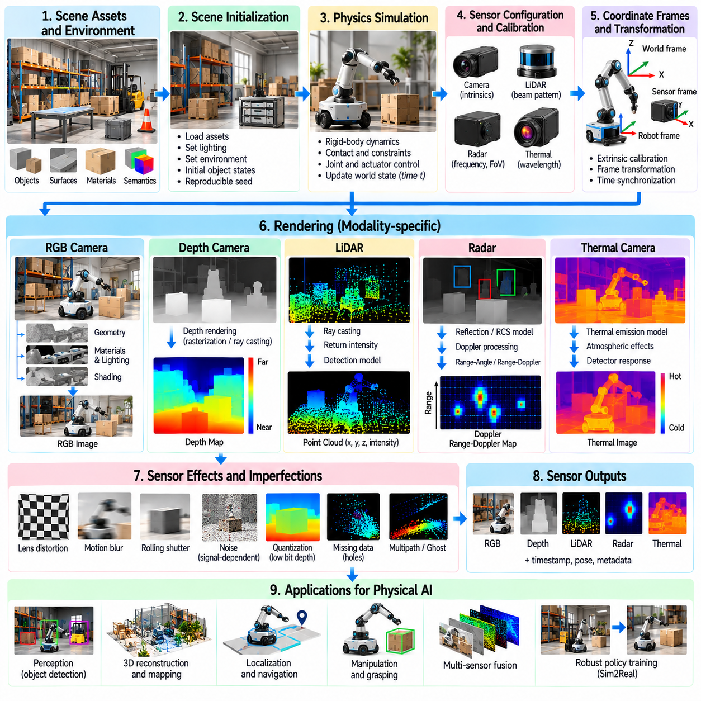{width="7.268055555555556in" height="7.268055555555556in"}

A synthetic sensor rendering pipeline converts simulated physical environments into observations that approximate measurements produced by real robotic sensors. It connects scene geometry, materials, illumination, physics, sensor configuration, and signal processing into a coordinated workflow. The resulting data supports perception training, localization, mapping, and control. Pipeline accuracy depends on preserving physical consistency while maintaining sufficient computational throughput.

The pipeline begins with a structured representation of the simulated world. Scene assets define objects, surfaces, environmental boundaries, and movable components. Each asset may contain visual geometry, collision geometry, material properties, and semantic annotations. Consistent coordinate systems and physical units are essential because rendering errors can originate from incorrect scene transformations rather than sensor models.

Scene initialization establishes the environment state before observations are generated. This process loads geometry, textures, lighting configurations, physical properties, and environmental parameters. Static objects remain fixed, while dynamic entities receive initial positions and velocities. A reproducible initialization process allows identical scenes to be reconstructed for debugging, benchmark evaluation, and controlled experimentation.

Physics simulation updates the state of robots and environmental objects over time. Rigid-body dynamics, contact interactions, joint constraints, and actuator commands determine object motion. Sensor rendering must use the appropriate physical state for each acquisition timestamp. Inconsistent synchronization between physics and rendering can produce observations that do not correspond to the robot\'s actual simulated configuration.

Sensor configuration defines the characteristics of each virtual measurement device. Camera models require focal length, image resolution, field of view, distortion parameters, and exposure settings. LiDAR systems require beam patterns, angular resolution, range limits, and scanning frequency. Radar and thermal sensors introduce additional modality-specific parameters. These configurations should correspond to the intended physical hardware.

Coordinate transformations connect the world frame, robot body frame, and individual sensor frames. Extrinsic calibration determines sensor position and orientation relative to the robot, while intrinsic calibration defines internal measurement geometry. Transformation errors can create systematic misalignment between modalities. A robust pipeline maintains explicit frame relationships and applies timestamp-consistent transformations.

The rendering stage determines which environmental elements contribute to each sensor observation. Visibility calculations account for geometry, occlusion, viewing direction, and sensor range. Rasterization efficiently generates image-space observations, while ray tracing supports detailed geometric intersections and light transport. Different sensing modalities may require separate rendering methods while sharing a common scene representation.

RGB camera rendering combines geometric projection with material shading and illumination. Physically based rendering estimates surface appearance using reflectance, roughness, light sources, and environmental illumination. Shadows, reflections, and exposure influence the resulting image. Camera-specific processing then introduces optical and electronic characteristics to approximate observations captured by physical imaging hardware.

Depth rendering estimates distances between sensing devices and visible environmental surfaces. Rasterized depth buffers provide efficient geometric depth, while ray-based methods can represent alternative sensing arrangements. Sensor-specific processing introduces quantization, missing measurements, range-dependent uncertainty, and multipath effects where applicable. Depth values must be expressed using consistent conventions and coordinate frames.

LiDAR rendering simulates emitted beams and their interactions with surrounding geometry. Ray casting determines candidate intersections, while material and incidence-angle models influence return intensity and detection probability. Scanning patterns establish the temporal and spatial distribution of measurements. Additional processing introduces range uncertainty, angular imperfections, missing returns, and realistic point-cloud characteristics.

Radar rendering requires modeling electromagnetic interactions at a level appropriate to the application. Simplified pipelines may generate detections using object geometry, relative velocity, radar cross section, and probabilistic visibility. More detailed approaches approximate propagation, multipath, and signal processing. The selected fidelity determines whether outputs represent raw signals, range-Doppler measurements, or processed detections.

Thermal rendering estimates infrared radiation received from environmental surfaces. Object temperature, emissivity, reflected radiation, and atmospheric effects influence apparent thermal intensity. Temperature fields may be assigned procedurally or updated through thermal models. Detector response, nonuniformity, and measurement noise are subsequently applied to generate observations resembling thermal camera outputs.

Optical effects are introduced according to the physical characteristics of the target camera. Lens distortion modifies projected coordinates, while depth of field depends on focus and aperture. Motion blur integrates information over exposure intervals, and rolling shutter creates row-dependent acquisition times. These effects must be applied in a physically meaningful order to avoid unrealistic combinations of sensor artifacts.

Noise and imperfection modeling converts ideal sensor measurements into more realistic observations. Random noise, systematic bias, quantization, saturation, and dropout represent different error mechanisms. Their parameters may depend on illumination, range, temperature, and operating conditions. Calibrated noise models are preferable to arbitrary perturbations because they preserve meaningful relationships between physical signals and measurement uncertainty.

Temporal synchronization is essential when multiple sensors observe a dynamic environment. Each measurement should have an acquisition timestamp reflecting its simulated capture time. Cameras may expose images over finite intervals, while scanning LiDAR accumulates points sequentially. Synchronization logic must distinguish acquisition time from processing and delivery latency. Accurate timing supports reliable multimodal fusion and closed-loop control.

Multimodal sensor rendering allows RGB cameras, depth sensors, LiDAR, radar, and thermal cameras to observe the same simulated world. Shared geometry and object motion establish physical consistency across modalities. However, each sensor retains distinct visibility, material-response, and noise characteristics. Proper cross-modal alignment enables realistic perception fusion while preserving differences between sensing mechanisms.

Ground-truth generation provides information that may be unavailable or uncertain in real sensor measurements. Simulators can produce segmentation masks, object identities, depth maps, surface normals, optical flow, poses, and motion vectors. These annotations support supervised learning and quantitative evaluation. Ground truth should be derived from authoritative simulation states rather than inferred from noisy rendered observations.

Semantic annotations connect sensor observations to object categories, instances, and functional attributes. Stable identifiers allow the same object to be tracked across frames and sensing modalities. Instance segmentation distinguishes individual objects, while semantic segmentation groups pixels or points by category. Annotation consistency is essential for training datasets that combine detection, tracking, scene understanding, and robotic manipulation.

Domain randomization expands the diversity of synthetic sensor outputs by varying scene and sensor parameters. Materials, illumination, object placement, camera poses, environmental conditions, and noise characteristics may change between episodes. Randomization distributions should preserve plausible physical relationships. Controlled variation helps reduce overfitting to specific rendering conditions and improves robustness during real-world deployment.

Dataset generation organizes rendered observations into synchronized sequences or independent samples. Each record may include sensor measurements, timestamps, calibration parameters, robot states, scene metadata, and annotations. Consistent schemas support automated training and evaluation workflows. Dataset provenance should identify simulation versions, asset configurations, randomization parameters, and generation settings.

Pipeline validation compares synthetic observations with measurements collected from representative physical sensors. Image statistics, depth error distributions, point-cloud density, radar detection characteristics, and thermal responses provide modality-specific evidence. Task-level evaluation measures whether synthetic training improves perception and control. Validation should identify systematic discrepancies and guide targeted refinement of rendering models.

Computational optimization improves the scalability of synthetic sensor generation. Batched rendering, GPU acceleration, asset instancing, and asynchronous processing reduce execution overhead. Selective fidelity allocation concentrates expensive calculations on important sensing effects. However, optimization must preserve synchronization, annotation correctness, and reproducibility. Throughput improvements are valuable only when generated data remains trustworthy.

Reproducibility requires explicit management of random seeds, simulation versions, scene configurations, and sensor parameters. Deterministic execution is useful for debugging, regression testing, and controlled comparisons, although some parallel GPU operations may introduce nondeterminism. Recording configuration metadata allows generated datasets to be traced to their production conditions. Repeatable pipelines support reliable benchmarking and continuous development.

A modular pipeline separates scene management, physics updates, sensor rendering, noise processing, annotation generation, and dataset export. Standardized interfaces allow individual components to be replaced without redesigning the entire system. This architecture supports new sensor types and multiple rendering backends. Modular design also simplifies profiling, calibration, testing, and integration with robotic learning infrastructure.

Ultimately, a synthetic sensor rendering pipeline provides the operational foundation for scalable Physical AI data generation. Its effectiveness depends on accurate scene representation, synchronized physics, calibrated sensor models, consistent annotations, and efficient computation. By integrating these components into a validated and reproducible workflow, simulation platforms can produce diverse observations that support robust robotic perception, learning, and Sim2Real transfer.

합성 센서 렌더링 파이프라인(Synthetic Sensor Rendering Pipeline)은 시뮬레이션된 물리적 환경(Simulated Physical Environment)을 실제 로봇 센서(Real Robotic Sensor)가 생성하는 측정값에 근접한 관측 데이터(Observation Data)로 변환한다. 이 파이프라인은 장면 기하학(Scene Geometry), 재질(Material), 조명(Illumination), 물리 연산(Physics), 센서 구성(Sensor Configuration), 신호 처리(Signal Processing)를 하나의 통합된 작업 흐름(Workflow)으로 연결한다. 생성된 데이터는 인식 학습(Perception Training), 위치 추정(Localization), 지도 작성(Mapping), 제어(Control)를 지원한다. 파이프라인의 정확도는 충분한 계산 처리량(Computational Throughput)을 유지하면서 물리적 일관성(Physical Consistency)을 보존하는 데 달려 있다.

파이프라인은 시뮬레이션 세계(Simulated World)의 구조화된 표현(Structured Representation)에서 시작된다. 장면 에셋(Scene Asset)은 객체(Object), 표면(Surface), 환경 경계(Environmental Boundary), 이동 가능한 구성요소(Movable Component)를 정의한다. 각 에셋에는 시각적 기하학(Visual Geometry), 충돌 기하학(Collision Geometry), 재질 속성(Material Property), 의미적 주석(Semantic Annotation)이 포함될 수 있다. 렌더링 오차(Rendering Error)는 센서 모델(Sensor Model) 자체가 아니라 잘못된 장면 좌표 변환(Scene Transformation)에서 발생할 수 있으므로 일관된 좌표계(Coordinate System)와 물리 단위(Physical Unit)가 필수적이다.

장면 초기화(Scene Initialization)는 관측 데이터(Observation Data)가 생성되기 전에 환경 상태(Environment State)를 설정한다. 이 과정에서는 기하학(Geometry), 텍스처(Texture), 조명 구성(Lighting Configuration), 물리적 속성(Physical Property), 환경 매개변수(Environmental Parameter)를 불러온다. 정적 객체(Static Object)는 고정된 상태를 유지하고, 동적 객체(Dynamic Entity)에는 초기 위치(Initial Position)와 속도(Velocity)가 부여된다. 재현 가능한 초기화 과정(Reproducible Initialization Process)은 디버깅(Debugging), 벤치마크 평가(Benchmark Evaluation), 통제된 실험(Controlled Experiment)을 위해 동일한 장면을 다시 구성할 수 있도록 한다.

물리 시뮬레이션(Physics Simulation)은 시간에 따라 로봇과 환경 객체(Environmental Object)의 상태를 갱신한다. 강체 동역학(Rigid-Body Dynamics), 접촉 상호작용(Contact Interaction), 관절 제약조건(Joint Constraint), 액추에이터 명령(Actuator Command)은 객체의 움직임을 결정한다. 센서 렌더링(Sensor Rendering)은 각 데이터 획득 타임스탬프(Acquisition Timestamp)에 해당하는 적절한 물리 상태(Physical State)를 사용해야 한다. 물리 연산과 렌더링 사이의 동기화(Synchronization)가 일치하지 않으면 로봇의 실제 시뮬레이션 구성(Simulated Configuration)과 대응하지 않는 관측값이 생성될 수 있다.

센서 구성(Sensor Configuration)은 각 가상 측정 장치(Virtual Measurement Device)의 특성을 정의한다. 카메라 모델(Camera Model)에는 초점 거리(Focal Length), 영상 해상도(Image Resolution), 시야각(Field of View), 왜곡 매개변수(Distortion Parameter), 노출 설정(Exposure Setting)이 필요하다. 라이다 시스템(LiDAR System)에는 빔 패턴(Beam Pattern), 각도 해상도(Angular Resolution), 거리 한계(Range Limit), 스캐닝 주파수(Scanning Frequency)가 필요하다. 레이더(Radar)와 열화상 센서(Thermal Sensor)는 추가적인 모달리티별 매개변수(Modality-Specific Parameter)를 도입한다. 이러한 구성은 목표로 하는 실제 센서 하드웨어(Physical Sensor Hardware)의 특성과 일치해야 한다.

좌표 변환(Coordinate Transformation)은 월드 좌표계(World Frame), 로봇 본체 좌표계(Robot Body Frame), 개별 센서 좌표계(Individual Sensor Frame)를 연결한다. 외부 보정(Extrinsic Calibration)은 로봇에 대한 센서의 위치(Position)와 방향(Orientation)을 결정하며, 내부 보정(Intrinsic Calibration)은 센서 내부의 측정 기하학(Measurement Geometry)을 정의한다. 좌표 변환 오차(Transformation Error)는 서로 다른 센싱 모달리티(Sensing Modality) 사이에 체계적인 정렬 불일치(Systematic Misalignment)를 발생시킬 수 있다. 강건한 파이프라인(Robust Pipeline)은 명시적인 좌표계 관계(Frame Relationship)를 유지하고 타임스탬프와 일치하는 좌표 변환(Timestamp-Consistent Transformation)을 적용한다.

렌더링 단계(Rendering Stage)는 어떤 환경 요소(Environmental Element)가 각 센서 관측값(Sensor Observation)에 기여하는지를 결정한다. 가시성 계산(Visibility Calculation)은 기하학적 구조(Geometry), 가림(Occlusion), 관측 방향(Viewing Direction), 센서 측정 범위(Sensor Range)를 고려한다. 래스터화(Rasterization)는 영상 공간 관측(Image-Space Observation)을 효율적으로 생성하며, 광선 추적(Ray Tracing)은 상세한 기하학적 교차(Geometric Intersection)와 빛 전달(Light Transport)을 지원한다. 서로 다른 센싱 모달리티는 공통된 장면 표현(Common Scene Representation)을 공유하면서도 별도의 렌더링 방법(Rendering Method)을 필요로 할 수 있다.

RGB 카메라 렌더링(RGB Camera Rendering)은 기하학적 투영(Geometric Projection)을 재질 셰이딩(Material Shading) 및 조명(Illumination)과 결합한다. 물리 기반 렌더링(Physically Based Rendering)은 반사율(Reflectance), 거칠기(Roughness), 광원(Light Source), 환경 조명(Environmental Illumination)을 이용하여 표면 외관(Surface Appearance)을 추정한다. 그림자(Shadow), 반사(Reflection), 노출(Exposure)은 최종 영상(Resulting Image)에 영향을 미친다. 이후 카메라별 처리(Camera-Specific Processing)는 광학적 및 전자적 특성(Optical and Electronic Characteristic)을 도입하여 실제 영상 하드웨어(Physical Imaging Hardware)가 획득하는 관측값에 근접하도록 한다.

깊이 렌더링(Depth Rendering)은 센싱 장치(Sensing Device)와 가시적인 환경 표면(Visible Environmental Surface) 사이의 거리를 추정한다. 래스터화된 깊이 버퍼(Rasterized Depth Buffer)는 효율적인 기하학적 깊이(Geometric Depth)를 제공하며, 광선 기반 방법(Ray-Based Method)은 다른 센싱 구성을 표현할 수 있다. 센서별 처리(Sensor-Specific Processing)는 해당하는 경우 양자화(Quantization), 측정 누락(Missing Measurement), 거리 의존적 불확실성(Range-Dependent Uncertainty), 다중 경로 효과(Multipath Effect)를 도입한다. 깊이 값(Depth Value)은 일관된 표현 규칙(Convention)과 좌표계(Coordinate Frame)를 사용하여 나타내야 한다.

라이다 렌더링(LiDAR Rendering)은 방출된 빔(Emitted Beam)과 주변 기하학적 구조(Surrounding Geometry) 사이의 상호작용을 시뮬레이션한다. 광선 투사(Ray Casting)는 후보 교차점(Candidate Intersection)을 결정하며, 재질 및 입사각 모델(Material and Incidence-Angle Model)은 반사 신호 강도(Return Intensity)와 검출 확률(Detection Probability)에 영향을 미친다. 스캐닝 패턴(Scanning Pattern)은 측정값의 시간적 및 공간적 분포(Temporal and Spatial Distribution)를 결정한다. 추가 처리는 거리 불확실성(Range Uncertainty), 각도 불완전성(Angular Imperfection), 반사 신호 누락(Missing Return), 사실적인 포인트 클라우드 특성(Point-Cloud Characteristic)을 도입한다.

레이더 렌더링(Radar Rendering)은 응용 분야(Application)에 적합한 수준에서 전자기 상호작용(Electromagnetic Interaction)을 모델링해야 한다. 단순화된 파이프라인(Simplified Pipeline)은 객체 기하학(Object Geometry), 상대 속도(Relative Velocity), 레이더 단면적(Radar Cross Section), 확률적 가시성(Probabilistic Visibility)을 이용하여 검출 결과(Detection)를 생성할 수 있다. 더욱 상세한 접근법(Detailed Approach)은 전파(Propagation), 다중 경로(Multipath), 신호 처리(Signal Processing)를 근사한다. 선택한 충실도(Fidelity)에 따라 출력은 원시 신호(Raw Signal), 거리-도플러 측정값(Range-Doppler Measurement), 처리된 검출 결과(Processed Detection)를 나타낼 수 있다.

열화상 렌더링(Thermal Rendering)은 환경 표면(Environmental Surface)에서 수신되는 적외선 복사(Infrared Radiation)를 추정한다. 객체 온도(Object Temperature), 방사율(Emissivity), 반사 복사(Reflected Radiation), 대기 효과(Atmospheric Effect)는 겉보기 열 강도(Apparent Thermal Intensity)에 영향을 미친다. 온도장(Temperature Field)은 절차적으로 할당하거나 열 모델(Thermal Model)을 통해 갱신할 수 있다. 이후 검출기 응답(Detector Response), 비균일성(Nonuniformity), 측정 잡음(Measurement Noise)을 적용하여 실제 열화상 카메라 출력(Thermal Camera Output)과 유사한 관측값을 생성한다.

광학 효과(Optical Effect)는 대상 카메라(Target Camera)의 물리적 특성(Physical Characteristic)에 따라 도입된다. 렌즈 왜곡(Lens Distortion)은 투영 좌표(Projected Coordinate)를 변경하며, 피사계 심도(Depth of Field)는 초점(Focus)과 조리개(Aperture)에 따라 달라진다. 모션 블러(Motion Blur)는 노출 구간(Exposure Interval)에 걸친 정보를 적분하며, 롤링 셔터(Rolling Shutter)는 영상 행(Row)에 따라 서로 다른 획득 시점(Acquisition Time)을 생성한다. 이러한 효과는 비현실적인 센서 인공물(Sensor Artifact)의 조합을 방지하기 위해 물리적으로 의미 있는 순서(Physically Meaningful Order)로 적용해야 한다.

잡음 및 불완전성 모델링(Noise and Imperfection Modeling)은 이상적인 센서 측정값(Ideal Sensor Measurement)을 더욱 사실적인 관측값(Realistic Observation)으로 변환한다. 무작위 잡음(Random Noise), 체계적 편향(Systematic Bias), 양자화(Quantization), 포화(Saturation), 측정 누락(Dropout)은 서로 다른 오차 발생 메커니즘(Error Mechanism)을 나타낸다. 이러한 매개변수(Parameter)는 조명(Illumination), 거리(Range), 온도(Temperature), 작동 조건(Operating Condition)에 따라 달라질 수 있다. 보정된 잡음 모델(Calibrated Noise Model)은 물리적 신호(Physical Signal)와 측정 불확실성(Measurement Uncertainty) 사이의 의미 있는 관계를 보존하므로 임의적인 교란(Arbitrary Perturbation)보다 바람직하다.

시간적 동기화(Temporal Synchronization)는 여러 센서(Multiple Sensor)가 동적 환경(Dynamic Environment)을 관측할 때 필수적이다. 각 측정값(Measurement)에는 시뮬레이션된 획득 시점(Simulated Capture Time)을 반영하는 타임스탬프(Acquisition Timestamp)가 있어야 한다. 카메라(Camera)는 유한한 노출 구간(Finite Exposure Interval)에 걸쳐 영상을 획득할 수 있으며, 스캐닝 라이다(Scanning LiDAR)는 측정점을 순차적으로 누적한다. 동기화 로직(Synchronization Logic)은 데이터 획득 시점(Acquisition Time)을 처리 지연(Processing Latency) 및 전달 지연(Delivery Latency)과 구분해야 한다. 정확한 타이밍(Accurate Timing)은 신뢰성 높은 다중 모달 융합(Multimodal Fusion)과 폐루프 제어(Closed-Loop Control)를 지원한다.

다중 모달 센서 렌더링(Multimodal Sensor Rendering)은 RGB 카메라(RGB Camera), 깊이 센서(Depth Sensor), 라이다(LiDAR), 레이더(Radar), 열화상 카메라(Thermal Camera)가 동일한 시뮬레이션 세계(Simulated World)를 관측하도록 한다. 공유된 기하학적 구조(Shared Geometry)와 객체 움직임(Object Motion)은 모달리티 사이의 물리적 일관성(Physical Consistency)을 확립한다. 그러나 각 센서는 고유한 가시성(Visibility), 재질 응답(Material Response), 잡음 특성(Noise Characteristic)을 유지한다. 적절한 모달리티 간 정렬(Cross-Modal Alignment)은 센싱 메커니즘(Sensing Mechanism)의 차이를 보존하면서 사실적인 인식 융합(Perception Fusion)을 가능하게 한다.

정답 데이터 생성(Ground-Truth Generation)은 실제 센서 측정값(Real Sensor Measurement)에서는 얻기 어렵거나 불확실할 수 있는 정보를 제공한다. 시뮬레이터(Simulator)는 분할 마스크(Segmentation Mask), 객체 식별자(Object Identity), 깊이 맵(Depth Map), 표면 법선(Surface Normal), 광학 흐름(Optical Flow), 자세(Pose), 움직임 벡터(Motion Vector)를 생성할 수 있다. 이러한 주석(Annotation)은 지도학습(Supervised Learning)과 정량적 평가(Quantitative Evaluation)를 지원한다. 정답 데이터(Ground Truth)는 잡음이 포함된 렌더링 관측값(Noisy Rendered Observation)에서 추론하기보다 신뢰할 수 있는 시뮬레이션 상태(Authoritative Simulation State)에서 직접 도출해야 한다.

의미적 주석(Semantic Annotation)은 센서 관측값(Sensor Observation)을 객체 범주(Object Category), 개별 인스턴스(Instance), 기능적 속성(Functional Attribute)과 연결한다. 안정적인 식별자(Stable Identifier)를 사용하면 동일한 객체를 여러 프레임(Frame)과 센싱 모달리티(Sensing Modality)에 걸쳐 추적할 수 있다. 인스턴스 분할(Instance Segmentation)은 개별 객체를 구분하며, 의미적 분할(Semantic Segmentation)은 픽셀(Pixel)이나 측정점(Point)을 범주별로 그룹화한다. 주석 일관성(Annotation Consistency)은 탐지(Detection), 추적(Tracking), 장면 이해(Scene Understanding), 로봇 조작(Robotic Manipulation)을 결합하는 학습 데이터셋(Training Dataset)에 필수적이다.

도메인 랜덤화(Domain Randomization)는 장면 및 센서 매개변수(Scene and Sensor Parameter)를 변화시켜 합성 센서 출력(Synthetic Sensor Output)의 다양성을 확장한다. 재질(Material), 조명(Illumination), 객체 배치(Object Placement), 카메라 자세(Camera Pose), 환경 조건(Environmental Condition), 잡음 특성(Noise Characteristic)은 에피소드(Episode)마다 변경될 수 있다. 랜덤화 분포(Randomization Distribution)는 타당한 물리적 관계(Plausible Physical Relationship)를 유지해야 한다. 통제된 변형(Controlled Variation)은 특정 렌더링 조건(Rendering Condition)에 대한 과적합(Overfitting)을 줄이고 실제 환경 배포(Real-World Deployment) 과정에서 강건성(Robustness)을 향상시키는 데 도움이 된다.

데이터셋 생성(Dataset Generation)은 렌더링된 관측값(Rendered Observation)을 동기화된 시퀀스(Synchronized Sequence) 또는 독립적인 샘플(Independent Sample)로 구성한다. 각 데이터 레코드(Data Record)에는 센서 측정값(Sensor Measurement), 타임스탬프(Timestamp), 보정 매개변수(Calibration Parameter), 로봇 상태(Robot State), 장면 메타데이터(Scene Metadata), 주석(Annotation)이 포함될 수 있다. 일관된 데이터 스키마(Consistent Data Schema)는 자동화된 학습 및 평가 작업 흐름(Automated Training and Evaluation Workflow)을 지원한다. 데이터셋 생성 이력(Dataset Provenance)에는 시뮬레이션 버전(Simulation Version), 에셋 구성(Asset Configuration), 랜덤화 매개변수(Randomization Parameter), 생성 설정(Generation Setting)이 명시되어야 한다.

파이프라인 검증(Pipeline Validation)은 합성 관측값(Synthetic Observation)을 대표적인 실제 센서(Representative Physical Sensor)에서 수집한 측정값과 비교한다. 영상 통계(Image Statistics), 깊이 오차 분포(Depth Error Distribution), 포인트 클라우드 밀도(Point-Cloud Density), 레이더 검출 특성(Radar Detection Characteristic), 열 응답(Thermal Response)은 모달리티별 검증 근거(Modality-Specific Evidence)를 제공한다. 작업 수준 평가(Task-Level Evaluation)는 합성 데이터 학습(Synthetic Training)이 인식(Perception)과 제어(Control)를 개선하는지 측정한다. 검증은 체계적 불일치(Systematic Discrepancy)를 식별하고 렌더링 모델(Rendering Model)의 목표 지향적 개선(Targeted Refinement)을 안내해야 한다.

계산 최적화(Computational Optimization)는 합성 센서 생성(Synthetic Sensor Generation)의 확장성(Scalability)을 향상시킨다. 배치 렌더링(Batched Rendering), GPU 가속(GPU Acceleration), 에셋 인스턴싱(Asset Instancing), 비동기 처리(Asynchronous Processing)는 실행 오버헤드(Execution Overhead)를 줄인다. 선택적 충실도 할당(Selective Fidelity Allocation)은 중요한 센싱 효과(Important Sensing Effect)에 계산 비용이 높은 연산을 집중한다. 그러나 최적화는 동기화(Synchronization), 주석 정확성(Annotation Correctness), 재현성(Reproducibility)을 보존해야 한다. 생성된 데이터의 신뢰성(Trustworthiness)이 유지될 때만 처리량 개선(Throughput Improvement)은 실질적인 가치를 가진다.

재현성(Reproducibility)을 확보하려면 난수 시드(Random Seed), 시뮬레이션 버전(Simulation Version), 장면 구성(Scene Configuration), 센서 매개변수(Sensor Parameter)를 명시적으로 관리해야 한다. 결정론적 실행(Deterministic Execution)은 디버깅(Debugging), 회귀 시험(Regression Testing), 통제된 비교(Controlled Comparison)에 유용하지만 일부 병렬 GPU 연산(Parallel GPU Operation)은 비결정성(Nondeterminism)을 발생시킬 수 있다. 구성 메타데이터(Configuration Metadata)를 기록하면 생성된 데이터셋(Generated Dataset)을 해당 생성 조건(Production Condition)까지 추적할 수 있다. 반복 가능한 파이프라인(Repeatable Pipeline)은 신뢰성 높은 벤치마킹(Benchmarking)과 지속적인 개발(Continuous Development)을 지원한다.

모듈형 파이프라인(Modular Pipeline)은 장면 관리(Scene Management), 물리 상태 갱신(Physics Update), 센서 렌더링(Sensor Rendering), 잡음 처리(Noise Processing), 주석 생성(Annotation Generation), 데이터셋 내보내기(Dataset Export)를 분리한다. 표준화된 인터페이스(Standardized Interface)를 사용하면 전체 시스템을 재설계하지 않고도 개별 구성요소(Individual Component)를 교체할 수 있다. 이러한 아키텍처(Architecture)는 새로운 센서 유형(Sensor Type)과 다양한 렌더링 백엔드(Rendering Backend)를 지원한다. 모듈형 설계(Modular Design)는 프로파일링(Profiling), 보정(Calibration), 시험(Testing), 로봇 학습 인프라(Robotic Learning Infrastructure)와의 통합(Integration)도 단순화한다.

궁극적으로 합성 센서 렌더링 파이프라인(Synthetic Sensor Rendering Pipeline)은 확장 가능한 피지컬 AI 데이터 생성(Scalable Physical AI Data Generation)을 위한 운영 기반(Operational Foundation)을 제공한다. 파이프라인의 효과는 정확한 장면 표현(Scene Representation), 동기화된 물리 연산(Synchronized Physics), 보정된 센서 모델(Calibrated Sensor Model), 일관된 주석(Consistent Annotation), 효율적인 계산(Efficient Computation)에 달려 있다. 이러한 구성요소를 검증되고 재현 가능한 작업 흐름(Validated and Reproducible Workflow)으로 통합함으로써 시뮬레이션 플랫폼(Simulation Platform)은 강건한 로봇 인식(Robotic Perception), 학습(Learning), 시뮬레이션-현실 전이(Sim2Real Transfer)를 지원하는 다양한 관측 데이터를 생성할 수 있다.
