**Volume 05. Simulation and Sim2Real Transfer**

# Chapter 03. Domain Randomization

## 03.01. Why Domain Randomization Works

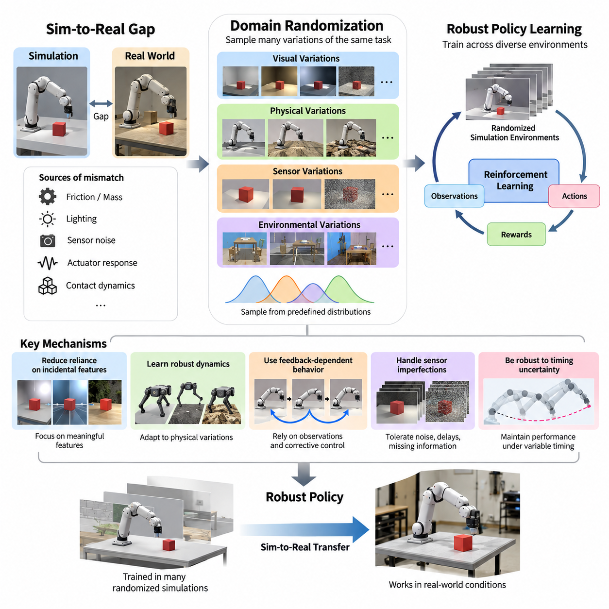{width="7.268055555555556in" height="7.268055555555556in"}

도메인 무작위화(Domain Randomization)는 시뮬레이션 환경(Simulated Environment)에서 학습한 인공지능 정책(AI Policy)을 실제 물리적 로봇(Physical Robot)으로 전이하기 위한 핵심 기술이다. 이 기술의 기본 원리는 하나의 완벽하게 모델링된 환경에 의존하는 대신, 동일한 작업에 대해 다양한 환경 변화를 경험하도록 학습시키는 것이다. 학습 과정에서 다양한 조건을 경험한 인공지능 시스템은 실제 환경이 시뮬레이션과 다르더라도 안정적인 동작을 유지할 가능성이 높아진다.

시뮬레이션과 현실 간 격차(Simulation-to-Reality Gap)는 디지털 환경(Digital Environment)이 실제 로봇이 경험하는 모든 물리적 특성, 센서 불완전성(Sensor Imperfection), 환경 상호작용(Environmental Interaction)을 완벽하게 재현할 수 없기 때문에 발생한다. 정밀하게 보정된 시뮬레이션에도 마찰(Friction), 질량 분포(Mass Distribution), 조명(Lighting), 구동기 응답(Actuator Response), 접촉 동역학(Contact Dynamics) 등의 오차가 존재한다. 고정된 가정에 따라 학습한 정책은 이러한 오차를 이용하여 시뮬레이션에서는 높은 성능을 보이지만 실제 하드웨어에서는 실패할 수 있다.

도메인 무작위화(Domain Randomization)는 학습 에피소드(Training Episode)마다 시뮬레이션 매개변수(Simulation Parameter)를 의도적으로 변경하여 이러한 한계를 해결한다. 하나의 시뮬레이션 구성이 현실을 정확하게 표현한다고 가정하는 대신, 미리 정의된 확률 분포(Probability Distribution)에서 다양한 환경 구성을 추출한다. 이러한 변화는 학습 알고리즘(Learning Algorithm)이 서로 연관된 여러 환경을 경험하도록 하며, 물리적 조건과 인지 조건의 불확실성(Uncertainty)을 견딜 수 있는 행동을 학습하도록 유도한다.

도메인 무작위화의 이론적 근거는 강건 최적화(Robust Optimization)와 통계적 일반화(Statistical Generalization)에 밀접하게 연결된다. 기존 학습 방식은 특정 학습 분포(Training Distribution)에서 기대 오차(Expected Error)를 최소화하지만, 도메인 무작위화는 다양한 환경 변화를 포함하도록 학습 분포를 확장한다. 그 결과 학습된 정책은 실제 물리 환경과 일치하지 않을 수 있는 좁은 시뮬레이션 조건에만 최적화되는 대신, 여러 조건에서 안정적으로 작동하도록 유도된다.

수학적으로 도메인 무작위화는 불확실한 물리적 특성과 환경적 특성을 나타내는 매개변수 벡터(Parameter Vector)로 정의된 시뮬레이션 환경 집합으로 해석할 수 있다. 학습 과정에서는 이러한 매개변수를 확률 분포에서 추출하고, 정책이 여러 환경에서 얻는 기대 누적 보상(Expected Cumulative Reward)을 최대화한다. 이 목적 함수(Objective Function)는 다양한 환경에서의 평균 성능을 향상시키지만, 모든 가능한 조건에서 만족스러운 성능을 자동으로 보장하지는 않는다.

도메인 무작위화의 효과는 실제 환경이 학습 과정에서 사용한 조건 범위에 포함되거나 충분히 유사한지에 따라 달라진다. 중요한 물리적 변화가 학습 범위에 포함되면, 학습된 정책은 이전에 경험하지 못한 환경에서도 익숙한 패턴을 발견할 수 있다. 그러나 비현실적인 확률 분포, 누락된 물리 현상, 불충분한 매개변수 범위는 실제 배치(Real-World Deployment)에서 정책의 취약성을 초래할 수 있다.

도메인 무작위화가 작동하는 중요한 메커니즘 중 하나는 우연적 특징(Incidental Feature)에 대한 의존성을 감소시키는 것이다. 시각 인지(Visual Perception)에서 일정한 조명, 텍스처(Texture), 배경(Background)으로 학습한 신경망(Neural Network)은 의미 있는 객체 형상(Object Geometry)보다 표면적인 외관에 의존할 수 있다. 이러한 시각적 특성을 무작위로 변경하면 불필요한 연관성이 약해지고, 다양한 장면과 관측 조건에서도 유효한 특징을 학습하도록 유도할 수 있다.

이러한 메커니즘은 조명, 표면 외관, 카메라 위치, 주변 장애물이 변하더라도 객체 인식(Object Recognition)과 파지 계획(Grasp Planning)이 안정적으로 수행되어야 하는 로봇 조작(Robotic Manipulation)에 특히 중요하다. 다양한 시뮬레이션 관측을 경험한 파지 시스템(Grasping System)은 객체 형상, 공간적 관계(Spatial Relationship), 파지에 필요한 기하학적 특성을 우선적으로 학습할 수 있다. 이러한 표현은 시뮬레이션 객체와 외관이 다른 실제 객체로의 전이를 지원한다.

도메인 무작위화는 시각적 외관뿐 아니라 물리 동역학(Physical Dynamics)에도 적용된다. 질량(Mass), 관성(Inertia), 마찰(Friction), 반발 계수(Restitution), 감쇠(Damping), 관절 저항(Joint Resistance)의 변화는 명령된 동작과 실제 움직임 사이의 관계를 변경한다. 다양한 물리 조건에서 학습하면 제어 정책(Control Policy)이 불확실한 동역학에 대응하도록 유도할 수 있으며, 정확하게 측정하거나 재현하기 어려운 물리적 매개변수에 대한 의존성을 줄일 수 있다.

예를 들어, 하나의 지면 마찰 계수(Ground Friction Coefficient)로 학습한 사족보행 로봇(Quadruped Robot)은 시뮬레이션에서는 효율적인 보행 패턴(Gait Pattern)을 형성하지만 익숙하지 않은 표면에서는 불안정해질 수 있다. 마찰, 지형 특성(Terrain Properties), 구동기 출력(Actuator Strength), 몸체 질량(Body Mass)을 무작위화하면 다양한 안정성 요구조건을 경험하게 된다. 그 결과 발 배치(Foot Placement), 적응형 균형 제어(Adaptive Balance Control), 자세 회복 전략(Recovery Strategy)이 개선될 수 있다.

또 다른 중요한 메커니즘은 암기된 동작 순서(Memorized Action Sequence)보다 피드백 기반 행동(Feedback-Dependent Behavior)을 학습하도록 유도하는 것이다. 결정론적 시뮬레이션(Deterministic Simulation)에서는 에이전트(Agent)가 관측 결과에 충분히 대응하지 않고 정확한 시간에 동일한 동작을 반복하여 성공할 수 있다. 그러나 동역학이 무작위로 변화하면 동일한 명령도 서로 다른 결과를 생성한다. 따라서 에이전트는 감각 피드백(Sensory Feedback), 상태 추정(State Estimation), 보정 제어(Corrective Control)에 의존해야 한다.

이러한 차이는 부분 관측 환경(Partially Observable Environment)에서 작동하는 피지컬 AI(Physical AI) 시스템에 필수적이다. 실제 로봇은 자신의 물리적 상태나 주변 환경을 완벽하게 파악하기 어렵다. 센서 측정에는 잡음(Noise), 지연(Delay), 보정 오차(Calibration Error), 정보 누락(Missing Information)이 포함된다. 학습 과정에서 이러한 특성을 무작위화하면 불완전한 관측을 견디고, 다양한 센싱 조건(Sensing Condition)에서도 신뢰할 수 있는 정보를 활용하여 의사결정하도록 유도할 수 있다.

도메인 무작위화는 시간적 불확실성(Timing Uncertainty)에 대한 저항성도 향상시킬 수 있다. 실제 제어 시스템에는 통신 지연(Communication Delay), 비동기 센서 갱신(Asynchronous Sensor Update), 연산 스케줄링 변동(Computational Scheduling Variation), 구동기 응답 지연(Actuator Response Latency)이 존재한다. 완벽하게 동기화된 시뮬레이션에서 최적화된 제어기는 실제 하드웨어에서 불안정해질 수 있다. 학습 중 제한된 범위의 시간 변화를 도입하면 지연에 대한 민감도를 확인하고 안정적인 동작을 유도할 수 있다.

이 방법은 강화학습(Reinforcement Learning)과 특히 높은 호환성을 가진다. 시뮬레이션 환경에서는 실제 장비를 반복적인 학습 실패에 노출하지 않고도 대량의 상호작용 경험(Interaction Experience)을 생성할 수 있기 때문이다. 각 에피소드는 서로 다른 무작위 매개변수 조합으로 시작하며, 다양한 상태 전이(State Transition)와 보상(Reward)을 생성한다. 수많은 에피소드를 통해 학습 알고리즘은 실제 물리적 실험만으로 경험하기 어려운 폭넓은 상황을 학습할 수 있다.

대규모 병렬 시뮬레이션(Massively Parallel Simulation)은 다수의 무작위 환경을 동시에 실행하여 이러한 접근법을 더욱 강화한다. 서로 다른 로봇 인스턴스(Robot Instance)는 각기 다른 지형, 센서 구성, 적재 하중(Payload), 동역학 매개변수를 경험하면서 공통 학습 과정에 데이터를 제공한다. 이러한 병렬적 다양성(Parallel Diversity)은 학습 범위를 확장하고 정책 개발을 가속할 수 있지만, 시뮬레이션 인프라가 충분한 물리적 일관성과 수치적 안정성(Numerical Stability)을 유지해야 한다.

그러나 도메인 무작위화는 변화의 범위를 무조건 확대한다고 효과가 향상되는 기술이 아니다. 지나치게 넓은 매개변수 범위는 물리적으로 비현실적이거나 실제 배치 환경보다 훨씬 어려운 상황을 생성할 수 있다. 학습 알고리즘은 이에 대응하여 지나치게 보수적인 행동을 선택할 수 있으며, 정밀도(Precision), 효율성(Efficiency), 작업 완료율(Task Completion Rate)이 저하될 수 있다. 따라서 효과적인 무작위화는 환경 다양성과 작업 관련성(Task Relevance), 학습 목표의 달성 가능성 사이에서 균형을 유지해야 한다.

매개변수를 추출하는 확률 분포(Probability Distribution)는 무작위화 범위만큼 중요하다. 균등 샘플링(Uniform Sampling)은 넓은 범위를 제공하지만 발생 가능성이 낮은 조건을 과도하게 포함할 수 있다. 반면 실제 측정값에 기반한 분포는 현실적인 변동성을 강조할 수 있다. 매개변수 간 상관관계(Correlation)도 중요하며, 독립적으로 추출한 조합은 물리적 제약을 위반할 수 있다. 적절하게 설계된 분포는 임의적인 시뮬레이션 오류보다 의미 있는 불확실성을 학습하도록 지원한다.

도메인 무작위화는 커리큘럼 학습(Curriculum Learning)을 통해 점진적으로 도입할 수 있다. 초기 학습에서는 제한된 매개변수 변화만 적용하여 에이전트가 관리 가능한 조건에서 기본적인 작업 수행 능력을 습득하도록 한다. 성능이 향상되면 무작위화 범위를 확장하여 더 어려운 환경 및 동역학 변화를 포함한다. 이러한 단계적 접근은 최적화의 어려움을 줄이면서 실제 환경에 필요한 강건성(Robustness)을 점진적으로 개발할 수 있도록 한다.

적응형 도메인 무작위화(Adaptive Domain Randomization)는 관측된 정책 성능에 따라 매개변수 분포를 조정하는 방식으로 이러한 개념을 확장한다. 이미 안정적으로 처리하는 상황을 반복적으로 추출하는 대신, 현재 정책이 취약한 조건을 집중적으로 학습할 수 있다. 적대적 접근법(Adversarial Approach)은 유효하면서도 어려운 환경 구성을 적극적으로 탐색한다. 이러한 방법은 선택된 도전 조건이 실제 배치 위험과 관련성을 유지할 때 강건성 향상에 기여할 수 있다.

도메인 무작위화와 사실적 렌더링(Photorealistic Rendering)의 관계는 중요한 설계 절충관계(Design Tradeoff)를 보여준다. 사실적 렌더링은 높은 시각적 충실도(Visual Fidelity)로 현실 세계의 외관을 재현하려 하지만, 도메인 무작위화는 의도적으로 외관의 다양성을 도입한다. 두 접근법은 상호 배타적이지 않다. 물리적으로 의미 있는 렌더링은 신뢰할 수 있는 기준 환경을 제공하고, 조명, 재질, 카메라 특성, 장면 구성의 무작위화는 학습에 활용할 관측 범위를 확장한다.

도메인 무작위화와 시스템 식별(System Identification) 사이에도 유사한 관계가 존재한다. 시스템 식별은 측정된 로봇 동작으로부터 물리적 매개변수를 추정하여 보다 정확한 기준 시뮬레이션 모델(Nominal Simulation Model)을 제공한다. 이후 도메인 무작위화는 제조 공차(Manufacturing Tolerance), 환경 변화, 모델링 오차를 표현하기 위해 추정값 주변에 제어된 불확실성을 도입한다. 보정된 모델과 적절한 변동성을 결합하면 정밀 모델링이나 광범위한 무작위화만 사용하는 것보다 강력한 전이 기반을 제공할 수 있다.

도메인 무작위화의 효과는 궁극적으로 실제 환경 평가(Real-World Evaluation)를 통해 입증되어야 한다. 중요한 물리 현상이 모델링되지 않았다면 무작위 시뮬레이션에서 높은 성능을 달성하더라도 성공적인 전이를 보장할 수 없다. 평가에서는 작업 성공률(Task Success Rate), 안정성(Stability), 안전성(Safety), 회복 행동(Recovery Behavior), 운용 조건 변화에 따른 성능 저하(Performance Degradation)를 검토해야 한다. 무작위화를 적용한 정책과 적용하지 않은 정책을 비교하면 실제 배치 성능의 개선 여부를 판단할 수 있다.

실제 환경에서 발생한 실패는 무작위화 과정을 개선하는 데 활용할 수 있다. 로봇이 미끄러운 표면, 예상하지 못한 적재 하중, 센서 노출 변화에 어려움을 겪는다면 이는 누락된 변동성이나 부정확한 매개변수 가정을 나타낼 수 있다. 엔지니어는 이러한 관측을 바탕으로 시뮬레이션 모델과 샘플링 분포(Sampling Distribution)를 갱신하고, 정책을 재학습한 후 실제 검증을 반복할 수 있다. 이 과정은 배치 경험이 시뮬레이션 범위와 학습 효과를 지속적으로 개선하는 반복적 개발 주기(Iterative Development Cycle)를 형성한다.

따라서 도메인 무작위화(Domain Randomization)는 시뮬레이션과 현실 간 격차(Sim2Real Gap)를 완전히 제거하는 기술이 아니라 불확실성을 관리하는 방법으로 이해해야 한다. 성공 여부는 의미 있는 변수의 선택, 신뢰할 수 있는 확률 분포의 정의, 필수적인 물리적 관계의 유지, 학습 환경을 넘어서는 성능 평가에 달려 있다. 물리 시뮬레이션(Physics Simulation), 합성 데이터 생성(Synthetic Data Generation), 시스템 식별(System Identification), 실제 환경 검증(Real-World Validation)과 통합하면 환경 및 운용 조건 변화에서도 신뢰할 수 있는 행동을 수행하는 피지컬 AI 시스템 개발의 실용적인 기반을 제공한다.

## 03.02. Domain Randomization vs Photorealism

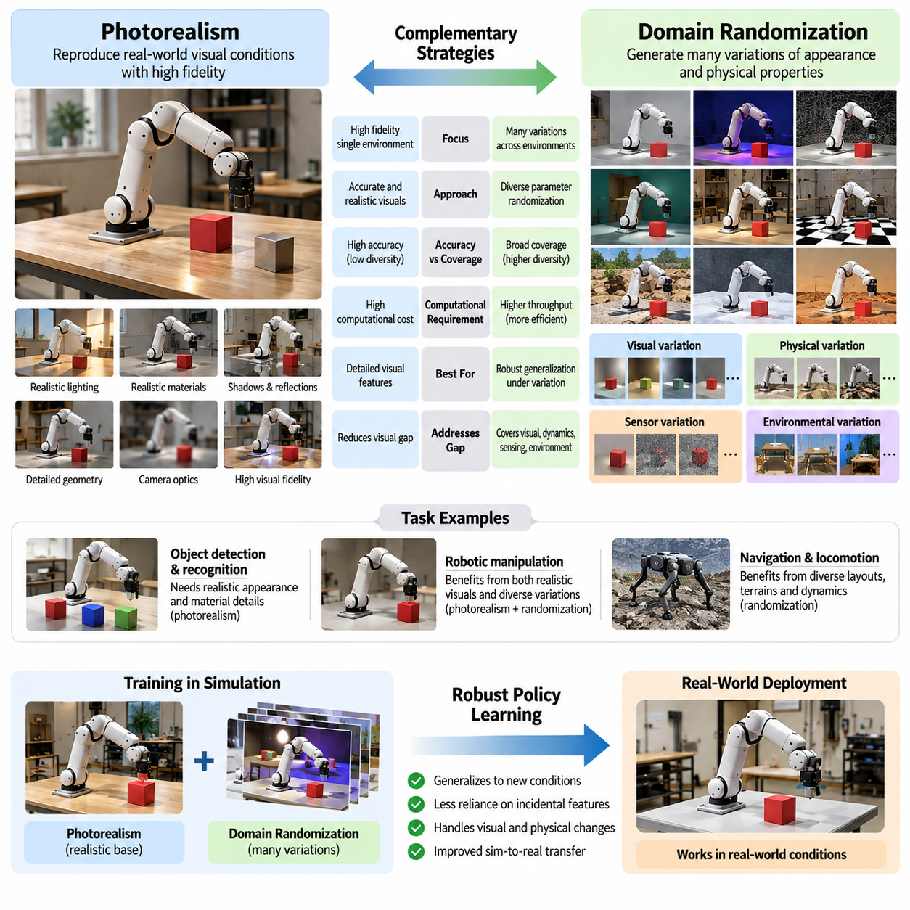{width="7.268055555555556in" height="7.268055555555556in"}

도메인 무작위화(Domain Randomization)와 사실적 렌더링(Photorealism)은 피지컬 AI(Physical AI)에서 시뮬레이션과 현실 간 격차(Simulation-to-Reality Gap)를 줄이기 위한 상호 보완적인 두 가지 전략이다. 사실적 렌더링은 실제 세계의 시각적 조건을 높은 충실도로 재현하려는 반면, 도메인 무작위화는 시뮬레이션 환경에 의도적으로 다양한 변화를 도입한다. 두 접근법 모두 실제 환경에서의 성능 향상을 목표로 하지만, 불확실성(Uncertainty), 시각적 표현(Visual Representation), 연산 요구사항(Computational Requirements), 일반화(Generalization)를 다루는 방식에서 차이가 있다.

사실적 시뮬레이션(Photorealistic Simulation)은 물리적 센서(Physical Sensor)가 획득한 이미지와 매우 유사한 합성 관측 데이터(Synthetic Observation)를 생성하는 데 중점을 둔다. 고급 렌더링 기술(Advanced Rendering Techniques)은 조명(Lighting), 그림자(Shadow), 반사(Reflection), 표면 재질(Surface Material), 카메라 광학(Camera Optics), 환경 기하학(Environmental Geometry)을 재현한다. 기본 가정은 시뮬레이션과 실제 관측 사이의 시각적 차이를 줄이면 대규모 실제 환경 재학습 없이도 인지 모델(Perception Model)과 제어 정책(Control Policy)을 효과적으로 전이할 수 있다는 것이다.

도메인 무작위화(Domain Randomization)는 이와 다른 원리를 따른다. 하나의 현실적인 환경을 최대한 정확하게 재현하는 대신, 환경의 외관과 물리적 특성을 다양하게 변화시킨다. 학습 에피소드(Training Episode)마다 텍스처(Texture), 조명(Illumination), 카메라 위치(Camera Position), 객체 배치(Object Arrangement), 센서 특성(Sensor Characteristics)이 변경될 수 있다. 이러한 다양성은 학습 시스템이 서로 다른 조건에서도 유효한 작업 관련 특징(Task-Relevant Features)을 식별하도록 유도한다.

두 접근법의 차이는 정확도(Accuracy)와 포괄 범위(Coverage)의 관계를 통해 이해할 수 있다. 사실적 렌더링은 개별 시뮬레이션 관측의 정확성을 강조하지만, 도메인 무작위화는 가능한 관측 분포(Observation Distribution)의 폭넓은 범위를 강조한다. 매우 사실적인 장면은 특정 실제 환경과 높은 유사성을 가질 수 있지만 예상하지 못한 변화를 표현하지 못할 수 있다. 반대로 시각적으로 단순한 환경이라도 광범위한 무작위화를 적용하면 이미지 수준의 사실성이 낮더라도 더 높은 일반화 성능을 제공할 수 있다.

사실적 렌더링(Photorealistic Rendering)은 작업 성능이 미세한 시각 정보(Subtle Visual Information)에 의존할 때 특히 중요하다. 객체 검출(Object Detection), 재질 인식(Material Recognition), 표면 검사(Surface Inspection), 정밀 조작(Precision Manipulation)은 텍스처, 조명, 투명도(Transparency), 반사 특성의 정확한 표현을 요구할 수 있다. 합성 이미지(Synthetic Image)가 이러한 특성을 유지하면 인지 시스템은 실제 배치 환경에서 관측되는 특징과 유사한 정보를 학습할 수 있으며, 필요한 실제 라벨링 데이터(Labeled Real-World Data)의 양을 줄일 가능성이 있다.

그러나 높은 시각적 충실도(Visual Fidelity)가 성공적인 시뮬레이션-현실 전이(Sim2Real Transfer)를 자동으로 보장하지는 않는다. 렌더링 시스템은 사실적인 조명과 재질을 재현하면서도 센서 인공 왜곡(Sensor Artifact), 환경 다양성(Environmental Diversity), 비정상적인 운용 조건(Unusual Operating Conditions)을 놓칠 수 있다. 신경망(Neural Network)은 정교하게 구성된 장면에만 존재하는 상관관계를 이용할 수도 있다. 따라서 사실적 학습 데이터는 익숙한 조건에서 우수한 성능을 제공하지만 배치 환경이 변화하면 성능이 저하될 수 있다.

도메인 무작위화는 특정 장면의 상관관계(Scene-Specific Correlation)에 대한 의존성을 줄이려고 한다. 배경(Background), 색상(Color), 텍스처(Texture), 조명(Lighting)을 작업 라벨(Task Label)과 독립적으로 변경함으로써 모델이 우연한 시각적 패턴에 의존하지 않도록 유도한다. 다양한 외관에서 객체를 인식하도록 학습한 로봇은 기하학적 형상(Geometry), 공간적 관계(Spatial Relationship), 안정적인 특징(Stable Feature)에 더 민감해질 수 있다. 이러한 과정의 효과는 무작위 변화가 의미 있는 작업 정보를 보존하는지에 따라 달라진다.

실용적인 사례로 작업대(Workbench) 위의 객체를 인식하고 조작하도록 학습하는 로봇 파지 시스템(Robotic Grasping System)을 고려할 수 있다. 사실적 시뮬레이션은 작업대 재질, 공장 조명(Factory Lighting), 카메라 특성을 정확하게 재현할 수 있다. 반면 도메인 무작위화는 변화하는 배경, 객체 색상, 조명 각도, 카메라 구성에 로봇을 노출한다. 두 방법을 결합하면 현실적인 기준 관측(Baseline Observation)을 제공하면서도 안정적인 파지(Grasping)가 가능한 환경 조건의 범위를 확장할 수 있다.

두 전략은 연산 요구사항(Computational Requirements)에서도 차이가 있다. 고품질 사실적 렌더링은 광선 추적(Ray Tracing), 복잡한 재질 모델(Material Model), 상세한 기하학(Geometry), 고급 조명 계산(Advanced Lighting Calculation)을 필요로 할 수 있다. 이러한 연산은 특히 대규모 데이터셋(Dataset)을 생성할 때 상당한 그래픽 처리 장치(GPU) 자원을 소비한다. 단순화된 렌더링과 도메인 무작위화를 결합하면 시뮬레이션 처리량(Simulation Throughput)을 높여 제한된 연산 예산(Computational Budget) 내에서 더 많은 학습 에피소드를 실행할 수 있다.

그렇지만 도메인 무작위화에도 연산 비용(Computational Cost)이 발생한다. 다양한 환경을 생성하려면 매개변수 샘플링(Parameter Sampling), 자산 변형(Asset Variation), 장면 관리(Scene Management), 반복적인 시뮬레이션 실행이 필요하다. 복잡한 무작위 장면은 추가적인 메모리 소비와 처리 부담을 발생시킬 수 있다. 또한 더 넓은 분포에서 학습하려면 더 많은 학습 경험(Training Experience)이 필요할 수 있다. 따라서 적절한 비교는 렌더링 비용만이 아니라 전체 학습 비용(Total Training Cost)을 고려해야 한다.

시각적 충실도의 상대적 중요성은 대상 작업(Target Task)에 따라 크게 달라진다. 기하학적 장애물(Geometric Obstacle)을 기반으로 하는 내비게이션(Navigation)에서는 상세한 표면 텍스처보다 무작위 지도 구성(Randomized Layout)과 센서 잡음(Sensor Noise)이 일반화에 더 크게 기여할 수 있다. 제조 결함의 시각적 검사(Visual Inspection)에서는 사실적인 조명과 재질 외관이 필수적일 수 있다. 로봇 조작에서는 기하학적 정확도(Geometric Accuracy)와 외관 다양성(Appearance Diversity)이 모두 인지, 접촉 계획(Contact Planning), 작업 실행(Task Execution)에 영향을 줄 수 있다.

사실적 렌더링과 도메인 무작위화는 시뮬레이션과 현실 간 격차(Sim2Real Gap)의 서로 다른 측면을 다룬다. 사실적 렌더링은 주로 시각적 관측(Visual Observation)의 차이를 줄이지만, 보다 광범위한 시뮬레이션 충실도(Simulation Fidelity)에는 센서 모델(Sensor Model)과 물리 모델(Physical Model)도 포함될 수 있다. 도메인 무작위화는 시각적 외관뿐 아니라 동역학(Dynamics), 구동(Actuation), 센싱(Sensing), 환경 조건(Environmental Conditions)을 포괄할 수 있다. 마찰, 질량, 지연, 구동기 응답을 무작위화하면 이미지 렌더링 개선만으로 해결할 수 없는 불확실성을 다룰 수 있다.

하이브리드 시뮬레이션 전략(Hybrid Simulation Strategy)은 물리 기반 렌더링(Physically Based Rendering)과 제어된 무작위화(Controlled Randomization)를 결합한다. 사실적인 재질, 보정된 카메라(Calibrated Camera), 물리적으로 타당한 조명은 신뢰할 수 있는 시각적 기반을 형성한다. 이후 무작위 조명, 텍스처, 객체 구성, 센서 매개변수를 적용하여 이러한 기반 주변에 다양성을 도입한다. 이 접근법은 사실성과 다양성을 경쟁 관계로 취급하지 않고, 각 기술을 활용하여 서로 다른 배치 환경의 불확실성을 해결한다.

하이브리드 전략의 효과는 무작위화 분포(Randomization Distribution)의 설계에 따라 달라진다. 임의적인 변화는 시각적으로 일관성이 없거나 물리적으로 비현실적인 장면을 생성하여 학습 가치를 제한할 수 있다. 예를 들어 재질 반사율(Material Reflectance)과 조명을 현실적인 관계를 유지하지 않고 독립적으로 변경하면 실제 카메라에서 관측되지 않는 이미지가 생성될 수 있다. 제약 기반 무작위화(Constrained Randomization)는 일반화에 필요한 충분한 다양성을 제공하면서도 물리적으로 타당한 조합을 유지한다.

실제 환경 측정(Real-World Measurement)은 렌더링 정확도와 무작위화 설계를 모두 개선할 수 있다. 카메라 보정(Camera Calibration), 조명 측정(Illumination Measurement), 재질 특성 분석(Material Characterization), 센서 잡음 분석(Sensor Noise Analysis)은 현실적인 기준 시뮬레이션 조건(Nominal Simulation Conditions)을 구성하는 정보를 제공한다. 이러한 측정값 주변의 통계적 변화(Statistical Variation)는 제조 편차(Manufacturing Variation), 환경 변화, 측정 불확실성(Measurement Uncertainty)을 표현할 수 있다. 이 조합은 제한 없는 절차적 변화보다 물리적 증거에 기반한 합성 관측을 생성한다.

중요한 설계 고려사항은 학습 시스템이 환경 변화에 대해 불변성(Invariance)을 가져야 하는지, 아니면 적응성(Adaptability)을 가져야 하는지에 관한 것이다. 시각적 도메인 무작위화는 배경색처럼 작업과 무관한 외관 변화에 대한 불변성을 유도하는 경우가 많다. 그러나 일부 환경 특성은 올바른 행동에 직접적인 영향을 미친다. 로봇은 이동 전략을 선택할 때 마찰 차이를 무시해서는 안 된다. 대신 실제 물리 조건을 나타내는 관측 정보를 활용하여 행동을 적응적으로 변경하도록 학습해야 한다.

이러한 구분은 시각 기반 로봇 제어(Vision-Based Robotic Control)에서 특히 중요하다. 조명 변화는 조작 목표(Manipulation Objective)와 무관할 수 있지만, 객체 방향(Object Orientation), 접촉 기하학(Contact Geometry), 재질 특성(Material Properties)은 성공적인 동작을 결정할 수 있다. 이러한 관계를 가리는 과도한 무작위화는 성능을 저하시킬 수 있다. 효과적인 학습은 제어에 필요한 인과적 정보(Causal Information)를 보존하면서 작업 결과를 결정해서는 안 되는 부수적 요인(Nuisance Factor)을 변화시킨다.

평가 과정에서는 사실적 렌더링 기반 학습(Photorealistic Training), 무작위화 기반 학습(Randomized Training), 결합 학습(Combined Training)을 동일한 실제 환경 조건에서 비교해야 한다. 주요 측정 항목에는 작업 성공률(Task Success Rate), 인지 정확도(Perception Accuracy), 환경 변화에 대한 강건성(Robustness), 추론 안정성(Inference Stability), 미경험 시나리오(Unseen Scenario)에서의 성능이 포함된다. 추가적인 시뮬레이션 복잡성이 정당화되는지 판단하기 위해 연산 비용, 합성 데이터 생성 처리량(Synthetic Data Generation Throughput), 학습 효율성(Training Efficiency)도 측정해야 한다.

통제 실험(Controlled Experiment)은 어떤 시뮬레이션 특성이 전이 성능(Transfer Performance)에 가장 크게 기여하는지 밝혀낼 수 있다. 예를 들어 고정 텍스처(Fixed Texture), 무작위 텍스처(Randomized Texture), 사실적 조명(Realistic Lighting), 복합 변화(Combined Variation)로 학습한 모델을 비교할 수 있다. 카메라 잡음, 기하학, 물리 매개변수에 대해서도 유사한 비교가 가능하다. 이러한 제거 실험(Ablation Study)은 사실성 향상으로 발생한 개선과 환경 다양성으로 발생한 개선을 구분하는 데 도움이 된다.

따라서 사실적 렌더링과 도메인 무작위화 사이의 선택은 보편적인 선호보다 실제 배치 요구사항(Deployment Requirements)에 따라 결정해야 한다. 세밀한 시각적 구별(Visual Discrimination)이 필요한 응용 분야는 고충실도 렌더링(High-Fidelity Rendering)의 이점을 얻을 수 있으며, 다양한 환경에서 작동하는 시스템은 광범위한 무작위화를 요구할 수 있다. 많은 피지컬 AI 응용 분야는 시뮬레이션이 작업에 중요한 물리적 관계와 관련 불확실성을 적절히 표현한다면 두 접근법을 결합하여 이점을 얻을 수 있다.

시뮬레이션 플랫폼(Simulation Platform)이 발전하면서 사실성과 무작위화 사이의 구분은 점차 덜 제한적이 되고 있다. 현대적인 합성 데이터 파이프라인(Synthetic Data Pipeline)은 기하학, 조명, 재질, 센서, 동역학을 대규모로 변화시키면서도 물리적으로 타당한 장면을 생성할 수 있다. 자동 장면 생성(Automated Scene Generation)과 병렬 시뮬레이션(Parallel Simulation)을 통해 고품질 관측과 광범위한 환경 포괄 범위를 결합할 수 있지만, 연산 제약(Computational Constraints)과 데이터 품질(Data Quality)은 여전히 중요한 고려사항이다.

궁극적으로 사실적 렌더링(Photorealism)은 시뮬레이션 관측과 실제 물리적 관측 사이의 유사성을 높이고, 도메인 무작위화(Domain Randomization)는 환경 변동성(Environmental Variability)에 대한 학습 경험을 확대한다. 어느 한 접근법도 독립적으로 신뢰할 수 있는 실제 환경 성능을 보장하지 않는다. 현실적인 모델링(Realistic Modeling)이 의미 있는 물리적 구조를 형성하고, 신중하게 설계된 무작위화가 불확실성에 대한 강건성을 개발할 때 두 기술의 가치가 극대화된다. 이 두 접근법의 결합은 확장 가능한 시뮬레이션 기반 학습(Scalable Simulation-Based Learning)과 신뢰성 높은 피지컬 AI 배치(Dependable Physical AI Deployment)를 위한 실용적인 기반을 제공한다.

## 03.03. Visual Appearance Randomization

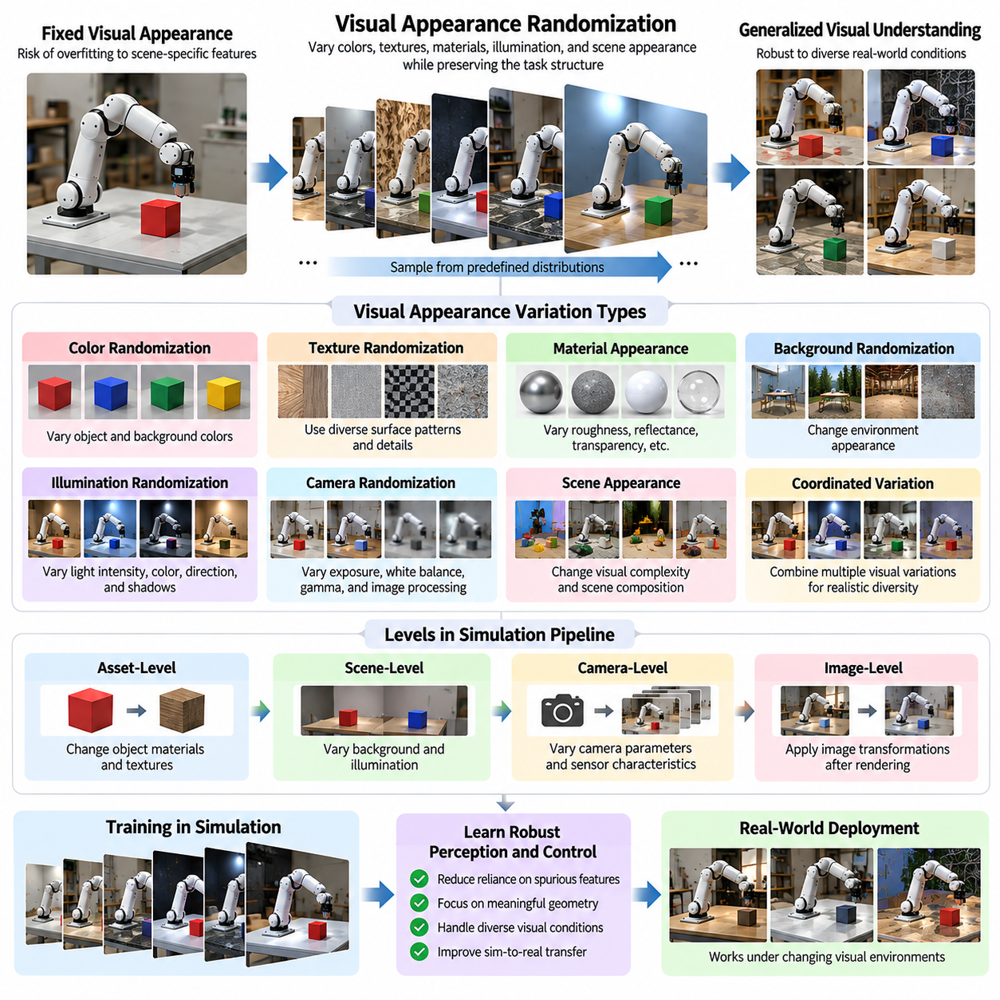{width="7.268055555555556in" height="7.268055555555556in"}

시각적 외관 무작위화(Visual Appearance Randomization)는 변화하는 시각 환경(Visual Environment)에서 피지컬 AI(Physical AI) 시스템의 작동 능력을 향상시키는 도메인 무작위화(Domain Randomization) 기술이다. 이 기술은 시뮬레이션 기반 학습(Simulation-Based Training) 과정에서 색상(Color), 텍스처(Texture), 재질(Material), 조명(Illumination), 장면 외관(Scene Appearance)에 제어된 변화를 도입한다. 인지 모델(Perception Model)과 로봇 정책(Robotic Policy)은 고정된 시각적 구성 대신 다양한 관측을 경험함으로써 개발 과정에서 사용한 합성 환경(Synthetic Environment)을 넘어서는 일반화(Generalization) 능력을 학습한다.

이 기술의 근본적인 필요성은 실제 물리 환경(Physical Environment)의 시각적 조건이 거의 일정하게 유지되지 않는다는 사실에서 비롯된다. 객체는 조명 변화, 표면 마모(Surface Wear), 반사(Reflection), 카메라 노출(Camera Exposure), 환경 오염(Environmental Contamination)에 따라 서로 다른 모습으로 관측될 수 있다. 동일한 객체라도 관측 조건이 변하면 상당히 다른 이미지를 생성할 수 있다. 하나의 시각적 구성에서만 학습한 모델은 실제 환경 배치(Real-World Deployment)에서 신뢰하기 어려운 외관 패턴(Appearance Pattern)에 의존할 수 있다.

시각적 외관 무작위화는 기본적인 작업 구조(Task Structure)를 유지하면서 렌더링 매개변수(Rendering Parameter)를 변경하여 이러한 문제를 해결한다. 객체 색상(Object Color), 표면 텍스처(Surface Texture), 재질 특성(Material Properties), 배경 외관(Background Appearance)은 미리 정의된 확률 분포(Probability Distribution)에서 추출할 수 있다. 생성된 이미지는 유사한 물리적 상황에 대한 다양한 시각적 표현을 제공하며, 학습 알고리즘(Learning Algorithm)이 의미 있는 작업 정보와 부수적인 외관 특성을 구분하도록 유도한다.

핵심 학습 메커니즘(Learning Mechanism)은 허위 시각적 상관관계(Spurious Visual Correlation)에 대한 의존성을 줄이는 것이다. 특정 객체가 항상 동일한 색상이나 배경과 함께 나타나면 신경망(Neural Network)은 객체의 기하학적 형상(Geometry)이나 기능적 정체성(Functional Identity)보다 이러한 특징을 인식 기준으로 사용할 수 있다. 외관 무작위화는 이러한 학습 지름길(Shortcut)을 약화시키고 다양한 장면에서 유효한 표현을 학습하도록 유도한다. 다만 변화 과정에서 작업에 필수적인 정보가 제거되지 않아야 한다.

색상 무작위화(Color Randomization)는 가장 단순한 시각적 외관 변화 방법 중 하나이다. 객체 색상, 배경색, 표면 색상 분포(Surface Color Distribution)를 객체의 기하학적 형상을 변경하지 않고 조정할 수 있다. 이 기술은 색상이 객체 식별이나 행동 선택에 필수적이지 않은 경우 특히 유용하다. 그러나 색상 기반 분류(Color-Based Sorting), 경고 표시(Warning Indicator), 재질 식별(Material Identification)과 같은 작업에서는 실제 운용 의미를 전달하는 색상 정보를 반드시 보존해야 한다.

텍스처 무작위화(Texture Randomization)는 표면 패턴(Surface Pattern), 공간 주파수(Spatial Frequency), 거칠기 외관(Roughness Appearance), 이미지 세부 정보(Image Detail)의 변화를 도입한다. 시뮬레이션 객체에는 학습 에피소드마다 서로 다른 절차적 텍스처(Procedural Texture)나 샘플링된 재질 패턴(Material Pattern)을 적용할 수 있다. 이는 인지 모델이 특정 표면 외관에만 의존하는 것을 방지한다. 로봇 조작(Robotic Manipulation)에서는 암기된 시각 패턴보다 객체 경계(Object Boundary), 형상(Shape), 공간적 구성(Spatial Configuration)에 집중하도록 유도할 수 있다.

재질 외관 무작위화(Material Appearance Randomization)는 단순한 색상과 텍스처 변화를 넘어선다. 물리 기반 렌더링(Physically Based Rendering) 시스템은 금속 반응(Metallic Response), 표면 거칠기(Surface Roughness), 반사율(Reflectance), 투명도(Transparency), 표면하 산란(Subsurface Scattering)과 같은 특성을 표현한다. 이러한 매개변수를 변경하면 객체가 조명과 시각적으로 상호작용하는 방식이 달라진다. 이는 서로 다른 재질로 제조된 제품이나 마모, 코팅(Coating), 환경 노출의 영향을 받은 표면을 다루는 로봇에 유용하다.

그러나 시각적 재질 매개변수(Visual Material Parameter)는 물리적 접촉 특성(Physical Contact Property)과 구분해야 한다. 렌더링된 표면 거칠기를 변경한다고 해서 물리 엔진(Physics Engine)의 마찰 계수(Friction Coefficient)가 반드시 변하는 것은 아니다. 시각적으로 금속처럼 보이는 객체도 외관상 재질과 일치하지 않는 물리 동역학(Physical Dynamics)을 가질 수 있다. 시각적 단서(Visual Cue)가 제어 의사결정에 중요하다면 관측과 행동 사이의 의미 있는 관계를 유지하도록 외관 매개변수와 물리 매개변수를 연계해야 한다.

배경 무작위화(Background Randomization)는 환경 의존성(Environmental Dependence)을 줄이는 데 특히 효과적이다. 하나의 창고나 연구실에서 학습한 로봇 인지 모델은 객체 정체성(Object Identity)을 주변 가구, 벽, 장비와 연관 지을 수 있다. 배경 텍스처, 색상, 시각적 복잡도(Visual Complexity)를 변경하면 이러한 연관성을 줄일 수 있다. 그 결과 모델은 객체가 나타나는 특정 환경과 무관하게 작업 관련 객체를 인식할 가능성이 높아진다.

장면 외관(Scene Appearance)은 조명(Illumination)과 그림자 형성(Shadow Formation)의 영향도 받는다. 광도(Light Intensity), 색온도(Color Temperature), 조명 방향(Light Direction), 공간적 분포(Spatial Distribution)의 변화는 객체 대비(Object Contrast)와 표면 세부 정보의 가시성을 변경한다. 조명 무작위화(Lighting Randomization)는 별도의 범주로 다루어지는 경우가 많지만, 재질 및 텍스처 외관과 직접적으로 상호작용한다. 조명과 표면 특성을 연계하여 변경하면 물리적으로 타당한 시각적 관측 범위를 더욱 확장할 수 있다.

카메라 영상 형성(Camera Image Formation)은 외관 변화의 또 다른 원인이다. 노출(Exposure), 화이트 밸런스(White Balance), 감마 응답(Gamma Response), 색상 감도(Color Sensitivity), 영상 처리 파이프라인(Image Processing Pipeline)은 렌더링된 장면의 최종 외관에 영향을 미친다. 이러한 특성을 무작위화하면 시뮬레이션 카메라와 실제 영상 시스템 사이의 모델 전이 강건성(Robustness)을 높일 수 있다. 다만 선택한 변화는 필수 정보를 왜곡하는 임의적 영상 변환이 아니라 현실적인 카메라 동작을 반영해야 한다.

시각적 외관 무작위화는 시뮬레이션 파이프라인(Simulation Pipeline)의 여러 수준에서 수행할 수 있다. 자산 수준 무작위화(Asset-Level Randomization)는 렌더링 전에 객체 재질과 텍스처를 변경하고, 장면 수준 무작위화(Scene-Level Randomization)는 환경 외관과 조명을 변경한다. 이미지 수준 증강(Image-Level Augmentation)은 렌더링 이후 관측 이미지에 변환을 적용한다. 이러한 접근법은 결합할 수 있지만, 이미지 변환만으로 재질, 기하학, 조명 사이의 모든 물리적 상호작용을 재현할 수는 없다.

외관 무작위화의 주요 장점은 자동 합성 데이터 생성(Automatic Synthetic Data Generation)과 높은 호환성을 가진다는 점이다. 시뮬레이션 엔진(Simulation Engine)은 객체 정체성, 분할(Segmentation), 깊이(Depth), 자세(Pose), 공간적 관계에 대한 정확한 주석 정보(Annotation)를 유지하면서 대량의 이미지를 생성할 수 있다. 시각적 매개변수가 변경되더라도 기본 기하학이 유지되면 많은 주석 정보가 그대로 유효하다. 이는 객체 검출(Detection), 분할, 추적(Tracking), 로봇 인지 모델의 확장 가능한 학습을 지원한다.

자율이동로봇(Autonomous Mobile Robot, AMR)에서 외관 무작위화는 다양한 창고, 복도, 공장, 서비스 환경에서 인지 성능을 향상시킬 수 있다. 바닥 색상(Floor Color), 벽 텍스처(Wall Texture), 장비 표면(Equipment Surface), 배경의 복잡한 물체 배치(Background Clutter)는 배치 장소마다 크게 달라질 수 있다. 다양한 외관을 활용한 학습은 이러한 변화에 대한 민감도를 낮추면서 장애물 검출(Obstacle Detection), 위치 추정(Localization), 내비게이션(Navigation)에 필요한 기하학적 정보와 의미적 정보(Semantic Information)를 보존할 수 있다.

로봇 조작(Robotic Manipulation)에서는 동일한 조작 작업에 서로 다른 포장재(Packaging), 코팅(Coating), 제조 마감(Manufacturing Finish)을 가진 객체가 사용될 때 시각적 외관 다양성이 특히 중요하다. 시각적으로 다양한 객체를 학습한 파지 정책(Grasping Policy)은 기하학적 특징(Geometric Feature)과 공간적 관계에 더 강하게 의존하도록 학습할 수 있다. 그러나 투명 객체(Transparent Object), 반사 객체(Reflective Object), 변형 가능한 객체(Deformable Object)는 단순한 외관 무작위화만으로 모든 관측 특성을 재현할 수 없으므로 전문적인 렌더링 및 센싱 모델이 필요할 수 있다.

휴머노이드 로봇(Humanoid Robot)과 서비스 로봇(Service Robot)은 인간 중심 환경(Human-Centered Environment)에서 더욱 다양한 외관 변화를 경험한다. 의류(Clothing), 가구(Furniture), 가정용 물체(Household Object), 실내 장식(Interior Decoration), 조명은 장소와 사용자에 따라 달라진다. 시각적 무작위화는 가능한 모든 실제 환경을 재구성하지 않고도 학습 범위를 확장할 수 있다. 그러나 작업에 중요한 의미적 단서(Semantic Cue), 인간 안전 표시(Human Safety Indicator), 의미 있는 객체 속성(Object Attribute)은 학습 과정 전체에서 구별 가능하도록 유지해야 한다.

시각적 외관 무작위화의 효과는 매개변수 분포(Parameter Distribution)를 어떻게 선택하는지에 따라 달라진다. 제한 없는 색상과 재질 범위에서 균등 샘플링(Uniform Sampling)을 수행하면 실제 배치 환경에서 거의 발생하지 않는 비현실적인 조합이 생성될 수 있다. 보다 구조화된 분포(Structured Distribution)는 타당한 재질 특성, 조명 관계, 환경적 맥락(Environmental Context)을 유지할 수 있다. 실제 이미지에서 측정한 정보를 활용하면 이러한 분포를 설계하고 관련성이 낮은 시각적 변화에 대한 학습 위험을 줄일 수 있다.

무작위화 강도(Randomization Intensity)도 학습 난이도(Learning Difficulty)에 영향을 미친다. 변화가 너무 작으면 충분한 다양성을 제공하지 못하여 익숙하지 않은 시각적 조건에 모델이 취약해질 수 있다. 반대로 지나치게 강한 변화는 객체 경계를 가리거나 유용한 시각적 단서를 제거하고, 충분히 학습된 인지 시스템조차 처리하기 어려운 장면을 생성할 수 있다. 따라서 효과적인 학습은 외관 다양성, 가시성(Visibility), 작업 관련성(Task Relevance), 의미 있는 정보의 보존 사이에서 균형을 유지해야 한다.

커리큘럼 기반 외관 무작위화(Curriculum-Based Appearance Randomization)는 학습 진행에 따라 시각적 복잡도를 높이는 방식으로 이러한 절충관계(Tradeoff)를 해결할 수 있다. 초기 학습에서는 단순한 배경, 적당한 색상 변화, 일관된 조명을 사용할 수 있다. 이후 단계에서는 더 강한 재질 변화, 복잡한 물체 배치(Clutter), 반사, 카메라 변화를 도입한다. 이러한 점진적 과정은 모델이 어려운 시각 조건을 처리하기 전에 기본적인 인식 능력과 제어 능력을 확립하도록 지원한다.

적응형 외관 무작위화(Adaptive Appearance Randomization)는 모델 성능(Model Performance)에 따라 시각적 매개변수 분포를 조정하는 또 다른 전략이다. 특정 조명이나 텍스처 조건에서 인식 정확도(Recognition Accuracy)가 감소하면 해당 조건을 학습 과정에서 더 강조할 수 있다. 적대적 접근법(Adversarial Approach)은 모델의 취약성을 드러내는 어렵지만 현실적으로 타당한 시각적 구성을 탐색할 수 있다. 이러한 방법은 도전적인 학습 사례가 실제 배치 요구사항과 일치할 때 강건성 향상에 기여한다.

외관 무작위화의 평가는 합성 검증(Synthetic Validation)에만 의존하지 않고 실제 이미지와 물리적 작업을 대상으로 수행해야 한다. 유용한 평가 지표에는 인식 정확도(Recognition Accuracy), 분할 품질(Segmentation Quality), 객체 자세 추정 오차(Object Pose Estimation Error), 작업 성공률(Task Success Rate), 시각 조건 변화에 대한 강건성(Robustness)이 포함된다. 고정 외관 학습(Fixed-Appearance Training), 무작위화 학습(Randomized Training), 사실적 렌더링 기반 학습(Photorealistic Training)을 통제된 조건에서 비교하면 외관 다양성이 실제 전이 성능을 향상시키는지 확인할 수 있다.

궁극적으로 시각적 외관 무작위화(Visual Appearance Randomization)는 독립적인 해결책으로 취급하기보다 기하학적 무작위화(Geometry Randomization), 센서 무작위화(Sensor Randomization), 물리 무작위화(Physics Randomization)와 통합해야 한다. 신뢰할 수 있는 피지컬 AI 시스템은 세계가 어떻게 보이는지뿐 아니라 어떻게 움직이고 상호작용하는지도 이해해야 한다. 현실적인 렌더링 기반(Realistic Rendering Foundation)과 신중하게 선택된 시각적 다양성을 결합하면 시뮬레이션 기반 학습을 통해 다양한 실제 환경에서도 효과적으로 작동하는 인지 모델과 제어 정책을 개발할 수 있다.

## 03.04. Lighting Texture and Background Randomization

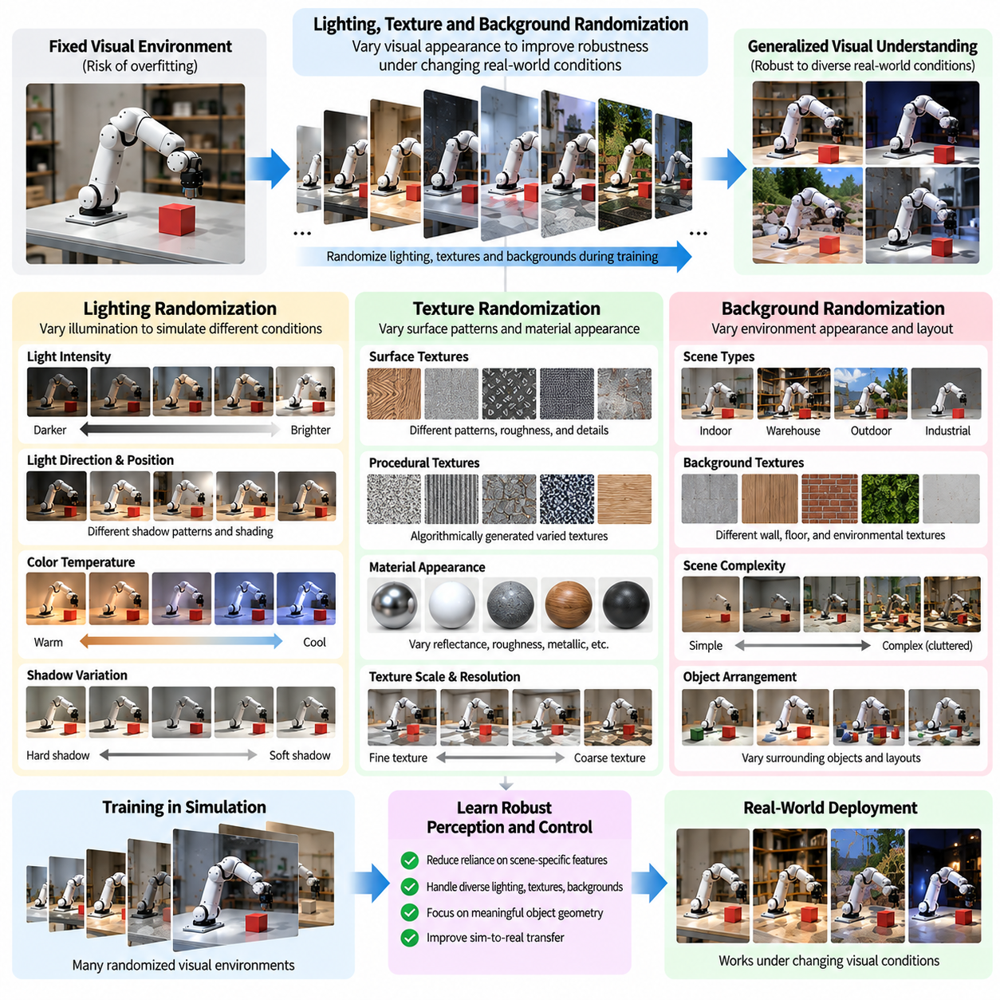{width="7.268055555555556in" height="7.268055555555556in"}

조명, 텍스처 및 배경 무작위화(Lighting, Texture, and Background Randomization)는 피지컬 AI(Physical AI) 시스템을 위한 시각적 도메인 무작위화(Visual Domain Randomization)의 핵심 구성 요소이다. 이러한 기술은 시뮬레이션 장면의 외관(Scene Appearance)에 제어된 변화를 도입하여 실제 환경의 시각적 조건 변화에 대한 강건성(Robustness)을 향상시킨다. 학습 과정에서 조명(Illumination), 표면 패턴(Surface Pattern), 환경 배경(Environmental Background)을 변경함으로써 인지 모델(Perception Model)과 로봇 정책(Robotic Policy)은 특정 시뮬레이션 시각 구성에 의존하지 않는 표현을 학습할 수 있다.

조명 무작위화(Lighting Randomization)는 조명이 시각적 인지(Visual Perception)에 미치는 상당한 영향을 다룬다. 동일한 객체라도 광도(Light Intensity), 조명 방향(Light Direction), 색온도(Color Temperature), 그림자 분포(Shadow Distribution)에 따라 매우 다르게 보일 수 있다. 고정된 조명 조건에서 학습한 인지 모델은 특정 밝기 패턴(Brightness Pattern)이나 표면 반사(Surface Reflection)에 의존할 수 있다. 조명을 무작위화하면 다양한 외관을 경험하게 되어 변화하는 조명 조건에서도 신뢰할 수 있는 특징을 기반으로 객체를 인식하도록 유도한다.

광도 무작위화(Light Intensity Randomization)는 학습 에피소드(Training Episode)마다 시뮬레이션 광원의 밝기를 변경한다. 이러한 변화는 일광(Daylight)의 변화, 인공조명(Artificial Lighting)의 차이, 부분적으로 조명이 비추는 환경을 표현할 수 있다. 서로 다른 광도 수준에 노출되면 인지 시스템은 밝기 변동(Brightness Fluctuation)과 대비 감소(Reduced Contrast)에 대한 대응 능력을 향상시킬 수 있다. 그러나 극단적인 조명은 중요한 이미지 정보를 제거하고 의미 있는 학습에 적합하지 않은 조건을 생성할 수 있으므로 광도 범위는 물리적으로 타당해야 한다.

조명 방향 및 위치 무작위화(Light Direction and Position Randomization)는 표면이 빛을 받는 방식과 그림자가 형성되는 위치를 변경한다. 가상 광원(Virtual Light Source)을 이동하면 음영 기울기(Shading Gradient), 객체 경계(Object Boundary), 가시적인 기하학적 세부 정보(Geometric Detail)가 달라진다. 이러한 변화는 그림자 패턴이 형상 해석(Shape Interpretation)에 영향을 미칠 수 있는 로봇 조작(Robotic Manipulation)과 객체 인식(Object Recognition)에서 특히 중요하다. 다양한 조명 구성에서 학습하면 고정된 그림자 위치에 대한 의존성을 줄이고 안정적인 기하학적 이해를 촉진한다.

색온도 무작위화(Color Temperature Randomization)는 조명의 스펙트럼 특성(Spectral Characteristics)을 변경하여 따뜻하거나 차가운 시각적 외관을 생성한다. 산업 시설(Industrial Facility)은 서로 다른 인공조명 시스템을 사용할 수 있으며, 실외 로봇(Outdoor Robot)은 하루 동안 변화하는 자연광(Natural Illumination)을 경험한다. 이러한 차이를 시뮬레이션하면 색상 항상성(Color Constancy)과 인지 강건성(Perception Robustness)을 향상시킬 수 있다. 다만 정밀한 색상 구별(Color Discrimination)이 필요한 작업에서는 객체 특성과 관측된 색상 정보 사이의 관계를 유지해야 한다.

그림자 무작위화(Shadow Randomization)는 그림자 강도(Shadow Intensity), 부드러움(Shadow Softness), 방향(Direction), 공간적 범위(Spatial Extent)에 변화를 도입한다. 그림자는 유용한 기하학적 정보를 제공할 수 있지만 잘못된 경계선을 만들거나 중요한 객체 특징을 가릴 수도 있다. 다양한 그림자 구성에서 학습하면 모델이 실제 객체 경계와 조명 인공 왜곡(Illumination Artifact)을 구분하도록 지원한다. 물리적으로 일관된 그림자 생성은 기하학, 조명, 가시성(Visibility) 사이의 관계를 보존하므로 임의적인 이미지 변환보다 바람직하다.

텍스처 무작위화(Texture Randomization)는 시뮬레이션 표면에 연결된 시각적 패턴을 변경한다. 학습 과정에서 객체, 바닥, 벽, 장비에는 서로 다른 절차적 텍스처(Procedural Texture)나 샘플링된 재질 이미지(Material Image)를 적용할 수 있다. 이러한 변화는 실제 환경에 존재하지 않을 수 있는 특정 표면 패턴에 대한 의존성을 줄인다. 다양한 텍스처를 경험한 인지 모델은 부수적인 시각적 세부 정보보다 객체 기하학(Object Geometry), 공간적 관계(Spatial Relationship), 의미적 정보(Semantic Information)를 우선적으로 학습할 수 있다.

절차적 텍스처 생성(Procedural Texture Generation)은 다양한 표면 외관을 확장 가능하게 생성하는 방법이다. 알고리즘은 수작업으로 제작한 대규모 자산 라이브러리(Asset Library) 없이도 공간 주파수(Spatial Frequency), 패턴 방향(Pattern Orientation), 색상 분포(Color Distribution), 국소 대비(Local Contrast)를 변경할 수 있다. 절차적 텍스처는 거친 표면(Rough Surface), 반복 패턴(Repeated Pattern), 불규칙한 시각 구조(Irregular Visual Structure)를 표현할 수 있다. 그러나 실제 배치 조건과 관련 없는 임의의 잡음보다 물리적으로 타당한 재질 변화를 생성해야 효과적이다.

재질 인식 기반 텍스처 무작위화(Material-Aware Texture Randomization)는 표면 외관과 재질 정체성(Material Identity) 사이의 의미 있는 관계를 보존한다. 금속 객체(Metallic Object), 도장 표면(Painted Surface), 직물(Fabric), 콘크리트(Concrete)는 서로 다른 반사 및 텍스처 특성을 나타낸다. 이러한 차이가 인지나 조작에 영향을 미친다면 무작위화 과정에서도 고려해야 한다. 예를 들어 미끄러운 표면을 식별하는 로봇은 시각적 재질 단서(Visual Material Cue)와 시뮬레이션에 표현된 물리적 마찰 특성(Physical Friction Property) 사이의 일관된 관계가 필요할 수 있다.

텍스처 해상도(Texture Resolution)와 크기(Scale)도 시각적 인지에 영향을 미친다. 특정 관측 거리(Viewing Distance)에서 사실적으로 보이는 표면 패턴이라도 부적절한 공간적 크기로 적용하면 오해를 유발할 수 있다. 텍스처 크기를 무작위화하면 객체 크기(Object Size)와 카메라 거리(Camera Distance)의 변화에 대한 강건성을 높일 수 있지만, 비현실적인 크기 조정은 재질 외관을 왜곡할 수 있다. 효과적인 시뮬레이션은 텍스처 치수(Texture Dimensions), 객체 기하학, 카메라 해상도(Camera Resolution), 예상 관측 거리 사이의 일관성을 유지한다.

배경 무작위화(Background Randomization)는 대상 작업과 무관한 환경적 맥락(Environmental Context)에 대한 의존성을 줄인다. 고정된 연구실 배경에서 객체를 인식하도록 학습한 모델은 창고, 가정, 실외 환경에서 성능이 저하될 수 있다. 벽 색상(Wall Color), 바닥 텍스처(Floor Texture), 주변 객체(Surrounding Object), 환경 배치(Environmental Layout)를 변경하면 모델이 더 다양한 시각적 맥락을 경험한다. 이는 암기된 장면 특성보다 객체 고유의 특징(Object-Specific Feature)을 기반으로 인식하도록 유도한다.

배경 복잡도(Background Complexity)도 중요한 변수이다. 단순한 배경은 초기 학습을 효율적으로 지원할 수 있지만, 복잡한 장면은 시각적 혼잡(Visual Clutter), 부분 가림(Partial Occlusion), 경쟁적인 패턴(Competing Pattern)을 도입한다. 배경 객체의 수량, 외관, 배치를 무작위화하면 혼잡한 환경에서도 인지 시스템이 작동하도록 학습할 수 있다. 그러나 배경 변화는 현실적인 공간적 관계를 유지해야 하며, 불가능한 객체 배치나 작업 조건을 잘못 표현하는 상황을 생성하지 않아야 한다.

조명, 텍스처, 배경 사이의 상호작용(Interaction)은 각 변수를 독립적으로 다루는 것보다 중요하다. 텍스처가 있는 표면은 조명에 따라 외관이 달라지며, 배경 재질(Background Material)은 반사(Reflection)와 간접조명(Indirect Lighting)에 영향을 미친다. 이러한 특성을 함께 무작위화하면 더 다양하고 현실적인 관측을 생성할 수 있다. 그러나 제약 없는 조합은 물리적으로 일관성이 없는 장면을 만들 수 있으므로 효과적인 학습을 위해 구조화된 매개변수 샘플링(Structured Parameter Sampling)이 필수적이다.

물리 기반 렌더링(Physically Based Rendering)은 조정된 외관 무작위화(Coordinated Appearance Randomization)를 위한 유용한 기반을 제공한다. 재질 매개변수(Material Parameter), 광원(Light Source), 장면 기하학(Scene Geometry)은 실제 광학적 상호작용(Optical Interaction)을 근사하는 모델을 통해 표현된다. 이후 무작위화는 물리적으로 타당한 렌더링 동작을 유지하면서 이러한 매개변수를 변경할 수 있다. 이 접근법은 환경 다양성과 물리적 일관성(Physical Consistency)을 결합하여 학습 시스템이 비현실적인 시각적 인공 왜곡을 이용할 위험을 줄인다.

조명과 텍스처 변화를 평가할 때는 카메라 특성(Camera Characteristics)도 고려해야 한다. 노출 제어(Exposure Control), 화이트 밸런스(White Balance), 동적 범위(Dynamic Range), 모션 블러(Motion Blur), 센서 잡음(Sensor Noise)은 무작위화된 장면이 최종 이미지에 나타나는 방식을 크게 변경할 수 있다. 렌더러(Renderer)에서는 적절하게 보이는 조명 구성도 카메라 처리(Camera Processing) 이후 과다 노출(Overexposure)이나 노출 부족(Underexposure)이 발생할 수 있다. 따라서 카메라와 외관의 연계 무작위화는 더욱 대표성 있는 합성 관측(Synthetic Observation)을 제공한다.

무작위화 분포(Randomization Distribution)의 설계는 학습 시스템이 어떤 환경 조건을 경험하는지 결정한다. 균등 샘플링(Uniform Sampling)은 광범위한 변화를 제공하지만 드물게 발생하는 조합을 과도하게 포함할 수 있다. 실제 환경 측정(Real-World Measurement)에 기반한 분포는 일반적인 운용 조건(Common Operating Conditions)을 강조하면서 중요한 예외 상황(Edge Case)에 대한 학습 범위도 유지할 수 있다. 현실적인 시각적 관계를 유지해야 하는 경우 조명, 재질, 배경 사이의 상관관계(Correlation)를 보존해야 한다.

커리큘럼 기반 무작위화(Curriculum-Based Randomization)는 학습 과정에서 시각적 난이도(Visual Difficulty)를 점진적으로 높인다. 초기 단계에서는 기본적인 인지 능력을 확립하기 위해 적당한 조명 변화, 단순한 텍스처, 복잡하지 않은 배경을 사용할 수 있다. 이후 단계에서는 강한 그림자, 복잡한 표면 패턴, 반사, 환경적 혼잡을 도입한다. 이러한 진행 방식은 학습 안정성(Training Stability)을 향상시키면서 실제 배치 환경에서 발생하는 점점 더 어려운 시각적 조건에 대한 강건성을 개발할 수 있다.

적응형 무작위화(Adaptive Randomization)는 관측된 모델 성능(Model Performance)에 따라 환경 변화를 조정한다. 인지 시스템이 저조도(Low Illumination)나 시각적으로 복잡한 배경에서 지속적으로 실패한다면 학습 과정에서 해당 조건의 노출 빈도를 높일 수 있다. 성능 기반 샘플링(Performance-Guided Sampling)은 익숙한 시나리오를 균등하게 반복하는 대신 취약한 조건에 연산 자원(Computational Resources)을 집중한다. 이러한 적응 과정에서는 비현실적이거나 지나치게 어려운 구성을 과도하게 강조하지 않도록 보호 장치(Safeguard)가 필요하다.

자율이동로봇(Autonomous Mobile Robot, AMR)에서 조명, 텍스처, 배경 무작위화는 창고, 공장, 복도, 실외 시설 전반의 운용을 지원한다. 바닥 재질(Floor Material), 벽 외관(Wall Appearance), 조명 설비(Lighting Installation), 주변 장비(Surrounding Equipment)는 배치 장소에 따라 달라진다. 이러한 변화에 대한 학습은 장애물 검출(Obstacle Detection), 의미적 인지(Semantic Perception), 시각적 위치 추정(Visual Localization)을 향상시킬 수 있다. 그러나 신뢰할 수 있는 내비게이션(Navigation)을 위해서는 기하학적 일관성(Geometric Consistency)과 센서 보정(Sensor Calibration)이 여전히 필요하다.

로봇 매니퓰레이터(Robotic Manipulator)는 서로 다른 포장재(Packaging), 표면 마감(Surface Finish), 주변 작업 공간(Workspace)을 가진 객체를 다룰 때 외관 무작위화의 이점을 얻는다. 조명과 텍스처의 변화는 객체 분할(Object Segmentation), 자세 추정(Pose Estimation), 파지점 검출(Grasp-Point Detection)에 영향을 미칠 수 있다. 무작위화 학습은 이러한 차이에도 모델이 효과적으로 작동하도록 유도한다. 그러나 시각적 강건성만으로 성공적인 접촉 상호작용(Contact Interaction)을 보장할 수 없으므로 정밀 조작(Precision Manipulation)에는 정확한 기하학적 정보와 적절한 물리 모델이 필요하다.

평가 과정에서는 무작위화된 외관 조건이 실제 이미지와 물리적 로봇 작업에서 성능을 향상시키는지 측정해야 한다. 관련 평가 지표(Metric)에는 검출 정확도(Detection Accuracy), 분할 품질(Segmentation Quality), 자세 추정 오차(Pose Estimation Error), 작업 성공률(Task Success Rate), 익숙하지 않은 조명과 배경에 대한 강건성(Robustness)이 포함된다. 통제 실험(Controlled Experiment)을 통해 조명, 텍스처, 배경 변화의 개별 효과를 분리한 다음 시뮬레이션-현실 전이(Simulation-to-Reality Transfer)에 대한 결합 효과를 평가할 수 있다.

궁극적으로 조명, 텍스처 및 배경 무작위화(Lighting, Texture, and Background Randomization)는 시뮬레이션 기반 학습(Simulation-Based Learning)에서 활용할 수 있는 시각적 경험(Visual Experience)을 확장하는 실용적인 메커니즘이다. 효과는 현실적인 매개변수 범위(Realistic Parameter Range), 의미 있는 환경 다양성(Environmental Diversity), 작업에 필수적인 시각 정보(Task-Critical Visual Information)의 보존에 달려 있다. 이러한 기술을 물리 기반 렌더링(Physically Based Rendering), 센서 모델링(Sensor Modeling), 실제 환경 검증(Real-World Validation)과 통합하면 피지컬 AI 시스템이 변화하는 운용 환경에서도 신뢰할 수 있는 인지와 제어 성능을 유지하도록 지원할 수 있다.

## 03.05. Object Pose Scale and Scene Randomization

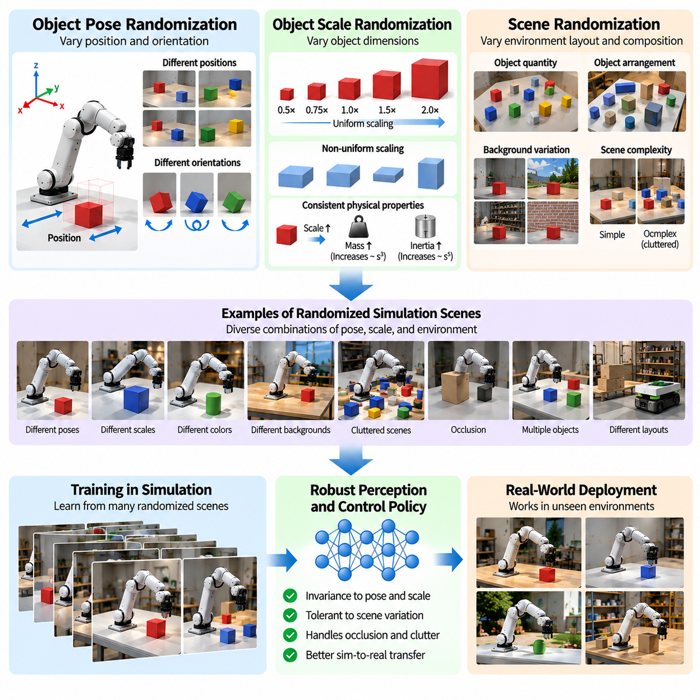{width="7.268055555555556in" height="7.268055555555556in"}

객체 자세, 크기 및 장면 무작위화(Object Pose, Scale, and Scene Randomization)는 시뮬레이션 환경(Simulated Environment)에서 학습한 피지컬 AI(Physical AI) 시스템의 일반화(Generalization) 능력을 향상시키는 핵심 기술이다. 이러한 방법은 학습 과정에서 객체의 위치(Position), 방향(Orientation), 치수(Dimension), 공간적 배치(Spatial Arrangement)에 변화를 도입한다. 인지 모델(Perception Model)과 로봇 제어 정책(Robotic Control Policy)이 다양한 기하학적 구성(Geometric Configuration)을 경험하도록 함으로써 고정된 배치에 대한 의존성을 줄이고 익숙하지 않은 물리 환경에서의 성능을 향상시킬 수 있다.

객체 자세 무작위화(Object Pose Randomization)는 시뮬레이션 장면에서 객체의 위치와 방향을 변경한다. 위치 변화는 수평축과 수직축을 따라 발생할 수 있으며, 방향 변화는 여러 축을 중심으로 하는 회전(Rotation)을 포함한다. 이러한 변화는 학습 시스템이 서로 다른 관측 각도(Viewing Angle), 접촉 구성(Contact Configuration), 공간적 관계(Spatial Relationship)를 경험하도록 한다. 목표는 객체의 초기 배치와 관계없이 효과적으로 작동하는 인지 및 제어 능력을 개발하는 것이다.

자세 무작위화(Pose Randomization)는 파지 성공(Grasping Success)이 객체의 방향과 접근 가능성(Accessibility)에 크게 좌우되므로 로봇 조작(Robotic Manipulation)에서 특히 중요하다. 동일한 구성으로 배치된 객체만 학습한 로봇 팔(Robotic Arm)은 일반적인 조작 전략(Manipulation Strategy)을 학습하기보다 특정 파지 궤적(Grasp Trajectory)을 암기할 수 있다. 객체 자세를 무작위화하면 정책이 현재 객체의 기하학적 형상(Object Geometry)을 추정하고 실행 가능한 파지 위치(Grasp Location)를 식별하며 관측된 구성에 적합한 행동을 생성하도록 유도한다.

객체 방향(Object Orientation)은 오일러 각(Euler Angle), 회전 행렬(Rotation Matrix), 쿼터니언(Quaternion)을 사용하여 표현할 수 있다. 시뮬레이션 초기화(Simulation Initialization) 과정에서 방향 매개변수(Orientation Parameter)를 미리 정의된 분포(Predefined Distribution)에서 샘플링하여 객체 변환(Object Transformation)에 적용한다. 자유롭게 회전하는 객체에는 균등 방향 샘플링(Uniform Orientation Sampling)이 적합할 수 있지만, 일반적으로 지지 표면(Supporting Surface) 위에 놓이는 객체에는 제약된 분포(Constrained Distribution)가 더 적합하다. 비현실적인 학습 사례를 방지하려면 샘플링 방법이 물리적으로 가능한 구성을 반영해야 한다.

객체 위치 무작위화(Object Position Randomization)는 대상 객체와 주변 요소의 공간 좌표(Spatial Coordinate)를 변경한다. 조작 환경(Manipulation Environment)에서는 객체가 로봇의 도달 가능한 작업 공간(Reachable Workspace) 내 여러 위치에 나타날 수 있다. 내비게이션 환경(Navigation Environment)에서는 장애물(Obstacle)이 가능한 이동 경로(Travel Path)의 서로 다른 위치를 차지할 수 있다. 이러한 변화는 정책이 암기된 좌표에 의존하는 것을 방지하고 현재 센서 관측(Sensor Observation)과 공간적 관계를 기반으로 의사결정하도록 유도한다.

크기 무작위화(Scale Randomization)는 제품 크기(Product Size), 제조 공차(Manufacturing Tolerance), 기하학적 변동성(Geometric Variability)의 차이를 표현하기 위해 객체 치수를 변경한다. 다양한 객체 크기로 학습한 인지 모델은 겉보기 크기(Apparent Size)와 관측 거리(Viewing Distance)의 변화에 더욱 강건해질 수 있다. 로봇 조작에서는 크기 변화가 파지 폭(Grasp Width), 도달 가능성(Reachability), 충돌 제약조건(Collision Constraint)에도 영향을 미친다. 따라서 기하학적 크기 조정(Geometric Scaling)은 성공적인 작업 수행에 필요한 물리적 특성과 일관성을 유지해야 한다.

균일 크기 조정(Uniform Scaling)은 모든 객체 치수를 동일한 비율로 변경하여 원래의 형상 비율(Shape Proportion)을 유지한다. 비균일 크기 조정(Nonuniform Scaling)은 각 치수를 독립적으로 변경하여 더욱 다양한 기하학적 형상(Geometry)을 생성할 수 있다. 그러나 과도한 비균일 크기 조정은 객체를 현실적인 제조 편차(Manufacturing Variation)를 벗어나는 형태로 왜곡할 수 있다. 적절한 크기 분포(Scale Distribution)는 대상 객체 범주(Object Category), 예상 크기 차이, 로봇 운용 환경(Operating Environment)의 물리적 제약조건을 반영해야 한다.

크기 무작위화는 질량(Mass), 관성(Inertia), 충돌 기하학(Collision Geometry)과의 관계도 고려해야 한다. 시뮬레이션 객체를 확대하면서 물리적 특성(Physical Property)을 갱신하지 않으면 일관성이 없는 동역학(Dynamics)이 발생할 수 있다. 밀도(Density)가 일정한 기하학적으로 유사한 객체에서는 질량이 크기 배율(Scale Factor)의 세제곱에 비례하여 증가하고, 회전 관성(Rotational Inertia)은 크기 배율의 다섯제곱에 비례하여 증가한다. 기하학적 매개변수와 물리적 매개변수를 연계하면 로봇과 무작위화된 객체 사이의 물리적으로 타당한 상호작용을 유지할 수 있다.

장면 무작위화(Scene Randomization)는 개별 객체를 넘어 시뮬레이션 환경의 전체 공간 구성(Spatial Organization)을 변경한다. 객체 수량(Object Quantity), 배치 패턴(Placement Pattern), 장애물 구성(Obstacle Configuration), 가구 배치(Furniture Arrangement), 작업 공간 레이아웃(Workspace Layout)은 학습 에피소드마다 달라질 수 있다. 이러한 변화는 학습 시스템이 다양한 환경 구조(Environmental Structure)를 경험하도록 하며, 하나의 사전 정의된 장면에 의존하기보다 현재 조건에 적응하는 행동을 유도한다.

창고 로봇(Warehouse Robotics)에서는 장면 무작위화를 통해 선반 위치(Shelf Location), 팔레트 배치(Pallet Arrangement), 통로 폭(Aisle Width), 장애물 분포(Obstacle Distribution)를 변경할 수 있다. 자율이동로봇(Autonomous Mobile Robot, AMR)은 변화하는 배치에서 주행 가능한 영역(Navigable Region)을 식별하고 충돌 없는 경로(Collision-Free Path)를 계획해야 한다. 여러 구성에서 학습하면 특히 실제 배치 시설이 시뮬레이션 개발 환경과 다른 경우 내비게이션 일반화(Navigation Generalization)를 향상시킬 수 있다.

로봇 조작에서는 장면 무작위화를 통해 객체 혼잡(Object Clutter), 적재 배치(Stacking Arrangement), 대상 접근 가능성(Target Accessibility)에 변화를 도입할 수 있다. 객체는 부분적으로 겹치거나 서로를 가리거나 보관함(Bin)과 작업 공간에서 서로 다른 방향으로 나타날 수 있다. 이러한 조건에서는 인지 모델이 가림 현상(Occlusion)을 처리하고 제어 정책(Control Policy)이 실행 가능한 조작 전략을 선택해야 한다. 따라서 무작위화된 장면은 개별 객체와의 단순한 상호작용을 넘어서는 학습을 지원한다.

가림 무작위화(Occlusion Randomization)는 객체 배치와 장면 구성(Scene Composition)을 변경할 때 발생하는 중요한 결과이다. 부분 가시성(Partial Visibility)은 전경 객체(Foreground Object)가 대상 객체의 일부를 가리거나 카메라 시점(Camera Viewpoint)이 관측 가능한 표면을 제한할 때 발생한다. 다양한 가림 조건에서 학습하면 객체 검출(Object Detection), 분할(Segmentation), 자세 추정(Pose Estimation)을 향상시킬 수 있다. 그러나 시나리오는 의도한 작업에 필요한 충분한 정보를 유지하거나 대체 센싱(Alternative Sensing) 및 탐색 전략(Exploration Strategy)을 제공해야 한다.

장면 복잡도(Scene Complexity)는 객체 수(Number of Objects), 공간 밀도(Spatial Density), 장애물 다양성(Obstacle Diversity), 기하학적 불규칙성(Geometric Irregularity)을 통해 제어할 수 있다. 단순한 장면은 기본적인 인지 및 제어 능력을 확립하는 데 유용하며, 복잡한 장면은 현실적인 계획 과제(Planning Challenge)를 도입한다. 커리큘럼 학습(Curriculum Learning)을 통해 장면 복잡도를 점진적으로 높이면 학습 안정성(Training Stability)을 향상시키고 정책이 초기의 어려운 조건에 압도되지 않으면서 고급 행동을 습득하도록 지원할 수 있다.

무작위화된 객체 배치(Randomized Object Placement)는 물리적 제약조건(Physical Constraint)과 작업별 제약조건(Task-Specific Constraint)을 충족해야 한다. 의도적으로 작업에 포함된 조건이 아니라면 객체가 지지 표면과 교차하거나 불가능한 위치를 차지하거나 로봇의 운용 작업 공간(Operational Workspace) 밖에 나타나서는 안 된다. 충돌 검사(Collision Checking), 안정성 평가(Stability Evaluation), 도달 가능성 분석(Reachability Analysis)을 통해 유효하지 않은 구성을 제거할 수 있다. 제약조건 인식 샘플링(Constraint-Aware Sampling)은 생성된 시나리오의 물리적 의미를 보장하여 학습 품질을 향상시킨다.

자세, 크기 및 장면 무작위화에 사용되는 확률 분포(Probability Distribution)는 학습 효과에 큰 영향을 미친다. 균등 샘플링(Uniform Sampling)은 광범위한 조건을 포함하지만 발생 가능성이 낮은 구성을 다수 생성할 수 있다. 실제 환경 측정(Real-World Measurement)에서 도출한 분포는 일반적인 운용 조건(Common Operating Condition)을 강조하면서 중요한 예외 상황(Edge Case)에 대한 노출을 유지할 수 있다. 객체 범주, 치수, 배치 패턴 사이의 상관관계(Correlation)가 의미 있는 환경 구조를 나타낸다면 이를 보존해야 한다.

도메인 무작위화(Domain Randomization)는 객체 사이의 의미적 관계(Semantic Relationship)도 보존해야 한다. 주방에서는 조리 도구(Utensil)가 일반적으로 작업대(Work Surface) 근처에 있으며, 산업용 부품(Industrial Component)은 제조 공정(Manufacturing Process)에 부합하는 위치에 배치된다. 완전히 임의적인 배치는 비현실적인 장면을 생성하고 작업 학습(Task Learning)을 약화시킬 수 있다. 의미적 제약조건(Semantic Constraint)은 의미 있는 인지, 계획, 상호작용에 필요한 맥락적 관계(Contextual Relationship)를 유지하면서 기하학적 다양성을 확보하도록 한다.

자세 및 장면 무작위화는 시각적 외관 무작위화(Visual Appearance Randomization)와 통합하여 학습 다양성을 더욱 확장할 수 있다. 객체 위치와 방향은 조명(Lighting), 텍스처(Texture), 재질(Material), 카메라 시점(Camera Viewpoint)과 함께 변경될 수 있다. 이러한 결합은 학습 시스템이 특정 기하학적 형상을 고정된 시각적 외관과 연관 짓는 것을 방지한다. 그러나 무작위화 과정은 객체 기하학, 렌더링된 관측(Rendered Observation), 물리적 상호작용(Physical Interaction) 사이의 일관성을 유지해야 한다.

대규모 병렬 시뮬레이션(Massively Parallel Simulation)은 수천 개의 무작위화된 기하학적 구성을 동시에 평가할 수 있도록 한다. 각 환경 인스턴스(Environment Instance)는 동일한 학습 정책(Learning Policy)을 공유하면서 서로 다른 객체 자세, 크기, 장면 레이아웃을 포함할 수 있다. 이러한 접근법은 경험 수집(Experience Collection)을 가속하고 가능한 운용 조건의 적용 범위를 확장한다. 높은 시뮬레이션 처리량(Simulation Throughput)을 유지하려면 효율적인 장면 생성(Scene Generation), 충돌 초기화(Collision Initialization), 메모리 관리(Memory Management)가 필요하다.

적응형 무작위화(Adaptive Randomization)는 현재 정책이 낮은 성능을 보이는 구성에 학습을 집중할 수 있다. 조작 정책(Manipulation Policy)이 회전된 객체나 매우 혼잡한 장면을 처리하는 데 어려움을 겪는다면 샘플링 과정에서 해당 조건의 노출 빈도를 높일 수 있다. 마찬가지로 내비게이션 정책(Navigation Policy)에는 더욱 어려운 장애물 배치를 제공할 수 있다. 성능 기반 샘플링(Performance-Guided Sampling)은 어려운 시나리오가 실행 가능하고 실제 배치 요구사항을 대표하는 경우 학습 효율성(Learning Efficiency)을 향상시킨다.

평가 과정에서는 기하학적 무작위화(Geometric Randomization)가 학습 중 경험하지 않은 객체 자세, 치수, 환경 레이아웃에서 성능을 향상시키는지 검토해야 한다. 관련 평가 지표(Evaluation Metric)에는 객체 검출 정확도(Object Detection Accuracy), 자세 추정 오차(Pose Estimation Error), 파지 성공률(Grasp Success Rate), 충돌 빈도(Collision Frequency), 내비게이션 완료율(Navigation Completion Rate), 작업 수행 시간(Task Execution Time)이 포함된다. 고정된 학습 구성과 무작위화된 학습 구성을 비교하는 통제 실험(Controlled Experiment)을 통해 각 기하학적 변화가 실제 성능에 기여하는 정도를 확인할 수 있다.

기하학적 다양성(Geometric Diversity)만으로 모든 물리적 불확실성(Physical Uncertainty)을 재현할 수 없으므로 실제 환경 검증(Real-World Validation)은 여전히 필요하다. 객체 변형(Object Deformation), 접촉 마찰(Contact Friction), 센서 한계(Sensor Limitation), 액추에이터 동작(Actuator Behavior), 환경 동역학(Environmental Dynamics)은 시뮬레이션과 실제 환경 사이에서 차이가 있을 수 있다. 자세, 크기 및 장면 무작위화를 물리 보정(Physics Calibration)과 센서 모델링(Sensor Modeling)에 결합하면 시뮬레이션-현실 전이(Simulation-to-Reality Transfer)와 신뢰성 높은 로봇 배치를 위한 더욱 포괄적인 기반을 제공한다.

궁극적으로 객체 자세, 크기 및 장면 무작위화(Object Pose, Scale, and Scene Randomization)는 시뮬레이션 기반 학습(Simulation-Based Training) 과정에서 피지컬 AI 시스템이 경험할 수 있는 기하학적 다양성을 확장한다. 효과는 현실적인 매개변수 분포(Realistic Parameter Distribution), 물리적으로 유효한 구성(Physically Valid Configuration), 의미적 일관성(Semantic Consistency), 적절한 작업 난이도(Task Difficulty)에 달려 있다. 이러한 기술을 시각적 무작위화(Visual Randomization) 및 물리 무작위화(Physics Randomization)와 통합하면 인지 및 제어 정책이 변화하는 객체, 작업 공간, 운용 환경 전반에서 일반화 능력을 확보하도록 지원할 수 있다.

## 03.06. Camera and Sensor Randomization

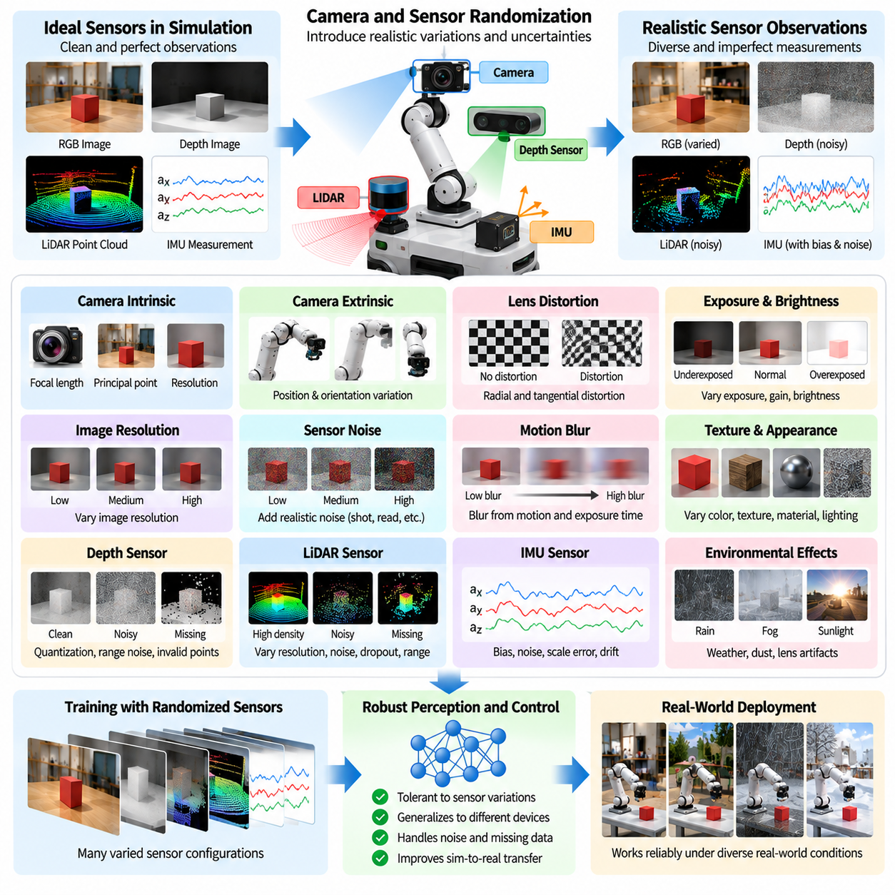{width="7.268055555555556in" height="7.268055555555556in"}

카메라 및 센서 무작위화(Camera and Sensor Randomization)는 피지컬 AI(Physical AI) 시스템에서 시뮬레이션과 현실 간 격차(Simulation-to-Reality Gap)를 줄이기 위한 핵심 기술이다. 시뮬레이션 센서(Simulated Sensor)는 실제 하드웨어(Physical Hardware)에서 생성되는 측정값과 다른 이상화된 관측값(Idealized Observation)을 생성하는 경우가 많다. 카메라 매개변수(Camera Parameter), 측정 잡음(Measurement Noise), 보정 오차(Calibration Error), 센싱 조건(Sensing Condition)을 무작위화하면 학습 시스템이 현실적인 불확실성(Uncertainty)을 경험할 수 있다. 이는 서로 다른 장치와 환경에서 인지 및 제어 정책(Perception and Control Policy)이 안정적으로 작동하는 능력을 향상시킨다.

센서 무작위화(Sensor Randomization)의 주요 목적은 로봇 정책(Robotic Policy)이 완벽하거나 고정된 관측값에 의존하지 않도록 하는 것이다. 실제 센서는 측정 잡음, 제한된 해상도(Limited Resolution), 왜곡(Distortion), 환경 간섭(Environmental Interference), 하드웨어 편차(Hardware Variation)를 경험한다. 이상적인 센서 출력(Ideal Sensor Output)만으로 학습한 정책은 실제 로봇에 배치되었을 때 실패할 수 있다. 시뮬레이션 과정에서 제어된 센서 변동성(Sensor Variability)을 도입하면 학습 알고리즘(Learning Algorithm)이 불완전한 측정값에서도 신뢰할 수 있는 정보를 추출하도록 유도할 수 있다.

카메라 내부 매개변수 무작위화(Camera Intrinsic Randomization)는 3차원 장면(Three-Dimensional Scene)이 이미지에 투영되는 방식을 결정하는 매개변수를 변경한다. 이러한 매개변수에는 초점 거리(Focal Length), 주점(Principal Point), 픽셀 종횡비(Pixel Aspect Ratio), 이미지 해상도(Image Resolution)가 포함된다. 작은 변화는 제조 공차(Manufacturing Tolerance), 보정 불확실성(Calibration Uncertainty), 카메라 모델(Camera Model) 간 차이를 표현할 수 있다. 다양한 내부 매개변수 구성에서 학습하면 이미지 기하학(Image Geometry)의 변화에 대한 강건성(Robustness)이 향상되고 하나의 정밀하게 보정된 가상 카메라(Virtual Camera)에 대한 의존성이 감소한다.

카메라 외부 매개변수 무작위화(Camera Extrinsic Randomization)는 로봇이나 주변 환경을 기준으로 센서의 위치와 방향을 변경한다. 실제 카메라는 작은 정렬 오차(Alignment Error)를 가진 상태로 설치되거나 진동(Vibration)을 경험하거나 유지보수 과정에서 위치가 달라질 수 있다. 센서의 병진 이동(Translation)과 회전(Rotation)을 무작위화하면 인지 모델(Perception Model)이 서로 다른 시점(Viewpoint)과 좌표 변환(Coordinate Transformation)을 경험할 수 있다. 이는 센서와 액추에이터(Actuator) 사이의 정확한 공간적 관계(Spatial Relationship)에 의존하는 이동로봇(Mobile Robot)과 매니퓰레이터(Manipulator)에서 특히 중요하다.

렌즈 왜곡 무작위화(Lens Distortion Randomization)는 이미지 기하학에 영향을 미치는 광학적 불완전성(Optical Imperfection)을 시뮬레이션한다. 방사 왜곡(Radial Distortion)은 직선이 곡선처럼 보이게 하며, 접선 왜곡(Tangential Distortion)은 불완전한 렌즈 정렬(Lens Alignment)로 인해 발생한다. 이러한 효과는 객체 검출(Object Detection), 특징 정합(Feature Matching), 기하학적 재구성(Geometric Reconstruction)에 영향을 미칠 수 있다. 현실적인 왜곡 매개변수를 도입하면 인지 시스템이 이상적인 원근 투영(Perspective Projection)을 가정하지 않고도 시뮬레이션 카메라와 실제 광학 장치(Optical Assembly) 사이의 차이를 처리하도록 지원할 수 있다.

이미지 해상도 무작위화(Image Resolution Randomization)는 인지 알고리즘(Perception Algorithm)이 활용할 수 있는 공간적 세부 정보(Spatial Detail)를 변경한다. 낮은 해상도는 연산 요구량(Computational Requirement)을 줄이지만 작은 객체나 미세한 기하학적 특징(Geometric Feature)을 가릴 수 있다. 높은 해상도는 더 많은 세부 정보를 제공하지만 처리 비용(Processing Cost)을 증가시킨다. 여러 해상도와 현실적인 재표본화 방법(Resampling Method)을 사용하여 학습하면 카메라 구성 변화에 대한 강건성을 향상시킬 수 있지만, 선택된 해상도에서 작업에 필수적인 정보가 관측 가능해야 한다.

노출 및 밝기 무작위화(Exposure and Brightness Randomization)는 조명 변화에 대한 카메라 응답(Camera Response)의 차이를 재현한다. 자동 노출 시스템(Automatic Exposure System)은 장면에 따라 이미지 밝기를 다르게 조정할 수 있으며, 이로 인해 노출 부족 영역(Underexposed Region)이나 과다 노출 영역(Overexposed Region)이 발생할 수 있다. 노출 시간(Exposure Time), 이득(Gain), 밝기 응답(Brightness Response)을 무작위화하면 인지 모델이 이러한 조건에 대응하도록 지원할 수 있다. 실제 운용에서 관련성이 높은 경우 시뮬레이션은 센서 포화(Sensor Saturation)와 제한된 동적 범위(Limited Dynamic Range)도 표현해야 한다.

센서 잡음 무작위화(Sensor Noise Randomization)는 측정된 이미지 값(Image Value)에 불확실성을 도입한다. 일반적인 카메라 잡음 원인에는 광자 산탄 잡음(Photon Shot Noise), 전자 판독 잡음(Electronic Read Noise), 신호 증폭 효과(Signal Amplification Effect)가 포함된다. 잡음 특성(Noise Characteristics)은 단일한 고정 분포(Constant Distribution)를 따르기보다 조명과 센서 이득(Sensor Gain)에 따라 달라지는 경우가 많다. 따라서 물리적 특성을 반영한 잡음 모델(Physically Informed Noise Model)은 카메라 동작과 무관하게 적용하는 임의의 독립적 픽셀 교란(Independent Pixel Perturbation)보다 대표성 있는 학습 관측값을 제공할 수 있다.

모션 블러 무작위화(Motion Blur Randomization)는 노출 중 움직임으로 인해 발생하는 이미지 품질 저하(Image Degradation)를 모델링한다. 이동로봇과 로봇 매니퓰레이터는 카메라나 관측 대상 객체가 움직이는 동안 작동하는 경우가 많다. 노출 시간(Exposure Duration), 상대 속도(Relative Velocity), 카메라 움직임(Camera Motion)은 결과적으로 발생하는 블러 패턴(Blur Pattern)을 결정한다. 현실적인 모션 블러를 활용한 학습은 동적 조건(Dynamic Condition)에서 인지 성능을 향상시킬 수 있지만, 지나치게 강한 블러는 정확한 위치 추정(Localization)과 객체 인식(Object Recognition)에 필요한 정보를 제거할 수 있다.

깊이 센서 무작위화(Depth Sensor Randomization)는 스테레오 카메라(Stereo Camera), 구조광 센서(Structured-Light Sensor), 비행시간 방식 카메라(Time-of-Flight Camera)를 사용하는 로봇에 필수적이다. 실제 깊이 측정값(Depth Measurement)에는 양자화 오차(Quantization Error), 누락 픽셀(Missing Pixel), 거리 의존성 잡음(Range-Dependent Noise), 반사 또는 투명 표면 주변의 측정 실패가 포함된다. 깊이 불확실성(Depth Uncertainty)과 유효하지 않은 측정값(Invalid Measurement)을 무작위화하면 모델이 불완전한 3차원 관측(Three-Dimensional Observation)에 대응하도록 지원한다. 깊이 센싱 기술마다 서로 다른 오차 발생 메커니즘(Error Mechanism)을 가지므로 센서별 특성을 반영해야 한다.

라이다 무작위화(LiDAR Randomization)는 레이저 거리 측정(Laser Ranging)과 포인트 클라우드 획득(Point-Cloud Acquisition)의 변화를 모델링한다. 관련 매개변수에는 각도 해상도(Angular Resolution), 거리 잡음(Range Noise), 빔 발산(Beam Divergence), 검출 확률(Detection Probability), 최대 감지 거리(Maximum Sensing Distance)가 포함된다. 환경 조건(Environmental Condition)과 표면 반사율(Surface Reflectivity)은 측정값 누락이나 부정확한 반사 신호(Return)를 발생시킬 수 있다. 무작위화된 라이다 관측값을 활용한 학습은 특히 실제 센서 특성이 시뮬레이션에서 가정한 특성과 다를 때 장애물 검출(Obstacle Detection), 지도 작성(Mapping), 위치 추정(Localization)의 강건성을 향상시킨다.

관성 측정 장치 무작위화(Inertial Measurement Unit Randomization)는 가속도계(Accelerometer)와 자이로스코프(Gyroscope) 출력의 불확실성을 다룬다. 실제 관성 센서(Inertial Sensor)는 측정 잡음(Measurement Noise), 바이어스(Bias), 스케일 계수 오차(Scale-Factor Error), 온도 의존성 드리프트(Temperature-Dependent Drift)를 나타낸다. 이러한 효과를 시뮬레이션하면 상태 추정(Estimation) 및 제어 알고리즘(Control Algorithm)이 불완전한 운동 측정값(Motion Measurement)에서도 작동하도록 지원할 수 있다. 시간적 상관관계(Temporal Correlation)는 관성 항법 성능(Inertial Navigation Performance)에 큰 영향을 미치므로 바이어스 과정(Bias Process)은 독립적인 무작위 오차로만 표현하지 않고 시간에 따라 변화하도록 모델링해야 한다.

휠 엔코더 및 관절 센서 무작위화(Wheel Encoder and Joint Sensor Randomization)는 센서 불확실성 모델링(Sensor Uncertainty Modeling)을 로봇 운동 피드백(Motion Feedback)으로 확장한다. 엔코더 측정값(Encoder Measurement)에는 양자화(Quantization), 카운트 누락(Missed Count), 보정 오프셋(Calibration Offset), 타이밍 불규칙성(Timing Irregularity)이 포함될 수 있다. 관절 위치(Joint Position)와 속도(Velocity) 측정값도 잡음과 기계적 컴플라이언스(Mechanical Compliance)의 영향을 받을 수 있다. 이러한 변화를 도입하면 특히 정밀 조작(Precise Manipulation)과 이동 내비게이션(Mobile Navigation)에서 실제 움직임과 보고된 측정값이 약간 다르더라도 제어 정책이 효과적으로 작동하도록 지원할 수 있다.

시간적 센서 무작위화(Temporal Sensor Randomization)는 관측 주파수(Observation Frequency), 지연 시간(Latency), 타임스탬프 정확도(Timestamp Accuracy), 동기화(Synchronization)를 변경한다. 실제 로봇 시스템은 서로 다른 샘플링 속도(Sampling Rate)로 작동하는 센서를 결합하며, 통신 지연(Communication Delay)과 처리 지터(Processing Jitter)가 발생하는 경우가 많다. 완벽하게 동기화된 관측값만으로 학습한 정책은 분산 하드웨어(Distributed Hardware)에 배치되었을 때 불안정해질 수 있다. 시간적 특성을 무작위화하면 물리적으로 의미 있는 시간 관계를 유지하면서 지연되거나 비동기적인 측정값(Asynchronous Measurement)에 대한 강건성을 높일 수 있다.

센서 드롭아웃 무작위화(Sensor Dropout Randomization)는 일시적인 측정 손실(Measurement Loss)이나 통신 중단(Communication Interruption)을 시뮬레이션한다. 카메라는 프레임(Frame)을 전달하지 못할 수 있고, 라이다 스캔(LiDAR Scan)에는 누락 영역(Missing Region)이 발생할 수 있으며, 네트워크 연결 센서(Networked Sensor)는 패킷 손실(Packet Loss)을 경험할 수 있다. 제어된 드롭아웃을 활용한 학습은 관측값을 사용할 수 없을 때 정책이 중복 정보(Redundant Information)를 활용하거나 단기 추정값(Short-Term Estimate)을 유지하도록 유도한다. 그러나 안전 필수 시스템(Safety-Critical System)은 학습된 강건성에만 의존하지 않고 명시적인 고장 대응(Failure Handling)을 정의해야 한다.

다중 센서 무작위화(Multi-Sensor Randomization)는 카메라, 라이다, 관성 센서, 고유수용성 측정(Proprioceptive Measurement) 사이의 상호작용을 고려한다. 센서 오차가 진동(Vibration), 온도(Temperature), 타이밍 불안정성(Timing Instability)과 같은 공통 원인(Common Cause)을 공유하는 경우 독립적인 교란(Independent Perturbation)만으로는 충분하지 않을 수 있다. 연계 무작위화(Coordinated Randomization)는 상관된 외란(Correlated Disturbance)과 보정 불확실성(Calibration Uncertainty)을 재현할 수 있다. 이는 상호 보완적인 측정값을 결합하여 로봇 상태(Robot State)와 환경 구조(Environmental Structure)를 추정하는 센서 융합 시스템(Sensor Fusion System)의 더욱 현실적인 학습을 지원한다.

무작위화 분포(Randomization Distribution)는 대상 하드웨어(Intended Hardware)의 사양(Specification)과 측정된 동작 특성을 반영해야 한다. 임의의 오차를 균등하게 샘플링하면 비현실적인 조건이 생성되거나 중요한 고장 유형(Failure Mode)이 누락될 수 있다. 보정 데이터셋(Calibration Dataset), 제조업체 사양(Manufacturer Specification), 실험 측정값(Experimental Measurement)은 매개변수 범위(Parameter Range)를 결정하는 근거가 될 수 있다. 일반적인 운용 변동(Typical Operating Variation)과 드문 외란(Rare Disturbance)을 구분하면 학습 효율성(Training Efficiency), 물리적 타당성(Physical Plausibility), 예외적인 센싱 조건에 대한 강건성 사이의 균형을 유지할 수 있다.

커리큘럼 기반 센서 무작위화(Curriculum-Based Sensor Randomization)는 학습 과정에서 측정 불확실성(Measurement Uncertainty)을 점진적으로 증가시킨다. 초기 학습에서는 정확한 관측값을 사용하여 기본적인 인지 및 제어 행동을 확립할 수 있다. 이후 단계에서는 잡음(Noise), 왜곡(Distortion), 지연 시간(Latency), 간헐적인 센서 고장(Intermittent Sensor Failure)을 도입한다. 적응형 무작위화(Adaptive Randomization)는 정책 성능이 낮은 조건을 강조할 수 있다. 이러한 진행 방식은 초기부터 미성숙한 정책(Immature Policy)에 과도한 불확실성을 부여하지 않으면서 강건성을 개발하도록 지원한다.

평가 과정에서는 시뮬레이션 교란(Simulated Perturbation)과 실제 센서 측정값(Real Sensor Measurement) 모두에서 성능을 검토해야 한다. 관련 평가 지표(Evaluation Metric)에는 검출 정확도(Detection Accuracy), 자세 추정 오차(Pose Estimation Error), 위치 추정 드리프트(Localization Drift), 추적 안정성(Tracking Stability), 작업 성공률(Task Success Rate), 제어 강건성(Control Robustness)이 포함된다. 절제 연구(Ablation Study)를 통해 카메라 기하학(Camera Geometry), 잡음, 타이밍, 센서 드롭아웃의 개별 기여도를 분리할 수 있다. 여러 실제 장치에서 수행하는 시험은 무작위화가 합성 벤치마크 성능(Synthetic Benchmark Performance)만이 아니라 하드웨어 일반화(Hardware Generalization)를 향상시킨다는 더욱 강력한 근거를 제공한다.

카메라 및 센서 무작위화는 각 로봇 작업의 정보 요구사항(Information Requirement)도 준수해야 한다. 과도한 교란은 관측값을 모호하게 만들거나 중요한 안전 정보(Safety Information)를 제거할 수 있다. 무작위화는 정확한 보정(Accurate Calibration), 신뢰할 수 있는 하드웨어(Reliable Hardware), 고장 검출(Fault Detection)을 대체할 수 없다. 대신 현실적인 운용 한계(Operating Limit) 내의 불확실성에 학습 시스템이 대비하도록 하고 센싱 품질(Sensing Quality)이 저하될 때 점진적인 성능 저하(Graceful Degradation)를 유도함으로써 이러한 공학적 조치를 보완한다.

궁극적으로 카메라 및 센서 무작위화(Camera and Sensor Randomization)는 시뮬레이션 기반 학습(Simulation-Based Training) 과정에서 경험할 수 있는 측정 조건(Measurement Condition)의 범위를 확장한다. 그 효과는 현실적인 센서 모델(Realistic Sensor Model), 적절한 불확실성 분포(Uncertainty Distribution), 시간적 일관성(Temporal Consistency), 실제 하드웨어를 통한 검증(Physical Hardware Validation)에 달려 있다. 시각적 무작위화(Visual Randomization), 기하학적 무작위화(Geometric Randomization), 물리 무작위화(Physics Randomization)와 결합하면 시뮬레이션에서 실제 로봇 시스템으로 더욱 신뢰성 있게 전이할 수 있는 강건한 인지(Perception), 상태 추정(State Estimation), 제어 정책(Control Policy)을 개발하도록 지원한다.

## 03.07. Mass Inertia Friction and Physics Randomization

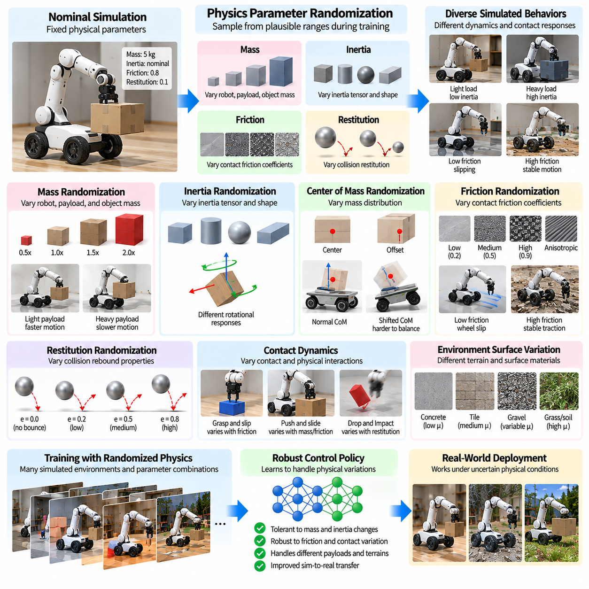{width="7.268055555555556in" height="7.268055555555556in"}

질량, 관성, 마찰 및 물리 무작위화(Mass, Inertia, Friction, and Physics Randomization)는 시뮬레이션에서 학습한 피지컬 AI(Physical AI) 시스템의 강건성(Robustness)을 향상시키기 위한 핵심 기술이다. 실제 로봇은 불확실한 기계적 특성(Mechanical Properties), 변화하는 접촉 조건(Contact Conditions), 불완전한 물리 모델(Physical Model) 아래에서 작동한다. 학습 과정에서 이러한 매개변수를 무작위화하면 제어 정책(Control Policy)이 다양한 동적 거동(Dynamic Behavior)을 경험할 수 있다. 이는 단일 공칭 모델(Nominal Model)에 대한 의존성을 줄이고 시뮬레이션 환경에서 실제 하드웨어로의 더욱 신뢰성 높은 전이(Transfer)를 지원한다.

물리 무작위화(Physics Randomization)는 시뮬레이션 동역학(Simulated Dynamics)과 실제 로봇 동작(Actual Robot Behavior) 사이의 불일치를 다룬다. 정밀하게 보정된 시뮬레이터(Calibrated Simulator)라도 재질 특성(Material Properties), 기계적 공차(Mechanical Tolerances), 마모(Wear), 환경과의 상호작용(Environmental Interaction)을 완벽하게 재현할 수는 없다. 작은 모델링 오차(Modeling Error)도 복잡한 움직임과 접촉이 많은 작업(Contact-Rich Task)에서 누적될 수 있다. 제어된 물리적 변화를 도입하면 정책이 시뮬레이션 엔진(Simulation Engine)에서만 성립하는 가정에 의존하기보다 불확실성에 적응하도록 유도할 수 있다.

질량 무작위화(Mass Randomization)는 로봇, 탑재 하중(Payload), 조작 대상 객체(Manipulated Object)의 질량 관련 동적 특성(Mass-Related Dynamic Properties)을 변경한다. 제조 편차(Manufacturing Variation), 교체 가능한 도구(Interchangeable Tool), 변화하는 탑재 하중은 로봇 시스템의 유효 질량(Effective Mass)을 변화시킬 수 있다. 학습 과정에서는 물리적으로 타당한 운용 범위(Operating Range) 내에서 질량 매개변수(Mass Parameter)를 샘플링한다. 이를 통해 실제 하중이 개발 과정에서 사용한 공칭 구성(Nominal Configuration)과 다르더라도 제어기가 안정적인 움직임과 정확한 조작을 유지하도록 유도한다.

탑재 하중 질량 변화(Payload Mass Variation)는 이동형 매니퓰레이터(Mobile Manipulator), 산업용 로봇(Industrial Robot), 자율 운송 플랫폼(Autonomous Transport Platform)에서 특히 중요하다. 서로 다른 하중을 운반하는 로봇은 가속도(Acceleration), 제동 거리(Braking Distance), 모터 구동력(Motor Effort), 구조적 응답(Structural Response)의 변화를 경험한다. 탑재 하중 질량을 무작위화하면 정책이 실제 배치 전에 이러한 차이를 경험할 수 있다. 그러나 물리적으로 실행 불가능한 운용 조건에서 학습하지 않도록 샘플링된 하중은 로봇의 기계적 허용 용량(Mechanical Capacity)과 액추에이터 한계(Actuator Limit) 이내에 있어야 한다.

관성 무작위화(Inertia Randomization)는 강체(Rigid Body)가 회전 운동(Rotational Motion)의 변화에 저항하는 특성을 변경한다. 관성 텐서(Inertia Tensor)는 질량 분포(Mass Distribution), 기하학적 형상(Geometry), 질량 중심(Center of Mass)의 위치에 따라 결정된다. 질량이 동일한 두 객체라도 내부 질량 분포가 다르면 회전에 대해 서로 다른 반응을 나타낼 수 있다. 다양한 관성 특성을 활용한 학습은 로봇 제어기(Robotic Controller)가 파지(Grasping), 균형 유지(Balancing), 보행(Locomotion), 객체 운송(Object Transportation) 과정에서 불확실한 회전 동역학(Rotational Dynamics)을 처리하도록 지원한다.

질량 중심 무작위화(Center-of-Mass Randomization)는 로봇이나 탑재 하중의 유효 균형점(Effective Balance Point)에 변화를 도입한다. 불균일하게 분포된 화물(Unevenly Distributed Cargo), 서로 다른 도구 부착물(Tool Attachment), 불완전한 조립(Imperfect Assembly)은 질량 중심을 공칭 위치(Nominal Location)에서 이동시킬 수 있다. 이러한 변화는 전도 안정성(Tipping Stability), 관절 토크(Joint Torque), 동적 균형(Dynamic Balance)에 영향을 미친다. 물리적으로 타당한 질량 중심 오프셋(Center-of-Mass Offset)을 시뮬레이션하면 제어 정책이 하중 분포 변화에 대응하고 안정적인 작동을 유지하도록 유도한다.

질량과 관성 매개변수는 물리적 일관성(Physical Consistency)을 유지해야 한다. 관성 텐서의 구성 요소를 임의로 샘플링하면 물리적으로 불가능한 강체 특성(Rigid-Body Property)이나 불안정한 시뮬레이션 동작이 발생할 수 있다. 물리적으로 유효한 관성 텐서는 대칭성(Symmetry), 비퇴화 강체(Nondegenerate Body)에 대한 양의 정부호성(Positive Definiteness), 실현 가능한 질량 분포(Realizable Mass Distribution)에 따른 제약조건을 충족해야 한다. 기하학적 형상, 밀도(Density), 제한된 질량 재분배(Bounded Mass Redistribution)를 기반으로 매개변수를 생성하면 더욱 신뢰할 수 있는 동적 변화를 구현할 수 있다.

마찰 무작위화(Friction Randomization)는 상호작용하는 표면 사이의 접촉력(Contact Force)에 존재하는 불확실성을 모델링한다. 실제 마찰(Friction)은 재질 구성(Material Composition), 표면 상태(Surface Condition), 오염(Contamination), 온도(Temperature), 접촉 역학(Contact Mechanics)에 따라 달라진다. 서로 다른 바닥에서 이동하거나 다양한 표면 마감(Surface Finish)을 가진 객체를 조작하는 로봇은 구동 접지력(Traction)과 운동 저항(Motion Resistance)의 상당한 변화를 경험할 수 있다. 마찰 계수(Friction Coefficient)를 무작위화하면 정책이 더 넓은 접촉 조건에서도 효과적으로 작동하는 행동을 학습하도록 지원한다.

정지 마찰(Static Friction)은 상대적인 미끄럼 운동(Relative Sliding)이 시작되는 것을 방해하는 저항을 결정하며, 운동 마찰(Kinetic Friction)은 미끄럼 운동 중 발생하는 저항을 지배한다. 이러한 특성은 파지 안정성(Grasp Stability), 휠 접지력(Wheel Traction), 객체 조작(Object Manipulation)에 영향을 미친다. 시뮬레이션 엔진은 모든 미시적 상호작용(Microscopic Interaction)을 표현할 수 없는 단순화된 마찰 모델(Simplified Friction Model)을 사용하는 경우가 많다. 물리적으로 타당한 범위에서 마찰 매개변수를 변경하면 일부 모델링 불확실성을 보완하면서 강건한 접촉 인식 제어(Contact-Aware Control)를 유도할 수 있다.

휠 기반 로봇(Wheeled Robot)에서 마찰 무작위화는 가속(Acceleration), 제동(Braking), 선회(Turning), 미끄럼 거동(Slip Behavior)에 직접적인 영향을 미친다. 서로 다른 바닥 재질(Floor Material)과 환경 조건은 타이어와 지면 사이에서 확보할 수 있는 접지력(Tire-Ground Traction)을 변화시킨다. 하나의 마찰 계수만으로 학습한 내비게이션 제어기(Navigation Controller)는 연마된 콘크리트(Polished Concrete), 젖은 표면(Wet Surface), 불균일한 지형(Uneven Terrain)에서 성능이 저하될 수 있다. 접지 조건을 무작위화하면 불확실한 지면 접촉 상태에서 더욱 안전한 속도 조절(Velocity Regulation)과 향상된 안정성을 학습하도록 지원한다.

다족 보행 로봇(Legged Robot)은 보행이 발과 지지 표면(Supporting Surface) 사이의 반복적인 상호작용에 의존하므로 마찰 및 접촉 동역학(Contact Dynamics)에 특히 민감하다. 마찰 변화는 발 디딤 안정성(Foothold Stability), 추진력(Propulsion), 미끄럼 회복(Slip Recovery)에 영향을 미친다. 서로 다른 접촉 매개변수(Contact Parameter)에서 학습하면 보행 정책(Walking Policy)과 균형 제어 정책(Balancing Policy)을 향상시킬 수 있다. 그러나 학습된 행동이 물리적으로 불가능한 지면 반력(Ground Reaction Force)에 의존하지 않도록 시뮬레이션은 현실적인 접촉 제약조건(Contact Constraint)을 표현해야 한다.

반발 계수 무작위화(Restitution Randomization)는 객체 사이의 충돌(Collision) 과정에서 반환되는 에너지(Energy)를 변경한다. 반발 계수(Coefficient of Restitution)는 반발 속도(Rebound Velocity)와 충격 응답(Impact Response)에 영향을 미친다. 이 매개변수는 객체 낙하(Object Dropping), 동적 조작(Dynamic Manipulation), 접촉이 많은 상호작용(Contact-Rich Interaction)에서 중요하다. 다양한 반발 계수로 학습하면 정책이 불확실한 충돌 결과(Collision Outcome)에 대응하도록 지원할 수 있지만, 반발 특성은 충돌 속도(Impact Velocity), 접촉 재질(Contact Material), 물리 엔진의 가정과 일관되게 모델링해야 한다.

접촉 강성 및 감쇠 무작위화(Contact Stiffness and Damping Randomization)는 상호작용 과정에서 표면이 변형되고 에너지를 소산(Energy Dissipation)하는 방식의 차이를 다룬다. 강체 시뮬레이터(Rigid-Body Simulator)는 벌점력(Penalty Force), 제약조건(Constraint), 유연 접촉 모델(Compliant Contact Model)을 통해 접촉을 근사하는 경우가 많다. 강성(Stiffness)과 감쇠(Damping)의 변화는 침투 깊이(Penetration Depth), 충격력(Impact Force), 수치적 안정성(Numerical Stability)에 상당한 영향을 미칠 수 있다. 적절한 무작위화는 비현실적인 진동(Oscillation)이나 불안정한 수치 적분(Numerical Integration)을 발생시키는 매개변수 조합을 피하면서 강건성을 향상시킨다.

관절 마찰(Joint Friction)과 기계적 감쇠(Mechanical Damping)는 로봇 동역학(Robot Dynamics)에 추가적인 불확실성을 도입한다. 베어링(Bearing), 동력 전달 장치(Transmission), 씰(Seal), 기계적 접촉부(Mechanical Interface)는 온도, 마모, 작동 속도(Operating Speed)에 따라 달라지는 저항을 발생시킨다. 점성 감쇠(Viscous Damping), 쿨롱 마찰(Coulomb Friction), 관련 매개변수를 무작위화하면 제어 정책이 시뮬레이션 관절(Simulated Joint)과 실제 기계 장치(Physical Mechanism) 사이의 차이에 대응하도록 지원한다. 이러한 효과는 정밀 운동(Precision Motion)과 저속 조작(Low-Speed Manipulation)에서 특히 중요하다.

중력 무작위화(Gravity Randomization)는 유효 중력 가속도(Effective Gravitational Acceleration)에 제어된 변화를 도입하는 데 사용할 수 있다. 일반적인 지상 배치 장소 사이에서 지구 중력(Earth\'s Gravity)의 변화는 매우 작지만, 제한적인 무작위화는 모델 불확실성(Model Uncertainty)을 보완하거나 특정 학습 환경에서 강건성을 향상시킬 수 있다. 과도한 중력 변화는 의도한 작업 동역학(Task Dynamics)을 왜곡할 수 있다. 따라서 중력 분포(Gravity Distribution)는 무제한적인 다양성의 원천으로 취급하기보다 적용 분야(Application)를 반영해야 한다.

물리 엔진 매개변수(Physics Engine Parameter)도 학습 정책이 경험하는 동역학에 영향을 미칠 수 있다. 적분 시간 간격(Integration Time Step), 솔버 반복 횟수(Solver Iteration), 접촉 허용 오차(Contact Tolerance), 수치적 근사(Numerical Approximation)는 시뮬레이션 움직임과 충돌 응답(Collision Response)에 영향을 미친다. 일부 수치 설정(Numerical Setting)을 변경하면 시뮬레이션 인공 오차(Simulation Artifact)에 대한 민감도를 확인할 수 있다. 그러나 수치적 무작위화(Numerical Randomization)가 정확한 물리 모델링(Physical Modeling)을 대체해서는 안 되며, 불안정한 솔버 구성(Unstable Solver Configuration)은 학습에서 제외해야 한다.

매개변수 분포(Parameter Distribution)는 물리 무작위화의 효과를 결정한다. 균등 샘플링(Uniform Sampling)은 광범위한 조건을 포함하지만 발생 가능성이 낮은 기계적 구성(Mechanical Configuration)에 지나치게 높은 확률을 부여할 수 있다. 부품 사양(Component Specification), 실험 측정값(Experimental Measurement), 시스템 식별(System Identification)에 기반한 분포는 예상되는 불확실성을 더욱 정확하게 표현할 수 있다. 질량, 관성, 마찰, 기하학적 형상 사이의 상관관계(Correlation)가 공통적인 물리적 원인에서 발생한다면 이를 보존해야 한다.

커리큘럼 기반 물리 무작위화(Curriculum-Based Physics Randomization)는 학습 과정에서 동적 불확실성(Dynamic Uncertainty)을 점진적으로 증가시킨다. 초기 단계에서는 공칭 기계 매개변수(Nominal Mechanical Parameter)를 사용하여 기본적인 제어 행동(Control Behavior)을 확립할 수 있다. 이후 단계에서는 더 넓은 질량 분포(Mass Distribution), 마찰 변화(Friction Variation), 접촉 불확실성(Contact Uncertainty)을 도입한다. 이러한 진행 방식은 강건한 정책(Robust Policy)을 개발하면서 학습 안정성(Training Stability)을 향상시킬 수 있다. 적응형 접근법(Adaptive Approach)은 성능 저하나 반복적인 작업 실패(Task Failure)와 관련된 매개변수 조합을 추가로 강조할 수 있다.

대규모 병렬 시뮬레이션(Massively Parallel Simulation)을 사용하면 여러 물리 매개변수 조합(Physical Parameter Combination)에 대해 정책을 동시에 학습할 수 있다. 각 시뮬레이션 로봇 인스턴스(Simulated Robot Instance)에는 서로 다른 질량, 관성 텐서(Inertia Tensor), 마찰 계수(Friction Coefficient), 접촉 특성(Contact Property)을 적용할 수 있다. 공유 정책(Shared Policy)은 이러한 다양한 동적 경험(Dynamic Experience)을 통해 학습한다. 연산 처리량(Computational Throughput)과 의미 있는 학습 신호(Learning Signal)를 유지하려면 효율적인 매개변수 샘플링(Parameter Sampling)과 안정적인 시뮬레이션 실행(Simulation Execution)이 필요하다.

평가 과정에서는 무작위화된 시뮬레이션 조건(Randomized Simulation Condition)과 실제 하드웨어 실험(Physical Hardware Experiment) 모두에서 강건성을 측정해야 한다. 관련 평가 지표(Evaluation Metric)에는 작업 성공률(Task Success Rate), 궤적 추종 오차(Trajectory Tracking Error), 에너지 소비량(Energy Consumption), 미끄럼 발생 빈도(Slip Frequency), 충돌 응답(Collision Response), 안정성 여유(Stability Margin)가 포함된다. 통제된 비교 실험(Controlled Comparison)을 통해 질량, 관성, 마찰, 접촉 무작위화의 개별 기여도를 분리할 수 있다. 현실적인 운용 한계(Operating Limit) 근처에서 수행하는 시험은 불확실한 물리 조건에서 정책의 신뢰성(Policy Reliability)을 평가하는 데 유용한 근거를 제공한다.

물리 무작위화는 액추에이터 모델링(Actuator Modeling), 센서 모델링(Sensor Modeling), 제어 시스템 모델링(Control-System Modeling)과 연계해야 한다. 질량과 마찰의 변화는 필요한 모터 토크(Motor Torque)를 변경하며, 센서 지연(Sensor Delay)과 액추에이터 포화(Actuator Saturation)는 제어기의 응답 방식에 영향을 미친다. 이러한 효과의 상호작용을 고려하지 않고 독립적으로 무작위화하면 실제 상황을 잘못 반영하는 학습 시나리오(Training Scenario)가 생성될 수 있다. 통합 동역학 모델링(Integrated Dynamic Modeling)은 물리적 불확실성, 사용 가능한 구동력(Available Actuation), 관측된 로봇 동작(Observed Robot Behavior) 사이의 일관성을 유지하도록 지원한다.

궁극적으로 질량, 관성, 마찰 및 물리 무작위화(Mass, Inertia, Friction, and Physics Randomization)는 피지컬 AI 시스템이 불확실한 실제 동역학(Real-World Dynamics) 아래에서 작동할 수 있도록 준비시킨다. 그 효과는 물리적으로 유효한 매개변수 범위(Physically Valid Parameter Range), 현실적인 상관관계(Realistic Correlation), 안정적인 수치 시뮬레이션(Stable Numerical Simulation), 체계적인 하드웨어 검증(Systematic Hardware Validation)에 달려 있다. 이러한 기술을 시각적 무작위화(Visual Randomization), 기하학적 무작위화(Geometric Randomization), 센서 무작위화(Sensor Randomization)와 결합하면 강건한 로봇 제어(Robust Robotic Control)와 신뢰성 높은 시뮬레이션-현실 전이(Simulation-to-Reality Transfer)를 위한 더욱 견고한 기반을 제공할 수 있다.

## 03.08. Actuator Control and Latency Randomization

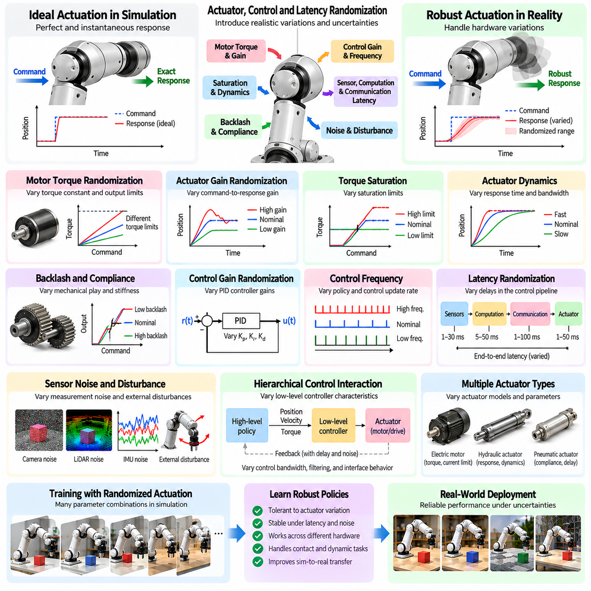{width="7.268055555555556in" height="7.268055555555556in"}

액추에이터, 제어 및 지연 시간 무작위화(Actuator, Control, and Latency Randomization)는 로봇 정책(Robotic Policy)을 시뮬레이션(Simulation)에서 실제 하드웨어(Physical Hardware)로 전이하는 성능을 향상시키기 위한 핵심 기술이다. 실제 액추에이터(Actuator)는 이상화된 시뮬레이션 모델(Idealized Simulation Model)이 예측하는 대로 정확하게 반응하는 경우가 드물며, 제어 시스템(Control System)은 타이밍 변화(Timing Variation)와 통신 지연(Communication Delay)을 경험한다. 학습 과정에서 이러한 특성을 무작위화하면 피지컬 AI(Physical AI) 시스템이 현실적인 실행 불확실성(Execution Uncertainty)을 경험하고, 서로 다른 하드웨어 구성(Hardware Configuration)과 운용 조건(Operating Condition)에서도 안정적인 동작을 학습하도록 유도할 수 있다.

액추에이터 무작위화(Actuator Randomization)는 명령된 동작(Commanded Action)과 실제 기계적 응답(Actual Mechanical Response) 사이의 차이를 다룬다. 모터(Motor), 동력 전달 장치(Transmission), 유압 시스템(Hydraulic System), 공압 장치(Pneumatic Device)는 비선형 거동(Nonlinear Behavior), 제조 공차(Manufacturing Tolerance), 성능 편차(Performance Variation)를 나타낸다. 완벽한 구동(Perfect Actuation)을 가정하여 학습한 제어기는 명령이 즉각적이고 정확하게 실행되는 조건에 의존할 수 있다. 현실적인 액추에이터 불확실성(Actuator Uncertainty)을 도입하면 정책이 불완전한 응답을 보상하고 하드웨어 제약(Hardware Limitation)에도 불구하고 작업 성능(Task Performance)을 유지하도록 유도한다.

모터 토크 무작위화(Motor Torque Randomization)는 제어 명령(Control Command)과 생성되는 기계적 토크(Mechanical Torque) 사이의 관계를 변경한다. 실제 토크는 모터 특성(Motor Characteristics), 전류 제한(Current Limit), 온도(Temperature), 공급 전압(Supply Voltage), 드라이브 전자회로(Drive Electronics)에 따라 달라진다. 물리적으로 타당한 토크 상수(Torque Constant)와 출력 한계(Output Limit)를 샘플링하면 정책이 서로 다른 구동 능력(Actuation Capability)을 경험할 수 있다. 이는 변화하는 기계적 하중(Mechanical Load) 아래에서 동적 보행(Dynamic Locomotion), 고하중 조작(Heavy Manipulation), 급가속(Rapid Acceleration)을 수행하는 로봇에서 특히 중요하다.

액추에이터 이득 무작위화(Actuator Gain Randomization)는 모터나 서보(Servo)가 제어 입력(Control Input)에 반응하는 강도를 변경한다. 증폭기 이득(Amplifier Gain), 드라이브 보정(Drive Calibration), 기계적 동력 전달 효율(Mechanical Transmission Efficiency)의 차이는 결과적인 움직임을 변화시킬 수 있다. 이러한 이득을 무작위화하면 정책이 하나의 정확한 명령-응답 관계(Command-to-Response Relationship)에 의존하지 않도록 할 수 있다. 그러나 실제 배치 과정에서 발생할 수 없는 제어 조건을 생성하지 않도록 이득 범위(Gain Range)는 현실적인 하드웨어 동작과 일치해야 한다.

토크 포화 무작위화(Torque Saturation Randomization)는 모터와 구동 시스템(Drive System)의 물리적 한계를 표현한다. 명령된 토크(Commanded Torque)가 사용 가능한 용량(Available Capacity)을 초과하면 액추에이터는 요구된 출력을 제공할 수 없다. 열 보호(Thermal Protection), 전류 제한(Current Limiting), 공급 전압 저하(Reduced Supply Voltage)로 인해 포화 한계(Saturation Limit)는 더욱 엄격해질 수 있다. 다양한 포화 한계에서 학습하면 제어기가 사용 가능한 구동 능력을 준수하고 지속적으로 비현실적인 모터 성능을 요구하는 제어 전략(Control Strategy)을 피하도록 유도한다.

액추에이터 동역학(Actuator Dynamics)은 명령과 기계적 움직임 사이에 지연(Delay)과 과도 응답(Transient Response)을 발생시킨다. 전기 모터(Electric Motor), 유압 밸브(Hydraulic Valve), 공압 시스템(Pneumatic System)은 내부의 전기적 동역학(Electrical Dynamics), 기계적 동역학(Mechanical Dynamics), 유체 동역학(Fluid Dynamics)에 따라 반응한다. 단순화된 1차 모델(First-Order Model)이나 고차 모델(Higher-Order Model)을 사용하여 이러한 효과를 근사할 수 있다. 응답 시정수(Response Time Constant)와 대역폭(Bandwidth)을 무작위화하면 실제 액추에이터가 공칭 시뮬레이션 모델보다 느리거나 다르게 반응하더라도 정책이 효과적으로 작동하도록 지원한다.

기계적 백래시(Mechanical Backlash)와 동력 전달계 컴플라이언스(Transmission Compliance)는 명령된 움직임과 실제 구현된 움직임 사이에 추가적인 차이를 발생시킨다. 기어박스(Gearbox)에는 데드존(Dead Zone)이 존재할 수 있으며, 벨트(Belt), 샤프트(Shaft), 유연 커플링(Flexible Coupling)은 탄성 변형(Elastic Deformation)을 유발한다. 이러한 효과는 위치 결정 정확도(Positioning Accuracy), 힘 전달(Force Transmission), 진동(Oscillation)에 영향을 미칠 수 있다. 백래시, 강성(Stiffness), 감쇠(Damping) 매개변수를 무작위화하면 특히 정밀 조작(Precision Manipulation)과 운동 방향 전환(Direction Reversal) 과정에서 제어기가 기계적 불완전성(Mechanical Imperfection)에 대응하도록 지원한다.

제어 이득 무작위화(Control Gain Randomization)는 비례 이득(Proportional Gain), 적분 이득(Integral Gain), 미분 이득(Derivative Gain)을 포함한 피드백 제어기(Feedback Controller)의 매개변수를 변경한다. 서로 다른 이득 설정(Gain Setting)은 추종 정확도(Tracking Accuracy), 응답 속도(Response Speed), 오버슈트(Overshoot), 안정성 여유(Stability Margin)에 영향을 미친다. 검증된 범위 내에서 이득을 무작위화하면 기존 제어 루프(Conventional Control Loop)와 상호작용하는 학습 정책(Learned Policy)의 적응성을 향상시킬 수 있다. 그러나 불안정한 제어기 구성(Unstable Controller Configuration)은 실제와 다른 학습 동작과 위험한 동역학을 발생시킬 수 있으므로 제외해야 한다.

학습 정책과 저수준 제어기(Low-Level Controller) 사이의 상호작용은 계층적 로봇 아키텍처(Hierarchical Robotic Architecture)에서 특히 중요하다. 고수준 정책(High-Level Policy)은 목표 위치(Target Position), 목표 속도(Target Velocity), 목표 토크(Target Torque)를 생성하고, 임베디드 제어기(Embedded Controller)는 이러한 명령을 실행할 수 있다. 제어 대역폭(Control Bandwidth), 필터링(Filtering), 명령 해석(Command Interpretation)의 차이는 결과적인 동작을 변화시킬 수 있다. 관련 인터페이스 특성(Interface Characteristics)을 무작위화하면 정책이 현실적인 제어기 구현(Controller Implementation) 전반에서 강건성을 유지하도록 유도한다.

제어 주파수 무작위화(Control Frequency Randomization)는 정책과 피드백 제어기가 명령을 갱신하는 빈도에 변화를 도입한다. 실제 시스템에서는 스케줄링 지터(Scheduling Jitter), 프로세서 부하 변화(Processor Load Variation), 공칭 갱신 주기(Nominal Update Rate)와 실제 갱신 주기(Effective Update Rate) 사이의 차이가 발생할 수 있다. 하나의 완벽하게 고정된 주파수에서 학습한 정책은 타이밍 편차(Timing Deviation)에 민감해질 수 있다. 제한된 주파수 변화(Bounded Frequency Variation)를 활용한 학습은 물리 시스템의 시간적 요구사항(Temporal Requirement)을 유지하면서 더욱 안정적인 응답을 유도한다.

지연 시간 무작위화(Latency Randomization)는 관측(Observation), 의사결정(Decision), 통신(Communication), 구동(Actuation) 사이에서 발생하는 지연을 모델링한다. 로봇 제어 파이프라인(Robotic Control Pipeline)은 센서 데이터 획득(Sensor Acquisition), 데이터 전송(Data Transfer), 인지 처리(Perception Processing), 정책 추론(Policy Inference), 명령 전송(Command Transmission), 액추에이터 실행(Actuator Execution)으로 구성된다. 각 단계는 종단 간 지연(End-to-End Delay)에 영향을 미친다. 이러한 지연을 무작위화하면 정책이 물리 세계의 현재 상태에 즉각적으로 접근할 수 있다고 가정하지 않고, 약간 이전 상태를 나타내는 관측값을 활용하여 동작하도록 학습할 수 있다.

관측 지연(Observation Latency)은 제어기가 사용할 수 있는 상태 정보(State Information)의 정확도에 영향을 미친다. 카메라 프레임(Camera Frame), 라이다 스캔(LiDAR Scan), 고유수용성 측정값(Proprioceptive Measurement)은 해당 물리적 사건이 발생한 이후에 도착할 수 있다. 지연된 관측값(Delayed Observation)은 빠른 움직임 중 추종 오차(Tracking Error)나 부적절한 보정 동작(Corrective Action)을 발생시킬 수 있다. 현실적인 관측 지연을 활용한 학습은 현재 측정값을 사용할 수 없을 때 정책이 시간적 문맥(Temporal Context), 상태 추정(State Estimation), 예측적 행동(Predictive Behavior)을 활용하도록 유도한다.

동작 지연(Action Latency)은 명령을 발행한 시점과 그 물리적 효과를 관측하는 시점 사이의 지연을 의미한다. 네트워크 통신(Network Communication), 모터 제어기(Motor Controller), 명령 대기열(Command Queue), 기계적 응답 동역학(Mechanical Response Dynamics)이 이러한 지연에 기여한다. 동작 지연을 무작위화하면 정책이 명령 실행 타이밍(Command Execution Timing)의 변화를 경험할 수 있다. 이는 작은 지연도 안정성(Stability)과 궤적 정확도(Trajectory Accuracy)에 상당한 영향을 미칠 수 있는 균형 제어 로봇(Balancing Robot)과 고속 매니퓰레이터(High-Speed Manipulator)에서 특히 중요하다.

통신 지터 무작위화(Communication Jitter Randomization)는 분산 로봇 시스템(Distributed Robotic System)에서 메시지 전달 시간(Message Delivery Time)의 변화를 표현한다. 이더넷 네트워크(Ethernet Network), 무선 연결(Wireless Connection), 필드버스(Field Bus), 미들웨어(Middleware)는 변화하는 연산 부하(Computational Load) 아래에서 타이밍 불확실성(Timing Uncertainty)을 발생시킨다. 일정한 지연 시간(Constant Latency)과 달리 지터(Jitter)는 관측과 동작 사이에 불규칙한 시간 간격(Irregular Interval)을 생성한다. 현실적인 지터 분포(Jitter Distribution)를 활용한 학습은 정책이 완벽하게 주기적인 통신을 가정하지 않고 비동기 실행(Asynchronous Execution)에 대응하도록 지원한다.

패킷 손실 및 명령 드롭아웃 무작위화(Packet Loss and Command Dropout Randomization)는 제어 통신(Control Communication)의 일시적인 중단을 시뮬레이션한다. 통신 아키텍처(Communication Architecture)에 따라 명령은 지연되거나 폐기되거나 이전에 수신한 값으로 대체될 수 있다. 이러한 사건은 움직임의 연속성(Motion Continuity)과 추종 성능(Tracking Performance)에 영향을 미칠 수 있다. 무작위화 학습(Randomized Training)은 제한적인 통신 장애(Communication Failure)에 대한 대응 능력을 향상시킬 수 있지만, 안전 필수 시스템(Safety-Critical System)에는 명시적인 워치독(Watchdog), 타임아웃 처리(Timeout Handling), 독립적인 보호 메커니즘(Independent Protective Mechanism)이 여전히 필요하다.

제어 및 지연 시간 매개변수를 무작위화할 때는 시간적 일관성(Temporal Consistency)이 필수적이다. 명령 순서(Command Order)를 고려하지 않고 독립적인 무작위 지연(Random Delay)을 적용하면 비현실적인 실행 순서(Execution Sequence)가 생성될 수 있다. 시뮬레이션은 타임스탬프 관계(Timestamp Relationship), 버퍼링 동작(Buffering Behavior), 액추에이터 명령 스케줄링(Actuator Command Scheduling)을 정확하게 표현해야 한다. 지연 분포(Delay Distribution)에는 일정한 지연 성분(Constant Delay Component), 제한된 지터(Bounded Jitter), 간헐적인 장시간 외란(Occasional Longer Disturbance)을 포함할 수 있으며, 이는 대상 로봇 플랫폼(Robotic Platform)의 특성을 반영해야 한다.

액추에이터 및 지연 시간 무작위화는 물리 동역학(Physical Dynamics)과 연계해야 한다. 무거운 탑재 하중(Heavy Payload)을 운반하는 로봇은 더 느리게 가속할 수 있으며, 제한된 모터 토크(Motor Torque)와 지연된 피드백(Delayed Feedback)은 응답에 추가적인 영향을 미친다. 이러한 효과를 함께 무작위화하면 정책이 실제 운용 과정에서 발생하는 결합된 불확실성(Coupled Uncertainty)을 경험할 수 있다. 물리적으로 일관된 조합(Physically Consistent Combination)은 하드웨어 성능이나 시스템 아키텍처(System Architecture)를 위반하는 임의의 매개변수 변화보다 유용하다.

매개변수 분포(Parameter Distribution)는 모터 사양(Motor Specification), 제어기 측정값(Controller Measurement), 통신 벤치마크(Communication Benchmark), 실험적 식별(Experimental Identification)을 기반으로 설정해야 한다. 균등 샘플링(Uniform Sampling)은 넓은 범위를 포함할 수 있지만, 실제 운용 조건은 구조화된 변화(Structured Variation)를 나타내는 경우가 많다. 온도 의존성 성능 저하(Temperature-Dependent Performance Loss), 전압 변동(Voltage Fluctuation), 처리 지연(Processing Delay)은 서로 다른 분포를 따를 수 있다. 데이터 기반 매개변수 선택(Data-Driven Parameter Selection)은 무작위화된 학습 시나리오(Training Scenario)의 현실적 관련성을 높이고 불필요한 연산 비용(Computational Effort)을 줄인다.

커리큘럼 기반 무작위화(Curriculum-Based Randomization)는 액추에이터 불확실성(Actuator Uncertainty)과 타이밍 외란(Timing Disturbance)을 점진적으로 도입한다. 초기 학습에서는 공칭 액추에이터 응답(Nominal Actuator Response)과 안정적인 제어 주파수(Stable Control Frequency)를 사용하여 기본적인 동작을 확립할 수 있다. 이후 단계에서는 토크 제한(Torque Limitation), 응답 지연(Response Delay), 이득 변화(Gain Variation), 통신 지터(Communication Jitter)를 도입한다. 적응형 무작위화(Adaptive Randomization)는 샘플링된 구성이 실행 가능하고 물리적으로 의미 있는 범위에 유지된다는 조건에서 추종 성능 저하(Poor Tracking)나 불안정한 동작(Unstable Behavior)과 관련된 조건을 강조할 수 있다.

대규모 병렬 시뮬레이션(Massively Parallel Simulation)은 다양한 액추에이터 및 타이밍 구성(Actuator and Timing Configuration)에서 동시에 학습할 수 있도록 한다. 서로 다른 로봇 인스턴스(Robot Instance)는 공통 정책(Common Policy)을 공유하면서도 각각 다른 토크 한계(Torque Limit), 응답 대역폭(Response Bandwidth), 제어 주파수(Control Frequency), 지연 시간 프로파일(Latency Profile)을 경험할 수 있다. 이는 제어 경험(Control Experience)의 다양성을 증가시키고 강건한 정책 최적화(Robust Policy Optimization)를 지원한다. 수치적 인공 오차(Numerical Artifact)가 학습된 동작에 영향을 미치지 않도록 효율적인 시뮬레이션 스케줄링(Simulation Scheduling)과 정확한 시간 모델링(Temporal Modeling)이 필요하다.

평가 과정에서는 궤적 추종 오차(Trajectory Tracking Error), 정착 시간(Settling Time), 오버슈트(Overshoot), 에너지 소비량(Energy Consumption), 작업 성공률(Task Success Rate), 지연 제어(Delayed Control) 조건에서의 안정성을 검토해야 한다. 하드웨어 인 더 루프 시험(Hardware-in-the-Loop Testing)은 실제 배치 전에 학습된 정책을 실제 제어기(Real Controller)와 통신 인터페이스(Communication Interface)에 연결하여 평가할 수 있도록 한다. 통제된 실험(Controlled Experiment)에서는 현실적인 지연 시간과 액추에이터 한계 아래에서 공칭 학습(Nominal Training)과 무작위화 학습(Randomized Training)을 비교해야 한다. 이러한 측정은 강건성 향상이 실제 물리적 성능(Physical Performance)의 신뢰성으로 이어지는지 판단하는 데 도움이 된다.

궁극적으로 액추에이터, 제어 및 지연 시간 무작위화(Actuator, Control, and Latency Randomization)는 피지컬 AI 시스템이 실제 로봇 플랫폼의 불완전한 실행 조건(Imperfect Execution Condition)에 대응할 수 있도록 준비시킨다. 그 효과는 현실적인 하드웨어 모델(Realistic Hardware Model), 제한된 매개변수 분포(Bounded Parameter Distribution), 정확한 시간 관계(Accurate Timing Relationship), 체계적인 검증(Systematic Validation)에 달려 있다. 이러한 기술을 센서 무작위화(Sensor Randomization) 및 물리 무작위화(Physics Randomization)와 통합하면 구동 및 통신의 불확실성에도 불구하고 안정적이고 효율적이며 신뢰성 높은 동작을 유지하는 제어 정책(Control Policy)을 개발하도록 지원한다.

## 03.09. Terrain Weather and Environment Randomization

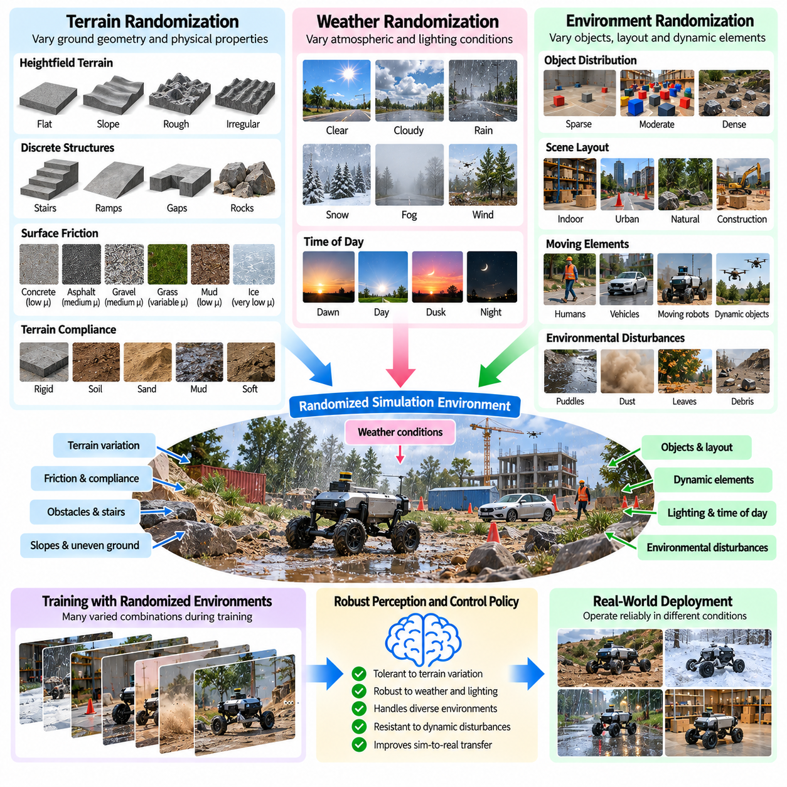{width="7.268055555555556in" height="7.268055555555556in"}

지형, 기상 및 환경 무작위화(Terrain, Weather, and Environment Randomization)는 실제 로봇이 고정된 시뮬레이션 환경과 일치하지 않는 조건에서 작동하기 때문에 강건한 피지컬 AI(Physical AI) 학습의 핵심 구성 요소이다. 지면 표면(Ground Surface), 대기 조건(Atmospheric Condition), 장애물(Obstacle), 환경 외란(Environmental Disturbance)은 인지(Perception)와 움직임(Motion)에 영향을 미친다. 이러한 요소를 무작위화하면 로봇 정책(Robotic Policy)이 다양한 운용 조건(Operating Condition)을 경험하고, 통제된 가상 환경(Controlled Virtual Environment)에서 예측하기 어려운 실제 환경(Physical Environment)으로 전이하는 능력을 향상시킬 수 있다.

지형 무작위화(Terrain Randomization)는 이동로봇(Mobile Robot)과 다족 보행 로봇(Legged Robot)이 접하는 표면의 기하학적 특성(Geometric Characteristics)과 기계적 특성(Mechanical Characteristics)을 변경한다. 실제 환경에는 경사면(Slope), 계단(Step), 균열(Crack), 돌출부(Bump), 불균일한 지면(Uneven Ground)이 존재하며, 이는 이동 능력(Locomotion)과 안정성(Stability)에 영향을 미친다. 평탄한 표면에서만 학습하면 지형 형상이 변화할 때 실패하는 정책이 만들어질 수 있다. 제어된 지형 변화를 도입하면 로봇이 적응형 이동 전략(Adaptive Movement Strategy)을 개발하고 다양한 지면 구성에서 균형을 유지하도록 유도할 수 있다.

지형 높이 필드 무작위화(Terrain Heightfield Randomization)는 고도(Elevation), 경사(Slope), 국부적 불규칙성(Local Irregularity)이 서로 다른 표면을 생성한다. 높이 필드(Heightfield)는 물리 시뮬레이션(Physics Simulation)에서 대규모 지형을 효율적으로 생성하기 위한 표현 방식이다. 고도 진폭(Elevation Amplitude), 공간 주파수(Spatial Frequency), 표면 거칠기(Surface Roughness)와 같은 매개변수는 지형 복잡도(Terrain Complexity)를 결정한다. 이러한 매개변수를 샘플링하면 물리적으로 의미 있는 지형 형상을 유지하면서 완만한 경사, 불규칙한 지면, 어려운 전이 구간(Transition)을 경험하도록 할 수 있다.

절차적 지형 생성(Procedural Terrain Generation)은 계단(Stair), 간극(Gap), 장애물(Obstacle), 경사로(Ramp), 불연속적인 표면 구조(Discrete Surface Structure)를 도입하여 단순한 높이 필드를 넘어 무작위화 범위를 확장한다. 이러한 특징은 서로 다른 보행 및 내비게이션 전략(Locomotion and Navigation Strategy)을 요구한다. 장애물 크기(Obstacle Dimension), 간격(Spacing), 방향(Orientation)을 무작위화하면 다양한 이동 과제를 생성할 수 있다. 지형 생성 과정에서는 실행 가능한 통과 경로(Feasible Traversal Path)와 현실적인 기하학적 제약조건(Geometric Constraint)을 유지하여 학습이 불가능한 이동 과제가 아니라 적응형 행동(Adaptive Behavior)에 집중하도록 해야 한다.

표면 마찰 무작위화(Surface Friction Randomization)는 재질과 환경 조건에 따라 발생하는 접지력(Traction)의 차이를 표현한다. 콘크리트(Concrete), 아스팔트(Asphalt), 자갈(Gravel), 토양(Soil), 잔디(Grass), 젖은 표면(Wet Surface)은 서로 다른 접촉 특성(Contact Property)을 나타낸다. 이러한 변화는 가속(Acceleration), 제동(Braking), 선회(Turning), 미끄럼(Slipping)에 영향을 미친다. 지형 형상과 함께 마찰 계수(Friction Coefficient)를 무작위화하면 불확실한 지면 접촉(Ground Contact) 아래에서 안정적인 이동 전략을 학습하도록 지원하며, 특히 급격한 기동(Rapid Maneuver)이나 무거운 탑재 하중(Heavy Payload)으로 접지력 요구가 증가하는 경우 중요하다.

지형 컴플라이언스 무작위화(Terrain Compliance Randomization)는 표면 변형(Surface Deformation)과 기계적 지지(Mechanical Support)의 차이를 모델링한다. 부드러운 토양(Soft Soil), 모래(Sand), 진흙(Mud), 유연한 바닥재(Flexible Flooring)는 강체 표면(Rigid Surface)과 다르게 작용력(Applied Force)에 반응한다. 접촉 강성(Contact Stiffness), 감쇠(Damping), 관입 저항(Penetration Resistance)은 휠 이동성(Wheel Mobility)과 다족 보행(Legged Locomotion)에 영향을 미친다. 물리적으로 타당한 컴플라이언스 변화를 시뮬레이션하면 정책이 지면 지지력(Ground Support)의 변화에 대응하도록 지원할 수 있지만, 변형이 큰 지형(Highly Deformable Terrain)은 특수한 접촉 모델(Contact Model)이나 입상 재료 모델(Granular Material Model)이 필요할 수 있다.

기상 무작위화(Weather Randomization)는 로봇의 인지, 이동성(Mobility), 운용 신뢰성(Operational Reliability)에 영향을 미치는 대기 조건을 도입한다. 비(Rain), 눈(Snow), 안개(Fog), 바람(Wind), 변화하는 조명(Illumination)은 센서 측정값(Sensor Measurement)과 물리적 상호작용(Physical Interaction)을 변화시킬 수 있다. 이러한 조건은 독립적으로 발생하거나 동시에 나타나 복잡한 환경 불확실성(Environmental Uncertainty)을 형성할 수 있다. 대표적인 기상 시나리오(Weather Scenario)에서 학습하면 로봇이 이상적인 실험실 조건(Laboratory Condition)을 넘어 작업 성능(Task Performance)을 유지하고 특정 배치 환경(Deployment Environment)에 대한 민감도를 줄이도록 지원한다.

강우 무작위화(Rain Randomization)는 강수(Precipitation)가 가시성(Visibility), 표면 접지력(Surface Traction), 센서 신뢰성(Sensor Reliability)에 미치는 영향을 모델링한다. 빗방울(Raindrop)은 카메라 이미지를 가리거나 반사(Reflection)를 발생시키고 일부 광학 측정(Optical Measurement)을 방해할 수 있다. 젖은 표면은 마찰을 감소시키고 제동 거리(Braking Distance)를 증가시킬 수 있다. 현실적인 강우 시뮬레이션(Rain Simulation)은 시각적 효과(Visual Effect)와 그에 상응하는 물리적 변화(Physical Change)를 연결해야 하며, 이를 통해 정책이 저하된 인지 성능(Degraded Perception)과 변화된 지면 접촉 조건에 모두 적절하게 대응하도록 학습할 수 있다.

눈과 얼음 무작위화(Snow and Ice Randomization)는 지형 외관(Terrain Appearance), 표면 마찰(Surface Friction), 장애물 형상(Obstacle Geometry)의 변화를 도입한다. 적설(Snow Accumulation)은 경계(Boundary)를 가리거나 시각적 랜드마크(Visual Landmark)를 감소시키고 통과 가능한 표면(Traversable Surface)을 변화시킬 수 있다. 얼음(Ice)은 사용 가능한 접지력을 크게 감소시켜 미끄럼이나 제어 상실(Loss of Control)의 위험을 높인다. 적설 범위(Snow Coverage), 표면 상태(Surface Condition), 관련 마찰 매개변수를 무작위화하면 현실적인 차량 및 로봇 운용 한계(Operating Limit)를 준수하면서 겨울철 환경(Winter Environment)에 대비하도록 정책을 학습시킬 수 있다.

안개 및 대기 가시성 무작위화(Fog and Atmospheric Visibility Randomization)는 환경 특징(Environmental Feature)을 관측할 수 있는 거리와 선명도를 변경한다. 산란(Scattering)과 감쇠(Attenuation)는 이미지 대비(Image Contrast)를 감소시키고 광학 센싱 기술(Optical Sensing Technology)에 영향을 미칠 수 있다. 가시성 조건(Visibility Condition)은 장애물 검출(Obstacle Detection), 위치 추정(Localization), 내비게이션 계획(Navigation Planning)에 영향을 미친다. 다양한 안개 밀도(Fog Density)에서 학습하면 인지 시스템이 정보 품질(Information Quality)이 저하된 조건에서도 작동하도록 유도할 수 있지만, 센서별 감쇠 특성과 측정 오차(Measurement Error)는 일관되게 모델링해야 한다.

바람 무작위화(Wind Randomization)는 로봇의 움직임을 교란하는 외력(External Force)과 모멘트(Moment)를 도입한다. 공중 로봇(Aerial Robot)은 풍속(Wind Speed), 풍향(Wind Direction), 돌풍(Gust), 난류(Turbulence)에 특히 민감하며, 이동형 매니퓰레이터(Mobile Manipulator)와 경량 플랫폼(Lightweight Platform)도 상당한 외란을 경험할 수 있다. 바람장(Wind Field)을 무작위화하면 제어 정책이 외란 억제 능력(Disturbance Rejection Capability)을 개발하도록 지원한다. 현실적인 돌풍은 시뮬레이션의 매 단계에서 독립적인 무작위 힘처럼 작용하지 않으므로 바람 모델은 공간적 상관관계(Spatial Correlation)와 시간적 상관관계(Temporal Correlation)를 고려해야 한다.

환경 조명 무작위화(Environmental Illumination Randomization)는 태양광(Sunlight), 구름량(Cloud Cover), 그림자(Shadow), 시간대(Time of Day)에 따른 변화를 표현한다. 실외 로봇(Outdoor Robot)은 빠르게 변화하는 밝기(Brightness), 강한 방향성 조명(Directional Lighting), 낮은 대비(Low Contrast) 조건을 경험할 수 있다. 이러한 효과는 카메라 관측(Camera Observation)과 시각적 위치 추정(Visual Localization)에 영향을 미친다. 조명 변화를 지형 및 기상 변화와 결합하면 더욱 현실적인 학습 시나리오를 생성할 수 있으며, 이때 조명 조건은 시뮬레이션 환경과 일관성을 유지해야 한다.

동적 장애물 무작위화(Dynamic Obstacle Randomization)는 움직이는 사람(Pedestrian), 차량(Vehicle), 동물(Animal), 기타 에이전트(Agent)를 시뮬레이션 환경에 도입한다. 이들의 위치(Position), 속도(Velocity), 궤적(Trajectory), 상호작용 패턴(Interaction Pattern)은 학습 에피소드(Training Episode)마다 달라질 수 있다. 이를 통해 내비게이션 정책(Navigation Policy)이 불확실하고 지속적으로 변화하는 주변 환경을 경험하도록 한다. 로봇이 인위적인 움직임 패턴(Artificial Movement Pattern)을 악용하는 대신 동적 장애물에 안전하게 대응하도록 현실적인 운동 제약조건(Motion Constraint)과 충돌 회피 요구사항(Collision Avoidance Requirement)을 유지해야 한다.

환경 혼잡도 무작위화(Environmental Clutter Randomization)는 작업 공간(Workspace)을 차지하는 객체의 수, 배치, 특성을 변경한다. 창고(Warehouse), 건설 현장(Construction Site), 농업 현장(Agricultural Field), 공공 환경(Public Environment)에는 다양한 수준의 혼잡도(Clutter)와 임시 장애물(Temporary Obstacle)이 존재한다. 이러한 조건을 무작위화하면 인지 및 경로 계획(Path Planning)의 강건성을 향상시킬 수 있다. 객체 배치(Object Placement)는 의미적으로 타당하고(Semantically Plausible) 물리적으로 실현 가능해야 하며, 접근 가능한 경로(Accessible Route)와 의미 있는 작업 구성(Task Configuration)을 유지해야 한다.

환경 외란 무작위화(Environmental Disturbance Randomization)에는 진동(Vibration), 지면 운동(Ground Motion), 먼지(Dust), 기계적 간섭(Mechanical Interference)도 포함된다. 산업용 로봇(Industrial Robot)은 주변 기계 장치(Nearby Machinery)에서 발생하는 진동을 경험할 수 있으며, 현장 로봇(Field Robot)은 공기 중 입자(Airborne Particle)와 불안정한 지지 표면(Unstable Supporting Surface)에 직면할 수 있다. 이러한 외란은 센서 측정값과 제어 정확도(Control Accuracy)에 동시에 영향을 미칠 수 있다. 연계 무작위화(Coordinated Randomization)는 독립적인 시각적 또는 기계적 교란만으로는 표현하기 어려운 결합된 환경 효과(Coupled Environmental Effect)를 모델링하도록 지원한다.

계절 및 지리적 무작위화(Seasonal and Geographical Randomization)는 학습 과정에서 표현되는 환경 조건의 범위를 확장한다. 서로 다른 지역(Region)은 지형 구성(Terrain Composition), 식생(Vegetation), 강수량(Precipitation), 온도(Temperature), 일조 패턴(Daylight Pattern)에서 차이를 나타낸다. 계절 변화(Seasonal Change)는 장면 외관(Scene Appearance)과 물리적 상호작용 특성(Physical Interaction Property)을 모두 변화시킬 수 있다. 대표적인 환경 조합(Environmental Combination)을 샘플링하면 모든 가능한 조건이 동일한 확률로 발생한다고 가정하지 않고도 다양한 배치 장소(Deployment Location)에 대한 정책의 일반화(Generalization)를 지원할 수 있다.

환경 무작위화는 기상, 지형, 물리 동역학(Physical Dynamics) 사이의 관계를 유지해야 한다. 폭우(Heavy Rain)는 표면 수분(Surface Moisture)을 증가시킬 수 있으며, 영하의 온도(Freezing Temperature)는 접지력과 재질 거동(Material Behavior)을 변화시킬 수 있다. 이러한 관계를 고려하지 않은 독립적 샘플링(Independent Sampling)은 물리적으로 타당하지 않은 조합을 생성할 수 있다. 조건부 분포(Conditional Distribution)와 환경별 제약조건(Environment-Specific Constraint)은 더욱 일관된 시나리오를 제공하고 정책이 현실적인 외란 조합(Disturbance Combination)에 대응하도록 유도한다.

무작위화 분포 설계(Randomization Distribution Design)는 학습 과정에서 서로 다른 지형 및 기상 조건이 나타나는 빈도를 결정한다. 균등 샘플링(Uniform Sampling)은 광범위한 조건을 포함할 수 있지만 드물거나 극단적인 시나리오(Rare or Extreme Scenario)를 과도하게 표현할 수 있다. 기후 기록(Climate Record), 지형 조사(Terrain Survey), 운용 요구사항(Operational Requirement), 현장 측정값(Field Measurement)은 현실적인 매개변수 범위(Parameter Range)를 결정하는 근거가 될 수 있다. 정상 운용 조건(Normal Operating Condition)과 예외적인 외란(Exceptional Disturbance)을 구분하면 작업 성능, 강건성, 학습 효율성(Training Efficiency) 사이의 균형을 유지하는 데 도움이 된다.

커리큘럼 기반 환경 무작위화(Curriculum-Based Environment Randomization)는 지형 복잡도와 환경 불확실성을 점진적으로 증가시킨다. 초기 학습에서는 양호한 가시성 조건에서 평탄한 표면(Smooth Surface)을 사용할 수 있다. 이후 단계에서는 거친 지형(Rough Terrain), 감소된 접지력(Reduced Traction), 동적 장애물, 악천후(Adverse Weather)를 도입한다. 적응형 커리큘럼(Adaptive Curriculum)은 정책 실패(Policy Failure)와 관련된 시나리오를 강조할 수 있다. 이러한 진행 방식은 안정적인 학습(Stable Learning)을 지원하면서 로봇이 점차 어려워지는 실제 배치 조건에 대비하도록 한다.

대규모 병렬 시뮬레이션(Massively Parallel Simulation)을 사용하면 수천 개의 지형 및 환경 구성(Terrain and Environmental Configuration)에서 동시에 학습할 수 있다. 각 시뮬레이션 로봇 인스턴스(Simulated Robot Instance)는 서로 다른 표면 형상(Surface Geometry), 마찰(Friction), 조명(Illumination), 기상(Weather), 장애물 배치(Obstacle Arrangement)를 경험할 수 있다. 공유 정책(Shared Policy)은 다양한 환경 상호작용(Environmental Interaction)을 통해 학습하고 더 넓은 운용 능력(Operating Capability)을 개발한다. 학습 처리량(Training Throughput)과 유용한 학습 신호(Learning Signal)를 유지하려면 효율적인 절차적 생성(Procedural Generation)과 물리적으로 일관된 시뮬레이션(Physically Consistent Simulation)이 필수적이다.

평가 과정에서는 대표적인 지형 유형(Terrain Class), 기상 조건, 환경 외란에 걸쳐 성능을 검토해야 한다. 관련 평가 지표(Evaluation Metric)에는 작업 성공률(Task Success Rate), 지형 통과 안정성(Traversal Stability), 미끄럼 발생 빈도(Slip Frequency), 위치 추정 정확도(Localization Accuracy), 충돌률(Collision Rate), 에너지 소비량(Energy Consumption), 복구 성능(Recovery Performance)이 포함된다. 학습에서 제외된 환경(Held-Out Environment)에 대한 시험은 학습 분포(Training Distribution)를 넘어서는 일반화 성능을 측정하는 데 도움이 된다. 시뮬레이션에서 확보한 강건성이 신뢰할 수 있는 실제 운용으로 이어지는지 판단하려면 실제 현장 실험(Physical Field Experiment)이 여전히 필요하다.

궁극적으로 지형, 기상 및 환경 무작위화(Terrain, Weather, and Environment Randomization)는 피지컬 AI 시스템이 실제 배치 조건(Real Deployment Condition)의 다양성과 불확실성에 대비하도록 한다. 그 효과는 현실적인 환경 모델(Realistic Environmental Model), 일관된 매개변수 관계(Coherent Parameter Relationship), 적절한 샘플링 분포(Sampling Distribution), 체계적인 검증(Systematic Validation)에 달려 있다. 이러한 기술을 물리 무작위화(Physics Randomization), 센서 무작위화(Sensor Randomization), 액추에이터 무작위화(Actuator Randomization)와 통합하면 변화하는 환경 전반에서 신뢰성 높은 인지(Perception), 내비게이션(Navigation), 제어(Control)를 유지할 수 있는 로봇 정책을 개발하도록 지원한다.

## 03.10. Robot Morphology and Payload Randomization

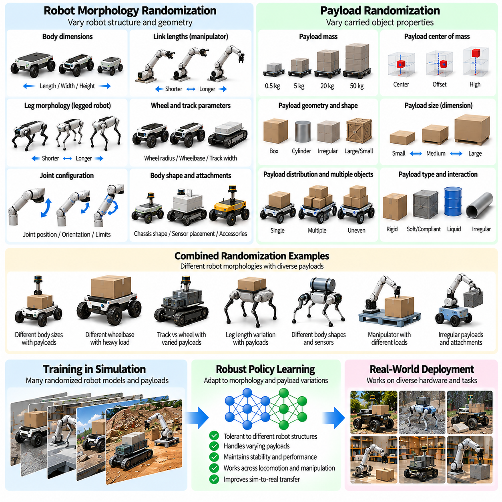{width="7.268055555555556in" height="7.268055555555556in"}

로봇 형태 및 탑재 하중 무작위화(Robot Morphology and Payload Randomization)는 시뮬레이션에서 학습한 피지컬 AI(Physical AI) 시스템의 적응성(Adaptability)을 향상시키기 위한 중요한 기술이다. 실제 로봇 플랫폼(Robotic Platform)은 기하학적 형상(Geometry), 기계적 구성(Mechanical Configuration), 부품 치수(Component Dimension), 운반 하중(Carried Load)에서 다양한 편차를 나타낸다. 이러한 차이는 움직임(Motion), 안정성(Stability), 센싱(Sensing), 제어(Control)에 영향을 미친다. 학습 과정에서 로봇 구조(Robot Structure)와 탑재 하중 특성(Payload Characteristics)을 무작위화하면 하드웨어 편차(Hardware Variation)와 변화하는 운용 요구사항(Operational Requirement)에서도 정책이 효과적으로 작동하도록 지원할 수 있다.

로봇 형태(Robot Morphology)는 로봇이 환경과 상호작용하는 방식을 결정하는 물리적 구조(Physical Structure)와 구성 요소의 배치(Component Arrangement)를 의미한다. 관련 특성에는 몸체 치수(Body Dimension), 팔다리 길이(Limb Length), 관절 위치(Joint Location), 휠 간격(Wheel Spacing), 액추에이터 배치(Actuator Placement)가 포함된다. 동일한 설계로 제조된 로봇이라도 작은 기하학적 차이(Geometric Difference)가 발생할 수 있다. 형태 무작위화(Morphology Randomization)는 학습 정책(Learning Policy)이 이러한 변화를 경험하도록 하며, 하나의 정밀하게 정의된 기계적 구성(Mechanical Configuration)에 대한 의존성을 줄인다.

기하학적 형태 무작위화(Geometric Morphology Randomization)는 몸체 길이(Body Length), 너비(Width), 높이(Height), 구성 요소 비율(Component Proportion)과 같은 치수를 변경한다. 이러한 매개변수는 통과 여유 공간(Clearance), 도달 가능성(Reachability), 회전 반경(Turning Radius), 충돌 형상(Collision Geometry)에 영향을 미친다. 휠베이스(Wheelbase)가 다른 이동로봇(Mobile Robot)은 서로 다른 조향 동작(Steering Behavior)이 필요할 수 있으며, 링크 길이(Link Length)가 변경된 매니퓰레이터(Manipulator)는 작업 공간 기하학(Workspace Geometry)이 변화한다. 물리적으로 타당한 치수 범위에서 학습하면 제어기가 전체 재학습(Complete Retraining) 없이 기계적 차이에 적응하도록 지원할 수 있다.

관절 구성 무작위화(Joint Configuration Randomization)는 선택된 관절의 위치(Position), 방향(Orientation), 운동 한계(Motion Limit), 기계적 관계(Mechanical Relationship)를 변경한다. 관절 배치(Joint Placement)는 운동학적 구조(Kinematic Structure)를 결정하며, 운동 한계는 도달 가능한 구성(Reachable Configuration)을 제한한다. 이러한 특성을 무작위화하면 로봇 변형 모델(Robot Variant)과 제조 공차(Manufacturing Tolerance)에 대한 적응성을 향상시킬 수 있다. 그러나 임의의 관절 변경은 기계적으로 불가능한 구조를 생성할 수 있으므로 유효한 운동학적 체인(Kinematic Chain)과 실행 가능한 운동 범위(Feasible Motion Range)를 유지해야 한다.

팔다리 및 링크 무작위화(Limb and Link Randomization)는 다족 보행 로봇(Legged Robot)과 매니퓰레이터에서 특히 중요하다. 링크 길이(Link Length), 분절 질량(Segment Mass), 관절 간격(Joint Spacing)의 변화는 도달 범위(Reach), 균형(Balance), 운동 효율성(Movement Efficiency)에 영향을 미친다. 긴 팔다리는 도달 가능한 작업 공간(Reachable Workspace)을 확장할 수 있지만 토크 요구량(Torque Requirement)과 동적 응답(Dynamic Response)도 변화시킨다. 물리적으로 타당한 여러 팔다리 구성에서 학습하면 정책이 기계적 구조가 움직임에 미치는 영향을 인식하고 그에 따라 제어 동작(Control Behavior)을 조정하도록 유도할 수 있다.

휠 및 트랙 형태 무작위화(Wheel and Track Morphology Randomization)는 이동로봇의 주행 시스템(Locomotion System)에서 발생하는 변화를 다룬다. 휠 반경(Wheel Radius), 휠베이스(Wheelbase), 트랙 폭(Track Width), 접촉 형상(Contact Geometry)은 속도(Speed), 선회 동작(Turning Behavior), 장애물 통과 능력(Obstacle Traversal), 접지력(Traction)에 영향을 미친다. 휠 치수의 차이는 엔코더 해석(Encoder Interpretation)과 속도 추정(Velocity Estimation)에도 영향을 준다. 이러한 매개변수를 무작위화하면 조향 및 구동계 제약조건(Steering and Drivetrain Constraint)을 준수하면서 다양한 플랫폼 구성에서 내비게이션 및 운동 제어 정책(Navigation and Motion Control Policy)이 효과적으로 작동하도록 지원할 수 있다.

로봇 몸체 형상 무작위화(Robot Body Shape Randomization)는 충돌 회피(Collision Avoidance)와 환경 상호작용(Environmental Interaction)에 영향을 미치는 구조적 형상(Structural Geometry)을 변경한다. 섀시 치수(Chassis Dimension), 보호 커버(Protective Cover), 장착 액세서리(Mounted Accessory)의 변화는 장애물 통과 여유 공간(Obstacle Clearance)과 접근 가능한 경로(Accessible Pathway)를 변경할 수 있다. 조작 시스템(Manipulation System)에서는 몸체 형상이 자기 충돌(Self-Collision)과 도달 가능한 작업 공간에도 영향을 미친다. 현실적인 형상 변화를 활용한 학습은 정책이 충돌 인식(Collision Awareness)을 유지하고 서로 다른 물리적 구성에 맞게 운동 계획(Motion Planning)을 조정하도록 지원한다.

형태 무작위화는 기하학적 형상(Geometry), 질량(Mass), 관성(Inertia), 구동(Actuation) 사이의 일관성을 유지해야 한다. 관성이나 토크 요구량을 갱신하지 않고 링크 길이를 증가시키면 비현실적인 동적 거동(Dynamic Behavior)이 발생할 수 있다. 마찬가지로 휠 반경을 변경하면 접촉 형상뿐 아니라 회전 속도(Rotational Speed)와 선속도(Linear Velocity) 사이의 관계도 변화한다. 물리적으로 일관된 매개변수 갱신(Physically Consistent Parameter Update)은 시뮬레이션 로봇이 무작위화된 특성의 단절된 조합이 아니라 현실적으로 구현 가능한 기계 시스템(Mechanical System)을 표현하도록 보장한다.

탑재 하중 무작위화(Payload Randomization)는 운반 객체(Carried Object)의 질량, 치수, 위치, 기계적 특성(Mechanical Characteristics)에 변화를 도입한다. 물류(Logistics), 제조(Manufacturing), 서비스(Service) 분야에서 사용되는 로봇은 작업마다 서로 다른 하중을 처리하는 경우가 많다. 이러한 변화는 가속(Acceleration), 제동(Braking), 균형(Balance), 에너지 소비량(Energy Consumption)에 영향을 미친다. 무작위화된 탑재 하중을 활용한 학습은 실제 배치 과정에서 운용 조건이 변화하더라도 정책이 신뢰성 높은 성능을 유지하도록 유도한다.

탑재 하중 질량 무작위화(Payload Mass Randomization)는 이동 운송 로봇(Mobile Transport Robot)과 로봇 매니퓰레이터(Robotic Manipulator)에서 특히 중요하다. 탑재 하중 질량이 증가하면 가속 및 감속(Acceleration and Deceleration)에 필요한 힘(Force)과 토크(Torque)가 증가한다. 무거운 하중은 달성 가능한 속도(Achievable Speed)를 감소시키거나 더욱 보수적인 운동 계획(Conservative Motion Planning)을 요구할 수 있다. 정격 운용 한계(Rated Operating Limit) 내에서 탑재 하중 질량을 무작위화하면 정책이 비현실적으로 높은 액추에이터 구동 능력(Actuator Capability)에 의존하는 전략을 피하면서 적절한 제어 응답(Control Response)을 학습하도록 지원한다.

탑재 하중 질량 중심 무작위화(Payload Center-of-Mass Randomization)는 불균일하거나 변화하는 하중 분포(Load Distribution)를 표현한다. 로봇의 기하학적 중심(Geometric Center)에서 벗어난 위치에 탑재된 하중은 추가적인 모멘트(Moment)를 발생시키고 전도 안정성(Tipping Stability)을 변화시킬 수 있다. 매니퓰레이터에서는 편심 하중(Offset Load)이 작업 공간 전체에서 관절 토크 요구량(Joint Torque Requirement)을 변경한다. 탑재 하중의 위치와 질량 분포를 무작위화하면 정책이 이러한 효과를 보상하고 서로 다른 적재 구성(Loading Configuration)에서 안정적인 움직임을 유지하도록 유도한다.

탑재 하중 형상 무작위화(Payload Geometry Randomization)는 객체의 치수(Dimension), 형상(Shape), 접촉 인터페이스(Contact Interface)를 변경한다. 큰 탑재 하중은 센서 시야(Sensor Visibility)를 가리거나 기동성(Maneuverability)을 제한하고 충돌 위험(Collision Risk)을 증가시킬 수 있다. 불규칙한 형상(Irregular Shape)은 파지 안정성(Grasp Stability)과 접촉 거동(Contact Behavior)도 변화시킬 수 있다. 현실적인 탑재 하중 형상 전반에서 학습하면 로봇 시스템이 객체 크기(Object Size)와 공간적 배치(Spatial Arrangement)의 차이를 고려하면서 조작 및 내비게이션 전략(Manipulation and Navigation Strategy)을 조정하도록 지원한다.

탑재 하중 부착 무작위화(Payload Attachment Randomization)는 하중이 로봇 구조(Robotic Structure)에 연결되는 방식의 변화를 모델링한다. 그리퍼(Gripper), 장착 브래킷(Mounting Bracket), 후크(Hook), 운송 고정 장치(Transport Fixture)는 서로 다른 기계적 제약조건(Mechanical Constraint)을 도입한다. 부착 강성(Attachment Stiffness), 정렬(Alignment), 허용 운동(Allowable Movement)은 하중 안정성(Load Stability)에 영향을 미칠 수 있다. 이러한 차이를 시뮬레이션하면 정책이 부착 불확실성(Attachment Uncertainty)에 대응하도록 지원할 수 있지만, 부착 구성은 기계적으로 실현 가능해야 하며 의도한 운용 절차(Operating Procedure)와 일치해야 한다.

로봇 형태와 탑재 하중의 변화는 액추에이터 요구사항(Actuator Requirement)과 제어 권한(Control Authority)에 영향을 미친다. 긴 매니퓰레이터 링크는 지레 효과(Leverage)를 증가시키고 더 큰 관절 토크(Joint Torque)를 요구할 수 있으며, 무거운 이동로봇은 가속과 정지에 더 많은 구동력(Actuation Effort)이 필요하다. 구조적 조건(Structural Condition)과 적재 조건(Loading Condition)을 함께 무작위화하면 정책이 결합된 기계적 불확실성(Coupled Mechanical Uncertainty)을 경험할 수 있다. 비현실적인 학습 결과를 방지하려면 액추에이터 한계(Actuator Limit)와 열적 제약조건(Thermal Constraint)이 각 구성과 일관성을 유지해야 한다.

형태 인식 관측(Morphology-Aware Observation)은 서로 다른 로봇 구조에 대한 적응성을 향상시킬 수 있다. 정책은 관절 위치(Joint Location), 링크 치수(Link Dimension), 질량 추정값(Mass Estimate), 탑재 하중 정보(Payload Information)를 추가 입력(Additional Input)으로 받을 수 있다. 이러한 기술 정보(Descriptor)는 물리적 구성의 변화와 예상하지 못한 외란(Unexpected Disturbance)을 구분하는 데 도움이 된다. 명시적인 형태 정보(Explicit Morphology Information)를 사용할 수 없는 경우에는 순환 정책(Recurrent Policy)이나 온라인 추정 방법(Online Estimation Method)을 통해 움직임 이력(Motion History)과 관측된 제어 응답(Observed Control Response)으로부터 관련 특성을 추론할 수 있다.

매개변수화된 로봇 모델(Parameterized Robot Model)은 형태 무작위화를 위한 효율적인 기반을 제공한다. 공통 로봇 기술 모델(Common Robot Description)은 치수, 관절 위치, 물리적 특성(Physical Property)을 조정하여 기계적으로 유효한 여러 변형 모델(Variant)을 생성할 수 있다. 절차적 생성 도구(Procedural Generation Tool)는 충돌 메시(Collision Mesh), 관성 텐서(Inertia Tensor), 액추에이터 매핑(Actuator Mapping)을 일관되게 갱신할 수 있다. 이러한 접근법은 개별 시뮬레이션 모델을 별도로 구축하는 데 필요한 공학적 노력(Engineering Effort)을 줄이면서 로봇 변형에 대한 체계적인 탐색(Systematic Exploration)을 지원한다.

무작위화 분포(Randomization Distribution)는 제조 공차(Manufacturing Tolerance), 제품 변형 모델(Product Variant), 탑재 하중 사양(Payload Specification), 예상 운용 조건(Expected Operating Condition)을 반영해야 한다. 지나치게 넓은 분포는 발생 가능성이 낮거나 물리적으로 불가능한 구성을 포함할 수 있다. 반대로 지나치게 좁은 분포는 실제 편차에 대응하기 위한 충분한 강건성을 제공하지 못할 수 있다. 공학적 제약조건(Engineering Constraint)에 기반한 구조화된 샘플링(Structured Sampling)은 일반화(Generalization), 학습 효율성(Training Efficiency), 대상 로봇 계열(Intended Robot Family)의 현실적인 표현 사이에서 균형을 유지하도록 지원한다.

커리큘럼 기반 형태 무작위화(Curriculum-Based Morphology Randomization)는 학습 과정에서 구조적 변화(Structural Variation)와 탑재 하중 변화(Payload Variation)의 범위를 점진적으로 확장한다. 초기 단계에서는 제한된 탑재 하중 불확실성(Payload Uncertainty)을 가진 공칭 로봇 구성(Nominal Robot Configuration)을 사용할 수 있다. 이후 단계에서는 링크 치수, 휠 매개변수(Wheel Parameter), 질량 분포(Mass Distribution), 부착 구성(Attachment Configuration)의 변화 범위를 넓힌다. 적응형 커리큘럼(Adaptive Curriculum)은 성능이 낮은 구성에 집중하여 학습 초기부터 과도한 복잡성을 도입하지 않으면서 정책의 강건성을 향상시키도록 지원할 수 있다.

대규모 병렬 시뮬레이션(Massively Parallel Simulation)을 사용하면 다양한 형태 및 탑재 하중 구성(Morphology and Payload Configuration)에서 동시에 학습할 수 있다. 서로 다른 로봇 인스턴스(Robot Instance)는 공통 정책(Common Policy)을 공유하면서도 몸체 형상(Body Geometry), 관절 매개변수(Joint Parameter), 휠 치수(Wheel Dimension), 운반 하중(Carried Load)이 서로 다를 수 있다. 이는 학습 시스템이 다양한 기계적 거동(Mechanical Behavior)을 경험하도록 하며 구성 간 일반화(Cross-Configuration Generalization)를 지원한다. 연산 처리량(Computational Throughput)을 유지하려면 효율적인 모델 생성(Model Generation)과 안정적인 물리 시뮬레이션(Stable Physics Simulation)이 필수적이다.

평가 과정에서는 익숙한 로봇 구성(Familiar Robot Configuration)과 이전에 경험하지 못한 로봇 구성(Previously Unseen Robot Configuration) 모두에서 성능을 검토해야 한다. 관련 평가 지표(Evaluation Metric)에는 작업 성공률(Task Success Rate), 궤적 추종 오차(Trajectory Tracking Error), 안정성 여유(Stability Margin), 에너지 소비량(Energy Consumption), 충돌 빈도(Collision Frequency), 탑재 하중 처리 정확도(Payload Handling Accuracy)가 포함된다. 학습에서 제외된 형태 및 탑재 하중 조합(Held-Out Morphology and Payload Combination)을 시험하면 정책이 전이 가능한 제어 원리(Transferable Control Principle)를 학습했는지 판단할 수 있다. 시뮬레이션에서 확보한 적응성이 실제 하드웨어 편차에도 적용되는지 검증하려면 물리적 실험(Physical Experiment)이 필요하다.

형태 및 탑재 하중 무작위화는 모듈형 및 재구성 가능한 로봇 플랫폼(Modular and Reconfigurable Robotic Platform)도 지원한다. 로봇은 서로 다른 작업을 수행하기 위해 도구(Tool), 부착 장치(Attachment), 휠 어셈블리(Wheel Assembly), 구조 모듈(Structural Module)을 변경할 수 있다. 호환 가능한 구성(Compatible Configuration) 전반에서 학습하면 모든 하드웨어 배치(Hardware Arrangement)에 대해 별도의 정책을 개발해야 하는 필요성을 줄일 수 있다. 그러나 상당한 구조적 변화(Substantial Structural Change)가 발생하면 관측 표현(Observation Representation), 동작 매핑(Action Mapping), 추가적인 정책 적응(Policy Adaptation)을 갱신해야 할 수 있다.

궁극적으로 로봇 형태 및 탑재 하중 무작위화(Robot Morphology and Payload Randomization)는 시뮬레이션 기반 학습(Simulation-Based Learning)의 범위를 하나의 고정된 로봇 몸체(Fixed Robotic Body)를 넘어 확장한다. 그 효과는 기계적으로 유효한 구성(Mechanically Valid Configuration), 일관된 동적 특성(Consistent Dynamic Property), 현실적인 매개변수 분포(Realistic Parameter Distribution), 체계적인 하드웨어 검증(Systematic Hardware Validation)에 달려 있다. 이러한 기술을 물리 무작위화(Physics Randomization), 센서 무작위화(Sensor Randomization), 액추에이터 무작위화(Actuator Randomization)와 결합하면 피지컬 AI 시스템이 구조적 차이(Structural Difference)와 변화하는 탑재 하중 조건(Payload Condition)에 적응할 수 있는 강건한 제어 정책(Robust Control Policy)을 개발하도록 지원한다.

## 03.11. Randomization Distribution Design

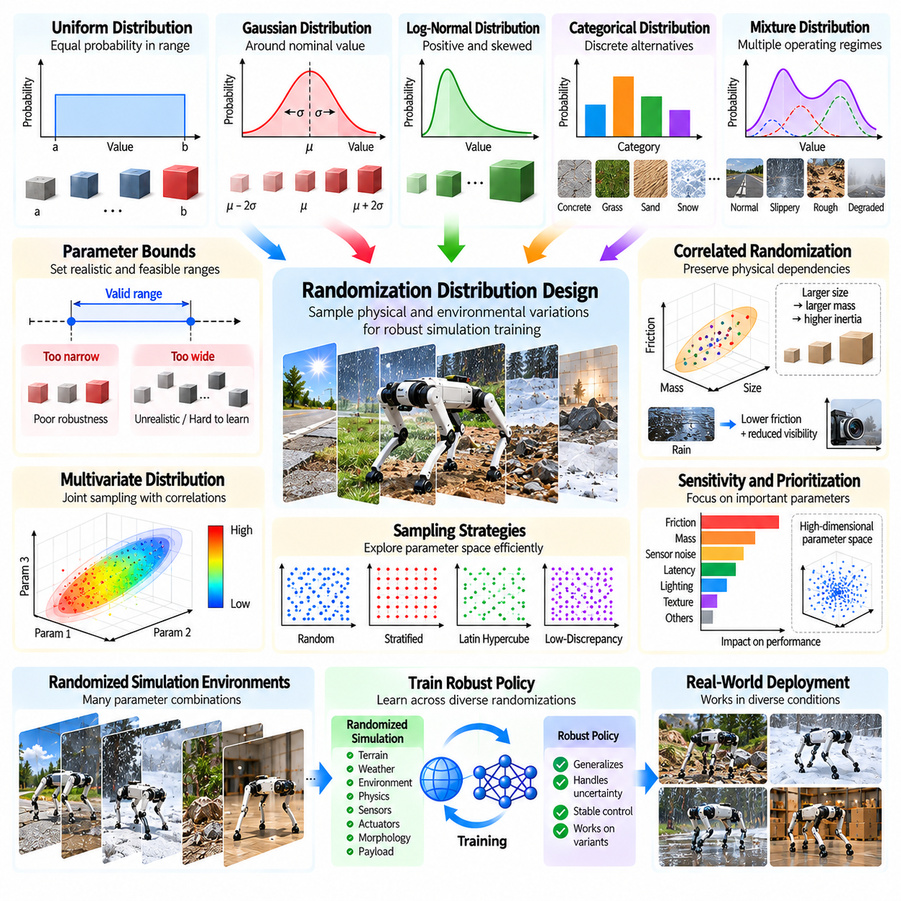{width="7.268055555555556in" height="7.268055555555556in"}

무작위화 분포 설계(Randomization Distribution Design)는 시뮬레이션 기반 학습(Simulation-Based Training) 과정에서 물리적 변화(Physical Variation)와 환경적 변화(Environmental Variation)를 샘플링하는 방식을 결정한다. 피지컬 AI(Physical AI)의 목표는 단순히 무작위성을 극대화하는 것이 아니라 실제 환경에서 신뢰성 높은 운용을 지원할 수 있는 불확실성(Uncertainty)을 학습 정책(Learning Policy)에 경험시키는 것이다. 선택된 분포(Distribution)는 학습 효율성(Training Efficiency), 정책 강건성(Policy Robustness), 시뮬레이션에서 현실로의 전이(Simulation-to-Reality Transfer)에 영향을 미친다. 잘못 설계된 분포는 비현실적인 경험을 생성하거나 중요한 실제 운용 조건(Deployment Condition)을 충분히 반영하지 못할 수 있다.

무작위화 분포(Randomization Distribution)는 시뮬레이션 매개변수(Simulation Parameter)의 특정 값을 선택할 확률을 정의한다. 이러한 매개변수에는 질량(Mass), 마찰(Friction), 조명(Lighting), 센서 잡음(Sensor Noise), 액추에이터 응답(Actuator Response), 환경 조건(Environmental Condition)이 포함될 수 있다. 각 매개변수는 지정된 경계값(Bound)과 통계적 특성(Statistical Property)을 가진 확률 분포(Probability Distribution)로 표현할 수 있다. 그 결과 학습 환경(Training Environment)은 하나의 고정된 시뮬레이션 구성이 아니라 서로 관련된 여러 동적 시스템(Dynamic System)의 집합으로 구성된다.

균등 분포(Uniform Distribution)는 구현이 간단하고 광범위한 매개변수 범위(Parameter Range)를 포함할 수 있기 때문에 자주 사용된다. 지정된 구간(Interval) 내의 모든 값에는 동일한 확률 밀도(Probability Density)가 부여된다. 이러한 접근법은 실제 환경의 변동성(Real-World Variability)에 대한 정보가 제한적인 경우 유용하다. 그러나 균등 샘플링(Uniform Sampling)은 극단적인 조건(Extreme Condition)에 과도한 확률을 부여하는 반면 일반적인 운용 상태(Typical Operating State)를 충분히 표현하지 못할 수 있다. 따라서 그 효과는 물리적으로 의미 있는 매개변수 경계(Parameter Boundary)를 선택하는 데 크게 좌우된다.

가우시안 분포(Gaussian Distribution)는 매개변수 변화가 공칭값(Nominal Value)을 중심으로 집중되는 경우에 사용할 수 있는 대안이다. 제조 공차(Manufacturing Tolerance), 보정 오차(Calibration Error), 일부 측정 불확실성(Measurement Uncertainty)은 정규 분포(Normal Distribution)로 근사할 수 있는 경우가 많다. 평균(Mean)은 예상 매개변수 값을 나타내고 표준편차(Standard Deviation)는 변동성(Variability)을 제어한다. 절단 가우시안 분포(Truncated Gaussian Distribution)는 물리적 한계(Physical Limit)를 준수해야 하는 경우 유용하며, 샘플이 실행 가능한 운용 범위(Feasible Operating Range)를 벗어나지 않도록 한다.

로그 정규 분포(Log-Normal Distribution)는 비대칭적인 변화(Asymmetric Variation)를 나타내는 양수 매개변수(Strictly Positive Parameter)에 적합하다. 마찰 관련 물리량(Friction-Related Quantity), 잡음 크기(Noise Magnitude), 응답 시정수(Response Time Constant) 등은 측정 결과가 뒷받침되는 경우 양의 왜도를 가진 분포(Positively Skewed Distribution)로 모델링할 수 있다. 이러한 분포는 일반적인 조건(Typical Condition) 부근에 확률을 집중시키면서도 간헐적으로 큰 값이 발생하도록 허용한다. 긴 꼬리(Long Tail)는 학습을 불안정하게 만드는 극단적인 샘플(Extreme Sample)을 생성할 수 있으므로 분포 매개변수를 신중하게 추정해야 한다.

범주형 분포(Categorical Distribution)는 연속적인 매개변수 변화(Continuous Parameter Variation)가 아니라 이산적인 대안(Discrete Alternative)을 표현한다. 표면 재질(Surface Material), 센서 모델(Sensor Model), 액추에이터 유형(Actuator Type), 기상 범주(Weather Category)는 미리 정의된 집합(Predefined Set)에서 샘플링할 수 있다. 각 범주는 해당하는 물리적 및 시각적 매개변수(Physical and Visual Parameter)의 집합을 활성화할 수 있다. 이러한 계층적 접근법(Hierarchical Approach)은 모든 매개변수를 독립적으로 무작위화하는 대신 이산적인 환경 선택(Discrete Environmental Choice)과 연속적인 특성(Continuous Property)을 연결하여 현실적인 시나리오 생성(Scenario Generation)을 지원한다.

매개변수 경계(Parameter Bound)는 학습 과정에서 표현되는 불확실성의 범위를 설정한다. 경계가 지나치게 좁으면 실제 환경의 작은 변화에도 실패하는 정책이 생성될 수 있으며, 지나치게 넓으면 학습이 불필요하게 어려워질 수 있다. 공학적 사양(Engineering Specification), 보정 기록(Calibration Record), 현장 측정값(Field Measurement)은 초기 범위를 결정하는 유용한 근거를 제공한다. 또한 경계는 물리적 실현 가능성(Physical Feasibility), 액추에이터 성능(Actuator Capability), 대상 응용 분야(Intended Application)의 안전 제약조건(Safety Constraint)을 준수해야 한다.

상관관계 기반 무작위화(Correlated Randomization)는 시뮬레이션 매개변수가 공통된 물리적 원인(Physical Cause)을 공유할 때 필수적이다. 객체 치수(Object Dimension)가 증가하면 질량과 관성(Inertia)이 변화할 수 있으며, 강우(Rain)는 가시성(Visibility)과 표면 마찰(Surface Friction)에 동시에 영향을 미칠 수 있다. 독립적인 샘플링(Independent Sampling)은 이러한 관계를 단절시켜 물리적으로 일관되지 않은 시나리오(Physically Inconsistent Scenario)를 생성할 수 있다. 결합 확률 분포(Joint Probability Distribution), 조건부 샘플링(Conditional Sampling), 구조화된 매개변수 모델(Structured Parameter Model)은 의미 있는 종속 관계(Dependency)를 유지하고 생성된 학습 환경의 현실성(Realism)을 향상시킨다.

다변량 분포(Multivariate Distribution)를 사용하면 여러 연속 매개변수(Continuous Parameter)를 지정된 상관관계(Correlation)를 유지하면서 함께 샘플링할 수 있다. 공분산 행렬(Covariance Matrix)은 액추에이터 이득(Actuator Gain)과 응답 대역폭(Response Bandwidth)처럼 불확실한 물리량 사이의 관계를 설명할 수 있다. 그러나 선형 공분산 모델(Linear Covariance Model)은 비선형 종속 관계(Nonlinear Dependency)나 복잡한 물리적 제약조건(Physical Constraint)을 충분히 표현하지 못할 수 있다. 매개변수 관계가 기하학적 형상(Geometry), 운용 상태(Operating State), 환경 범주(Environmental Category)에 따라 달라지는 경우에는 더욱 구조화된 확률 모델(Probabilistic Model)이 필요할 수 있다.

혼합 분포(Mixture Distribution)는 여러 확률 모델(Probability Model)을 결합하여 서로 다른 운용 영역(Operating Regime)을 표현한다. 로봇은 대부분 정상 조건(Normal Condition)에서 작동하지만 간헐적으로 미끄러운 표면(Slippery Surface), 비정상적인 탑재 하중(Unusual Payload), 성능이 저하된 센서(Degraded Sensor)를 경험할 수 있다. 혼합 모델(Mixture Model)은 일반적인 운용 조건에 높은 확률을 부여하면서도 어려운 상황(Challenging Case)을 포함할 수 있다. 이는 모든 배치 조건이 하나의 단순한 분포를 따른다고 가정하지 않고 다봉형 불확실성(Multimodal Uncertainty)을 표현하는 유연한 방법을 제공한다.

샘플링 전략(Sampling Strategy)은 무작위화 분포를 얼마나 효율적으로 탐색할 수 있는지 결정한다. 독립적인 무작위 샘플링(Independent Random Sampling)은 구현이 간단하지만 고차원 매개변수 공간(High-Dimensional Parameter Space)의 일부 영역을 충분히 탐색하지 못할 수 있다. 층화 샘플링(Stratified Sampling)과 라틴 하이퍼큐브 샘플링(Latin Hypercube Sampling)은 선택된 차원(Dimension) 전반에서 표본의 포괄 범위(Coverage)를 개선할 수 있다. 저불일치 수열(Low-Discrepancy Sequence)도 체계적인 탐색(Systematic Exploration)을 지원할 수 있다. 적절한 전략은 매개변수 차원(Parameter Dimensionality), 시뮬레이션 비용(Simulation Cost), 학습 알고리즘(Learning Algorithm)에 따라 달라진다.

고차원 무작위화(High-Dimensional Randomization)는 가능한 매개변수 조합(Parameter Combination)의 수가 빠르게 증가하기 때문에 추가적인 문제를 발생시킨다. 사용 가능한 모든 특성을 무작위화하면 실질적인 강건성(Practical Robustness)을 향상시키지 못하면서 학습 복잡도(Training Complexity)만 증가할 수 있다. 민감도 분석(Sensitivity Analysis)은 작업 결과(Task Outcome)에 강한 영향을 미치는 매개변수를 식별하는 데 도움이 된다. 이러한 변수를 우선적으로 고려하면 영향력이 낮은 매개변수에는 제한적인 변화를 유지하면서 계산 자원(Computational Resource)을 의미 있는 불확실성에 집중할 수 있다.

분포 보정(Distribution Calibration)은 실제 측정값(Real-World Measurement)을 활용하여 시뮬레이션 조건과 물리적 조건 사이의 일치도(Correspondence)를 향상시킨다. 로봇 하드웨어(Robot Hardware), 센서(Sensor), 지형 시험(Terrain Test), 운용 환경(Operational Environment)에서 수집한 데이터는 매개변수 범위와 통계적 관계(Statistical Relationship)를 추정하는 데 활용할 수 있다. 시스템 식별(System Identification) 방법은 관측된 응답(Observed Response)으로부터 불확실한 동역학(Uncertain Dynamics)을 추론할 수 있다. 갱신된 분포는 측정 불확실성을 반영해야 하며, 제한된 데이터셋(Limited Dataset)을 실제 배치 환경의 변동성에 대한 완전한 설명으로 취급해서는 안 된다.

분포 불일치(Distribution Mismatch)는 학습 무작위화(Training Randomization)가 실제 배치 과정에서 접하는 조건과 크게 다를 때 발생한다. 정책은 시뮬레이션의 다양한 변화에서 우수한 성능을 보이더라도 실제 환경에 모델링되지 않은 종속 관계(Unmodeled Dependency)나 외란(Disturbance)이 존재하면 실패할 수 있다. 학습 분포(Training Distribution)와 배치 분포(Deployment Distribution)의 차이를 평가하면 포괄 범위의 공백(Coverage Gap)을 식별할 수 있다. 추가적인 데이터 수집(Data Collection)과 목표 지향적인 매개변수 조정(Targeted Parameter Adjustment)은 무작위화 강도(Randomization Strength)를 무분별하게 증가시키지 않고도 이러한 차이를 줄일 수 있다.

강건 최적화(Robust Optimization)는 어려운 운용 조건을 중심으로 분포를 설계하기 위한 프레임워크(Framework)를 제공한다. 평균 학습 성능(Average Training Performance)만 최적화하는 대신 학습 목적함수(Learning Objective)가 불량한 결과(Poor Outcome)나 고위험 매개변수 영역(High-Risk Parameter Region)을 강조하도록 할 수 있다. 위험 민감 기준(Risk-Sensitive Criterion)과 최악 조건 평가(Worst-Case Evaluation)는 평균 성공률(Mean Success Rate)에 가려진 취약점을 드러낼 수 있다. 그러나 극단적인 조건을 지나치게 강조하면 정상 운용에서의 성능이 저하될 수 있으므로 강건성과 효율성 사이에서 의도적인 균형을 유지해야 한다.

적응형 분포 설계(Adaptive Distribution Design)는 관측된 정책 성능(Observed Policy Performance)에 따라 샘플링 확률(Sampling Probability)을 변경한다. 실패가 자주 발생하는 조건에는 더 높은 학습 비중을 부여하고, 충분히 숙달된 시나리오(Well-Mastered Scenario)는 샘플링 빈도를 낮출 수 있다. 이러한 접근법은 해결되지 않은 취약점(Unresolved Weakness)에 학습을 집중시킨다. 적응 과정에서는 파국적 망각(Catastrophic Forgetting)이나 소수의 어려운 시나리오에 대한 과도한 특화(Excessive Specialization)를 방지하기 위해 원래 운용 분포(Original Operating Distribution)를 충분히 포함해야 한다.

커리큘럼 기반 분포 설계(Curriculum-Based Distribution Design)는 무작위화 조건의 범위와 복잡도를 점진적으로 확장한다. 초기 학습에서는 기본적인 작업 수행 능력(Fundamental Task Competence)을 확보하기 위해 공칭 매개변수(Nominal Parameter)와 중간 수준의 불확실성(Moderate Uncertainty)을 강조할 수 있다. 이후 단계에서는 더 넓은 분포, 강한 외란(Stronger Disturbance), 어려운 매개변수 조합(Challenging Combination)을 도입한다. 이러한 진행 과정은 수동으로 계획하거나 성능 피드백(Performance Feedback)을 활용하여 조정할 수 있다. 적절한 진행 속도(Pacing)는 최종적인 강건성을 희생하지 않으면서 학습 안정성(Learning Stability)을 향상시킨다.

분포 설계에서는 인식론적 불확실성(Epistemic Uncertainty)과 우연적 변동성(Aleatoric Variability)을 구분해야 한다. 인식론적 불확실성은 시스템 매개변수(System Parameter)에 대한 불완전한 지식(Incomplete Knowledge)에서 발생하며 측정이나 식별(Identification)을 통해 감소할 수 있다. 우연적 변동성은 관측(Observation)이나 운용 조건에 내재된 무작위성(Inherent Randomness)을 반영한다. 이러한 불확실성의 원인은 서로 다른 모델링 및 샘플링 접근법(Modeling and Sampling Approach)을 요구할 수 있다. 두 개념을 구분하면 추가적인 데이터 수집과 더 광범위한 정책 학습(Broader Policy Training) 중 어떤 대응이 효과적인지 판단하는 데 도움이 된다.

검증(Validation) 과정에서는 학습 중 직접 경험하지 않은 매개변수 조합(Parameter Combination)에 대해 정책을 평가해야 한다. 학습에서 제외된 분포(Held-Out Distribution), 이동된 매개변수 범위(Shifted Parameter Range), 드물지만 발생 가능한 시나리오(Rare but Plausible Scenario)는 학습된 행동(Learned Behavior)이 샘플링된 조건을 넘어 일반화되는지 확인하는 데 도움이 된다. 성능은 작업 성공률(Task Success), 안정성(Stability), 추종 정확도(Tracking Accuracy), 에너지 소비량(Energy Consumption), 복구 동작(Recovery Behavior)을 활용하여 측정해야 한다. 시뮬레이션의 포괄 범위만으로는 실제 환경의 신뢰성(Real-World Reliability)을 입증할 수 없으므로 물리적 실험(Physical Experiment)이 여전히 필요하다.

분포 설계에는 시뮬레이션 충실도(Simulation Fidelity)와 계산 비용(Computational Cost) 사이의 균형도 포함된다. 복잡한 확률 모델(Complex Probabilistic Model)과 매우 상세한 물리적 변화(Physical Variation)는 시뮬레이션 오버헤드(Simulation Overhead)를 증가시킬 수 있다. 단순화된 분포(Simplified Distribution)라도 제어 성능(Control Performance)에 가장 중요한 불확실성을 포착한다면 효과적일 수 있다. 절제 연구(Ablation Study)를 통해 추가적인 무작위화 매개변수가 측정 가능한 이점(Measurable Benefit)을 제공하는지 판단할 수 있다. 효율적인 설계는 무작위화 차원(Randomized Dimension)의 수를 극대화하는 대신 유용한 변동성(Useful Variability)을 우선시한다.

대규모 병렬 시뮬레이션(Massively Parallel Simulation)을 활용하면 많은 수의 분포 샘플(Distribution Sample)을 동시에 평가할 수 있다. 서로 다른 로봇 인스턴스(Robot Instance)는 물리적 특성(Physical Property), 센서 특성(Sensor Characteristic), 환경 조건(Environmental Condition)의 서로 다른 조합을 경험할 수 있다. 학습 결과(Training Outcome)에 대한 통계 분석(Statistical Analysis)은 민감도 패턴(Sensitivity Pattern)과 충분히 표현되지 않은 실패 영역(Underrepresented Failure Region)을 드러낼 수 있다. 이러한 결과는 반복적인 분포 개선(Iterative Distribution Refinement)을 안내하며, 시뮬레이션에서 생성된 경험(Simulation-Generated Experience)을 정책 강건성의 체계적인 향상과 연결한다.

궁극적으로 무작위화 분포 설계(Randomization Distribution Design)는 피지컬 AI에서 효과적인 도메인 무작위화(Domain Randomization)를 구현하기 위한 통계적 기반(Statistical Foundation)을 제공한다. 성공적인 분포는 현실적인 매개변수 범위(Realistic Parameter Range), 물리적으로 일관된 종속 관계(Physically Consistent Dependency), 효율적인 샘플링(Efficient Sampling), 하드웨어 검증(Hardware Validation)에서 얻은 피드백(Feedback)을 결합한다. 임의적인 변화(Arbitrary Variation)에 의존하는 대신 신중하게 설계된 불확실성 모델(Uncertainty Model)은 정책이 대표적이면서도 어려운 조건(Representative and Challenging Condition)을 경험하도록 한다. 이는 더욱 효율적인 학습, 향상된 일반화(Generalization), 신뢰성 높은 시뮬레이션에서 현실로의 전이(Simulation-to-Reality Transfer)를 지원한다.

## 03.12. Curriculum and Adaptive Domain Randomization

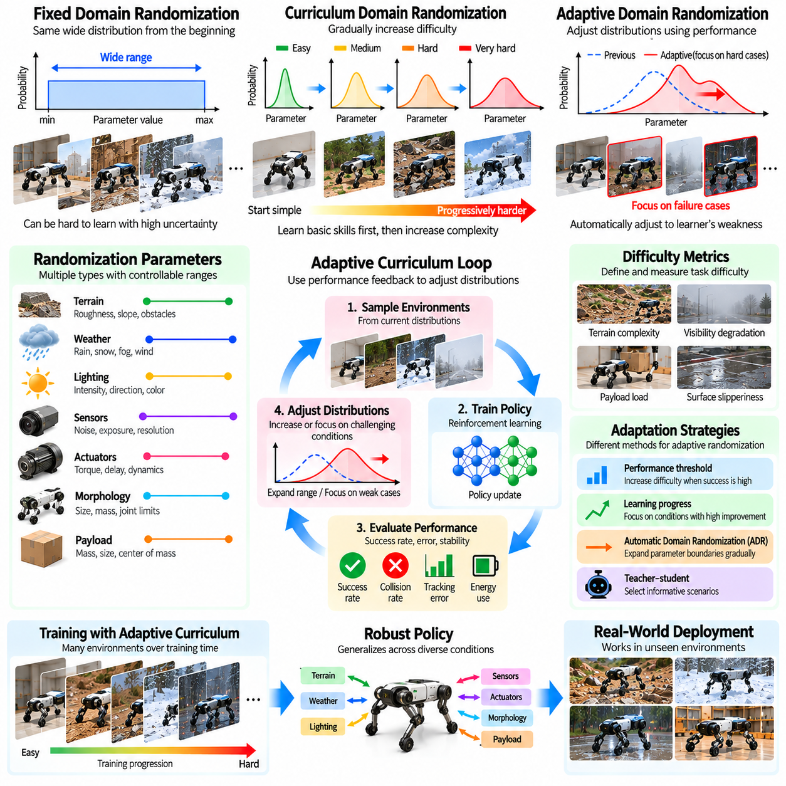{width="7.268055555555556in" height="7.268055555555556in"}

커리큘럼 및 적응형 도메인 무작위화(Curriculum and Adaptive Domain Randomization)는 로봇 정책(Robotic Policy)이 발전함에 따라 시뮬레이션 환경(Simulated Environment)의 난이도(Difficulty)와 다양성(Diversity)을 조절하는 학습 전략(Training Strategy)이다. 기존 도메인 무작위화(Conventional Domain Randomization)는 학습자의 현재 능력을 고려하지 않고 사전에 정의된 분포(Predefined Distribution)에서 불확실한 매개변수(Uncertain Parameter)를 샘플링하는 경우가 많다. 커리큘럼 방법(Curriculum Method)은 복잡도를 점진적으로 도입하며, 적응형 방법(Adaptive Method)은 성능 피드백(Performance Feedback)을 활용하여 무작위화를 조정한다. 두 방법을 결합하면 학습 안정성(Learning Stability), 효율성(Efficiency), 강건성(Robustness)을 향상시킬 수 있다.

커리큘럼 도메인 무작위화(Curriculum Domain Randomization)는 비교적 단순한 시나리오(Simple Scenario)에서 더욱 어려운 환경(Challenging Environment)으로 진행되도록 학습 조건(Training Condition)을 구성한다. 초기 단계에서는 일반적으로 공칭 로봇 매개변수(Nominal Robot Parameter), 중간 수준의 외란(Moderate Disturbance), 예측 가능한 주변 환경(Predictable Surroundings)을 사용한다. 정책의 수행 능력이 향상되면 학습 과정에서 매개변수 범위(Parameter Range)를 확장하고 추가적인 불확실성(Uncertainty)을 도입한다. 이러한 점진적 진행(Progression)은 로봇이 물리적 및 환경적 변화(Physical and Environmental Variation)의 어려운 조합을 경험하기 전에 기본적인 제어 행동(Fundamental Control Behavior)을 습득하도록 지원한다.

커리큘럼 학습(Curriculum Learning)의 필요성은 과도한 불확실성 아래에서 로봇 정책을 최적화(Optimization)하기 어렵다는 점에서 비롯된다. 학습 초기부터 액추에이터 동역학(Actuator Dynamics), 마찰(Friction), 센서 잡음(Sensor Noise), 지형 복잡도(Terrain Complexity)가 크게 변화하면 성공적인 경험(Successful Experience)이 드물어질 수 있다. 희소 보상(Sparse Reward)과 불안정한 궤적(Unstable Trajectory)은 학습 속도를 저하시키거나 수렴(Convergence)을 방해할 수 있다. 신중하게 설계된 커리큘럼은 달성 가능한 도전 과제(Achievable Challenge)를 유지하면서 학습 경험의 다양성을 점진적으로 증가시킨다.

커리큘럼 난이도(Curriculum Difficulty)는 물리적 매개변수(Physical Parameter), 환경 복잡도(Environmental Complexity), 작업 요구사항(Task Requirement)을 통해 정의할 수 있다. 예를 들어 지형 거칠기(Terrain Roughness)를 증가시키거나, 탑재 하중 범위(Payload Range)를 확장하거나, 가시성(Visibility)을 감소시키거나, 액추에이터 지연(Actuator Delay)을 강화할 수 있다. 난이도는 단순히 매개변수의 크기가 아니라 실제 작업 요구를 반영해야 한다. 로봇의 센서(Sensor), 동역학(Dynamics), 목표(Objective)에 따라 마찰의 작은 변화가 조명의 큰 변화보다 더 어려운 조건이 될 수 있다.

단계별 커리큘럼(Staged Curriculum)은 학습을 사전에 정의된 무작위화 설정(Randomization Setting)을 가진 이산적인 수준(Discrete Level)으로 구분한다. 각 수준은 매개변수 범위, 외란 크기(Disturbance Magnitude), 시나리오 복잡도(Scenario Complexity)를 지정한다. 정책은 목표 성공률(Target Success Rate)이나 안정성 기준(Stability Criterion)과 같은 선택된 임계값(Threshold)을 초과하면 다음 단계로 진행한다. 이러한 구조는 구현과 해석이 비교적 간단하지만, 고정 임계값(Fixed Threshold)은 성능 추정값(Performance Estimate)에 잡음이 존재할 때 조기 단계 전환(Premature Advancement)이나 불필요하게 긴 학습을 유발할 수 있다.

연속형 커리큘럼 무작위화(Continuous Curriculum Randomization)는 고정된 단계 사이를 전환하는 대신 매개변수 분포(Parameter Distribution)를 점진적으로 변경한다. 분포 폭(Distribution Width), 평균(Mean), 샘플링 확률(Sampling Probability)은 학습 진행에 따라 변화할 수 있다. 이는 난이도 수준 사이의 전환을 더욱 부드럽게 만들고 학습 환경의 급격한 변화를 줄인다. 연속형 일정(Continuous Schedule)은 학습 반복 횟수(Training Iteration), 누적 경험(Accumulated Experience), 측정된 수행 능력(Measured Competence)에 따라 결정될 수 있지만, 시간 기반 일정(Time-Based Schedule)만으로 정책이 더 어려운 조건에 대비되었는지는 보장할 수 없다.

성능 기반 커리큘럼(Performance-Driven Curriculum)은 관측된 학습 결과(Observed Learning Outcome)에 따라 난이도를 조정한다. 작업 성공률(Task Success), 추종 오차(Tracking Error), 충돌 빈도(Collision Frequency), 복구 능력(Recovery Ability), 에너지 소비량(Energy Consumption)은 정책이 현재 조건을 충분히 학습했는지 판단하는 지표가 될 수 있다. 성능이 지속적으로 우수하면 무작위화 난이도를 높인다. 반대로 실패가 크게 증가하면 난이도를 유지하거나 일시적으로 낮출 수 있다. 신뢰성 높은 판단을 위해서는 충분한 평가 에피소드(Evaluation Episode)에 걸쳐 성능을 평균화해야 한다.

적응형 도메인 무작위화(Adaptive Domain Randomization)는 샘플링 분포(Sampling Distribution)를 자동으로 변경함으로써 커리큘럼 학습을 확장한다. 고정된 진행 절차를 따르는 대신 적응 메커니즘(Adaptive Mechanism)은 정책의 성능이 낮거나 경험이 부족한 매개변수 영역(Parameter Region)을 식별한다. 이후 학습에서는 해당 조건에 더 많은 시뮬레이션 에피소드(Simulation Episode)를 할당한다. 이러한 피드백 기반 과정(Feedback-Driven Process)은 대표적인 운용 환경(Representative Operating Environment)에 대한 경험을 유지하면서 해결되지 않은 취약점(Unresolved Weakness)에 계산 자원(Computational Resource)을 집중시킨다.

자동 도메인 무작위화(Automatic Domain Randomization, ADR)는 적응형 학습(Adaptive Training)을 구현하는 한 가지 접근법이다. 시스템은 비교적 좁은 매개변수 범위에서 시작하며, 정책이 해당 경계(Boundary) 부근에서 충분한 성능을 보이면 선택된 경계를 확장한다. 경계 평가(Boundary Evaluation)는 새로운 조건을 포함할지 판단하는 데 사용된다. 수행 능력이 향상됨에 따라 확장이 계속되며, 최종 매개변수 범위(Final Parameter Range)를 학습 초기에 모두 도입하지 않고도 점차 다양해지는 학습 분포(Training Distribution)를 형성할 수 있다.

자동 도메인 무작위화(ADR)는 확장 기준(Expansion Criterion)과 매개변수 상호작용(Parameter Interaction)을 신중하게 관리해야 한다. 다른 매개변수를 공칭값(Nominal Value) 부근에 유지한 상태에서 하나의 매개변수 경계만 평가하면 결합된 외란(Combined Disturbance)의 난이도를 과소평가할 수 있다. 반대로 여러 차원을 동시에 확장하면 학습이 불안정해질 수 있다. 구조화된 경계 시험(Structured Boundary Test), 결합 매개변수 평가(Joint Parameter Evaluation), 보수적인 확장 속도(Conservative Expansion Rate)는 의미 있는 학습 진행을 유지하는 데 도움이 된다. 적응 과정 전체에서 물리적 실현 가능성 제약조건(Physical Feasibility Constraint)을 지속적으로 적용해야 한다.

교사-학생 프레임워크(Teacher-Student Framework)는 커리큘럼 생성(Curriculum Generation)을 위한 또 다른 접근법을 제공한다. 교사 메커니즘(Teacher Mechanism)은 학습 환경을 선택하고, 학생 정책(Student Policy)은 해당 환경에서 로봇 작업을 수행하도록 학습한다. 교사는 학습 진전도(Learning Progress), 실패 발견(Failure Discovery), 예상 개선 효과(Expected Improvement)를 최적화할 수 있다. 모든 가능성을 균등하게 샘플링하는 대신 유용한 시나리오(Informative Scenario)를 선택함으로써 데이터 효율성(Data Efficiency)을 향상시킬 수 있다. 그러나 교사는 불가능한 작업(Impossible Task)을 생성하거나 학생의 일시적인 취약점(Transient Student Weakness)을 반복적으로 이용하지 않도록 해야 한다.

학습 진전도(Learning Progress)는 커리큘럼 조건(Curriculum Condition)을 선택하는 데 유용한 신호를 제공한다. 이미 숙달된 시나리오(Mastered Scenario)는 새로운 정보를 제한적으로 제공하며, 지속적으로 수행이 불가능한 작업(Consistently Impossible Task)은 유용하지 않은 실패 경험(Uninformative Failure)을 생성할 수 있다. 현재 수행 능력의 경계(Current Competence Boundary) 부근에 있는 조건은 가치 있는 학습 경험을 제공하는 경우가 많다. 따라서 적응형 샘플링(Adaptive Sampling)은 성능이 개선되고 있는 환경을 강조할 수 있지만, 폭넓은 능력(Broad Capability)을 유지하려면 쉬운 조건과 어려운 조건도 간헐적으로 경험하도록 해야 한다.

실패 기반 무작위화(Failure-Driven Randomization)는 성공하지 못한 행동(Unsuccessful Behavior)과 관련된 시나리오에 학습을 집중한다. 시뮬레이션 로그(Simulation Log)를 분석하면 마찰, 탑재 하중(Payload), 센서 성능 저하(Sensor Degradation), 제어 지연(Control Delay)의 조합 중 불안정성을 자주 유발하는 조건을 식별할 수 있다. 이후 학습에서는 이러한 조합에 더 높은 샘플링 확률을 부여할 수 있다. 이 접근법은 목표 지향적 어려운 사례 탐색(Targeted Hard-Example Mining)과 유사하지만, 드문 사건(Rare Event)과 잡음이 많은 평가(Noisy Evaluation)가 난이도 추정(Difficulty Estimate)을 왜곡할 수 있으므로 실패 빈도를 신중하게 해석해야 한다.

커리큘럼 설계(Curriculum Design)는 무작위화된 매개변수 사이의 종속 관계(Dependency)를 고려해야 한다. 지형 난이도(Terrain Difficulty)를 높이면서 동시에 접지력(Traction)을 낮추고 탑재 하중 질량(Payload Mass)을 증가시키면 로봇의 물리적 능력(Physical Capability)을 초과하는 문제가 발생할 수 있다. 조건부 분포(Conditional Distribution)는 환경 특성(Environment Property)과 로봇 동역학(Robot Dynamics) 사이의 현실적인 관계를 유지할 수 있다. 조정된 적응(Coordinated Adaptation)은 정책이 실제 물리적 거동(Physical Behavior) 대신 시뮬레이션 인공물(Simulation Artifact)에 대응하도록 학습시키는 비일관적인 조합(Inconsistent Combination)의 생성을 방지한다.

다차원 커리큘럼(Multi-Dimensional Curriculum)은 여러 불확실성 원인(Source of Uncertainty)을 개별적이거나 결합된 진행 일정(Progression Schedule)으로 관리한다. 시각적 무작위화(Visual Randomization)는 액추에이터 불확실성(Actuator Uncertainty)과 독립적으로 확장할 수 있으며, 탑재 하중 변화(Payload Variation)는 지형 난이도와 연결할 수 있다. 이러한 유연성(Flexibility)은 학습 단계별로 서로 다른 능력을 목표로 삼을 수 있게 한다. 그러나 각 차원을 독립적으로 숙달했다고 해서 그 조합에 대한 강건성(Robustness)이 보장되는 것은 아니므로, 정책이 실제 배치(Deployment)에 적합하다고 판단하기 전에 결합 평가(Joint Evaluation)가 필요하다.

보상 설계(Reward Design)는 적응형 무작위화의 효과에 영향을 미친다. 보상(Reward)은 정책이 쉬운 시나리오를 악용하도록 유도하지 않으면서 작업 완료(Task Completion), 안정성(Stability), 안전성(Safety), 효율적인 행동(Efficient Behavior)을 장려해야 한다. 커리큘럼 적응(Curriculum Adaptation)이 보상 크기(Reward Magnitude)에만 의존하면 보상 척도(Reward Scale)의 변화를 수행 능력(Competence)의 변화로 잘못 해석할 수 있다. 작업별 평가 지표(Task-Specific Metric)와 독립적인 평가 조건(Independent Evaluation Condition)은 학습 보상(Training Reward)만 사용하는 것보다 더욱 신뢰성 높은 진전도 지표(Progress Indicator)를 제공한다.

파국적 망각(Catastrophic Forgetting)은 적응형 샘플링이 어려운 시나리오에 지나치게 집중할 때 발생할 수 있는 위험이다. 정책은 새롭게 도입된 조건에서 성능이 향상되는 동시에 이전에 숙달한 작업(Previously Mastered Task)의 성능을 잃을 수 있다. 공칭 환경(Nominal Environment), 과거 학습 환경(Historical Environment), 어려운 환경(Challenging Environment)을 혼합하여 유지하면 이러한 위험을 줄일 수 있다. 이전 커리큘럼 단계(Earlier Curriculum Stage)에 대한 주기적인 평가(Periodic Evaluation)는 성능 퇴행(Performance Regression)을 발견하고 의도한 운용 분포(Intended Operating Distribution) 전반에서 균형 잡힌 수행 능력(Balanced Competence)을 유지하도록 지원한다.

병렬 시뮬레이션(Parallel Simulation)은 피지컬 AI에서 커리큘럼 및 적응형 무작위화의 효과를 더욱 높인다. 수천 개의 시뮬레이션 로봇 인스턴스(Simulated Robot Instance)는 서로 다른 난이도 수준(Difficulty Level)과 매개변수 조합(Parameter Combination)을 동시에 경험할 수 있다. 성능 통계(Performance Statistic)를 집계하여 샘플링 분포와 커리큘럼 경계를 갱신할 수 있다. 이를 통해 빠른 적응(Rapid Adaptation)이 가능하지만, 불안정하거나 지나치게 빈번한 갱신을 방지하려면 동기화(Synchronization), 통계적 신뢰성(Statistical Reliability), 계산 오버헤드(Computational Overhead)를 관리해야 한다.

커리큘럼 평가(Curriculum Evaluation)는 학습 효율성(Learning Efficiency)과 최종 정책 강건성(Final Policy Robustness)을 구분해야 한다. 빠른 수렴(Faster Convergence)이 반드시 우수한 일반화(Generalization)를 의미하는 것은 아니며, 점진적인 난이도를 통해 학습한 정책도 경험하지 못한 조합(Unseen Combination)에서 실패할 수 있다. 평가에는 고정된 벤치마크 시나리오(Fixed Benchmark Scenario), 학습에서 제외된 매개변수 분포(Held-Out Parameter Distribution), 극단적이지만 실행 가능한 조건(Extreme but Feasible Condition)을 포함해야 한다. 정적 도메인 무작위화(Static Domain Randomization)와 비교하면 적응형 일정 조정(Adaptive Scheduling)이 측정 가능한 개선 효과(Measurable Improvement)를 제공하는지 판단할 수 있다.

시뮬레이션에서 현실로의 전이 검증(Sim-to-Real Validation)은 시뮬레이션 기반 난이도 추정(Simulation-Based Difficulty Estimate)이 실제 하드웨어 거동(Real Hardware Behavior)과 일치하지 않을 수 있기 때문에 필수적이다. 시뮬레이션에서 어렵다고 판단된 조건이 실제 환경에서는 쉬울 수 있으며, 반대로 모델링되지 않은 액추에이터 효과(Unmodeled Actuator Effect)나 센서 고장(Sensor Failure)은 예상하지 못한 어려움을 발생시킬 수 있다. 하드웨어 측정값(Hardware Measurement)과 실제 배치 관측값(Deployment Observation)은 커리큘럼 개선(Curriculum Refinement)의 근거가 될 수 있다. 실제 데이터를 활용하여 학습 분포를 갱신하면 시뮬레이션 학습 과제(Simulated Learning Challenge)를 운용 요구사항(Operational Requirement)에 더욱 가깝게 조정할 수 있다.

안전 인식 커리큘럼(Safety-Aware Curriculum)은 유용한 학습 난이도(Useful Training Difficulty)와 물리적으로 위험하거나 실행 불가능한 조건(Physically Hazardous or Infeasible Condition)을 구분한다. 탑재 하중 한계(Payload Limit), 액추에이터 포화(Actuator Saturation), 충돌 제약조건(Collision Constraint), 안정성 여유(Stability Margin)는 로봇 사양(Robot Specification)과 일관성을 유지해야 한다. 시뮬레이션에서는 실제 하드웨어에서 직접 재현하기에 위험한 실패를 탐색할 수 있지만, 학습된 정책은 여전히 통제된 검증(Controlled Validation)이 필요하다. 안전 제약조건(Safety Constraint)은 커리큘럼 확장(Curriculum Expansion)과 새롭게 학습된 정책의 승인(Policy Acceptance) 모두에 적용되어야 한다.

궁극적으로 커리큘럼 및 적응형 도메인 무작위화(Curriculum and Adaptive Domain Randomization)는 시뮬레이션 학습(Simulation Training)을 정적인 불확실성 샘플링(Static Uncertainty Sampling)에서 구조화된 학습 과정(Structured Learning Process)으로 전환한다. 점진적인 난이도 증가(Progressive Difficulty)는 기본적인 수행 능력(Fundamental Competence)을 확립하고, 성능 기반 적응(Performance-Driven Adaptation)은 해결되지 않은 취약점에 학습 경험을 집중시킨다. 그 효과는 의미 있는 난이도 지표(Meaningful Difficulty Measure), 현실적인 매개변수 종속 관계(Realistic Parameter Dependency), 신뢰성 높은 평가(Reliable Evaluation), 망각 방지 장치(Safeguard Against Forgetting)에 달려 있다. 이러한 방법을 대규모 시뮬레이션(Large-Scale Simulation) 및 하드웨어 피드백(Hardware Feedback)과 통합하면 효율적이고 강건한 피지컬 AI 학습(Physical AI Learning)을 지원할 수 있다.

## 03.13. Adversarial Domain Randomization

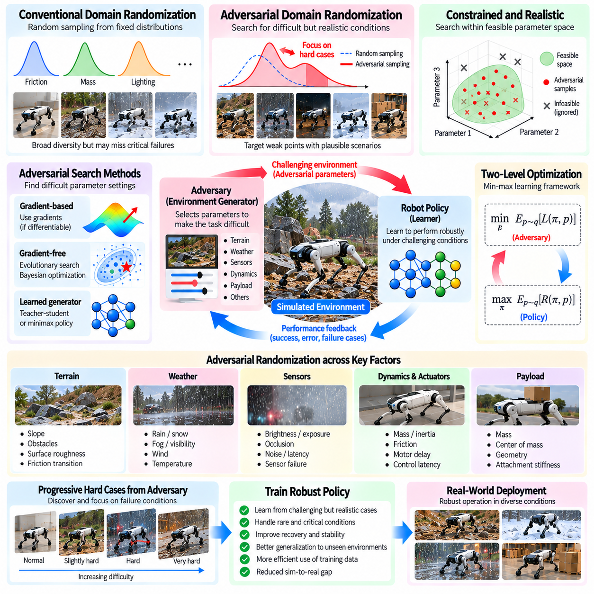{width="7.268055555555556in" height="7.268055555555556in"}

적대적 도메인 무작위화(Adversarial Domain Randomization)는 로봇 정책(Robotic Policy)의 취약점을 드러내는 조건을 의도적으로 생성함으로써 기존 시뮬레이션 학습(Conventional Simulation Training)을 확장한다. 고정된 분포(Fixed Distribution)에서 환경 및 물리적 매개변수(Environmental and Physical Parameter)를 샘플링하는 대신, 적대적 메커니즘(Adversarial Mechanism)은 어렵지만 현실적으로 발생 가능한 시나리오(Plausible Scenario)를 탐색한다. 이러한 시나리오는 물리적 제약조건(Physical Constraint)을 유지하면서 인지(Perception), 계획(Planning), 제어(Control) 능력을 시험한다. 목표는 일반적인 무작위 샘플링(Random Sampling)에서 놓칠 수 있는 불확실성(Uncertainty)에 대한 강건성(Robustness)을 향상시키는 것이다.

기존 도메인 무작위화(Conventional Domain Randomization)는 마찰(Friction), 질량(Mass), 센서 잡음(Sensor Noise), 조명(Lighting), 기타 시뮬레이션 특성(Simulation Property)을 변화시켜 학습 다양성(Training Diversity)을 높인다. 그러나 무작위 샘플링은 심각한 실패(Critical Failure)를 유발하는 매개변수 조합(Parameter Combination)을 거의 경험하지 못할 수 있다. 적대적 무작위화(Adversarial Randomization)는 정책 성능(Policy Performance)을 저하시키는 매개변수 값을 선택하여 이러한 한계를 보완한다. 그 결과 학습 과정은 가능한 모든 환경 구성(Environment Configuration)을 동일하게 유용한 것으로 취급하는 대신 취약한 운용 영역(Vulnerable Operating Region)에 집중한다.

적대적 도메인 무작위화(Adversarial Domain Randomization)는 이중 수준 최적화 문제(Two-Level Optimization Problem)로 정식화할 수 있다. 적대자(Adversary)는 작업을 어렵게 만드는 시뮬레이션 매개변수(Simulation Parameter)를 선택하고, 로봇 정책은 해당 조건에서 작업 성능(Task Performance)을 극대화하려고 한다. 적대자는 기대 보상(Expected Reward)을 최소화하거나 정의된 실패 지표(Failure Metric)를 최대화할 수 있다. 이러한 목적함수(Objective)를 번갈아 최적화하면 환경적 도전 과제(Environmental Challenge)가 정책의 수행 능력(Capability)과 함께 발전하는 경쟁적 학습 과정(Competitive Learning Process)이 형성된다.

적대자(Adversary)는 일반적으로 물리적으로 실현 가능한 환경(Physically Feasible Environment)을 나타내는 제약된 매개변수 공간(Constrained Parameter Space) 내에서 작동한다. 적대자는 지형 마찰(Terrain Friction), 탑재 하중 분포(Payload Distribution), 액추에이터 지연(Actuator Latency), 센서 성능 저하(Sensor Degradation), 장애물 배치(Obstacle Placement)를 변경할 수 있다. 각 매개변수는 공학적 한계(Engineering Limit)와 현실적인 운용 범위(Realistic Operating Range)를 준수해야 한다. 이러한 제약이 없으면 적대자가 실제 배치(Real-World Deployment)에 유용한 정보를 거의 제공하지 않는 불가능한 시나리오(Impossible Scenario)를 생성하여 학습 목표(Training Objective)를 훼손할 수 있다.

적대적 매개변수 선택(Adversarial Parameter Selection)은 임의적인 최악 조건 외란 생성(Arbitrary Worst-Case Disturbance Generation)과 다르다. 시뮬레이션에서 가장 큰 피해를 유발하는 조건이 반드시 의도한 배치 환경(Intended Deployment Environment)과 관련되는 것은 아니다. 액추에이터 고장(Actuator Failure), 극단적인 탑재 하중(Extreme Payload), 거의 없는 마찰(Negligible Friction)을 물리적으로 불가능하게 조합하면 유용한 복구 행동(Recovery Behavior)을 학습시키지 못한 채 실패만 보장할 수 있다. 따라서 효과적인 적대적 학습(Adversarial Training)은 시나리오 난이도(Scenario Difficulty), 현실적 타당성(Plausibility), 운용 관련성(Operational Relevance), 의미 있는 적응 기회(Adaptation Opportunity) 사이의 균형을 유지해야 한다.

경사도 기반 적대적 최적화(Gradient-Based Adversarial Optimization)는 환경과 성능 목적함수(Performance Objective)가 미분 가능한 경우 어려운 시뮬레이션 매개변수를 식별할 수 있다. 경사도(Gradient)는 매개변수 변화가 정책 성능에 미치는 영향을 나타내며, 더욱 어려운 조건을 향한 탐색을 안내한다. 그러나 접촉 동역학(Contact Dynamics), 충돌 사건(Collision Event), 이산적인 시뮬레이션 선택(Discrete Simulation Choice)은 불연속성(Discontinuity)을 발생시키는 경우가 많다. 따라서 많은 로봇 응용 분야(Robotic Application)에서는 경사도 비사용 최적화(Gradient-Free Optimization)가 더 적합할 수 있다.

경사도 비사용 적대적 방법(Gradient-Free Adversarial Method)에는 진화적 탐색(Evolutionary Search), 베이지안 최적화(Bayesian Optimization), 집단 기반 매개변수 탐색(Population-Based Parameter Exploration)이 포함된다. 이러한 기술은 후보 환경(Candidate Environment)을 평가하고 성능 결과(Performance Result)를 활용하여 후속 샘플링(Subsequent Sampling)을 안내한다. 미분 가능한 시뮬레이터(Differentiable Simulator)가 없어도 비선형 동역학(Nonlinear Dynamics)과 이산적인 시나리오 변수(Discrete Scenario Variable)를 처리할 수 있다. 주요 한계는 계산 비용(Computational Cost)이며, 유용한 실패 사례(Informative Failure)를 발견하려면 많은 시뮬레이션 에피소드(Simulated Episode)를 평가해야 할 수 있다.

적대적 환경 생성기(Adversarial Environment Generator)는 무작위화 매개변수를 선택하는 별도의 정책(Separate Policy)으로 구현할 수 있다. 생성기(Generator)는 학습 통계(Training Statistics)를 관측하고 로봇 제어기(Robotic Controller)에 도전 과제를 제공하기 위한 시나리오를 제안한다. 이후 제어기는 해당 시나리오와의 상호작용(Interaction)을 통해 학습한다. 이러한 교사-학생 구조(Teacher-Student Formulation) 또는 최소최대 최적화 구조(Minimax Formulation)는 적응형 난이도(Adaptive Difficulty)를 지원하지만, 생성기가 불가능한 작업을 반복적으로 선택하거나 시뮬레이션 결함(Simulation Defect)을 악용하지 못하도록 제한해야 한다.

적대적 지형 무작위화(Adversarial Terrain Randomization)는 이동 능력(Locomotion)의 취약점을 드러내는 표면 구성(Surface Configuration)을 탐색한다. 적대자는 경사각(Slope Angle), 장애물 간격(Obstacle Spacing), 마찰 전이(Friction Transition), 국부적인 표면 불규칙성(Local Surface Irregularity)을 변경할 수 있다. 다족 보행 로봇(Legged Robot)에서는 어려운 조합이 균형 유지의 한계(Balance Limitation)나 불안정한 발 배치(Unstable Foot Placement)를 드러낼 수 있다. 휠 기반 플랫폼(Wheeled Platform)에서는 부족한 접지력(Insufficient Traction)이나 조향 불안정성(Steering Instability)을 드러낼 수 있다. 지형 제약조건(Terrain Constraint)은 실행 가능한 통과 경로(Feasible Traversal)와 현실적인 접촉 거동(Realistic Contact Behavior)을 유지해야 한다.

적대적 센서 무작위화(Adversarial Sensor Randomization)는 인지 및 상태 추정(Perception and State Estimation)의 취약점을 목표로 한다. 카메라 노출 변화(Camera Exposure Change), 가림 현상(Occlusion), 깊이 잡음(Depth Noise), 시간 오차(Timing Error), 일시적인 센서 성능 저하(Temporary Sensor Degradation)를 선택하여 작업 성능을 방해할 수 있다. 목표는 단순히 관측값(Observation)을 손상시키는 것이 아니라 체계적인 오차(Systematic Error)를 유발하는 현실적인 센싱 조건(Realistic Sensing Condition)을 식별하는 것이다. 이러한 사례에 대한 학습은 복구 전략(Recovery Strategy), 센서 융합(Sensor Fusion), 불완전한 환경 정보(Incomplete Environmental Information)에 대한 허용 능력(Tolerance)을 향상시킬 수 있다.

적대적 동역학 무작위화(Adversarial Dynamics Randomization)는 불확실한 물리적 상호작용(Physical Interaction)과 액추에이터 거동(Actuator Behavior)에 집중한다. 질량(Mass), 관성(Inertia), 마찰(Friction), 모터 응답(Motor Response), 제어 지연(Control Latency)의 변화를 결합하여 불안정한 운용 영역(Unstable Operating Region)을 드러낼 수 있다. 이러한 조건은 고속 이동(High-Speed Movement)과 성능 한계(Performance Limit)에 근접한 조작(Manipulation)에서 특히 중요하다. 적대자는 결합된 물리적 관계(Coupled Physical Relationship)를 준수하여 어려운 시나리오가 현실적으로 발생 가능한 하드웨어 및 환경 변화(Hardware and Environmental Variation)를 표현하도록 해야 한다.

적대적 탑재 하중 무작위화(Adversarial Payload Randomization)는 안정성(Stability)과 제어 권한(Control Authority)에 부담을 주는 적재 구성(Loading Configuration)을 식별한다. 탑재 하중 질량(Payload Mass), 질량 중심(Center of Mass), 부착 강성(Attachment Stiffness), 객체 형상(Object Geometry)의 변화는 동적 응답(Dynamic Response)을 변경할 수 있다. 적대자는 큰 추종 오차(Tracking Error)나 감소된 안정성 여유(Stability Margin)를 발생시키는 구성을 발견할 수 있다. 이러한 시나리오는 정격 하중 한계(Rated Load Limit)를 준수하고 실제 로봇 운용(Robotic Operation)에서 발생할 수 있는 조건을 반영할 때 가치가 있다.

적대적 장애물 생성(Adversarial Obstacle Generation)은 장애물의 위치(Position), 치수(Dimension), 이동 패턴(Movement Pattern)을 조정하여 어려운 내비게이션 및 조작 환경(Navigation and Manipulation Environment)을 생성한다. 동적 에이전트(Dynamic Agent)는 적절한 시점의 회피(Avoidance)나 재계획(Replanning)이 필요한 궤적(Trajectory)을 따라 이동할 수 있다. 적대자는 회피할 수 없는 충돌(Unavoidable Collision)을 생성하거나 현실적인 운동 제약조건(Motion Constraint)을 위반해서는 안 된다. 유용한 시나리오는 성공적인 작업 완료(Task Completion)를 위한 실행 가능한 전략(Feasible Strategy)을 최소한 하나 이상 유지하면서 의사결정(Decision-Making)의 취약점을 드러내는 조건이다.

강건 최적화(Robust Optimization)는 적대적 무작위화를 위한 수학적 기반(Mathematical Foundation)을 제공한다. 학습 목적함수(Training Objective)는 평균 성능(Average Performance)만 극대화하는 대신 허용 가능한 가장 어려운 매개변수(Admissible Parameter)에서도 우수한 성능을 발휘하는 정책을 찾도록 설계할 수 있다. 위험 민감 목적함수(Risk-Sensitive Objective)는 낮은 성능을 보이는 에피소드(Low-Performing Episode)나 불리한 결과 분포(Unfavorable Outcome Distribution)를 강조할 수 있다. 그러나 최악 조건(Worst-Case Condition)만을 대상으로 최적화하면 지나치게 보수적인 행동(Overly Conservative Behavior)이 형성되고 정상 운용(Normal Operation)에서의 효율성이 저하될 수 있다.

분포적 강건 최적화(Distributionally Robust Optimization)는 운용 조건의 확률 분포(Probability Distribution)에 존재하는 불확실성까지 고려하도록 이러한 관점을 확장한다. 하나의 정확한 무작위화 분포(Exact Randomization Distribution)를 가정하는 대신, 학습 과정에서 현실적으로 가능한 분포의 집합(Set of Plausible Distributions)에 걸쳐 성능을 평가한다. 적대자는 통계적 제약조건(Statistical Constraint)을 준수하면서 불량한 결과(Poor Outcome)와 관련된 분포를 강조할 수 있다. 이러한 접근법은 실제 배치 과정에서 어려운 조건이 얼마나 자주 발생할지에 대한 불확실성을 다루는 데 도움이 된다.

적대적 학습(Adversarial Training)은 제한된 실패 시나리오(Failure Scenario)에 대한 과적합(Overfitting)을 방지해야 한다. 적대자가 유사한 조건을 반복적으로 선택하면 제어기(Controller)가 특정 조건에 지나치게 특화되면서 전반적인 성능(General Performance)을 잃을 수 있다. 공칭 환경(Nominal Environment), 무작위 샘플링 환경(Randomly Sampled Environment), 적대적 환경(Adversarial Environment)을 혼합하여 유지하면 다양성을 보존할 수 있다. 독립적인 시나리오(Independent Scenario)에 대한 주기적인 평가(Periodic Evaluation)는 적대적 학습이 현재 생성기(Current Generator)에 대한 성능만이 아니라 폭넓은 강건성(Broad Robustness)을 향상시키는지 판단하는 데 도움이 된다.

커리큘럼 학습(Curriculum Learning)은 적대적 무작위화의 강도(Strength)를 조절할 수 있다. 초기 학습에서는 제어기가 기본적인 수행 능력(Basic Competence)을 확보하도록 적대자의 탐색 범위를 중간 수준의 외란(Moderate Disturbance)으로 제한할 수 있다. 성능이 향상되면 적대적 탐색 공간(Adversarial Search Space)을 더욱 어려운 매개변수 조합(Parameter Combination)으로 확장할 수 있다. 이러한 점진적 접근법(Progressive Approach)은 학습 불안정성(Training Instability)을 줄이고, 아직 충분히 학습되지 않은 정책(Immature Policy)이 지속적으로 해결할 수 없는 시나리오에 압도되는 상황을 방지한다.

안전 제약조건(Safety Constraint)은 적대적 조건에서 학습된 정책을 실제 로봇(Physical Robot)에 적용할 때 필수적이다. 시뮬레이션 시나리오(Simulated Scenario)는 위험한 조건을 탐색할 수 있지만, 학습 과정에서는 복구 가능한 외란(Recoverable Disturbance)과 하드웨어 한계 위반(Hardware Limit Violation)을 구분해야 한다. 액추에이터 포화(Actuator Saturation), 구조적 하중(Structural Loading), 전도 위험(Tipping Risk), 충돌 경계(Collision Boundary)를 명시적으로 표현해야 한다. 적대적 조건에서 학습된 정책도 실제 배치 전에 통제된 시험(Controlled Testing)이 필요하며, 시뮬레이션에서 확보한 강건성이 물리적 안전성(Physical Safety)을 보장하지는 않는다.

대규모 병렬 시뮬레이션(Massively Parallel Simulation)은 많은 후보 환경(Candidate Environment)을 동시에 평가함으로써 적대적 도메인 무작위화의 실용성을 높인다. 병렬 로봇 인스턴스(Parallel Robot Instance)는 서로 다른 매개변수 조합을 시험하고 작업 실패(Task Failure), 안정성 여유(Stability Margin), 복구 결과(Recovery Outcome)를 보고할 수 있다. 적대적 메커니즘(Adversarial Mechanism)은 이러한 결과를 활용하여 유용한 시나리오(Informative Scenario)의 우선순위를 결정할 수 있다. 지속적인 학습 진행(Training Progress)을 유지하려면 효율적인 평가(Efficient Evaluation), 시나리오 다양성(Scenario Diversity), 계산 자원의 신중한 할당(Careful Allocation of Computational Resources)이 중요하다.

평가 과정에서는 적대적 학습 정책(Adversarially Trained Policy)을 기존 도메인 무작위화(Conventional Domain Randomization) 및 적응형 도메인 무작위화(Adaptive Domain Randomization)로 학습한 정책과 비교해야 한다. 관련 평가 지표(Evaluation Measure)에는 작업 성공률(Task Success), 최악 조건 성능(Worst-Case Performance), 충돌 빈도(Collision Frequency), 안정성(Stability), 복구 능력(Recovery Capability), 학습에서 경험하지 못한 매개변수 조합(Unseen Parameter Combination)에서의 성능이 포함된다. 학습에서 제외된 적대적 시나리오(Held-Out Adversarial Scenario)는 강건성이 학습 생성기(Training Generator)를 넘어 일반화되는지 확인하는 데 도움이 된다. 실제 외란(Real Disturbance)과 모델링 오차(Modeling Error)에서도 개선 효과가 유지되는지 확인하려면 하드웨어 실험(Hardware Experiment)이 필요하다.

궁극적으로 적대적 도메인 무작위화(Adversarial Domain Randomization)는 시뮬레이션 불확실성(Simulation Uncertainty)을 정책의 취약점을 발견하고 개선하기 위한 능동적 메커니즘(Active Mechanism)으로 전환한다. 그 효과는 물리적으로 의미 있는 제약조건(Physically Meaningful Constraint), 유용한 실패 지표(Informative Failure Metric), 균형 잡힌 시나리오 샘플링(Balanced Scenario Sampling), 안정적인 최적화(Stable Optimization)에 달려 있다. 커리큘럼 학습(Curriculum Learning), 현실적인 물리 모델(Realistic Physics), 체계적인 검증(Systematic Validation)과 결합하면 적대적 학습은 기존 무작위화가 충분히 드러내지 못하는 어려운 운용 조건(Challenging Operating Condition)에 대한 피지컬 AI(Physical AI) 시스템의 강건성을 강화할 수 있다.

## 03.14. Domain Randomization Pipeline [w/Code]

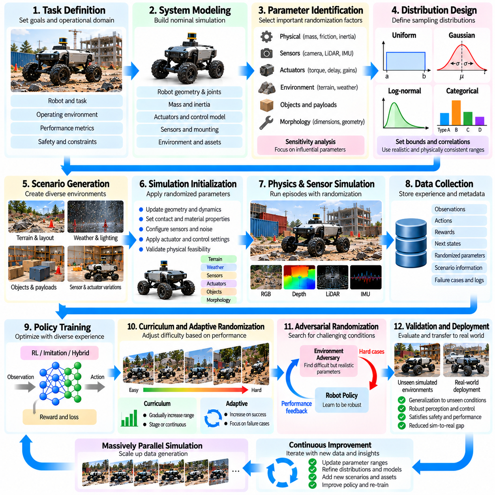{width="7.268055555555556in" height="7.268055555555556in"}

도메인 무작위화 파이프라인(Domain Randomization Pipeline)은 다양한 시뮬레이션 환경(Simulation Environment)을 생성하고 강건한 피지컬 AI(Physical AI) 정책을 학습하기 위한 체계적인 프레임워크(Systematic Framework)이다. 이 파이프라인은 매개변수 정의(Parameter Definition), 확률 분포 설계(Probability Distribution Design), 시나리오 생성(Scenario Generation), 물리 시뮬레이션(Physics Simulation), 데이터 수집(Data Collection), 정책 최적화(Policy Optimization), 검증(Validation)을 통합한다. 효과적인 파이프라인은 임의적인 변화를 독립적으로 적용하는 대신 시각적, 기계적, 센서 및 환경 영역(Visual, Mechanical, Sensor, and Environmental Domain)의 불확실성을 연계하여 시뮬레이션에서 현실로의 전이(Simulation-to-Reality Transfer)를 향상시킨다.

파이프라인은 대상 로봇 작업(Target Robotic Task)과 운용 설계 영역(Operational Design Domain)을 정의하는 것으로 시작한다. 로봇 구성(Robot Configuration), 작업 공간 형상(Workspace Geometry), 환경 조건(Environmental Condition), 성능 요구사항(Performance Requirement), 안전 한계(Safety Limit)는 관련 불확실성(Relevant Uncertainty)의 범위를 결정한다. 창고 운송 로봇(Warehouse Transport Robot)은 공중 검사 로봇(Aerial Inspection Robot)과 서로 다른 무작위화 우선순위(Randomization Priority)를 필요로 한다. 의도한 배치 조건(Intended Deployment Condition)을 명확히 정의하면 불필요한 시뮬레이션 복잡도(Simulation Complexity)를 방지하고 현실적인 운용 과제(Operational Challenge)에 학습을 집중할 수 있다.

시스템 모델링(System Modeling)은 무작위화를 도입하기 전에 공칭 시뮬레이션 환경(Nominal Simulation Environment)을 구축한다. 로봇 형상(Robot Geometry), 관절 구성(Joint Configuration), 질량 특성(Mass Property), 액추에이터 특성(Actuator Characteristic), 센서(Sensor), 환경 자산(Environmental Asset)은 일관되게 표현되어야 한다. 가능한 경우 기준 시뮬레이션 거동(Baseline Simulation Behavior)을 하드웨어 측정값(Hardware Measurement)과 비교해야 한다. 보정이 불충분한 공칭 모델(Poorly Calibrated Nominal Model)은 무작위화만으로 신뢰성 있게 보상하기 어려운 체계적 오차(Systematic Error)를 발생시킬 수 있다.

매개변수 식별(Parameter Identification)은 학습 과정에서 어떤 시뮬레이션 특성(Simulation Property)을 변화시킬지 결정한다. 후보 매개변수(Candidate Parameter)에는 마찰 계수(Friction Coefficient), 객체 질량(Object Mass), 액추에이터 지연(Actuator Delay), 카메라 내부 매개변수(Camera Intrinsics), 조명 조건(Lighting Condition), 지형 형상(Terrain Geometry), 탑재 하중 분포(Payload Distribution)가 포함된다. 민감도 분석(Sensitivity Analysis)은 작업 성능(Task Performance)에 강한 영향을 미치는 변수를 식별할 수 있다. 영향력이 큰 매개변수를 우선적으로 고려하면 실제 환경의 강건성(Real-World Robustness)에 중요한 불확실성을 유지하면서 불필요한 계산 비용(Computational Expense)을 줄일 수 있다.

무작위화 분포 설계(Randomization Distribution Design)는 매개변수 값을 샘플링하는 방식을 지정한다. 균등 분포(Uniform Distribution), 가우시안 분포(Gaussian Distribution), 범주형 분포(Categorical Distribution), 혼합 분포(Mixture Distribution)는 서로 다른 형태의 불확실성을 표현할 수 있다. 분포 경계(Distribution Boundary)는 공학적 사양(Engineering Specification), 측정된 변동성(Measured Variability), 예상 배치 조건(Expected Deployment Condition)을 반영해야 한다. 또한 매개변수 사이의 상관관계(Correlation)를 유지해야 하며, 독립적인 샘플링(Independent Sampling)은 학습 경험(Training Experience)의 유용성을 떨어뜨리는 물리적으로 일관되지 않은 조합(Physically Inconsistent Combination)을 생성할 수 있다.

시나리오 생성(Scenario Generation)은 샘플링된 매개변수를 실행 가능한 시뮬레이션 환경(Executable Simulation Environment)으로 변환한다. 절차적 생성 도구(Procedural Tool)는 지형 표면(Terrain Surface), 객체 배치(Object Placement), 재질 특성(Material Property), 조명(Lighting), 센서 구성(Sensor Configuration), 로봇 탑재 하중(Robot Payload)을 변경할 수 있다. 생성된 각 시나리오는 기하학적, 기계적 및 작업별 제약조건(Geometric, Mechanical, and Task-Specific Constraint)을 충족해야 한다. 유효성 검사(Validity Check)는 불가능한 구성(Impossible Configuration), 도달할 수 없는 목표(Unreachable Objective), 의도한 운용 가정(Intended Operating Assumption)을 위반하는 환경 조합(Environmental Combination)을 배제하는 데 도움이 된다.

시뮬레이션 초기화(Simulation Initialization)는 선택된 무작위화 매개변수(Randomization Parameter)를 각 학습 인스턴스(Training Instance)에 적용한다. 형상(Geometry), 관성 텐서(Inertia Tensor), 접촉 특성(Contact Property), 액추에이터 설정(Actuator Setting), 센서 모델(Sensor Model)은 일관되게 갱신되어야 한다. 일부 매개변수는 에피소드 경계(Episode Boundary)에서 변경할 수 있으며, 다른 매개변수는 외란(Disturbance)을 표현하기 위해 실행 중에 변화할 수 있다. 이러한 변화의 시점(Timing)은 물리적 거동(Physical Behavior)을 반영해야 하며, 정책 학습(Policy Learning)을 왜곡할 수 있는 인위적인 불연속성(Artificial Discontinuity)을 방지해야 한다.

물리 및 센서 시뮬레이션(Physics and Sensor Simulation)은 생성된 시나리오를 실행하면서 관측값(Observation)과 상태 전이(State Transition)를 생성한다. 접촉 동역학(Contact Dynamics), 액추에이터 응답(Actuator Response), 센서 잡음(Sensor Noise), 환경 효과(Environmental Effect)는 서로 상호작용하여 로봇 거동(Robotic Behavior)을 결정한다. 시뮬레이션 충실도(Simulation Fidelity)는 불필요한 계산 오버헤드(Computational Overhead)를 발생시키지 않으면서 작업과 관련된 메커니즘(Task-Relevant Mechanism)을 포착하기에 충분해야 한다. 안정적인 수치 적분(Stable Numerical Integration)과 일관된 시간 처리(Consistent Timing)는 신뢰성 높은 학습 경험을 생성하는 데 필수적이다.

데이터 수집(Data Collection)은 관측값(Observation), 동작(Action), 보상(Reward), 상태 전이(State Transition), 관련 시뮬레이션 메타데이터(Simulation Metadata)를 기록한다. 메타데이터에는 무작위화된 매개변수 값(Randomized Parameter Value), 시나리오 구성(Scenario Configuration), 소프트웨어 버전(Software Version), 난수 시드(Random Seed)가 포함되어야 한다. 이러한 기록은 실패 분석(Failure Analysis), 재현성(Reproducibility), 목표 지향적 평가(Targeted Evaluation)를 지원한다. 구조화된 로깅(Structured Logging)은 엔지니어가 특정 물리적 불확실성 조합(Physical Uncertainty Combination)이 불안정한 거동(Unstable Behavior)이나 낮은 작업 성능(Poor Task Performance)과 관련되는지 판단하도록 지원한다.

정책 학습(Policy Training)은 수집된 시뮬레이션 경험(Simulation Experience)을 활용하여 무작위화된 조건 전반에서 로봇 행동(Robotic Behavior)을 최적화한다. 작업 요구사항(Task Requirement)에 따라 강화학습(Reinforcement Learning), 모방학습(Imitation Learning), 혼합형 접근법(Hybrid Approach)을 사용할 수 있다. 학습 목적함수(Training Objective)는 작업 완료(Task Completion), 제어 정확도(Control Accuracy), 효율성(Efficiency), 안전성(Safety) 사이의 균형을 유지해야 한다. 정책은 소수의 유리한 시뮬레이션 구성(Favorable Simulation Configuration)을 암기하는 대신 매개변수 변화(Parameter Variation) 전반에서 효과적으로 작동하는 행동을 학습해야 한다.

커리큘럼 메커니즘(Curriculum Mechanism)은 파이프라인 전체에서 무작위화 난이도(Randomization Difficulty)를 조절할 수 있다. 초기 학습에서는 기본적인 수행 능력(Basic Competence)을 확보하기 위해 좁은 매개변수 범위(Narrow Parameter Range)와 비교적 단순한 환경(Simple Environment)을 사용할 수 있다. 성능이 향상되면 분포를 확장하여 더 강한 외란(Stronger Disturbance)과 복잡한 시나리오(Complex Scenario)를 포함할 수 있다. 적응형 방법(Adaptive Method)은 관측된 실패(Observed Failure)를 기반으로 샘플링 확률(Sampling Probability)을 조정하여 정책이 여전히 취약한 조건(Vulnerable Condition)에 추가적인 학습을 집중하도록 할 수 있다.

적대적 시나리오 생성(Adversarial Scenario Generation)은 어려운 운용 조건(Challenging Operating Condition)을 발견하기 위한 추가적인 메커니즘을 제공한다. 적대적 과정(Adversarial Process)은 실행 가능한 매개변수 경계(Feasible Parameter Bound) 내에서 정책 성능(Policy Performance)을 저하시키는 조합을 탐색한다. 이러한 시나리오는 일반적인 무작위 샘플링(Random Sampling)에서 거의 발견되지 않는 취약점을 드러낼 수 있다. 적대적 사례(Adversarial Case)를 공칭 환경(Nominal Environment) 및 무작위 생성 환경(Randomly Generated Environment)과 통합하면 비현실적인 최악 조건(Unrealistic Worst-Case Condition)이 학습을 지배하지 않으면서 강건성(Robustness)을 향상시킬 수 있다.

대규모 병렬 시뮬레이션(Massively Parallel Simulation)은 많은 무작위화 환경(Randomized Environment)을 동시에 실행하여 파이프라인 처리량(Pipeline Throughput)을 증가시킨다. 서로 다른 로봇 인스턴스(Robot Instance)는 공통 정책(Common Policy)을 공유하면서도 서로 다른 지형 특성(Terrain Property), 센서 특성(Sensor Characteristic), 액추에이터 동역학(Actuator Dynamics), 탑재 하중 구성(Payload Configuration)을 경험할 수 있다. 효율적인 환경 생성(Environment Generation), 메모리 관리(Memory Management), GPU 활용(GPU Utilization)은 실질적인 확장성(Scalability)을 결정한다. 병렬 실행(Parallel Execution)은 독립적인 무작위 샘플링(Independent Random Sampling)과 신뢰성 높은 성능 통계(Performance Statistics)를 유지해야 한다.

파이프라인 오케스트레이션(Pipeline Orchestration)은 환경 생성(Environment Generation), 시뮬레이션 실행(Simulation Execution), 정책 갱신(Policy Update), 평가(Evaluation), 데이터 저장(Data Storage)을 조정한다. 자동화된 스케줄링(Automated Scheduling)은 계산 작업 부하(Computational Workload)를 분산하고 실험 구성(Experiment Configuration)을 관리할 수 있다. 버전 관리된 자산(Version-Controlled Asset), 매개변수 정의(Parameter Definition), 학습 설정(Training Setting)은 반복 실험(Repeated Experiment) 전반에서 일관성을 유지하도록 지원한다. 모니터링 시스템(Monitoring System)은 시뮬레이션 실패(Simulation Failure), 자원 소비(Resource Consumption), 정책 수렴(Policy Convergence), 무작위화 조건에 따른 성능 변화를 추적해야 한다.

품질 보증(Quality Assurance)은 생성된 시나리오가 물리적으로 의미 있고 계산적으로 안정적인 상태를 유지하는지 검증한다. 자동화된 검사(Automated Check)는 유효하지 않은 형상(Invalid Geometry), 비현실적인 관성값(Unrealistic Inertia Value), 불안정한 접촉(Unstable Contact), 센서 구성 오류(Sensor Configuration Error), 불가능한 작업 조건(Impossible Task Condition)을 검출할 수 있다. 통계적 모니터링(Statistical Monitoring)은 샘플링된 매개변수가 의도한 분포(Intended Distribution)를 따르는지 확인할 수 있다. 이러한 관리 절차는 시뮬레이션 결함(Simulation Defect)이 숨겨진 학습 신호(Hidden Learning Signal)로 작용하여 정책이 모델링 인공물(Modeling Artifact)을 악용하도록 유도하는 상황을 방지한다.

평가(Evaluation)는 학습 분포(Training Distribution)와 분리된 환경 및 매개변수 조합(Parameter Combination)을 사용해야 한다. 고정된 벤치마크 시나리오(Fixed Benchmark Scenario)는 일관된 성능 비교(Performance Comparison)를 제공하며, 학습에서 제외된 무작위화 범위(Held-Out Randomization Range)는 일반화(Generalization)를 시험한다. 관련 평가 지표(Evaluation Metric)에는 작업 성공률(Task Success Rate), 충돌 빈도(Collision Frequency), 안정성 여유(Stability Margin), 추종 오차(Tracking Error), 에너지 소비량(Energy Consumption), 복구 능력(Recovery Capability)이 포함된다. 평가는 하나의 종합 점수(Aggregate Score)에만 의존하지 않고 평균 성능(Average Performance)과 어려운 운용 조건을 함께 검토해야 한다.

절제 연구(Ablation Study)는 어떤 무작위화 구성 요소(Randomization Component)가 정책 강건성(Policy Robustness)에 의미 있게 기여하는지 판단하는 데 도움이 된다. 엔지니어는 선택된 매개변수 그룹(Parameter Group)을 제거하거나 제한한 뒤 성능을 비교할 수 있다. 이를 통해 시각적 변화(Visual Variation), 동역학 변화(Dynamic Variation), 센서 변화(Sensor Variation), 환경 변화(Environmental Variation)가 측정 가능한 이점(Measurable Benefit)을 제공하는지 확인할 수 있다. 민감도 분석(Sensitivity Analysis)과 절제 연구 결과는 분포 개선(Distribution Refinement)을 안내하고 불필요한 시뮬레이션 복잡도를 줄이며 후속 학습 주기(Subsequent Training Cycle)의 효율성을 향상시킬 수 있다.

하드웨어 검증(Hardware Validation)은 시뮬레이션 결과(Simulation Result)를 실제 로봇 운용(Actual Robotic Operation)과 연결한다. 통제된 실험(Controlled Experiment)에서는 대표적인 탑재 하중(Payload), 표면(Surface), 센서 조건(Sensor Condition), 액추에이터 설정(Actuator Setting)에서 예측된 거동(Predicted Behavior)과 관측된 거동(Observed Behavior)을 비교해야 한다. 시뮬레이션과 하드웨어 사이의 차이(Difference)는 모델링 오차(Modeling Error)와 누락된 불확실성 원인(Missing Uncertainty Source)을 드러낸다. 검증 과정은 안전한 운용 조건(Safe Operating Condition)에서 시작하고 학습된 정책(Learned Policy)에 대한 신뢰도(Confidence)가 증가함에 따라 점진적으로 범위를 확장해야 한다.

하드웨어 실험(Hardware Experiment)에서 얻은 피드백(Feedback)은 반복적인 파이프라인 개선(Iterative Pipeline Improvement)을 지원한다. 측정된 마찰(Friction), 액추에이터 응답(Actuator Response), 센서 잡음(Sensor Noise), 작업 실패(Task Failure)는 시뮬레이션 매개변수(Simulation Parameter)와 무작위화 분포(Randomization Distribution)를 갱신하는 데 활용할 수 있다. 새롭게 관측된 실패 조건(Failure Condition)은 목표 지향적 학습 시나리오(Targeted Training Scenario)에 포함할 수 있다. 이러한 폐루프 과정(Closed-Loop Process)은 도메인 무작위화를 일회성 구성 단계(One-Time Configuration Step)에서 실제 배치 증거(Real Deployment Evidence)에 반응하는 지속적으로 발전하는 시스템(Evolving System)으로 전환한다.

재현성(Reproducibility)과 추적성(Traceability)은 신뢰성 높은 파이프라인 운용(Pipeline Operation)에 필수적이다. 각 실험에 대해 난수 시드(Random Seed), 시뮬레이터 버전(Simulator Version), 로봇 모델(Robot Model), 학습 데이터셋(Training Dataset), 분포 정의(Distribution Definition), 정책 체크포인트(Policy Checkpoint)를 기록해야 한다. 병렬 하드웨어(Parallel Hardware) 전반에서 결정론적 실행(Deterministic Execution)을 항상 달성할 수 있는 것은 아니지만, 통제된 구성(Controlled Configuration)은 비교 가능성(Comparability)을 향상시킨다. 추적 가능한 실험 이력(Traceable Experiment History)은 디버깅(Debugging), 회귀 시험(Regression Testing), 체계적인 정책 개발(Systematic Policy Development)을 지원한다.

배치 준비 상태(Deployment Readiness)를 판단하려면 의도한 운용 설계 영역(Operational Design Domain) 전반에서 허용 가능한 성능(Acceptable Performance)을 입증해야 한다. 검증 과정에서는 공칭 조건(Nominal Condition), 발생 가능한 외란(Plausible Disturbance), 드물지만 중요한 실패(Rare but Relevant Failure), 하드웨어 안전 제약조건(Hardware Safety Constraint)을 고려해야 한다. 시뮬레이션에서 우수한 성능을 보이는 정책도 보수적인 운용 한계(Conservative Operating Limit)와 실행 시간 모니터링(Runtime Monitoring)이 필요할 수 있다. 명확한 승인 기준(Acceptance Criterion)은 성공적인 학습(Successful Training)과 신뢰성 높은 실제 운용(Dependable Physical Operation)을 뒷받침하는 충분한 증거(Sufficient Evidence)를 구분하는 데 도움이 된다.

궁극적으로 도메인 무작위화 파이프라인(Domain Randomization Pipeline)은 불확실성 모델링(Uncertainty Modeling), 시뮬레이션 생성(Simulation Generation), 학습(Learning), 평가(Evaluation), 하드웨어 피드백(Hardware Feedback)을 하나의 지속적인 개발 과정(Continuous Development Process)으로 통합한다. 그 효과는 물리적으로 일관된 시나리오(Physically Consistent Scenario), 현실적인 확률 분포(Realistic Probability Distribution), 확장 가능한 연산(Scalable Computation), 엄격한 검증(Rigorous Validation)에 달려 있다. 이러한 구성 요소가 유기적으로 작동하면 피지컬 AI 시스템은 개별 시뮬레이션 구성(Individual Simulation Configuration)을 넘어 일반화할 수 있는 정책을 개발하고, 변화하는 실제 환경(Changing Real-World Environment)에서 더욱 신뢰성 높은 성능을 발휘할 수 있다.
