**Volume 05. Simulation and Sim2Real Transfer**

# Chapter 04. Domain Adaptation

## 04.01. Source Target Domains and Domain Shift

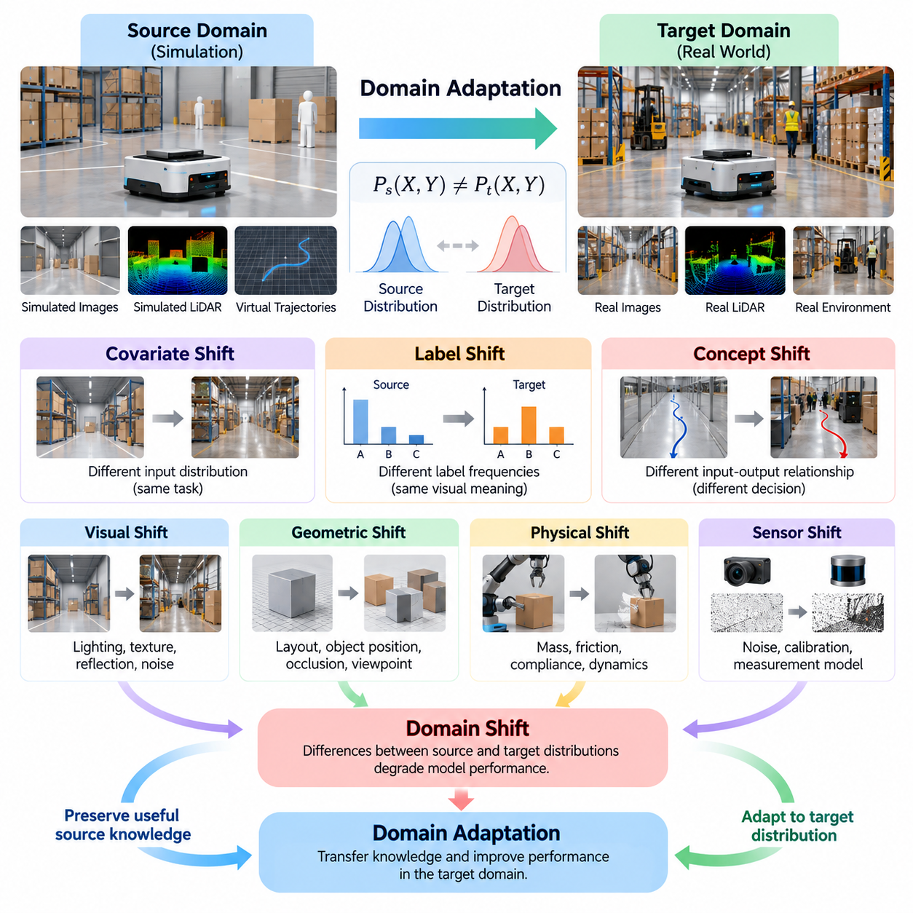{width="7.268055555555556in" height="7.268055555555556in"}

도메인 적응(Domain Adaptation)은 서로 다른 통계적(Statistical), 시각적(Visual), 물리적(Physical) 특성을 가진 환경 사이에서 인공지능(Artificial Intelligence)의 능력을 전이(Transfer)하기 위한 핵심 메커니즘이다. 피지컬 AI(Physical AI)에서는 통제된 시뮬레이션(Simulation) 환경에서 학습한 모델이 센서 측정값, 객체 속성, 환경 동역학, 상호작용 패턴이 서로 다른 실제 환경에서 작동해야 한다. 이러한 차이를 이해하려면 소스 도메인(Source Domain), 타깃 도메인(Target Domain), 그리고 두 도메인을 구분하는 분포 변화(Distribution Shift)를 정의하는 것부터 시작해야 한다.

소스 도메인(Source Domain)은 인공지능 모델이 처음으로 지식을 획득하는 환경이나 데이터셋(Dataset)을 의미한다. 여기에는 학습에 사용되는 관측값(Observations), 레이블(Labels), 상태 전이(State Transitions), 물리적 매개변수(Physical Parameters), 작업별 경험(Task-Specific Experiences)이 포함된다. 시뮬레이션 기반 로보틱스(Simulation-Based Robotics)에서 소스 도메인은 합성 카메라 영상(Synthetic Camera Images), 시뮬레이션 LiDAR 측정값, 가상 로봇 궤적(Virtual Robot Trajectories), 정확하게 레이블링된 객체 상태(Object States) 등을 포함할 수 있다. 이러한 자원은 광범위한 물리적 실험 없이도 확장 가능한 학습 기회를 제공한다.

타깃 도메인(Target Domain)은 학습된 모델이 실제로 작동하도록 요구되는 운영 환경(Operational Environment)을 의미한다. 피지컬 AI에서는 일반적으로 실제 로봇, 물리적 센서, 산업 시설, 물류창고, 도로, 실외 환경 등이 이에 해당한다. 시뮬레이션과 달리 타깃 환경에는 예측하기 어려운 외란(Disturbances), 하드웨어 불완전성(Hardware Imperfections), 변화하는 조명, 재료 특성의 차이, 복잡한 인간 활동이 존재한다. 따라서 타깃 환경의 통계적 특성은 학습 과정에서 경험한 환경과 상당히 다를 수 있다.

도메인 시프트(Domain Shift)는 소스 도메인과 타깃 도메인의 관측값 또는 상호작용을 지배하는 확률분포(Probability Distributions)가 서로 달라지는 현상을 의미한다. 모델은 시뮬레이션 데이터에서 뛰어난 성능을 달성하더라도 실제 환경에 배포(Deployment)된 이후에는 정확도(Accuracy), 안정성(Stability), 신뢰성(Reliability)이 저하될 수 있다. 이러한 차이는 학습된 표현(Learned Representations)이 물리적 작업의 보편적으로 전이 가능한 특성보다 특정 학습 환경에 종속된 특성을 포함하는 경우가 많기 때문에 발생한다.

도메인의 형식적 표현(Formal Domain Representation)은 입력 공간(Input Space), 출력 공간(Output Space), 관측값과 레이블에 대한 결합확률분포(Joint Probability Distribution)로 나타낼 수 있다. 소스 도메인은 P_s(X,Y) 분포를 따르고, 타깃 도메인은 P_t(X,Y) 분포를 따른다. 이러한 분포의 차이가 예측 또는 의사결정 품질에 영향을 미칠 정도로 커지면 도메인 적응이 필요해진다. 도메인 적응의 목표는 소스 도메인에서 획득한 유용한 지식을 유지하면서 타깃 분포(Target Distribution)에서의 성능을 향상시키는 것이다.

공변량 시프트(Covariate Shift)는 입력 관측값의 분포가 변화하지만 입력과 출력 사이의 조건부 관계(Conditional Relationship)는 대체로 유지되는 상황을 의미한다. 예를 들어 로봇 객체 검출기(Object Detector)는 객체 범주(Object Categories)가 변하지 않더라도 서로 다른 조명, 텍스처(Texture), 카메라 특성을 경험할 수 있다. 의미적 작업(Semantic Task)은 동일하게 유지되지만 시뮬레이션에서 학습한 시각적 특징(Visual Features)은 실제 카메라 영상에 적용될 때 신뢰성이 떨어질 수 있다.

레이블 시프트(Label Shift)는 소스 환경과 타깃 환경에서 출력 범주의 상대적 발생 빈도가 달라지는 현상을 의미한다. 시뮬레이션에서 학습한 물류창고 로봇은 팔레트(Pallet), 작업자, 차량이 균형 있게 포함된 데이터를 경험할 수 있지만 실제 배포 환경에서는 객체별 발생 빈도가 크게 다를 수 있다. 이러한 차이는 개별 범주와 관련된 시각적 특성이 비교적 안정적으로 유지되더라도 예측 신뢰도(Prediction Confidence)와 의사결정 임계값(Decision Thresholds)에 영향을 줄 수 있다.

개념 시프트(Concept Shift)는 관측값과 해당 출력 사이의 관계가 변화하는 현상을 의미한다. 피지컬 AI에서는 환경 조건, 운영 요구사항, 물리적 제약조건(Physical Constraints)이 달라지면서 동일한 센서 관측값이 서로 다른 행동을 요구할 때 발생할 수 있다. 장애물이 없는 복도를 대상으로 학습한 내비게이션 정책(Navigation Policy)은 사람이 밀집한 시설에서 다른 의사결정을 수행해야 할 수 있다. 단순한 시각적 차이와 달리 개념 시프트는 학습된 행동 자체의 수정을 요구할 수 있다.

시각적 도메인 시프트(Visual Domain Shift)는 시뮬레이션에서 현실로 전이(Sim2Real Transfer)할 때 가장 쉽게 확인할 수 있는 문제 중 하나이다. 합성 영상(Synthetic Images)은 조명, 반사, 그림자, 텍스처 통계(Texture Statistics), 광학 왜곡(Optical Distortion), 노출(Exposure), 센서 잡음(Sensor Noise) 측면에서 실제 영상과 다를 수 있다. 사실적 렌더링(Photorealistic Rendering)조차 실제 영상 형성 과정의 모든 특성을 재현할 수는 없다. 따라서 시각 인식 네트워크(Visual Perception Networks)는 실제 환경에서 일관되게 유지되지 않는 시뮬레이션 영상 특성에 의존할 수 있다.

기하학적 도메인 시프트(Geometric Domain Shift)는 학습 환경과 배포 환경 사이에서 공간 구조(Spatial Structures), 객체 치수(Object Dimensions), 배치(Layouts), 시점 분포(Viewpoint Distributions)가 달라질 때 발생한다. 정확하게 배치된 객체를 이용해 학습한 조작 시스템(Manipulation System)은 실제 환경에서 불규칙한 배치, 부분 가림(Partial Occlusion), 제조 공차(Manufacturing Tolerances)를 경험할 수 있다. 마찬가지로 자율이동로봇(Autonomous Mobile Robot)은 시뮬레이션 지도에 존재하지 않는 복도 구조와 장애물 배치를 마주할 수 있다. 이러한 차이는 인식, 위치추정(Localization), 경로계획(Planning), 충돌 회피(Collision Avoidance)에 영향을 미친다.

물리적 도메인 시프트(Physical Domain Shift)는 시각적 외형의 차이를 넘어 로봇과 환경 사이의 상호작용을 지배하는 동역학(Dynamics)까지 확장된다. 시뮬레이션의 질량(Mass), 관성(Inertia), 마찰(Friction), 감쇠(Damping), 유연성(Compliance), 접촉 거동(Contact Behavior)은 실제 물리 시스템과 완벽하게 일치하기 어렵다. 파지 정책(Grasping Policy)은 이상화된 접촉 매개변수에서 성공하더라도 실제 객체가 미끄러지거나 변형되면 실패할 수 있다. 보행 제어기(Locomotion Controller) 역시 실제 지형 특성이 학습 환경과 다를 때 유사한 어려움을 경험할 수 있다.

센서 도메인 시프트(Sensor Domain Shift)는 시뮬레이션 측정 모델(Simulated Measurement Models)과 실제 센싱 하드웨어(Sensing Hardware) 사이의 차이에서 발생한다. 실제 카메라는 전자적 잡음(Electronic Noise), 노출 변동(Exposure Fluctuations), 보정 오차(Calibration Errors), 움직임에 따른 영상 왜곡을 발생시킨다. LiDAR 시스템에서는 거리 불확실성(Range Uncertainty), 반사율에 따른 측정 차이, 불완전한 반환 신호가 나타난다. 관성 센서(Inertial Sensors)에서는 바이어스(Bias), 드리프트(Drift), 진동(Vibration)이 발생한다. 이러한 영향은 관측 분포를 변화시키고 인식, 상태추정(State Estimation), 제어 파이프라인(Control Pipeline) 전반으로 전파될 수 있다.

액추에이터 및 제어 도메인 시프트(Actuator and Control Domain Shift)는 동일한 명령이 환경에 따라 서로 다른 물리적 반응을 생성할 때 발생한다. 실제 모터에는 토크 제한(Torque Limitations), 비선형 마찰(Nonlinear Friction), 백래시(Backlash), 열적 영향(Thermal Effects), 통신 지연(Communication Delays)이 존재하지만 단순화된 시뮬레이션 모델에서는 이러한 특성이 누락될 수 있다. 결과적으로 동일한 제어 명령(Control Commands)이 서로 다른 궤적(Trajectories)을 생성할 수 있다. 따라서 적응 과정에서는 행동을 선택하는 데 사용되는 관측값의 차이뿐 아니라 명령 실행 과정의 불일치도 고려해야 한다.

시간적 도메인 시프트(Temporal Domain Shift)는 타이밍(Timing), 동기화(Synchronization), 시스템 동작의 시간적 변화에서 발생하는 차이를 의미한다. 시뮬레이션 환경은 일반적으로 결정론적 갱신 간격(Deterministic Update Intervals)으로 작동하지만 실제 시스템에서는 가변적인 처리 지연(Processing Latency), 비동기 센서 측정(Asynchronous Sensor Measurements), 네트워크 지연(Network Delays)이 발생한다. 이러한 차이는 작은 시간 오차가 큰 행동 차이를 만들 수 있는 고주파 제어(High-Frequency Control), 동적 장애물 회피(Dynamic Obstacle Avoidance), 협조 조작(Coordinated Manipulation)에서 특히 중요하다.

도메인 시프트는 로봇 형태(Morphology)와 하드웨어 구성(Hardware Configuration)의 차이에서도 발생할 수 있다. 한 로봇을 대상으로 개발한 정책(Policy)을 다른 플랫폼으로 전이할 때 관절 제한(Joint Limits), 액추에이터 성능, 센서 배치, 적재 능력(Payload Capacity), 운동학적 구조(Kinematic Structures)가 달라질 수 있다. 이러한 변화는 관측 공간(Observation Space)과 행동 공간(Action Space)을 모두 변화시킨다. 따라서 로봇 간 적응(Cross-Robot Adaptation)에는 전이 가능한 작업 지식과 하드웨어별 가정(Hardware-Specific Assumptions)을 구분하는 표현이 필요하다.

도메인 적응(Domain Adaptation)과 도메인 무작위화(Domain Randomization) 사이에는 중요한 차이가 존재한다. 도메인 무작위화는 학습 과정에서 시뮬레이션 매개변수를 의도적으로 변화시켜 모델이 다양한 환경 조건을 경험하도록 한다. 반면 도메인 적응은 일반적으로 특정 타깃 도메인에서 수집한 정보를 활용하여 소스 도메인과 타깃 도메인 사이의 성능 차이를 줄이는 데 초점을 맞춘다. 두 접근법은 상호 보완적이며, 무작위화된 소스 환경은 후속 적응을 위한 더욱 강건한 초기 표현(Robust Initial Representations)을 제공할 수 있다.

타깃 도메인 정보(Target-Domain Information)의 가용성은 적응 전략(Adaptation Strategy)에 큰 영향을 미친다. 일부 시스템은 레이블이 있는 실제 관측 데이터(Labeled Real-World Observations)를 사용할 수 있지만, 다른 시스템은 레이블이 없는 센서 기록(Unlabeled Sensor Recordings)이나 제한된 작업 시연(Operational Demonstrations)만 확보할 수 있다. 더욱 제한적인 환경에서는 배포 전에 타깃 데이터에 직접 접근하지 못한 상태에서 적응을 수행해야 한다. 이러한 차이는 지도 적응(Supervised Adaptation), 준지도 적응(Semi-Supervised Adaptation), 비지도 적응(Unsupervised Adaptation), 온라인 적응(Online Adaptation) 등의 접근법으로 이어지며, 각각 데이터 요구사항과 운영 복잡도 측면에서 서로 다른 절충관계(Tradeoffs)를 가진다.

도메인 시프트는 소스 관측값과 타깃 관측값 사이의 통계적 비교(Statistical Comparisons)를 통해 분석할 수 있다. 특징 분포(Feature Distributions), 임베딩 거리(Embedding Distances), 분류 신뢰도(Classification Confidence), 작업별 오류 패턴(Task-Specific Error Patterns)은 분포 불일치를 보여주는 근거를 제공한다. 최대 평균 불일치(Maximum Mean Discrepancy), 분포 발산(Distribution Divergence), 도메인 분류 정확도(Domain-Classification Accuracy)와 같은 기법은 분포 차이의 특정 측면을 정량화할 수 있다. 그러나 통계적 유사성만으로 성공적인 물리적 행동이나 안전한 제어가 보장되지는 않는다.

로봇 시스템에서 도메인 시프트를 평가하려면 인식 정확도(Perception Accuracy)뿐 아니라 전체 작업 성능(Task Performance)을 검토해야 한다. 주요 평가 지표에는 내비게이션 성공률(Navigation Success), 궤적 추종 오차(Trajectory Tracking Error), 파지 안정성(Grasp Stability), 충돌 빈도(Collision Frequency), 에너지 소비(Energy Consumption), 복구 동작(Recovery Behavior)이 포함된다. 비교적 작은 센서 불일치도 폐루프 의사결정(Closed-Loop Decision Making)과 결합되면 심각한 후속 실패를 초래할 수 있다. 따라서 평가는 측정 가능한 분포 차이를 실제 운영 결과와 연결해야 한다.

소스 도메인과 타깃 도메인 사이의 관계는 고정되어 있지 않은 경우가 많다. 실제 환경은 조명 변화, 장비 마모(Equipment Wear), 계절적 조건(Seasonal Conditions), 센서 재보정(Sensor Recalibration), 시설 배치 변경에 따라 지속적으로 변화한다. 초기 배포 시점에 관측한 타깃 도메인은 수개월 후의 운영 환경과 달라질 수 있다. 이는 모델이 이전에 획득한 능력을 잃지 않으면서 점진적인 분포 드리프트(Distribution Drift)에 강건하게 대응해야 하는 지속적 적응(Continual Adaptation) 문제를 발생시킨다.

효과적인 도메인 적응은 작업 성능에 가장 큰 영향을 미치는 환경 특성을 식별하는 것에서 시작한다. 시각 인식에서는 조명, 카메라 보정(Camera Calibration), 객체 외형(Object Appearance)이 중요할 수 있다. 조작 작업에서는 접촉 역학(Contact Mechanics)과 액추에이터 응답(Actuator Response)이 지배적인 요인이 될 수 있다. 자율주행 및 내비게이션에서는 기하학적 구조, 센서 특성, 이동 장애물이 핵심 요소가 될 수 있다. 영향력이 큰 불일치를 우선적으로 처리하면 시뮬레이션 충실도(Simulation Fidelity), 데이터 수집, 적응 자원을 효율적으로 배분할 수 있다.

소스 도메인의 다양성(Source-Domain Diversity) 역시 필요한 적응 수준을 결정한다. 제한된 합성 장면(Synthetic Scenes)으로 학습한 모델은 특정 텍스처, 시점, 물리적 매개변수에 종속된 취약한 표현(Fragile Representations)을 형성할 수 있다. 다양한 조건에서 학습하면 강건성(Robustness)을 향상시킬 수 있지만 지나친 변동은 비현실적인 경험을 생성하거나 작업별 학습(Task-Specific Learning)을 약화시킬 수 있다. 따라서 성공적인 전이는 환경 다양성과 실제 타깃 조건을 의미 있게 포괄하는 학습 범위 사이의 균형에 달려 있다.

도메인 적응은 타깃 환경의 성능을 개선하기 위한 변경이 기존에 확립된 행동까지 변화시킬 수 있기 때문에 중요한 안전 문제(Safety Considerations)를 수반한다. 적응된 제어기(Adapted Controller)는 익숙하지 않은 조건에서 더욱 효과적으로 작동하면서도 다른 상황에서는 예상하지 못한 반응을 나타낼 수 있다. 신뢰할 수 있는 배포를 위해서는 통제된 평가(Controlled Evaluation), 운영 경계(Operational Boundaries), 대체 동작 메커니즘(Fallback Mechanisms), 성능 저하 감시(Performance Degradation Monitoring)가 필요하다. 도메인 적응은 제한 없는 최적화 과정이 아니라 검증된 시스템 업데이트(Verified System Update)로 취급해야 한다.

실제 피지컬 AI 개발에서 소스-타깃 분석(Source-Target Analysis)은 적응 방법을 선택하고 검증 절차(Validation Procedures)를 설계하기 위한 기반을 제공한다. 엔지니어는 시뮬레이션 가정(Simulation Assumptions)을 분석하고 대표적인 실제 관측 데이터를 수집하며 분포 불일치를 식별하고 이러한 차이가 후속 작업에 미치는 영향을 판단한다. 이렇게 확보한 근거는 특징 정렬(Feature Alignment), 외형 적응(Appearance Adaptation), 동역학 보정(Dynamics Calibration), 정책 개선(Policy Refinement)의 방향을 결정한다. 이 과정은 도메인 적응을 추상적인 학습 문제에서 체계적인 엔지니어링 활동(Structured Engineering Activity)으로 전환한다.

궁극적으로 소스 도메인, 타깃 도메인, 도메인 시프트를 이해하는 것은 시뮬레이션에서 실제 물리적 운영 환경으로 안정적으로 전이할 수 있는 피지컬 AI 시스템을 개발하는 데 필수적이다. 핵심 과제는 시뮬레이션 환경과 실제 환경을 완전히 동일하게 만드는 것이 아니라 어떤 차이가 중요한지 식별하고 그러한 차이에도 효과적으로 작동하는 표현과 행동을 개발하는 것이다. 이러한 관점은 강건한 시뮬레이션-현실 전이(Robust Sim2Real Transfer), 도메인 일반화(Domain Generalization), 지속적으로 개선되는 로봇 지능(Continuously Improving Robotic Intelligence)을 위한 개념적 기반을 제공한다.

## 04.02. Supervised Semi Supervised and Unsupervised Adaptation

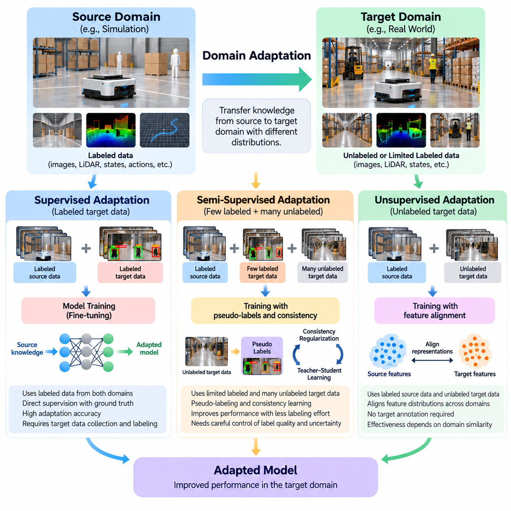{width="7.268055555555556in" height="7.268055555555556in"}

도메인 적응(Domain Adaptation) 방법은 타깃 도메인(Target Domain)에서 레이블이 지정된 데이터(Labeled Data)의 가용성과 학습 과정에서 사용되는 지도 수준(Degree of Supervision)에 따라 분류할 수 있다. 지도 적응(Supervised Adaptation), 준지도 적응(Semi-Supervised Adaptation), 비지도 적응(Unsupervised Adaptation)은 소스 환경(Source Environment)에서 타깃 환경(Target Environment)으로 지식을 전이하기 위한 세 가지 주요 접근법이다. 피지컬 AI(Physical AI)에서 이러한 접근법은 시뮬레이션으로 학습한 인식 모델(Perception Models), 제어 정책(Control Policies), 로봇 지능 시스템(Robotic Intelligence Systems)이 실제 환경에서 성능을 향상시키는 방식을 결정한다.

지도 도메인 적응(Supervised Domain Adaptation)은 소스 도메인(Source Domain)과 타깃 도메인 모두에서 레이블이 지정된 데이터를 사용할 수 있다고 가정한다. 시뮬레이션 관측값(Simulated Observations)으로 초기 학습한 모델은 검증된 정답 주석(Ground-Truth Annotations)이 포함된 실제 사례를 이용하여 미세조정(Fine-Tuning)할 수 있다. 이러한 주석에는 객체 범주(Object Categories), 분할 마스크(Segmentation Masks), 로봇 자세(Robot Poses), 파지 결과(Grasp Outcomes), 제어 목표(Control Targets) 등이 포함될 수 있다. 직접적인 지도 정보는 타깃 작업에 대한 신뢰할 수 있는 정보를 제공하지만 추가적인 데이터 수집과 레이블링 자원이 필요하다.

로봇 인식(Robotic Perception)에서 지도 적응은 일반적으로 사전학습된 신경망(Pretrained Neural Networks)을 대표적인 실제 데이터셋(Real-World Datasets)으로 미세조정하는 방식으로 구현된다. 합성 물류창고 영상(Synthetic Warehouse Images)으로 학습한 검출기(Detector)는 실제 카메라에서 수집한 레이블 영상으로 갱신할 수 있다. 최적화(Optimization) 과정에서 모델은 시뮬레이션으로 획득한 유용한 특징을 유지하면서 조명, 텍스처(Texture), 센서 잡음(Sensor Noise), 객체 외형(Object Appearance)의 차이에 대응하도록 내부 표현(Internal Representations)을 조정한다.

지도 적응의 효과는 타깃 도메인 주석(Target-Domain Annotations)의 품질과 포괄 범위(Coverage)에 크게 의존한다. 소규모 레이블 데이터셋은 익숙한 조건에서 성능을 개선할 수 있지만 드문 사건(Rare Events), 특이한 시점(Unusual Viewpoints), 변화하는 환경 조건을 충분히 표현하지 못할 수 있다. 따라서 운영 환경의 다양성(Operational Diversity)을 확보하기 위한 신중한 표본 추출(Sampling)이 필요하다. 제한된 타깃 데이터에 지나치게 미세조정하면 과적합(Overfitting)이 발생하여 소스 도메인 학습에서 확보한 일반화 능력(Generalization Capabilities)이 저하될 수도 있다.

지도 적응은 소스 도메인과 타깃 도메인의 학습 목적함수(Learning Objectives)를 가중 결합(Weighted Combination)하여 최소화하는 문제로 정식화할 수 있다. 소스 목적함수(Source Objective)는 이전에 학습한 지식을 유지하고, 타깃 목적함수(Target Objective)는 배포 환경에서 정확한 예측을 유도한다. 두 목적함수의 가중치는 지식 유지(Knowledge Retention)와 특화(Specialization) 사이의 균형을 결정한다. 정규화(Regularization), 선택적 계층 동결(Selective Layer Freezing), 제어된 학습률(Controlled Learning Rates)은 유용한 표현이 파괴적으로 변경되는 현상을 방지하는 데 도움이 된다.

준지도 도메인 적응(Semi-Supervised Domain Adaptation)은 소수의 레이블이 지정된 타깃 샘플과 대규모 레이블이 없는 타깃 관측값(Unlabeled Target Observations)을 함께 사용할 수 있는 상황을 다룬다. 이러한 조건은 많은 피지컬 AI 배포 환경과 유사하다. 로봇은 센서 데이터를 지속적으로 기록할 수 있지만 정확한 주석을 확보하는 데는 상당한 비용이 발생하기 때문이다. 준지도 방법은 레이블이 지정된 사례와 레이블이 없는 데이터의 내재적 구조(Underlying Structure)를 함께 활용하여 타깃 도메인 성능을 개선한다.

일반적인 준지도 적응 파이프라인(Semi-Supervised Adaptation Pipeline)은 레이블이 지정된 시뮬레이션 데이터로 사전학습한 모델과 소규모 실제 레이블 데이터셋에서 시작한다. 모델은 추가적인 레이블 없는 타깃 관측값에 대해 예측을 생성하며, 신뢰할 수 있는 예측은 의사 레이블(Pseudo-Labels)로 활용될 수 있다. 이러한 의사 레이블은 효과적인 타깃 데이터셋을 확장하는 보조 학습 신호(Supplementary Training Signals)를 제공한다. 그러나 예측이 부정확하면 신뢰도와 데이터 품질을 신중하게 관리하지 않는 경우 기존 모델 오류가 반복적으로 강화될 수 있다.

일관성 정규화(Consistency Regularization)는 준지도 적응에서 중요한 또 다른 메커니즘이다. 동일한 타깃 관측값에 적절한 조명 변화, 영상 교란(Image Perturbations), 센서 잡음과 같은 현실적인 변환을 적용하더라도 모델이 일관된 예측을 생성하도록 유도한다. 이를 통해 우연한 외형 특성(Incidental Appearance Characteristics)에 덜 의존하는 안정적인 표현을 학습할 수 있다. 특히 기하학적 구조(Geometry)나 물리적 상태(Physical State)가 올바른 행동을 결정하는 경우에는 변환 과정에서 작업과 관련된 정보가 보존되어야 한다.

교사-학생 학습(Teacher-Student Learning)은 레이블이 없는 타깃 데이터를 활용하기 위한 실용적인 프레임워크(Framework)를 제공한다. 교사 모델(Teacher Model)은 지도 예측(Supervisory Predictions)을 생성하고, 학생 모델(Student Model)은 레이블이 지정된 사례와 선택된 교사 출력으로 학습한다. 교사 모델은 예측 안정성을 향상시키기 위해 학생 모델 매개변수의 지수이동평균(Exponential Moving Average)을 사용하여 갱신할 수 있다. 로보틱스에서는 대량의 레이블 없는 관측값을 활용하는 객체 검출(Object Detection), 의미적 분할(Semantic Segmentation), 깊이 추정(Depth Estimation) 등의 작업을 지원할 수 있다.

준지도 적응에서는 레이블 불확실성(Label Uncertainty)과 분포 불균형(Distribution Imbalance)을 신중하게 관리해야 한다. 높은 신뢰도의 예측은 익숙한 객체나 쉬운 운영 조건에 편중될 수 있으며, 그 결과 어려운 사례가 충분히 반영되지 않을 수 있다. 신뢰도 임계값(Confidence Thresholds), 클래스 인식 표본 추출(Class-Aware Sampling), 불확실성 추정(Uncertainty Estimation), 주기적인 인간 검증(Human Verification)은 이러한 영향을 줄일 수 있다. 핵심 목표는 단순히 학습 데이터의 양을 늘리는 것이 아니라 레이블이 없는 운영 데이터에서 신뢰할 수 있는 학습 신호를 추출하는 것이다.

비지도 도메인 적응(Unsupervised Domain Adaptation)은 레이블이 지정된 소스 도메인 데이터는 사용할 수 있지만 타깃 도메인 관측값에는 작업 레이블(Task Labels)이 없는 상황을 가정한다. 이 방식은 시뮬레이션에서 현실로의 전이(Simulation-to-Reality Transfer)에 특히 유용하다. 시뮬레이션에서는 광범위한 정답 주석(Ground-Truth Annotations)을 자동으로 생성할 수 있지만 실제 로봇 데이터의 레이블링에는 상당한 인적 노력이 필요하기 때문이다. 핵심 과제는 적응 과정에서 올바른 타깃 도메인 출력을 직접 확인하지 않고도 예측 지식을 전이하는 것이다.

특징 정렬(Feature Alignment)은 비지도 적응에서 널리 사용되는 전략이다. 신경망은 작업 관련 정보(Task-Relevant Information)를 유지하면서 소스와 타깃의 특징 분포(Feature Distributions) 사이에서 측정 가능한 차이를 줄이는 표현을 학습한다. 이러한 정렬이 성공하면 소스 특징으로 학습한 예측 모델이 타깃 특징에서도 더욱 안정적으로 작동할 수 있다. 정렬은 통계적 불일치 목적함수(Statistical Discrepancy Objectives), 공유 인코더(Shared Encoders), 도메인 불변 표현 학습(Domain-Invariant Representation Learning)을 통해 유도할 수 있다.

적대적 도메인 적응(Adversarial Domain Adaptation)은 소스 도메인 특징과 타깃 도메인 특징을 구분하려는 도메인 판별기(Domain Discriminator)를 도입한다. 동시에 특징 추출기(Feature Extractor)는 원래 작업을 지원하면서 두 도메인의 표현을 구별하기 어렵도록 학습된다. 이러한 경쟁적 최적화 과정(Competing Optimization Process)은 도메인 불변 특징(Domain-Invariant Features)의 학습을 촉진한다. 그러나 특징 분포를 정렬한다고 해서 서로 다른 객체 범주나 제어 상태(Control States)가 올바르게 구분된다는 보장은 없다.

불일치 기반 적응(Discrepancy-Based Adaptation)은 최대 평균 불일치(Maximum Mean Discrepancy)나 공분산 정렬(Covariance Alignment)과 같은 척도를 사용하여 소스와 타깃 표현 사이의 통계적 차이를 줄인다. 이러한 기법은 타깃 레이블 없이도 선택된 분포 특성을 일치시키기 위한 명시적인 목적함수를 제공한다. 효과는 선택한 특징 공간(Feature Space)과 공유 작업 구조(Shared Task Structure)에 대한 가정에 따라 달라진다. 클래스 관계(Class Relationships)나 환경 동역학(Environmental Dynamics)이 크게 다른 경우에는 전체 통계량(Global Statistics)을 일치시키는 것만으로 충분하지 않을 수 있다.

영상 수준 적응(Image-Level Adaptation)은 시각적 도메인 차이를 줄이는 또 다른 접근법이다. 합성 관측값을 실제 카메라 영상과 유사하게 변환하거나 실제 관측값을 합성 영상 스타일(Synthetic Visual Style)로 매핑(Mapping)할 수 있다. 영상 변환(Image Translation)과 생성 모델(Generative Models)은 텍스처, 조명, 외형 통계(Appearance Statistics)를 수정할 수 있다. 피지컬 AI에서는 기하학적 일관성(Geometric Consistency)이 필수적이다. 객체 경계(Object Boundaries), 공간 관계(Spatial Relationships), 접촉 위치(Contact Locations)를 변경하는 변환은 합성 데이터와 연결된 지도 정보(Supervision)를 손상시킬 수 있기 때문이다.

자기지도 학습(Self-Supervised Learning)은 타깃 관측값에서 직접 학습 신호를 추출하여 비지도 적응을 강화할 수 있다. 시간적 일관성(Temporal Consistency), 마스킹 복원(Masked Reconstruction), 대조 학습(Contrastive Learning), 다중모달 대응(Multimodal Correspondence)은 수작업으로 지정한 작업 레이블 없이도 학습 목적을 제공한다. 로봇 궤적(Robot Trajectories)은 연속적인 관측값과 행동 이력(Action Histories)을 통해 추가적인 구조적 정보를 제공한다. 이러한 신호는 표현 품질을 개선할 수 있지만 올바른 작업 예측이나 안전한 물리적 행동을 자동으로 보장하지는 않는다.

세 가지 적응 접근법은 주로 주석 요구사항(Annotation Requirements), 지도 정보의 품질(Supervision Quality), 배포 비용(Deployment Cost)에서 차이가 있다. 지도 적응은 직접적인 타깃 작업 피드백(Target-Task Feedback)을 제공하지만 충분한 레이블 데이터에 의존한다. 준지도 적응은 제한된 주석과 풍부한 레이블 없는 관측값을 결합하며, 비지도 적응은 타깃 레이블링 자체를 필요로 하지 않는다. 도메인 유사성(Domain Similarity), 작업 복잡도(Task Complexity), 주석 신뢰성(Annotation Reliability), 가용 계산 자원(Computational Resources)에 따라 성능이 달라지므로 어느 한 접근법이 모든 상황에서 우수한 것은 아니다.

자율이동로봇(Autonomous Mobile Robots)의 경우 지도 적응은 레이블이 지정된 실제 장애물 영상과 내비게이션 사례(Navigation Examples)를 사용할 수 있다. 준지도 적응은 운영 중 수집한 카메라 및 LiDAR 관측값을 활용하여 이러한 데이터셋을 확장할 수 있다. 비지도 적응은 수작업 타깃 레이블 없이 시뮬레이션 센서 표현과 실제 센서 표현을 정렬할 수 있다. 각 접근법은 서로 다른 운영 제약조건(Operational Constraints)을 해결하며, 실제 시스템에서는 추가 데이터가 확보됨에 따라 여러 방법을 결합할 수 있다.

로봇 조작(Robotic Manipulation)은 성공적인 전이가 시각적 외형뿐 아니라 물리적 상호작용(Physical Interaction)에 의존하기 때문에 추가적인 복잡성을 가진다. 타깃 레이블에는 파지 성공(Grasp Success), 접촉 상태(Contact State), 객체 변위(Object Displacement), 궤적 품질(Trajectory Quality) 등이 포함될 수 있다. 이러한 레이블을 확보하려면 실제 물리적 실험(Physical Trials)과 신뢰할 수 있는 측정이 필요하므로 비용이 높을 수 있다. 준지도 및 비지도 방법은 주석 요구사항을 줄일 수 있지만 마찰(Friction), 유연성(Compliance), 액추에이터 응답(Actuator Response), 접촉 동역학(Contact Dynamics)의 차이를 여전히 고려해야 한다.

제어 정책 적응(Control-Policy Adaptation)은 잘못된 예측이 실제 물리적 행동에 직접적인 영향을 미칠 수 있으므로 특별한 주의가 필요하다. 수동적인 인식 작업(Passive Perception Tasks)과 달리 탐색적 업데이트(Exploratory Updates)는 위험한 궤적이나 불안정한 행동을 생성할 수 있다. 기록된 타깃 도메인 데이터를 사용하는 오프라인 적응(Offline Adaptation)은 즉각적인 배포 위험을 줄일 수 있다. 이후 온라인 개선(Online Refinement)은 검증된 안전 제약조건(Safety Constraints) 안에서 수행되어야 하며, 성능이 불확실해질 경우 감시 및 대체 제어 메커니즘(Fallback Control Mechanisms)을 사용할 수 있어야 한다.

평가 프로토콜(Evaluation Protocols)은 적응 데이터(Adaptation Data)와 독립적인 타깃 도메인 시험 데이터(Target-Domain Test Data)를 분리해야 한다. 성능은 검출 정확도(Detection Accuracy), 내비게이션 성공률(Navigation Success), 파지 완료율(Grasp Completion), 추종 오차(Tracking Error), 충돌 빈도(Collision Frequency)와 같은 작업 관련 지표(Task-Relevant Metrics)를 사용하여 측정해야 한다. 또한 비교 과정에서는 타깃 레이블 수, 계산 요구사항, 적응 시간(Adaptation Time)을 고려해야 한다. 일관된 평가 조건이 없다면 관측된 성능 개선이 실제로 더 효과적인 적응 때문인지 추가적인 지도 정보 때문인지 구분하기 어렵다.

부정적 전이(Negative Transfer)는 소스와 타깃의 지식이 서로 호환되지 않거나 잘못 정렬되어 적응 이후 성능이 저하되는 현상을 의미한다. 이는 도메인 사이에서 클래스 분포(Class Distributions), 물리적 제약조건(Physical Constraints), 관측값과 행동 사이의 관계가 서로 다를 때 발생할 수 있다. 비지도 방법은 분포 정렬(Distribution Alignment)이 의미 있는 작업 구분을 흐리게 만드는 경우 특히 취약하다. 부정적 전이를 탐지하려면 타깃 도메인의 성능 개선뿐 아니라 이전에 신뢰할 수 있었던 능력의 저하도 함께 감시해야 한다.

실용적인 적응 전략(Practical Adaptation Strategy)은 배포 시스템이 경험을 축적함에 따라 점진적으로 발전하는 경우가 많다. 초기 모델은 타깃 레이블을 사용할 수 없을 때 비지도 정렬(Unsupervised Alignment)이나 강건한 시뮬레이션 학습(Robust Simulation Training)에 의존할 수 있다. 이후 제한된 검증 사례(Verified Examples)가 확보되면 준지도 학습을 지원할 수 있으며, 더 큰 주석 데이터셋이 구축되면 목표 지향적인 지도 미세조정(Targeted Supervised Refinement)이 가능해진다. 이러한 발전 과정은 초기부터 광범위한 실제 지도 데이터를 확보할 수 있다고 가정하지 않고도 배포 모델을 지속적으로 개선할 수 있게 한다.

적응 방법의 선택은 예측 오류(Prediction Errors)가 운영에 미치는 영향을 반영해야 한다. 위험도가 낮은 인식 작업은 레이블이 없는 데이터를 활용한 폭넓은 실험을 허용할 수 있지만, 안전 필수 조작(Safety-Critical Manipulation)과 내비게이션에는 더욱 엄격한 검증과 통제된 업데이트가 필요하다. 따라서 데이터 거버넌스(Data Governance), 주석 품질(Annotation Quality), 모델 버전 관리(Model Versioning), 재현 가능한 평가(Reproducible Evaluation)는 적응 설계의 필수 요소이다. 신뢰할 수 있는 성능 개선은 학습 알고리즘뿐 아니라 이를 둘러싼 엔지니어링 프로세스(Engineering Processes)에 의해서도 결정된다.

궁극적으로 지도 도메인 적응(Supervised Domain Adaptation), 준지도 도메인 적응(Semi-Supervised Domain Adaptation), 비지도 도메인 적응(Unsupervised Domain Adaptation)은 시뮬레이션과 실제 운영 환경 사이의 차이를 줄이기 위한 상호 보완적인 메커니즘을 제공한다. 이들의 공통 목표는 전이 가능한 지식(Transferable Knowledge)을 유지하면서 도메인별 차이(Domain-Specific Differences)의 영향을 줄이는 것이다. 데이터 가용성(Data Availability), 작업 요구사항(Task Requirements), 안전 제약조건(Safety Constraints)에 따라 적절한 지도 전략을 선택함으로써 피지컬 AI 개발자는 변화하는 물리적 환경에 더욱 효율적으로 적응하고 신뢰할 수 있는 성능을 유지하는 로봇 시스템을 구축할 수 있다.

## 04.03. Weakly Supervised Domain Adaptation

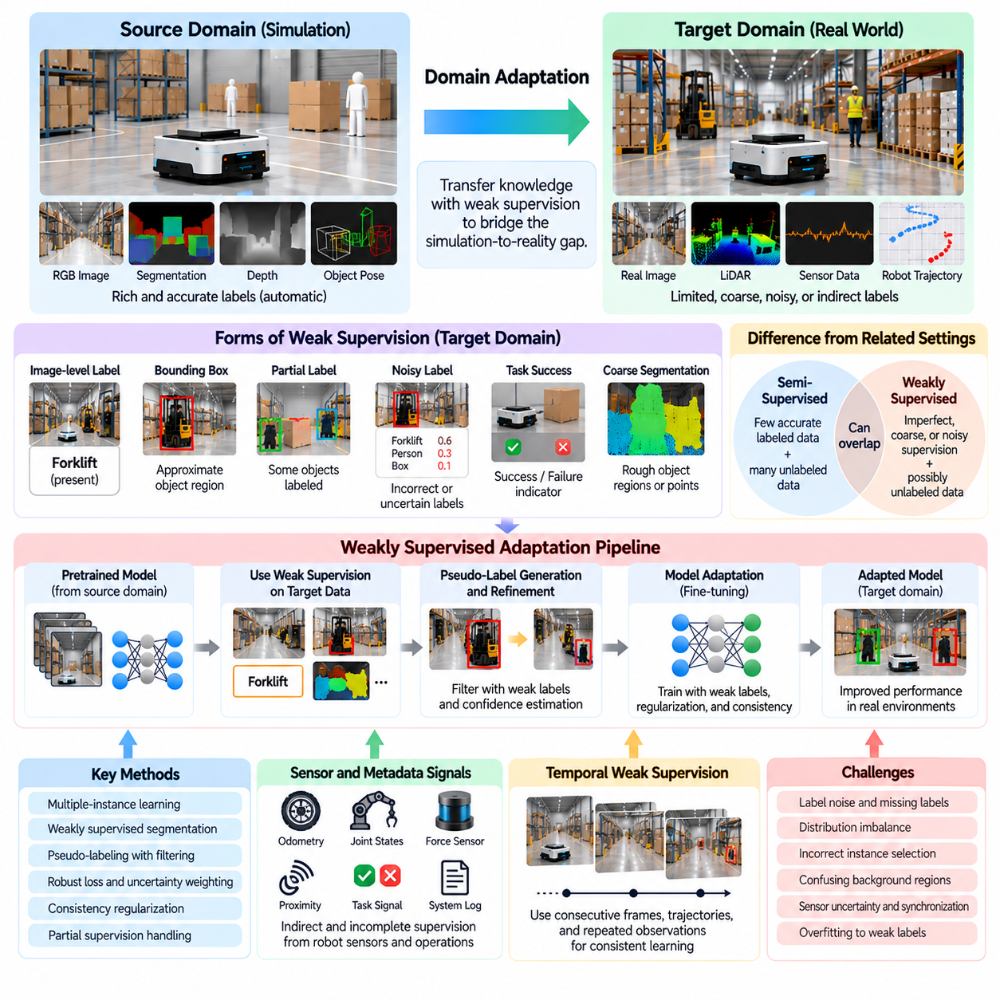{width="7.268055555555556in" height="7.268055555555556in"}

약지도 도메인 적응(Weakly Supervised Domain Adaptation)은 완전한 타깃 도메인 주석(Target-Domain Annotations)을 사용할 수 없는 상황에서 소스 환경(Source Environment)과 타깃 환경(Target Environment) 사이에 머신러닝 모델(Machine Learning Models)을 전이하기 위한 실용적인 프레임워크(Framework)를 제공한다. 개별 학습 샘플에 정확한 레이블(Labels)을 요구하는 완전 지도 적응(Fully Supervised Adaptation)과 달리, 약지도 학습(Weak Supervision)은 불완전하거나 개략적이고 잡음이 포함되었거나 간접적으로 생성된 정보를 활용한다. 피지컬 AI(Physical AI)에서 이러한 접근법은 실제 로봇 데이터의 수집 및 레이블링 비용을 줄이면서 시뮬레이션과 현실 사이의 차이를 극복하는 데 도움이 된다.

약지도 적응(Weakly Supervised Adaptation)의 필요성은 합성 데이터 생성(Synthetic Data Generation)과 실제 환경 주석(Real-World Annotation) 사이의 상당한 차이에서 비롯된다. 시뮬레이션 환경은 정확한 객체 자세(Object Poses), 분할 마스크(Segmentation Masks), 깊이 지도(Depth Maps), 접촉 상태(Contact States), 행동 결과(Action Outcomes)를 자동으로 제공할 수 있다. 반면 실제 환경에서 유사한 정보를 확보하려면 센서, 인간 주석 작업자(Human Annotators), 보정 절차(Calibration Procedures), 물리적 실험(Physical Experiments)이 필요하다. 약지도 학습은 비용이 낮으면서도 유용한 타깃 도메인 신호(Target-Domain Signals)를 활용하여 적응을 수행할 수 있도록 한다.

약지도 학습은 학습 과정에서 사용할 수 있는 정보에 따라 여러 형태로 나타날 수 있다. 영상 수준 레이블(Image-Level Labels)은 객체의 정확한 위치를 지정하지 않고도 해당 객체의 존재 여부를 나타낼 수 있다. 경계 상자(Bounding Boxes)는 픽셀 수준 분할(Pixel-Level Segmentation)을 제공하지 않으면서 대략적인 객체 영역을 식별할 수 있다. 로봇 궤적(Robot Trajectories)은 상세한 행동 주석(Action Annotations) 없이 작업 성공 여부(Task Success Indicators)를 포함할 수 있다. 이러한 신호는 완전 지도 정보보다 정밀도는 낮지만 학습된 표현(Learned Representations)의 적응을 유도할 수 있다.

약지도 도메인 적응과 준지도 도메인 적응(Semi-Supervised Domain Adaptation) 사이에는 근본적인 차이가 존재한다. 준지도 적응은 일반적으로 소수의 정확하게 레이블링된 타깃 샘플과 대규모 레이블 없는 관측값(Unlabeled Observations)을 결합한다. 반면 약지도 적응은 불완전하거나 낮은 해상도의 지도 정보(Lower-Resolution Supervision)를 활용하는 데 중점을 둔다. 두 접근법은 희소한 검증 주석(Sparse Verified Annotations), 잡음이 포함된 레이블(Noisy Labels), 자동 추론된 타깃(Automatically Inferred Targets), 레이블 없는 운영 데이터를 결합하는 시스템에서 서로 중첩될 수 있다.

로봇 인식(Robotic Perception)에서 약지도 학습은 실제 객체 검출(Object Detection)과 의미적 분할(Semantic Segmentation)에 필요한 주석 작업을 크게 줄일 수 있다. 상세한 합성 레이블(Synthetic Labels)로 학습한 모델은 객체 범주(Object Categories)나 대략적인 경계 상자만 주석으로 제공된 실제 영상을 이용하여 적응할 수 있다. 학습 시스템은 개략적인 타깃 정보(Coarse Target Information)를 시뮬레이션에서 획득한 상세한 표현과 연결해야 한다. 이를 통해 모든 픽셀에 대한 주석 없이도 시각 인식(Visual Recognition) 성능을 개선할 수 있다.

다중 인스턴스 학습(Multiple-Instance Learning)은 개략적인 주석에서 유용한 정보를 추출하기 위한 메커니즘 중 하나이다. 시스템은 모든 영상 영역에 레이블을 부여하는 대신 영상이나 관측 시퀀스(Observation Sequence)를 후보 인스턴스(Candidate Instances)의 집합으로 취급한다. 양성 영상 수준 레이블(Positive Image-Level Label)은 적어도 하나의 관련 인스턴스가 존재한다는 사실을 나타낸다. 모델은 타깃 도메인의 외형 특성에 적응하면서 관련 가능성이 높은 영역을 식별하도록 학습한다. 그러나 부정확한 인스턴스 선택은 위치추정 오류(Localization Errors)를 발생시킬 수 있다.

약지도 의미적 분할(Weakly Supervised Semantic Segmentation)은 소스 도메인의 정밀도(Source-Domain Precision)와 타깃 도메인의 주석 효율성(Target-Domain Annotation Efficiency) 사이의 관계를 보여준다. 합성 장면(Synthetic Scenes)은 모든 가시 객체에 대한 조밀한 분할 마스크(Dense Segmentation Masks)를 제공할 수 있지만 실제 영상에는 범주 레이블, 희소 점(Sparse Points), 대략적인 객체 영역만 포함될 수 있다. 적응 방법은 소스 도메인의 분할 지식과 약한 타깃 제약조건(Weak Target Constraints)을 결합하여 실제 환경의 예측 성능을 개선한다. 공간적 일관성(Spatial Consistency)과 경계 보존(Boundary Preservation)은 유용한 기하학적 정보(Geometric Information)를 유지하는 데 필수적이다.

의사 레이블 생성(Pseudo-Label Generation)은 약지도 적응 파이프라인(Weakly Supervised Adaptation Pipelines)에 자주 포함된다. 소스 도메인에서 학습한 모델(Source-Trained Model)은 실제 관측값에 대한 예측을 생성하고, 약한 타깃 주석(Weak Target Annotations)은 이러한 예측을 필터링(Filtering), 개선(Refinement), 검증(Validation)하는 데 사용된다. 예를 들어 영상 수준 객체 레이블은 제공된 주석과 일치하지 않는 예측 범주를 제거할 수 있다. 신뢰도 추정(Confidence Estimation)은 어떤 예측을 학습에 활용하고 어떤 예측에 추가 검증이 필요한지 결정하는 데 도움이 된다.

레이블 잡음(Label Noise)은 약한 주석에 잘못된 범주, 누락된 객체, 부정확한 경계, 불확실한 작업 결과가 포함될 수 있기 때문에 핵심적인 문제이다. 신뢰할 수 없는 레이블로 직접 학습하면 체계적인 오류(Systematic Errors)가 강화되고 타깃 도메인 성능이 저하될 수 있다. 강건한 손실함수(Robust Loss Functions), 신뢰도 가중치(Confidence Weighting), 샘플 필터링(Sample Filtering), 불확실성 인식 최적화(Uncertainty-Aware Optimization)는 의심스러운 지도 정보의 영향을 줄일 수 있다. 이러한 방법의 효과는 주석 오류가 어떤 분포를 따르는지에 대한 가정에 의존한다.

부분 지도 학습(Partial Supervision)은 관측값의 일부 요소에만 레이블이 지정된 경우에 유용한 또 다른 접근법이다. 로봇 데이터셋(Robotic Dataset)은 중요한 장애물에 대한 정확한 주석을 포함하면서 배경 객체는 지정하지 않을 수 있다. 마찬가지로 조작 시연(Manipulation Demonstrations)에는 완전한 접촉 상태 측정값 없이 신뢰할 수 있는 파지 결과(Grasp Outcomes)만 포함될 수 있다. 학습 알고리즘(Learning Algorithms)은 누락된 레이블(Missing Labels)과 부정 레이블(Negative Labels)을 구분해야 한다. 주석이 없는 영역을 확인된 배경으로 취급하면 상당한 학습 편향(Training Bias)이 발생할 수 있다.

피지컬 AI에서 약지도 정보는 인간 주석뿐 아니라 로봇 센서(Robot Sensors)와 운영 메타데이터(Operational Metadata)에서도 얻을 수 있다. 주행거리 측정(Odometry), 관절 엔코더(Joint Encoders), 힘 센서(Force Sensors), 근접 측정(Proximity Measurements), 작업 완료 신호(Task Completion Signals)는 환경 상태에 대한 간접적인 근거를 제공할 수 있다. 이러한 신호는 불완전하거나 측정 불확실성(Measurement Uncertainty)의 영향을 받을 수 있지만 시뮬레이션에서 얻은 지식과 결합하면 학습을 제약하는 데 활용할 수 있다. 센서 보정(Sensor Calibration)과 시간 동기화(Temporal Synchronization)는 이러한 정보의 신뢰성에 영향을 미친다.

시간적 약지도 학습(Temporal Weak Supervision)은 로봇 운영 중 수집된 관측값 사이의 관계를 활용한다. 연속 비디오 프레임(Consecutive Video Frames), 이동 궤적(Motion Trajectories), 반복적인 객체 상호작용(Repeated Object Interactions)은 객체 식별, 움직임, 물리적 일관성에 대한 제약조건을 제공한다. 로봇은 모든 관측값에 상세한 주석을 받지 않더라도 여러 프레임에서 동일한 객체를 관찰할 수 있다. 추적 일관성(Tracking Consistency)은 희소 레이블(Sparse Labels)의 전파를 지원할 수 있지만 가림(Occlusion), 움직임 흐림(Motion Blur), 추적 실패(Tracking Failures)는 추가적인 불확실성을 발생시킬 수 있다.

약지도 학습은 상세한 접촉 주석(Contact Annotations)을 확보하기 어려운 로봇 조작(Robotic Manipulation)에서 특히 중요하다. 로봇은 정확한 접촉 위치(Contact Locations), 마찰계수(Friction Coefficients), 힘 분포(Force Distributions)를 측정하지 않고도 파지 성공 여부를 알 수 있다. 이러한 결과 수준 지도 정보(Outcome-Level Supervision)는 파지 예측 모델(Grasp Prediction Models)과 조작 정책(Manipulation Policies)의 적응을 지원할 수 있다. 그러나 작업 성공만으로는 성공을 발생시킨 물리적 메커니즘(Physical Mechanisms)을 유일하게 식별할 수 없으므로 추론 가능한 정보에는 한계가 있다.

자율이동로봇(Autonomous Mobile Robots)의 경우 약한 타깃 레이블(Weak Target Labels)은 완전한 환경 지도(Environmental Maps) 없이 주행 가능 영역(Traversable Regions), 장애물 존재 여부(Obstacle Presence), 내비게이션 결과(Navigation Outcomes)를 설명할 수 있다. 인간 운영자(Human Operator)는 대략적인 표시를 통해 위험 구역을 식별할 수 있으며, 로봇 로그(Robot Logs)는 충돌 사건(Collision Events)이나 경로 완료 기록(Route Completion Records)을 제공할 수 있다. 이러한 신호는 익숙하지 않은 시설에서 인식 및 주행 가능성 모델(Traversability Models)을 적응시키는 데 도움이 된다. 다만 성공적인 주행이 모든 통과 위치가 다른 조건에서도 안전하다는 것을 의미하지는 않으므로 주의가 필요하다.

특징 수준 적응(Feature-Level Adaptation)은 소스와 타깃의 분포 차이를 줄이면서 작업 관련 구조(Task-Relevant Structure)를 유지하기 위해 약한 타깃 레이블을 활용할 수 있다. 순수한 비지도 특징 정렬(Unsupervised Feature Alignment)은 서로 다른 범주나 물리적 상태에 속하는 표현을 잘못 결합할 수 있다. 약한 범주 정보(Weak Category Information), 대략적인 공간 레이블(Approximate Spatial Labels), 작업 수준 제약조건(Task-Level Constraints)은 의미적으로 호환되는 영역(Semantically Compatible Regions)을 중심으로 정렬을 유도할 수 있다. 이러한 추가 정보는 소스와 타깃 분포가 크게 다를 때 부정적 전이(Negative Transfer)를 줄일 수 있다.

대조 학습(Contrastive Learning)은 약지도 정보를 활용하는 또 다른 메커니즘을 제공한다. 동일한 객체, 위치, 물리적 상태를 나타낸다고 판단되는 관측값은 서로 관련된 사례로 취급하고, 서로 다른 관측값은 대조 신호(Contrasting Signals)를 제공한다. 약한 연관 관계(Weak Associations)는 시간적 근접성(Temporal Proximity), 로봇 위치추정(Robot Localization), 공유된 작업 결과(Shared Task Outcomes)에서 얻을 수 있다. 이러한 관계가 항상 신뢰할 수 있는 것은 아니므로 학습 목적함수(Training Objectives)는 불확실한 양성 및 음성 쌍(Positive and Negative Pairs)을 허용할 수 있어야 한다.

약지도 적응은 신뢰도 수준(Reliability Levels)이 서로 다른 여러 주석 소스(Annotation Sources)를 결합함으로써 효과를 높일 수 있다. 인간이 제공한 범주 레이블, 자동 객체 추적(Automatic Object Tracking), 센서 기반 측정값(Sensor-Derived Measurements), 시뮬레이션 예측(Simulation Predictions)은 상호 보완적인 정보를 제공할 수 있다. 학습 시스템은 이러한 신호에 서로 다른 신뢰도 가중치(Confidence Weights)를 부여하거나 신호 간 일관성을 추정할 수 있다. 독립적인 근거를 결합하면 지도 정보의 품질을 개선할 수 있지만 서로 연관된 오류(Correlated Errors)는 여전히 탐지하기 어려울 수 있다.

능동 학습(Active Learning)은 추가적인 인간 주석이 가장 유용한 관측값을 식별함으로써 약지도 학습을 보완할 수 있다. 모든 타깃 샘플에 상세한 레이블을 요구하는 대신 시스템은 불확실한 예측(Uncertain Predictions), 익숙하지 않은 환경(Unfamiliar Environments), 안전 필수 사건(Safety-Critical Events)을 우선적으로 선택한다. 이후 인간 전문가(Human Experts)는 선택된 사례에 대해 정확한 수정 정보를 제공하고 나머지 데이터셋은 약한 주석을 유지할 수 있다. 이러한 접근법은 레이블링 자원이 제한된 상황에서 주석 효율성(Annotation Efficiency)을 높일 수 있다.

약지도 학습과 도메인 적응의 관계는 학습 효율성 향상이 자동으로 더 나은 전이 성능(Transfer Performance)을 의미하지 않으므로 신중하게 평가해야 한다. 약한 레이블은 모델이 관련 타깃 특징(Target Features)에 집중하도록 유도할 수 있지만 잘못된 제약조건은 표현을 왜곡할 수 있다. 적응 품질(Adaptation Quality)은 주석 포괄 범위(Annotation Coverage), 레이블 신뢰성(Label Reliability), 소스-타깃 유사성(Source-Target Similarity), 작업 복잡도(Task Complexity)에 의존한다. 따라서 일관된 조건에서 지도 적응(Supervised Adaptation), 준지도 적응(Semi-Supervised Adaptation), 비지도 적응(Unsupervised Adaptation)과 성능을 비교해야 한다.

약지도 적응의 평가는 작업 성능(Task Performance)과 주석 효율성(Annotation Efficiency)을 모두 포함해야 한다. 관련 인식 지표(Perception Metrics)에는 검출 정확도(Detection Accuracy), 분할 품질(Segmentation Quality), 위치추정 오차(Localization Error), 보정 성능(Calibration Performance)이 포함된다. 로봇 제어(Robotic Control)에서는 작업 완료율(Task Completion), 파지 안정성(Grasp Stability), 궤적 추종(Trajectory Tracking), 실패 빈도(Failure Frequency)를 평가할 수 있다. 약지도 학습이 실질적인 이점을 제공하는지 판단하려면 주석 시간(Annotation Time), 인간 작업량(Human Effort), 검증된 타깃 샘플 수(Number of Verified Target Samples)도 측정해야 한다.

약지도 정보가 물리적 행동(Physical Actions)에 영향을 미치는 경우 안전 고려사항(Safety Considerations)은 특히 중요해진다. 잘못된 장애물 레이블(Obstacle Label), 신뢰할 수 없는 주행 가능성 추정(Traversability Estimate), 오해를 유발하는 파지 결과(Grasp Outcome)는 위험한 의사결정으로 전파될 수 있다. 적응된 모델(Adapted Models)은 신뢰할 수 있는 타깃 도메인 측정값(Target-Domain Measurements)을 이용하여 독립적으로 검증해야 한다. 신뢰도 감시(Confidence Monitoring), 보수적 행동 선택(Conservative Action Selection), 운영 제약조건(Operational Constraints), 대체 제어기(Fallback Controllers)는 배포 과정에서 불확실한 학습 표현이 초래하는 영향을 제한할 수 있다.

실용적인 약지도 적응 워크플로(Weakly Supervised Adaptation Workflow)는 풍부한 주석이 포함된 시뮬레이션 데이터(Richly Annotated Simulation Data)로 학습한 모델에서 시작한다. 엔지니어는 대표적인 타깃 도메인 관측값을 수집하고 영상, 센서 로그(Sensor Logs), 로봇 궤적, 운영 기록(Operational Records)에서 저비용으로 추출할 수 있는 지도 신호(Supervisory Signals)를 식별한다. 이후 약한 주석을 적절한 학습 목적함수(Learning Objectives)를 통해 소스 도메인 지식과 결합한다. 반복적인 검증(Iterative Validation)은 신뢰할 수 없는 레이블을 식별하고 추가 지도 정보가 필요한 부분을 결정한다.

약지도 적응은 로봇 시스템이 여러 시설, 환경, 하드웨어 구성(Hardware Configurations)에서 운영될수록 더욱 중요해진다. 모든 배포 도메인(Deployment Domains)에 대해 완전한 주석을 수집하는 것은 현실적으로 어려운 경우가 많지만 제한적인 운영 피드백(Operational Feedback)은 비교적 쉽게 확보할 수 있다. 적응 시스템은 개략적인 레이블(Coarse Labels), 간접 측정값(Indirect Measurements), 작업 결과(Task Outcomes)를 활용하여 변화하는 조건에서도 시뮬레이션에서 학습한 지식을 재사용할 수 있다. 그러나 전이 신뢰성(Transfer Reliability)은 지도 정보의 품질과 환경 차이를 지속적으로 평가하는 능력에 달려 있다.

궁극적으로 약지도 도메인 적응(Weakly Supervised Domain Adaptation)은 주석 작업이 많이 필요한 지도 학습(Annotation-Intensive Supervised Learning)과 완전히 레이블이 없는 적응(Fully Unlabeled Adaptation) 사이의 중간 접근법을 제공한다. 핵심적인 기여는 불완전한 타깃 도메인 정보(Imperfect Target-Domain Information)를 지식 전이(Knowledge Transfer)에 유용한 지침으로 변환하는 능력이다. 강건한 표현 학습(Robust Representation Learning), 불확실성 추정(Uncertainty Estimation), 선택적 인간 검증(Selective Human Verification), 체계적인 검증(Systematic Validation)을 결합하면 약지도 학습은 적응 비용을 줄이면서 복잡한 실제 환경에서 더욱 신뢰할 수 있는 피지컬 AI 배포(Physical AI Deployment)를 지원할 수 있다.

## 04.04. Feature Level Domain Adaptation

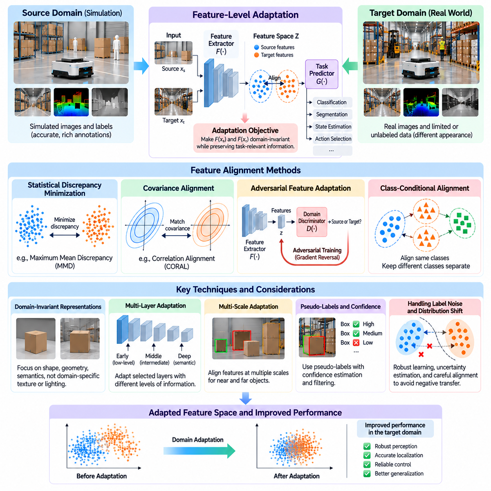{width="7.268055555555556in" height="7.268055555555556in"}

특징 수준 도메인 적응(Feature-Level Domain Adaptation)은 내부 특징 표현(Internal Feature Representations)을 정렬하여 소스 환경(Source Environment)과 타깃 환경(Target Environment) 사이에서 머신러닝 모델(Machine Learning Models)을 전이하는 핵심 접근법이다. 이 방법은 원시 센서 관측값(Raw Sensor Observations)을 직접 수정하는 대신 신경망(Neural Networks)이 추출한 중간 표현(Intermediate Representations)을 대상으로 작동한다. 피지컬 AI(Physical AI)에서 특징 수준 적응은 시뮬레이션으로 학습한 인식 및 제어 시스템이 외형, 센싱 조건, 물리적 특성의 차이에도 불구하고 실제 환경에서 의미 있는 패턴을 인식하도록 지원한다.

특징 수준 적응의 핵심 가정은 소스 관측값(Source Observations)과 타깃 관측값(Target Observations)이 상당히 다르더라도 기본적인 작업 관련 정보(Task-Relevant Information)는 공유할 수 있다는 것이다. 시뮬레이션 카메라 영상과 실제 카메라 영상은 텍스처(Texture), 조명(Illumination), 잡음(Noise) 특성이 서로 다르지만 동일한 객체 형상(Object Geometry)이나 의미적 범주(Semantic Category)를 나타낼 수 있다. 적응 방법은 이러한 공통 속성을 강조하는 표현을 학습함으로써 도메인별 변동(Domain-Specific Variations)에 대한 의존성을 줄이고자 한다.

일반적인 특징 수준 적응 아키텍처(Feature-Level Adaptation Architecture)는 특징 추출기(Feature Extractor), 작업 예측 모듈(Task Prediction Module), 적응 목적함수(Adaptation Objective)로 구성된다. 특징 추출기는 입력 관측값을 잠재 표현(Latent Representations)으로 변환하고, 예측 모듈은 객체 인식(Object Recognition), 분할(Segmentation), 상태추정(State Estimation), 행동 선택(Action Selection)을 수행한다. 적응 목적함수는 정확한 작업 수행에 필요한 정보를 제거하지 않으면서 소스와 타깃 표현이 통계적으로 호환되도록 유도한다.

특징 정렬(Feature Alignment)은 분포 P_s(X)에서 추출한 소스 관측값과 분포 P_t(X)에서 추출한 타깃 관측값을 고려하여 정식화할 수 있다. 특징 추출기 F는 이러한 관측값을 공유 표현 공간(Shared Representation Space) Z로 매핑(Mapping)한다. 적응 목적함수는 F(X_s)와 F(X_t)의 분포 사이에 존재하는 차이를 줄이는 것을 목표로 한다. 그러나 주변분포(Marginal Distributions)를 일치시키는 것만으로는 잘못된 예측이 발생할 수 있으므로 성공적인 정렬을 위해서는 특징과 작업 출력(Task Outputs) 사이의 관계도 유지해야 한다.

도메인 불변 표현 학습(Domain-Invariant Representation Learning)은 서로 다른 운영 환경에서도 유용하게 유지되는 특징을 식별하는 것을 목표로 한다. 로봇 비전(Robotic Vision)에서 이러한 특징은 특정 텍스처나 조명 조건보다 객체 형상(Object Shapes), 공간 관계(Spatial Relationships), 움직임 패턴(Motion Patterns), 의미적 구조(Semantic Structure)를 표현할 수 있다. 제어 응용(Control Applications)에서는 상대 위치(Relative Positions), 속도(Velocities), 접촉 조건(Contact Conditions), 작업 진행 상태(Task Progress)를 나타내는 표현이 전이 가능할 수 있다. 핵심 과제는 어떤 특성이 실제로 불변이며 어떤 특성은 도메인에 종속적으로 유지되어야 하는지 판단하는 것이다.

통계적 불일치 최소화(Statistical Discrepancy Minimization)는 특징 수준 적응 기법의 한 계열을 구성한다. 이러한 방법은 소스와 타깃 특징 분포 사이의 차이를 측정하는 목적함수를 도입하고 특징 추출기가 그 차이를 줄이도록 유도한다. 최대 평균 불일치(Maximum Mean Discrepancy)는 재생 커널 힐베르트 공간(Reproducing Kernel Hilbert Space)에서 분포의 임베딩(Embeddings)을 비교하는 대표적인 방법이다. 그 효과는 선택한 커널(Kernel), 특징 표현(Feature Representation), 분포 유사성(Distribution Similarity)에 대한 가정에 따라 달라진다.

공분산 정렬(Covariance Alignment)은 소스와 타깃 특징의 2차 통계량(Second-Order Statistics)을 일치시키는 또 다른 접근법이다. 상관관계 정렬(Correlation Alignment) 방법은 특징 공분산 행렬(Feature Covariance Matrices)이 유사해지도록 유도하여 학습된 특징 차원들이 함께 변화하는 방식의 차이를 줄인다. 이러한 기법은 계산 측면에서 편리할 수 있으며 반드시 적대적 학습(Adversarial Training)을 요구하지는 않는다. 그러나 공분산을 일치시킨다고 해서 복잡한 다중모달 분포(Multimodal Distributions)나 작업별 관계(Task-Specific Relationships)가 올바르게 정렬된다는 보장은 없다.

적대적 특징 적응(Adversarial Feature Adaptation)은 추출된 특징이 소스 도메인에서 생성되었는지 타깃 도메인에서 생성되었는지를 식별하려는 도메인 판별기(Domain Discriminator)를 도입한다. 특징 추출기는 원래 작업의 예측 성능을 유지하면서 판별기를 혼동시키도록 학습된다. 기울기 반전 계층(Gradient Reversal Layers)은 이러한 경쟁적 최적화 과정(Competing Optimization Process)을 구현하는 실용적인 방법 중 하나이다. 그 결과 특징의 도메인 종속성이 감소할 수 있지만 학습 불안정성(Training Instability)과 부적절한 정렬(Inappropriate Alignment)이 발생할 가능성은 여전히 존재한다.

전역 특징 정렬(Global Feature Alignment)의 주요 한계는 통계적 유사성이 반드시 의미적 일관성(Semantic Consistency)을 보장하지 않는다는 점이다. 소스와 타깃 분포의 클래스 비율(Class Proportions)이 서로 다르면 서로 다른 객체 범주나 물리적 상태를 나타내는 특징이 혼합될 수 있다. 이는 분류 정확도(Classification Accuracy)를 저하시키고 부정적 전이(Negative Transfer)를 발생시킬 수 있다. 클래스 조건부 정렬(Class-Conditional Alignment)은 서로 대응하는 의미적 범주를 정렬하면서 관련 없는 범주 사이의 구분을 유지하도록 하여 이러한 문제를 해결한다.

클래스 인식 적응(Class-Aware Adaptation)은 타깃 도메인 레이블(Target-Domain Labels)이 제한적이거나 없는 경우 특히 중요하다. 소스 레이블(Source Labels)은 신뢰할 수 있는 의미적 구조(Semantic Structure)를 제공하고, 타깃 예측(Target Predictions)은 가능한 범주 할당(Category Assignments)을 추정할 수 있다. 신뢰도 가중 의사 레이블(Confidence-Weighted Pseudo-Labels)은 대응하는 소스 및 타깃 특징 군집(Feature Clusters) 사이의 정렬을 유도할 수 있다. 그러나 잘못된 의사 레이블은 분류 오류를 강화할 수 있으므로 불확실성 추정(Uncertainty Estimation)과 선택적 샘플 포함(Selective Sample Inclusion)이 안정적인 학습에 필수적이다.

다중 계층 특징 적응(Multi-Layer Feature Adaptation)은 신경망의 서로 다른 계층이 서로 다른 수준의 정보를 표현한다는 점을 고려한다. 초기 계층(Early Layers)은 일반적으로 국소 에지(Local Edges), 텍스처, 저수준 센서 패턴(Low-Level Sensor Patterns)을 표현하고, 깊은 계층(Deeper Layers)은 의미적 개념(Semantic Concepts)과 작업 의존적 관계(Task-Dependent Relationships)를 포착한다. 도메인 차이는 이러한 계층에 서로 다른 영향을 미칠 수 있다. 따라서 선택된 중간 표현을 정렬하면 최종 특징 계층에 단일 적응 목적함수를 적용하는 것보다 더 높은 유연성을 확보할 수 있다.

다중 스케일 적응(Multi-Scale Adaptation)은 서로 다른 크기와 거리에 있는 객체를 다루는 로봇 인식 작업에서 특히 유용하다. 자율 로봇(Autonomous Robots)은 가까운 장애물, 먼 구조물, 작은 부품, 부분적으로 가려진 객체를 인식해야 한다. 특징 피라미드 네트워크(Feature Pyramid Networks)와 계층적 표현(Hierarchical Representations)은 정렬을 위한 여러 공간 해상도(Spatial Resolutions)를 제공한다. 이러한 스케일 전반의 적응은 강건성(Robustness)을 향상시킬 수 있지만 과도한 제약조건은 정확한 위치추정(Localization)이나 경계 추정(Boundary Estimation)에 필요한 특징을 억제할 수 있다.

공간 인식 특징 정렬(Spatially Aware Feature Alignment)은 도메인 차이를 줄이면서 기하학적 정보(Geometric Information)를 보존한다. 객체 검출(Object Detection)과 분할(Segmentation)에서 전역 특징 통계(Global Feature Statistics)는 객체 경계(Object Boundaries), 접촉 영역(Contact Regions), 작은 장애물 주변에 집중된 불일치를 간과할 수 있다. 영역 수준 정렬(Region-Level Alignment)과 어텐션 기반 가중치(Attention-Based Weighting)는 운영상 중요한 영역을 강조할 수 있다. 이러한 접근법은 합성 관측값과 실제 관측값 사이의 전이를 개선하면서 로봇 상호작용(Robotic Interaction)에 필요한 공간적 정밀도(Spatial Precision)를 유지하는 데 도움이 된다.

특징 수준 적응은 다중모달 센서 표현(Multimodal Sensor Representations)에도 적용할 수 있다. 피지컬 AI 시스템은 RGB 카메라, 깊이 센서(Depth Sensors), LiDAR, 관성 측정값(Inertial Measurements), 고유수용성 신호(Proprioceptive Signals)를 자주 결합한다. 각 모달리티(Modality)는 서로 다른 도메인 시프트(Domain Shift)를 나타내며 배포 이후 모달리티 간 관계도 변화할 수 있다. 모달리티별 인코더(Modality-Specific Encoders)는 먼저 적절한 표현을 학습하고, 이후 공유 정렬 목적함수(Shared Alignment Objectives)를 통해 모달 간 일관성(Cross-Modal Consistency)과 상호 보완적인 정보를 유지할 수 있다.

자율이동로봇(Autonomous Mobile Robots)에서 특징 적응은 시뮬레이션 환경에서 실제 시설로 장애물 검출(Obstacle Detection), 의미적 매핑(Semantic Mapping), 주행 가능성 추정(Traversability Estimation)을 전이하는 성능을 개선할 수 있다. 합성 학습 장면(Synthetic Training Scenes)은 광범위한 주석을 제공하지만 실제 환경에는 변화하는 조명, 반사 표면(Reflective Surfaces), 익숙하지 않은 배치(Unfamiliar Layouts)가 존재한다. 의미 있는 기하학적 및 의미적 특징을 정렬하면 타깃 환경을 완전히 재구성하지 않고도 인식 오류를 줄일 수 있다.

로봇 조작(Robotic Manipulation)은 시각적 특징이 정확한 물리적 상호작용(Physical Interaction)을 지원해야 하는 경우가 많기 때문에 추가적인 어려움을 가진다. 파지 모델(Grasping Model)은 객체 형상(Object Shape), 방향(Orientation), 표면 특성(Surface Characteristics), 접촉 기하학(Contact Geometry)에 의존할 수 있다. 특징 적응은 합성 관측값과 실제 관측값 사이의 차이를 줄일 수 있지만 외형 불변 표현(Appearance-Invariant Representations)만으로는 부정확한 마찰(Friction)이나 액추에이터 동역학(Actuator Dynamics)을 보정할 수 없다. 따라서 신뢰할 수 있는 전이를 위해서는 인식 적응(Perceptual Adaptation)과 물리 시스템 보정(Physical System Calibration)의 연계가 필요하다.

강화학습(Reinforcement Learning)을 위한 특징 적응은 지도 예측 네트워크(Supervised Prediction Networks)뿐 아니라 제어 정책(Control Policies)에서 사용되는 표현에 초점을 맞춘다. 시뮬레이션에서 학습한 정책은 시각 입력(Visual Inputs)이나 고유수용성 입력(Proprioceptive Inputs)을 잠재 상태(Latent State)로 매핑하는 인코더(Encoder)를 통해 관측값을 받을 수 있다. 잠재 표현(Latent Representations)을 정렬하면 시뮬레이션과 현실 사이의 관측 차이를 줄일 수 있다. 그러나 동일한 잠재 표현은 타깃 도메인 동역학(Target-Domain Dynamics)에서 행동을 선택하는 데 충분한 정보를 유지해야 한다.

시간적 특징 정렬(Temporal Feature Alignment)은 순차적 일관성(Sequential Consistency)을 고려하여 개별 관측값을 넘어 적응 범위를 확장한다. 로봇 궤적(Robot Trajectories)에는 움직임(Motion), 객체 지속성(Object Persistence), 상태 전이(State Transitions), 행동 결과(Action Consequences)에 대한 정보가 포함된다. 소스와 타깃 환경에서 대응하는 시간적 패턴(Temporal Patterns)에 대해 표현이 일관성을 유지하도록 유도할 수 있다. 이는 개별 관측값만으로 전체 물리적 상태(Physical State)를 파악하기 어려운 추적(Tracking), 내비게이션(Navigation), 동적 조작(Dynamic Manipulation)에서 특히 유용하다.

자기지도 목적함수(Self-Supervised Objectives)는 표현이 안정적인 환경 구조(Environmental Structure)를 포착하도록 유도함으로써 특징 정렬을 보완할 수 있다. 대조 학습(Contrastive Learning), 마스킹 복원(Masked Reconstruction), 시간적 예측(Temporal Prediction), 모달 간 대응(Cross-Modal Correspondence)은 레이블이 없는 타깃 관측값에서 추가적인 학습 신호를 제공한다. 이러한 목적함수는 소스 도메인에 특화된 외형 패턴(Source-Specific Appearance Patterns)에 대한 의존성을 줄일 수 있다. 효과는 후속 로봇 행동(Downstream Robotic Behavior)에 필요한 정보를 보존하는 변환과 예측 작업을 선택하는 데 달려 있다.

특징 수준 적응의 최적화(Optimization)는 작업 성능(Task Performance)과 도메인 정렬(Domain Alignment) 사이의 균형을 필요로 한다. 분포 일치(Distribution Matching)를 지나치게 강조하면 판별 정보(Discriminative Information)가 제거될 수 있으며, 정렬이 부족하면 소스 도메인에 특화된 편향(Source-Specific Biases)이 그대로 남을 수 있다. 따라서 학습 목적함수(Training Objectives)는 일반적으로 지도 소스 작업 손실(Supervised Source-Task Losses), 적응 손실(Adaptation Losses), 선택적인 타깃 도메인 일관성 항(Target-Domain Consistency Terms)을 결합한다. 이들의 상대적 가중치는 안정성, 표현 품질, 최종 타깃 도메인 성능에 영향을 미친다.

특징 수준 적응은 부분적 도메인 차이(Partial Domain Differences)나 개방 집합 도메인 차이(Open-Set Domain Differences)의 가능성도 고려해야 한다. 타깃 환경에는 소스 학습 분포(Source Training Distribution)에 존재하지 않는 객체, 상태, 운영 조건이 포함될 수 있다. 이러한 익숙하지 않은 관측값을 기존 소스 특징 군집(Source Feature Clusters)에 강제로 포함시키면 신뢰도는 높지만 잘못된 예측이 생성될 수 있다. 미지 범주 탐지(Unknown-Category Detection), 불확실성 추정(Uncertainty Estimation), 선택적 정렬(Selective Alignment)은 부적절한 소스 도메인 가정(Source-Domain Assumptions)이 전이되는 위험을 줄일 수 있다.

특징 수준 적응의 평가는 학습된 표현 사이의 통계적 유사성(Statistical Similarity)을 측정하는 것 이상을 요구한다. 도메인 분류 정확도(Domain-Classification Accuracy), 특징 불일치 지표(Feature Discrepancy Metrics), 임베딩 시각화(Embedding Visualizations)는 진단 정보를 제공할 수 있지만 운영 성능(Operational Performance)이 가장 중요한 평가 기준이다. 관련 지표에는 객체 검출 정확도(Object Detection Accuracy), 분할 품질(Segmentation Quality), 내비게이션 성공률(Navigation Success), 파지 완료율(Grasp Completion), 추종 오차(Tracking Error), 환경 변화에 대한 강건성(Robustness)이 포함된다.

실제 구현에서는 계산 자원 및 배포 제약조건(Computational and Deployment Constraints)도 고려해야 한다. 적응 목적함수는 학습 비용(Training Cost)을 증가시킬 수 있으며 복잡한 특징 추출기는 임베디드 로봇 하드웨어(Embedded Robotic Hardware)에서 추론 지연(Inference Latency)을 발생시킬 수 있다. 오프라인 적응(Offline Adaptation)은 실시간 운영에 영향을 주지 않고 상당한 계산 자원을 사용할 수 있지만 온라인 적응(Online Adaptation)은 신중한 자원 관리(Resource Management)가 필요하다. 모델 압축(Model Compression), 선택적 매개변수 갱신(Selective Parameter Updates), 효율적인 인코더(Efficient Encoders)는 배포 가능성(Deployment Feasibility)을 유지하는 데 도움이 된다.

특징 표현(Feature Representations)은 후속 로봇 의사결정(Downstream Robotic Decisions)에 직접적인 영향을 미치므로 안전성과 신뢰성(Safety and Reliability)이 필수적이다. 적응된 인식 모델(Adapted Perception Model)은 평균 정확도를 향상시키면서도 드문 조명 조건(Rare Lighting Conditions), 특이한 재료(Unusual Materials), 예상하지 못한 센서 외란(Sensor Disturbances)에서 새로운 실패를 발생시킬 수 있다. 따라서 독립적인 타깃 도메인 검증(Independent Target-Domain Validation), 불확실성 감시(Uncertainty Monitoring), 대체 동작 메커니즘(Fallback Mechanisms)이 필요하다. 특징 정렬은 대표적인 운영 조건과 안전 필수 조건(Safety-Critical Conditions)에서 개선 효과가 입증된 경우에만 수용해야 한다.

실용적인 특징 수준 적응 워크플로(Feature-Level Adaptation Workflow)는 풍부한 주석이 포함된 시뮬레이션 데이터(Richly Annotated Simulation Data)를 이용하여 소스 도메인 모델을 학습하는 것에서 시작한다. 대표적인 타깃 관측값(Representative Target Observations)을 수집하고 중간 특징 분포(Intermediate Feature Distributions)의 불일치를 분석한다. 이후 엔지니어는 적절한 정렬 목적함수(Alignment Objectives)를 선택하고 적응이 필요한 신경망 계층(Network Layers)을 결정한 다음 작업 성능을 유지하면서 모델을 최적화한다. 독립적인 실제 환경 평가(Independent Real-World Evaluation)는 남아 있는 취약점을 식별하고 추가적인 개선 방향을 제시한다.

궁극적으로 특징 수준 도메인 적응(Feature-Level Domain Adaptation)은 변화하는 환경 전반에서 작업 관련 정보(Task-Relevant Information)를 유지하는 표현을 학습함으로써 시뮬레이션과 현실 사이의 차이를 극복하는 강력한 메커니즘을 제공한다. 그 효과는 단순히 소스와 타깃 특징을 통계적으로 유사하게 만드는 데 있는 것이 아니라 의미적 의미(Semantic Meaning), 기하학적 정밀도(Geometric Precision), 시간적 일관성(Temporal Consistency), 제어 관련성(Control Relevance)을 유지하는 데 달려 있다. 신중한 평가와 물리 시스템 보정(Physical System Calibration)을 결합하면 특징 수준 적응은 더욱 강건하고 전이 가능한 피지컬 AI 시스템(Physical AI Systems)의 개발을 지원할 수 있다.

## 04.05. Pixel and Appearance Level Adaptation

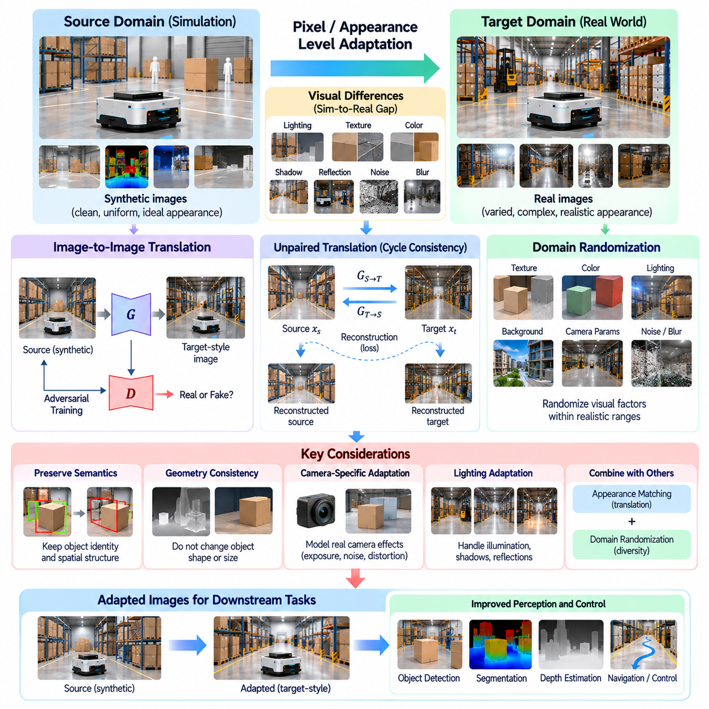{width="7.268055555555556in" height="7.268055555555556in"}

픽셀 수준 및 외형 수준 적응(Pixel-Level and Appearance-Level Adaptation)은 작업 관련 정보(Task-Relevant Information)를 보존하면서 영상 특성(Image Characteristics)을 수정하여 시뮬레이션 환경과 실제 환경 사이의 시각적 차이를 해결하는 방법이다. 내부 신경망 표현(Internal Neural Representations)을 정렬하는 특징 수준 적응(Feature-Level Adaptation)과 달리, 이 접근법은 영상 자체나 가시적 속성(Visible Properties)을 직접 대상으로 한다. 피지컬 AI(Physical AI)에서는 합성 관측값(Synthetic Observations)으로 학습한 모델이 실제 카메라 조건에서도 더욱 신뢰성 있게 작동하도록 지원한다.

시뮬레이션과 현실 사이의 격차(Simulation-to-Reality Gap)는 조명(Lighting), 텍스처(Textures), 그림자(Shadows), 반사(Reflections), 색상(Colors), 센서 잡음(Sensor Noise)의 차이를 통해 나타나는 경우가 많다. 시뮬레이션 엔진(Simulation Engines)은 기하학적으로 정확한 장면을 생성할 수 있지만 시각적 외형(Visual Appearance)이 실제 물리 환경을 완전히 재현하지 못할 수 있다. 이러한 불일치는 인식 모델(Perception Models)이 배포 과정에서 제대로 작동하지 않는 합성 데이터 특유의 패턴(Synthetic-Specific Patterns)을 학습하게 만들 수 있다. 외형 적응(Appearance Adaptation)은 학습 관측값을 실제 조건에 더욱 가깝게 만들어 이러한 의존성을 줄인다.

픽셀 수준 적응(Pixel-Level Adaptation)은 일반적으로 의미적 내용(Semantic Content)을 보존하면서 영상을 한 시각적 도메인(Visual Domain)에서 다른 도메인으로 변환한다. 합성 물류창고 영상(Synthetic Warehouse Image)은 객체의 정체성(Object Identities)이나 공간적 배치(Spatial Arrangements)를 변경하지 않고 실제 카메라 영상과 유사한 관측값으로 변환할 수 있다. 반대로 실제 영상을 단순화된 합성 스타일(Synthetic Style)로 변환할 수도 있다. 두 방향 모두 시각적 분포 차이(Visual Distribution Differences)를 줄이는 것을 목표로 하지만 실용적인 이점은 학습 파이프라인(Training Pipeline)에 따라 달라진다.

일반적인 접근법은 영상 간 변환 모델(Image-to-Image Translation Models)을 사용하여 소스 영상(Source Images)을 타깃 도메인 관측값(Target-Domain Observations)의 외형으로 매핑(Mapping)하는 것이다. 생성적 적대 신경망(Generative Adversarial Networks)은 합성 영상과 실제 영상의 집합에서 현실적인 텍스처, 색상, 조명 변환을 학습할 수 있다. 생성기(Generator)는 적응된 관측값을 생성하고, 판별기(Discriminator)는 해당 영상의 외형이 타깃 도메인과 유사한지 평가한다. 학습 과정은 반드시 쌍을 이루는 영상(Paired Images)이 없어도 시각적 사실성(Visual Realism)을 높이도록 유도한다.

비대응 영상 변환(Unpaired Image Translation)은 정확하게 대응하는 시뮬레이션 영상과 실제 영상을 확보하기 어려운 경우가 많기 때문에 유용하다. 순환 일관성 적대 신경망(Cycle-Consistent Adversarial Networks)은 변환된 영상이 원본 입력의 정보를 유지하도록 유도하는 복원 제약조건(Reconstruction Constraints)을 도입한다. 타깃 스타일(Target Style)로 변환한 영상은 다시 소스 외형(Source Appearance)으로 매핑될 수 있다. 그러나 순환 일관성(Cycle Consistency)만으로 객체 형상(Object Geometry)이나 작업 필수 세부정보(Task-Critical Details)의 보존이 보장되는 것은 아니다.

외형 적응은 안전하게 변경할 수 있는 시각적 속성과 반드시 안정적으로 유지해야 하는 물리적 정보(Physical Information)를 구분해야 한다. 조명 강도(Illumination Intensity), 색상 균형(Color Balance), 표면 텍스처(Surface Texture)는 객체 정체성(Object Identity)에 영향을 주지 않고 수정할 수 있다. 반면 객체 경계(Object Boundaries), 장애물 크기(Obstacle Dimensions), 파지 접촉점(Grasp Contact Points), 공간 관계(Spatial Relationships)를 변경하면 학습 주석(Training Annotations)이 무효화될 수 있다. 따라서 기하학적 구조 보존(Geometry Preservation)은 신뢰할 수 있는 피지컬 AI 응용의 핵심 요구사항이다.

의미적 일관성 제약조건(Semantic Consistency Constraints)은 영상 변환(Image Translation)이 작업 관련 내용을 변경하지 않도록 하는 데 도움이 된다. 분할 모델(Segmentation Model)이나 객체 검출기(Object Detector)는 외형 변환 전후의 예측을 비교하여 안정적인 의미 해석(Semantic Interpretation)을 유지하도록 유도할 수 있다. 지각 손실(Perceptual Losses)은 고수준 시각 구조(Higher-Level Visual Structure)를 보존하고, 항등 손실(Identity Losses)은 불필요한 변경을 억제할 수 있다. 이러한 목적함수(Objectives)는 유해한 변환을 줄이지만 독립적인 검증(Independent Validation) 없이는 정확성을 보장할 수 없다.

사실적 렌더링(Photorealistic Rendering)은 적응 이전에 외형 차이를 줄이기 위한 또 다른 전략이다. 물리 기반 렌더링(Physically Based Rendering)은 물리 광학(Physical Optics)의 근사 모델을 사용하여 빛 전달(Light Transport), 재료 반응(Material Response), 반사, 그림자를 표현한다. 정확한 카메라 모델(Camera Models)은 노출(Exposure), 렌즈 왜곡(Lens Distortion), 움직임 흐림(Motion Blur), 센서 잡음을 추가로 재현할 수 있다. 높은 렌더링 충실도(Rendering Fidelity)는 사실성을 개선할 수 있지만 계산 비용(Computational Cost)을 증가시키고 중요한 도메인 차이를 완전히 해결하지 못할 수도 있다.

도메인 무작위화(Domain Randomization)는 특정 타깃 외형을 일치시키는 방식의 대안이다. 특정 실제 환경과 유사한 영상을 생성하는 대신 시뮬레이션에서 텍스처, 색상, 조명 방향(Lighting Directions), 배경(Backgrounds), 카메라 매개변수(Camera Parameters)를 광범위하게 변화시킨다. 목표는 모델이 충분한 시각적 다양성(Visual Diversity)을 경험하도록 하여 실제 관측값이 상대적으로 낯설지 않게 만드는 것이다. 무작위화는 물리적으로 타당해야 하며 의미 있는 작업 구조(Task Structure)를 보존해야 한다.

외형 일치(Appearance Matching)와 도메인 무작위화는 함께 사용할 수도 있다. 무작위화된 합성 영상(Randomized Synthetic Images)은 광범위한 시각적 조건을 제공하고, 타깃 지향 변환(Target-Oriented Translation)은 실제 배포 환경에서 관측되는 특성을 반영한다. 이러한 조합은 타깃 도메인에 예측 가능한 외형 패턴과 예상하지 못한 변화가 모두 존재할 때 강건성(Robustness)을 높일 수 있다. 그러나 과도한 무작위화나 비현실적인 변환은 불필요한 복잡성을 유발하고 학습 효과를 저하시킬 수 있다.

카메라별 적응(Camera-Specific Adaptation)은 시뮬레이션과 실제 배포에서 서로 다른 영상 장치(Imaging Hardware)를 사용하는 로봇 시스템에 특히 중요하다. 실제 카메라는 센서별 색상 응답(Color Responses), 노출 동작(Exposure Behavior), 롤링 셔터 효과(Rolling-Shutter Effects), 압축 아티팩트(Compression Artifacts), 잡음 분포(Noise Distributions)를 발생시킨다. 시뮬레이션 관측값은 이러한 특성을 생략하거나 부정확하게 재현할 수 있다. 카메라 인식 변환(Camera-Aware Transformations)은 기하학적 및 시간적 일관성(Geometric and Temporal Consistency)을 유지하면서 이러한 차이를 줄일 수 있다.

조명 적응(Lighting Adaptation)은 조명 강도, 방향, 스펙트럼(Spectrum), 환경 조건(Environmental Conditions)에 의해 발생하는 변화를 다룬다. 산업용 로봇(Industrial Robots)은 시뮬레이션 장면과 크게 다른 형광등 조명(Fluorescent Lighting), 햇빛(Sunlight), 그림자, 반사 표면(Reflective Surfaces) 아래에서 작동할 수 있다. 적응 과정에서는 이러한 조건을 근사하기 위해 밝기(Brightness), 대비(Contrast), 그림자 외형(Shadow Appearance), 색온도(Color Temperature)를 수정할 수 있다. 조명 변화가 작은 객체를 가리거나 중요한 시각적 경계(Visual Boundaries)를 변경할 수 있으므로 신중한 검증이 필요하다.

텍스처 적응(Texture Adaptation)은 시뮬레이션 객체와 실제 객체 사이의 재료 외형(Material Appearance) 차이에 초점을 맞춘다. 합성 표면(Synthetic Surfaces)은 비정상적으로 매끄럽거나 반복적이고 균일하게 보일 수 있지만 실제 재료에는 마모(Wear), 오염(Contamination), 제조 편차(Manufacturing Variation), 불규칙한 반사(Irregular Reflections)가 존재한다. 텍스처 변환(Texture Translation)은 객체 형상(Object Shape)을 보존하면서 현실적인 외형 통계(Appearance Statistics)를 추가할 수 있다. 그러나 조작 작업(Manipulation Tasks)에서 시각적 텍스처를 측정된 마찰(Friction)이나 재료 특성(Material Properties)의 신뢰할 수 있는 대체 정보로 취급해서는 안 된다.

공간 선택적 외형 적응(Spatially Selective Appearance Adaptation)은 영상 영역의 의미적 또는 기하학적 역할에 따라 서로 다른 영역을 수정한다. 배경 표면(Background Surfaces)은 광범위한 텍스처 변경을 허용할 수 있지만 작은 장애물, 객체 경계, 파지 영역(Grasp Regions)은 더 강력한 보존 제약조건(Preservation Constraints)이 필요하다. 분할 마스크(Segmentation Masks), 깊이 지도(Depth Maps), 어텐션 메커니즘(Attention Mechanisms)은 영역별 변환(Region-Specific Transformations)을 유도할 수 있다. 이러한 접근법은 시각적으로 설득력 있는 영상이 정밀한 로봇 인식에 부적합해지는 위험을 줄인다.

시간적 일관성(Temporal Consistency)은 외형 적응을 개별 영상이 아닌 로봇 비디오(Robot Video)에 적용할 때 필수적이다. 프레임별 독립 변환(Independent Frame Transformations)은 깜박이는 텍스처(Flickering Textures), 불안정한 그림자(Unstable Shadows), 일관되지 않은 객체 색상(Inconsistent Object Colors)을 생성할 수 있다. 이러한 아티팩트(Artifacts)는 추적(Tracking), 시각 주행거리 측정(Visual Odometry), 움직임 추정(Motion Estimation)을 방해할 수 있다. 따라서 비디오 적응 방법(Video Adaptation Methods)은 연속 관측값 사이의 일관된 외형을 유지하기 위해 시간적 제약조건(Temporal Constraints)이나 움직임 인식 변환(Motion-Aware Transformations)을 포함한다.

외형 적응은 객체 검출(Object Detection), 의미적 분할(Semantic Segmentation), 깊이 추정(Depth Estimation), 시각적 위치추정(Visual Localization)을 지원할 수 있다. 변환된 영상이 원래의 기하학적 구조와 의미적 레이블(Semantic Labels)을 보존한다면 합성 주석(Synthetic Annotations)을 계속 활용할 수 있다. 이를 통해 자동으로 레이블이 지정된 대규모 시뮬레이션 데이터셋(Simulation Datasets)이 시각적으로 사실적인 학습 사례에 지도 정보(Supervision)를 제공할 수 있다. 그러나 영상의 사실성이 반드시 작업 성능 향상을 의미하는 것은 아니므로 평가는 후속 작업 정확도(Downstream Accuracy)에 초점을 맞춰야 한다.

자율이동로봇(Autonomous Mobile Robots)에서 픽셀 수준 적응은 시뮬레이션 복도, 물류창고 통로(Warehouse Aisles), 실제 운영 시설 사이의 시각적 차이를 줄일 수 있다. 적응된 영상(Adapted Images)은 배포 과정에서 나타나는 바닥 반사(Floor Reflections), 벽면 텍스처(Wall Textures), 조명 변화(Lighting Variations), 카메라 아티팩트(Camera Artifacts)를 재현할 수 있다. 이러한 변환은 시각적 장애물 인식(Visual Obstacle Recognition)과 장면 이해(Scene Understanding)를 개선할 수 있다. 그러나 내비게이션 신뢰성(Navigation Reliability)은 시각적 외형 외에도 기하학적 구조, 위치추정 정확도(Localization Accuracy), 센서 융합(Sensor Fusion)에 의존한다.

로봇 조작(Robotic Manipulation)에서 외형 적응은 현실적인 조명, 표면 마감(Surface Finishes), 복잡한 배경(Cluttered Backgrounds) 아래에서 모델이 객체를 인식하도록 지원할 수 있다. 렌더링된 객체(Rendered Objects)로 학습한 파지 예측 모델(Grasp Prediction Model)은 합성 파지 주석(Synthetic Grasp Annotations)을 유지하면서 현실적인 카메라 관측값을 활용할 수 있다. 그러나 성공적인 조작은 접촉 동역학(Contact Dynamics), 객체 질량(Object Mass), 마찰, 액추에이터 동작(Actuator Behavior)에도 의존한다. 따라서 시각적 적응(Visual Adaptation)은 물리적 보정(Physical Calibration)과 동역학 적응(Dynamics Adaptation)을 대체하는 것이 아니라 보완해야 한다.

다중모달 피지컬 AI 시스템(Multimodal Physical AI Systems)은 외형 적응과 다른 센서 채널(Sensor Channels) 사이의 신중한 조정이 필요하다. RGB 영상에는 스타일 변환(Style Transformations)을 적용할 수 있지만 깊이(Depth), LiDAR, 고유수용성 측정값(Proprioceptive Measurements)은 원래의 물리적 의미를 유지한다. 변환된 시각적 경계가 측정된 기하학적 구조(Measured Geometry)와 대응하도록 모달 간 일관성(Cross-Modal Consistency)을 유지해야 한다. 모달리티 간 불일치(Misalignment Between Modalities)는 센서 융합을 약화시키고 신뢰할 수 없는 상태추정(State Estimates)을 발생시킬 수 있다.

적응된 영상의 품질은 시각적 유사성 척도(Visual Similarity Measures), 분포 비교(Distribution Comparisons), 인간 검사(Human Inspection)를 통해 평가할 수 있다. 특징 분포(Feature Distributions)에 기반한 지표는 합성 영상이 실제 관측값과 얼마나 유사한지 나타낼 수 있지만 의미적 정확성(Semantic Correctness)을 입증하지는 못한다. 작업 기반 평가(Task-Based Evaluation)는 검출 정확도(Detection Accuracy), 분할 품질(Segmentation Quality), 추적 안정성(Tracking Stability), 운영 성공률(Operational Success)을 측정해야 한다. 기하학적 구조 보존(Geometry Preservation)과 주석 일관성(Annotation Consistency)은 시각적 사실성과 별도로 평가해야 한다.

외형 변환이 아티팩트를 생성하거나 원래 모델에 필요한 정보를 제거하면 부정적 전이(Negative Transfer)가 발생할 수 있다. 변환 모델(Translation Model)은 작은 부품을 변경하거나 대비가 낮은 장애물(Low-Contrast Obstacles)을 억제하거나 오해를 유발하는 반사를 생성할 수 있다. 평가가 물리적 정확성(Physical Correctness)보다 시각적 매력(Visual Attractiveness)에 중점을 두면 이러한 오류를 발견하지 못할 수 있다. 보수적 변환(Conservative Transformations), 불확실성 추정(Uncertainty Estimation), 독립적인 실제 환경 시험(Independent Real-World Testing)은 이러한 위험을 줄이는 데 도움이 된다.

실용적인 적응 파이프라인(Practical Adaptation Pipeline)은 합성 관측값과 자동 생성된 주석(Automatically Generated Annotations)에서 시작한다. 대표적인 실제 영상(Representative Real Images)을 수집하여 타깃 도메인 외형(Target-Domain Appearance)을 분석한 다음 적절한 변환(Translation), 렌더링(Rendering), 무작위화(Randomization) 방법을 선택한다. 적응된 영상은 모델 학습에 사용하기 전에 기하학적 및 의미적 일관성(Geometric and Semantic Consistency)을 검사한다. 이후 독립적인 실제 환경 데이터(Independent Real-World Data)에서 성능을 평가하고 문제가 있는 변환은 개선하거나 제외한다.

궁극적으로 픽셀 수준 및 외형 수준 적응(Pixel-Level and Appearance-Level Adaptation)은 합성 학습 데이터(Synthetic Training Data)가 실제 센서 관측값(Real Sensor Observations)과 더욱 호환되도록 만들어 시뮬레이션과 현실 사이의 격차에서 시각적 요소를 줄인다. 성공 여부는 외형을 변경하면서도 물리적 기하학(Physical Geometry), 의미적 의미(Semantic Meaning), 주석 유효성(Annotation Validity), 시간적 일관성(Temporal Coherence)을 보존하는 데 달려 있다. 특징 적응(Feature Adaptation), 센서 보정(Sensor Calibration), 체계적인 검증(Systematic Validation)과 결합하면 피지컬 AI 시스템에서 더욱 신뢰할 수 있는 시각 인식(Visual Perception)을 지원할 수 있다.

## 04.06. Adversarial and Discrepancy Based Adaptation

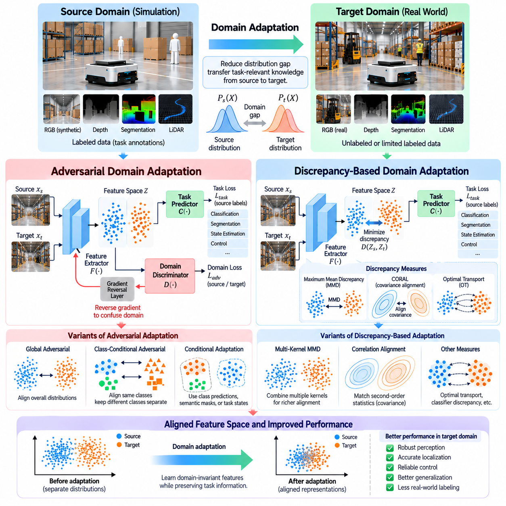{width="7.268055555555556in" height="7.268055555555556in"}

적대적 및 불일치 기반 도메인 적응(Adversarial and Discrepancy-Based Domain Adaptation)은 시뮬레이션 환경과 실제 환경 사이의 분포 차이(Distribution Differences)를 줄이기 위한 두 가지 주요 접근법이다. 두 방법 모두 레이블이 지정된 소스 도메인(Labeled Source Domain)에서 주석이 제한적이거나 없는 타깃 도메인(Target Domain)으로 작업 관련 지식(Task-Relevant Knowledge)을 전이하는 것을 목표로 한다. 피지컬 AI(Physical AI)에서는 광범위한 실제 데이터 레이블링 없이 로봇 인식(Robotic Perception), 상태추정(State Estimation), 제어 시스템(Control Systems)의 적응을 지원한다.

근본적인 과제는 소스 관측값(Source Observations)과 타깃 관측값(Target Observations)이 서로 다른 통계적 분포(Statistical Distributions)를 따르는 경우가 많다는 점이다. 합성 영상(Synthetic Images)은 이상화된 조명(Idealized Lighting)과 텍스처(Textures)를 포함할 수 있지만 실제 센서(Real Sensors)는 잡음(Noise), 반사(Reflections), 보정 오차(Calibration Errors)를 발생시킨다. 두 도메인이 동일한 객체나 물리적 작업을 나타내더라도 신경망(Neural Networks)은 서로 다른 특징(Features)을 추출할 수 있다. 적응 방법은 올바른 예측에 필수적인 정보를 보존하면서 이러한 차이를 줄이고자 한다.

적대적 도메인 적응(Adversarial Domain Adaptation)은 특징 추출기(Feature Extractor)와 도메인 판별기(Domain Discriminator) 사이의 경쟁을 도입한다. 특징 추출기는 소스 및 타깃 관측값을 잠재 표현(Latent Representations)으로 변환하고, 판별기는 각 표현이 어느 도메인에서 생성되었는지 예측한다. 특징 추출기는 이러한 구분을 어렵게 만들도록 최적화된다. 동시에 작업 예측기(Task Predictor)는 소스 도메인 주석(Source-Domain Annotations)으로 학습하여 유용한 의미적 및 운영 정보를 유지한다.

도메인 적대적 신경망(Domain-Adversarial Neural Networks)은 일반적으로 기울기 반전 계층(Gradient Reversal Layer)을 사용하여 이러한 과정을 구현한다. 순전파(Forward Propagation) 과정에서 이 계층은 특징을 변경하지 않고 도메인 판별기로 전달한다. 역전파(Backpropagation) 과정에서는 판별기의 기울기(Gradient)를 반전시킨 후 특징 추출기로 전달한다. 이러한 메커니즘은 일반적인 기울기 기반 최적화(Gradient-Based Optimization)를 사용하면서 도메인 혼동(Domain Confusion)을 유도한다. 효과는 작업 학습(Task Learning)과 도메인 정렬(Domain Alignment) 사이의 균형에 따라 달라진다.

적대적 목적함수(Adversarial Objective)는 소스 작업 예측 손실(Source-Task Prediction Loss)과 도메인 판별 목적함수(Domain Discrimination Objective)를 결합한다. 작업 구성요소(Task Component)는 정확한 인식 또는 제어 예측을 유도하고, 적대적 구성요소(Adversarial Component)는 도메인 정체성(Domain Identity)을 드러내는 특징의 학습을 억제한다. 가중치 매개변수(Weighting Parameter)는 적응 강도(Adaptation Strength)를 제어한다. 과도한 적대적 압력(Adversarial Pressure)은 작업 관련 정보를 제거할 수 있으며, 압력이 부족하면 학습된 표현에 시뮬레이션 특유의 편향(Simulation-Specific Biases)이 상당 부분 남을 수 있다.

적대적 정렬(Adversarial Alignment)은 특징 분포 사이의 차이에 대한 명시적인 수학적 모델(Mathematical Model)이 필요하지 않다는 점에서 유용하다. 충분한 표현 능력을 가진 판별기(Expressive Discriminator)는 소스와 타깃 표현 사이의 복잡한 차이를 탐지할 수 있다. 그러나 판별기가 지나치게 강하거나 약해지면 적대적 최적화(Adversarial Optimization)가 불안정해질 수 있다. 신뢰할 수 있는 수렴(Convergence)을 위해서는 학습률 스케줄링(Learning-Rate Scheduling), 정규화(Regularization), 신중한 모니터링(Monitoring)이 중요하다.

전역 적대적 정렬(Global Adversarial Alignment)은 소스와 타깃 도메인이 서로 다른 범주 비율(Category Proportions)이나 물리적 상태(Physical States)를 포함하는 경우 실패할 수 있다. 판별기는 서로 관련 없는 의미적 클래스(Semantic Classes)에 속하는 특징을 혼합하면서 전체적인 분포 유사성(Distribution Similarity)을 높이도록 유도할 수 있다. 이는 부정적 전이(Negative Transfer)를 발생시키고 타깃 도메인 정확도(Target-Domain Accuracy)를 저하시킬 수 있다. 클래스 조건부 적대적 적응(Class-Conditional Adversarial Adaptation)은 모든 관측값을 동일하게 취급하는 대신 대응하는 범주나 작업 상태(Task States)를 정렬하여 이러한 한계를 해결한다.

조건부 적응(Conditional Adaptation)은 클래스 예측(Class Predictions), 의미적 마스크(Semantic Masks), 작업별 표현(Task-Specific Representations)을 판별기에 통합할 수 있다. 로봇 비전(Robotic Vision)에서는 객체 범주(Object Categories)를 이용하여 대응하는 시각적 특징(Visual Features)의 정렬을 유도할 수 있다. 제어 시스템에서는 추정된 운동 상태(Motion States)나 상호작용 조건(Interaction Conditions)이 추가적인 구조를 제공할 수 있다. 타깃 레이블(Target Labels)이 없는 경우 의사 레이블(Pseudo-Labels)로 이러한 관계를 근사할 수 있지만 잘못된 예측은 정렬 오류(Alignment Errors)를 강화할 수 있다.

불일치 기반 도메인 적응(Discrepancy-Based Domain Adaptation)은 명시적인 통계적 척도(Statistical Measures)를 통해 동일한 전이 문제(Transfer Problem)에 접근한다. 판별기를 학습하는 대신 소스와 타깃 특징 분포(Feature Distributions)의 선택된 속성 사이의 차이를 계산한다. 학습 목적함수(Learning Objective)는 소스 작업 성능(Source-Task Performance)을 유지하면서 이러한 불일치를 줄이도록 유도한다. 이 접근법은 일반적으로 해석하기 쉬운 최적화 신호(Optimization Signals)를 제공하며 적대적 경쟁(Adversarial Competition)과 관련된 일부 어려움을 피할 수 있다.

최대 평균 불일치(Maximum Mean Discrepancy)는 특징 분포를 비교하는 데 널리 사용되는 통계적 기준(Statistical Criterion)이다. 이 방법은 재생 커널 힐베르트 공간(Reproducing Kernel Hilbert Space)에서 분포 임베딩(Distribution Embeddings) 사이의 거리를 측정한다. 이 거리를 최소화함으로써 신경망은 소스와 타깃의 통계적 특성이 더욱 유사해지는 표현을 학습할 수 있다. 커널 선택(Kernel Selection)과 특징 계층 배치(Feature-Layer Placement)는 서로 다른 유형의 분포 변화(Distribution Shifts)에 대한 민감도에 영향을 미친다.

다중 커널 최대 평균 불일치(Multi-Kernel Maximum Mean Discrepancy)는 서로 다른 특성을 가진 커널(Kernels)을 결합하여 이러한 접근법을 확장한다. 이를 통해 여러 스케일(Scales)과 통계적 패턴(Statistical Patterns)에 걸친 분포 차이를 포착할 수 있다. 로봇 인식에서는 이러한 유연성이 텍스처, 조명, 센서 응답(Sensor Response)의 변화를 처리하는 데 도움이 될 수 있다. 그러나 분포 유사성만으로 객체 범주, 기하학적 관계(Geometric Relationships), 행동 관련 상태(Action-Relevant States)가 올바르게 구분된다는 보장은 없다.

상관관계 정렬(Correlation Alignment)은 소스와 타깃 특징의 공분산 구조(Covariance Structures)를 일치시켜 도메인 차이를 줄인다. 이 방법은 학습된 특징 차원(Feature Dimensions)이 도메인 전반에서 유사한 관계를 나타내도록 유도한다. 별도의 적대적 판별기(Adversarial Discriminator)를 도입하지 않고도 신경망 학습에 통합할 수 있다. 그러나 2차 통계량(Second-Order Statistics)을 일치시키는 방식은 복잡한 비선형 차이(Nonlinear Differences), 다중모달 구조(Multimodal Structures), 드문 운영 조건(Rare Operating Conditions)을 충분히 반영하지 못할 수 있다.

다른 불일치 척도(Discrepancy Measures)에는 최적 수송 거리(Optimal Transport Distances)와 분류기 불일치 목적함수(Classifier Disagreement Objectives)가 포함된다. 최적 수송(Optimal Transport)은 수송 비용(Transport Cost)을 최소화하면서 소스와 타깃 특징 분포 사이의 대응 관계(Correspondence)를 찾는다. 분류기 불일치 방법(Classifier Disagreement Methods)은 독립적으로 학습된 예측기(Predictors)가 일치하지 않는 출력을 생성하는 타깃 관측값을 식별한다. 이러한 기법은 전이가 제대로 이루어지지 않는 영역을 드러낼 수 있지만 효과는 의미 있는 특징 기하학(Feature Geometry)과 신뢰할 수 있는 예측 구조(Prediction Structure)에 의존한다.

적대적 방법과 불일치 기반 방법은 단일 적응 아키텍처(Adaptation Architecture) 안에서 결합할 수 있다. 적대적 학습(Adversarial Learning)은 복잡한 도메인 차이를 줄이고, 통계적 불일치 목적함수(Statistical Discrepancy Objectives)는 추가적인 정렬 제약조건(Alignment Constraints)을 제공할 수 있다. 클래스 인식 손실(Class-Aware Losses)과 일관성 정규화(Consistency Regularization)는 의미적 구조(Semantic Structure)를 더욱 효과적으로 보존할 수 있다. 이러한 결합은 어려운 조건에서 전이 성능을 개선할 수 있지만 추가적인 목적함수는 계산 복잡도(Computational Complexity)를 높이고 신중한 가중치 선택(Weight Selection)을 요구한다.

다중 계층 정렬(Multi-Layer Alignment)은 도메인 차이가 신경망 표현(Neural Representations)의 서로 다른 수준에서 발생한다는 점을 고려한다. 초기 계층(Early Layers)은 센서 잡음(Sensor Noise), 색상(Colors), 텍스처를 표현할 수 있으며, 깊은 계층(Deeper Layers)은 객체 정체성(Object Identities)과 작업 의미(Task Semantics)를 포착한다. 선택된 계층에 적응 손실(Adaptation Losses)을 적용하면 저수준 외형 차이(Low-Level Appearance Differences)와 고수준 표현 변화(Higher-Level Representation Shifts)를 모두 다룰 수 있다. 모든 계층에 과도하게 정렬을 적용하면 유용한 도메인별 정보(Domain-Specific Information)가 제한될 수 있다.

자율이동로봇(Autonomous Mobile Robots)에서 이러한 방법은 장애물 검출(Obstacle Detection), 의미적 매핑(Semantic Mapping), 주행 가능성 추정(Traversability Estimation)을 시뮬레이션에서 실제 배포 환경(Deployment Environments)으로 전이하는 데 활용될 수 있다. 소스 데이터(Source Data)는 정확한 장애물 주석(Obstacle Annotations)을 포함할 수 있지만 타깃 관측값에는 익숙하지 않은 조명, 반사 바닥(Reflective Floors), 센서 아티팩트(Sensor Artifacts)가 존재할 수 있다. 도메인 정렬은 인식 강건성(Perception Robustness)을 향상시킬 수 있지만 내비게이션 안전성(Navigation Safety)은 실제 운영 시험(Real-World Operational Testing)을 통해 검증해야 한다.

로봇 조작(Robotic Manipulation)은 성공적인 행동이 시각적 관측뿐 아니라 물리적 상호작용(Physical Interactions)에 의존하므로 추가적인 복잡성을 가진다. 적대적 정렬이나 불일치 기반 정렬은 객체 형상(Object Shape), 자세(Pose), 접촉 관련 시각 단서(Contact-Related Visual Cues)의 표현을 개선할 수 있다. 그러나 특징 정렬(Feature Alignment)만으로는 마찰(Friction), 유연성(Compliance), 액추에이터 응답(Actuator Response), 접촉 동역학(Contact Dynamics)의 차이를 보정할 수 없다. 신뢰할 수 있는 조작 전이(Manipulation Transfer)를 위해서는 물리적 보정(Physical Calibration)과 동역학 적응(Dynamics Adaptation)이 여전히 필요하다.

제어 정책 적응(Control-Policy Adaptation)은 관측값(Observations), 행동(Actions), 그 결과로 발생하는 상태 전이(State Transitions) 사이의 관계를 보존해야 한다. 관측 특징(Observation Features)을 정렬하면 시뮬레이션에서 학습한 정책(Simulation-Trained Policy)이 실제 센서 입력을 해석하는 데 도움이 될 수 있지만 외형적으로 동일한 표현이 서로 다른 물리적 동역학(Physical Dynamics)에 대응할 수도 있다. 따라서 적응은 작업 결과(Task Outcomes)와 제어 안정성(Control Stability)을 고려해야 한다. 안전하지 않은 탐색적 업데이트(Exploratory Updates)는 오프라인 검증(Offline Validation)과 검증된 운영 제약조건(Verified Operational Constraints)을 통해 방지해야 한다.

평가(Evaluation)에서는 성공적인 도메인 정렬과 실제 로봇 성능 개선을 구분해야 한다. 도메인 판별기 정확도(Domain Discriminator Accuracy), 최대 평균 불일치, 공분산 차이(Covariance Differences)는 유용한 진단 측정값(Diagnostic Measurements)을 제공한다. 그러나 통계적 불일치(Statistical Discrepancy)가 감소했다고 해서 반드시 타깃 작업 정확도(Target-Task Accuracy)가 향상되는 것은 아니다. 독립적인 시험(Independent Testing)은 대표적인 조건에서 검출 성능(Detection Performance), 내비게이션 성공률(Navigation Success), 파지 완료율(Grasp Completion), 궤적 추종(Trajectory Tracking), 실패 빈도(Failure Frequency)를 측정해야 한다.

부정적 전이(Negative Transfer)는 정렬 과정에서 서로 호환되지 않는 소스와 타깃 관측값을 유사한 표현으로 강제로 매핑할 때 발생하는 주요 문제이다. 이러한 위험은 클래스 불균형(Class Imbalance), 누락된 타깃 범주(Missing Target Categories), 변화하는 센서 구성(Sensor Configurations), 물리적 동역학의 상당한 차이가 존재할 때 증가한다. 선택적 정렬(Selective Alignment), 불확실성 추정(Uncertainty Estimation), 미지 범주 탐지(Unknown-Category Detection)는 부적절한 전이를 줄일 수 있다. 타깃 성능 개선과 기존에 신뢰할 수 있었던 능력의 저하를 함께 모니터링하는 것이 필수적이다.

실제 구현(Practical Implementation)에서는 학습 안정성(Training Stability), 계산 요구사항(Computational Requirements), 배포 제약조건(Deployment Constraints)을 고려해야 한다. 적대적 방법은 판별기 네트워크(Discriminator Networks)와 잠재적으로 불안정한 최적화를 추가하며, 불일치 기반 방법은 비용이 높은 분포 비교(Distribution Comparisons)를 요구할 수 있다. 미니배치 샘플링(Mini-Batch Sampling), 효율적인 특징 인코더(Efficient Feature Encoders), 선택적 계층 적응(Selective Layer Adaptation)은 자원 요구량을 줄일 수 있다. 안전 필수 로봇 시스템(Safety-Critical Robotic Systems)에서는 일반적으로 지속적인 온라인 업데이트(Continuous Online Updates)보다 오프라인 적응(Offline Adaptation)을 검증하기가 더 쉽다.

실용적인 개발 워크플로(Practical Development Workflow)는 풍부한 주석이 포함된 시뮬레이션 데이터(Richly Annotated Simulation Data)로 학습한 모델과 대표적인 실제 관측값(Representative Real-World Observations)의 집합에서 시작한다. 엔지니어는 도메인 차이(Domain Differences)를 분석하고 적대적 또는 불일치 기반 목적함수(Adversarial or Discrepancy-Based Objectives)를 선택한 다음 소스 작업 정확도(Source-Task Accuracy)를 유지하면서 특징 표현(Feature Representations)을 최적화한다. 독립적인 타깃 도메인 평가(Independent Target-Domain Evaluation)는 남아 있는 취약점을 식별한다. 전이 성능이 충분하지 않은 경우 추가 레이블(Additional Labels), 조건부 정렬(Conditional Alignment), 물리적 보정을 도입할 수 있다.

궁극적으로 적대적 및 불일치 기반 적응(Adversarial and Discrepancy-Based Adaptation)은 시뮬레이션 환경과 물리적 환경 사이에서 전이 가능한 표현(Transferable Representations)을 학습하기 위한 상호 보완적인 메커니즘을 제공한다. 효과는 의미적 정보(Semantic Information), 기하학적 정보(Geometric Information), 제어 관련 정보(Control-Related Information)를 손상시키지 않으면서 불필요한 분포 차이(Irrelevant Distribution Differences)를 줄이는 데 달려 있다. 불확실성 관리(Uncertainty Management), 신중한 최적화(Careful Optimization), 체계적인 실제 환경 검증(Systematic Real-World Validation)을 결합하면 이러한 방법은 기존 학습 도메인(Training Domains)을 벗어나 운영되는 피지컬 AI 시스템의 신뢰성을 강화할 수 있다.

## 04.07. Self Training and Pseudo Labeling

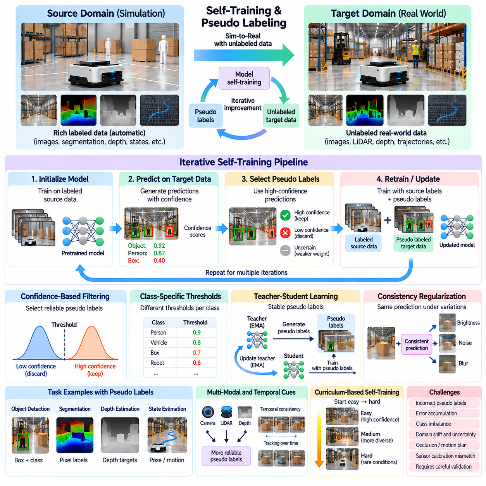{width="7.268055555555556in" height="7.268055555555556in"}

자기 학습(Self-Training)과 의사 레이블링(Pseudo-Labeling)은 시뮬레이션에서 학습한 모델이 레이블이 없는 실제 환경 관측값(Unlabeled Real-World Observations)을 활용하여 성능을 개선할 수 있도록 하는 대표적인 도메인 적응(Domain Adaptation) 기법이다. 자기 학습은 모델 자체의 예측을 추가적인 지도 정보(Supervision)로 반복적으로 활용하며, 의사 레이블링은 기존에 레이블이 없는 샘플에 임시 레이블(Provisional Labels)을 부여한다. 피지컬 AI(Physical AI)에서 이러한 방법은 비용이 많이 드는 수동 주석(Manual Annotation)에 대한 의존성을 줄이고 로봇 인식 시스템(Robotic Perception Systems)의 지속적인 개선을 지원한다.

핵심적인 동기는 풍부한 레이블이 포함된 시뮬레이션 데이터(Labeled Simulation Data)와 주석이 제한적인 실제 환경 데이터(Annotated Real-World Data) 사이의 불균형이다. 시뮬레이션 엔진(Simulation Engines)은 객체 정체성(Object Identities), 분할 마스크(Segmentation Masks), 깊이 지도(Depth Maps), 로봇 상태(Robot States)를 자동으로 생성할 수 있지만 실제 배포 환경(Physical Deployments)에서는 레이블이 없는 대량의 센서 기록(Sensor Recordings)이 생성된다. 자기 학습은 충분히 신뢰할 수 있는 예측을 학습 목표(Training Targets)로 변환하여 활용 가능한 지도 정보를 점진적으로 확장한다.

일반적인 자기 학습 파이프라인(Self-Training Pipeline)은 풍부한 주석이 포함된 합성 데이터(Synthetic Data)로 학습한 소스 모델(Source Model)에서 시작한다. 모델은 타깃 도메인 관측값(Target-Domain Observations)을 처리하고 관련 신뢰도 추정값(Confidence Estimates)과 함께 예측 결과를 생성한다. 선택된 예측은 이후 학습 반복 과정(Training Iterations)에서 의사 레이블(Pseudo-Labels)로 사용된다. 업데이트된 모델은 다시 새로운 예측을 생성하며 이러한 과정이 반복된다. 각 반복 단계에서는 누적된 오류(Accumulated Errors)가 성능을 저하시키지 않도록 평가해야 한다.

의사 레이블 품질(Pseudo-Label Quality)은 성공적인 자기 학습에 영향을 미치는 가장 중요한 요소이다. 잘못된 예측은 잘못된 학습 목표(False Training Targets)가 되어 기존 편향(Biases)을 강화하고 확증 오류(Confirmation Errors)를 발생시킬 수 있다. 반사성 객체(Reflective Objects)나 작은 장애물(Small Obstacles)을 지속적으로 잘못 식별하는 모델은 유사한 관측값에도 반복적으로 잘못된 레이블을 부여할 수 있다. 적절한 보호 장치(Safeguards)가 없다면 추가 학습은 정확도를 개선하기보다 잘못된 예측에 대한 확신을 높일 수 있다.

신뢰도 기반 필터링(Confidence-Based Filtering)은 의사 레이블을 선택하는 일반적인 메커니즘이다. 사전에 정의된 신뢰도 임계값(Confidence Threshold)을 초과하는 예측은 채택하고, 불확실한 예측은 제외하거나 낮은 가중치(Reduced Weights)를 부여한다. 이 접근법은 신뢰할 수 없는 지도 정보(Unreliable Supervision)에 대한 노출을 제한하지만 익숙한 객체와 단순한 환경 조건을 선호할 수 있다. 임계값 선택(Threshold Selection)은 레이블 정밀도(Label Precision)와 타깃 데이터셋(Target Dataset)의 다양성 및 포괄 범위(Coverage) 사이에서 균형을 유지해야 한다.

클래스별 신뢰도 임계값(Class-Specific Confidence Thresholds)은 의미적 범주(Semantic Categories)에 따른 예측 신뢰성 차이를 해결할 수 있다. 일반적인 객체는 비교적 중간 수준의 신뢰도에서도 정확하게 예측될 수 있지만 드물거나 시각적으로 모호한 클래스(Visually Ambiguous Classes)는 더욱 엄격한 선택 기준이 필요하다. 적응형 임계값(Adaptive Thresholds)은 모델 성능이 개선됨에 따라 변경될 수도 있다. 이러한 메커니즘은 클래스 불균형(Class Imbalance)을 줄이는 데 도움이 되지만 신뢰도 점수(Confidence Scores)는 실제 예측 신뢰성을 반영하도록 보정(Calibration)되어야 한다.

교사-학생 학습(Teacher-Student Learning)은 자기 학습을 구조적으로 구현하는 방법이다. 교사 모델(Teacher Model)은 레이블이 없는 타깃 관측값에서 의사 레이블을 생성하고, 학생 모델(Student Model)은 소스 주석(Source Annotations)과 선택된 교사 예측(Teacher Predictions)을 사용하여 학습한다. 교사 모델은 학생 모델 매개변수(Student Parameters)의 지수 이동 평균(Exponential Moving Average)을 통해 업데이트할 수 있다. 이 접근법은 개별 최적화 단계(Optimization Steps)와 잡음이 포함된 미니배치(Noisy Mini-Batches)에 대한 민감도를 줄여 의사 레이블 생성을 안정화한다.

일관성 정규화(Consistency Regularization)는 동일한 관측값의 서로 다른 변형에 대해 호환 가능한 예측을 요구함으로써 의사 레이블 학습을 강화한다. 로봇 영상(Robot Image)에는 객체 정체성을 보존하는 현실적인 밝기 변화(Brightness Changes), 적당한 잡음(Moderate Noise), 기하학적 변환(Geometric Transformations)을 적용할 수 있다. 모델은 이러한 변화에도 일관된 의미적 예측(Semantic Predictions)을 유지하도록 학습된다. 과도한 변환은 공간 레이블(Spatial Labels)이나 물리적 관계(Physical Relationships)를 무효화할 수 있으므로 변환 방법을 신중하게 선택해야 한다.

약한 데이터 증강(Weak Augmentation)과 강한 데이터 증강(Strong Augmentation)은 교사-학생 프레임워크(Teacher-Student Frameworks)에서 자주 결합된다. 교사 모델은 약하게 수정된 관측값에서 의사 레이블을 생성하고, 학생 모델은 더 강한 외형 교란(Appearance Perturbations)이 적용된 조건에서도 해당 레이블을 재현하도록 학습한다. 이는 타깃 도메인 변동성(Target-Domain Variability)에 대한 강건성(Robustness)을 높인다. 그러나 특히 객체 검출(Object Detection), 분할(Segmentation), 자세 추정(Pose Estimation)에서는 기하학적 변환을 레이블에도 일관되게 적용해야 한다.

자기 학습은 로봇 작업에 따라 여러 예측 수준(Prediction Levels)에서 수행할 수 있다. 객체 검출은 의사 경계 상자(Pseudo Bounding Boxes)와 클래스 레이블(Class Labels)을 사용하고, 의미적 분할(Semantic Segmentation)은 예측된 픽셀 범주(Pixel Categories)를 사용한다. 깊이 추정(Depth Estimation)은 임시 깊이 목표(Provisional Depth Targets)를 생성할 수 있으며, 상태추정(State Estimation)은 추론된 위치(Positions)나 운동 상태(Motion States)를 사용할 수 있다. 예측 불확실성(Prediction Uncertainty)은 출력 유형마다 의미가 다르므로 각 작업에 적합한 신뢰도 척도(Confidence Measures)가 필요하다.

시간적 정보(Temporal Information)는 로봇 환경에서 의사 레이블을 생성하는 데 유용한 제약조건을 제공한다. 연속된 비디오 프레임(Consecutive Video Frames)은 시점(Viewpoints)이 변하더라도 동일한 객체를 포함하는 경우가 많으므로 시간에 따른 예측을 비교할 수 있다. 객체 추적(Object Tracking)과 운동 일관성(Motion Consistency)은 안정적인 레이블을 식별하고 고립된 오류(Isolated Errors)를 제거하는 데 도움이 된다. 그러나 가림(Occlusion), 움직임 흐림(Motion Blur), 추적 드리프트(Tracking Drift)는 시간적 연관 관계(Temporal Associations)의 신뢰성이 낮을 경우 잘못된 의사 레이블을 전파할 수 있다.

다중모달 센서 융합(Multimodal Sensor Fusion)은 카메라(Cameras), 라이다(LiDAR), 깊이 센서(Depth Sensors), 고유수용성 측정값(Proprioceptive Measurements)의 정보를 결합하여 의사 레이블 신뢰성을 개선할 수 있다. 시각적 장애물 예측(Visual Obstacle Prediction)은 기하학적 측정값(Geometric Measurements)과 비교하여 검증할 수 있으며, 추정된 로봇 운동(Estimated Robot Motion)은 주행거리 측정값(Odometry)과 비교할 수 있다. 독립적인 모달리티(Independent Modalities) 사이의 일치는 추론된 레이블에 대한 신뢰도를 높인다. 그러나 공통 보정 오차(Shared Calibration Errors)나 동기화 실패(Synchronization Failures)는 잘못된 일치 결과를 발생시킬 수 있다.

커리큘럼 기반 자기 학습(Curriculum-Based Self-Training)은 모델 신뢰성이 개선됨에 따라 더욱 어려운 타깃 도메인 샘플을 점진적으로 도입한다. 초기 학습에서는 명확한 객체(Clear Objects), 안정적인 조명(Stable Lighting), 높은 신뢰도의 예측(High-Confidence Predictions)을 우선적으로 활용할 수 있다. 이후 단계에서는 까다로운 시점(Challenging Viewpoints), 복잡한 장면(Cluttered Scenes), 불확실한 관측값(Uncertain Observations)을 포함한다. 이러한 진행 방식은 초기 오류 누적(Early Error Accumulation)을 줄일 수 있지만 어려운 사례를 지나치게 오래 제외하면 운영상 중요한 조건에 대한 적응이 제한될 수 있다.

분포 불균형(Distribution Imbalance)은 높은 신뢰도의 의사 레이블이 익숙한 소스 도메인 범주(Source-Domain Categories)를 과도하게 대표하는 경우가 많기 때문에 또 다른 과제가 된다. 드문 장애물(Rare Obstacles), 특이한 재료(Unusual Materials), 예상하지 못한 운영 조건(Unexpected Operating Conditions)은 충분히 표현되지 못할 수 있다. 클래스 균형 샘플링(Class-Balanced Sampling), 다양성 인식 선택(Diversity-Aware Selection), 표적 인간 검증(Targeted Human Verification)은 데이터 포괄 범위를 개선할 수 있다. 목표는 생성되는 레이블의 수를 단순히 최대화하는 것이 아니라 유용한 지도 정보(Informative Supervision)를 확보하는 것이다.

자율이동로봇(Autonomous Mobile Robots)에서 자기 학습은 장애물 검출(Obstacle Detection), 주행 가능성 추정(Traversability Estimation), 의미적 매핑(Semantic Mapping)을 익숙하지 않은 시설에 적응시키는 데 활용할 수 있다. 시뮬레이션에서 학습한 인식 모델(Simulation-Trained Perception Model)은 실제 주행 과정에서 기록된 카메라 및 라이다 데이터(Camera and LiDAR Data)를 처리한다. 신뢰할 수 있는 예측은 의사 레이블로 선택되어 이후 학습에 통합된다. 잘못된 자유 공간 예측(Free-Space Predictions)은 심각한 내비게이션 위험(Navigation Hazards)을 초래할 수 있으므로 독립적인 검증(Independent Validation)이 필요하다.

로봇 조작(Robotic Manipulation)은 작업 결과(Task Outcomes)가 물리적 상호작용(Physical Interaction)에 의존하므로 추가적인 어려움이 발생한다. 의사 레이블은 객체 자세(Object Poses), 파지 후보(Grasp Candidates), 접촉 상태(Contact States), 추정된 조작 성공 여부(Estimated Manipulation Success)를 나타낼 수 있다. 시각적 예측(Visual Predictions)은 힘 측정값(Force Measurements)과 관측된 객체 운동(Observed Object Motion)을 사용하여 개선할 수 있다. 그러나 외형적으로 성공적인 파지 예측이 안정적인 물리적 접촉(Stable Physical Contact)을 보장하지는 않으므로 검증된 결과 측정값(Verified Outcome Measurements)이 특히 중요하다.

제어 정책(Control Policies)을 위한 자기 학습은 수동적 인식 모델(Passive Perception Models)의 적응보다 더욱 신중하게 수행해야 한다. 잘못된 의사 행동(Pseudo-Actions)이나 추정된 가치 목표(Estimated Value Targets)는 정책 최적화(Policy Optimization)에 사용될 때 안전하지 않은 행동을 유도할 수 있다. 기록된 궤적(Recorded Trajectories)을 이용한 오프라인 학습(Offline Training)은 즉각적인 물리적 위험을 줄이고, 보수적 정책 업데이트(Conservative Policy Updates)는 검증된 행동(Validated Behavior)에서 벗어나는 정도를 제한한다. 적응된 제어 정책을 배포하기 전에 안전 제약조건(Safety Constraints)과 독립적인 시험(Independent Testing)이 필수적이다.

의사 레이블 불확실성(Pseudo-Label Uncertainty)은 가능한 경우 명시적으로 표현해야 한다. 예측 확률(Prediction Probabilities), 앙상블 불일치(Ensemble Disagreement), 시간적 불안정성(Temporal Instability), 센서 불일치(Sensor Inconsistency)는 상호 보완적인 불확실성 지표(Uncertainty Indicators)를 제공할 수 있다. 불확실성이 높은 샘플은 제외하거나 가중치를 낮추거나 인간 검토(Human Review)의 우선 대상으로 지정할 수 있다. 신뢰할 수 있는 불확실성 추정(Uncertainty Estimation)은 오류가 충돌 회피(Collision Avoidance), 파지 안정성(Grasp Stability), 로봇 위치추정(Robot Localization)에 영향을 미칠 수 있을 때 특히 중요하다.

인간 참여형 검증(Human-in-the-Loop Verification)은 전체 데이터셋에 주석을 부여하지 않고도 자기 학습 효율성을 크게 개선할 수 있다. 엔지니어는 선택된 불확실한 샘플(Uncertain Samples)을 검토하고 체계적인 예측 오류(Systematic Prediction Errors)를 수정하며 드문 운영 조건(Rare Operating Conditions)에 대해 검증된 레이블(Verified Labels)을 제공한다. 이러한 수정 결과는 신뢰도 임계값을 업데이트하고 이후 의사 레이블 생성(Pseudo-Label Generation)을 개선하는 데 활용할 수 있다. 능동 학습(Active Learning) 방법은 제한된 인간 작업(Human Effort)으로 가장 큰 효과를 얻을 수 있는 샘플을 식별하는 데 도움이 된다.

부정적 전이(Negative Transfer)는 의사 레이블이 타깃 환경(Target Environment)에 적용되지 않는 소스 도메인 가정(Source-Domain Assumptions)을 강화할 때 발생한다. 이상화된 시뮬레이션 텍스처(Idealized Simulation Textures)로 학습한 모델은 익숙하지 않은 실제 재료(Real Materials)를 높은 신뢰도로 잘못 분류할 수 있다. 반복적인 자기 학습은 이러한 오류를 증폭하고 성능을 저하시킬 수 있다. 클래스 수준 정확도(Class-Level Accuracy), 불확실성 추세(Uncertainty Trends), 독립적인 타깃 도메인 시험 데이터셋(Independent Target-Domain Test Sets)의 성능을 모니터링하면 유해한 적응(Harmful Adaptation)을 식별하는 데 도움이 된다.

평가(Evaluation)에서는 의사 레이블의 수량과 실제 작업 성능에 대한 기여도를 구분해야 한다. 유용한 측정 항목에는 의사 레이블 정밀도(Pseudo-Label Precision), 포괄 범위(Coverage), 클래스 균형(Class Balance), 반복 단계 간 안정성(Stability Across Iterations)이 포함된다. 후속 작업 지표(Downstream Metrics)는 검출 정확도(Detection Accuracy), 분할 품질(Segmentation Quality), 내비게이션 성공률(Navigation Success), 파지 완료율(Grasp Completion), 실패 빈도(Failure Frequency)를 평가해야 한다. 비교 과정에서는 추가적인 인간 레이블(Additional Human Labels), 학습 자원(Training Resources), 계산 비용(Computational Cost)을 고려해야 한다.

실용적인 자기 학습 워크플로(Practical Self-Training Workflow)는 소스 도메인 사전 학습(Source-Domain Pretraining)과 대표적인 타깃 도메인 데이터 수집(Representative Target-Domain Data Collection)에서 시작한다. 모델은 예측을 생성하고 신뢰도 및 일관성 검사(Confidence and Consistency Checks)를 적용한 다음 선별된 의사 레이블 데이터셋(Curated Pseudo-Labeled Dataset)을 구성한다. 이후 학습에서는 검증된 소스 레이블(Verified Source Labels)과 선택된 타깃 지도 정보(Target Supervision)를 결합한다. 업데이트된 각 모델은 독립적인 평가를 거치며 성능이 개선되지 않은 반복 결과는 자동으로 배포하지 않고 제외한다.

운영 배포(Operational Deployment)에는 모델 버전 관리(Model Versioning), 데이터 출처 추적(Data Provenance), 재현 가능한 평가(Reproducible Evaluation)가 필요하다. 의사 레이블에는 이를 생성한 모델(Generating Model), 신뢰도 점수(Confidence Scores), 센서 조건(Sensor Conditions), 검증 상태(Validation Status)에 관한 정보를 유지해야 한다. 이를 통해 엔지니어는 실패 원인을 조사하고 신뢰할 수 없는 예측이 향후 학습 데이터셋(Training Datasets)을 오염시키는 것을 방지할 수 있다. 통제된 배포 절차(Controlled Release Procedures)와 대체 모델(Fallback Models)은 반복적인 적응 과정에서 추가적인 보호 기능을 제공한다.

궁극적으로 자기 학습(Self-Training)과 의사 레이블링(Pseudo-Labeling)은 레이블이 없는 실제 환경 관측값을 시뮬레이션에서 현실로의 전이(Simulation-to-Reality Transfer)에 점진적으로 유용한 지도 정보로 변환한다. 효과는 예측 오류(Prediction Errors)를 통제하고 데이터셋 다양성(Dataset Diversity)을 보존하며 독립적인 운영 증거(Independent Operational Evidence)를 통해 성능 개선을 검증하는 데 달려 있다. 불확실성 추정(Uncertainty Estimation), 다중모달 일관성(Multimodal Consistency), 선택적 인간 검증(Selective Human Verification), 안전 인식 배포(Safety-Aware Deployment)를 결합하면 피지컬 AI 시스템의 확장 가능한 적응(Scalable Adaptation)을 지원할 수 있다.

## 04.08. Self Supervised Domain Adaptation

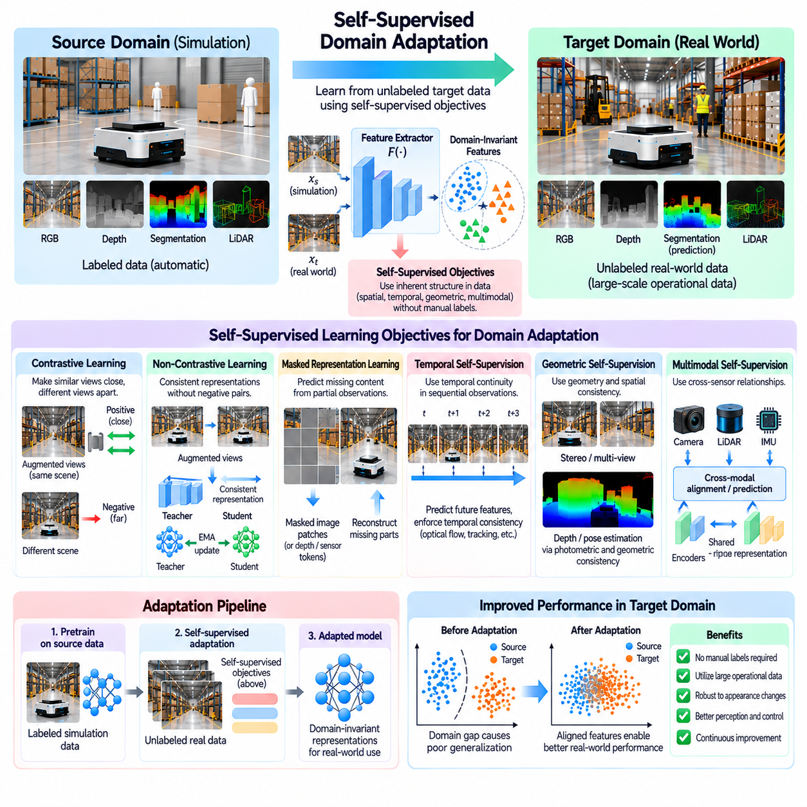{width="7.268055555555556in" height="7.268055555555556in"}

자기 지도 도메인 적응(Self-Supervised Domain Adaptation)은 레이블이 없는 관측값(Unlabeled Observations)에서 직접 학습 신호(Training Signals)를 추출하여 로봇 학습 시스템(Robotic Learning Systems)이 시뮬레이션에서 현실로 지식을 전이할 수 있도록 한다. 지도 기반 적응(Supervised Adaptation)과 달리 수동으로 부여된 타깃 도메인 레이블(Target-Domain Labels)이 필요하지 않다. 대신 영상, 센서 시퀀스(Sensor Sequences), 물리적 상호작용(Physical Interactions)에 내재된 관계를 활용한다. 피지컬 AI(Physical AI)에서 이러한 접근법은 대량의 실제 운영 데이터(Real-World Operational Data)를 표현 학습(Representation Learning)에 활용할 수 있도록 한다.

핵심 원리는 데이터 자체의 구조(Data Structure)에서 의미 있는 지도 정보(Supervision)를 구성할 수 있다는 것이다. 로봇은 시각적 장면(Visual Scenes), 움직임(Motion), 객체 상호작용(Object Interactions), 환경 변화(Environmental Changes)를 지속적으로 관측한다. 이러한 관측값에는 명시적인 주석(Explicit Annotations) 없이도 학습을 지원할 수 있는 공간적 관계(Spatial Relationships), 시간적 관계(Temporal Relationships), 물리적 관계(Physical Relationships)가 포함되어 있다. 자기 지도 목적함수(Self-Supervised Objectives)는 합성 환경과 실제 환경 전반에서 유용하게 유지되는 표현을 모델이 발견하도록 유도한다.

자기 지도 적응(Self-Supervised Adaptation)은 일반적으로 시뮬레이션 데이터(Simulated Data)로 사전 학습된 모델(Pretrained Model)에서 시작한다. 모델은 이미 객체를 인식하고 깊이(Depth)를 추정하거나 로봇 상태(Robot States)를 예측할 수 있지만, 학습된 표현은 여전히 합성 영상의 외형 특성(Synthetic Appearance Characteristics)에 민감할 수 있다. 이후 레이블이 없는 타깃 도메인 관측값을 사용하여 보조 학습 목적함수(Auxiliary Learning Objectives)를 통해 특징 추출기(Feature Extractor)를 개선한다. 목표는 시뮬레이션 학습에서 획득한 능력을 유지하면서 실제 환경 일반화 성능(Real-World Generalization)을 향상시키는 것이다.

대조 학습(Contrastive Learning)은 전이 가능한 표현(Transferable Representations)을 학습하는 데 널리 사용되는 자기 지도 학습(Self-Supervised Learning) 기법이다. 관련된 관측값의 표현은 서로 유사해지도록 하고, 관련이 없는 관측값의 표현은 구분되도록 유도한다. 양성 쌍(Positive Pairs)은 동일한 영상에 서로 다른 데이터 증강(Data Augmentation)을 적용한 결과나 시간적으로 관련된 센서 측정값으로 구성할 수 있다. 음성 쌍(Negative Pairs)은 관련이 없는 장면을 나타낼 수 있지만, 신중하지 않은 선택은 의미적으로 동일한 관측값을 잘못 분리할 수 있다.

대조 학습 목적함수(Contrastive Objectives)는 쌍으로 구성된 관측값 사이에서 조명(Lighting), 텍스처(Texture), 센서 잡음(Sensor Noise)이 달라질 때 이러한 특성에 대한 민감도를 줄일 수 있다. 로봇 카메라 영상(Robot Camera Image)에는 현실적인 색상 변화(Color Changes), 자르기(Cropping), 적당한 잡음 주입(Moderate Noise Injection)을 적용할 수 있다. 신경망(Network)은 변환된 영상들 사이에서 공유되는 정보를 보존하도록 학습한다. 그러나 과도한 자르기나 기하학적 왜곡(Geometric Distortion)은 장애물을 제거하거나 중요한 공간 관계(Spatial Relationships)를 변경할 수 있으므로 데이터 증강은 작업 요구사항(Task Requirements)을 준수해야 한다.

비대조 자기 지도 학습 방법(Non-Contrastive Self-Supervised Methods)은 명시적인 음성 샘플 쌍(Negative Sample Pairs)이 필요하지 않은 대안을 제공한다. 이러한 접근법은 서로 다르게 증강된 관측값 사이에서 일관된 표현을 유도하면서, 표현 붕괴(Representation Collapse)를 방지하기 위해 아키텍처 제약조건(Architectural Constraints)이나 예측 메커니즘(Prediction Mechanisms)을 사용한다. 교사-학생 아키텍처(Teacher-Student Architectures)와 기울기 중단 연산(Stop-Gradient Operations)이 일반적인 구성요소이다. 효과는 모든 입력에 동일한 표현을 생성하는 것이 아니라 유용한 정보를 포함하는 특징(Informative Features)을 유지하는 데 달려 있다.

마스킹 표현 학습(Masked Representation Learning)은 부분적으로 관측된 입력(Partially Observed Inputs)에서 누락된 정보를 복원하도록 모델을 학습시킨다. 학습 과정에서 영상 패치(Image Patches), 깊이 측정값(Depth Measurements), 센서 시퀀스의 일부(Segments of Sensor Sequences)를 가릴 수 있다. 신경망은 주변 문맥(Surrounding Context)으로부터 누락된 내용을 추론해야 하므로 공간적 및 구조적 지식(Spatial and Structural Knowledge)을 습득하도록 유도된다. 이러한 접근법은 합성 관측값과 실제 관측값이 시각적 외형은 다르지만 기본적인 기하학적 구조(Underlying Geometry)를 공유하는 경우 적응을 지원할 수 있다.

마스킹 영상 모델링(Masked Image Modeling)은 레이블이 없는 대규모 로봇 영상 집합에서 시각적 표현(Visual Representations)을 학습하는 데 특히 유용하다. 누락된 영상 영역(Missing Image Regions)이나 잠재 특징(Latent Features)을 예측함으로써 모델은 객체, 표면, 장면 배치(Scene Layouts) 사이의 관계를 학습한다. 복원 목표(Reconstruction Targets)는 신중하게 선택해야 한다. 픽셀 수준 목적함수(Pixel-Level Objectives)는 텍스처와 조명을 지나치게 강조할 수 있기 때문이다. 특징 수준 복원(Feature-Level Reconstruction)은 의미적 및 기하학적 구조(Semantic and Geometric Structure)를 더욱 강조하도록 유도할 수 있다.

시간적 자기 지도 학습(Temporal Self-Supervision)은 시간에 따른 로봇 관측값의 연속성(Continuity)을 활용한다. 연속된 프레임(Consecutive Frames)은 카메라나 로봇이 움직이더라도 일반적으로 서로 관련된 객체와 환경 구조(Environmental Structures)를 포함한다. 모델은 미래 표현(Future Representations)을 예측하거나 시간적 대응 관계(Temporal Correspondence)를 추정하거나 인접 관측값 사이의 일관성(Consistency)을 강제하는 방식으로 학습할 수 있다. 이러한 목적함수는 움직임 관련 정보(Motion-Related Information)를 보존하고 실제 운영 조건에 대한 적응을 개선하는 데 도움이 된다.

비디오 기반 적응(Video-Based Adaptation)은 광학 흐름(Optical Flow), 객체 추적(Object Tracking), 운동 일관성(Motion Consistency)을 통합하여 추가적인 학습 신호를 생성할 수 있다. 정지된 객체(Stationary Object)에 대응하는 특징은 로봇의 시점(Viewpoint)이 변경되더라도 식별 가능하게 유지되어야 한다. 시간적 대응 관계는 지속적으로 존재하는 물리적 구조(Persistent Physical Structures)와 일시적인 시각적 아티팩트(Transient Visual Artifacts)를 구분하는 데 도움이 된다. 그러나 가림(Occlusion), 동적 객체(Dynamic Objects), 부정확한 운동 추정(Inaccurate Motion Estimation)은 시간적 관계가 검증되지 않을 경우 잘못된 지도 정보를 발생시킬 수 있다.

기하학적 자기 지도 학습(Geometric Self-Supervision)은 물리적 기하학(Physical Geometry)이 시각적 외형보다 도메인 전반에서 더 안정적으로 유지되는 경우가 많기 때문에 특히 유용하다. 스테레오 영상 쌍(Stereo Image Pairs), 카메라 운동(Camera Motion), 깊이 관측값(Depth Observations)은 공간 표현(Spatial Representations)을 학습하기 위한 제약조건을 제공할 수 있다. 광도 측정 기반 복원(Photometric Reconstruction)과 기하학적 일관성 목적함수(Geometric Consistency Objectives)는 깊이 및 자세 추정(Depth and Pose Estimation)에 일반적으로 사용된다. 신뢰성은 가시성(Visibility), 카메라 보정(Camera Calibration), 장면 운동(Scene Motion)에 관한 가정에 따라 달라진다.

다중모달 자기 지도 학습(Multimodal Self-Supervision)은 서로 다른 센서 채널(Sensor Channels) 사이의 관계를 활용하여 공유 표현(Shared Representations)을 학습한다. 카메라(Cameras), 라이다(LiDAR), 관성 센서(Inertial Sensors), 휠 엔코더(Wheel Encoders), 고유수용성 측정값(Proprioceptive Measurements)은 동일한 물리 환경의 상호 보완적인 측면을 관측한다. 모달 간 예측(Cross-Modal Prediction)이나 정렬(Alignment)은 공통 기하학(Common Geometry)과 움직임을 반영하는 특징을 학습하도록 유도할 수 있다. 일관되지 않은 센서 측정값이 학습 신호를 손상시킬 수 있으므로 정확한 동기화(Synchronization)와 보정(Calibration)이 필수적이다.

로봇 조작(Robotic Manipulation)에서 자기 지도 학습은 객체 운동(Object Motion), 접촉 이벤트(Contact Events), 행동 결과(Action Outcomes)를 활용할 수 있다. 로봇은 명령된 행동(Commanded Actions) 이후 객체가 어떻게 움직이는지 예측하거나 접촉 전후의 시각적 관측값(Visual Observations)을 비교하여 표현을 학습할 수 있다. 힘 측정값(Force Measurements)과 촉각 측정값(Tactile Measurements)은 상호작용 상태(Interaction States)에 관한 추가 정보를 제공한다. 이러한 목적함수는 인식(Perception)을 물리적 결과(Physical Consequences)와 연결하지만 데이터 수집 과정에서는 안전하지 않은 탐색(Unsafe Exploration)을 제한해야 한다.

행동 조건부 예측(Action-Conditioned Prediction)은 자기 지도 학습을 수동적 관측(Passive Observation) 이상으로 확장한다. 모델은 현재 관측값(Current Observation)과 실행된 행동(Executed Action)을 입력받아 다음 상태(Next State) 또는 잠재 표현(Latent Representation)을 예측한다. 예측 결과와 측정된 결과(Measured Outcomes) 사이의 차이는 학습 신호를 제공한다. 이러한 목적함수는 제어 가능한 동역학(Controllable Dynamics)에 대한 표현을 개선하고 시뮬레이션에서 현실로의 전이(Simulation-to-Reality Transfer)를 지원할 수 있지만 불확실성(Uncertainty)과 액추에이터 동작(Actuator Behavior)의 차이를 고려해야 한다.

주요 과제 중 하나는 자기 지도 적응이 소스 도메인 학습(Source-Domain Training)에서 획득한 작업별 지식(Task-Specific Knowledge)을 저하시키지 않도록 하는 것이다. 보조 목적함수(Auxiliary Objectives)는 관측값을 정확하게 복원하지만 객체 인식(Object Recognition)이나 제어 의사결정(Control Decisions)에는 도움이 되지 않는 표현을 선호할 수 있다. 자기 지도 손실(Self-Supervised Losses)을 소스 작업 지도 정보(Source-Task Supervision), 특징 정규화(Feature Regularization), 재생 데이터(Replay Data)와 결합하면 파국적 망각(Catastrophic Forgetting)을 줄일 수 있다. 적응과 기존 능력 유지(Retention) 사이의 균형은 실험적으로 검증해야 한다.

자기 지도 적응은 운영 중인 로봇 데이터(Operational Robot Data)를 활용한 지속 학습(Continual Learning)도 지원할 수 있다. 기록된 내비게이션 세션(Navigation Sessions), 조작 시도(Manipulation Attempts), 일상적인 센서 측정값(Routine Sensor Measurements)은 지속적으로 증가하는 레이블 없는 타깃 관측값의 집합을 제공한다. 주기적인 오프라인 학습(Periodic Offline Training)은 이러한 관측값을 업데이트된 표현에 반영할 수 있다. 데이터 선택(Data Selection)은 단순히 기록량(Recording Volume)에 의존하기보다 환경 다양성(Environmental Diversity), 드문 조건(Rare Conditions), 센서 품질(Sensor Quality)을 고려해야 한다.

평가(Evaluation)에서는 자기 지도 목적함수의 개선과 실제 로봇 작업 성능의 개선을 구분해야 한다. 복원 오차(Reconstruction Error)가 감소하거나 표현 일관성(Representation Consistency)이 향상되었다고 해서 반드시 내비게이션이 더 안전해지거나 조작 정확도가 높아지는 것은 아니다. 독립적인 실제 환경 시험(Independent Real-World Tests)은 인식 정확도(Perception Accuracy), 위치추정 안정성(Localization Stability), 작업 완료율(Task Completion), 실패 빈도(Failure Frequency)를 측정해야 한다. 변화하는 조명(Changing Lighting), 센서 잡음(Sensor Noise), 익숙하지 않은 환경(Unfamiliar Environments)에서의 강건성(Robustness)이 특히 중요하다.

궁극적으로 자기 지도 도메인 적응(Self-Supervised Domain Adaptation)은 레이블이 없는 로봇 관측값에 내재된 구조(Inherent Structure)를 유용한 학습 정보(Training Information)로 변환한다. 대조 학습(Contrastive Learning), 마스킹 모델링(Masked Modeling), 시간적 예측(Temporal Prediction), 기하학적 일관성(Geometric Consistency), 다중모달 정렬(Multimodal Alignment)은 시뮬레이션과 현실 사이의 차이를 줄이기 위한 상호 보완적인 메커니즘을 제공한다. 작업 인식 정규화(Task-Aware Regularization)와 체계적인 검증(Systematic Validation)을 결합하면 이러한 방법은 피지컬 AI 시스템의 확장 가능하고 신뢰할 수 있는 적응(Scalable and Reliable Adaptation)을 지원한다.

## 04.09. Test Time and Online Adaptation

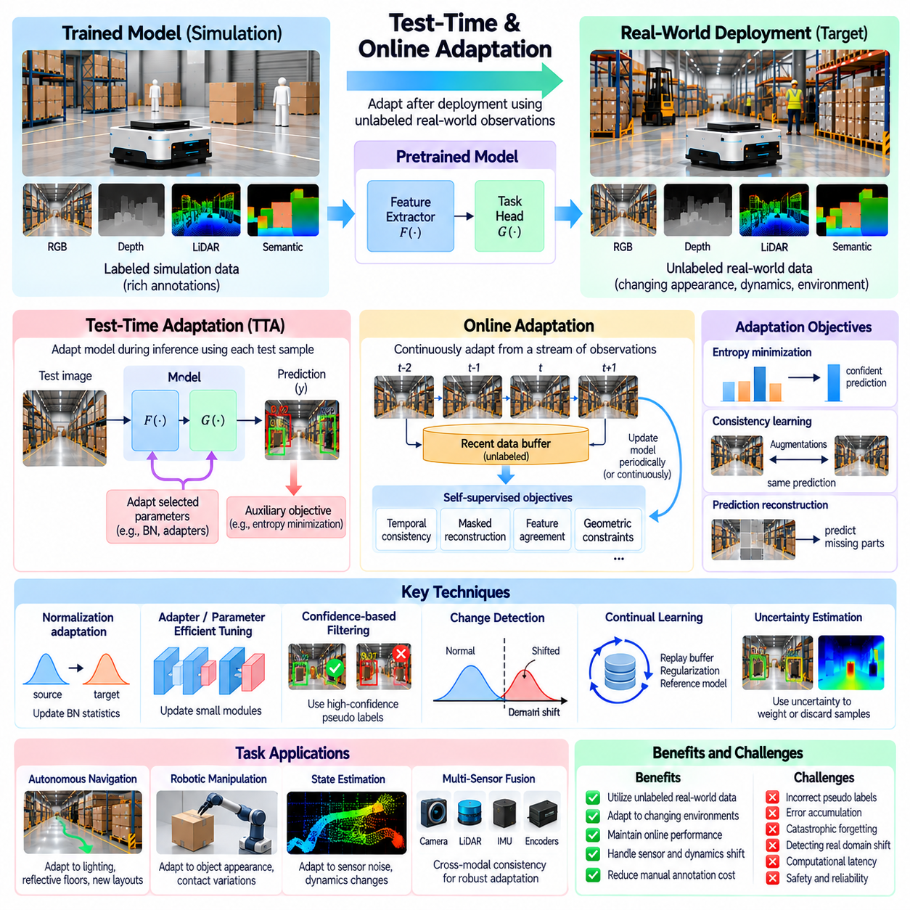{width="7.268055555555556in" height="7.268055555555556in"}

테스트 시점 적응(Test-Time Adaptation)과 온라인 적응(Online Adaptation)은 실제 환경의 관측값이 시뮬레이션 학습 조건과 달라질 때 피지컬 AI(Physical AI) 시스템이 배포 이후에도 학습된 모델을 조정할 수 있도록 한다. 테스트 시점 적응은 추론(Inference) 과정에서 선택된 모델 구성요소를 업데이트하며, 온라인 적응은 연속적인 운영 데이터(Sequential Operational Data)에서 얻은 정보를 반영한다. 두 접근법 모두 전체 재학습(Complete Retraining) 없이 변화하는 환경에서 신뢰할 수 있는 인식(Perception)과 의사결정(Decision-Making)을 유지하는 것을 목표로 한다.

이러한 접근법의 필요성은 물리적 환경(Physical Environments)의 동적인 특성(Dynamic Nature)에서 비롯된다. 조명 조건(Lighting Conditions), 센서 특성(Sensor Characteristics), 객체 외형(Object Appearances), 작업 표면(Operating Surfaces)은 배포 이후 변경될 수 있다. 합성 관측값(Synthetic Observations)으로 학습한 모델은 이러한 변화로 입력 분포(Input Distribution)가 달라지면 정확도가 저하될 수 있다. 운영 중 적응(Adaptation During Operation)은 이러한 변화에 대응하는 메커니즘을 제공하지만, 통제되지 않은 업데이트(Uncontrolled Updates)는 새로운 안전 및 신뢰성 위험(Safety and Reliability Risks)을 초래할 수 있다.

테스트 시점 적응은 일반적으로 레이블이 없는 타깃 관측값(Unlabeled Target Observations)을 사용하여 보조 목적함수(Auxiliary Objectives)를 통해 사전 학습된 모델(Pretrained Model)을 수정한다. 기존 도메인 적응(Conventional Domain Adaptation)과 달리 원래의 소스 데이터셋(Source Dataset)에 접근하지 않고도 작동할 수 있다. 적응 과정에서는 정규화 통계량(Normalization Statistics), 선택된 신경망 매개변수(Selected Network Parameters), 경량 적응 모듈(Lightweight Adaptation Modules)을 업데이트할 수 있다. 조정 가능한 매개변수의 수를 제한하면 계산 비용(Computational Cost)을 줄이고 기존에 확보된 기능에 의도하지 않은 변화가 발생하는 것을 억제할 수 있다.

엔트로피 최소화(Entropy Minimization)는 분류(Classification) 및 인식 모델(Perception Models)에 사용되는 일반적인 테스트 시점 적응 전략이다. 예측 불확실성(Predictive Uncertainty)을 줄여 신경망이 타깃 도메인 관측값에 대해 높은 신뢰도의 예측(Confident Predictions)을 생성하도록 유도한다. 이러한 방법은 분포 변화(Distribution Changes)가 중간 수준이고 기존 모델이 비교적 정확한 상태를 유지할 때 성능을 개선할 수 있다. 그러나 모델이 익숙하지 않은 객체(Unfamiliar Objects)나 심각한 도메인 변화(Severe Domain Shifts)를 경험하면 엔트로피 최소화가 잘못된 예측을 강화할 수 있다.

정규화 기반 적응(Normalization-Based Adaptation)은 신경망 내부 활성화(Intermediate Network Activations)의 통계적 특성을 조정한다. 예를 들어 배치 정규화 계층(Batch Normalization Layers)은 타깃 도메인 통계량(Target-Domain Statistics)을 사용하여 센서 응답(Sensor Response)이나 시각적 외형(Visual Appearance)의 변화를 보정할 수 있다. 이러한 조정은 광범위한 신경망 재학습이 필요하지 않으므로 계산 효율성이 높을 수 있다. 그러나 작은 배치(Small Batches), 상관관계가 높은 관측값(Correlated Observations), 급격한 환경 변화(Abrupt Environmental Changes)는 신뢰할 수 없는 통계량을 생성할 수 있다.

온라인 적응은 연속적인 관측 스트림(Continuous Stream of Observations) 전반에 걸쳐 모델 조정을 확장한다. 각 입력을 독립적으로 처리하는 대신 최근 로봇 경험(Recent Robot Experiences)에서 정보를 축적하고 시간에 따라 모델 매개변수(Model Parameters)나 내부 통계량(Internal Statistics)을 업데이트한다. 이를 통해 지속적인 환경 변화(Persistent Environmental Changes)에 점진적으로 적응할 수 있다. 그러나 스트리밍 관측값(Streaming Observations)은 시간적 상관관계(Temporal Correlation)가 높은 경우가 많으며, 통계적 특성이 모델의 적응 속도보다 빠르게 변할 수도 있다.

핵심적인 설계 결정(Design Decision)은 적응 빈도(Adaptation Frequency)와 업데이트 크기(Update Magnitude)를 결정하는 것이다. 모든 관측값 이후 업데이트하면 빠른 대응성(Responsiveness)을 확보할 수 있지만 계산 부하(Computational Load)가 증가하고 잡음(Noise)이 증폭될 수 있다. 축적된 관측값을 사용한 주기적 업데이트(Periodic Updates)는 통계적 안정성(Statistical Stability)을 개선할 수 있지만 적응 지연(Adaptation Delays)을 발생시킨다. 실제 시스템은 대응성, 추론 지연시간(Inference Latency), 에너지 소비(Energy Consumption), 사용 가능한 학습 신호(Training Signals)의 신뢰성 사이에서 균형을 유지해야 한다.

자기 지도 목적함수(Self-Supervised Objectives)는 타깃 도메인 레이블(Target-Domain Labels)이 없는 경우 유용한 학습 신호를 제공한다. 시간적 일관성(Temporal Consistency), 마스킹 복원(Masked Reconstruction), 특징 일치(Feature Agreement), 기하학적 제약조건(Geometric Constraints)은 온라인 표현 업데이트(Online Representation Updates)를 유도할 수 있다. 로봇은 연속된 카메라 관측값(Consecutive Camera Observations)을 비교하거나 추정된 움직임(Estimated Motion)으로부터 센서 측정값을 예측할 수 있다. 이러한 목적함수는 운영 성능(Operational Performance)을 희생하면서 복원 품질(Reconstruction Quality)만 최적화하는 것이 아니라 작업 관련 정보(Task-Relevant Information)를 보존해야 한다.

지속적 적응(Continual Adaptation)은 현재 조건에서의 성능 개선이 이전에 경험한 환경의 성능을 저하시키는 파국적 망각(Catastrophic Forgetting)의 위험을 수반한다. 어두운 조명(Dim Lighting)에 적응하는 로봇은 업데이트가 지나치게 특화되면 밝은 조명(Bright Illumination)에서 정확도를 잃을 수 있다. 재생 버퍼(Replay Buffers), 매개변수 정규화(Parameter Regularization), 참조 모델(Reference Models)은 이전 기능을 보존하는 데 도움이 된다. 따라서 평가는 최근 조건과 이전에 검증된 운영 시나리오(Previously Validated Operating Scenarios)를 모두 포함해야 한다.

변화 탐지(Change Detection)는 적응이 필요한 시점을 결정하는 데 중요하다. 분포 변화 지표(Distribution-Shift Indicators), 예측 불확실성(Prediction Uncertainty), 센서 잔차(Sensor Residuals), 작업 성능 추세(Task-Performance Trends)는 예상 운영 조건(Expected Operating Conditions)에서 벗어나는 변화를 나타낼 수 있다. 적응 제어기(Adaptation Controller)는 지속적인 변화의 증거가 정의된 임계값(Threshold)을 초과할 때만 업데이트를 활성화할 수 있다. 이러한 접근법은 불필요한 모델 변경을 줄이지만 실제 도메인 변화(Genuine Domain Shifts)와 일시적 교란(Transient Disturbances)을 구분하는 것은 여전히 어려운 과제이다.

불확실성 인식 적응(Uncertainty-Aware Adaptation)은 신뢰할 수 없는 관측값이 모델 업데이트에 과도한 영향을 미치는 것을 방지할 수 있다. 예측이 일관되지 않거나 심각한 센서 손상(Severe Sensor Corruption)이 발생했거나 익숙하지 않은 의미적 내용(Unfamiliar Semantic Content)을 포함한 샘플에는 낮은 가중치(Reduced Weights)를 부여하거나 해당 샘플을 제외할 수 있다. 모델 앙상블(Model Ensembles)과 시간적 일관성 검사(Temporal Consistency Checks)는 추가적인 신뢰도 추정값(Confidence Estimates)을 제공할 수 있다. 그러나 신경망은 잘못된 입력이나 분포 외 입력(Out-of-Distribution Inputs)에 대해서도 높은 신뢰도의 잘못된 예측을 생성할 수 있으므로 신뢰도만으로는 충분하지 않다.

자율이동로봇(Autonomous Mobile Robots)에서 테스트 시점 적응은 변화하는 조명(Changing Illumination), 반사성 바닥(Reflective Floors), 카메라 오염(Camera Contamination), 익숙하지 않은 실내 환경(Unfamiliar Indoor Environments)에 대응할 수 있다. 인식 모듈(Perception Modules)은 장애물 검출(Obstacle Detection)과 의미적 이해(Semantic Understanding)를 유지하기 위해 선택된 표현을 업데이트할 수 있다. 적응 과정은 충돌 회피(Collision Avoidance)나 위치추정 안정성(Localization Stability)을 손상시켜서는 안 된다. 안전 필수 내비게이션 기능(Safety-Critical Navigation Functions)은 독립적으로 검증된 제약조건(Independently Validated Constraints)과 대체 메커니즘(Fallback Mechanisms)을 통해 보호되어야 한다.

로봇 조작(Robotic Manipulation)은 적응이 물리적 접촉(Physical Contact)을 수반하는 의사결정에 영향을 미치므로 추가적인 과제를 가진다. 객체 외형(Object Appearance), 카메라 배치(Camera Placement), 센서 잡음(Sensor Noise)의 변화는 인식 모델(Perception Models)의 업데이트를 정당화할 수 있다. 그러나 변화된 마찰(Friction), 탑재물 특성(Payload Properties), 액추에이터 동역학(Actuator Dynamics)은 시각적 적응(Visual Adaptation)만으로 해결할 수 없으며 물리적 식별(Physical Identification)이 필요하다. 온라인 업데이트는 불확실한 상호작용(Uncertain Interactions) 중에도 파지 안전성(Grasp Safety), 힘 제한(Force Limits), 예측 가능한 제어기 동작(Predictable Controller Behavior)을 유지해야 한다.

안전한 아키텍처(Safe Architecture)는 적응형 학습 구성요소(Adaptive Learning Components)를 검증된 제어 및 안전 기능(Verified Control and Safety Functions)과 분리한다. 업데이트된 인식 특징(Perception Features)은 작업 계획(Task Planning)에 정보를 제공할 수 있지만 독립적인 감시기(Independent Monitors)는 충돌 제약조건(Collision Constraints), 속도 제한(Velocity Limits), 비상 정지 조건(Emergency Stopping Conditions)을 강제한다. 후보 업데이트(Candidate Updates)는 실제 의사결정에 영향을 주기 전에 섀도 모드(Shadow Mode)에서 평가할 수 있다. 롤백 메커니즘(Rollback Mechanisms)은 성능이 저하될 경우 이전에 검증된 매개변수(Previously Validated Parameters)를 복원할 수 있도록 한다.

평가(Evaluation)는 적응 속도(Adaptation Speed), 정확도(Accuracy), 계산 오버헤드(Computational Overhead), 운영 안전성(Operational Safety)을 고려해야 한다. 유용한 측정 항목에는 도메인 변화 이후의 회복 시간(Recovery Time), 변화하는 조건 전반의 성능(Performance Across Changing Conditions), 매개변수 업데이트 빈도(Parameter-Update Frequency), 이전 환경에서의 성능 저하(Degradation on Earlier Environments)가 포함된다. 시험에는 점진적 드리프트(Gradual Drift), 급격한 센서 변화(Abrupt Sensor Changes), 예상하지 못한 관측값(Unexpected Observations)을 포함해야 한다. 성공적인 적응은 단순히 신뢰도가 높아지거나 보조 손실(Auxiliary Loss)이 감소하는 것이 아니라 지속적인 작업 성능(Sustained Task Performance)을 요구한다.

궁극적으로 테스트 시점 적응(Test-Time Adaptation)과 온라인 적응(Online Adaptation)은 배포 조건(Deployment Conditions)이 변화함에 따라 피지컬 AI 성능을 유지하기 위한 메커니즘을 제공한다. 그 가치는 신뢰할 수 있는 변화 탐지(Reliable Shift Detection), 보수적 업데이트(Conservative Updates), 작업 인식 학습 목적함수(Task-Aware Learning Objectives), 망각과 안전하지 않은 행동에 대한 보호(Protection Against Forgetting and Unsafe Behavior)에 달려 있다. 불확실성 모니터링(Uncertainty Monitoring), 독립적인 안전 제약조건(Independent Safety Constraints), 되돌릴 수 있는 배포 절차(Reversible Deployment Procedures)를 결합하면 이러한 접근법은 시뮬레이션을 넘어 더욱 회복력 있는 로봇 운영(Resilient Robotic Operation)을 지원할 수 있다.

## 04.10. Sensor and Multimodal Domain Adaptation

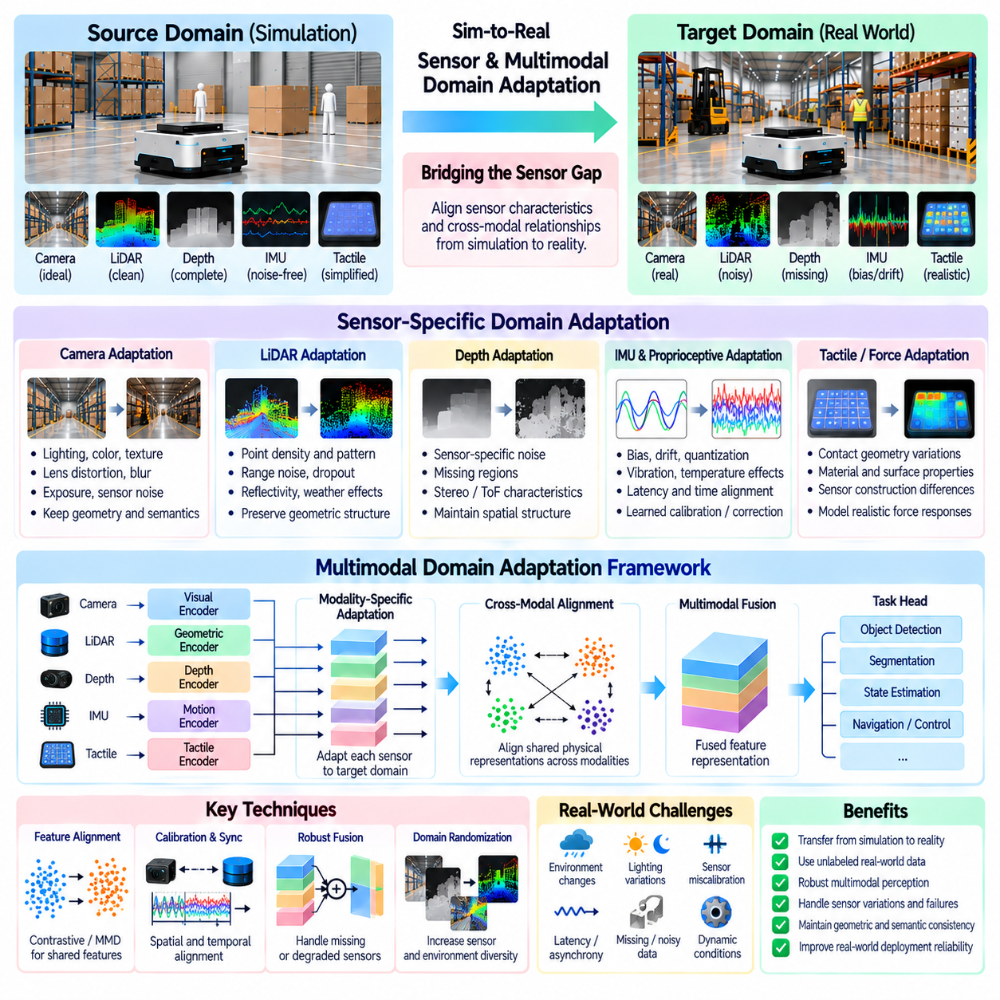{width="7.268055555555556in" height="7.268055555555556in"}

센서 및 다중모달 도메인 적응(Sensor and Multimodal Domain Adaptation)은 카메라(Camera), 라이다(LiDAR), 깊이 센서(Depth Sensors), 관성 측정 장치(Inertial Units), 촉각 센서(Tactile Sensors), 고유수용성 측정값(Proprioceptive Measurements)에서 얻은 정보를 정렬하여 시뮬레이션 센싱 시스템과 실제 센싱 시스템 사이의 차이를 해결한다. 단일 시각 도메인(Single Visual Domain)에 초점을 맞춘 적응과 달리 다중모달 적응(Multimodal Adaptation)은 여러 관측 채널(Observation Channels) 사이의 관계를 고려한다. 피지컬 AI(Physical AI)에서 이러한 접근법은 환경에 따라 센서 특성이 달라지는 상황에서도 신뢰할 수 있는 인식(Perception)과 의사결정(Decision-Making)을 지원한다.

시뮬레이션과 현실 사이의 격차(Simulation-to-Reality Gap)는 시뮬레이션 센서(Simulated Sensors)가 실제 물리적 측정 장치(Physical Measurement Devices)의 모든 특성을 재현하기 어렵기 때문에 발생한다. 실제 센서는 잡음(Noise), 편향(Bias), 지연시간(Latency), 양자화(Quantization), 보정 오차(Calibration Errors), 환경 간섭(Environmental Interference)을 발생시킨다. 이러한 영향은 센서 유형과 운영 조건(Operating Conditions)에 따라 달라진다. 따라서 이상화된 합성 측정값(Idealized Synthetic Measurements)으로 학습한 모델은 기본적인 물리 환경이 동일하더라도 실제 관측값을 잘못 해석할 수 있다.

카메라 도메인 적응(Camera Domain Adaptation)은 영상 형성(Image Formation), 조명(Illumination), 렌즈 왜곡(Lens Distortion), 노출(Exposure), 센서 잡음(Sensor Noise)의 차이를 다룬다. 합성 영상(Synthetic Images)은 기하학적으로 정확하게 보일 수 있지만 현실적인 움직임 흐림(Motion Blur), 반사(Reflections), 색상 응답(Color Response)이 부족할 수 있다. 적응 방법은 영상 외형(Image Appearance)을 수정하거나 학습된 시각적 특징(Learned Visual Features)을 정렬할 수 있다. 그러나 변환 과정에서는 로봇 인식과 제어에 필요한 객체 경계(Object Boundaries), 공간 관계(Spatial Relationships), 의미적 정보(Semantic Information)를 보존해야 한다.

라이다 도메인 적응(LiDAR Domain Adaptation)은 점 밀도(Point Density), 각도 해상도(Angular Resolution), 거리 정확도(Range Accuracy), 반사율(Reflectivity), 측정 누락(Measurement Dropout)의 차이에 초점을 맞춘다. 시뮬레이션 포인트 클라우드(Simulated Point Clouds)는 실제 센서보다 표면이 깨끗하고 샘플링(Sampling)이 균일한 경우가 많다. 실제 라이다 측정값은 투명 재료(Transparent Materials), 반사성 객체(Reflective Objects), 기상 조건(Weather), 다중 경로 효과(Multipath Effects)의 영향을 받을 수 있다. 적응 과정에서는 센서별 불확실성(Sensor-Specific Uncertainty)을 고려하면서 기하학적 구조(Geometric Structure)를 보존해야 한다.

깊이 센서(Depth Sensors)는 측정 오차(Measurement Errors)가 센싱 기술(Sensing Technology)과 표면 특성(Surface Properties)에 따라 달라지므로 추가적인 과제를 발생시킨다. 스테레오 카메라(Stereo Cameras), 구조광 센서(Structured-Light Sensors), 비행시간 측정 장치(Time-of-Flight Devices)는 서로 다른 잡음 패턴(Noise Patterns)과 데이터 누락 영역(Missing-Data Regions)을 생성한다. 합성 깊이 지도(Synthetic Depth Maps)는 비현실적으로 완전한 기하학적 정보를 포함할 수 있다. 깊이 적응(Depth Adaptation)은 현실적인 불확실성을 도입하거나 기하학적 표현(Geometric Representations)을 정렬할 수 있지만 물리적 센싱 자체가 모호한 영역에서 신뢰할 수 있는 측정값을 임의로 생성해서는 안 된다.

관성 센서(Inertial Sensors)와 고유수용성 센서(Proprioceptive Sensors)는 시각적 외형보다 시간적 및 통계적 특성(Temporal and Statistical Characteristics)의 적응이 필요하다. 가속도계(Accelerometers), 자이로스코프(Gyroscopes), 휠 엔코더(Wheel Encoders), 관절 센서(Joint Sensors)는 편향, 드리프트(Drift), 양자화, 기계적 결합(Mechanical Coupling) 특성을 나타낸다. 시뮬레이션 모델(Simulation Models)은 온도 영향(Temperature Effects), 진동(Vibration), 액추에이터 관련 교란(Actuator-Related Disturbances)을 생략할 수 있다. 현실적인 센서 모델링(Realistic Sensor Modeling)과 학습 기반 보정 메커니즘(Learned Correction Mechanisms)은 상태추정(State Estimation)과 운동 예측(Motion Prediction)의 불일치를 줄일 수 있다.

촉각 및 힘 센서(Tactile and Force Sensors)는 출력이 물리적 접촉(Physical Contact)에 의존하므로 특히 복잡한 도메인 차이(Domain Differences)를 가진다. 센서 응답(Sensor Responses)은 재료 강성(Material Stiffness), 접촉 기하학(Contact Geometry), 마찰(Friction), 하중 방향(Loading Direction), 센서 구조(Sensor Construction)에 따라 달라진다. 시뮬레이션 접촉 측정값(Simulated Contact Measurements)은 변형(Deformation)과 힘 분포(Force Distribution)를 단순화할 수 있다. 따라서 신뢰할 수 있는 파지(Grasping)와 조작(Manipulation)을 지원하려면 센서 동작(Sensor Behavior)과 기본적인 상호작용 동역학(Interaction Dynamics)을 모두 고려해야 한다.

다중모달 적응(Multimodal Adaptation)은 개별 센서 분포(Individual Sensor Distributions)를 보정하는 수준을 넘어선다. 서로 다른 모달리티(Modalities)에서 생성된 관측값 사이의 물리적 관계(Physical Relationships)를 보존해야 한다. 카메라 픽셀(Camera Pixels), 라이다 포인트(LiDAR Points), 깊이 측정값(Depth Measurements), 관성 신호(Inertial Signals)는 서로 다른 관점에서 동일한 객체나 움직임을 설명할 수 있다. 효과적인 적응은 정확한 해석에 필요한 모달리티별 정보(Modality-Specific Information)를 제거하지 않으면서 이러한 상호 보완적인 표현(Complementary Representations)을 정렬한다.

모달 간 특징 정렬(Cross-Modal Feature Alignment)은 센서 채널 사이에서 공유되는 정보를 포착하는 표현을 학습한다. 시각 인코더(Visual Encoders)와 기하학적 인코더(Geometric Encoders)는 대응하는 객체나 공간 영역(Spatial Regions)에 대해 호환 가능한 특징을 생성하도록 학습할 수 있다. 대조 학습(Contrastive Learning), 일관성 목적함수(Consistency Objectives), 분포 정렬(Distribution Alignment)은 이러한 과정을 지원할 수 있다. 그러나 모든 모달리티를 동일한 표현으로 강제하면 불확실성, 재료 특성(Material Properties), 측정 한계(Measurement Limitations)에 관한 유용한 정보가 손실될 수 있다.

센서 보정(Sensor Calibration)은 다중모달 적응의 기본적인 전제조건이다. 외부 보정(Extrinsic Calibration)은 센서 사이의 공간적 관계를 결정하고, 내부 보정(Intrinsic Calibration)은 센서 내부의 측정 특성을 설명한다. 시간 동기화(Time Synchronization)는 관측값이 서로 호환 가능한 물리적 상태(Physical States)에 대응하도록 보장한다. 보정 오차는 도메인 변화(Domain Shifts)와 유사하게 나타날 수 있으므로 학습 알고리즘(Learning Algorithms)이 센서 정렬 불량(Sensor Misalignment)과 실제 환경 변화(Genuine Environmental Variation)를 구분하기 어렵게 만들 수 있다.

시간적 정렬(Temporal Alignment)은 모달리티가 서로 다른 샘플링 주파수(Sampling Frequencies)와 지연시간(Latencies)으로 작동할 때 중요해진다. 카메라는 상대적으로 느린 영상 스트림(Image Streams)을 생성할 수 있지만 관성 센서는 높은 주파수의 측정값(High-Frequency Measurements)을 제공한다. 라이다 스캔(LiDAR Scans)과 촉각 관측값(Tactile Observations)은 추가적인 시간 특성(Timing Characteristics)을 가진다. 적응 아키텍처(Adaptation Architectures)는 비동기 데이터(Asynchronous Data)와 지연된 측정값(Delayed Measurements)을 고려해야 한다. 잘못된 시간적 대응 관계(Temporal Correspondence)는 운동 추정(Motion Estimation)과 센서 융합(Sensor Fusion) 결과를 왜곡할 수 있기 때문이다.

모달리티별 적응(Modality-Specific Adaptation)은 다중모달 융합(Multimodal Fusion) 이전에 각 센서 인코더(Sensor Encoder)가 자체적인 분포 변화(Distribution Changes)를 보정하도록 한다. 시각 인코더는 조명 변화(Lighting Variations)에 적응하고, 라이다 인코더(LiDAR Encoder)는 포인트 클라우드 희소성(Point-Cloud Sparsity)을 처리하며, 관성 인코더(Inertial Encoder)는 측정 드리프트(Measurement Drift)를 보정할 수 있다. 이후 공유 융합 계층(Shared Fusion Layers)이 적응된 특징(Adapted Features)을 통합한다. 이러한 모듈형 전략(Modular Strategy)은 해석 가능성(Interpretability)을 개선하고 영향을 받지 않은 센서 채널의 불필요한 변경을 줄일 수 있다.

강건한 다중모달 시스템(Robust Multimodal Systems)은 누락되거나 성능이 저하된 모달리티도 처리해야 한다. 카메라는 불량한 조명(Poor Illumination)에서 제대로 작동하지 않을 수 있고, 라이다 측정값은 특정 표면에서 신뢰성이 낮아질 수 있으며, 촉각 센서는 접촉 정보(Contact Information)를 잃을 수 있다. 학습 과정의 모달리티 드롭아웃(Modality Dropout)은 일부 센서만 사용 가능한 상황(Partial Sensor Availability)에 대비하도록 모델을 학습시킬 수 있다. 신뢰도 인식 융합(Confidence-Aware Fusion)은 신뢰할 수 없는 채널의 영향을 줄일 수 있지만 불확실성 추정값(Uncertainty Estimates)은 실제 센서 고장(Actual Sensor Failures)을 기준으로 검증해야 한다.

자율이동로봇(Autonomous Mobile Robots)에서 다중모달 적응은 장애물 검출(Obstacle Detection), 위치추정(Localization), 매핑(Mapping), 주행 가능성 추정(Traversability Estimation)을 지원한다. 카메라는 의미적 정보(Semantic Information)를 제공하고, 라이다는 기하학적 측정값(Geometric Measurements)을 제공하며, 관성 센서는 운동 추정(Motion Estimation)을 지원한다. 도메인 적응은 로봇이 시뮬레이션 시설(Simulated Facilities)에서 실제 물류창고(Real Warehouses)나 실외 환경(Outdoor Environments)으로 이동할 때 이러한 채널 사이의 불일치를 줄일 수 있다. 신뢰할 수 있는 운영을 위해서는 여전히 독립적인 안전 모니터링(Independent Safety Monitoring)과 센서 고장 탐지(Sensor Fault Detection)가 필요하다.

로봇 조작(Robotic Manipulation)은 적응 과정에서 시각(Visual), 깊이(Depth), 촉각(Tactile), 힘(Force) 정보를 결합함으로써 이점을 얻을 수 있다. 비전(Vision)은 객체 자세(Object Pose)와 외형(Appearance)을 추정하고, 촉각 센싱(Tactile Sensing)은 접촉 조건(Contact Conditions)을 파악하며, 힘 센서(Force Sensors)는 상호작용 하중(Interaction Loads)을 측정한다. 모달 간 일관성(Cross-Modal Consistency)은 개별 센서가 불확실한 상황에서 파지 상태 추정(Grasp-State Estimation)을 개선할 수 있다. 그러나 마찰, 유연성(Compliance), 액추에이터 동역학(Actuator Dynamics)의 변화에는 센서 분포 정렬(Sensor Distribution Alignment)을 넘어서는 물리적 모델링(Physical Modeling)이 필요하다.

평가(Evaluation)는 개별 센서 적응(Individual Sensor Adaptation)과 전체 융합 시스템(Complete Fusion System)의 성능을 모두 측정해야 한다. 유용한 시험에는 센서 잡음 변화(Sensor Noise Variation), 보정 교란(Calibration Perturbations), 시간 오차(Timing Errors), 부분적인 센서 고장(Partial Sensor Failures), 환경 변화(Environmental Changes)가 포함된다. 평가 지표(Metrics)는 인식 정확도(Perception Accuracy), 위치추정 안정성(Localization Stability), 파지 성공률(Grasp Success), 불확실성 보정(Uncertainty Calibration)을 포함해야 한다. 특징 정렬(Feature Alignment)이 개선되더라도 실제 로봇 작업(Real Robotic Tasks)에서 측정 가능한 성능 향상으로 이어지지 않는다면 충분하지 않다.

궁극적으로 센서 및 다중모달 도메인 적응(Sensor and Multimodal Domain Adaptation)은 시뮬레이션 센싱 모델(Simulated Sensing Models)과 실제 물리적 측정 시스템(Physical Measurement Systems)의 복잡한 동작을 연결한다. 효과는 불필요한 분포 차이(Irrelevant Distribution Differences)를 줄이면서 기하학적 구조(Geometry), 시간적 대응 관계(Temporal Correspondence), 모달 간 일관성(Cross-Modal Consistency), 센서별 불확실성(Sensor-Specific Uncertainty)을 보존하는 데 달려 있다. 현실적인 시뮬레이션(Realistic Simulation), 보정(Calibration), 강건한 융합(Robust Fusion), 체계적인 검증(Systematic Validation)을 결합하면 다양한 운영 환경(Operating Environments)에서 피지컬 AI의 신뢰성을 강화할 수 있다.

## 04.11. Dynamics and Control Domain Adaptation

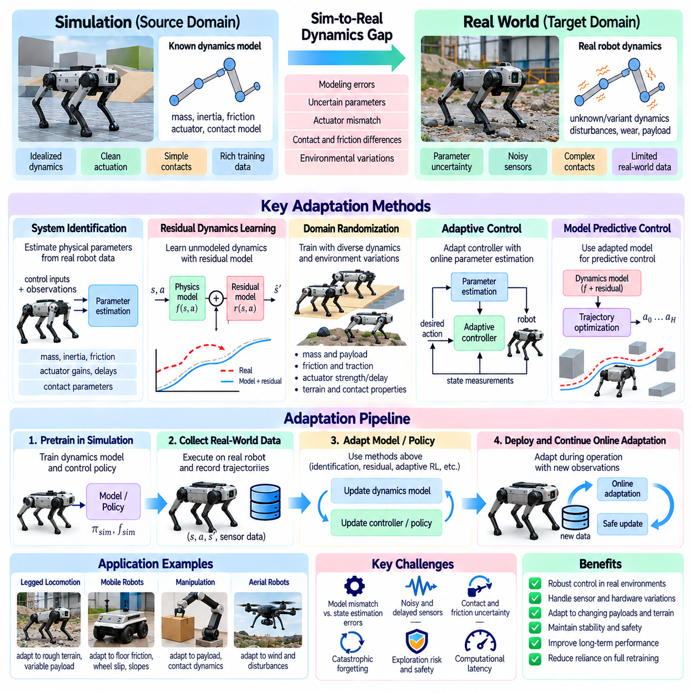{width="7.268055555555556in" height="7.268055555555556in"}

동역학 및 제어 도메인 적응(Dynamics and Control Domain Adaptation)은 시뮬레이션과 실제 로봇 사이에서 발생하는 운동(Motion), 구동(Actuation), 물리적 상호작용(Physical Interactions)의 차이를 해결한다. 인식 모델(Perception Models)이 성공적으로 전이되더라도 시뮬레이션 동역학(Simulated Dynamics)이 실제 하드웨어 동작(Hardware Behavior)을 정확하게 재현하지 못하면 제어 정책(Control Policies)이 실패할 수 있다. 적응의 목표는 질량(Mass), 마찰(Friction), 액추에이터 응답(Actuator Response), 접촉력(Contact Forces), 환경 조건(Environmental Conditions)의 불일치에도 안정적이고 효과적인 제어를 유지하는 것이다.

동역학 격차(Dynamics Gap)는 불완전한 물리 모델(Physical Models)과 불확실한 시스템 매개변수(System Parameters)에서 발생한다. 시뮬레이터(Simulators)는 관성(Inertia), 감쇠(Damping), 관절 유연성(Joint Compliance), 전달 손실(Transmission Losses), 외부 교란(External Disturbances)을 단순화된 방정식(Simplified Equations)으로 근사한다. 실제 로봇은 제조 공차(Manufacturing Tolerances), 기계적 마모(Mechanical Wear), 온도 의존적 동작(Temperature-Dependent Behavior), 비선형 효과(Nonlinear Effects)를 나타낸다. 이러한 불일치는 반복적인 동작 과정에서 누적되어 예측 궤적(Predicted Trajectories)과 실제 관측 궤적(Observed Trajectories) 사이에 상당한 차이를 발생시킬 수 있다.

시스템 식별(System Identification)은 측정된 로봇 동작(Measured Robot Behavior)으로부터 물리적 매개변수(Physical Parameters)를 추정하여 동역학 적응(Dynamics Adaptation)의 기반을 제공한다. 알려진 제어 입력(Control Inputs)과 기록된 상태 전이(State Transitions)를 활용하면 액추에이터 이득(Actuator Gains), 마찰 계수(Friction Coefficients), 관성 특성(Inertial Properties), 응답 지연(Response Delays)을 파악할 수 있다. 매개변수 추정(Parameter Estimation)에는 최적화(Optimization), 필터링(Filtering), 학습 기반 모델(Learned Models)을 사용할 수 있다. 신뢰할 수 있는 식별을 위해서는 운영 한계(Operational Limits)를 준수하고 위험한 탐색 동작(Unsafe Exploratory Movements)을 피하면서 충분한 정보가 포함된 시스템 가진(Informative Excitation)을 수행해야 한다.

잔차 동역학 학습(Residual Dynamics Learning)은 예측된 상태 전이와 실제 측정된 상태 전이 사이의 차이를 학습하여 근사적인 시뮬레이션 모델(Approximate Simulation Models)을 개선한다. 명목 물리 모델(Nominal Physics Model)은 알려진 기계적 관계(Mechanical Relationships)를 표현하고, 잔차 신경망(Residual Network)은 모델링되지 않은 효과(Unmodeled Effects)를 추정한다. 이러한 조합은 기존 물리 지식(Physical Knowledge)을 대체하지 않으면서 마찰 비선형성(Friction Nonlinearities), 액추에이터 지연(Actuator Lag), 접촉 불일치(Contact Discrepancies)를 표현할 수 있다. 불안정한 제어 동작을 방지하기 위해 잔차 예측(Residual Predictions)은 제한된 범위 내에서 유지되어야 한다.

도메인 무작위화(Domain Randomization)는 시뮬레이션 학습 과정에서 물리적 매개변수를 변화시켜 제어 정책(Control Policies)이 불확실성(Uncertainty)에 대비하도록 한다. 로봇 질량(Robot Mass), 무게중심(Center of Gravity), 관절 마찰(Joint Friction), 액추에이터 출력(Actuator Strength), 표면 접지력(Surface Traction), 제어 지연(Control Delays)을 현실적으로 가능한 범위(Plausible Ranges)에서 샘플링할 수 있다. 다양한 동역학에 노출된 정책은 실제 하드웨어에 대한 일반화 성능(Generalization Performance)이 향상될 수 있다. 그러나 지나치게 광범위한 무작위화는 성능을 저하시킬 수 있으며, 비현실적인 매개변수 조합(Unrealistic Parameter Combinations)은 잘못된 학습 경험(Misleading Training Experiences)을 생성할 수 있다.

적응 제어(Adaptive Control)는 시스템 동역학(System Dynamics)의 추정값이 변화함에 따라 제어기 동작(Controller Behavior)을 수정한다. 온라인 매개변수 추정(Online Parameter Estimation)은 검증된 운영 범위(Verified Operating Boundaries) 내에서 모델 기반 제어기(Model-Based Controllers)를 업데이트하거나 피드백 이득(Feedback Gains)을 조정할 수 있다. 이러한 접근법은 탑재물(Payloads), 마찰, 액추에이터 특성(Actuator Characteristics)이 운영 중에 변화하는 경우 특히 유용하다. 안정성 보장(Stability Guarantees)은 적응 법칙(Adaptation Law), 사용 가능한 측정값(Available Measurements), 가진 조건(Excitation Conditions), 교란에 관한 가정(Assumptions About Disturbances)에 따라 달라진다.

모델 예측 제어(Model Predictive Control, MPC)는 적응된 동역학 모델(Adapted Dynamics Models)을 짧은 예측 구간(Short-Horizon)의 궤적 최적화(Trajectory Optimization)에 통합할 수 있다. 각 제어 주기(Control Cycle)에서 제어기는 미래 상태(Future States)를 예측하고 제약조건(Constraints)을 평가하여 행동 시퀀스(Action Sequence)를 선택한다. 예측 모델(Prediction Model)을 업데이트하면 변화하는 하중(Changing Loads)이나 표면 조건(Surface Conditions)에서 궤적 추종 정확도(Tracking Accuracy)를 개선할 수 있다. 그러나 실행 가능성(Feasibility), 응답성(Responsiveness), 안전성(Safety)을 유지하려면 모델 불확실성(Model Uncertainty)과 계산 지연(Computational Delays)을 관리해야 한다.

강화학습 정책(Reinforcement Learning Policies)도 시뮬레이션 사전 학습(Simulation Pretraining) 이후 실제 환경 경험(Real-World Experience)을 통해 적응할 수 있다. 미세 조정(Fine-Tuning)은 하드웨어별 동역학(Hardware-Specific Dynamics)에서 이동(Locomotion), 내비게이션(Navigation), 조작(Manipulation) 성능을 개선할 수 있다. 그러나 실제 로봇에서 탐색적 상호작용(Exploratory Interactions)을 수집하는 과정은 비용이 높고 잠재적으로 위험하다. 보수적인 정책 업데이트(Conservative Policy Updates), 오프라인 데이터셋(Offline Datasets), 안전 제약 탐색(Safety-Constrained Exploration)은 위험을 줄이면서 점진적인 성능 개선을 지원할 수 있다.

액추에이터 적응(Actuator Adaptation)은 토크 생성(Torque Generation), 모터 응답(Motor Response), 포화(Saturation), 백래시(Backlash), 명령 지연시간(Command Latency)의 불일치를 해결한다. 시뮬레이션 액추에이터(Simulated Actuators)는 실제 모터 및 동력 전달 장치(Physical Motors and Transmissions)보다 일관된 응답을 보이는 경우가 많다. 학습된 액추에이터 모델(Learned Actuator Models)이나 보정된 응답 곡선(Calibrated Response Curves)은 명령 예측(Command Prediction)과 추종 성능(Tracking Performance)을 개선할 수 있다. 적응 과정에서는 열적 한계(Thermal Limits), 전류 제약조건(Current Constraints), 장시간 운영 중 발생하는 성능 저하(Degradation)도 고려해야 한다.

접촉 동역학(Contact Dynamics)은 마찰(Friction), 충격(Impact), 유연성(Compliance), 변형(Deformation)을 정확하게 시뮬레이션하기 어렵기 때문에 주요 과제가 된다. 작은 모델링 오차(Modeling Errors)도 파지 안정성(Grasp Stability), 발 착지 위치(Foot Placement), 바퀴 접지력(Wheel Traction)에 큰 변화를 발생시킬 수 있다. 접촉 인식 적응(Contact-Aware Adaptation)은 힘 측정값(Force Measurements), 촉각 피드백(Tactile Feedback), 관측된 미끄러짐(Observed Slip)을 사용하여 상호작용 모델(Interaction Models)을 개선할 수 있다. 이러한 업데이트는 센서 불확실성(Sensor Uncertainty)과 실제 물리적 접촉 조건(Physical Contact Conditions)의 변화를 구분해야 한다.

이동로봇(Mobile Robots)에서 동역학 적응은 탑재 하중(Payload), 타이어 특성(Tire Properties), 바닥 마찰(Floor Friction), 바퀴 미끄러짐(Wheel Slip)의 변화를 보정할 수 있다. 균일한 시뮬레이션 표면(Uniform Simulated Surfaces)에서 학습한 제어기는 경사로(Ramps), 광택 바닥(Polished Floors), 불규칙한 지형(Uneven Terrain)에서 성능이 저하될 수 있다. 온라인 접지력 추정(Online Traction Estimation)과 운동 모델 보정(Motion-Model Correction)은 경로 추종(Path Tracking)과 안정성(Stability)을 개선할 수 있다. 사용 가능한 접지력이나 위치추정 신뢰도(Localization Confidence)가 불확실해지면 안전 제약조건(Safety Constraints)을 통해 과격한 주행 동작(Aggressive Maneuvers)을 방지해야 한다.

로봇 매니퓰레이터(Robotic Manipulators)는 변화하는 탑재물 관성(Payload Inertia), 관절 마찰(Joint Friction), 유연한 구성요소(Flexible Components), 말단효과기 접촉 조건(End-Effector Contact Conditions)에 대한 적응이 필요하다. 잘못된 동역학 추정(Incorrect Dynamics Estimates)은 추종 오차(Tracking Errors), 과도한 힘(Excessive Forces), 불안정한 파지 상호작용(Unstable Grasp Interactions)을 발생시킬 수 있다. 모델 기반 보상(Model-Based Compensation), 힘 피드백(Force Feedback), 제한된 적응 항(Bounded Adaptive Terms)을 결합하면 정밀도(Precision)를 개선할 수 있다. 관절 토크(Joint Torque), 속도(Speed), 접촉력(Contact Force)에 대한 물리적 제한(Physical Limits)은 학습된 보정 기능과 독립적으로 강제할 수 있어야 한다.

핵심적인 과제는 동역학 불일치(Dynamics Mismatch)를 인식 및 상태추정 오차(Perception and State-Estimation Errors)와 구분하는 것이다. 잘못된 속도 추정(Incorrect Velocity Estimates), 지연된 관측값(Delayed Observations), 보정 드리프트(Calibration Drift)는 예상하지 못한 기계적 동작(Unexpected Mechanical Behavior)처럼 나타날 수 있다. 잘못된 측정값을 보상하기 위해 동역학 모델을 업데이트하면 오히려 제어 성능(Control Performance)이 저하될 수 있다. 센서 품질(Sensor Quality), 예측 잔차(Prediction Residuals), 액추에이터 응답(Actuator Responses)을 통합적으로 모니터링하면 적응을 시작하기 전에 불일치의 원인을 식별하는 데 도움이 된다.

안전한 배포(Safe Deployment)를 위해서는 명시적인 검증 경계(Explicit Validation Boundaries)를 갖춘 구조화된 적응 절차(Structured Adaptation Process)가 필요하다. 후보 동역학 모델(Candidate Dynamics Models)이나 제어기 매개변수(Controller Parameters)는 먼저 데이터 재생(Replay), 시뮬레이션(Simulation), 섀도 모드 예측(Shadow-Mode Prediction)을 통해 평가할 수 있다. 런타임 감시기(Runtime Monitors)는 과도한 추종 오차(Excessive Tracking Error), 불안정한 진동(Unstable Oscillations), 제약조건 위반(Constraint Violations), 비정상적인 액추에이터 하중(Abnormal Actuator Loads)을 탐지해야 한다. 적응의 신뢰성이 저하되면 시스템은 검증된 제어 매개변수(Validated Control Parameters)로 복귀하거나 안전 운영 상태(Safe Operating State)로 전환해야 한다.

평가(Evaluation)는 다양한 물리적 조건(Physical Conditions)에서 궤적 추종(Trajectory Tracking), 교란 억제(Disturbance Rejection), 에너지 효율(Energy Efficiency), 접촉 안정성(Contact Stability), 작업 완료(Task Completion)를 측정해야 한다. 시험에는 탑재 하중 변화(Payload Changes), 마찰 변화(Friction Variation), 액추에이터 지연(Actuator Delays), 학습 과정에서 경험하지 않은 모델링 오차(Modeling Errors)를 포함해야 한다. 적응 속도(Adaptation Speed)와 계산 오버헤드(Computational Overhead)도 중요하다. 성능 개선은 안정성 여유(Stability Margins), 안전 위반(Safety Violations), 예상하지 못한 교란에 대한 강건성(Robustness to Unexpected Disturbances)과 함께 평가되어야 한다.

궁극적으로 동역학 및 제어 도메인 적응(Dynamics and Control Domain Adaptation)은 시뮬레이션 제어 정책(Simulated Control Policies)을 실제 로봇의 불확실한 기계적 특성(Uncertain Mechanics)과 연결한다. 시스템 식별(System Identification), 잔차 학습(Residual Learning), 무작위화 학습(Randomized Training), 적응 제어(Adaptive Control), 신중한 정책 미세 조정(Cautious Policy Fine-Tuning)은 상호 보완적인 해결책을 제공한다. 이러한 방법의 성공적인 통합은 정확한 측정값(Accurate Measurements), 제한된 업데이트(Bounded Updates), 명시적인 안전 제약조건(Explicit Safety Constraints), 변화하는 운영 조건 전반에 대한 체계적인 실제 환경 검증(Systematic Real-World Validation)에 달려 있다.

## 04.12. Cross Robot and Cross Embodiment Adaptation

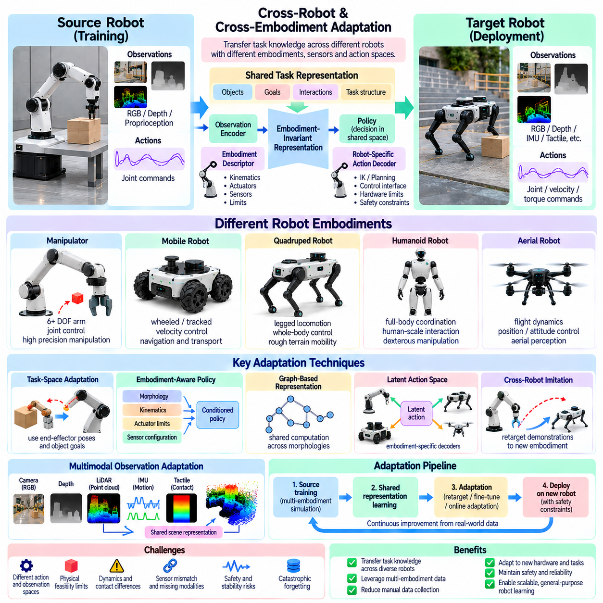{width="7.268055555555556in" height="7.268055555555556in"}

로봇 간 및 이종 로봇 신체 적응(Cross-Robot and Cross-Embodiment Adaptation)은 서로 다른 기계적 구조(Mechanical Structures), 센서(Sensors), 액추에이터(Actuators), 제어 인터페이스(Control Interfaces)를 가진 로봇 사이에서 피지컬 AI(Physical AI) 시스템이 학습된 능력을 전이할 수 있도록 한다. 하나의 로봇에서 학습한 정책(Policy)은 행동 공간(Action Spaces)과 물리적 제약조건(Physical Constraints)이 다르기 때문에 다른 로봇에서 직접 작동하지 않을 수 있다. 적응은 각 로봇 플랫폼(Robotic Platform)의 고유한 신체 구조(Embodiment)와 운영 특성(Operating Characteristics)을 고려하면서 전이 가능한 작업 지식(Transferable Task Knowledge)을 보존하는 것을 목표로 한다.

로봇 신체 구조(Robot Embodiment)는 지능형 시스템(Intelligent System)이 환경을 인식하고 움직이며 상호작용하는 방식을 결정한다. 관절 구성(Joint Configuration), 링크 치수(Link Dimensions), 자유도(Degrees of Freedom), 탑재 하중 용량(Payload Capacity), 액추에이터 성능(Actuator Performance)의 차이는 실행 가능한 행동(Feasible Behaviors)에 영향을 미친다. 동일한 작업을 수행하는 로봇이라도 서로 다른 운동 전략(Motion Strategies)이 필요할 수 있다. 따라서 이종 로봇 신체 적응(Cross-Embodiment Adaptation)은 일반적인 작업 목표(General Task Objectives)와 이를 달성하기 위한 플랫폼별 메커니즘(Platform-Specific Mechanisms)을 구분해야 한다.

핵심적인 과제는 서로 다른 로봇 플랫폼 사이의 관측 공간(Observation Spaces)과 행동 공간(Action Spaces)의 불일치이다. 하나의 매니퓰레이터(Manipulator)는 관절 위치(Joint Positions)와 토크 명령(Torque Commands)을 제공하지만 다른 매니퓰레이터는 데카르트 속도(Cartesian Velocity) 또는 위치 제어(Position Control)를 제공할 수 있다. 이동로봇(Mobile Robots)은 조향 기하학(Steering Geometry)과 운동 제약조건(Motion Constraints)이 다를 수 있다. 수치 명령(Numerical Commands)을 직접 전이하면 유효하지 않거나 위험한 행동이 발생할 수 있다. 적응에는 이질적인 인터페이스(Heterogeneous Interfaces) 사이에서 물리적 의미(Physical Meaning)를 보존하는 매핑(Mappings)이 필요하다.

공유 표현 학습(Shared Representation Learning)은 서로 다른 신체 구조 사이에서 지식을 전이하기 위한 기반을 제공한다. 모든 작업을 로봇별 관절 좌표(Robot-Specific Joint Coordinates)만으로 표현하는 대신 모델은 객체(Objects), 목표(Goals), 공간 관계(Spatial Relationships), 상호작용 결과(Interaction Outcomes)를 표현할 수 있다. 이러한 표현은 하드웨어 세부사항(Hardware Details)과 독립적으로 작업 요구사항(Task Requirements)을 추론하는 정책을 지원한다. 이후 신체 구조별 모듈(Embodiment-Specific Modules)이 공유된 의도(Shared Intentions)를 실행 가능한 행동(Executable Actions)으로 변환한다.

작업 공간 적응(Task-Space Adaptation)은 말단효과기 자세(End-Effector Poses), 객체 궤적(Object Trajectories), 접촉 상태(Contact States) 또는 물리적으로 의미 있는 다른 변수(Physically Meaningful Variables)를 사용하여 원하는 행동을 표현한다. 조작 작업(Manipulation Task)은 특정 관절 각도 시퀀스(Joint Angle Sequence)가 아니라 필요한 객체 변위(Object Displacement)로 정의할 수 있다. 역기구학(Inverse Kinematics)과 운동 계획(Motion Planning)은 이러한 목표를 플랫폼별 명령(Platform-Specific Commands)으로 변환한다. 전이는 도달 가능성(Reachability), 충돌 기하학(Collision Geometry), 액추에이터 성능(Actuator Capabilities)에 의해 제한된다.

신체 구조 인식 정책 아키텍처(Embodiment-Aware Policy Architectures)는 로봇 형태(Morphology)와 하드웨어 특성(Hardware Properties)을 명시적으로 조건으로 사용하여 의사결정을 수행한다. 입력에는 관절 토폴로지(Joint Topology), 링크 길이(Link Lengths), 질량 분포(Mass Distribution), 액추에이터 제한(Actuator Limits), 센서 배치(Sensor Placement)가 포함될 수 있다. 공유 정책(Shared Policy)은 이러한 설명자(Descriptors)를 사용하여 서로 다른 플랫폼에 적합한 행동을 선택할 수 있다. 이러한 아키텍처는 제한된 로봇 설계(Robot Designs)에 과적합(Overfitting)되지 않도록 충분히 다양한 학습 사례(Training Examples)가 필요하다.

그래프 기반 표현(Graph-Based Representations)은 로봇 메커니즘(Robotic Mechanisms)이 자연스럽게 링크(Links)와 관절(Joints)로 연결된 구조를 형성하기 때문에 유용하다. 그래프 신경망(Graph Neural Networks)은 서로 다른 로봇 형태 사이에서 계산 규칙(Computational Rules)을 공유하면서 국소 관계(Local Relationships)를 인코딩할 수 있다. 이를 통해 관절 수가 가변적이거나 기구학적 배열(Kinematic Arrangements)이 다른 구조를 지원할 수 있다. 그러나 구조적 유연성(Structural Flexibility)이 접촉 동역학(Contact Dynamics), 제어 대역폭(Control Bandwidth), 센싱 능력(Sensing Capabilities)이 크게 다른 경우에도 전이를 자동으로 보장하는 것은 아니다.

로봇 간 모방학습(Cross-Robot Imitation Learning)은 다른 플랫폼에서 수집한 시연 데이터(Demonstrations)로부터 행동 지식(Behavioral Knowledge)을 전이한다. 시연은 원시 모터 명령(Raw Motor Commands) 대신 객체 운동(Object Motions), 말단효과기 궤적(End-Effector Trajectories), 작업 결과(Task Outcomes)로 표현할 수 있다. 동작 재매핑 알고리즘(Retargeting Algorithms)은 이러한 시연을 수신 로봇(Receiving Robot)이 실행할 수 있는 운동으로 변환한다. 동작 재매핑(Retargeting)은 관절 제한(Joint Limits), 작업 공간 경계(Workspace Boundaries), 충돌 제약조건(Collision Constraints), 조작 능력(Manipulation Capability)의 차이를 준수해야 한다.

시뮬레이션(Simulation)은 여러 신체 구조에 걸쳐 전이 가능한 정책(Transferable Policies)을 개발하기 위한 통제된 환경(Controlled Environment)을 제공한다. 학습 과정에서는 다양한 기하학적 구조(Geometries), 액추에이터 출력(Actuator Strengths), 센서 구성(Sensor Configurations), 탑재 하중 제한(Payload Limits)을 가진 로봇에 모델을 노출할 수 있다. 이러한 다양성은 하나의 기계적 설계(Mechanical Design)에 의존하기보다 재사용 가능한 작업 구조(Reusable Task Structure)를 학습하도록 유도한다. 그러나 시뮬레이션된 신체 구조 변화(Simulated Embodiment Variation)는 물리적으로 타당해야 하며 현실적인 제어 한계(Control Limitations)를 포함해야 한다.

잠재 행동 표현(Latent Action Representations)은 이질적인 로봇(Heterogeneous Robots)을 연결하는 또 다른 메커니즘을 제공한다. 모델은 의도된 움직임(Intended Movement)이나 상호작용 효과(Interaction Effects)를 나타내는 공유 추상 공간(Shared Abstract Space)에 행동을 인코딩할 수 있다. 이후 로봇별 디코더(Robot-Specific Decoders)가 잠재 명령(Latent Commands)을 유효한 제어 신호(Valid Control Signals)로 변환한다. 전이 품질(Transfer Quality)은 공유 공간이 물리적 능력(Physical Capability)의 중요한 차이를 숨기지 않으면서 작업 관련 의미(Task-Relevant Meaning)를 보존하는지에 따라 달라진다.

이종 로봇 신체 적응(Cross-Embodiment Adaptation)은 센서 가용성(Sensor Availability)과 배치(Sensor Placement)의 차이도 고려해야 한다. 로봇은 손목 카메라(Wrist Cameras), 고정 카메라(Fixed Cameras), 깊이 센서(Depth Sensors), 촉각 배열(Tactile Arrays)을 통해 동일한 환경을 관측할 수 있다. 다중모달 인코더(Multimodal Encoders)는 관측값을 공유 장면 표현(Shared Scene Representations)으로 정렬할 수 있다. 그러나 누락된 시점(Missing Viewpoints), 가림(Occlusion), 보정 차이(Calibration Differences), 불균등한 센싱 정밀도(Unequal Sensing Precision)는 전이된 정책(Transferred Policies)이 활용할 수 있는 정보를 제한할 수 있다.

물리적 실행 가능성(Physical Feasibility)은 지식 전이(Knowledge Transfer)의 근본적인 경계이다. 높은 손재주를 가진 매니퓰레이터(Highly Dexterous Manipulator)에서 학습한 정책이 더 단순한 그리퍼(Simpler Gripper)에서 동일한 행동을 자동으로 재현할 수는 없다. 도달 범위(Reach), 탑재 하중(Payload), 토크(Torque), 속도(Speed), 접촉 기하학(Contact Geometry)의 차이로 인해 특정 작업은 수행이 불가능할 수 있다. 따라서 적응 과정에서는 능력 호환성(Capability Compatibility)을 평가하고 직접적인 행동 재현(Direct Behavioral Reproduction)이 불가능할 경우 작업 전략(Task Strategies)을 수정해야 한다.

안전성(Safety)은 서로 다른 동역학(Dynamics)을 가진 로봇 사이에서 정책을 전이할 때 특히 중요하다. 하나의 플랫폼에서 안정적인 행동이 다른 플랫폼에서는 과도한 힘(Excessive Forces), 충돌(Collisions), 불안정성(Instability)을 발생시킬 수 있다. 적응 과정에는 하드웨어별 제약조건(Hardware-Specific Constraints), 검증된 운동 제한(Verified Motion Limits), 독립적인 안전 감독(Independent Safety Supervision)을 통합해야 한다. 후보 정책(Candidate Policies)은 실제 운영 권한(Operational Authority)을 부여받기 전에 시뮬레이션과 제한된 물리적 시험(Restricted Physical Trials)을 통해 검증할 수 있다.

평가(Evaluation)는 작업 수준 전이(Task-Level Transfer)와 기계적 모방(Mechanical Imitation)을 구분해야 한다. 성공적인 적응은 수신 로봇이 소스 로봇(Source Robot)의 움직임을 반드시 재현하는 것이 아니라 의도된 목표(Intended Objective)를 달성하는 것을 의미한다. 평가 지표(Metrics)에는 작업 성공률(Task Success), 전이 효율성(Transfer Efficiency), 궤적 실행 가능성(Trajectory Feasibility), 에너지 소비(Energy Consumption), 안전 위반(Safety Violations)이 포함될 수 있다. 익숙하지 않은 신체 구조(Unfamiliar Embodiments)에 대한 시험은 학습된 표현이 실제로 전이 가능한 지식(Genuinely Transferable Knowledge)을 포착하는지 판단하는 데 도움이 된다.

궁극적으로 로봇 간 및 이종 로봇 신체 적응(Cross-Robot and Cross-Embodiment Adaptation)은 이질적인 로봇 시스템(Heterogeneous Robotic Systems) 전반에서 재사용 가능한 피지컬 AI 능력(Reusable Physical AI Capabilities)의 개발을 지원한다. 공유 작업 표현(Shared Task Representations), 형태 인식 정책(Morphology-Aware Policies), 시연 동작 재매핑(Demonstration Retargeting), 잠재 행동 매핑(Latent Action Mappings)은 상호 보완적인 전이 메커니즘(Transfer Mechanisms)을 제공한다. 이러한 방법의 효과는 신체 구조 제약조건(Embodiment Constraints)을 준수하고 물리적 의미(Physical Meaning)를 보존하며 각 타깃 플랫폼(Target Platform)에서 성능을 검증하는 데 달려 있다.

## 04.13. Domain Generalization

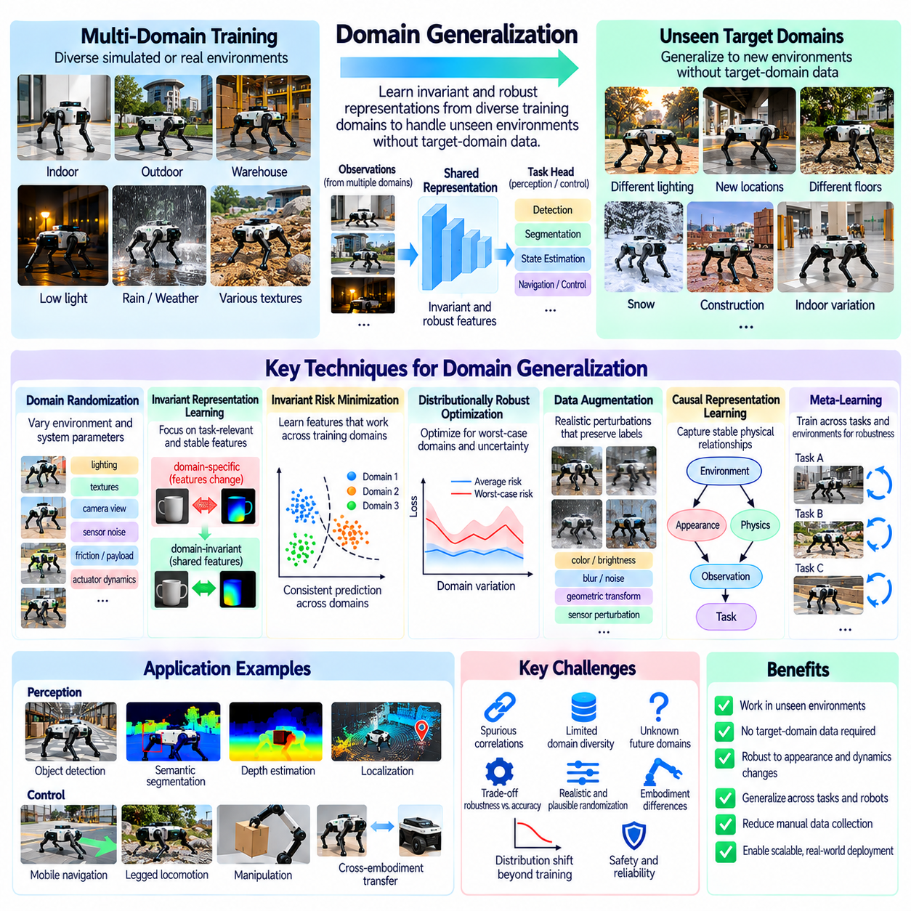{width="7.268055555555556in" height="7.268055555555556in"}

도메인 일반화(Domain Generalization)는 피지컬 AI(Physical AI) 시스템이 타깃 도메인 데이터(Target-Domain Data)에 접근하지 않고도 학습 과정에서 경험하지 못한 환경에서 신뢰할 수 있는 성능을 발휘하도록 한다. 특정 배포 환경(Deployment Environment)의 정보를 활용하는 도메인 적응(Domain Adaptation)과 달리 도메인 일반화는 알려지지 않은 조건에서도 효과적으로 작동하는 표현(Representations)과 정책(Policies)을 학습한다. 이러한 능력은 다양하고 예측하기 어려운 물리적 환경(Physical Environments)에서 작동하는 로봇에 필수적이다.

핵심적인 과제는 학습 환경(Training Environments)에 포함된 상관관계(Correlations)가 실제 배포 환경에서는 유지되지 않을 수 있다는 점이다. 인식 모델(Perception Model)은 객체의 기본적인 구조(Underlying Structure)를 학습하기보다 특정 텍스처(Textures), 색상(Colors), 조명 패턴(Lighting Patterns)을 객체와 연관 지을 수 있다. 마찬가지로 제어 정책(Control Policy)은 특정 마찰(Friction)이나 액추에이터 특성(Actuator Characteristics)에 의존할 수 있다. 도메인 일반화는 강건한 작업 수행(Robust Task Execution)에 필요한 정보를 보존하면서 이러한 부수적인 관계(Incidental Relationships)에 대한 의존성을 줄이고자 한다.

다중 도메인 학습(Multi-Domain Training)은 도메인 일반화의 기본적인 접근법이다. 모델은 서로 다른 시각적 특성(Visual Properties), 기하학적 특성(Geometric Properties), 물리적 특성(Physical Properties)을 가진 여러 시뮬레이션 환경(Simulated Environments)이나 실제 환경(Real Environments)에서 수집된 관측값으로 학습한다. 다양한 도메인에 노출되면 여러 조건에서 유용하게 유지되는 공유 패턴(Shared Patterns)을 학습하도록 유도된다. 그러나 실제 배포 환경의 중요한 변화가 학습 분포(Training Distribution)에 포함되지 않았다면 다양성만으로 일반화가 보장되지는 않는다.

도메인 무작위화(Domain Randomization)는 환경 및 시스템 매개변수(Environmental and System Parameters)를 변화시켜 학습 다양성(Training Diversity)을 확대한다. 조명(Lighting), 텍스처(Textures), 카메라 시점(Camera Viewpoints), 객체 배치(Object Arrangements), 센서 잡음(Sensor Noise), 마찰(Friction), 탑재 하중(Payloads), 액추에이터 응답(Actuator Response)을 현실적으로 가능한 범위(Plausible Ranges)에서 무작위화할 수 있다. 목표는 정책이 제한된 시뮬레이션 특성(Simulation Characteristics)에 의존하지 않도록 하는 것이다. 비현실적인 조합은 학습 효율(Learning Efficiency)을 저하시킬 수 있으므로 무작위화 분포(Randomization Distributions)는 물리적으로 의미 있는 범위를 유지해야 한다.

불변 표현 학습(Invariant Representation Learning)은 환경 전반에서 작업 관련 의미(Task-Relevant Meaning)를 유지하는 특징(Features)을 식별하고자 한다. 시각 인식(Visual Perception)에서는 객체 기하학(Object Geometry)과 공간 관계(Spatial Relationships)가 배경 텍스처(Background Textures)나 조명(Illumination)보다 전이 가능성이 높을 수 있다. 제어(Control)에서는 물리적 제약조건(Physical Constraints)과 행동 결과(Action Consequences)가 특정 액추에이터 매개변수(Actuator Parameters)보다 안정적일 수 있다. 그러나 일부 환경 변화는 올바른 행동에 직접적인 영향을 미치므로 불변성(Invariance)을 학습할 때는 주의가 필요하다.

불변 위험 최소화(Invariant Risk Minimization)는 학습 도메인(Training Domains) 전반에서 효과적으로 유지되는 예측 관계(Predictive Relationships)를 모델이 식별하도록 유도한다. 평균 성능(Average Performance)만 최적화하는 대신 환경 변화(Environmental Changes)에서도 일관된 예측(Consistent Predictions)을 지원하는 표현을 선호한다. 실제로는 최적화(Optimization)가 어려울 수 있으며, 겉으로 드러나는 불변성이 경험하지 못한 조건(Unseen Conditions)까지 확장되지 않을 수 있다. 따라서 학습된 특징을 진정한 도메인 독립적 특징(Domain-Independent Features)으로 해석하기 전에 엄격한 평가(Strong Evaluation)가 필요하다.

분포 강건 최적화(Distributionally Robust Optimization)는 데이터 분포(Data Distribution)의 불리한 변화에 대응하는 성능을 개선하여 불확실성(Uncertainty)을 다룬다. 평균 학습 손실(Average Training Loss)만 최소화하는 대신 어려운 도메인(Difficult Domains)이나 발생 가능한 대체 분포(Plausible Alternative Distributions)를 고려한다. 이를 통해 드문 운영 조건(Rare Operating Conditions)과 충분히 대표되지 않은 환경(Underrepresented Environments)에 대한 취약성을 줄일 수 있다. 그러나 최악 조건 성능(Worst-Case Performance)을 지나치게 강조하면 일반적인 상황에서 효율성(Efficiency)이나 정확도(Accuracy)가 저하될 수 있다.

데이터 증강(Data Augmentation)은 완전히 새로운 환경을 수집하지 않고도 일반화 성능(Generalization Performance)을 개선하는 또 다른 메커니즘을 제공한다. 영상에는 현실적인 색상(Color), 밝기(Brightness), 흐림(Blur), 잡음(Noise) 변화를 적용할 수 있으며, 센서 측정값(Sensor Measurements)은 장치 특성(Device Characteristics)에 따라 교란할 수 있다. 데이터 증강은 작업 레이블(Task Labels)과 물리적 관계(Physical Relationships)를 보존해야 한다. 장애물을 제거하거나 접촉 기하학(Contact Geometry)을 왜곡하는 변환은 잘못된 학습 신호(Incorrect Training Signals)를 생성할 수 있다.

인과 표현 학습(Causal Representation Learning)은 안정적인 물리적 관계(Stable Physical Relationships)와 표면적인 상관관계(Superficial Correlations)를 구분하고자 한다. 로봇은 객체 운동(Object Motion)이 배경 외형(Background Appearance)이 아니라 가해진 힘(Applied Forces)과 접촉 조건(Contact Conditions)에 따라 달라진다는 사실을 인식해야 한다. 인과 추론(Causal Reasoning)은 시각적 특성이 서로 다른 환경 사이에서 지식을 전이하는 데 도움이 될 수 있다. 그러나 관측 데이터(Observational Data)만으로 인과 구조(Causal Structure)를 식별하는 것은 어려우며, 개입(Interventions)이나 물리적 가정(Physical Assumptions)이 필요한 경우가 많다.

메타학습(Meta-Learning)은 관련된 작업(Tasks)과 환경(Environments)의 집합에 걸쳐 모델을 학습시켜 도메인 일반화를 지원할 수 있다. 학습 과정에서 모델은 조건 변화를 반복적으로 경험하며 이러한 변화 전반에서 강건한 행동(Robust Behavior)을 지원하는 매개변수(Parameters)를 학습한다. 일부 방법은 학습 데이터의 부분집합(Training Subsets) 사이에서 도메인 변화(Domain Shifts)를 모의하여 전이 가능한 지식(Transferable Knowledge)을 학습하도록 유도한다. 메타학습의 효과는 이러한 모의 변화가 실제 배포 과정의 중요한 과제(Deployment Challenges)와 얼마나 유사한지에 따라 달라진다.

로봇 인식(Robotic Perception)에서 도메인 일반화는 익숙하지 않은 환경 전반에 걸쳐 객체 검출(Object Detection), 의미적 분할(Semantic Segmentation), 깊이 추정(Depth Estimation), 위치추정(Localization)을 지원한다. 학습에는 조명(Illumination), 기상 조건(Weather), 장면 기하학(Scene Geometry), 센서 특성(Sensor Characteristics)의 변화를 포함해야 한다. 모델은 안정적인 공간 정보(Spatial Information)와 의미적 정보(Semantic Information)를 우선적으로 활용해야 한다. 평가에서는 익숙하지 않은 여러 조건이 동시에 발생할 때도 성능이 신뢰할 수 있는 수준으로 유지되는지 확인해야 한다.

로봇 제어(Robotic Control)에서 일반화는 불확실한 동역학(Uncertain Dynamics), 탑재 하중 변화(Payload Changes), 표면 마찰(Surface Friction), 외부 교란(External Disturbances)을 견딜 수 있는 정책을 요구한다. 강건 제어 목적함수(Robust Control Objectives)와 무작위화된 시뮬레이션(Randomized Simulation)은 정책을 광범위한 물리적 조건(Physical Conditions)에 노출할 수 있다. 그러나 어떤 정책도 무제한적인 변화에 안전하게 대응할 수는 없다. 조건이 검증된 능력(Validated Capabilities)을 초과하는 경우를 대비하여 명시적인 운영 경계(Operating Boundaries)와 대체 제어기(Fallback Controllers)가 필요하다.

이종 로봇 신체 일반화(Cross-Embodiment Generalization)는 이러한 원리를 서로 다른 기계적 구조(Mechanical Structures)와 센싱 구성(Sensing Configurations)을 가진 로봇으로 확장한다. 공유 작업 표현(Shared Task Representations)은 특정 관절 배열(Joint Arrangements)과 독립적으로 목표를 인코딩할 수 있으며, 형태 인식 정책(Morphology-Aware Policies)은 하드웨어 제약조건(Hardware Constraints)을 반영한다. 여러 로봇 설계(Robot Designs)에 걸친 학습은 익숙하지 않은 플랫폼(Unfamiliar Platforms)으로의 전이를 개선할 수 있다. 그러나 서로 다른 신체 구조(Embodiments)가 동일한 행동을 지원하지 못할 수 있으므로 물리적 실행 가능성(Physical Feasibility)은 반드시 검증해야 한다.

평가(Evaluation)에는 학습에 사용된 환경과 의미 있는 차이를 가진 제외 도메인(Held-Out Domains)을 사용해야 한다. 시험에서는 조명(Lighting), 센서 잡음(Sensor Noise), 객체 재료(Object Materials), 로봇 동역학(Robot Dynamics), 복합 교란(Combinations of Disturbances)을 변화시킬 수 있다. 평가 지표(Metrics)에는 작업 성공률(Task Success), 최악 도메인 성능(Worst-Domain Performance), 실패 빈도(Failure Frequency), 안전 위반(Safety Violations)이 포함되어야 한다. 유사한 환경이 학습 집합과 시험 집합 모두에 포함되는 무작위 학습-시험 분할(Random Train-Test Splits)은 도메인별 편법적 특징(Domain-Specific Shortcuts)에 대한 의존성을 숨길 수 있으므로 충분하지 않다.

궁극적으로 도메인 일반화(Domain Generalization)는 실제 배포 조건(Deployment Conditions)이 예상과 다르더라도 능력을 유지하는 피지컬 AI 시스템을 개발하는 것을 목표로 한다. 다중 도메인 학습(Multi-Domain Learning), 무작위화(Randomization), 불변 표현(Invariant Representations), 강건 최적화(Robust Optimization), 인과 추론(Causal Reasoning)은 상호 보완적인 전략을 제공한다. 이러한 방법의 효과는 현실적인 학습 다양성(Realistic Training Diversity), 물리적 제약조건(Physical Constraints)의 보존, 실제로 익숙하지 않은 조건(Genuinely Unfamiliar Conditions)에서의 체계적인 평가(Systematic Evaluation)에 달려 있다.

## 04.14. Domain Adaptation Example [w/Code]

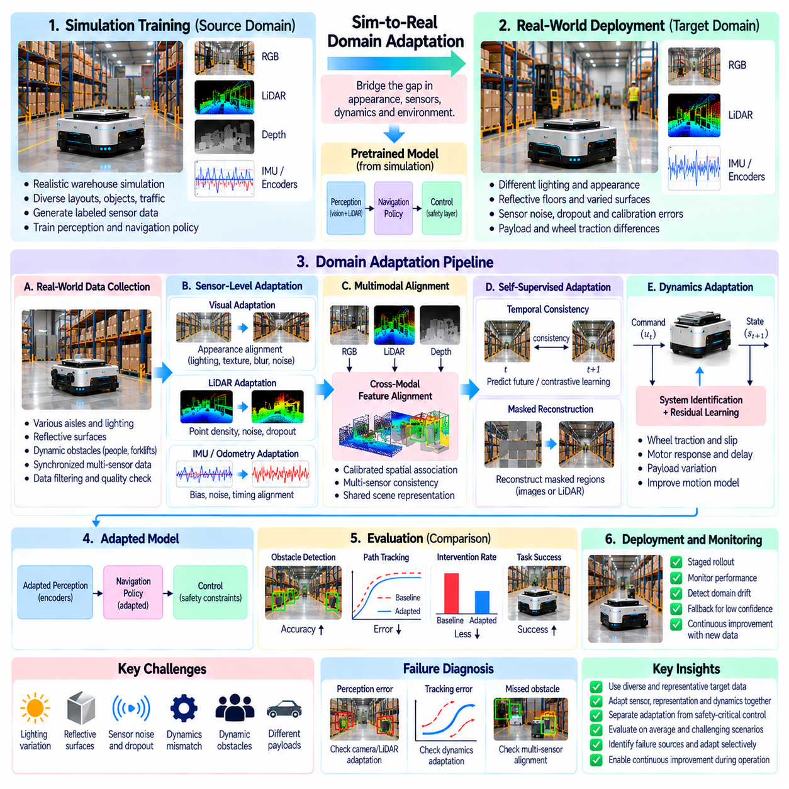{width="7.268055555555556in" height="7.268055555555556in"}

실용적인 도메인 적응(Domain Adaptation) 사례는 시뮬레이션에서 학습한 후 실제 물류창고(Real Warehouse)에 배포되는 자율이동로봇(Autonomous Mobile Robot)을 중심으로 구성할 수 있다. 로봇은 RGB 카메라(RGB Cameras), 라이다(LiDAR), 휠 엔코더(Wheel Encoders), 관성 센서(Inertial Sensors)를 사용하여 통로를 주행하고 장애물을 회피한다. 내비게이션 정책(Navigation Policy)이 시뮬레이션에서는 우수한 성능을 보이더라도 실제 배포 환경에서는 조명(Lighting), 바닥 반사율(Floor Reflectivity), 센서 잡음(Sensor Noise), 바퀴 접지력(Wheel Traction)의 차이가 발생하여 신뢰성이 저하될 수 있다.

초기 시뮬레이션 환경(Initial Simulation Environment)은 물류창고의 기하학적 구조(Warehouse Geometry), 선반(Shelving), 팔레트(Pallets), 이동 장비(Mobile Equipment), 보행자 통행(Pedestrian Traffic)을 표현한다. 로봇이 다양한 운영 조건(Operating Conditions)에서 계획된 경로(Planned Routes)를 따라 이동하는 동안 합성 센서 관측값(Synthetic Sensor Observations)이 생성된다. 학습 과정에서는 장애물을 인식하고 주행 가능 공간(Traversable Space)을 추정할 수 있는 인식 및 내비게이션 모델(Perception and Navigation Models)을 생성한다. 그러나 시뮬레이터(Simulator)는 실제 물류창고의 모든 특성을 완벽하게 재현할 수는 없다.

적응 이전에는 기준 성능 평가(Baseline Evaluation)를 통해 시뮬레이션에서 학습한 시스템이 실제 하드웨어(Real Hardware)에서 어떻게 작동하는지 확인한다. 로봇은 통제된 내비게이션 시험(Controlled Navigation Trials)을 수행하면서 카메라 영상(Camera Images), 라이다 스캔(LiDAR Scans), 위치추정 결과(Localization Estimates), 제어 명령(Control Commands), 안전 이벤트(Safety Events)를 기록한다. 측정 항목에는 장애물 검출 정확도(Obstacle Detection Accuracy), 경로 추종 오차(Path Tracking Error), 개입 빈도(Intervention Frequency), 작업 완료(Task Completion)가 포함된다. 이러한 결과는 이후 적응을 통한 성능 개선을 평가하기 위한 기준을 제공한다.

데이터 수집(Data Collection)은 단순한 기록량(Recording Volume)보다 타깃 도메인의 대표적인 조건(Representative Target-Domain Conditions)에 초점을 맞춘다. 로봇은 다양한 통로(Aisles), 조명 수준(Illumination Levels), 반사성 표면(Reflective Surfaces), 적재 구성(Loading Configurations), 보행자 움직임(Pedestrian Movements)을 관측한다. 센서 스트림(Sensor Streams)은 동기화되고 로봇 자세(Robot Poses) 및 운영 상태(Operating States)와 연결된다. 데이터 품질 검사(Data Quality Checks)는 관측값이 적응 파이프라인(Adaptation Pipeline)에 입력되기 전에 손상된 측정값(Corrupted Measurements), 보정 오차(Calibration Errors), 불완전한 기록(Incomplete Recordings)을 식별한다.

시각적 도메인 적응(Visual Domain Adaptation)은 렌더링된 물류창고 영상(Rendered Warehouse Images)과 실제 카메라 관측값(Real Camera Observations) 사이의 차이를 해결한다. 합성 영상(Synthetic Images)은 균일한 조명(Uniform Lighting)과 단순화된 표면 텍스처(Simplified Surface Textures)를 포함할 수 있지만 실제 장면에는 그림자(Shadows), 눈부심(Glare), 움직임 흐림(Motion Blur)이 존재한다. 영상 수준 변환(Image-Level Transformations)은 시각적 유사성(Visual Similarity)을 높일 수 있으며, 특징 수준 정렬(Feature-Level Alignment)은 도메인 불변 표현(Domain-Invariant Representations)을 학습하도록 유도한다. 적응 과정에서는 장애물 경계(Obstacle Boundaries)와 공간 관계(Spatial Relationships)를 보존해야 한다.

라이다 적응(LiDAR Adaptation)은 점 밀도(Point Density), 거리 잡음(Range Noise), 반사율(Reflectivity), 측정 누락(Missing Measurements)의 차이를 해결한다. 실제 스캔(Real Scans)에는 어두운 표면(Dark Surfaces)에서 희소한 반사 신호(Sparse Returns)가 나타나거나 반사성 재료(Reflective Materials) 주변에서 신뢰할 수 없는 관측값이 포함될 수 있다. 시뮬레이션 모델(Simulation Model)은 현실적인 측정 누락(Dropout)과 측정 불확실성(Measurement Uncertainty)을 도입할 수 있다. 또한 기하학적 특징 인코더(Geometric Feature Encoder)는 도메인 전반에서 구조적 정보(Structural Information)가 일관되게 유지된다는 조건에서 레이블이 없는 실제 스캔(Unlabeled Real Scans)을 사용하여 적응할 수 있다.

다중모달 정렬(Multimodal Alignment)은 시각적 표현(Visual Representations)과 기하학적 표현(Geometric Representations)이 서로 호환되는 물리적 구조(Physical Structures)를 설명하도록 보장한다. 카메라 특징(Camera Features)은 보정된 공간 변환(Calibrated Spatial Transformations)을 통해 라이다 포인트(LiDAR Points)와 연결될 수 있다. 모달 간 일관성 목적함수(Cross-Modal Consistency Objectives)는 대응하는 관측값이 장애물(Obstacles)과 자유 공간(Free Space)에 대해 유사한 해석을 지원하도록 유도한다. 로봇의 움직임으로 인해 센서 사이에 겉보기 불일치(Apparent Disagreement)가 발생할 수 있으므로 정확한 타임스탬프 정렬(Timestamp Alignment)이 필수적이다.

자기 지도 적응(Self-Supervised Adaptation)은 레이블이 없는 물류창고 관측값(Unlabeled Warehouse Observations)을 사용하여 학습된 표현(Learned Representations)을 개선한다. 연속된 영상(Consecutive Images)은 시간적 대응 관계(Temporal Correspondence)를 제공하며, 라이다 기하학(LiDAR Geometry)은 공간적 일관성 제약조건(Spatial Consistency Constraints)을 지원한다. 로봇은 미래 특징(Future Features)을 예측하거나 마스킹된 센서 정보(Masked Sensor Information)를 복원하도록 학습할 수 있다. 이러한 보조 목적함수(Auxiliary Objectives)는 수동 주석(Manual Annotation)에 대한 의존성을 줄이지만, 실제 내비게이션 성능(Actual Navigation Performance)을 기준으로 개선 효과를 검증해야 한다.

동역학 적응(Dynamics Adaptation)은 시뮬레이션된 바퀴 운동(Simulated Wheel Motion)과 실제 차량 동작(Real Vehicle Behavior) 사이의 불일치를 해결한다. 탑재 하중(Payload), 바닥 마찰(Floor Friction), 모터 응답(Motor Response), 바퀴 미끄러짐(Wheel Slip)의 변화는 인식이 정확하더라도 추종 오차(Tracking Errors)를 발생시킬 수 있다. 통제된 운동 시험(Controlled Motion Trials)은 유효 접지력(Effective Traction)과 액추에이터 응답(Actuator Response)을 추정하기 위한 데이터를 제공한다. 업데이트된 운동 모델(Updated Motion Models)은 보수적인 속도 및 가속도 제한(Conservative Speed and Acceleration Limits)을 유지하면서 궤적 예측(Trajectory Prediction)을 개선할 수 있다.

적응 아키텍처(Adaptation Architecture)는 인식 업데이트(Perception Updates)를 안전 필수 운동 제어(Safety-Critical Motion Control)와 분리한다. 시각 및 기하학적 인코더(Visual and Geometric Encoders)는 수집된 타깃 도메인 데이터(Target-Domain Data)를 사용하여 오프라인(Offline)으로 미세 조정(Fine-Tuning)할 수 있다. 이후 후보 모델(Candidate Models)은 배포 전에 기록 데이터 재생(Recorded-Data Replay)과 시뮬레이션(Simulation)을 통해 평가된다. 검증된 내비게이션 제어기(Verified Navigation Controller)는 인식 신뢰도(Perception Confidence)가 불충분해질 경우에도 독립적인 충돌 제약조건(Collision Constraints), 비상 정지 기능(Emergency Stopping Functions), 대체 동작(Fallback Behavior)을 유지한다.

단계적 배포 절차(Staged Deployment Process)는 검증되지 않은 모델 동작(Unvalidated Model Behavior)이 도입될 위험을 줄인다. 초기 시험(Initial Trials)은 통행량이 제한되고 운영 경계(Operating Boundaries)가 정의된 통제된 물류창고 구역(Controlled Warehouse Sections)에서 수행된다. 적응된 모델(Adapted Models)은 동등한 조건(Equivalent Conditions)에서 기존 기준 모델(Original Baseline)과 비교된다. 성능은 개선 효과와 예상하지 못한 성능 퇴행(Unexpected Regressions)을 확인하기 위해 모니터링되며, 여기에는 드문 조명 조건(Rare Lighting Conditions)이나 센서 조건(Sensor Conditions)에서만 발생하는 실패도 포함된다.

평가(Evaluation)는 평균 성능(Average Performance)과 어려운 운영 시나리오(Difficult Operating Scenarios)를 모두 고려한다. 시험 조건(Test Conditions)에는 강한 반사(Bright Reflections), 어두운 통로(Dim Aisles), 부분적으로 가려진 장애물(Partially Occluded Obstacles), 변화하는 탑재 하중(Changing Payloads), 미끄러운 표면(Slippery Surfaces)이 포함된다. 평가 지표(Metrics)는 장애물 검출(Obstacle Detection), 위치추정 안정성(Localization Stability), 경로 추종(Path Tracking), 개입 빈도(Intervention Frequency), 충돌 관련 안전 이벤트(Collision-Related Safety Events)를 포함한다. 별도로 제외된 시험 경로(Held-Out Routes)는 적응이 학습에 사용된 데이터 범위를 넘어 일반화되는지 판단하는 데 도움이 된다.

이 사례는 적응이 선택적으로 수행되어야 하는 이유도 보여준다. 인식 오차(Perception Errors)가 카메라 노출(Camera Exposure)에서 발생한다면 바퀴 동역학(Wheel Dynamics)을 업데이트해도 근본적인 문제가 해결되지 않는다. 마찬가지로 바퀴 미끄러짐(Wheel Slip)으로 발생한 경로 추종 성능 저하(Poor Path Tracking)는 시각적 특징 정렬(Visual Feature Alignment)만으로 보정할 수 없다. 진단 분석(Diagnostic Analysis)은 관측된 실패(Observed Failures)가 센싱(Sensing), 표현 학습(Representation Learning), 상태추정(State Estimation), 물리적 제어(Physical Control) 중 어느 영역에서 발생하는지 식별해야 한다.

성공적인 검증(Successful Validation) 이후 물류창고 로봇은 통제된 개선 주기(Controlled Improvement Cycle)를 통해 추가적인 운영 데이터(Operational Data)를 반영할 수 있다. 새로운 관측값(New Observations)은 필터링(Filtering)과 분류(Categorization)를 거쳐 주기적인 오프라인 적응(Periodic Offline Adaptation)에 사용된다. 업데이트된 각 모델(Updated Model)은 배포 전에 확립된 성능 및 안전 기준(Established Performance and Safety Criteria)과 비교된다. 버전 추적(Version Tracking)과 롤백 절차(Rollback Procedures)는 예상하지 못한 성능 저하(Unexpected Degradation)가 나타날 경우 이전에 검증된 동작(Previously Validated Behavior)을 복원할 수 있도록 한다.

궁극적으로 이 물류창고 내비게이션 사례(Warehouse Navigation Example)는 도메인 적응(Domain Adaptation)이 단일 학습 알고리즘(Single Learning Algorithm)이 아니라 통합적인 엔지니어링 프로세스(Integrated Engineering Process)임을 보여준다. 시각적 정렬(Visual Alignment), 센서 모델링(Sensor Modeling), 자기 지도 학습(Self-Supervised Learning), 동역학 식별(Dynamics Identification), 통제된 배포(Controlled Deployment)는 시뮬레이션과 현실 사이의 격차(Simulation-to-Reality Gap)를 구성하는 서로 다른 측면을 해결한다. 신뢰할 수 있는 전이(Reliable Transfer)는 적절한 적응 메커니즘(Adaptation Mechanisms)을 선택하고 안전 경계(Safety Boundaries)를 보존하며 대표적인 실제 환경 시험(Representative Real-World Tests)을 통해 개선 효과를 검증하는 데 달려 있다.
