**Volume 05. Simulation and Sim2Real Transfer**

# Chapter 05. Massive Parallel Simulation

## 05.01. Why Massive Parallel Simulation

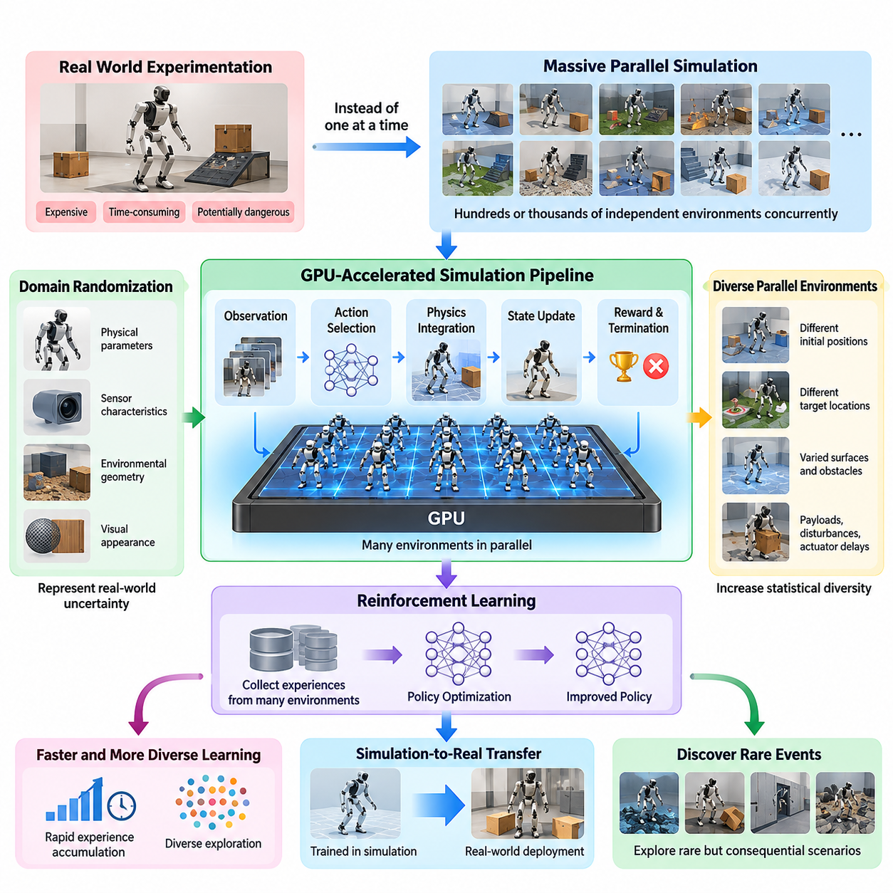{width="7.268055555555556in" height="7.268055555555556in"}

대규모 병렬 시뮬레이션(Massive Parallel Simulation)은 물리적 실험(Physical Experimentation)과 순차적 시뮬레이션(Sequential Simulation)의 한계를 넘어 피지컬 AI(Physical AI) 학습을 확장하기 위한 핵심 기술이다. 하나의 로봇 환경을 순차적으로 실행하는 대신, 수백 또는 수천 개의 독립적인 환경을 동시에 실행한다. 이를 통해 로봇 학습 시스템은 다양한 경험을 빠르게 축적하면서 정책 개발(Policy Development), 시험(Testing), 최적화(Optimization)에 필요한 시간을 단축할 수 있다.

물리적 로봇(Physical Robot)은 복잡한 동역학(Dynamics), 불확실한 접촉(Contact), 센서 불완전성(Sensor Imperfections), 예측하기 어려운 외부 교란(External Disturbances)의 영향을 받는 환경과 상호작용한다. 신뢰할 수 있는 행동을 학습하려면 이러한 조건의 다양한 변화에 노출되어야 한다. 실제 하드웨어만으로 충분한 경험을 수집하는 것은 비용과 시간이 많이 들고 위험할 수 있다. 대규모 병렬 시뮬레이션은 동일한 수의 실제 로봇 없이도 방대한 상호작용 데이터를 생성하는 계산적 대안을 제공한다.

전통적인 순차적 시뮬레이션(Sequential Simulation)은 관측(Observation), 행동 선택(Action Selection), 물리 적분(Physics Integration), 상태 갱신(State Update)의 반복 과정을 통해 개별 환경을 처리한다. 이러한 방식은 디버깅(Debugging)과 상세 분석에 유용하지만, 현대적인 강화학습(Reinforcement Learning) 알고리즘이 수백만 또는 수십억 단계의 상호작용을 요구할 때 처리량(Throughput)이 부족해진다. 병렬 시뮬레이션은 환경 실행을 여러 계산 자원에 분산하여 이러한 한계를 해결한다.

대규모 병렬 시뮬레이션의 근본적인 장점은 시뮬레이션 경험 생성(Simulated Experience Generation)을 실제 경과 시간(Wall-Clock Time)으로부터 분리할 수 있다는 점이다. 현실 세계에서 하나의 로봇은 특정 순간에 하나의 물리적 궤적(Physical Trajectory)만 경험할 수 있다. 반면 수천 개의 시뮬레이션 로봇 인스턴스(Robot Instance)는 서로 다른 궤적을 동시에 탐색할 수 있으므로, 학습 알고리즘은 비교적 짧은 계산 시간에 다양한 미래 상황의 경험을 수집할 수 있다.

강화학습(Reinforcement Learning)은 정책 최적화(Policy Optimization)가 에이전트(Agent)와 환경(Environment) 사이의 반복적인 상호작용에 의존하기 때문에 이러한 구조에서 특히 큰 이점을 얻는다. 각 시뮬레이션 로봇은 관측을 수신하고 행동을 실행하며 보상(Reward)과 상태 전이(State Transition)를 생성한다. 이러한 경험은 공유 정책(Shared Policy)을 갱신하는 학습 배치(Training Batch)로 통합된다. 동시 실행 환경의 수를 늘리면 데이터 수집 속도와 탐색 다양성(Exploration Diversity)을 향상시킬 수 있다.

병렬 실행(Parallel Execution)은 학습 경험의 통계적 다양성(Statistical Diversity)도 향상시킨다. 개별 환경은 서로 다른 초기 위치, 목표 지점, 물리적 교란 조건을 가질 수 있다. 일부 인스턴스는 미끄러운 표면을 경험하고, 다른 인스턴스는 장애물, 적재 하중 변화(Payload Variation), 구동기 지연(Actuator Delay)을 경험할 수 있다. 이러한 동시 노출은 변화하는 작동 조건에서도 효과적으로 동작하는 정책을 개발하는 데 도움이 된다.

대규모 병렬 시뮬레이션과 도메인 무작위화(Domain Randomization)의 관계는 시뮬레이션에서 현실로의 전이(Simulation-to-Real Transfer)에서 특히 중요하다. 도메인 무작위화는 현실 세계의 불확실성을 표현하기 위해 물리적 매개변수, 센서 특성, 환경 기하 구조, 시각적 외관을 변경한다. 병렬 시뮬레이션은 수많은 무작위 구성을 동시에 평가할 수 있도록 하여, 순차적 실행 없이도 학습 조건의 다양성을 크게 확대한다.

그래픽 처리 장치(Graphics Processing Unit, GPU)는 수천 개의 계산 실행 유닛(Computational Execution Unit)과 높은 대역폭의 메모리 시스템(High-Bandwidth Memory System)을 제공함으로써 시뮬레이션의 실질적인 확장성을 변화시켰다. GPU 기반 물리 엔진(GPU-Oriented Physics Engine)은 대규모 로봇 상태 배치, 충돌 상호작용, 수치 적분 연산을 처리할 수 있다. 시뮬레이션 데이터가 GPU 메모리에 상주하면 프로세서 사이의 데이터 전송을 줄여 전체 계산 효율을 높일 수 있다.

GPU 상주형 시뮬레이션(GPU-Resident Simulation)은 물리 엔진(Physics Engine), 관측 처리(Observation Processing), 정책 추론(Policy Inference), 학습 알고리즘(Learning Algorithm)이 통합된 계산 파이프라인(Computational Pipeline)에서 동작할 때 특히 유용하다. 로봇 상태를 배치형 텐서(Batched Tensor)로 표현하면 수천 개의 환경이 최적화된 수학 연산을 공유할 수 있다. 이러한 구조는 환경별 처리 부담을 줄이고 충분히 병렬화된 작업에서 시뮬레이션 처리량을 크게 향상시킨다.

대규모 병렬 시뮬레이션은 단순히 동일한 환경을 복제하는 기술이 아니다. 각 인스턴스는 독립적인 상태 변수(State Variable), 무작위 매개변수(Randomized Parameter), 작업 목표(Task Objective), 종료 조건(Termination Condition)을 유지할 수 있다. 휴머노이드(Humanoid) 학습 시스템은 보행, 균형 유지, 자세 회복, 교란 대응을 동시에 평가할 수 있다. 자율이동로봇(Autonomous Mobile Robot, AMR) 역시 서로 다른 장애물 배치, 교통 흐름, 노면 조건에서 내비게이션 전략(Navigation Strategy)을 탐색할 수 있다.

병렬 시뮬레이션은 접촉이 많은 로봇 작업(Contact-Rich Robotic Task)에 특히 유용하다. 안정적인 접촉 행동을 학습하려면 광범위한 실험이 필요하기 때문이다. 로봇 조작(Robotic Manipulation)은 그리퍼(Gripper), 물체, 마찰 표면, 외력 사이의 복잡한 상호작용을 포함한다. 다족 보행(Legged Locomotion)은 반복적인 발과 지면의 접촉 및 동적 균형 제약을 수반한다. 다양한 접촉 상황을 동시에 실행하면 학습 시스템은 더 넓은 물리적 조건에서 제어 전략을 발견할 수 있다.

또 다른 중요한 목적은 발생 빈도는 낮지만 결과가 중대한 희귀 사건(Rare Event)을 탐색하는 것이다. 실제 로봇의 고장은 드물게 발생할 수 있어 일반적인 운영 데이터만으로 포착하기 어렵다. 시뮬레이션은 비정상적인 교란 조합, 센서 오류(Sensor Error), 장애물, 구동기 제한(Actuator Limitation)을 의도적으로 생성할 수 있다. 병렬 실행을 통해 이러한 시나리오를 동시에 조사하면 실제 배포(Physical Deployment) 이전에 시스템의 취약점을 발견하는 데 도움이 된다.

시뮬레이션의 확장성은 로봇이 점진적으로 어려운 작업을 경험하는 커리큘럼 학습(Curriculum Learning)도 지원한다. 서로 다른 환경 그룹은 단순한 움직임부터 복잡한 상호작용까지 다양한 학습 단계를 표현할 수 있다. 학습이 진행되면 어려운 상황을 강조하도록 환경 분포(Environment Distribution)를 조정할 수 있다. 병렬 실행은 하나의 학습 과정에서 쉬운 시나리오와 어려운 시나리오가 동시에 존재하도록 한다.

강화학습 외에도 대규모 병렬 시뮬레이션은 인식(Perception), 계획(Planning), 멀티모달 로봇 지능(Multimodal Robot Intelligence)을 위한 합성 데이터 생성(Synthetic Data Generation)을 지원한다. 시뮬레이션 환경은 카메라 영상, 깊이 측정값(Depth Measurement), 라이다(LiDAR) 관측, 로봇 상태, 정답 주석(Ground-Truth Annotation)을 생성할 수 있다. 많은 환경을 동시에 실행하면 생성되는 장면과 행동의 범위가 확대되어 인식 모델, 월드 모델(World Model), 시각-언어-행동 모델(Vision-Language-Action Model, VLA)을 위한 데이터셋 구축에 도움이 된다.

대규모 시뮬레이션은 로봇 알고리즘의 평가 방식도 변화시킨다. 소수의 수동 선정 시나리오에서 제어기(Controller)를 시험하는 대신, 연구자는 수천 개의 독립적인 시험(Independent Trial)에 걸쳐 표준화된 평가를 수행할 수 있다. 이러한 시험은 작업 완료율(Task Completion Rate), 충돌 빈도(Collision Frequency), 에너지 소비(Energy Consumption), 궤적 품질(Trajectory Quality), 복구 성능(Recovery Performance)을 측정할 수 있다. 표본 수가 증가하면 신뢰성에 대한 근거가 강화되지만, 통계적 독립성과 시나리오 포괄성은 여전히 중요하다.

시뮬레이션 처리량(Simulation Throughput)은 일반적으로 초당 환경 단계(Environment Steps per Second), 초당 총 상태 전이 수(Aggregate Transitions per Second), 실제 경과 시간 대비 시뮬레이션 시간(Simulated Time Relative to Wall-Clock Time)으로 측정한다. 이러한 지표는 계산 성능의 서로 다른 측면을 나타낸다. 높은 상태 전이 처리율이 반드시 빠른 학습을 의미하지는 않는다. 정책 갱신 비용, 샘플 효율성(Sample Efficiency), 동기화 부담(Synchronization Overhead), 데이터 품질도 전체 학습 시간에 영향을 미친다.

따라서 병렬 환경의 수는 계산 자원과 학습 요구사항을 함께 고려하여 결정해야 한다. 환경 수를 늘리면 하드웨어 활용률(Hardware Utilization)이 높아질 수 있지만, 과도한 병렬화는 메모리 압박(Memory Pressure), 스케줄링 부담(Scheduling Overhead), 비효율적인 학습 배치를 초래할 수 있다. 일부 강화학습 알고리즘은 병렬 경험 수집이 최적화 효율을 저하시키지 않도록 궤적 길이(Trajectory Length)와 정책 갱신 빈도(Policy Update Frequency)를 신중하게 관리해야 한다.

메모리 관리(Memory Management)도 중요한 고려사항이다. 각 시뮬레이션 환경은 로봇 상태, 관절 변수(Joint Variable), 접촉 정보(Contact Information), 관측값, 작업별 매개변수를 저장해야 하기 때문이다. 고해상도 시각 센서와 복잡한 물리 장면은 메모리 사용량을 크게 증가시킬 수 있다. 효율적인 구현은 변경되지 않는 자산(Immutable Asset)을 공유하고 기하학적 표현(Geometric Representation)을 재사용하며, 상태 데이터를 병렬 처리에 적합한 압축된 구조로 구성한다.

병렬 시뮬레이션은 수치적 안정성(Numerical Stability)과 재현성(Reproducibility)에 관한 문제도 발생시킨다. 독립적인 환경은 서로 다른 접촉 구성, 솔버 수렴 특성(Solver Convergence Behavior), 부동소수점 연산 순서(Floating-Point Execution Order)를 경험할 수 있다. 난수 시드 관리(Random Seed Management)는 실험 조건의 재현에 도움이 되지만, 서로 다른 하드웨어나 시뮬레이션 구현에서 결정론적 결과(Deterministic Outcome)를 보장하지는 않는다. 따라서 신뢰할 수 있는 개발을 위해 체계적인 로그 기록, 통제된 실험, 명시적인 검증 절차가 필요하다.

계산 아키텍처(Computational Architecture)는 다중 GPU 실행(Multi-GPU Execution)과 분산 시뮬레이션 클러스터(Distributed Simulation Cluster)를 통해 단일 GPU를 넘어 확장될 수 있다. 서로 다른 프로세서나 계산 노드는 독립적인 환경 그룹을 관리하면서 중앙 집중형 또는 분산형 학습 시스템과 경험 데이터를 교환할 수 있다. 이러한 구조는 추가적인 확장 기회를 제공하지만 통신 지연(Communication Latency), 작업 부하 균형(Workload Balancing), 동기화(Synchronization), 인프라 비용(Infrastructure Cost)이 더욱 중요해진다.

클라우드 컴퓨팅(Cloud Computing)과 자체 구축형 클러스터(On-Premise Cluster)는 대규모 시뮬레이션을 위한 서로 다른 배포 모델(Deployment Model)을 제공한다. 클라우드 인프라는 일시적인 학습 작업과 광범위한 평가를 위해 탄력적인 계산 자원(Elastic Computing Resources)을 제공한다. 자체 구축형 시스템은 하드웨어를 직접 제어할 수 있으며 자원 활용 비용을 보다 예측 가능하게 관리할 수 있다. 아키텍처 선택에는 시뮬레이션 부하, GPU 가용성, 데이터 이동, 보안 요구사항, 장기 운영 경제성을 고려해야 한다.

대규모 병렬 시뮬레이션은 신속한 실험(Rapid Experimentation)을 통해 반복적인 개발도 지원한다. 엔지니어는 다양한 보상 함수(Reward Function), 제어기 구조(Controller Architecture), 관측 공간(Observation Space), 물리 매개변수 분포를 여러 동시 시험에서 비교할 수 있다. 이를 통해 가설 수립부터 실증 평가까지의 시간을 단축한다. 자동화된 실험 관리(Automated Experiment Management)는 유망한 구성을 식별하고 추가 계산 자원을 할당함으로써 효율을 더욱 높일 수 있다.

이러한 장점에도 불구하고 대규모 병렬 시뮬레이션이 시뮬레이션과 현실 사이의 격차(Sim-to-Real Gap)를 완전히 제거할 수는 없다. 시뮬레이션 환경은 실제 물리적 행동을 근사적으로 표현하므로, 부정확한 경험이 대량으로 생성되면 바람직하지 않은 제어 전략이 강화될 수 있다. 모델 충실도(Model Fidelity)나 매개변수 포괄성(Parameter Coverage)을 개선하지 않고 규모만 확대하면 시뮬레이션에서는 뛰어나지만 현실에서는 실패하는 정책이 생성될 수 있다. 따라서 확장성은 보정(Calibration) 및 물리적 검증(Physical Validation)과 결합되어야 한다.

가장 효과적인 개발 과정은 대규모 병렬 시뮬레이션을 시스템 식별(System Identification), 도메인 무작위화(Domain Randomization), 실제 환경 시험(Real-World Testing), 지속적인 모델 개선(Continuous Model Refinement)과 통합하는 것이다. 실제 로봇에서 측정한 데이터는 시뮬레이션 동역학과 센서 모델을 갱신하는 데 활용할 수 있으며, 시뮬레이션은 후속 실험의 방향을 결정하는 취약점을 드러낼 수 있다. 이러한 피드백 과정은 시뮬레이션을 독립적인 학습 도구에서 지속적으로 개선되는 피지컬 AI 개발 생명주기(Physical AI Development Lifecycle)의 구성 요소로 전환한다.

궁극적으로 대규모 병렬 시뮬레이션은 로봇 지능 개발의 경제성과 방법론을 변화시킨다. 연구자는 실제 물리적 실험만으로 합리적으로 확보하기 어려운 수준의 행동을 탐색하고, 다양한 조건을 평가하며, 방대한 학습 경험을 생성할 수 있다. 계산 규모(Computational Scale)가 현실적인 모델링(Realistic Modeling), 효율적인 학습 알고리즘(Efficient Learning Algorithm), 재현 가능한 평가(Reproducible Evaluation), 체계적인 시뮬레이션-현실 전이(Simulation-to-Real Transfer)와 결합될 때 그 가치가 극대화된다.

## 05.02. Vectorized and Batched Environments

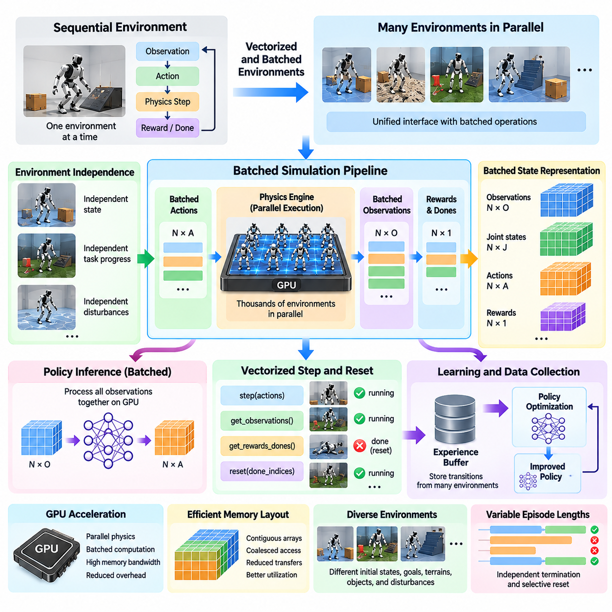{width="7.268055555555556in" height="7.268055555555556in"}

벡터화 환경(Vectorized Environment)과 배치형 환경(Batched Environment)은 피지컬 AI(Physical AI)의 대규모 병렬 시뮬레이션(Massive Parallel Simulation)을 위한 계산적 기반을 제공한다. 각 시뮬레이션 로봇을 독립적인 순차 실행 루프(Sequential Execution Loop)로 관리하는 대신, 여러 시뮬레이션 인스턴스(Simulation Instance)를 조정된 계산 구조로 구성한다. 이러한 접근 방식은 소프트웨어 처리 부담(Software Overhead)을 줄이고 하드웨어 활용률(Hardware Utilization)을 높이면서 많은 로봇을 동시에 실행할 수 있도록 한다.

전통적인 시뮬레이션 환경(Conventional Simulation Environment)은 일반적으로 하나의 로봇 상태(Robot State)를 유지하고, 하나의 행동(Action)을 처리하며, 물리 엔진(Physics Engine)을 진행시킨 후 하나의 관측값(Observation)을 반환한다. 수천 개의 환경을 독립적으로 실행하면 반복적인 함수 호출(Function Call), 메모리 전송(Memory Transfer), 스케줄링 작업(Scheduling Operation)으로 인해 상당한 처리 부담이 발생한다. 벡터화 환경은 여러 환경 인스턴스를 집합적으로 처리하는 통합 인터페이스(Unified Interface)를 제공하여 이러한 한계를 해결한다.

벡터화(Vectorization)의 기본 원리는 다수의 독립적인 환경을 하나의 구조화된 상태 및 행동 집합(Structured Collection of States and Actions)으로 표현하는 것이다. 하나의 로봇 위치나 속도 벡터를 저장하는 대신, 시뮬레이터는 모든 환경의 해당 값을 포함하는 배열(Array)을 유지한다. 제어 명령(Control Command) 적용, 관절 속도(Joint Velocity) 갱신, 보상(Reward) 계산 등의 작업은 최적화된 수치 연산 루틴(Optimized Numerical Routine)을 사용하여 전체 집합에 대해 수행할 수 있다.

배치형 환경은 일반적으로 병렬 인스턴스의 수를 나타내는 선행 차원(Leading Dimension)을 가진 텐서(Tensor)로 관측값을 표현한다. 예를 들어 로봇 4,096대가 있고 각 로봇에 48개의 관측 특성(Observation Feature)이 있다면, 관측값을 4,096 × 48 형태의 텐서로 구성할 수 있다. 이러한 표현을 통해 신경망(Neural Network)은 관측값을 일괄 처리할 수 있으며, 추론 효율(Inference Efficiency)을 높이고 반복 실행에 따른 처리 부담을 줄일 수 있다.

벡터화(Vectorization)와 배치 처리(Batching)의 차이를 이해하는 것은 중요하다. 벡터화는 통합 인터페이스를 통해 여러 환경에 연산을 적용하는 실행 전략(Execution Strategy)을 의미한다. 배치 처리는 데이터나 계산을 함께 처리할 수 있는 그룹으로 구성하는 방식을 의미한다. 두 개념은 자주 중첩되지만, 벡터화 인터페이스가 반드시 하드웨어의 동시 실행(Simultaneous Hardware Execution)을 보장하는 것은 아니며, 배치 연산도 환경 관리와 독립적으로 사용될 수 있다.

벡터화 시뮬레이션 아키텍처(Vectorized Simulation Architecture)는 일반적으로 집합적인 초기화(Reset), 단계 실행(Step), 관측(Observation), 보상(Reward) 연산을 제공한다. 하나의 단계 실행 요청(Step Request)은 모든 활성 환경에 행동을 전달하고, 시뮬레이션 동역학(Simulated Dynamics)을 진행시킨 후 갱신된 관측값, 보상, 종료 표시(Termination Indicator), 진단 정보(Diagnostic Information)를 반환한다. 이러한 인터페이스는 환경 수와 관계없이 일관된 경험 수집 구조를 제공하므로 강화학습 알고리즘(Reinforcement Learning Algorithm)과의 통합을 단순화한다.

실행이 벡터화되더라도 환경의 독립성(Environment Independence)은 반드시 유지되어야 한다. 각 시뮬레이션 로봇은 고유한 위치, 속도, 구동기 상태(Actuator State), 작업 진행 상태(Task Progress), 환경 조건(Environmental Condition)을 유지한다. 시뮬레이션 설계에서 명시적인 상호작용을 정의하지 않는 한, 한 환경에서 발생한 충돌이 다른 환경의 상태를 직접 변경해서는 안 된다. 벡터화 아키텍처는 개별 궤적(Individual Trajectory)의 논리적 분리를 유지하면서 실행을 조정한다.

배치형 상태 표현(Batched State Representation)은 환경들이 공통된 로봇 형태(Robot Morphology)와 관측 구조(Observation Structure)를 공유할 때 특히 효과적이다. 관절 위치(Joint Position), 관절 속도(Joint Velocity), 구동기 명령(Actuator Command), 센서 측정값(Sensor Measurement)을 일관된 차원의 밀집 텐서(Dense Tensor)에 저장할 수 있다. 이러한 구성은 효율적인 메모리 접근(Memory Access)을 지원하며 물리 계산, 제어 변환(Control Transformation), 보상 평가(Reward Evaluation)가 병렬 수치 연산을 활용하도록 한다.

그래픽 처리 장치(Graphics Processing Unit, GPU)는 다수의 데이터 요소에 유사한 수학 연산을 수행하므로 배치형 시뮬레이션(Batched Simulation)에 특히 적합하다. 수천 개의 로봇 인스턴스는 병렬 커널(Parallel Kernel) 내에서 상태 적분(State Integration), 구동기 갱신(Actuator Update), 특정 접촉 계산(Contact Computation)을 수행할 수 있다. 작업 규모가 충분히 크고 규칙적이라면 GPU 실행은 인스턴스별 계산 부담을 줄여 순차 처리보다 훨씬 높은 성능을 제공할 수 있다.

메모리 배치(Memory Layout)는 벡터화 시뮬레이션의 성능에 큰 영향을 미친다. 연속 배열(Contiguous Array)과 신중하게 구성된 텐서 차원(Tensor Dimension)은 메모리 접근 효율을 높이는 반면, 분산된 데이터 구조(Fragmented Data Structure)와 반복적인 메모리 할당(Repeated Allocation)은 불필요한 처리 부담을 발생시킨다. 시뮬레이션 개발자는 데이터 접근 패턴(Access Pattern)에 따라 저장 구조를 구성하며, 환경 중심 저장 방식과 구성요소 중심 배치 사이의 균형을 통해 GPU 메모리 병합 접근(Coalesced GPU Memory Access)을 개선한다.

시뮬레이션 단계(Simulation Step)는 일반적으로 공유 정책 신경망(Shared Policy Network)이 생성한 행동 배치(Action Batch)에서 시작된다. 이러한 행동은 해당 로봇 인스턴스에 연결되어 구동기(Actuator)에 적용된다. 물리 엔진은 하나 이상의 적분 단계(Integration Step)를 통해 각 환경을 진행시키고, 이후 센서 관측값과 작업 관련 변수(Task-Related Quantity)를 갱신한다. 결과 텐서는 경험 저장(Experience Storage)과 정책 최적화(Policy Optimization)를 위해 학습 시스템으로 반환된다.

실제 구현에서 중요한 문제 중 하나는 환경마다 서로 다른 시점에 종료된다는 점이다. 어떤 로봇은 작업을 완료했지만 다른 로봇은 계속 이동하거나 물체를 조작할 수 있다. 따라서 벡터화 환경에는 인스턴스별 종료 표시(Per-Instance Termination Indicator)와 선택적 초기화 메커니즘(Selective Reset Mechanism)이 필요하다. 완료되거나 실패한 인스턴스는 다른 환경을 중단하지 않고 다시 초기화할 수 있으므로 지속적인 경험 생성과 효율적인 계산 자원 활용이 가능하다.

선택적 초기화(Selective Reset)는 궤적 경계(Trajectory Boundary)를 신중하게 처리해야 한다. 종료 상태(Terminal State)에 연결된 관측값은 자동 초기화(Automatic Reset) 이후 생성된 관측값과 구별되어야 한다. 강화학습 알고리즘은 반환값(Return), 어드밴티지(Advantage), 부트스트랩 추정값(Bootstrap Estimate)을 계산할 때 이러한 구분에 의존한다. 종료 처리가 잘못되면 기본 시뮬레이션과 정책 계산이 정확하더라도 학습 편향(Training Bias)이 발생할 수 있다.

벡터화 환경은 개별 인스턴스에 서로 다른 매개변수를 할당하여 도메인 무작위화(Domain Randomization)를 자연스럽게 지원한다. 로봇 질량(Robot Mass), 마찰 계수(Friction Coefficient), 구동기 출력(Actuator Strength), 센서 잡음(Sensor Noise), 조명 조건(Lighting Condition), 지형 특성(Terrain Characteristic)을 배치 전체에서 다르게 설정할 수 있다. 무작위화 매개변수(Randomization Parameter)는 환경 초기화 시점이나 지정된 간격으로 샘플링하여 하나의 시뮬레이션 프로세스에서 다양한 물리적 조건을 표현할 수 있다.

배치형 보상 계산(Batched Reward Computation)은 또 다른 중요한 최적화 방법이다. 환경별 함수를 반복 호출하여 보상을 평가하는 대신, 시뮬레이터는 상태 텐서(State Tensor) 전체에 대해 보상 구성요소(Reward Component)를 계산한다. 추종 정확도(Tracking Accuracy), 에너지 소비(Energy Consumption), 충돌 페널티(Collision Penalty), 안정성 지표(Stability Measure), 작업 완료 표시(Task Completion Indicator)를 벡터화된 수학 표현으로 평가할 수 있다. 이를 통해 해석 실행 부담(Interpretation Overhead)을 줄이고 효율적인 강화학습 파이프라인을 지원한다.

배치형 환경과 정책 추론(Policy Inference)의 관계는 특히 중요하다. 공유 신경망(Shared Neural Network)은 수천 개 로봇의 관측값을 하나의 순전파(Forward Pass)로 입력받아 해당 행동을 생성할 수 있다. 이는 개별 관측값에 대해 신경망을 반복 실행하는 방식보다 계산 자원 활용률을 높인다. 그러나 추론 배치 크기(Inference Batch Size)는 메모리 용량(Memory Capacity), 지연시간 요구사항(Latency Requirement), 모델의 계산 특성(Computational Characteristic)을 고려하여 조정해야 한다.

벡터화 실행(Vectorized Execution)은 여러 아키텍처로 구현할 수 있다. CPU 기반 시스템(CPU-Based System)은 순차적 벡터화 인터페이스(Sequential Vectorized Interface), 다중 프로세스 작업자(Multiprocessing Worker), 공유 메모리 통신(Shared-Memory Communication)을 사용할 수 있다. GPU 기반 시스템(GPU-Based System)은 시뮬레이션 상태를 장치 메모리(Device Memory)에 직접 유지하고 배치형 물리 연산을 수행할 수 있다. 하이브리드 아키텍처(Hybrid Architecture)는 CPU 장면 관리와 GPU 가속을 결합하지만, 처리 장치 간 통신이 성능 병목(Bottleneck)이 될 수 있다.

CPU 다중 프로세싱(CPU Multiprocessing)은 환경에 복잡한 논리, 불규칙한 계산, 외부 소프트웨어 의존성(External Software Dependency)이 포함된 경우 유용하다. 각 작업자(Worker)는 독립적인 시뮬레이션 인스턴스 또는 소규모 환경 그룹을 실행할 수 있다. 그러나 프로세스 동기화(Process Synchronization), 프로세스 간 통신(Interprocess Communication), 관측값 직렬화(Observation Serialization)는 확장성을 제한할 수 있다. GPU 상주형 배치 처리(GPU-Resident Batching)는 환경이 규칙적인 계산 구조를 공유하고 많은 인스턴스가 필요한 경우 일반적으로 더 유리하다.

GPU 상주형 환경(GPU-Resident Environment)의 주요 장점은 관측값, 행동, 물리 상태, 보상을 학습 모델과 동일한 메모리 공간(Memory Space)에 유지할 수 있다는 것이다. CPU와 GPU 사이의 불필요한 데이터 전송을 제거하면 통신 부담(Communication Overhead)과 동기화 지연(Synchronization Delay)이 감소한다. 이러한 통합 아키텍처(Integrated Architecture)는 특히 수치 시뮬레이션(Numerical Simulation)이 중심이 되는 강화학습 작업에서 높은 처리량의 경험 수집(High-Throughput Experience Collection)을 지원할 수 있다.

그러나 벡터화(Vectorization)가 자동으로 선형적인 성능 확장(Linear Performance Scaling)을 제공하는 것은 아니다. 환경 수가 증가하면 결국 계산 유닛(Computational Unit), 메모리 대역폭(Memory Bandwidth), 장치 메모리(Device Memory)가 포화 상태에 도달할 수 있다. 복잡한 충돌 상호작용(Collision Interaction)과 불규칙한 접촉 패턴(Contact Pattern)도 실행 효율을 낮출 수 있다. 따라서 성능은 환경 수만이 아니라 전체 시뮬레이션 처리량(Aggregate Simulation Throughput), 메모리 소비량(Memory Consumption), 종단 간 학습 시간(End-to-End Training Time)을 기준으로 평가해야 한다.

개별 환경이 서로 다른 계산량을 요구할 때 작업 부하 불균형(Load Imbalance)이라는 또 다른 문제가 발생한다. 일부 로봇은 장애물이 없는 공간을 이동하지만, 다른 로봇은 수많은 충돌이나 복잡한 접촉 상호작용을 경험할 수 있다. 동기화 실행 모델(Synchronized Execution Model)에서는 처리 속도가 느린 인스턴스가 전체 단계의 완료를 지연시킬 수 있다. 효율적인 시뮬레이션 엔진은 작업 부하 구성(Workload Organization), 최적화된 솔버(Optimized Solver), 적절한 환경 그룹화(Environment Grouping)를 통해 이러한 영향을 최소화한다.

벡터화 환경은 체계적인 평가(Systematic Evaluation)와 벤치마킹(Benchmarking)도 단순화한다. 동일한 정책을 독립적으로 초기화된 다양한 시나리오에서 시험하면서 표준화된 성능 지표(Standardized Performance Metric)를 수집할 수 있다. 작업 성공률(Task Success Rate), 충돌 빈도(Collision Frequency), 궤적 길이(Trajectory Length), 에너지 소비(Energy Consumption), 복구 행동(Recovery Behavior)을 배치 전체에서 측정할 수 있다. 이는 통제된 조건에서 알고리즘을 비교하고 성능 분포(Performance Distribution)를 추정하기 위한 확장 가능한 기반을 제공한다.

재현성(Reproducibility)을 확보하려면 난수 생성(Random Number Generation)과 환경 초기화(Environment Initialization)를 명시적으로 관리해야 한다. 각 인스턴스에는 실험 구성(Experiment Configuration)에서 도출된 통제된 난수 시퀀스(Random Sequence) 또는 시드(Seed)를 할당해야 한다. 병렬 실행 순서와 하드웨어에 따른 수치 연산 특성은 여전히 결과에 변동을 일으킬 수 있으므로, 실험에서는 시뮬레이터 버전(Simulator Version), 매개변수 분포(Parameter Distribution), 난수 시드(Random Seed), 관련 계산 설정(Computational Setting)을 기록해야 한다.

실제 피지컬 AI 개발에서 벡터화 환경과 배치형 환경은 물리 시뮬레이션(Physics Simulation), 도메인 무작위화(Domain Randomization), 강화학습(Reinforcement Learning), 합성 데이터 생성(Synthetic Data Generation), 자동화 평가(Automated Evaluation)를 연결한다. 이러한 환경의 효과는 적절한 텐서 표현(Tensor Representation)을 선택하고, 동기화 비용(Synchronization Cost)을 최소화하며, 독립적인 환경 상태를 유지하고, 계산 작업 부하를 사용 가능한 하드웨어에 맞추는 데 달려 있다. 이러한 설계 원칙은 시뮬레이션 시스템을 개별 로봇 실험에서 대규모 학습 인프라(Large-Scale Learning Infrastructure)로 확장할 수 있도록 한다.

## 05.03. CPU vs GPU Parallel Simulation

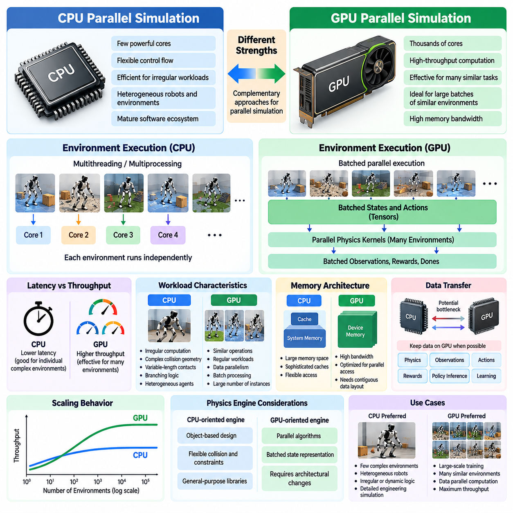{width="7.268055555555556in" height="7.268055555555556in"}

CPU 병렬 시뮬레이션(CPU Parallel Simulation)과 GPU 병렬 시뮬레이션(GPU Parallel Simulation)은 피지컬 AI(Physical AI)를 위한 물리 환경 실행(Physical Environment Execution)을 가속하는 상호 보완적인 두 가지 접근 방식이다. 중앙처리장치(Central Processing Unit, CPU)는 유연한 제어 흐름(Control Flow), 정교한 스케줄링(Scheduling), 불규칙한 작업 부하(Irregular Workload)의 효율적인 실행을 강조하는 반면, 그래픽처리장치(Graphics Processing Unit, GPU)는 다수의 유사한 연산에 대한 높은 처리량(High Throughput)을 강조한다. 이러한 차이를 이해하는 것은 성능, 정확도, 확장성, 개발 복잡성 사이의 균형을 유지하는 시뮬레이션 아키텍처(Simulation Architecture)를 선택하는 데 필수적이다.

CPU 기반 시뮬레이션(CPU-Based Simulation)은 전통적으로 범용 계산(General-Purpose Computation)에 최적화된 비교적 적은 수의 고성능 처리 코어(Processing Core)에 의존한다. 각 코어는 복잡한 명령어(Instruction), 조건 분기(Conditional Branch), 동적으로 변화하는 작업 부하를 효율적으로 실행할 수 있다. 이러한 아키텍처는 이기종 에이전트(Heterogeneous Agent), 복잡한 환경 논리(Environment Logic), 외부 소프트웨어 인터페이스(External Software Interface), 균일한 병렬 연산으로 구성하기 어려운 물리 계산을 포함하는 로봇 시뮬레이션에 특히 적합하다.

GPU 기반 시뮬레이션(GPU-Based Simulation)은 다수의 유사한 연산을 수많은 경량 실행 유닛(Lightweight Execution Unit)에 분산하는 다른 계산 방식을 사용한다. 개별 작업의 실행 지연시간(Execution Latency)을 최적화하기보다는 광범위한 데이터 병렬성(Data Parallelism)을 통해 전체 처리량(Aggregate Throughput)을 높이는 데 중점을 둔다. 따라서 수천 개의 로봇 인스턴스(Robot Instance)가 유사한 상태 표현(State Representation), 물리 계산(Physics Calculation), 제어 구조(Control Structure), 관측 처리 요구사항(Observation Processing Requirement)을 공유할 때 특히 효과적이다.

지연시간(Latency)과 처리량(Throughput)의 차이는 CPU 및 GPU 시뮬레이션 설계의 기본적인 요소이다. 지연시간은 개별 연산이나 시뮬레이션 단계(Simulation Step)를 완료하는 데 필요한 시간을 의미하며, 처리량은 단위 시간당 완료되는 전체 시뮬레이션 작업량을 나타낸다. CPU는 개별적으로 복잡한 환경을 처리할 때 장점을 제공할 수 있지만, GPU는 유사한 환경의 대규모 배치(Large Batch)가 동시에 실행될 때 훨씬 높은 전체 처리량을 제공할 수 있다.

CPU 병렬 시뮬레이션은 일반적으로 다중 스레딩(Multithreading), 다중 프로세싱(Multiprocessing), 분산 실행(Distributed Execution)을 사용하여 독립적인 환경을 실행한다. 각 작업자(Worker)는 자체 시뮬레이션 상태를 유지하고 스케줄링 메커니즘(Scheduling Mechanism)에 따라 실행을 진행한다. 이러한 방식은 기존 물리 엔진(Physics Engine)과 운영체제 기능을 활용하여 비교적 쉽게 구현할 수 있다. 그러나 환경 수가 증가하면 동기화 부담(Synchronization Overhead), 메모리 중복(Memory Duplication), 프로세스 간 통신(Interprocess Communication)이 중요한 문제가 될 수 있다.

GPU 병렬 시뮬레이션은 일반적으로 로봇 상태, 구동기 명령(Actuator Command), 접촉 정보(Contact Information), 관측값(Observation)을 구조화된 배열(Structured Array)이나 텐서(Tensor)로 구성한다. 물리 적분(Physics Integration)과 관련 연산은 여러 환경을 동시에 처리하는 병렬 커널(Parallel Kernel)을 통해 실행된다. 이러한 데이터 중심 아키텍처(Data-Oriented Architecture)는 반복적인 소프트웨어 처리 부담을 줄이고 높은 메모리 대역폭(Memory Bandwidth)을 활용하지만, 메모리 배치(Memory Layout), 커널 실행 효율(Kernel Execution Efficiency), 작업 부하의 규칙성(Workload Regularity)을 신중하게 고려해야 한다.

CPU 시뮬레이션의 주요 장점 중 하나는 불규칙한 계산 구조(Irregular Computational Structure)를 처리할 수 있다는 점이다. 복잡한 충돌 형상(Collision Geometry), 가변 길이 접촉 목록(Variable-Length Contact List), 분기형 작업 논리(Branching Task Logic), 이기종 로봇 모델(Heterogeneous Robot Model)은 환경마다 상당히 다른 계산 부하를 발생시킬 수 있다. CPU는 유연한 명령어 실행과 정교한 제어 메커니즘을 통해 이러한 차이에 효율적으로 대응할 수 있으므로, 상세한 공학 시뮬레이션(Engineering Simulation)과 특수 로봇 응용 분야에서 유용하다.

GPU는 많은 계산 스레드(Computational Thread)가 독립적인 데이터 요소에 대해 유사한 명령어를 실행할 때 가장 높은 효율을 달성한다. 불규칙한 분기(Irregular Branch)와 크게 달라지는 작업 부하는 실행 자원의 활용률을 낮출 수 있다. 접촉이 많은 로봇 작업(Contact-Rich Robotics)은 특히 어려운 문제를 제시한다. 충돌 검출(Collision Detection), 제약조건 해석(Constraint Solving), 접촉 응답(Contact Resolution)이 예측하기 어려운 계산 패턴을 생성하여 대규모 병렬 실행을 복잡하게 만들 수 있기 때문이다.

메모리 아키텍처(Memory Architecture)는 또 다른 중요한 차이를 만든다. CPU는 일반적으로 정교한 캐시 계층 구조(Cache Hierarchy)를 통해 대용량 시스템 메모리(System Memory)에 접근하는 반면, GPU는 병렬 접근에 최적화된 고대역폭 장치 메모리(High-Bandwidth Device Memory)에 의존한다. GPU 시뮬레이션의 성능은 상태 변수(State Variable)와 물리 매개변수(Physical Parameter)를 효율적인 메모리 트랜잭션(Memory Transaction)을 지원하는 연속적인 구조로 구성하는 데 크게 좌우된다. 메모리 구성이 부적절하면 병렬 실행의 예상 이점이 상당 부분 사라질 수 있다.

CPU와 GPU 사이의 데이터 전송(Data Transfer)은 하이브리드 시뮬레이션 파이프라인(Hybrid Simulation Pipeline)에서 상당한 병목 현상(Bottleneck)을 발생시킬 수 있다. 물리 계산은 GPU에서 실행하지만 관측값을 처리하기 위해 반복적으로 CPU로 반환해야 한다면 통신 부담(Communication Overhead)이 전체 처리량을 감소시킬 수 있다. GPU 상주형 시뮬레이션 아키텍처(GPU-Resident Simulation Architecture)는 가능한 경우 물리 상태, 관측값, 행동(Action), 보상(Reward), 신경망 계산(Neural Network Computation)을 장치 메모리 내부에 유지하여 이러한 한계를 해결한다.

물리 엔진 아키텍처(Physics Engine Architecture)는 CPU와 GPU 중 어느 실행 방식이 적합한지를 결정하는 데 큰 영향을 미친다. 전통적인 엔진은 CPU 중심의 충돌 검출, 제약조건 솔버(Constraint Solver), 객체 기반 데이터 구조(Object-Based Data Structure)를 사용하는 경우가 많다. GPU 중심 엔진은 이러한 구성요소를 병렬 알고리즘(Parallel Algorithm)과 배치형 상태 표현(Batched State Representation)에 맞게 재설계한다. 따라서 GPU 가속(GPU Acceleration)은 기존 CPU 코드를 그래픽처리장치로 단순히 이전하는 작업이 아니며, 상당한 아키텍처 변경이 필요할 수 있다.

시뮬레이션 환경의 수(Number of Simulated Environments)도 각 아키텍처의 상대적인 성능에 영향을 미친다. 소규모 작업 부하(Small Workload)는 GPU를 충분히 활용할 만큼의 병렬성을 제공하지 못할 수 있으므로 CPU 실행이 경쟁력을 유지하거나 더 빠를 수도 있다. 환경 수가 증가하면 계산 자원, 메모리 대역폭, 장치 용량(Device Capacity)이 포화될 때까지 GPU 활용률이 크게 향상될 수 있다. 최적의 성능 교차점(Performance Crossover Point)은 시뮬레이션 복잡성과 하드웨어 특성에 따라 달라진다.

강화학습(Reinforcement Learning)에서 GPU 시뮬레이션은 수천 개의 유사한 로봇 인스턴스를 통해 경험을 수집할 때 상당한 장점을 제공한다. 공유 정책 신경망(Shared Policy Network)은 배치형 관측값(Batched Observation)을 처리하고 GPU에서 직접 행동을 생성할 수 있다. 이후 시뮬레이션 엔진은 불필요한 프로세서 간 데이터 전송 없이 모든 환경을 진행시키고 새로운 학습 데이터를 생성한다. 이러한 통합 파이프라인(Integrated Pipeline)은 경험 생성 시간(Experience Generation Time)을 줄이고 반복적인 정책 최적화(Policy Optimization)를 가속할 수 있다.

CPU 시뮬레이션은 정교한 환경 논리, 계산 비용이 높은 렌더링(Expensive Rendering), 특수한 외부 의존성(External Dependency)을 포함하는 강화학습 작업에서도 여전히 중요하다. 다중 프로세싱 시스템(Multiprocessing System)은 사용 가능한 코어나 계산 노드(Computing Node)에 독립적인 환경을 분산할 수 있다. 매우 규칙적인 작업 부하에서는 전체 처리량이 낮을 수 있지만, CPU 아키텍처는 기존 시뮬레이터(Legacy Simulator), 계획 알고리즘(Planning Algorithm), 미들웨어(Middleware), 사용자 정의 작업 구성요소(Custom Task Component)를 통합할 때 더 높은 유연성을 제공하는 경우가 많다.

렌더링 요구사항(Rendering Requirement)은 CPU와 GPU 사이의 선택 기준을 크게 변화시킬 수 있다. 고충실도 카메라 시뮬레이션(High-Fidelity Camera Simulation), 광선 추적(Ray Tracing), 물리 기반 렌더링(Physically Based Rendering)은 GPU 가속의 이점을 얻는 경우가 많다. 그러나 수천 개의 고해상도 관측값을 렌더링하면 물리 계산 및 학습 작업과 GPU 메모리 및 계산 자원을 경쟁적으로 사용하게 된다. 따라서 일부 시스템은 렌더링, 물리 시뮬레이션, 신경망 학습을 서로 다른 프로세서나 장치에 분리하여 배치한다.

수치 정밀도(Numerical Precision)와 시뮬레이션 충실도(Simulation Fidelity)도 고려해야 한다. CPU와 GPU 구현은 서로 다른 부동소수점 연산 순서(Floating-Point Execution Order), 솔버 알고리즘(Solver Algorithm), 정밀도 설정(Precision Setting)을 사용할 수 있다. 이러한 차이는 접촉 동역학(Contact Dynamics), 적분 동작(Integration Behavior), 제약조건 만족도(Constraint Satisfaction)에 변화를 일으킬 수 있다. 어느 아키텍처도 본질적으로 더 높은 물리적 정확도를 보장하지 않으며, 충실도는 주로 수학적 모델(Mathematical Model), 수치해석 방법(Numerical Method), 솔버 구성(Solver Configuration), 실제 측정값을 이용한 검증(Validation)에 따라 결정된다.

결정론적 실행(Determinism)과 재현성(Reproducibility)은 병렬 실행에서 추가적인 문제를 제기한다. CPU 다중 스레딩은 비결정론적 스케줄링(Nondeterministic Scheduling)을 유발할 수 있으며, GPU 커널은 병렬 축약 연산 순서(Parallel Reduction Order)나 하드웨어 의존적 실행(Hardware-Dependent Execution)으로 인해 서로 다른 수치 결과를 생성할 수 있다. 신뢰할 수 있는 실험을 위해서는 통제된 난수 시드(Random Seed), 문서화된 소프트웨어 구성(Software Configuration), 일관된 평가 절차(Evaluation Procedure)가 필요하다. 서로 다른 아키텍처 사이에서 정확한 수치적 재현성이 보장된다고 가정해서는 안 된다.

에너지 효율(Energy Efficiency)은 아키텍처 선택에 영향을 미치는 또 다른 요소이다. GPU는 높은 활용률로 대규모의 규칙적인 작업 부하를 처리할 때 시뮬레이션 상태 전이당 에너지 소비량(Energy Consumption per Simulated Transition) 측면에서 유리할 수 있다. CPU는 GPU 자원을 효과적으로 활용하기 어려운 소규모, 불규칙하거나 지연시간에 민감한 작업(Latency-Sensitive Task)에서 더 효율적일 수 있다. 의미 있는 비교를 위해서는 완료된 시뮬레이션 작업량, 전체 시스템 전력(Total System Power), 메모리 사용량, 계산 인프라 유지 비용을 함께 고려해야 한다.

단일 프로세서를 넘어서는 확장성(Scalability)은 추가적인 설계 고려사항을 요구한다. CPU 환경은 다중 프로세싱과 클러스터 스케줄링(Cluster Scheduling)을 통해 여러 서버에 분산할 수 있으며, GPU 시뮬레이션은 다중 가속기(Multiple Accelerator)와 분산 학습 프레임워크(Distributed Learning Framework)를 통해 확장할 수 있다. 통신 부담, 부하 균형(Load Balancing), 메모리 복제(Memory Replication), 동기화(Synchronization)는 규모가 커질수록 더욱 중요해진다. 효과적인 확장을 위해서는 시뮬레이션 작업 부하를 사용 가능한 컴퓨팅 토폴로지(Computing Topology)에 맞추어야 한다.

하이브리드 CPU-GPU 아키텍처(Hybrid CPU-GPU Architecture)는 복잡한 피지컬 AI 시스템에서 가장 실용적인 균형을 제공하는 경우가 많다. CPU는 장면 구성(Scene Construction), 작업 조정(Task Orchestration), 외부 통신(External Communication), 불규칙한 의사결정 논리(Irregular Decision Logic)를 관리할 수 있으며, GPU는 배치형 물리 계산(Batched Physics), 센서 처리(Sensor Processing), 신경망 추론(Neural Network Inference)을 실행할 수 있다. 이러한 구성의 효과는 데이터 전송을 최소화하고 어느 처리 구성요소도 다른 구성요소를 반복적으로 기다리지 않도록 하는 데 달려 있다.

따라서 성능 평가(Performance Evaluation)는 단순한 초당 시뮬레이션 단계 수(Simulation Steps per Second)를 넘어야 한다. 중요한 측정 지표에는 전체 환경 처리량(Aggregate Environment Throughput), 단계별 지연시간(Per-Step Latency), 실시간 계수(Real-Time Factor), 메모리 소비량(Memory Consumption), 에너지 효율(Energy Efficiency), 전체 정책 학습 시간(Total Policy-Training Time)이 포함된다. 잘못된 비교를 방지하려면 동등한 로봇 모델, 물리 설정, 작업 조건, 관측 요구사항을 사용하여 벤치마킹(Benchmarking)을 수행해야 한다. 응용 분야별 측정(Application-Specific Measurement)은 일반화된 CPU 또는 GPU 성능 주장보다 더 신뢰할 수 있는 판단 근거를 제공한다.

CPU와 GPU 병렬 시뮬레이션 사이의 선택은 궁극적으로 로봇 작업 부하(Robotic Workload)의 구조와 목표에 따라 달라진다. CPU 실행은 유연성(Flexibility), 성숙한 소프트웨어 통합(Mature Software Integration), 불규칙한 계산의 효율적인 처리를 제공한다. GPU 실행은 대규모 데이터 병렬성(Large-Scale Data Parallelism)을 통해 높은 처리량의 학습(High-Throughput Learning)을 구현할 수 있는 상당한 기회를 제공한다. 신중하게 설계된 시뮬레이션 파이프라인에서 이러한 기능을 결합하면 피지컬 AI 시스템은 계산 확장성(Computational Scalability)과 실용적인 공학적 신뢰성(Engineering Reliability)을 동시에 달성할 수 있다.

## 05.04. GPU Resident Physics and Rendering

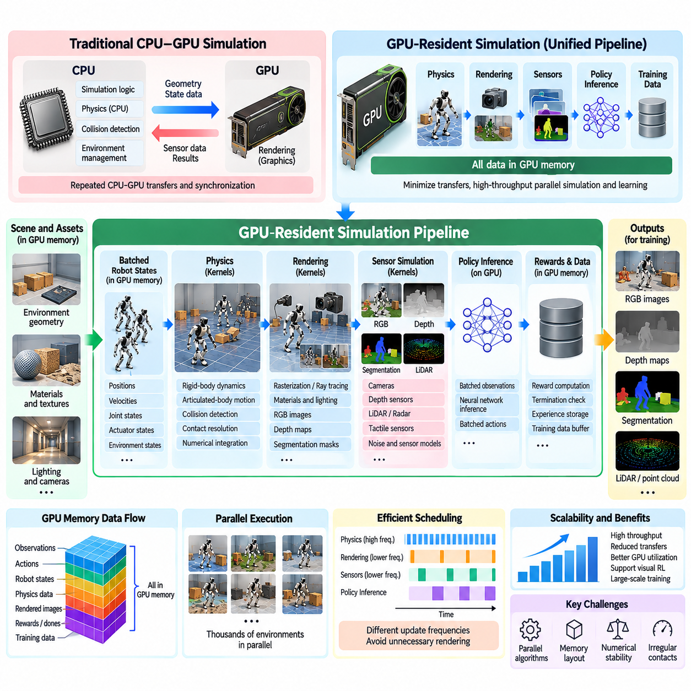{width="7.268055555555556in" height="7.268055555555556in"}

GPU 상주형 물리 시뮬레이션 및 렌더링(GPU-Resident Physics and Rendering)은 피지컬 AI(Physical AI)를 위한 대규모 병렬 시뮬레이션(Massive Parallel Simulation)에서 중요한 아키텍처 발전을 나타낸다. 시뮬레이션 상태(Simulation State), 물리 계산(Physics Computation), 센서 렌더링(Sensor Rendering), 학습 관련 데이터(Learning-Related Data)를 GPU 메모리 내부에 유지함으로써 중앙처리장치(CPU)와 그래픽처리장치(GPU) 사이의 비용이 높은 데이터 전송을 최소화한다. 이러한 통합 접근 방식은 수천 개의 로봇 환경을 동시에 실행하면서 높은 처리량의 경험 생성(High-Throughput Experience Generation)과 효율적인 신경망 학습(Neural-Network Training)을 지원한다.

전통적인 시뮬레이션 아키텍처(Traditional Simulation Architecture)는 CPU와 GPU 사이에 작업을 분리하는 경우가 많다. CPU는 물리적 상태(Physical State), 충돌 검출(Collision Detection), 시뮬레이션 논리(Simulation Logic)를 관리하고, GPU는 그래픽 렌더링(Graphics Rendering)을 수행한다. 이러한 분리 구조에서는 갱신된 기하 구조(Geometry), 센서 관측값(Sensor Observation), 제어 명령(Control Command)이 프로세서 경계를 통과할 때마다 반복적인 동기화(Synchronization)와 데이터 전송(Data Transfer)이 필요하다. 환경 수가 증가하면 통신 부담(Communication Overhead)이 전체 시뮬레이션 처리량(Simulation Throughput)을 제한하는 중요한 요인이 될 수 있다.

GPU 상주형 시뮬레이션(GPU-Resident Simulation)은 장치 메모리(Device Memory)를 중심으로 계산 파이프라인(Computational Pipeline)을 구성하여 이러한 병목 현상(Bottleneck)을 해결한다. 로봇 위치(Robot Position), 속도(Velocity), 관절 상태(Joint State), 구동기 명령(Actuator Command), 접촉 정보(Contact Information)는 GPU에서 접근할 수 있는 데이터 구조에 저장된다. 물리 커널(Physics Kernel)은 이러한 상태를 직접 갱신하며, 후속 렌더링 또는 관측 처리 연산은 불필요한 전송 없이 결과 데이터를 사용한다. 목표는 가속기(Accelerator) 내부에서 연속적인 계산 작업 흐름을 유지하는 것이다.

물리 시뮬레이션 구성요소(Physics Component)는 일반적으로 강체 동역학(Rigid-Body Dynamics), 관절체 운동(Articulated-Body Motion), 충돌 검출(Collision Detection), 접촉 해석(Contact Resolution), 수치 적분(Numerical Integration)을 포함한다. GPU 구현은 이러한 연산을 다수의 병렬 실행 유닛(Parallel Execution Unit)에 분산하여 많은 로봇 인스턴스(Robot Instance)를 동시에 진행시킨다. 효율적인 실행을 위해서는 기존 CPU 중심 물리 계산 루틴을 GPU 하드웨어로 단순히 이전하는 것이 아니라 데이터 병렬성(Data Parallelism)에 맞게 설계된 알고리즘이 필요하다.

상태 표현(State Representation)은 GPU 상주형 물리 시뮬레이션에서 핵심적인 역할을 한다. 시뮬레이션 데이터는 일반적으로 위치(Position), 자세(Orientation), 선속도(Linear Velocity), 각속도(Angular Velocity), 관절 좌표(Joint Coordinate), 구동기 상태(Actuator State)를 포함하는 밀집 배열(Dense Array)이나 텐서(Tensor)로 구성된다. 서로 다른 환경의 유사한 변수는 배치형 수학 연산(Batched Mathematical Operation)을 통해 처리할 수 있다. 이러한 구성은 메모리 접근 효율(Memory Access Efficiency)을 높이고 객체 지향 시뮬레이션 구조(Object-Oriented Simulation Structure)에서 발생하는 처리 부담을 줄인다.

충돌 검출(Collision Detection)은 접촉 상호작용(Contact Interaction)이 불규칙하고 장면 기하 구조(Scene Geometry)에 크게 의존하기 때문에 중요한 계산 문제를 제기한다. 광역 충돌 검출(Broad-Phase Collision Detection)은 잠재적으로 상호작용할 수 있는 물체 쌍을 식별하고, 정밀 충돌 검출(Narrow-Phase Collision Detection)은 상세한 접촉 정보를 결정한다. GPU 중심 구현은 공간 분할(Spatial Partitioning), 배치형 기하 검사(Batched Geometric Test), 후보 충돌 쌍(Candidate Collision Pair)의 효율적인 관리를 통해 이러한 연산을 병렬화하려고 한다.

접촉 해석(Contact Resolution)과 제약조건 해석(Constraint Solving)은 추가적인 복잡성을 발생시킨다. 로봇 보행(Robotic Locomotion)과 조작(Manipulation)은 마찰(Friction), 관절 제약조건(Joint Constraint), 충격력(Impact Force), 동시 접촉(Simultaneous Contact)을 자주 포함한다. GPU 솔버(GPU Solver)는 수치적 안정성(Numerical Stability)과 허용 가능한 물리적 정확도(Physical Accuracy)를 유지하면서 이러한 상호작용을 처리해야 한다. 병렬 제약조건 알고리즘(Parallel Constraint Algorithm)은 처리량을 향상시킬 수 있지만, 특히 접촉이 밀집된 장면에서는 수렴 특성(Convergence Behavior)과 동기화 요구사항(Synchronization Requirement)을 신중하게 고려해야 한다.

렌더링(Rendering)은 장면 기하 구조(Scene Geometry), 재질(Material), 조명 정보(Lighting Information), 카메라 매개변수(Camera Parameter)가 반복적인 CPU 전송 없이 그래픽 파이프라인(Graphics Pipeline)에서 사용될 수 있을 때 GPU 상주형으로 구현된다. 래스터화(Rasterization), 광선 추적(Ray Tracing), 물리 기반 렌더링(Physically Based Rendering)은 시뮬레이션 상태로부터 시각적 관측값(Visual Observation)을 직접 생성할 수 있다. 이러한 아키텍처는 물리 시뮬레이션과 그래픽 하위 시스템 사이의 통신을 줄이면서 합성 카메라 데이터 생성(Synthetic Camera Data Generation)과 시각 강화학습(Visual Reinforcement Learning)을 지원한다.

주요 설계 목표 중 하나는 물리 시뮬레이션(Physics Simulation)과 센서 렌더링(Sensor Rendering)을 효율적으로 연결하는 것이다. 갱신된 로봇 자세(Robot Pose)와 물체 변환(Object Transformation)은 렌더링 커널(Rendering Kernel)에서 직접 사용되어 RGB 영상(RGB Image), 깊이 맵(Depth Map), 분할 마스크(Segmentation Mask), 기타 시각적 출력(Visual Output)을 생성할 수 있다. 불필요한 상태 복제(State Duplication)와 메모리 전송을 방지하면 특히 수천 개의 독립적인 시뮬레이션 환경을 여러 카메라가 관측하는 경우 성능을 향상시킬 수 있다.

GPU 상주형 센서 시뮬레이션(GPU-Resident Sensor Simulation)은 일반적인 RGB 카메라를 넘어 확장된다. 깊이 센서(Depth Sensor), 라이다(LiDAR), 레이더(Radar), 일부 촉각 센싱 모델(Tactile Sensing Model)은 물리적 복잡성과 구현 방식에 따라 병렬 계산의 이점을 얻을 수 있다. 광선 기반 센서(Ray-Based Sensor)는 많은 독립적인 광선을 동시에 처리할 수 있으므로 GPU 가속에 특히 적합하다. 그러나 현실적인 잡음(Noise), 다중 경로 효과(Multipath Effect), 센서별 한계(Sensor-Specific Limitation)를 표현하려면 추가적인 모델링이 필요할 수 있다.

물리 시뮬레이션과 렌더링의 통합은 서로 다른 갱신 주기(Update Frequency)를 고려해야 한다. 물리 솔버(Physics Solver)는 여러 개의 짧은 적분 단계(Integration Step)를 통해 진행될 수 있지만, 카메라와 기타 센서는 더 낮은 샘플링 주파수(Sampling Rate)로 동작한다. 효율적인 시스템은 모든 물리 단계에서 완전한 영상을 생성하는 대신 관측값이 필요한 시점에만 렌더링을 수행하도록 스케줄링한다. 이러한 분리는 로봇 제어(Robotic Control)에 필요한 시간적 관계(Timing Relationship)를 유지하면서 불필요한 계산을 줄인다.

GPU 상주형 시뮬레이션은 정책 신경망(Policy Network)도 동일한 가속기에서 실행되는 강화학습(Reinforcement Learning)에 특히 유리하다. 시뮬레이션 상태에서 생성된 관측값은 신경망 추론(Neural-Network Inference)으로 직접 전달되고, 생성된 배치형 행동(Batched Action)은 다시 물리 엔진으로 전달된다. 보상(Reward), 종료 표시(Termination Indicator), 궤적 데이터(Trajectory Data)도 장치 메모리에 유지할 수 있다. 이를 통해 프로세서 동기화를 줄이고 긴밀하게 통합된 시뮬레이션-학습 파이프라인(Simulation-Learning Pipeline)을 지원한다.

수천 개의 유사한 환경이 동시에 실행될 때 계산상의 이점은 특히 커진다. GPU 커널(GPU Kernel)은 배치형 연산(Batched Operation)을 통해 로봇 상태를 갱신하고, 제어 명령을 평가하며, 보상을 계산하고, 관측값을 생성할 수 있다. 그러나 높은 처리량(High Throughput)을 달성하려면 충분한 병렬 작업 부하(Parallel Workload)를 유지하고, 커널 실행 부담(Kernel Launch Overhead)을 최소화하며, 시뮬레이션 단계 사이의 과도한 동기화를 방지해야 한다.

메모리 용량(Memory Capacity)은 GPU 상주형 시뮬레이션에서 가장 중요한 제약조건 중 하나이다. 모든 환경은 물리 상태(Physical State), 충돌 구조(Collision Structure), 센서 출력(Sensor Output), 임시 솔버 데이터(Temporary Solver Data)를 저장할 공간이 필요하다. 고해상도 렌더링(High-Resolution Rendering)은 특히 각 환경에서 여러 카메라가 동작하는 경우 상당한 메모리를 소비할 수 있다. 효율적인 구현은 정적 자산(Static Asset)을 공유하고, 버퍼(Buffer)를 재사용하며, 일부 표현을 압축하고, 중간 데이터(Intermediate Data)를 신중하게 관리한다.

메모리 대역폭(Memory Bandwidth)도 전체 성능에 영향을 미친다. GPU 계산 자원(Computational Resource)이 충분하더라도 대규모 텐서나 영상 버퍼(Image Buffer)를 자주 이동시키면 실행 속도가 제한될 수 있다. 데이터 배치(Data Layout)는 병합 메모리 접근(Coalesced Memory Access)을 지원해야 하며, 물리 시뮬레이션, 렌더링, 학습 구성요소 사이의 불필요한 복사를 방지해야 한다. 따라서 성능 최적화(Performance Optimization)에서는 산술 계산(Arithmetic Computation)만큼 데이터 이동(Data Movement)을 중요하게 고려해야 한다.

물리 시뮬레이션과 렌더링 작업은 동일한 GPU 자원을 놓고 경쟁할 수 있다. 복잡한 접촉 시뮬레이션(Contact Simulation)은 상당한 수치 계산(Numerical Computation)을 요구하며, 고충실도 렌더링(High-Fidelity Rendering)은 그래픽 처리 용량(Graphics Processing Capacity)과 메모리 대역폭을 소비한다. 신경망 학습(Neural-Network Training)은 텐서 계산(Tensor Computation)과 메모리에 대한 추가적인 수요를 발생시킨다. 효과적인 자원 관리(Resource Management)를 위해 단계별 실행(Staged Execution), 비동기 스케줄링(Asynchronous Scheduling), 작업 부하 분할(Workload Partitioning), 다중 GPU 분산(Multi-GPU Distribution)을 사용할 수 있다.

비동기 실행(Asynchronous Execution)은 독립적인 연산이 안전하게 중첩될 수 있을 때 자원 활용률(Utilization)을 높일 수 있다. GPU 스트림(GPU Stream)과 신중하게 설계된 동기화 메커니즘(Synchronization Mechanism)은 일부 렌더링, 전처리(Preprocessing), 학습 연산이 동시에 진행되도록 할 수 있다. 그러나 물리 상태와 센서 관측값 사이의 의존 관계(Dependency)는 정확하게 유지되어야 한다. 부분적으로 갱신된 상태를 읽거나 버퍼를 너무 일찍 재사용하면 일관성이 없는 학습 데이터와 진단하기 어려운 오류가 발생할 수 있다.

계산 가속에도 불구하고 시뮬레이션 충실도(Simulation Fidelity)는 여전히 중요한 고려사항이다. GPU 중심 물리 엔진은 처리량을 높이기 위해 단순화된 접촉 모델(Simplified Contact Model), 근사 솔버(Approximate Solver), 낮은 수치 정밀도(Reduced Numerical Precision)를 사용할 수 있다. 이러한 선택은 마찰 동작(Friction Behavior), 제약조건 만족도(Constraint Satisfaction), 동적 안정성(Dynamic Stability)에 영향을 미칠 수 있다. 따라서 GPU 상주형 시뮬레이션은 특히 정책이 실제 로봇을 제어하는 경우 물리적 측정값(Physical Measurement)을 기준으로 검증되어야 한다.

결정론적 실행(Determinism)과 재현성(Reproducibility) 역시 대규모 병렬 GPU 실행에서 해결하기 어려운 문제이다. 부동소수점 축약 연산(Floating-Point Reduction), 원자적 연산(Atomic Operation), 병렬 스케줄링(Parallel Scheduling), 솔버 실행 순서(Solver Ordering)는 실행마다 수치적 차이를 발생시킬 수 있다. 통제된 난수 시드(Random Seed)와 일관된 소프트웨어 구성(Software Configuration)은 실험 반복성(Experimental Repeatability)을 높이지만, 정확한 결정론적 동작이 항상 가능한 것은 아니다. 따라서 여러 시험에 걸친 통계적 평가(Statistical Evaluation)가 중요하다.

GPU 상주형 아키텍처(GPU-Resident Architecture)는 개별 환경에 서로 다른 질량(Mass), 마찰 계수(Friction Coefficient), 구동기 특성(Actuator Characteristic), 조명 매개변수(Lighting Parameter), 센서 속성(Sensor Property)을 할당하여 도메인 무작위화(Domain Randomization)를 지원할 수 있다. 이러한 변화는 전체 장면을 반복적으로 재구성하지 않고 배치형 매개변수 갱신(Batched Parameter Update)을 통해 적용할 수 있다. 무작위화된 물리 조건과 렌더링 조건을 결합하면 다양한 시뮬레이션 도메인(Simulated Domain)에서 학습할 수 있으며 더욱 강건한 시뮬레이션-현실 전이(Simulation-to-Real Transfer)를 지원한다.

이 아키텍처는 합성 데이터 생성(Synthetic Data Generation)을 위한 효율적인 기반도 제공한다. 수천 개의 시뮬레이션 장면(Simulated Scene)은 영상(Image), 깊이 측정값(Depth Measurement), 분할 레이블(Segmentation Label), 물체 자세(Object Pose), 로봇 궤적(Robot Trajectory)을 생성할 수 있다. 시뮬레이터가 내부 물리 상태(Internal Physical State)에 접근할 수 있으므로 정확한 주석(Annotation)을 자동으로 생성할 수 있는 경우가 많다. 이는 로봇 인식(Robotic Perception), 조작(Manipulation), 내비게이션(Navigation), 멀티모달 학습(Multimodal Learning)을 위한 확장 가능한 데이터셋 구축을 지원한다.

성능 평가(Performance Evaluation)는 전체 초당 시뮬레이션 단계 수(Aggregate Simulation Steps per Second)만을 고려해서는 안 된다. 관련 지표에는 물리 시뮬레이션 처리량(Physics Throughput), 초당 렌더링 프레임 수(Rendered Frames per Second), 센서 생성 지연시간(Sensor-Generation Latency), GPU 메모리 소비량(GPU Memory Consumption), 동기화 부담(Synchronization Overhead), 전체 학습 시간(Total Training Time)이 포함된다. 단순한 강체 장면(Rigid-Body Scene)에서 관측된 성능이 다수의 센서와 복잡한 접촉 상호작용을 포함하는 로봇에 그대로 적용되지 않을 수 있으므로, 측정은 현실적인 작업 부하를 반영해야 한다.

GPU 상주형 물리 시뮬레이션 및 렌더링은 궁극적으로 시뮬레이션을 피지컬 AI 개발을 위한 통합 계산 엔진(Integrated Computational Engine)으로 전환한다. 그 가치는 높은 처리량의 물리적 상호작용(High-Throughput Physical Interaction), 효율적인 센서 데이터 생성(Efficient Sensor Generation), 학습 알고리즘과의 직접적인 통합(Direct Integration)을 결합하는 데 있다. 프로세서 간 통신을 최소화하고, 메모리 구성을 최적화하며, 충실도와 계산 비용 사이의 균형을 유지함으로써 이러한 아키텍처는 확장 가능한 로봇 학습과 평가를 실현하고 실용적인 시뮬레이션-현실 전이 개발을 지원한다.

## 05.05. Parallel Robot and Scene Instances

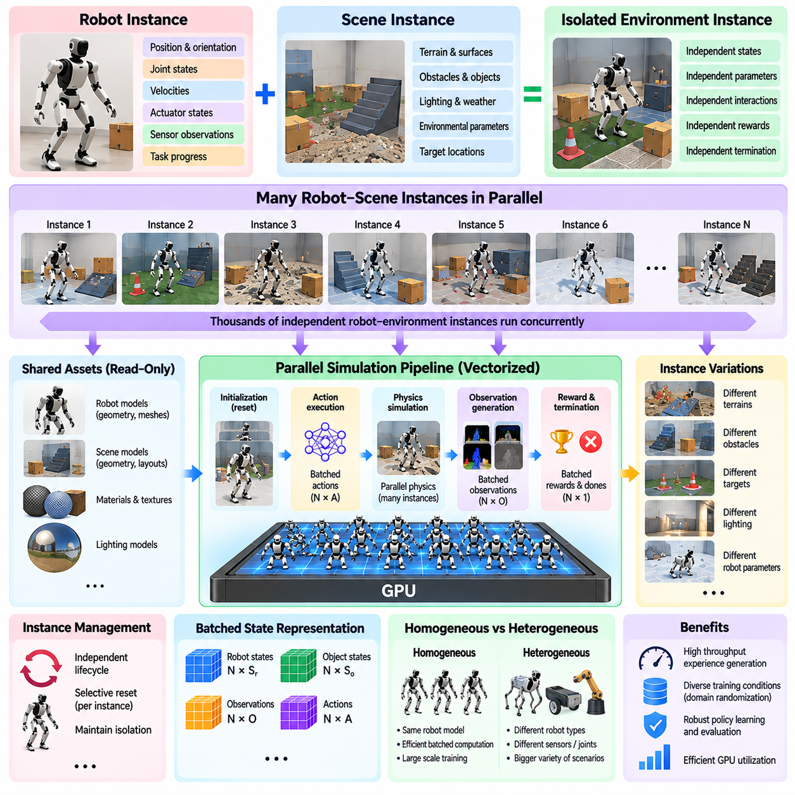{width="7.268055555555556in" height="7.268055555555556in"}

병렬 로봇 및 장면 인스턴스(Parallel Robot and Scene Instances)는 피지컬 AI(Physical AI)를 위한 대규모 병렬 시뮬레이션(Massive Parallel Simulation)의 핵심 구성요소이다. 하나의 시뮬레이션 세계에서 단일 로봇을 실행하는 대신, 시뮬레이션 플랫폼(Simulation Platform)은 동시에 동작하는 다수의 독립적인 로봇-환경 조합(Robot-Environment Combination)을 생성한다. 각 인스턴스(Instance)는 자체적인 물리 상태(Physical State), 작업 조건(Task Condition), 상호작용 이력(Interaction History)을 유지하여 다양한 운영 시나리오(Operating Scenario)에 걸친 대규모 경험 수집(Experience Collection)과 체계적인 평가(Systematic Evaluation)를 가능하게 한다.

로봇 인스턴스(Robot Instance)는 자체적인 위치(Position), 방향(Orientation), 관절 구성(Joint Configuration), 속도(Velocity), 구동기 상태(Actuator State), 센서 관측값(Sensor Observation)을 가진 독립적으로 시뮬레이션되는 로봇 개체를 의미한다. 장면 인스턴스(Scene Instance)는 지형(Terrain), 장애물(Obstacle), 물체(Object), 조명(Lighting), 환경 매개변수(Environmental Parameter)를 포함하는 주변 환경을 나타낸다. 로봇 인스턴스와 장면 인스턴스를 결합하면 각 로봇이 서로 다른 물리 세계 구성(Physical World Configuration)과 상호작용할 수 있는 격리된 시뮬레이션 환경(Isolated Simulation Environment)이 만들어진다.

이 아키텍처는 공유 시뮬레이션 자산(Shared Simulation Asset)과 인스턴스별 상태(Instance-Specific State)를 분리한다. 로봇 기하 구조(Robot Geometry), 충돌 메시(Collision Mesh), 재질 정의(Material Definition), 정적 환경 모델(Static Environment Model)은 여러 인스턴스에서 재사용할 수 있다. 반면 로봇 자세(Robot Pose), 관절 속도(Joint Velocity), 물체 위치(Object Position), 접촉력(Contact Force)과 같은 동적 속성(Dynamic Property)은 독립적으로 유지된다. 이러한 분리는 병렬 학습과 평가에 필요한 동작 독립성(Behavioral Independence)을 유지하면서 메모리 중복(Memory Duplication)을 줄인다.

장면 복제(Scene Replication)는 많은 환경이 공통적인 구조적 배치(Structural Layout)를 공유할 때 특히 효과적이다. 창고 시뮬레이션(Warehouse Simulation)은 동일한 바닥 기하 구조(Floor Geometry), 선반 구조(Shelving Structure), 로봇 모델(Robot Model)을 수천 개의 인스턴스에 복제할 수 있다. 이후 각 복제 환경(Replica)에 서로 다른 장애물 위치(Obstacle Position), 목표 위치(Target Location), 적재물 구성(Payload Configuration), 교통 조건(Traffic Condition)을 적용할 수 있다. 이러한 접근 방식은 완전한 환경을 처음부터 반복적으로 구성하지 않고도 통제된 실험(Controlled Experimentation)을 지원한다.

병렬 로봇 인스턴스는 동일한 로봇 또는 이기종 로봇 플랫폼(Heterogeneous Robotic Platform)을 나타낼 수 있다. 동종 시뮬레이션(Homogeneous Simulation)은 환경 전반에 걸쳐 동일한 로봇 형태(Robot Morphology), 구동기 구성(Actuator Configuration), 관측 구조(Observation Structure)를 사용하여 효율적인 배치형 계산(Batched Computation)을 가능하게 한다. 이기종 시뮬레이션(Heterogeneous Simulation)은 서로 다른 로봇 유형(Robot Type), 관절 구조(Joint Structure), 센싱 기능(Sensing Capability)을 도입하여 실험 범위를 확장하지만, 더욱 복잡한 상태 관리(State Management)와 계산 스케줄링(Computational Scheduling)이 필요하다.

인스턴스 격리(Instance Isolation)는 독립적인 물리적 상호작용(Physical Interaction)을 유지하는 데 필수적이다. 각 환경은 자체적인 충돌 관계(Collision Relationship), 접촉 제약조건(Contact Constraint), 물체 소유 관계(Object Ownership), 시뮬레이션 상태(Simulation State)를 보존해야 한다. 한 장면에서 로봇이 장애물과 충돌하더라도 환경 간 상호작용(Cross-Environment Interaction)이 명시적으로 의도되지 않았다면 다른 장면에 영향을 주어서는 안 된다. 시뮬레이션 엔진(Simulation Engine)은 일반적으로 장면 식별자(Scene Identifier), 충돌 필터링(Collision Filtering), 별도의 물리 컨텍스트(Physics Context)를 통해 격리를 보장한다.

공간 구성(Spatial Organization)은 여러 인스턴스를 관리하는 또 다른 메커니즘을 제공한다. 일부 시뮬레이션 시스템은 독립적인 환경을 하나의 대규모 시뮬레이션 세계에서 서로 떨어진 영역에 배치하고, 충분한 공간 오프셋(Spatial Offset)과 충돌 필터링을 사용하여 의도하지 않은 상호작용을 방지한다. 다른 시스템은 공유 계산 프레임워크(Shared Computational Framework) 내부에서 논리적으로 독립된 장면(Logically Independent Scene)을 유지한다. 적절한 전략은 물리 엔진의 기능, 메모리 구성(Memory Organization), 렌더링 요구사항(Rendering Requirement)에 따라 달라진다.

병렬 장면 인스턴스(Parallel Scene Instance)는 환경 조건(Environmental Condition)의 광범위한 변화를 가능하게 한다. 지형 경사(Terrain Slope), 표면 마찰(Surface Friction), 물체 밀도(Object Density), 조명 방향(Lighting Direction), 기상 효과(Weather Effect), 장애물 기하 구조(Obstacle Geometry)는 인스턴스마다 다르게 설정할 수 있다. 이러한 변화는 학습 알고리즘(Learning Algorithm)이 다양한 운영 조건의 분포(Distribution of Operating Conditions)를 동시에 경험하도록 한다. 또한 도메인 무작위화(Domain Randomization)와 강건성 중심 학습(Robustness-Oriented Training)을 위한 실용적인 기반을 제공한다.

로봇별 무작위화(Robot-Specific Randomization)는 시뮬레이션 경험의 범위를 더욱 확장한다. 개별 인스턴스는 질량 분포(Mass Distribution), 관절 마찰(Joint Friction), 구동기 출력(Actuator Strength), 제어 지연시간(Control Latency), 센서 보정(Sensor Calibration), 적재물 특성(Payload Characteristic)을 서로 다르게 설정할 수 있다. 이러한 차이는 제조 공차(Manufacturing Tolerance), 부품 노후화(Component Aging), 환경 불확실성(Environmental Uncertainty)을 근사적으로 표현한다. 다양한 로봇 매개변수(Robot Parameter)에 걸친 학습은 정책(Policy)이 하나의 이상화된 물리 구성(Idealized Physical Configuration)에 지나치게 의존하지 않도록 돕는다.

각 인스턴스의 생명주기(Instance Lifecycle)는 일반적으로 초기화(Initialization)로 시작하여 반복적인 행동 실행(Action Execution), 물리 상태 갱신(Physics Update), 관측값 생성(Observation Generation), 보상 계산(Reward Calculation)으로 이어진다. 작업이 완료되거나 실패가 발생하거나 최대 에피소드 길이(Maximum Episode Length)에 도달하면 인스턴스가 종료될 수 있다. 선택적 초기화 메커니즘(Selective Reset Mechanism)을 사용하면 다른 인스턴스가 계속 실행되는 동안 완료된 환경만 독립적으로 재시작할 수 있으므로 불필요한 전역 동기화(Global Synchronization) 없이 지속적인 경험 생성이 가능하다.

효율적인 인스턴스 관리(Instance Management)를 위해서는 구조화된 인덱싱(Structured Indexing)과 상태 매핑(State Mapping)이 필요하다. 모든 로봇, 물체, 관절, 센서는 올바른 환경 인스턴스와 연결되어야 한다. 배치형 상태 텐서(Batched State Tensor)는 일반적으로 환경 인덱스(Environment Index)를 사용하여 위치, 속도, 행동(Action), 관측값을 구성한다. 일관된 인덱싱(Consistent Indexing)은 우발적인 상태 혼합(State Mixing)을 방지하고, 시뮬레이션 커널(Simulation Kernel)이 여러 환경의 대응 구성요소를 효율적으로 처리하도록 한다.

공유 자산(Shared Asset)은 대규모 장면 복제의 메모리 비용(Memory Cost)을 크게 줄인다. 기하 구조 버퍼(Geometry Buffer), 텍스처(Texture), 재질 설명(Material Description), 로봇 모델 정의(Robot Model Definition)는 복제하는 대신 여러 인스턴스에서 참조할 수 있다. 변경 가능한 상태(Mutable State)와 인스턴스별 매개변수(Instance-Specific Parameter)만 별도의 저장 공간을 필요로 한다. 이러한 설계는 수천 개의 장면에 복잡한 로봇, 관절형 메커니즘(Articulated Mechanism), 시각적으로 상세한 물체가 포함될 때 특히 중요해진다.

그러나 자산 공유(Asset Sharing)가 모든 메모리 제약조건(Memory Constraint)을 제거하는 것은 아니다. 각 활성 인스턴스(Active Instance)는 여전히 동적 상태(Dynamic State), 충돌 정보(Collision Information), 솔버 변수(Solver Variable), 센서 버퍼(Sensor Buffer), 작업별 데이터(Task-Specific Data)를 저장할 공간이 필요하다. 접촉이 많은 조작 환경(Contact-Rich Manipulation Environment)은 단순한 내비게이션 장면(Navigation Scene)보다 훨씬 많은 메모리를 소비할 수 있다. 따라서 시뮬레이션 용량(Simulation Capacity)은 인스턴스 수와 각 로봇-환경 조합의 계산 복잡성(Computational Complexity)에 모두 영향을 받는다.

GPU 기반 병렬 시뮬레이션(GPU-Based Parallel Simulation)은 유사한 로봇이 최적화된 계산 커널(Optimized Computation Kernel)을 공유할 수 있으므로 규칙적인 인스턴스 구조(Regular Instance Structure)에서 이점을 얻는다. 관절 동역학(Joint Dynamics), 구동기 갱신(Actuator Update), 보상 계산, 관측 처리(Observation Processing)는 배치형 배열(Batched Array) 전반에 걸쳐 수행할 수 있다. 인스턴스마다 관절이나 물체 수가 다르면 효율적인 실행을 유지하고 과도한 계산 분기(Computational Divergence)를 방지하기 위해 패딩(Padding), 그룹화(Grouping), 특수 커널(Specialized Kernel)이 필요할 수 있다.

장면 복잡성(Scene Complexity)은 달성 가능한 병렬성(Achievable Parallelism)에 직접적인 영향을 미친다. 이동 로봇(Mobile Robot)과 소수의 장애물로 구성된 단순한 환경은 수천 개의 동시 인스턴스(Concurrent Instance)를 지원할 수 있다. 반면 관절형 매니퓰레이터(Articulated Manipulator), 변형 가능한 물체(Deformable Object), 밀집 접촉(Dense Contact), 다중 카메라(Multiple Camera)를 포함하는 복잡한 장면은 인스턴스당 더 많은 계산과 메모리를 요구한다. 따라서 실제로 실행 가능한 최대 인스턴스 수는 작업 부하별 성능 측정(Workload-Specific Performance Measurement)을 통해 결정해야 한다.

병렬 장면 렌더링(Parallel Scene Rendering)은 추가적인 아키텍처 고려사항을 제기한다. 카메라는 인접 환경의 물체를 촬영하지 않고 올바른 장면 인스턴스만 관측해야 한다. 렌더링 시스템(Rendering System)은 시각적 독립성(Visual Independence)을 유지하기 위해 장면별 가시성 마스크(Scene-Specific Visibility Mask), 격리된 렌더링 컨텍스트(Isolated Render Context), 공간적 분리(Spatial Separation)를 사용할 수 있다. 효율적인 배치형 렌더링(Batched Rendering)은 여러 카메라의 관측값을 생성할 수 있지만, 영상 해상도(Image Resolution)와 렌더링 충실도(Rendering Fidelity)는 자원 소비(Resource Consumption)에 큰 영향을 미친다.

병렬 인스턴스는 각 환경이 공유 정책(Shared Policy)에 따라 독립적인 궤적(Independent Trajectory)을 생성하기 때문에 강화학습(Reinforcement Learning)에 특히 유용하다. 서로 다른 로봇은 동일한 학습 반복(Training Iteration) 과정에서 서로 다른 초기 조건(Initial Condition), 외란(Disturbance), 작업 결과(Task Outcome)를 경험할 수 있다. 각 로봇의 관측값, 행동, 보상, 종료 표시(Termination Indicator)는 배치형 경험 버퍼(Batched Experience Buffer)에 수집할 수 있으며, 이를 통해 높은 처리량의 정책 최적화(High-Throughput Policy Optimization)와 폭넓은 행동 탐색(Behavioral Exploration)을 지원한다.

동일한 아키텍처는 체계적인 평가(Systematic Evaluation)와 벤치마킹(Benchmarking)도 지원한다. 후보 제어기(Candidate Controller)를 수천 개의 장면 구성(Scene Configuration)에 배포하여 성공률(Success Rate), 충돌 빈도(Collision Frequency), 에너지 소비량(Energy Consumption), 복구 성능(Recovery Performance)을 추정할 수 있다. 통제된 변화(Controlled Variation)는 개별 매개변수의 영향을 분리하여 분석할 수 있게 하고, 무작위화된 시나리오(Randomized Scenario)는 복합적인 불확실성(Combined Uncertainty)에 대한 민감도(Sensitivity)를 드러낸다. 샘플링 절차(Sampling Procedure)가 적절하게 설계되었다면 반복 시험(Repeated Trial)은 통계적 신뢰도(Statistical Confidence)를 높인다.

병렬 장면 생성(Parallel Scene Generation)은 어렵고 드물게 발생하는 시나리오(Difficult and Rare Scenario)를 자동으로 탐색하는 기능도 제공한다. 환경 매개변수(Environment Parameter)를 샘플링하여 비정상적인 장애물 배치(Unusual Obstacle Arrangement), 불안정한 접촉 조건(Unstable Contact Condition), 센서 성능 저하 패턴(Sensor Degradation Pattern)을 생성할 수 있다. 정책의 취약점(Policy Weakness)을 드러내는 인스턴스는 추가 분석을 위해 기록하고 재현할 수 있다. 이러한 기능은 적대적 테스트(Adversarial Testing), 안전성 평가(Safety Evaluation), 로봇 제어 정책의 목표 지향적 개선(Targeted Refinement)을 지원한다.

재현성(Reproducibility)은 일관된 인스턴스 초기화(Instance Initialization)와 난수 시드 관리(Random Seed Management)에 달려 있다. 각 환경에는 독립적으로 제어되는 난수 시퀀스(Random Sequence)를 할당해야 하며, 실험 구성(Experiment Configuration)에는 로봇 매개변수, 장면 변화(Scene Variation), 작업 조건을 기록해야 한다. 그러나 병렬 스케줄링(Parallel Scheduling)과 수치 연산 실행(Numerical Execution)은 여전히 비결정론적 차이(Nondeterministic Difference)를 발생시킬 수 있다. 따라서 신뢰할 수 있는 평가는 모든 실행에서 동일한 결과가 나온다고 가정하기보다 통제된 구성과 반복적인 통계 측정(Statistical Measurement)을 결합해야 한다.

다중 GPU 및 분산 시뮬레이션 아키텍처(Multi-GPU and Distributed Simulation Architecture)는 인스턴스 관리를 단일 가속기(Single Accelerator)를 넘어 확장한다. 로봇 및 장면 인스턴스 그룹(Instance Group)은 서로 다른 GPU 또는 계산 노드(Computing Node)에 할당될 수 있으며, 각 장치는 로컬 물리 상태(Local Physics State)와 관측값을 유지한다. 이후 경험 데이터(Experience Data)와 평가 결과(Evaluation Result)는 학습 또는 오케스트레이션 시스템(Orchestration System)에 의해 통합될 수 있다. 효율적인 분산 실행(Distributed Execution)을 위해서는 계산 부하의 균형을 유지하고 장치 간 불필요한 통신을 최소화해야 한다.

실제 피지컬 AI 개발에서 병렬 로봇 및 장면 인스턴스는 시뮬레이션을 개별적인 가상 실험(Isolated Virtual Experiment)에서 확장 가능한 경험 생성 인프라(Scalable Experience-Generation Infrastructure)로 전환한다. 그 효과는 자산 공유(Asset Sharing), 환경 격리(Environment Isolation), 구조화된 상태 관리(Structured State Management), 효율적인 물리 계산(Physics Execution), 통제된 시나리오 다양성(Controlled Scenario Diversity)에 달려 있다. 수천 개의 독립적인 로봇-세계 상호작용(Robot-World Interaction)을 조정함으로써 이러한 아키텍처는 강건한 학습(Robust Learning), 체계적인 검증(Systematic Validation), 확장 가능한 시뮬레이션-현실 전이 개발(Scalable Simulation-to-Real Development)을 지원한다.

## 05.06. Parallel RL Experience Collection

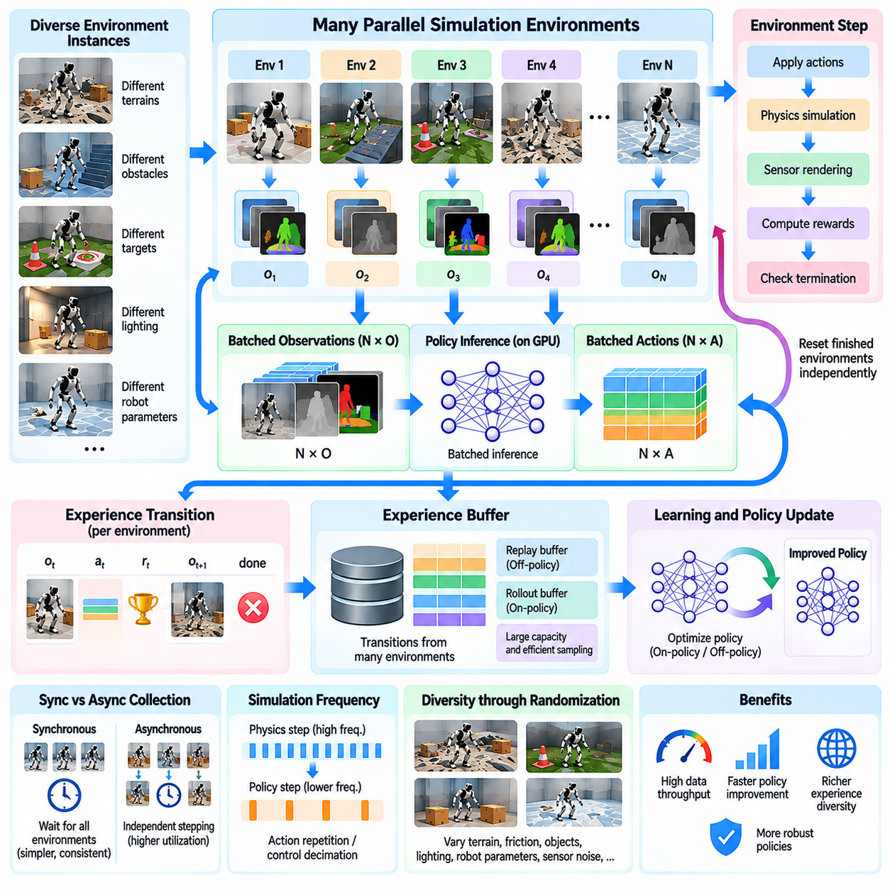{width="7.268055555555556in" height="7.268055555555556in"}

병렬 강화학습 경험 수집(Parallel Reinforcement Learning Experience Collection)은 피지컬 AI(Physical AI) 시스템이 다수의 시뮬레이션 로봇으로부터 대량의 상호작용 데이터(Interaction Data)를 동시에 수집할 수 있도록 한다. 순차적으로 상태 전이(Transition)를 생성하는 단일 환경에 의존하는 대신, 병렬 실행(Parallel Execution)은 수많은 독립적인 환경에 경험 생성(Experience Generation)을 분산한다. 이러한 아키텍처는 데이터 처리량(Data Throughput)을 높이고, 정책 개선(Policy Improvement)을 가속하며, 각 학습 주기(Training Cycle)에서 학습 에이전트(Learning Agent)가 다양한 물리적 조건을 경험하도록 한다.

강화학습(Reinforcement Learning)에서 경험 전이(Experience Transition)는 일반적으로 관측값(Observation), 행동(Action), 보상(Reward), 다음 관측값(Next Observation), 종료 표시(Termination Indicator)로 구성된다. 이러한 요소는 하나의 의사결정 구간(Decision Interval)에서 에이전트가 환경과 상호작용하는 방식을 설명한다. 병렬 수집(Parallel Collection)은 여러 상태 전이를 동시에 생성하도록 이 과정을 확장하여, 학습 알고리즘(Learning Algorithm)이 개별 시뮬레이션 에피소드(Simulation Episode)의 종료를 기다리지 않고 대규모 데이터셋(Dataset)을 구축할 수 있도록 한다.

병렬 롤아웃 아키텍처(Parallel Rollout Architecture)는 시뮬레이션 환경(Simulation Environment), 정책 추론 구성요소(Policy Inference Component), 경험 버퍼(Experience Buffer), 학습 프로세스(Learning Process)로 구성된다. 각 환경은 독립적인 물리 상태(Physical State)를 유지하면서 정책(Policy)을 공유하거나 공통 학습기(Common Learner)로부터 매개변수를 전달받는다. 관측값은 배치(Batch)로 수집되어 정책 신경망(Policy Network)에서 처리되고 행동으로 변환된다. 그 결과 생성된 상태 전이는 후속 최적화(Optimization) 또는 즉각적인 학습 갱신(Learning Update)을 위해 저장된다.

벡터화 환경(Vectorized Environment)은 병렬 경험 수집을 위한 실용적인 기반을 제공한다. 수천 개의 환경이 호환 가능한 관측 공간(Observation Space)과 행동 공간(Action Space)을 제공하면, 각 환경의 상태를 배치형 텐서(Batched Tensor)로 표현할 수 있다. 정책 신경망은 병렬 추론 연산(Parallel Inference Operation)을 통해 이러한 관측값을 처리하고 각 환경에 대한 행동을 생성한다. 이러한 구성은 반복적인 소프트웨어 처리 부담(Software Overhead)을 줄이고 시뮬레이션과 학습 과정에서 가속기 활용률(Accelerator Utilization)을 높인다.

GPU 상주형 시뮬레이션(GPU-Resident Simulation)은 관측값, 행동, 보상, 물리 상태를 장치 메모리(Device Memory) 내부에 유지함으로써 효율성을 더욱 향상시킨다. 물리 커널(Physics Kernel)은 로봇 환경을 진행시키고, 신경망 추론(Neural-Network Inference)은 불필요한 CPU 데이터 전송 없이 제어 명령(Control Command)을 생성한다. 보상 계산(Reward Calculation)과 종료 조건 검사(Termination Check)도 GPU에서 실행할 수 있다. 이러한 통합 설계(Integrated Design)는 동기화 부담(Synchronization Overhead)을 최소화하고 높은 빈도의 경험 생성(High-Frequency Experience Generation)을 지원한다.

시뮬레이션 단계(Simulation Step)와 정책 의사결정(Policy Decision) 사이의 관계는 효율적인 경험 수집에서 중요하다. 물리 엔진(Physics Engine)은 특히 안정적인 접촉 동역학(Contact Dynamics)을 위해 짧은 시간 간격(Time Increment)이 필요한 경우, 하나의 정책 행동에 대해 여러 적분 단계(Integration Step)를 실행할 수 있다. 행동 반복(Action Repetition)과 제어 데시메이션(Control Decimation)은 정책이 관측값을 수신하고 명령을 갱신하는 빈도를 결정한다. 이러한 설정은 데이터 처리량, 제어 응답성(Control Responsiveness), 학습된 행동의 시간적 특성(Temporal Characteristic)에 영향을 미친다.

병렬 환경(Parallel Environment)은 에피소드를 동시에 완료하는 경우가 드물다. 일부 로봇은 목표에 빠르게 도달하지만, 다른 로봇은 실패하거나 시간 제한(Time Limit)에 도달할 때까지 계속 동작한다. 독립적인 에피소드 관리(Independent Episode Management)를 사용하면 종료된 환경을 활성 인스턴스(Active Instance)의 실행을 중단하지 않고 초기화할 수 있다. 초기화 연산(Reset Operation)은 초기 상태(Initial State)를 복원하고, 선택된 조건을 무작위화하며, 경험 수집을 다시 시작하여 시뮬레이션 배치(Simulation Batch) 전체에서 높은 자원 활용률을 유지한다.

경험 버퍼(Experience Buffer)는 수집된 상태 전이를 학습에 적합하도록 구성한다. 온정책 알고리즘(On-Policy Algorithm)은 일반적으로 현재 정책에서 생성된 궤적(Trajectory)을 저장하고 제한된 횟수의 최적화 갱신(Optimization Update)에 사용한다. 오프정책 알고리즘(Off-Policy Algorithm)은 상태 전이를 재현 버퍼(Replay Buffer)에 보관하고 과거 경험을 재사용할 수 있다. 병렬 수집은 버퍼 삽입 속도(Buffer Insertion Rate)를 증가시키므로 메모리 용량(Memory Capacity), 데이터 구성(Data Organization), 샘플링 효율(Sampling Efficiency)이 중요한 설계 고려사항이 된다.

근접 정책 최적화(Proximal Policy Optimization, PPO)는 배치형 롤아웃 수집(Batched Rollout Collection)의 이점을 활용할 수 있으므로 벡터화 시뮬레이션(Vectorized Simulation)과 자주 결합된다. 여러 환경에서 고정 길이 궤적 구간(Fixed-Length Trajectory Segment)을 생성하고 이를 학습 배치(Training Batch)로 구성한다. 보상, 가치 예측(Value Prediction), 종료 정보를 사용하여 어드밴티지 추정값(Advantage Estimate)과 수익(Return)을 계산한다. 이후 학습기는 다음 롤아웃을 수집하기 전에 정책을 갱신하여 시뮬레이션과 최적화 사이의 구조화된 상호작용(Structured Interaction)을 유지한다.

소프트 액터-크리틱(Soft Actor-Critic, SAC)과 같은 오프정책 학습 방법(Off-Policy Method)도 병렬 경험 수집을 활용할 수 있다. 독립적인 환경은 공유 재현 버퍼(Shared Replay Buffer)에 저장되는 상태 전이를 생성하고, 학습 프로세스는 최적화를 위해 미니배치(Minibatch)를 샘플링한다. 자원 가용성(Resource Availability)에 따라 경험 수집과 학습을 동시에 진행할 수도 있다. 그러나 안정적인 학습(Stable Learning)을 유지하려면 데이터 생성 속도(Data Generation Speed)와 기울기 갱신 빈도(Gradient Update Frequency) 사이의 관계를 관리해야 한다.

동기식 수집(Synchronous Collection)은 정의된 환경 그룹이 각 롤아웃 단계(Rollout Step)를 완료할 때까지 기다린 후 배치를 진행한다. 이러한 방식은 텐서 구성(Tensor Organization), 정책 버전 일관성(Policy Version Consistency), 재현성(Reproducibility)을 단순화한다. 그러나 느린 환경이 빠른 환경의 진행을 지연시켜 동기화 부담을 발생시킬 수 있다. 장면 복잡성(Scene Complexity), 접촉 상호작용(Contact Interaction), 센서 처리 요구사항(Sensor-Processing Requirement)이 인스턴스마다 크게 달라지면 이러한 문제는 더욱 중요해진다.

비동기식 수집(Asynchronous Collection)은 환경 작업자(Environment Worker)가 독립적으로 실행되고 경험이 생성될 때마다 제출하도록 한다. 이는 작업 부하(Workload)가 이질적이거나 여러 계산 장치(Computing Device)에 분산된 경우 자원 활용률(Resource Utilization)을 향상시킬 수 있다. 그러나 비동기 시스템(Asynchronous System)은 정책 노후화(Policy Staleness), 가변적인 수집 속도(Variable Collection Rate), 통신 지연(Delayed Communication)을 관리해야 한다. 학습 알고리즘은 경험을 생성한 정책과 현재 최적화 중인 정책 사이의 차이를 고려해야 한다.

경험 다양성(Experience Diversity)은 병렬 시뮬레이션의 주요 장점이다. 개별 환경은 지형(Terrain), 마찰(Friction), 로봇 질량(Robot Mass), 구동기 출력(Actuator Strength), 센서 잡음(Sensor Noise), 장애물 배치(Obstacle Placement), 작업 목표(Task Objective)를 서로 다르게 설정할 수 있다. 이러한 변화는 각 학습 반복에서 정책이 더 넓은 상태 및 전이 분포(State and Transition Distribution)를 경험하도록 한다. 신중하게 설계된 도메인 무작위화(Domain Randomization)는 이상화된 시뮬레이션 조건에 대한 의존성을 줄이고 실제 배포(Deployment) 과정의 강건성(Robustness)을 향상시킬 수 있다.

병렬 수집은 환경에 서로 다른 작업 난이도(Task Difficulty)를 할당하여 커리큘럼 학습(Curriculum Learning)도 지원한다. 일부 인스턴스는 기본적인 안정화(Stabilization)나 내비게이션(Navigation)을 연습하는 반면, 다른 인스턴스는 어려운 지형(Challenging Terrain), 외란(Disturbance), 복잡한 조작 작업(Complex Manipulation Task)을 경험할 수 있다. 학습이 진행됨에 따라 난이도 분포(Difficulty Distribution)를 변경할 수 있다. 이를 통해 학습 시스템은 유용한 학습 신호(Learning Signal)를 유지하면서 요구되는 능력의 범위를 점진적으로 확장할 수 있다.

더 많은 상태 전이를 수집한다고 해서 반드시 더 나은 학습이 보장되는 것은 아니다. 상관관계가 높은 경험(Highly Correlated Experience), 반복적인 초기 조건(Repetitive Initial Condition), 불충분한 탐색(Insufficient Exploration)은 대규모 데이터셋의 정보적 가치(Informational Value)를 감소시킬 수 있다. 따라서 병렬 환경은 동일한 궤적을 단순히 복제하기보다 의미 있는 변화(Meaningful Variation)를 제공해야 한다. 탐색 전략(Exploration Strategy), 무작위 초기화(Randomized Reset), 균형 잡힌 시나리오 샘플링(Balanced Scenario Sampling)은 수집 속도와 함께 경험 품질(Experience Quality)을 향상시키는 데 도움이 된다.

보상 계산(Reward Computation)은 수천 개의 환경이 동시에 실행될 때 핵심 구성요소가 된다. 보상 함수(Reward Function)는 배치형 연산(Batched Operation)을 사용하여 작업 진행도(Task Progress), 에너지 소비(Energy Consumption), 안전 제약조건(Safety Constraint), 바람직하지 않은 행동(Undesirable Behavior)을 효율적으로 평가해야 한다. 잘못 설계된 보상은 시뮬레이션 처리량과 관계없이 의도하지 않은 전략(Unintended Strategy)을 유도할 수 있다. 따라서 대규모 학습을 시작하기 전에 보상 정의(Reward Definition)가 의도한 물리적 행동(Physical Behavior)에 부합하는지 검증해야 한다.

종료 조건(Termination Condition)과 절단 조건(Truncation Condition)도 신중하게 처리해야 한다. 종료(Termination)는 작업 성공(Task Success), 충돌 실패(Collision Failure), 기타 실제 에피소드 종료 사건(Episode-Ending Event)을 의미할 수 있으며, 절단(Truncation)은 외부에서 부과된 시간 제한(Externally Imposed Time Limit)을 나타내는 경우가 많다. 학습 알고리즘은 미래 수익(Future Return)을 추정할 때 이러한 경우를 다르게 처리할 수 있다. 잘못 처리하면 가치 추정값(Value Estimate)에 편향(Bias)이 발생하고 정책 성능(Policy Performance)이 저하될 수 있으며, 특히 에피소드 길이(Episode Length)가 크게 달라지는 경우 문제가 심각해질 수 있다.

시뮬레이션 처리량(Simulation Throughput)과 학습 처리량(Learning Throughput) 사이의 상호작용은 전체 학습 효율(Overall Training Efficiency)을 결정한다. 학습기가 처리할 수 있는 속도보다 경험을 빠르게 생성하면 메모리 부담(Memory Pressure)이 증가하고 오래된 데이터(Stale Data)가 발생할 가능성이 있다. 반대로 학습기 활용률(Learner Utilization)이 낮으면 새로운 롤아웃을 기다리는 데 상당한 시간을 소비할 수 있다. 효율적인 시스템은 환경 수(Environment Count), 롤아웃 길이(Rollout Length), 정책 추론 속도(Policy Inference Speed), 최적화 작업 부하(Optimization Workload)의 균형을 유지하여 전체 학습 시간을 최소화한다.

성능 모니터링(Performance Monitoring)은 원시 시뮬레이션 속도(Raw Simulation Speed)와 실제로 유용한 학습 진전(Useful Learning Progress)을 구분해야 한다. 중요한 측정 지표에는 초당 환경 단계 수(Environment Steps per Second), 초당 수집된 상태 전이 수(Transitions Collected per Second), 정책 추론 지연시간(Policy Inference Latency), 재현 버퍼 활용률(Replay-Buffer Utilization), 목표 성공률(Target Success Rate)에 도달하는 데 필요한 시간이 포함된다. 높은 경험 처리량은 안정적인 최적화와 작업 성능 향상에 기여할 때만 가치가 있다. 따라서 학습 효율은 계산 성능 지표(Computational Metric)와 행동 성능 지표(Behavioral Metric)를 모두 사용하여 평가해야 한다.

분산 경험 수집(Distributed Experience Collection)은 병렬 강화학습을 단일 GPU 또는 계산 노드(Computing Node)를 넘어 확장한다. 여러 시뮬레이션 작업자(Simulation Worker)는 독립적으로 궤적을 생성하고 이를 중앙집중형 또는 분산형 학습기(Centralized or Distributed Learner)에 전달할 수 있다. 매개변수 동기화(Parameter Synchronization), 네트워크 통신(Network Communication), 작업 부하 균형(Workload Balancing)은 확장성(Scalability)에 영향을 미친다. 효율적인 아키텍처는 불필요한 데이터 이동(Data Movement)을 최소화하면서 수집된 경험이 학습 알고리즘과 호환되도록 보장한다.

재현성(Reproducibility)과 데이터 무결성(Data Integrity)은 대규모 환경에서도 필수적이다. 각 환경은 통제된 난수 시드(Random Seed), 일관된 관측 정의(Observation Definition), 신뢰할 수 있는 에피소드 식별자(Episode Identifier)를 사용해야 한다. 경험 기록(Experience Record)은 관측값, 행동, 보상, 종료 상태(Terminal State) 사이의 대응 관계를 보존해야 한다. 병렬 실행으로 인해 수치적 비결정성(Numerical Nondeterminism)이 여전히 발생할 수 있으므로, 학습 구성을 비교할 때 반복 평가(Repeated Evaluation)와 통계적 결과 보고(Statistical Reporting)가 중요하다.

병렬 강화학습 경험 수집은 궁극적으로 대규모 시뮬레이션 역량(Massive Simulation Capacity)을 확장 가능한 로봇 지능 개발(Scalable Robotic Intelligence Development)과 연결한다. 그 효과는 효율적인 환경 실행(Environment Execution), 배치형 정책 추론(Batched Policy Inference), 신뢰할 수 있는 경험 저장(Experience Storage), 의미 있는 시나리오 다양성(Scenario Diversity), 균형 잡힌 최적화(Balanced Optimization)에 달려 있다. 이러한 구성요소가 함께 작동하면 피지컬 AI 시스템은 방대한 시뮬레이션 상호작용(Simulated Interaction)으로부터 학습하면서 강건성(Robustness), 일반화 성능(Generalization), 시뮬레이션-현실 전이(Simulation-to-Real Transfer)를 위한 준비 수준을 체계적으로 향상시킬 수 있다.

## 05.07. Multi GPU and Distributed Simulation

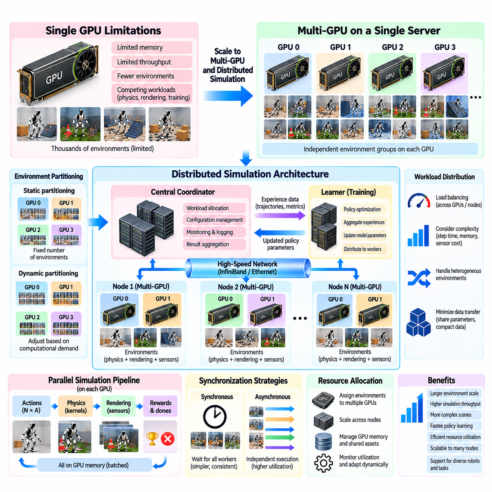{width="7.268055555555556in" height="7.268055555555556in"}

다중 GPU 및 분산 시뮬레이션(Multi-GPU and Distributed Simulation)은 피지컬 AI(Physical AI) 학습을 단일 가속기(Single Accelerator)의 계산 한계를 넘어 확장한다. 이러한 아키텍처는 시뮬레이션 작업 부하(Simulation Workload)를 여러 그래픽처리장치(Graphics Processing Unit, GPU)와 계산 노드(Computing Node)에 분산함으로써 더 많은 환경 인스턴스(Environment Instance), 더 복잡한 로봇 장면(Robotic Scene), 더 높은 경험 생성 처리량(Experience-Generation Throughput)을 지원한다. 그 효과는 작업 부하 분할(Workload Partitioning), 통신 효율(Communication Efficiency), 동기화(Synchronization), 시뮬레이션 자원의 조정된 관리(Coordinated Resource Management)에 달려 있다.

단일 GPU는 수천 개의 병렬 환경(Parallel Environment)을 실행할 수 있지만, 메모리 용량(Memory Capacity)과 계산 처리량(Computational Throughput)은 결국 제한 요인이 된다. 복잡한 관절형 로봇(Articulated Robot), 접촉이 많은 상호작용(Contact-Rich Interaction), 고해상도 카메라(High-Resolution Camera), 신경망 학습(Neural-Network Training)은 사용 가능한 자원을 놓고 경쟁한다. 다중 GPU 시뮬레이션(Multi-GPU Simulation)은 독립적인 환경 그룹을 서로 다른 가속기에 할당하여 이러한 제약을 해결하며, 모든 환경이 하나의 장치를 공유하지 않고도 전체 시뮬레이션 용량(Aggregate Simulation Capacity)을 증가시킬 수 있도록 한다.

가장 단순한 다중 GPU 아키텍처(Multi-GPU Architecture)는 환경 수준 분할(Environment-Level Partitioning)을 사용하며, 각 GPU가 별도의 로봇 및 장면 인스턴스(Robot and Scene Instance) 집합을 유지한다. 물리 계산(Physics Calculation), 관측값(Observation), 보상(Reward), 에피소드 초기화(Episode Reset)는 각 분할 영역 내부에서 로컬로 수행된다. 독립적인 환경은 일반적으로 직접적인 상호작용이 필요하지 않으므로, 이러한 접근 방식은 가속기 간 통신(Inter-Accelerator Communication)을 최소화하고 강화학습(Reinforcement Learning)과 합성 데이터 생성(Synthetic Data Generation)을 확장하기 위한 자연스러운 기반을 제공한다.

분산 시뮬레이션(Distributed Simulation)은 동일한 원리를 네트워크(Network)로 연결된 여러 계산 노드로 확장한다. 각 노드는 여러 CPU와 GPU를 포함할 수 있으며, 로컬 시뮬레이션 작업자(Local Simulation Worker)가 할당된 환경 그룹을 담당한다. 중앙 조정기(Central Coordinator) 또는 분산 오케스트레이션 시스템(Distributed Orchestration System)은 작업 부하 할당(Workload Allocation), 구성(Configuration), 모니터링(Monitoring), 결과 집계(Result Aggregation)를 관리한다. 이러한 아키텍처를 통해 시뮬레이션 인프라(Simulation Infrastructure)는 개별 서버의 메모리와 처리 용량을 넘어 확장될 수 있다.

작업 부하 분할(Workload Partitioning)은 분산 시뮬레이션의 기본적인 설계 결정이다. 정적 분할(Static Partitioning)은 각 장치에 미리 정해진 수의 환경을 할당하여 구현과 재현성(Reproducibility)을 단순화한다. 동적 분할(Dynamic Partitioning)은 측정된 계산 수요(Computational Demand)에 따라 할당을 조정한다. 동적 할당(Dynamic Allocation)은 자원 활용률(Utilization)을 향상시킬 수 있지만, 실행 중인 환경을 이동하려면 상당한 양의 물리 상태(Physical State), 장면 매개변수(Scene Parameter), 중간 시뮬레이션 데이터(Intermediate Simulation Data)를 전송해야 할 수 있다.

환경마다 계산 복잡성(Computational Complexity)이 다를 때 부하 균형(Load Balancing)은 더욱 중요해진다. 단순한 내비게이션 장면(Navigation Scene)은 관절형 물체(Articulated Object)와 밀집 접촉(Dense Contact)을 포함하는 조작 장면(Manipulation Scene)보다 훨씬 빠르게 진행될 수 있다. 모든 GPU에 동일한 수의 환경을 할당한다고 해서 반드시 동일한 작업 부하가 발생하는 것은 아니다. 효과적인 스케줄링(Scheduling)은 시뮬레이션 단계 지연시간(Simulation-Step Latency), 메모리 소비량(Memory Consumption), 센서 요구사항(Sensor Requirement), 물리적 상호작용의 변동성(Variability of Physical Interaction)을 고려한다.

통신 아키텍처(Communication Architecture)는 분산 성능(Distributed Performance)에 큰 영향을 미친다. 서버 내부에서 GPU는 하드웨어 지원 여부에 따라 PCI 익스프레스(PCI Express) 또는 NVLink와 같은 고속 상호연결(High-Speed Interconnect)을 통해 데이터를 교환할 수 있다. 서버 간 통신은 네트워크 인프라(Network Infrastructure)와 분산 통신 라이브러리(Distributed Communication Library)에 의존한다. 적절한 설계는 대규모 상태 텐서(State Tensor)의 빈번한 전송을 최소화하고, 대신 압축된 정책 매개변수(Compact Policy Parameter), 집계된 통계(Aggregated Statistic), 선택된 경험 배치(Selected Experience Batch)를 전달한다.

분산 강화학습(Distributed Reinforcement Learning)에서는 시뮬레이션 작업자(Simulation Worker)가 일반적으로 궤적(Trajectory)을 생성하고, 하나 이상의 학습 프로세스(Learner Process)가 정책 매개변수(Policy Parameter)를 갱신한다. 작업자는 로컬에서 사용 가능한 모델 가중치(Model Weight)를 이용하여 정책 추론(Policy Inference)을 실행하고, 최적화를 위해 경험 데이터(Experience Data)를 제출한다. 학습기(Learner)는 갱신된 매개변수를 주기적으로 작업자에게 배포한다. 이러한 분리는 시뮬레이션 자원과 학습 자원을 독립적으로 확장할 수 있도록 하지만, 통신 빈도(Communication Frequency)와 정책 일관성(Policy Consistency)을 신중하게 관리해야 한다.

동기식 분산 학습(Synchronous Distributed Training)은 공통 롤아웃(Common Rollout)과 최적화 경계(Optimization Boundary)를 기준으로 작업자들을 조정한다. 각 작업자는 지정된 양의 경험을 수집한 후 전역 학습 배치(Global Training Batch)에 기여한다. 이러한 구조는 정책 버전 관리(Policy-Version Management)를 단순화하고 일관된 갱신 절차(Update Procedure)를 지원한다. 그러나 가장 느린 작업자가 전체 시스템을 지연시킬 수 있으며, 특히 노드 간 하드웨어 성능(Hardware Performance), 장면 복잡성(Scene Complexity), 네트워크 조건(Network Condition)이 서로 다를 때 이러한 문제가 두드러진다.

비동기식 아키텍처(Asynchronous Architecture)는 시뮬레이션 작업자가 전역 동기화(Global Synchronization)를 기다리지 않고 지속적으로 경험을 생성하도록 한다. 학습기는 사용 가능한 궤적 또는 재현 버퍼 샘플(Replay-Buffer Sample)을 소비하는 동안 작업자는 독립적으로 동작한다. 이러한 접근 방식은 자원 활용률을 높이고 유휴 시간(Idle Time)을 줄일 수 있지만, 경험이 이전 정책 버전(Older Policy Version)에서 생성되었을 가능성이 있다. 따라서 학습 안정성(Learning Stability)을 유지하려면 정책 노후화(Policy Staleness), 재현 데이터 분포(Replay Distribution), 갱신 빈도(Update Frequency)를 관리하는 것이 필수적이다.

다중 GPU 시스템은 시뮬레이션, 렌더링(Rendering), 신경망 학습을 특화된 장치(Specialized Device)에 분리할 수도 있다. 한 그룹의 가속기는 물리 시뮬레이션(Physics Simulation)을 실행하고, 다른 그룹은 카메라 관측값(Camera Observation)을 생성하며, 추가 장치는 정책 최적화(Policy Optimization)를 수행할 수 있다. 이러한 기능별 분할(Functional Partitioning)은 작업 부하가 서로 다른 계산 특성(Computational Characteristic)을 가질 때 유용하다. 그러나 이점은 장치 간 데이터 전송으로 인해 발생하는 통신 및 동기화 비용(Communication and Synchronization Cost)을 초과해야 한다.

시뮬레이션 인프라가 확장되더라도 GPU 메모리 관리(GPU Memory Management)는 여전히 중요하다. 각 가속기는 로컬 환경 상태(Local Environment State), 충돌 구조(Collision Structure), 센서 버퍼(Sensor Buffer), 임시 솔버 변수(Temporary Solver Variable)를 저장할 공간이 필요하다. 공유 자산(Shared Asset)은 장치 내부의 중복을 줄일 수 있지만, 서로 다른 GPU 사이에서는 복사본이 필요할 수 있다. 메모리 인식 스케줄링(Memory-Aware Scheduling)은 환경 수뿐만 아니라 물리적 표현(Physical Representation)과 시각적 표현(Visual Representation)의 복잡성도 고려해야 한다.

분산 렌더링(Distributed Rendering)은 영상 관측값(Image Observation)이 압축된 물리 상태 벡터(Compact Physical State Vector)보다 훨씬 클 수 있기 때문에 추가적인 대역폭 문제(Bandwidth Challenge)를 발생시킨다. 노드 간 고해상도 영상(High-Resolution Image)을 전송하면 상당한 네트워크 용량(Network Capacity)을 소비하고 학습 지연시간(Learning Latency)을 증가시킬 수 있다. 시스템은 로컬 시각 전처리(Local Visual Preprocessing), 특징 추출(Feature Extraction), 선택적 압축(Selective Compression), 렌더링 프로세스(Rendering Process) 근처에 인식 추론(Perception Inference)을 배치하는 방식으로 이러한 부담을 줄일 수 있다.

장애 허용성(Fault Tolerance)은 시뮬레이션이 여러 장치에서 장시간 실행될 때 중요한 요구사항이 된다. 개별 작업자는 하드웨어 결함(Hardware Fault), 메모리 고갈(Memory Exhaustion), 소프트웨어 오류(Software Error), 네트워크 중단(Network Interruption)으로 인해 실패할 수 있다. 복원력이 높은 오케스트레이션 시스템(Resilient Orchestration System)은 장애를 감지하고, 영향을 받은 작업자를 재시작하며, 전체 실험을 종료하지 않고 구성을 복원한다. 정책 매개변수와 실험 메타데이터(Experiment Metadata)를 체크포인트(Checkpoint)로 저장하면 학습 진행 상태(Training Progress)를 보존하는 데 도움이 된다.

재현성(Reproducibility)을 확보하려면 작업자와 환경 인스턴스 전반에 걸쳐 난수 시드 관리(Random Seed Management)를 조정해야 한다. 각 시뮬레이션 분할 영역(Simulation Partition)에는 의도하지 않은 궤적 중복(Trajectory Duplication)을 방지하기 위해 서로 구별되고 추적 가능한 난수 시퀀스(Random Sequence)를 할당해야 한다. 구성 기록(Configuration Record)에는 장치 할당(Device Assignment), 물리 설정(Physics Setting), 소프트웨어 버전(Software Version), 시나리오 매개변수(Scenario Parameter)가 포함되어야 한다. 동적 스케줄링과 비동기 실행은 여전히 비결정성(Nondeterminism)을 유발할 수 있으므로 반복적인 통계 평가(Statistical Evaluation)가 필요하다.

성능 확장(Performance Scaling)은 강한 확장성(Strong Scaling)과 약한 확장성(Weak Scaling)의 개념을 모두 사용하여 측정해야 한다. 강한 확장성은 고정된 작업 부하(Fixed Workload)를 추가 장치에 분산할 때 실행 시간(Execution Time)이 어떻게 변화하는지를 평가한다. 약한 확장성은 사용 가능한 자원에 비례하여 작업 부하 크기(Workload Size)를 증가시킬 때 처리량(Throughput)이 함께 증가하는지를 검토한다. 이러한 측정은 서로 다른 병목 현상(Bottleneck)을 드러내며, 추가 GPU가 시뮬레이션 효율(Simulation Efficiency)을 실질적으로 향상시키는지 판단하는 데 도움이 된다.

통신, 동기화, 오케스트레이션 부담(Orchestration Overhead)이 유효 계산량(Useful Computation)보다 빠르게 증가하면 확장 효율(Scaling Efficiency)은 일반적으로 감소한다. GPU 수가 두 배인 시스템이 반드시 두 배의 시뮬레이션 처리량을 제공하는 것은 아니다. 네트워크 혼잡(Network Congestion), 불균형한 작업 부하(Unbalanced Workload), 매개변수 동기화(Parameter Synchronization), 학습기 포화(Learner Saturation)는 성능 향상을 제한할 수 있다. 이러한 한계를 식별하려면 계산, 통신, 메모리 사용량, 작업자 유휴 시간(Worker Idle Time)에 대한 상세한 프로파일링(Profiling)이 필요하다.

분산 시뮬레이션은 대규모 평가(Large-Scale Evaluation)와 시나리오 탐색(Scenario Exploration)에도 유용하다. 독립적인 작업자는 서로 다른 로봇 제어기(Robot Controller), 환경 조건(Environmental Condition), 난수 시드(Random Seed)를 동시에 시험할 수 있다. 결과를 집계하여 성공률(Success Rate), 실패 분포(Failure Distribution), 운영 도메인(Operating Domain) 전반의 강건성(Robustness)을 추정한다. 평가 작업 부하(Evaluation Workload)는 서로 독립적인 경우가 많으므로 작업자 간 비교적 적은 통신으로도 효율적으로 확장할 수 있다.

시나리오 수준 분산(Scenario-Level Distribution)은 서로 다른 환경 구성을 별도의 계산 분할 영역(Computing Partition)에 할당하여 희귀 사건 탐색(Rare-Event Discovery)을 지원한다. 작업자는 비정상적인 충돌(Unusual Collision), 불안정한 접촉(Unstable Contact), 내비게이션 실패(Navigation Failure), 센서 성능 저하 조건(Sensor Degradation Condition)을 탐색할 수 있다. 분석 가치가 높은 실패 사례(Failure Case)는 목표 지향적 재실행(Targeted Replay)과 분석을 위해 보존할 수 있다. 이러한 아키텍처는 순차 시뮬레이션(Sequential Simulation)으로는 실용적으로 수행하기 어려운 광범위한 안전성 시험(Safety Testing)을 가능하게 한다.

클라우드 및 온프레미스 인프라(Cloud and On-Premise Infrastructure)는 서로 다른 운영상 고려사항(Operational Consideration)을 가진다. 온프레미스 클러스터(On-Premise Cluster)는 하드웨어 구성(Hardware Configuration), 네트워크 토폴로지(Network Topology), 데이터 거버넌스(Data Governance)를 직접 제어할 수 있으며, 클라우드 자원(Cloud Resource)은 일시적인 계산 수요(Computational Demand)에 대응할 수 있는 유연한 용량(Flexible Capacity)을 제공한다. 하이브리드 배포(Hybrid Deployment)는 이러한 장점을 결합할 수 있지만, 작업 부하를 분산할 때 장치 성능, 네트워크 지연시간(Network Latency), 저장소 접근(Storage Access), 운영 비용(Operating Cost)의 차이를 고려해야 한다.

비용 효율(Cost Efficiency)은 원시 처리량(Raw Throughput)과 함께 평가해야 한다. 가속기를 추가하면 하드웨어 지출(Hardware Expenditure), 에너지 소비(Energy Consumption), 냉각 요구사항(Cooling Requirement), 인프라 관리 복잡성(Infrastructure Management Complexity)이 증가한다. 유용한 비교를 위해서는 단위 비용당 완료된 시뮬레이션 상태 전이(Completed Simulation Transition), 성공적인 학습 실행(Successful Training Run), 검증된 시나리오(Validated Scenario)를 고려해야 한다. 자원 활용률을 최적화하고 불필요한 통신을 줄이는 것이 단순히 계산 장치 수를 늘리는 것보다 더 큰 이점을 제공할 수 있다.

관측 가능성(Observability)과 오케스트레이션(Orchestration)은 신뢰할 수 있는 분산 운영(Distributed Operation)에 필수적이다. 모니터링 시스템(Monitoring System)은 환경 처리량(Environment Throughput), GPU 활용률(GPU Utilization), 메모리 부담(Memory Pressure), 통신 지연시간(Communication Latency), 작업자 장애(Worker Failure), 정책 학습 진행 상태(Policy-Training Progress)를 추적해야 한다. 중앙집중형 실험 메타데이터(Centralized Experiment Metadata)는 서로 다른 노드에서 생성된 결과를 일관되게 비교할 수 있도록 한다. 자동화된 스케줄링(Automated Scheduling)과 상태 점검(Health Check)은 장시간 실행되는 시뮬레이션 작업(Simulation Campaign)의 안정적인 운영을 지원한다.

다중 GPU 및 분산 시뮬레이션은 궁극적으로 병렬 로봇 시뮬레이션(Parallel Robotics Simulation)을 피지컬 AI를 위한 확장 가능한 계산 인프라(Scalable Computational Infrastructure)로 전환한다. 그 가치는 독립적인 환경 실행(Independent Environment Execution), 효율적인 데이터 교환(Efficient Data Exchange), 강건한 학습 파이프라인(Robust Learning Pipeline), 체계적인 성능 모니터링(Systematic Performance Monitoring)을 조정하는 데 있다. 작업 부하 분할, 동기화, 장애 허용성, 자원 할당(Resource Allocation)을 신중하게 설계하면 분산 아키텍처(Distributed Architecture)는 더 큰 규모의 실험과 더욱 포괄적인 시뮬레이션-현실 전이 검증(Simulation-to-Real Validation)을 가능하게 한다.

## 05.08. On Premise and Cloud Simulation Clusters

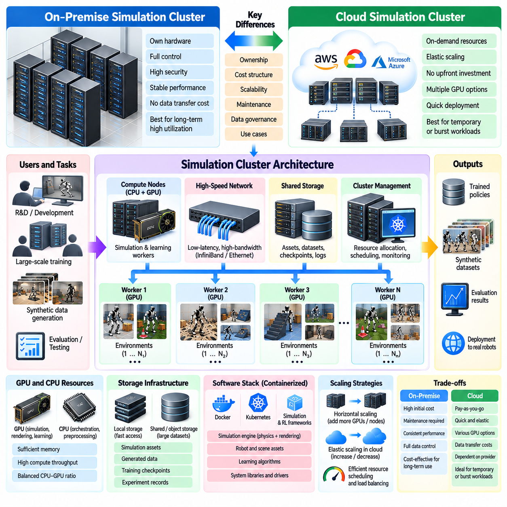{width="7.268055555555556in" height="7.268055555555556in"}

온프레미스 및 클라우드 시뮬레이션 클러스터(On-Premise and Cloud Simulation Clusters)는 피지컬 AI(Physical AI)를 위한 대규모 병렬 시뮬레이션(Massive Parallel Simulation) 작업 부하를 실행하는 데 필요한 계산 인프라(Computational Infrastructure)를 제공한다. 이러한 클러스터는 CPU, GPU, 메모리(Memory), 저장장치(Storage), 네트워킹(Networking), 오케스트레이션 소프트웨어(Orchestration Software)를 결합하여 대규모 시뮬레이션 로봇 집단을 지원한다. 인프라 선택(Infrastructure Selection)은 시뮬레이션 처리량(Simulation Throughput), 자원 가용성(Resource Availability), 운영 비용(Operating Cost), 데이터 거버넌스(Data Governance), 개별 프로토타입(Prototype)에서 생산 수준의 학습 시스템(Production-Level Training System)으로 실험을 확장하는 능력에 영향을 미친다.

온프레미스 시뮬레이션 클러스터(On-Premise Simulation Cluster)는 조직이 자체 시설 내에 설치하고 운영하는 계산 자원(Computing Resource)으로 구성된다. 전용 GPU 서버(Dedicated GPU Server), 고속 네트워크(High-Speed Network), 공유 저장장치(Shared Storage), 중앙집중형 관리 시스템(Centralized Management System)이 주요 인프라를 형성한다. 이러한 접근 방식은 하드웨어 구성(Hardware Configuration), 소프트웨어 환경(Software Environment), 보안 정책(Security Policy), 운영 일정(Operational Schedule)을 직접 제어할 수 있도록 하므로, 지속적인 시뮬레이션 수요와 엄격한 인프라 요구사항(Infrastructure Requirement)을 가진 조직에 적합하다.

클라우드 시뮬레이션 클러스터(Cloud Simulation Cluster)는 작업 부하 요구사항(Workload Requirement)에 따라 프로비저닝(Provisioning)할 수 있는 원격 관리형 인프라(Remotely Managed Infrastructure)를 통해 계산 자원을 제공한다. 가상 머신(Virtual Machine), GPU 인스턴스(GPU Instance), 컨테이너 서비스(Container Service), 관리형 저장장치(Managed Storage)를 활용하면 시뮬레이션 팀은 전용 하드웨어를 구매하지 않고도 계산 환경(Computational Environment)을 구축할 수 있다. 클라우드 플랫폼(Cloud Platform)은 일시적인 학습 작업(Training Campaign), 빠르게 증가하는 작업 부하, 다양한 가속기 구성(Accelerator Configuration)에 대한 접근이 필요한 프로젝트에 특히 유용하다.

두 아키텍처의 근본적인 차이는 자원 소유권(Resource Ownership)과 프로비저닝 방식(Provisioning Method)에 있다. 온프레미스 클러스터는 조직이 계산 장비를 구매, 설치, 유지보수하고 최종적으로 교체해야 한다. 클라우드 클러스터는 이러한 책임의 상당 부분을 서비스 소비(Service Consumption) 형태로 전환하며, 자원은 서비스 제공자 인터페이스(Provider Interface)를 통해 할당된다. 어느 모델도 모든 상황에서 우월하지 않으며, 상대적인 가치는 자원 활용 패턴(Utilization Pattern), 운영 전문성(Operational Expertise), 성능 요구사항(Performance Requirement), 장기 비용 구조(Long-Term Cost Structure)에 따라 달라진다.

GPU 선택(GPU Selection)은 두 배포 모델(Deployment Model) 모두에서 중요한 인프라 설계 결정이다. 시뮬레이션 작업 부하는 상당한 장치 메모리(Device Memory), 높은 부동소수점 처리량(Floating-Point Throughput), 효율적인 텐서 연산(Tensor Operation), 특수 그래픽 기능(Specialized Graphics Capability)을 요구할 수 있다. 접촉이 많은 물리 시뮬레이션(Contact-Rich Physics), 사실적 렌더링(Photorealistic Rendering), 강화학습(Reinforcement Learning)은 가속기 하드웨어(Accelerator Hardware)에 서로 다른 요구사항을 부과한다. 따라서 클러스터 설계는 이론적인 GPU 성능 사양에만 의존하지 않고 전체 시뮬레이션 파이프라인(Simulation Pipeline)을 평가해야 한다.

물리 시뮬레이션과 학습이 주로 GPU에서 실행되더라도 CPU 자원(CPU Resource)은 여전히 중요하다. 호스트 프로세서(Host Processor)는 장면 초기화(Scene Initialization), 환경 오케스트레이션(Environment Orchestration), 데이터 전처리(Data Preprocessing), 통신(Communication), 시스템 서비스(System Service)를 관리한다. CPU 용량이 부족하면 특히 시뮬레이션 환경에 복잡한 초기화 로직(Initialization Logic)이 포함된 경우 가속기가 효율적으로 동작하지 못할 수 있다. 균형 잡힌 클러스터 구성(Balanced Cluster Configuration)은 CPU 대 GPU 비율(CPU-to-GPU Ratio), 메모리 대역폭(Memory Bandwidth), 작업 부하별 스케줄링 요구사항(Workload-Specific Scheduling Demand)을 고려해야 한다.

네트워크 토폴로지(Network Topology)는 분산 시뮬레이션 성능(Distributed Simulation Performance)에 큰 영향을 미친다. 온프레미스 클러스터는 예측 가능한 지연시간(Latency)과 대역폭(Bandwidth) 특성을 가진 전용 고속 상호연결(Dedicated High-Speed Interconnect)을 사용할 수 있다. 클라우드 클러스터는 구성 가능한 네트워킹 기능(Configurable Networking Capability)을 제공하지만, 실제 성능은 인스턴스 배치(Instance Placement)와 서비스 구성(Service Configuration)에 따라 달라진다. 통신에 민감한 작업 부하(Communication-Sensitive Workload)는 긴밀하게 결합된 시뮬레이션 및 학습 프로세스(Simulation and Learning Process)를 네트워크 아키텍처 내부에서 서로 가깝게 배치할 때 이점을 얻는다.

저장장치 인프라(Storage Infrastructure)는 시뮬레이션 자산(Simulation Asset), 실험 구성(Experiment Configuration), 생성된 데이터셋(Generated Dataset), 학습 체크포인트(Training Checkpoint), 평가 결과(Evaluation Result)를 지원해야 한다. 고성능 로컬 저장장치(High-Performance Local Storage)는 자주 접근하는 데이터의 처리를 가속하며, 공유 저장장치 또는 객체 기반 저장장치(Shared or Object-Based Storage)는 협업과 영속성(Persistence)을 지원한다. 대규모 합성 영상 데이터셋(Synthetic Image Dataset)은 상당한 저장 용량과 전송 요구사항을 발생시킬 수 있다. 효율적인 아키텍처는 임시 작업 데이터(Temporary Working Data)를 장기 실험 기록(Long-Term Experiment Record) 및 재사용 가능한 시뮬레이션 자산(Reusable Simulation Asset)과 구분한다.

컨테이너화(Containerization)는 클러스터 노드(Cluster Node) 전반에서 일관된 소프트웨어 환경을 유지하기 위한 실용적인 방법을 제공한다. 시뮬레이션 엔진(Simulation Engine), 물리 라이브러리(Physics Library), 렌더링 의존성(Rendering Dependency), 학습 프레임워크(Learning Framework), 응용 프로그램 코드(Application Code)를 재현 가능한 실행 환경(Reproducible Execution Environment)으로 패키징할 수 있다. 컨테이너 오케스트레이션 플랫폼(Container Orchestration Platform)은 사용 가능한 CPU, GPU, 메모리 자원에 따라 작업 부하를 스케줄링할 수 있다. 그러나 드라이버 호환성(Driver Compatibility), GPU 접근(GPU Access), 특수 그래픽 요구사항(Specialized Graphics Requirement)은 여전히 신중한 구성이 필요하다.

클러스터 스케줄링(Cluster Scheduling)은 시뮬레이션 작업(Simulation Job)이 계산 자원을 놓고 경쟁하는 방식을 결정한다. 대화형 개발(Interactive Development), 대규모 정책 학습(Large-Scale Policy Training), 합성 데이터 생성(Synthetic Data Generation), 자동화된 평가(Automated Evaluation)는 서로 다른 우선순위(Priority)와 실행 시간(Execution Duration)을 가질 수 있다. 스케줄링 시스템(Scheduling System)은 GPU를 할당하고, 자원 할당량(Resource Quota)을 적용하며, 용량이 제한될 때 작업 부하를 대기열(Queue)에 배치할 수 있다. 효과적인 스케줄링은 대규모 실험이 지연시간에 민감한 개발 활동(Latency-Sensitive Development Activity)을 방해하지 않도록 하면서 자원 활용률을 높인다.

탄력적 확장(Elastic Scaling)은 클라우드 인프라(Cloud Infrastructure)의 주요 장점 중 하나이다. 집중적인 시뮬레이션 작업 기간에는 계산 자원을 늘리고 수요가 감소하면 줄일 수 있다. 이러한 유연성(Flexibility)은 짧은 기간에 수천 개의 환경이 필요한 실험에서 유용하다. 그러나 프로비저닝 지연(Provisioning Delay), 자원 할당량(Resource Quota), 가속기 가용성(Accelerator Availability), 데이터 이동 비용(Data Movement Cost)은 실제 탄력성을 제한할 수 있으며, 특히 특수 GPU 구성에서 이러한 제약이 두드러진다.

온프레미스 인프라(On-Premise Infrastructure)는 작업 부하가 장기간 지속적으로 높은 수준을 유지할 때 장점을 제공한다. 전용 가속기(Dedicated Accelerator)는 반복적인 클라우드 인스턴스 요금(Cloud Instance Charge) 없이 운영할 수 있으며, 로컬에 저장된 데이터셋은 반복적인 외부 전송을 피할 수 있다. 그러나 장비 감가상각(Equipment Depreciation), 전력(Electricity), 냉각(Cooling), 유지보수(Maintenance), 인력(Staffing), 하드웨어 교체(Hardware Replacement)는 총소유비용(Total Cost of Ownership)에 포함된다. 경제성 비교(Economic Comparison)는 구매 가격만 고려하는 대신 이러한 요소를 모두 포함해야 한다.

클라우드 비용 모델(Cloud Cost Model)은 서로 다른 최적화 과제(Optimization Challenge)를 발생시킨다. 계산 요금(Compute Charge)은 가속기 유형(Accelerator Type), 인스턴스 사용 시간(Instance Duration), 저장장치 사용량(Storage Consumption), 네트워크 트래픽(Network Traffic)에 따라 달라질 수 있다. 유휴 인스턴스(Idle Instance)와 비효율적으로 구성된 작업 부하는 학습 결과를 개선하지 않으면서 지출을 증가시킬 수 있다. 자동 종료 정책(Automated Shutdown Policy), 작업 부하 통합(Workload Consolidation), 적절한 인스턴스 선택(Instance Selection)은 비용 관리에 도움이 된다. 중단 가능한 자원(Interruptible Capacity)은 예기치 않은 종료에서 복구할 수 있는 작업의 비용을 줄일 수 있다.

하이브리드 시뮬레이션 클러스터(Hybrid Simulation Cluster)는 로컬 인프라(Local Infrastructure)와 클라우드 자원(Cloud Resource)을 결합하여 가변적인 수요(Variable Demand)에 대응한다. 일상적인 개발과 예측 가능한 학습 작업 부하(Predictable Training Workload)는 전용 서버에서 실행하고, 일시적인 대규모 실험에는 추가 클라우드 가속기를 활용할 수 있다. 이러한 구성에는 호환 가능한 소프트웨어 환경(Compatible Software Environment), 조정된 인증(Coordinated Authentication), 신뢰할 수 있는 데이터 전송 메커니즘(Reliable Data Transfer Mechanism)이 필요하다. 하이브리드 운영(Hybrid Operation)은 작업 부하 배치(Workload Placement)가 계산 요구사항과 데이터 지역성(Data Locality)을 모두 반영할 때 가장 효과적이다.

데이터 거버넌스(Data Governance)와 보안 요구사항(Security Requirement)도 배포 결정(Deployment Decision)에 영향을 미친다. 시뮬레이션 데이터셋에는 독점적인 로봇 설계(Proprietary Robot Design), 시설 배치도(Facility Layout), 운영 기록(Operational Recording), 상업적으로 민감한 모델(Commercially Sensitive Model)이 포함될 수 있다. 온프레미스 인프라는 물리적 저장장치(Physical Storage)와 네트워크 접근(Network Access)을 직접 제어할 수 있으며, 클라우드 서비스는 구성 가능한 보안 및 규정 준수 기능(Security and Compliance Capability)을 제공한다. 두 접근 방식 모두 암호화(Encryption), 신원 관리(Identity Management), 접근 제어(Access Control), 감사 로그(Audit Logging), 명확한 데이터 보존 정책(Data Retention Policy)이 필요하다.

운영 신뢰성(Operational Reliability)은 모니터링(Monitoring)과 자동 복구 메커니즘(Automated Recovery Mechanism)에 달려 있다. GPU 장애(GPU Failure), 메모리 고갈(Exhausted Memory), 저장장치 중단(Storage Interruption), 네트워크 결함(Network Fault), 소프트웨어 충돌(Software Crash)은 장시간 실행되는 시뮬레이션 작업을 방해할 수 있다. 클러스터 관리 시스템(Cluster Management System)은 하드웨어 상태(Hardware Health), 작업 상태(Job Status), 자원 소비(Resource Consumption), 학습 진행 상황(Training Progress)을 추적해야 한다. 체크포인트 저장(Checkpointing)과 재시작 절차(Restart Procedure)를 사용하면 이전에 완료한 모든 시뮬레이션 작업을 반복하지 않고 중단된 실험을 재개할 수 있다.

이기종 인프라(Heterogeneous Infrastructure)에서 작업 부하를 실행하면 실험 재현성(Experiment Reproducibility)을 확보하기가 더욱 어려워진다. GPU 아키텍처(GPU Architecture), 드라이버 버전(Driver Version), 물리 라이브러리(Physics Library), 수치 연산(Numerical Execution)의 차이는 시뮬레이션 결과에 영향을 미칠 수 있다. 일관된 컨테이너 이미지(Container Image), 버전 관리된 구성(Versioned Configuration), 통제된 난수 시드(Controlled Random Seed), 기록된 하드웨어 메타데이터(Hardware Metadata)는 추적 가능성(Traceability)을 향상시킨다. 동일한 소프트웨어 구성이라도 수치적으로 동일한 병렬 실행(Parallel Execution)을 항상 보장하지는 않으므로 통계적 평가(Statistical Evaluation)는 여전히 필요하다.

성능 평가(Performance Evaluation)는 개별 하드웨어 벤치마크(Isolated Hardware Benchmark)가 아니라 전체 시뮬레이션 워크플로(Simulation Workflow)를 고려해야 한다. 유용한 측정 지표에는 초당 환경 단계 수(Environment Steps per Second), GPU 활용률(GPU Utilization), 초당 렌더링된 관측값 수(Rendered Observations per Second), 데이터 전송 지연시간(Data Transfer Latency), 학습 완료 시간(Training Completion Time), 에너지 소비량(Energy Consumption)이 포함된다. 인프라 효율(Infrastructure Efficiency)은 단위 비용당 유효 시뮬레이션 상태 전이(Useful Simulation Transition) 또는 검증된 시나리오(Validated Scenario)로도 표현할 수 있다. 이러한 측정은 클러스터 규모 산정(Cluster Sizing)과 배포 전략(Deployment Strategy)에 관한 더 신뢰할 수 있는 의사결정을 지원한다.

용량 계획(Capacity Planning)은 환경 수(Number of Environments), 로봇 복잡성(Robot Complexity), 센서 요구사항(Sensor Requirement), 예상 학습 시간(Expected Training Duration)을 추정하는 것에서 시작한다. 이러한 요소는 대략적인 GPU 메모리 수요(GPU Memory Demand), 처리 요구사항(Processing Requirement), 저장 용량 증가(Storage Growth), 네트워크 트래픽(Network Traffic)을 결정한다. 대규모 인프라 투자(Infrastructure Investment)에 앞서 파일럿 벤치마크(Pilot Benchmark)를 통해 대표적인 작업 부하(Representative Workload)를 측정해야 한다. 계획에는 최대 수요(Peak Demand), 동시 사용자(Concurrent User), 유지보수 기간(Maintenance Period), 향후 확장(Future Expansion)도 고려해야 한다.

다중 테넌트 운영(Multi-Tenant Operation)은 여러 연구팀이 하나의 시뮬레이션 클러스터를 공유할 때 추가적인 복잡성을 발생시킨다. 자원 할당량(Resource Quota), 작업 우선순위(Job Priority), 프로젝트 격리(Project Isolation), 저장장치 접근 권한(Storage Permission)은 실험 간 간섭(Interference)을 방지하는 데 도움이 된다. 공유 인프라(Shared Infrastructure)는 전체 자원 활용률을 높일 수 있지만, 제대로 조정되지 않은 작업 부하는 예측하기 어려운 성능(Unpredictable Performance)을 유발할 수 있다. 투명한 사용량 회계(Transparent Accounting)와 중앙집중형 모니터링(Centralized Monitoring)은 공정한 자원 할당(Fair Resource Allocation)을 지원하고 각 팀이 실험의 계산 비용(Computational Cost)을 이해하도록 한다.

자동화(Automation)는 시뮬레이션 클러스터를 단순한 계산 장치의 집합에서 반복 가능한 실험 플랫폼(Repeatable Experimentation Platform)으로 전환한다. 인프라 프로비저닝(Infrastructure Provisioning), 컨테이너 배포(Container Deployment), 시나리오 생성(Scenario Generation), 학습 실행(Training Execution), 체크포인트 저장(Checkpoint Storage), 평가 보고(Evaluation Reporting)를 정의된 워크플로(Defined Workflow)를 통해 조정할 수 있다. 자동화된 파이프라인(Automated Pipeline)은 수동 구성 오류(Manual Configuration Error)를 줄이고 실험 간 체계적인 비교(Systematic Comparison)를 지원한다. 또한 대규모 시뮬레이션 작업을 더 쉽게 재현하고 유지관리할 수 있도록 한다.

최적의 인프라 전략(Optimal Infrastructure Strategy)은 피지컬 AI 개발이 진행됨에 따라 변화하는 경우가 많다. 초기 연구(Early Research)는 다양한 하드웨어에 대한 유연한 접근(Flexible Hardware Access)을 우선시할 수 있지만, 성숙한 학습 프로그램(Mature Training Program)은 전용 계산 용량(Dedicated Capacity)과 예측 가능한 운영 비용(Predictable Operating Cost)에서 이점을 얻을 수 있다. 조직은 작업 부하 강도(Workload Intensity), 하드웨어 요구사항(Hardware Requirement), 보안 제약조건(Security Constraint), 자원 활용률(Resource Utilization)을 주기적으로 재평가해야 한다. 인프라 결정은 변화하는 시뮬레이션 및 학습 목표(Simulation and Learning Objective)와 지속적으로 일치해야 한다.

온프레미스 및 클라우드 시뮬레이션 클러스터는 궁극적으로 확장 가능한 피지컬 AI 개발(Scalable Physical AI Development)을 위한 상호 보완적인 기반(Complementary Foundation)을 제공한다. 그 효과는 균형 잡힌 하드웨어 선택(Balanced Hardware Selection), 효율적인 스케줄링(Efficient Scheduling), 신뢰할 수 있는 저장장치(Reliable Storage), 안전한 데이터 관리(Secure Data Management), 지속적인 성능 측정(Continuous Performance Measurement)에 달려 있다. 인프라 역량(Infrastructure Capability)을 시뮬레이션 작업 부하(Simulation Workload)에 적절하게 대응시키면 조직은 지속 가능한 계산 자원(Sustainable Computational Resource)을 활용하여 대규모 로봇 학습(Large-Scale Robotic Learning), 합성 데이터 생성(Synthetic Data Generation), 체계적인 시뮬레이션-현실 전이 검증(Systematic Simulation-to-Real Validation)을 지원할 수 있다.

## 05.09. Throughput Real Time Factor and Performance

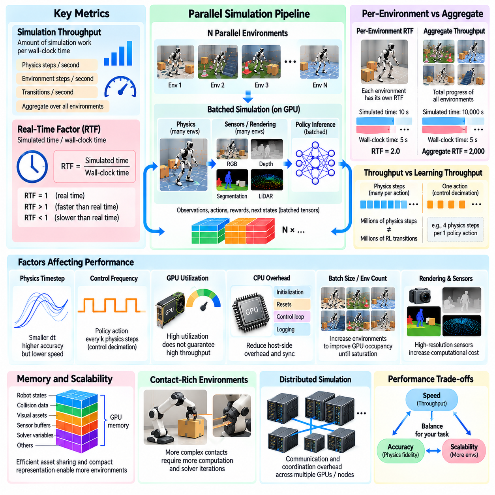{width="7.268055555555556in" height="7.268055555555556in"}

시뮬레이션 처리량(Simulation Throughput)과 실시간 계수(Real-Time Factor, RTF)는 피지컬 AI(Physical AI)의 대규모 병렬 시뮬레이션(Massive Parallel Simulation)을 평가하는 기본적인 성능 지표(Performance Metric)이다. 이러한 지표는 계산 자원(Computational Resource)이 물리적 상호작용(Physical Interaction)을 얼마나 효율적으로 재현하고 유용한 학습 데이터(Training Data)를 생성하는지 설명한다. 두 지표 모두 시뮬레이션 진행 정도(Simulated Progress)를 계산 노력(Computational Effort)과 연관시키지만, 시스템 동작(System Behavior)의 서로 다른 측면을 측정한다. 이들의 관계를 이해하는 것은 확장 가능한 시뮬레이션 아키텍처(Scalable Simulation Architecture)를 설계하고 인프라 투자(Infrastructure Investment)를 평가하는 데 필수적이다.

시뮬레이션 처리량(Simulation Throughput)은 지정된 실제 경과 시간(Wall-Clock Interval) 동안 완료된 시뮬레이션 작업량(Simulation Work)을 측정한다. 일반적으로 초당 물리 단계 수(Physics Steps per Second), 초당 환경 단계 수(Environment Steps per Second), 초당 생성된 상태 전이 수(Generated Transitions per Second)로 표현된다. 병렬 시스템(Parallel System)에서 총처리량(Aggregate Throughput)은 모든 활성 환경(Active Environment)의 진행량을 합산한 값이다. 그러나 의미 있는 비교를 위해서는 물리 적분 주파수(Physics Integration Frequency)와 정책 실행 간격(Policy Execution Interval)을 포함하여 단계(Step)의 정의가 일관되어야 한다.

실시간 계수(Real-Time Factor, RTF)는 경과한 시뮬레이션 시간(Simulated Time)과 실제 실행 시간(Wall-Clock Execution Time)을 비교한다. RTF가 1이면 시뮬레이션이 실제 물리적 시간(Physical Time)과 동일한 속도로 진행됨을 의미하며, 1보다 크면 실시간보다 빠르게 실행됨을 나타낸다. 반대로 1보다 작으면 실제 시간보다 느리게 실행된다는 의미이다. 예를 들어 실제 시간 10초 동안 물리적 활동 100초를 시뮬레이션하면 RTF는 10이 된다.

대규모 병렬 시뮬레이션에서 실시간 계수는 많은 환경이 동시에 진행되므로 신중하게 해석해야 한다. 개별 환경(Single Environment)은 실시간보다 느리게 동작하더라도 전체 시스템(Aggregate System)은 실제 시간 1초 동안 수천 초에 해당하는 시뮬레이션 시간을 생성할 수 있다. 따라서 개별 환경의 RTF가 높지 않더라도 총 시뮬레이션 시간 처리량(Aggregate Simulated-Time Throughput)은 매우 높을 수 있다. 환경별 RTF(Per-Environment RTF)와 총처리량(Aggregate Throughput)을 함께 보고하면 잘못된 성능 비교를 방지할 수 있다.

물리 시간 간격(Physics Timestep)의 선택은 시뮬레이션 성능(Simulation Performance)과 수치 정확도(Numerical Accuracy)에 직접적인 영향을 미친다. 작은 시간 간격은 빠른 동역학(Fast Dynamics)과 접촉 상호작용(Contact Interaction)의 해상도를 향상시키지만 더 많은 적분 연산(Integration Operation)을 요구한다. 큰 시간 간격은 계산 부담(Computational Demand)을 줄이지만 불안정성(Instability)이나 부정확한 충돌 응답(Inaccurate Collision Response)을 유발할 수 있다. 따라서 성능 평가는 가능한 한 높은 단계 실행 속도(Step Rate)를 주요 목표로 삼기보다 실행 속도와 함께 물리적 충실도(Physical Fidelity)를 고려해야 한다.

제어 주파수(Control Frequency)는 물리 처리량(Physics Throughput)과 학습 처리량(Learning Throughput) 사이에 또 다른 차이를 만든다. 로봇 제어기(Robot Controller)는 여러 물리 적분 단계(Physics Integration Step)에 걸쳐 하나의 행동(Action)을 명령할 수 있으며, 이러한 구성을 일반적으로 제어 데시메이션(Control Decimation)이라고 한다. 따라서 수백만 개의 물리 단계가 반드시 수백만 개의 강화학습 상태 전이(Reinforcement Learning Transition)에 대응하는 것은 아니다. 경험 생성 속도(Experience-Generation Rate)를 올바르게 해석하려면 벤치마크 보고서(Benchmark Report)에 물리 시간 간격과 정책 의사결정 간격(Policy Decision Interval)을 모두 명시해야 한다.

GPU 활용률(GPU Utilization)은 계산 효율(Computational Efficiency)을 나타내는 중요한 지표이지만, 높은 활용률 자체가 유용한 처리량(Useful Throughput)을 보장하지는 않는다. 시뮬레이션 커널(Simulation Kernel)은 메모리 대역폭(Memory Bandwidth), 명령어 의존성(Instruction Dependency), 동기화(Synchronization), 비효율적인 데이터 접근(Inefficient Data Access)에 의해 제한될 수 있다. GPU가 높은 점유율(Occupancy)로 동작하더라도 불필요한 계산이 포함되면 성능이 낮을 수 있다. 따라서 프로파일링(Profiling)은 활용률 측정값을 실제 완료된 시뮬레이션 작업 및 학습 진행 상태(Training Progress)와 연결해야 한다.

CPU 처리 부담(CPU Overhead)은 GPU 가속 시뮬레이션(GPU-Accelerated Simulation)의 이점을 크게 감소시킬 수 있다. 장면 초기화(Scene Initialization), 환경 초기화(Environment Reset), 파이썬 제어 루프(Python Control Loop), 로깅(Logging), 데이터 준비(Data Preparation)는 가속기 실행(Accelerator Execution)을 중단시킬 수 있다. CPU와 GPU 사이의 빈번한 동기화는 병렬로 수행할 수 있는 연산이 완료를 기다리도록 만든다. 호스트 측 개입(Host-Side Intervention)을 줄이고 작은 연산을 더 큰 배치(Batch)로 결합하면 하드웨어 용량을 늘리지 않고도 처리량을 향상시킬 수 있다.

배치 크기(Batch Size)와 환경 수(Environment Count)는 병렬 성능(Parallel Performance)에 큰 영향을 미친다. 작은 배치는 커널 실행 부담(Kernel Launch Overhead)이 계산보다 지배적이기 때문에 GPU 자원을 충분히 활용하지 못할 수 있다. 환경 수를 증가시키면 일반적으로 계산, 메모리, 스케줄링 한계(Computational, Memory, or Scheduling Limit)에 도달할 때까지 점유율이 향상된다. 이 지점을 넘어서면 추가 인스턴스(Instance)는 수익 체감(Diminishing Return)을 발생시키거나 성능을 저하시킬 수 있다. 따라서 최적 배치 크기(Optimal Batch Size)는 대표적인 작업 부하 측정(Representative Workload Measurement)을 통해 결정해야 한다.

렌더링(Rendering)과 센서 시뮬레이션(Sensor Simulation)은 성능 특성(Performance Characteristic)을 크게 변화시킬 수 있다. 상태 기반 강화학습(State-Based Reinforcement Learning)은 비교적 간결한 관측값(Compact Observation)만 필요로 하는 경우가 많지만, 시각 기반 정책(Vision-Based Policy)은 고해상도 카메라(High-Resolution Camera), 깊이 맵(Depth Map), 분할 영상(Segmentation Image)에 의존할 수 있다. 렌더링은 물리 실행에 사용할 수 있는 GPU 처리 능력(GPU Processing Capacity), 메모리, 대역폭을 소비한다. 따라서 성능 연구(Performance Study)는 물리 연산만 수행하는 처리량(Physics-Only Throughput)과 전체 센서가 활성화된 시뮬레이션 처리량(Complete Sensor-Enabled Simulation Throughput)을 구분해야 한다.

메모리 용량(Memory Capacity)과 대역폭(Bandwidth)은 병렬 환경의 최대 실용 개수(Maximum Practical Environment Count)를 결정하는 경우가 많다. 로봇 상태(Robot State), 충돌 구조(Collision Structure), 시각 자산(Visual Asset), 센서 버퍼(Sensor Buffer), 임시 솔버 데이터(Temporary Solver Data)는 장치 메모리(Device Memory)를 공유하며 경쟁한다. 과도한 메모리 할당(Excessive Allocation)은 실행 실패(Execution Failure)나 메모리 위치 간 비용이 높은 데이터 전송(Expensive Data Transfer)을 유발할 수 있다. 효율적인 자산 공유(Asset Sharing), 압축된 표현(Compact Representation), 신중한 버퍼 관리(Buffer Management)는 필수적인 물리적 세부사항을 희생하지 않고도 확장성을 향상시킬 수 있다.

접촉이 많은 환경(Contact-Rich Environment)은 추가적인 계산 변동성(Computational Variability)을 발생시킨다. 여러 강체(Rigid Body), 마찰 접촉(Frictional Contact), 관절형 메커니즘(Articulated Mechanism)이 포함된 조작 작업(Manipulation Task)은 단순한 자유 공간 운동(Free-Space Motion)보다 복잡한 제약조건 해결(Constraint Solving)을 필요로 한다. 솔버 반복 횟수(Solver Iteration Count)와 충돌 복잡성(Collision Complexity)은 실행 시간에 영향을 미칠 수 있다. 따라서 벤치마크 시나리오(Benchmark Scenario)는 비정상적으로 유리한 결과를 생성하는 단순화된 환경에만 의존하지 않고 대표적인 접촉 조건(Representative Contact Condition)을 포함해야 한다.

분산 시뮬레이션(Distributed Simulation)은 로컬 계산(Local Computation) 외에 통신 및 조정 부담(Communication and Coordination Overhead)을 추가한다. 작업자(Worker)는 장치 또는 노드(Node) 사이에서 정책 매개변수(Policy Parameter), 경험 배치(Experience Batch), 평가 결과(Evaluation Result), 동기화 신호(Synchronization Signal)를 교환할 수 있다. 네트워크 지연시간(Network Latency)과 대역폭 제한(Bandwidth Limitation)은 특히 빈번한 통신이 시뮬레이션을 중단시키는 경우 확장 효율(Scaling Efficiency)을 감소시킬 수 있다. 통신 시간을 물리 실행 및 학습 실행 시간과 별도로 측정하면 아키텍처 개선(Architectural Improvement)의 기회를 식별하는 데 도움이 된다.

강한 확장성(Strong Scaling)과 약한 확장성(Weak Scaling)은 다중 GPU 성능(Multi-GPU Performance)을 평가하기 위한 상호 보완적인 방법을 제공한다. 강한 확장성은 고정된 시뮬레이션 작업 부하(Fixed Simulation Workload)를 더 많은 장치에 분산할 때 실행 시간(Execution Time)이 얼마나 감소하는지 측정한다. 약한 확장성은 계산 자원(Computing Resource)에 비례하여 작업 부하 크기(Workload Size)를 증가시킬 때 총처리량(Aggregate Throughput)이 증가하는지 평가한다. 두 접근 방식 모두 단일 장치 벤치마크(Single-Device Benchmark)에서는 드러나지 않을 수 있는 동기화 비용(Synchronization Cost), 부하 불균형(Load Imbalance), 인프라 한계(Infrastructure Limitation)를 보여준다.

경험 수집(Experience Collection)과 정책 최적화(Policy Optimization) 사이의 관계는 종단 간 강화학습 성능(End-to-End Reinforcement Learning Performance)을 결정한다. 시뮬레이션 시스템이 학습기(Learner)의 처리 능력보다 빠르게 상태 전이(Transition)를 생성하면 버퍼 부담(Buffer Pressure)이나 갱신 지연(Delayed Update)이 발생할 수 있다. 반대로 강력한 학습기가 롤아웃(Rollout)을 기다리며 유휴 상태(Idle State)에 머물 수도 있다. 성공적인 정책(Successful Policy)을 학습하는 데 필요한 총시간을 줄이려면 시뮬레이션 작업자(Simulation Worker), 추론 용량(Inference Capacity), 최적화 빈도(Optimization Frequency)의 균형을 맞추는 것이 필수적이다.

강화학습 시스템을 비교할 때 실제 학습 소요 시간(Wall-Clock Training Time)은 원시 시뮬레이션 처리량(Raw Simulation Throughput)보다 더 의미 있는 지표인 경우가 많다. 더 많은 상태 전이를 생성하는 구성(Configuration)이라도 추가적인 최적화 단계(Optimization Step)가 필요하거나 품질이 낮은 경험(Lower-Quality Experience)을 생성할 수 있다. 학습 효율(Learning Efficiency)은 탐색 다양성(Exploration Diversity), 보상 설계(Reward Design), 알고리즘 안정성(Algorithm Stability), 데이터 관련성(Data Relevance)에 따라 달라진다. 따라서 성능 분석(Performance Analysis)은 계산 처리량(Computational Throughput)을 달성된 정책 품질(Policy Quality) 및 작업 성공률(Task Success Rate)과 연관시켜야 한다.

지연시간 측정(Latency Measurement)은 개별 연산(Individual Operation)의 지연을 드러냄으로써 처리량 지표를 보완한다. 관련 측정값에는 물리 단계 지연시간(Physics-Step Latency), 정책 추론 지연시간(Policy Inference Latency), 센서 렌더링 지연시간(Sensor Rendering Latency), 환경 초기화 시간(Environment Reset Time), 통신 지연(Communication Delay)이 포함된다. 평균 지연시간(Average Latency)만으로는 동기화된 배치(Synchronized Batch)를 중단시키는 간헐적으로 비용이 높은 연산(Expensive Operation)을 파악하지 못할 수 있다. 백분위수 측정(Percentile Measurement)과 지연시간 분포(Latency Distribution)는 가변적인 작업 부하에서 런타임 동작(Runtime Behavior)을 더 완전하게 보여준다.

성능 프로파일링(Performance Profiling)은 물리 적분(Physics Integration), 충돌 감지(Collision Detection), 렌더링(Rendering), 보상 계산(Reward Computation), 신경망 추론(Neural Inference), 데이터 전송(Data Transfer)의 상대적인 비용을 식별해야 한다. 타임라인 분석(Timeline Analysis)은 유휴 구간(Idle Interval), 반복적인 동기화(Repeated Synchronization), 비효율적인 커널 실행(Inefficient Kernel Launch), 불균형한 장치 작업 부하(Uneven Device Workload)를 드러낼 수 있다. 최적화(Optimization)는 추정된 한계가 아니라 실제 측정된 병목 현상(Measured Bottleneck)을 대상으로 해야 한다. 다른 단계가 전체 실행 시간을 지배하는 경우 부차적인 구성요소(Minor Component)를 개선하더라도 효과는 제한적일 수 있다.

벤치마크 재현성(Benchmark Reproducibility)을 확보하려면 일관된 하드웨어 구성(Hardware Configuration), 소프트웨어 버전(Software Version), 시뮬레이션 매개변수(Simulation Parameter), 측정 절차(Measurement Procedure)가 필요하다. GPU 예열(GPU Warm-Up), 컴파일 부담(Compilation Overhead), 초기화 시간(Initialization Time), 캐싱 동작(Caching Behavior)은 짧은 실험의 결과를 왜곡할 수 있다. 신뢰할 수 있는 벤치마크(Reliable Benchmark)는 시작 비용(Startup Cost)과 정상 상태 성능(Steady-State Performance)을 구분하고 여러 번 측정을 반복해야 한다. 환경 수, 시간 간격 설정(Timestep Setting), 센서 구성(Sensor Configuration), 장치 특성(Device Characteristic)을 기록하면 의미 있는 비교를 지원할 수 있다.

성능 최적화(Performance Optimization)는 시뮬레이션 결과의 물리적 타당성(Physical Validity)을 보존해야 한다. 시간 간격을 늘리거나, 솔버 반복 횟수(Solver Iteration)를 줄이거나, 충돌을 단순화하거나, 센서 효과(Sensor Effect)를 비활성화하면 실행 속도가 향상될 수 있지만 학습된 행동(Learned Behavior)이 달라질 수 있다. 이러한 변경은 작업별 충실도 요구사항(Task-Specific Fidelity Requirement)과 실제 환경 검증 결과(Real-World Validation Result)를 기준으로 평가해야 한다. 적절한 최적화 목표는 최대 계산 속도(Maximum Computational Speed)가 아니라 물리적으로 유용한 경험(Physically Useful Experience)을 신뢰성 있게 가장 빠르게 생성하는 것이다.

비용 정규화 성능(Cost-Normalized Performance)은 인프라 계획(Infrastructure Planning)에 또 다른 관점을 제공한다. GPU당, 와트당(Per Watt), 운영 비용 단위당(Per Unit of Operating Cost) 시뮬레이션 처리량은 하드웨어 구성과 배포 전략(Deployment Strategy) 사이의 차이를 보여줄 수 있다. 에너지 소비(Energy Consumption), 가속기 활용률(Accelerator Utilization), 인프라 운영 부담(Infrastructure Overhead)은 대규모 학습 작업(Training Campaign)의 경제적 지속 가능성(Economic Sustainability)에 영향을 미친다. 최대 처리량(Peak Throughput)이 낮은 시스템이라도 운영 효율(Operational Efficiency)이 더 높다면 전체적으로 더 나은 가치를 제공할 수 있다.

시뮬레이션 처리량(Simulation Throughput), 실시간 계수(Real-Time Factor), 성능 분석(Performance Analysis)은 궁극적으로 계산 확장성(Computational Scalability)을 실질적인 피지컬 AI 개발(Physical AI Development)과 연결한다. 효과적인 평가는 총 시뮬레이션 진행량(Aggregate Simulation Progress), 환경별 실행 속도(Per-Environment Execution Speed), 자원 활용률(Resource Utilization), 지연시간(Latency), 물리적 충실도(Physical Fidelity), 학습 결과(Learning Outcome)를 종합한다. 이러한 요소를 일관되게 측정함으로써 엔지니어는 병목 현상을 식별하고 병렬 아키텍처(Parallel Architecture)를 최적화하며 로봇 학습(Robotic Training)과 시뮬레이션-현실 전이 검증(Simulation-to-Real Validation)을 가속하는 시뮬레이션 시스템을 구축할 수 있다.

## 05.10. Memory Asset and GPU Optimization

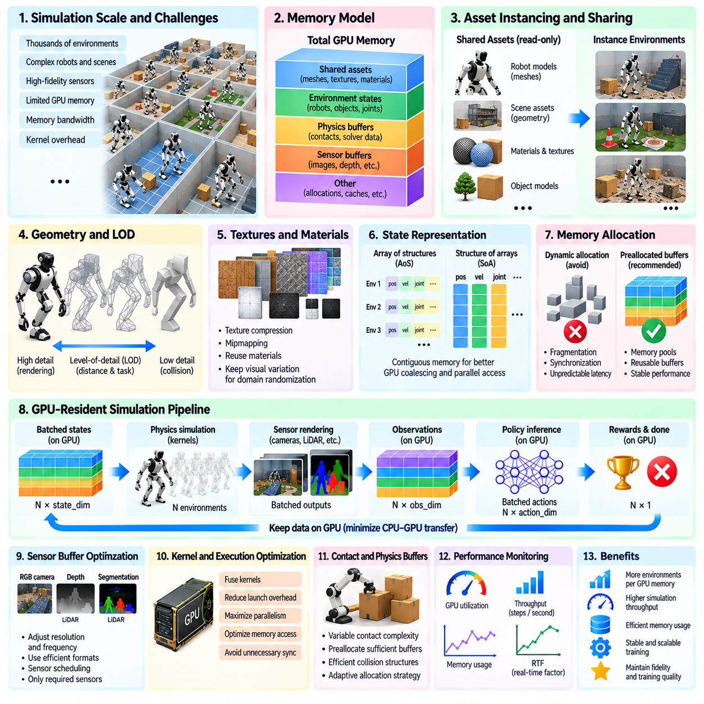{width="7.268055555555556in" height="7.268055555555556in"}

메모리, 자산 및 GPU 최적화(Memory, Asset, and GPU Optimization)는 피지컬 AI(Physical AI) 시뮬레이션을 수천 개의 동시 실행 로봇 환경(Concurrent Robot Environment)으로 확장하는 데 필수적이다. 시뮬레이션 환경의 수가 증가함에 따라 장치 메모리(Device Memory), 메모리 대역폭(Memory Bandwidth), 계산 자원(Computational Resource)이 주요 제약 요인이 된다. 효율적인 최적화를 위해서는 물리 상태(Physical State), 기하학적 자산(Geometric Asset), 센서 버퍼(Sensor Buffer), GPU 실행(GPU Execution)을 통합적으로 관리해야 한다. 목표는 물리적 충실도(Physical Fidelity)와 학습 품질(Training Quality)을 유지하면서 유효 시뮬레이션 처리량(Useful Simulation Throughput)을 극대화하는 것이다.

GPU 메모리 소비량(GPU Memory Consumption)은 환경 수(Environment Count), 로봇 복잡성(Robot Complexity), 활성화된 시뮬레이션 기능(Enabled Simulation Feature)에 따라 증가한다. 각 인스턴스(Instance)는 강체 상태(Rigid-Body State), 관절 좌표(Joint Coordinate), 속도(Velocity), 접촉 정보(Contact Information), 임시 솔버 변수(Temporary Solver Variable)를 저장할 공간이 필요하다. 렌더링(Rendering)은 기하 형상(Geometry), 재질(Material), 텍스처(Texture), 영상 버퍼(Image Buffer)를 추가한다. 이러한 메모리 범주(Memory Category)를 이해하면 엔지니어는 용량 요구사항(Capacity Requirement)을 추정하고 어떤 구성요소가 자원 소비(Resource Consumption)를 지배하는지 식별할 수 있다.

유용한 메모리 모델(Memory Model)은 공유 자산(Shared Asset)과 환경별 상태(Environment-Specific State)를 구분한다. 공유 자산에는 로봇 메시(Robot Mesh), 충돌 기하 형상(Collision Geometry), 재질 정의(Material Definition), 재사용 가능한 장면 설명(Reusable Scene Description)이 포함된다. 환경별 데이터(Environment-Specific Data)에는 위치 및 자세(Pose), 속도(Velocity), 관절 상태(Joint State), 접촉 제약조건(Contact Constraint), 무작위화된 매개변수(Randomized Parameter)가 포함된다. 변경되지 않는 자산(Immutable Asset)은 한 번만 저장하고 인스턴스별 상태(Per-Instance State)를 간결하게 유지하면 중복을 줄이고 제한된 GPU 메모리 내에서 더 큰 시뮬레이션 배치를 지원할 수 있다.

자산 인스턴싱(Asset Instancing)은 수천 개의 환경에 동일한 로봇 모델(Robot Model)이나 반복되는 물체(Repeated Object)가 포함된 경우 특히 효과적이다. 모든 메시와 재질의 복사본을 별도로 로드하는 대신, 시뮬레이션 시스템은 인스턴스별 변환(Instance-Specific Transform)을 통해 공통 자산 정의(Common Asset Definition)를 참조한다. 이러한 접근 방식은 기하 형상 저장 공간(Geometry Storage)과 초기화 부담(Initialization Overhead)을 줄인다. 그 효과는 물리 엔진(Physics Engine)과 렌더링 엔진(Rendering Engine)이 독립적인 시뮬레이션 환경 전반에서 효율적인 공유를 지원하는지에 따라 달라진다.

기하 형상 복잡성(Geometry Complexity)은 메모리 소비량과 계산 성능(Computational Performance)에 모두 영향을 미친다. 상세한 시각 메시(Visual Mesh)는 수백만 개의 다각형(Polygon)을 포함할 수 있지만, 충돌 감지(Collision Detection)에는 일반적으로 더 단순한 기하학적 표현(Geometric Representation)이 필요하다. 시각 기하 형상(Visual Geometry)과 충돌 기하 형상(Collision Geometry)을 분리하면 불필요하게 비싼 접촉 계산(Contact Calculation)을 수행하지 않고도 사실적인 렌더링(Realistic Rendering)을 구현할 수 있다. 기본 도형(Primitive Shape), 볼록 근사(Convex Approximation), 단순화된 충돌 메시(Simplified Collision Mesh)는 물리적 동작이 충분히 정확하게 유지되는 경우 효율성을 향상시킬 수 있다.

세부 수준 기법(Level-of-Detail Technique, LOD)은 관찰 거리(Viewing Distance)와 작업 요구사항(Task Requirement)에 적합한 기하학적 표현을 선택하여 렌더링 비용(Rendering Cost)을 줄인다. 영상에서 몇 개의 픽셀(Image Pixel)만 차지하는 물체는 가까운 조작 대상(Nearby Manipulation Target)과 동일한 수준의 기하학적 세부사항(Geometric Detail)을 필요로 하지 않는 경우가 많다. 그러나 단순화(Simplification)는 인식 학습(Perception Learning)에 중요한 시각적 특징(Visual Feature)을 보존해야 한다. 따라서 적응형 세부 수준 선택(Adaptive Detail Selection)은 카메라 해상도(Camera Resolution), 물체 가시성(Object Visibility), 로봇 정책(Robotic Policy)에 필요한 정보를 고려해야 한다.

텍스처 및 재질 관리(Texture and Material Management)는 사실적 시뮬레이션(Photorealistic Simulation)에서 상당한 GPU 메모리를 소비할 수 있다. 고해상도 텍스처(High-Resolution Texture), 노멀 맵(Normal Map), 물리 기반 재질 매개변수(Physically Based Material Parameter)는 시각적 사실성(Visual Realism)을 높이지만 메모리 요구량도 증가시킨다. 텍스처 압축(Texture Compression), 밉매핑(Mipmapping), 재질 정의 재사용(Material Definition Reuse)은 불필요한 저장 공간을 줄인다. 최적화는 도메인 무작위화(Domain Randomization)에 필요한 외관 변화(Appearance Variation)를 유지하면서 시각적으로 동일한 자원의 중복 복사본을 방지해야 한다.

물리 상태 표현(Physics State Representation)은 효율적인 병렬 메모리 접근(Parallel Memory Access)을 지원하도록 구성해야 한다. 배열 구조(Structure-of-Arrays, SoA) 배치는 인접한 스레드(Thread)가 동일한 물리량(Physical Quantity)의 연속된 값에 접근하므로 GPU 메모리 접근 병합(GPU Memory Coalescing)을 개선하는 경우가 많다. 구조체 배열(Array-of-Structures, AoS) 배치는 소프트웨어 구성(Software Organization)에는 편리할 수 있지만 비효율적인 메모리 트랜잭션(Memory Transaction)을 발생시킬 수 있다. 선호되는 표현 방식은 커널 접근 패턴(Kernel Access Pattern), 솔버 아키텍처(Solver Architecture), 각 시뮬레이션 단계에서 수행되는 연산에 따라 달라진다.

메모리 할당 전략(Memory Allocation Strategy)은 실행 안정성(Execution Stability)과 처리량(Throughput)에 모두 영향을 미친다. 시뮬레이션 중 반복적인 메모리 할당 및 해제(Allocation and Deallocation)는 동기화 부담(Synchronization Overhead), 메모리 단편화(Fragmentation), 예측하기 어려운 지연시간(Unpredictable Latency)을 유발할 수 있다. 사전 할당 버퍼(Preallocated Buffer)와 재사용 가능한 메모리 풀(Reusable Memory Pool)은 반복되는 연산에 필요한 저장 공간을 미리 확보하여 이러한 비용을 줄인다. 그러나 동적 작업 부하(Dynamic Workload)에서는 특히 접촉 수(Contact Count), 센서 출력(Sensor Output), 활성 물체 수(Active Object Population)가 환경마다 달라지는 경우 용량 계획(Capacity Planning)이 여전히 필요하다.

접촉 시뮬레이션(Contact Simulation)은 실행 중 크게 달라질 수 있는 임시 메모리 요구사항(Temporary Memory Requirement)을 발생시킨다. 충돌 감지(Collision Detection)는 후보 쌍(Candidate Pair), 접촉점(Contact Point), 제약조건 데이터(Constraint Data), 솔버 중간 데이터(Solver Intermediate)를 생성한다. 많은 관절형 물체(Articulated Body)가 밀집하여 상호작용하는 경우 버퍼 수요(Buffer Demand)가 갑자기 증가할 수 있다. 보수적인 용량 한계(Conservative Capacity Limit)는 신뢰성을 높이며, 적응형 할당 전략(Adaptive Allocation Strategy)은 시뮬레이션 인스턴스 간 접촉 복잡성(Contact Complexity)이 크게 달라지는 경우 자원 활용률을 향상시킬 수 있다.

센서 버퍼(Sensor Buffer)는 또 다른 중요한 최적화 대상(Optimization Target)이다. RGB 카메라(RGB Camera), 깊이 센서(Depth Sensor), 분할 출력(Segmentation Output), 이벤트 기반 센서(Event-Based Sensor)는 서로 다른 메모리 및 대역폭 특성(Memory and Bandwidth Characteristic)을 가진 데이터를 생성한다. 제어 정책(Control Policy)이 더 적은 정보만 필요로 하는 경우 모든 센서를 최대 해상도(Maximum Resolution)와 최대 주파수(Maximum Frequency)로 렌더링하는 것은 자원 낭비가 될 수 있다. 센서 스케줄링(Sensor Scheduling)은 데이터 획득 속도(Acquisition Rate)와 출력 형식(Output Format)을 실제 인식 및 제어 요구사항(Perception and Control Requirement)에 맞추어야 한다.

GPU 상주형 데이터 파이프라인(GPU-Resident Data Pipeline)은 장치 메모리(Device Memory)와 호스트 메모리(Host Memory) 사이의 전송을 최소화한다. 물리 상태(Physics State), 관측값(Observation), 행동(Action), 보상(Reward), 종료 플래그(Termination Flag)는 시뮬레이션과 학습 과정 전체에서 GPU 내부에 유지될 수 있다. 직접 텐서 인터페이스(Direct Tensor Interface)를 사용하면 정책 신경망(Policy Network)이 불필요한 직렬화(Serialization)나 복사(Copying) 없이 시뮬레이션 출력을 사용할 수 있다. 반복적인 CPU-GPU 동기화(CPU-GPU Synchronization)를 방지하는 것은 수천 개의 환경이 높은 주파수로 진행되는 경우 특히 중요하다.

시뮬레이션 연산이 많은 작은 GPU 작업(GPU Task)으로 분할되면 커널 실행 부담(Kernel Launch Overhead)이 중요해진다. 호환 가능한 계산(Compatible Computation)을 결합하면 커널 실행 빈도(Kernel Launch Frequency)를 줄이고 실행 효율(Execution Efficiency)을 향상시킬 수 있다. 보상 계산(Reward Calculation), 관측값 변환(Observation Transformation), 종료 조건 검사(Termination Check)는 배치 처리(Batched Processing)에 적합한 경우가 많다. 그러나 과도한 커널 융합(Kernel Fusion)은 레지스터 부담(Register Pressure)을 증가시키고 점유율(Occupancy)을 감소시킬 수 있으므로, 최적화는 무분별하게 적용하기보다 프로파일링(Profiling)을 기반으로 수행해야 한다.

GPU 점유율(GPU Occupancy)은 활성 스레드(Active Thread) 수, 레지스터 사용량(Register Usage), 공유 메모리 소비량(Shared Memory Consumption), 하드웨어 스케줄링 한계(Hardware Scheduling Limit)에 따라 달라진다. 높은 점유율은 메모리 지연시간(Memory Latency)을 숨기는 데 도움이 될 수 있지만, 최대 점유율이 항상 최대 처리량(Maximum Throughput)을 의미하지는 않는다. 계산 집약도(Computational Intensity)와 메모리 접근 효율(Memory Access Efficiency)도 동일하게 중요하다. 엔지니어는 활용률 수치(Utilization Percentage)에만 의존하지 않고 커널 실행 시간(Kernel Execution Time), 실제 달성 대역폭(Achieved Bandwidth), 명령어 효율(Instruction Efficiency)을 평가해야 한다.

메모리 대역폭 최적화(Memory Bandwidth Optimization)는 물리 및 렌더링 연산(Physics and Rendering Operation) 중 중복된 읽기와 쓰기(Redundant Read and Write)를 최소화해야 한다. 자주 접근하는 상태 변수(State Variable)는 병합된 메모리 트랜잭션(Coalesced Memory Transaction)과 적절한 캐싱(Caching)을 지원하는 배치를 사용해야 한다. 기존 버퍼(Existing Buffer)에서 직접 계산할 수 있는 경우 임시 텐서(Temporary Tensor)를 제거해야 한다. 산술 연산(Arithmetic Operation)의 비용이 상대적으로 낮은 시뮬레이션 작업 부하에서는 메모리 트래픽(Memory Traffic)을 줄이는 것만으로도 상당한 성능 향상을 얻을 수 있다.

혼합 정밀도 연산(Mixed-Precision Computation)은 일부 신경망 및 렌더링 연산(Neural-Network and Rendering Operation)의 메모리 소비량을 줄이고 처리량을 향상시킬 수 있다. 낮은 정밀도 형식(Lower-Precision Format)은 특수 가속기 하드웨어(Specialized Accelerator Hardware)가 지원하는 경우 특히 유용하다. 그러나 물리 적분(Physics Integration), 접촉 해결(Contact Resolution), 제약조건 해결(Constraint Solving)은 수치 정밀도(Numerical Precision)에 민감할 수 있다. 정밀도 선택(Precision Choice)은 안정성(Stability), 에너지 보존(Energy Conservation), 접촉 정확도(Contact Accuracy), 장시간 시뮬레이션 동작(Long-Horizon Simulation Behavior)을 기준으로 검증해야 한다.

환경 초기화(Environment Initialization)와 재설정 연산(Reset Operation)도 성능에 영향을 미친다. 에피소드(Episode)가 끝날 때마다 전체 장면(Scene)을 다시 구성하는 것은 상태 변수(State Variable)의 일부만 변경하면 되는 경우 불필요한 계산을 발생시킨다. 효율적인 재설정(Efficient Reset)은 변경되지 않는 자산(Immutable Asset)을 반복적으로 로드하지 않고 위치(Position), 속도(Velocity), 관절 구성(Joint Configuration), 무작위화된 매개변수(Randomized Parameter)를 복원한다. 배치형 재설정 절차(Batched Reset Procedure)를 사용하면 완료된 환경을 독립적으로 다시 시작하면서 나머지 시뮬레이션 환경 집단(Simulation Population)의 연속적인 실행을 유지할 수 있다.

메모리 단편화(Memory Fragmentation)는 환경 구성이 변화하는 장시간 실험(Long-Running Experiment)에서 더욱 문제가 된다. 가변 크기 할당(Variable-Sized Allocation)과 반복적인 자산 로딩(Repeated Asset Loading)은 사용 가능한 장치 메모리에 활용할 수 없는 빈 공간(Unusable Gap)을 남길 수 있다. 안정적인 할당 패턴(Stable Allocation Pattern), 메모리 풀(Memory Pool), 예측 가능한 자산 수명주기(Predictable Asset Lifecycle)는 단편화 위험(Fragmentation Risk)을 줄인다. 최대 메모리 할당량(Peak Allocation)과 예약된 메모리(Reserved Memory)를 모니터링하면 실제 용량 부족(Actual Capacity Shortage)과 비효율적인 메모리 관리(Inefficient Memory Management)를 구분하는 데 도움이 된다.

다중 GPU 시뮬레이션(Multi-GPU Simulation)은 추가적인 자산 및 메모리 고려사항(Asset and Memory Consideration)을 발생시킨다. 개별 장치 내부에서 자산을 공유하더라도 각 가속기(Accelerator)는 일반적으로 자신에게 할당된 환경에 필요한 데이터의 로컬 복사본(Local Copy)을 유지해야 한다. 따라서 대규모 시각 자원(Visual Resource)이 여러 GPU에 중복 저장될 수 있다. 작업 부하 분할(Workload Partitioning)은 단순히 인스턴스 수(Instance Count)에 따라 환경을 분산하는 대신 자산 지역성(Asset Locality), 장치 메모리 용량(Device Memory Capacity), 통신 비용(Communication Cost)을 고려해야 한다.

프로파일링 도구(Profiling Tool)는 최적화 작업(Optimization Work)의 우선순위를 결정하는 데 필요한 근거를 제공한다. 메모리 타임라인(Memory Timeline), 할당 통계(Allocation Statistic), 커널 추적(Kernel Trace), 대역폭 측정(Bandwidth Measurement), GPU 활용률(GPU Utilization)은 서로 다른 병목 현상(Bottleneck)을 드러낸다. 시뮬레이션이 계산 성능에 의해 제한되는 것처럼 보이더라도 실제로는 데이터 전송이나 동기화 대기에 상당한 시간을 소비할 수 있다. 대표적인 벤치마크(Representative Benchmark)는 실제 로봇 복잡성(Robot Complexity), 접촉 조건(Contact Condition), 센서 구성(Sensor Configuration), 환경 수(Environment Count)를 포함해야 한다.

최적화 결정(Optimization Decision)은 의도된 시뮬레이션 동작(Intended Simulation Behavior)을 보존해야 한다. 충돌 기하 형상(Collision Geometry)을 단순화하거나, 센서 해상도(Sensor Resolution)를 낮추거나, 수치 정밀도(Numerical Precision)를 줄이거나, 솔버 반복 횟수(Solver Iteration)를 감소시키면 처리량이 향상될 수 있지만 학습에 사용되는 데이터가 달라질 수 있다. 이러한 변경은 작업별 정확도 요구사항(Task-Specific Accuracy Requirement)과 실제 환경 검증 결과(Real-World Validation Result)를 기준으로 평가해야 한다. 성능 향상은 결과적으로 생성된 시뮬레이션이 의도된 학습 및 시험 목표(Training and Testing Objective)에 여전히 적합할 때만 가치가 있다.

메모리, 자산 및 GPU 최적화는 궁극적으로 대규모 병렬 시뮬레이션(Massive Parallel Simulation)이 하드웨어 용량(Hardware Capacity)을 유용한 피지컬 AI 경험(Useful Physical AI Experience)으로 얼마나 효과적으로 전환하는지를 결정한다. 효율적인 자산 공유(Efficient Asset Sharing), 간결한 상태 표현(Compact State Representation), GPU 상주형 파이프라인(GPU-Resident Pipeline), 통제된 메모리 할당(Controlled Memory Allocation), 신중하게 프로파일링된 커널(Carefully Profiled Kernel)은 더 높은 환경 밀도(Environment Density)와 빠른 실행을 지원한다. 균형 잡힌 최적화 전략(Balanced Optimization Strategy)은 신뢰할 수 있는 물리 시뮬레이션(Reliable Physics), 의미 있는 센서 관측값(Meaningful Sensor Observation), 강건한 시뮬레이션-현실 전이(Robust Simulation-to-Real Transfer)를 유지하면서 확장성(Scalability)을 향상시킨다.

## 05.11. Reproducibility and Seed Management

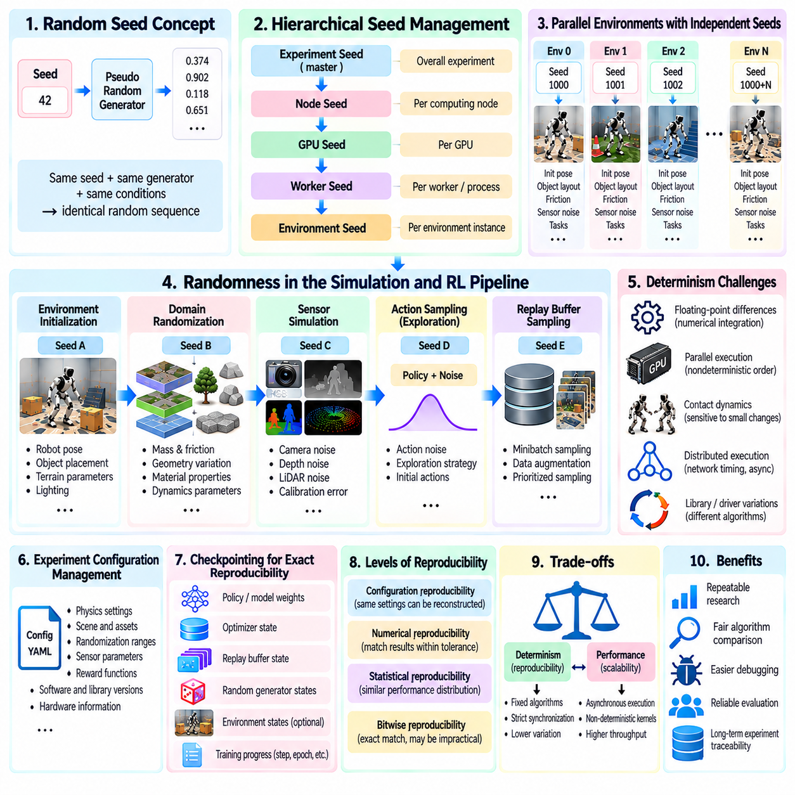{width="7.268055555555556in" height="7.268055555555556in"}

재현성(Reproducibility)과 시드 관리(Seed Management)는 피지컬 AI(Physical AI)의 신뢰할 수 있는 대규모 병렬 시뮬레이션(Massive Parallel Simulation)을 위한 기본 요구사항이다. 이를 통해 연구자는 통제된 조건(Controlled Condition)에서 실험을 반복하고, 학습 알고리즘(Learning Algorithm)을 비교하며, 예상하지 못한 로봇 동작(Robot Behavior)을 조사할 수 있다. 시뮬레이션이 수천 개의 환경과 다중 GPU(Multi-GPU)로 확장됨에 따라 일관된 실험 조건(Experimental Condition)을 유지하는 일은 더욱 어려워진다. 따라서 재현성을 확보하려면 무작위성(Randomness), 소프트웨어 구성(Software Configuration), 실행 기록(Execution Record)을 통합적으로 관리해야 한다.

무작위 시드(Random Seed)는 지정된 조건에서 결정론적 수열(Deterministic Sequence)을 생성하는 의사 난수 생성기(Pseudorandom Number Generator)를 초기화한다. 시뮬레이션 시스템은 이러한 수열을 사용하여 로봇 자세(Robot Pose), 물체 위치(Object Location), 마찰 계수(Friction Coefficient), 센서 잡음(Sensor Noise), 작업 매개변수(Task Parameter)를 무작위화한다. 생성기와 실행 순서(Execution Order)가 변경되지 않는다면 시드를 기록하여 동일한 난수 수열(Random Sequence)을 다시 생성할 수 있다. 그러나 동일한 시드를 사용하는 것만으로 동일한 시뮬레이션 결과(Simulation Outcome)가 보장되는 것은 아니다.

대규모 병렬 환경(Massive Parallel Environment)에서는 단일 인스턴스 시뮬레이션(Single-Instance Simulation)보다 정교한 시드 관리가 필요하다. 모든 환경에 하나의 공유 난수 생성기(Shared Random Generator)를 할당하면 실행 순서(Execution Sequence) 사이에 의존성(Dependency)이 발생할 수 있다. 환경이 서로 다른 시점에 재설정(Reset)되면 난수 소비 순서(Random-Number Consumption Order)가 변경될 수 있다. 독립적인 난수 스트림(Independent Random Stream)은 이러한 영향을 분리하여 각 환경이 관련 없는 시뮬레이션 인스턴스에 의존하지 않고 재현 가능한 변형(Reproducible Variation)을 생성하도록 지원한다.

계층적 시드 전략(Hierarchical Seed Strategy)은 실험(Experiment), 계산 노드(Computing Node), GPU, 작업자(Worker), 개별 환경(Individual Environment)에 걸쳐 무작위성을 체계적으로 관리할 수 있다. 마스터 실험 시드(Master Experiment Seed)는 전체 구성을 설정하며, 파생 시드(Derived Seed)는 독립적인 난수 스트림을 식별한다. 작업자 스케줄링(Worker Scheduling)이 변경되어도 시나리오 생성(Scenario Generation)이 의도치 않게 달라지지 않도록 안정적인 식별자(Stable Identifier)를 기반으로 시드를 파생해야 한다. 또한 시드 파생 절차(Seed Derivation Procedure)는 우발적인 충돌(Accidental Collision)을 방지하고 추적 가능성(Traceability)을 유지해야 한다.

카운터 기반 난수 생성기(Counter-Based Random-Number Generator)는 순차적 난수 스트림(Sequential Random Stream)을 대체할 수 있는 방법을 제공한다. 난수 값(Random Value)은 환경 번호(Environment Number), 에피소드 인덱스(Episode Index), 시뮬레이션 단계(Simulation Step), 샘플링 목적(Sampling Purpose)과 같은 명시적 식별자(Explicit Identifier)로부터 생성할 수 있다. 이 접근 방식은 실행 순서에 대한 의존성을 줄이며 비동기 시뮬레이션(Asynchronous Simulation)에 유용하다. 신중하게 설계된 카운터 할당(Counter Assignment)을 사용하면 병렬 작업자가 이전의 모든 연산을 재실행하지 않고도 특정 무작위 사건(Random Event)을 재현할 수 있다.

무작위성은 시뮬레이션 파이프라인(Simulation Pipeline) 내에서 수행하는 기능적 역할(Functional Role)에 따라 분리해야 한다. 환경 초기화(Environment Initialization), 도메인 무작위화(Domain Randomization), 센서 잡음(Sensor Noise), 탐색 행동(Exploration Action), 재생 버퍼 샘플링(Replay-Buffer Sampling)은 각각 별도의 생성기(Generator)가 필요할 수 있다. 이러한 분리는 한 구성요소의 변경이 다른 구성요소의 난수 수열을 예기치 않게 변경하는 것을 방지한다. 또한 확률적 동작(Stochastic Behavior)의 개별 원인을 독립적으로 재현할 수 있으므로 디버깅(Debugging)이 간단해진다.

결정론적 환경 초기화(Deterministic Environment Initialization)는 의미 있는 실험 비교(Experiment Comparison)를 위해 필수적이다. 초기 로봇 구성(Initial Robot Configuration), 물체 배치(Object Placement), 속도(Velocity), 작업 조건(Task Condition)은 문서화된 절차(Documented Procedure)에 따라 생성해야 한다. 서로 다른 제어 정책(Control Policy)을 평가할 때 동일하게 대응되는 초기 시나리오(Matched Initial Scenario)를 사용하면 불필요한 비교 분산(Comparison Variance)을 줄일 수 있다. 반복적으로 경험한 조건에 대한 과적합(Overfitting)을 제한하려면 평가 시드(Evaluation Seed)를 학습 시드(Training Seed)와 분리해야 한다.

물리 시뮬레이션(Physics Simulation)은 수치 적분(Numerical Integration)과 접촉 해결(Contact Solving)이 부동소수점 연산(Floating-Point Operation)에 의존하므로 추가적인 재현성 문제(Reproducibility Challenge)를 발생시킨다. 작은 반올림 차이(Rounding Difference)는 특히 혼돈적 환경(Chaotic Environment)이나 접촉이 많은 환경(Contact-Rich Environment)에서 시간이 지남에 따라 누적될 수 있다. 병렬 충돌 처리(Parallel Collision Processing)는 제약조건(Constraint)이 평가되는 순서를 변경할 수 있다. 따라서 두 실행이 동일한 상태에서 시작하더라도 무작위 시드가 같을 때조차 점진적으로 다른 결과로 분기(Divergence)할 수 있다.

GPU 실행(GPU Execution)은 병렬 스케줄링(Parallel Scheduling), 원자적 연산(Atomic Operation), 리덕션 연산 순서(Reduction Ordering)를 통해 비결정성(Nondeterminism)을 유발할 수 있다. 부동소수점 덧셈(Floating-Point Addition)은 일반적으로 결합법칙(Associative Law)이 성립하지 않으므로 연산 순서가 달라지면 결과에도 미세한 차이가 발생할 수 있다. 일부 가속 라이브러리(Accelerated Library)는 하드웨어 및 런타임 조건(Runtime Condition)에 따라 알고리즘을 선택하기도 한다. 결정론적 실행 모드(Deterministic Execution Mode)는 변동을 줄일 수 있지만 메모리 소비량을 증가시키거나 계산 처리량(Computational Throughput)을 감소시킬 수 있다.

분산 시뮬레이션(Distributed Simulation)은 통신 타이밍(Communication Timing)과 비동기 작업자 실행(Asynchronous Worker Execution)으로 인해 추가적인 불확실성(Uncertainty)을 발생시킨다. 네트워크 지연(Network Delay)의 차이는 궤적(Trajectory)이 도착하는 시점, 정책이 갱신되는 시점, 학습 배치(Training Batch)에 포함되는 경험을 변경할 수 있다. 정확한 실행 순서(Exact Execution Order)를 재현하려면 엄격한 동기화(Strict Synchronization)와 결정론적 스케줄링(Deterministic Scheduling)이 필요할 수 있다. 이러한 제어는 반복 가능성(Repeatability)을 높이지만 비동기 아키텍처(Asynchronous Architecture)의 확장성 이점(Scalability Advantage)을 감소시킬 수 있다.

재현성은 하나의 속성으로 취급하기보다 여러 수준에서 평가해야 한다. 구성 재현성(Configuration Reproducibility)은 동일한 실험 설정(Experimental Setting)을 재구성할 수 있음을 의미한다. 수치 재현성(Numerical Reproducibility)은 정의된 허용 오차(Defined Tolerance) 내에서 계산값이 일치해야 함을 의미하며, 통계적 재현성(Statistical Reproducibility)은 반복 실행에서 일관된 성능 분포(Performance Distribution)가 나타나는지를 의미한다. 비트 단위 재현성(Bitwise Reproducibility)은 더 엄격한 요구사항이며 이기종 GPU 시스템(Heterogeneous GPU System)에서는 실용적이지 않을 수 있다.

실험 구성 관리(Experiment Configuration Management)는 시뮬레이션 조건(Simulation Condition)을 재구성하기 위한 기반을 제공한다. 기록에는 물리 시간 간격(Physics Timestep), 솔버 설정(Solver Setting), 로봇 모델(Robot Model), 환경 수(Environment Count), 센서 매개변수(Sensor Parameter), 보상 정의(Reward Definition), 무작위화 분포(Randomization Distribution)가 포함되어야 한다. 소프트웨어 버전(Software Version), 드라이버 구성(Driver Configuration), 하드웨어 특성(Hardware Characteristic)도 보존해야 한다. 버전 관리되는 구성 파일(Version-Controlled Configuration File)은 문서화되지 않은 변경이 실험 결과에 영향을 미치는 것을 방지하는 데 도움이 된다.

정확한 학습 재개(Exact Training Continuation)가 필요한 경우 체크포인팅(Checkpointing)은 신경망 매개변수(Neural-Network Parameter) 이상의 정보를 저장해야 한다. 최적화기 상태(Optimizer State), 학습률 스케줄(Learning-Rate Schedule), 재생 버퍼 내용(Replay-Buffer Content), 난수 생성기 상태(Random-Generator State), 학습 카운터(Training Counter)는 이후의 갱신에 영향을 미칠 수 있다. 시뮬레이션을 이어서 실행하려면 관련 환경 상태(Environment State)와 에피소드 진행 상태(Episode Progress)도 복원해야 한다. 불완전한 체크포인트(Incomplete Checkpoint)는 실행을 성공적으로 재개하더라도 서로 다른 학습 궤적(Learning Trajectory)을 생성할 수 있다.

시나리오 식별자(Scenario Identifier)는 추적 가능한 시뮬레이션 실험(Traceable Simulation Experiment)을 위한 추가적인 메커니즘을 제공한다. 생성된 각 시나리오에는 시드(Seed), 물리 매개변수(Physical Parameter), 물체 배치(Object Arrangement), 작업 정의(Task Definition)와 연결된 안정적인 식별자(Stable Identifier)를 부여할 수 있다. 이후 실패 사례(Failure Case)를 저장하고 재생하여 집중적으로 조사할 수 있다. 이러한 접근 방식은 수천 개의 환경에서 드문 충돌(Rare Collision), 불안정한 접촉(Unstable Contact), 예상하지 못한 정책 동작(Unexpected Policy Behavior)이 발생하는 경우 특히 유용하다.

로깅 시스템(Logging System)은 실험과 결과 사이의 관계를 재구성할 수 있도록 충분한 정보를 기록해야 한다. 중요한 메타데이터(Metadata)에는 실험 식별자(Experiment Identifier), 시드 할당(Seed Assignment), 소프트웨어 수정 버전(Software Revision), 시뮬레이션 설정(Simulation Setting), 학습 체크포인트(Training Checkpoint), 평가 결과(Evaluation Result)가 포함된다. 대규모 환경에서 모든 물리 상태(Physical State)를 기록하는 것은 비현실적일 수 있으므로 선택적 궤적 기록(Selective Trajectory Recording)과 이벤트 기반 캡처(Event-Triggered Capture)가 더 효율적인 절충안(Compromise)을 제공한다.

재현성 시험(Reproducibility Testing)은 대규모 병렬 작업 부하(Large Parallel Workload)로 확장하기 전에 작은 결정론적 시나리오(Deterministic Scenario)에서 시작해야 한다. 단일 환경(Single Environment)은 고정된 행동(Fixed Action)과 초기 조건(Initial Condition)에 대한 기준 궤적(Reference Trajectory)을 설정할 수 있다. 이후 반복 실행(Repeated Execution), 서로 다른 환경 수(Environment Count), 다양한 GPU 구성(GPU Configuration)에서 결과를 비교할 수 있다. 분기 측정(Divergence Measurement)은 차이가 무작위화(Randomization), 수치 적분(Numerical Integration), 병렬 실행(Parallel Execution) 중 어디에서 발생하는지 식별하는 데 도움이 된다.

정확한 궤적 재현(Exact Trajectory Reproduction)을 보장할 수 없는 경우에도 통계적 평가(Statistical Evaluation)는 필수적이다. 정책(Policy)은 여러 독립적인 시드(Independent Seed)와 충분히 다양한 시나리오(Diverse Scenario)에서 시험해야 한다. 평균 성능(Mean Performance), 변동성(Variability), 신뢰구간(Confidence Interval), 실패 빈도(Failure Frequency)를 보고하면 단일 성공 사례(Successful Run)를 제시하는 것보다 강력한 근거를 제공할 수 있다. 평가 반복 횟수(Evaluation Repetition Count)는 관측된 분산(Observed Variance)과 대상 로봇 응용 분야(Robotic Application)의 신뢰성 요구사항(Reliability Requirement)을 반영해야 한다.

시드 선택(Seed Selection)은 숨겨진 실험 편향(Hidden Experimental Bias)을 유발하지 않아야 한다. 동일한 소수의 시드에 대해 알고리즘을 반복적으로 조정하면 실제보다 개선된 것처럼 보이는 잘못된 결과(Misleading Improvement)가 발생할 수 있다. 학습(Training), 검증(Validation), 최종 평가(Final Evaluation)에는 적절하게 분리된 무작위 시나리오(Random Scenario)를 사용해야 한다. 방법을 비교할 때 공통 평가 시드(Shared Evaluation Seed)는 대응 비교(Paired Comparison)를 지원하며, 추가적인 미사용 시드(Unseen Seed)는 관측된 이점이 익숙한 조건을 넘어 일반화(Generalization)되는지 판단하는 데 도움이 된다.

결정론적 재생(Deterministic Replay)은 안전 필수 실패(Safety-Critical Failure)를 디버깅할 때 특히 가치가 있다. 기록된 초기 상태(Initial State), 행동 시퀀스(Action Sequence), 시나리오 구성(Scenario Configuration)을 사용하면 많은 실패 조건(Failure Condition)을 재현할 수 있지만 수치적 비결정성(Numerical Nondeterminism)으로 인해 정확한 궤적 재현은 어려울 수 있다. 중간 상태(Intermediate State)를 저장하면 관심 사건(Event of Interest)에 가까운 지점에서 재생을 시작할 수 있다. 이러한 메커니즘은 충돌(Collision), 불안정한 제어(Unstable Control), 드문 환경 상호작용(Rare Environmental Interaction)을 체계적으로 조사하도록 지원한다.

성능(Performance)과 재현성(Reproducibility) 사이에는 종종 상충관계(Tradeoff)가 존재한다. 결정론적 알고리즘(Deterministic Algorithm)은 고정된 실행 순서(Fixed Execution Ordering), 추가 동기화(Additional Synchronization), 또는 효율성이 낮은 계산 커널(Computational Kernel)을 필요로 할 수 있다. 반대로 공격적인 병렬 최적화(Aggressive Parallel Optimization)는 실행 변동성(Execution Variability)을 유발할 수 있다. 엔지니어링 팀(Engineering Team)은 탐색적 학습(Exploratory Training), 벤치마크 평가(Benchmark Evaluation), 회귀 시험(Regression Testing), 안전 검증(Safety Validation)을 구분하여 각 작업 흐름(Workflow)에 필요한 재현성 수준(Reproducibility Level)을 정의해야 한다.

자동화된 실험 관리(Automated Experiment Management)는 시뮬레이션 클러스터(Simulation Cluster) 전반에서 일관된 시드 정책(Seed Policy)과 구성 추적(Configuration Tracking)을 강제할 수 있다. 작업 스케줄러(Job Scheduler)는 고유 식별자(Unique Identifier)를 할당하고, 독립적인 난수 스트림(Independent Random Stream)을 생성하며, 실행 메타데이터(Execution Metadata)를 보존할 수 있다. 지속적인 시험(Continuous Testing)은 소프트웨어 또는 하드웨어 업데이트 이후 예상하지 못한 수치적 변화(Numerical Change)를 감지할 수 있다. 이러한 관행은 재현성을 개별 연구자의 책임(Individual Researcher Responsibility)에서 체계적인 인프라 역량(Systematic Infrastructure Capability)으로 전환한다.

재현성(Reproducibility)과 시드 관리(Seed Management)는 궁극적으로 시뮬레이션 결과(Simulation Result)를 명확하게 정의된 실험 조건(Experimental Condition)과 연결함으로써 신뢰할 수 있는 피지컬 AI 개발(Trustworthy Physical AI Development)을 지원한다. 신뢰성 있는 시스템(Reliable System)은 독립적인 난수 스트림(Independent Random Stream), 버전 관리된 구성(Versioned Configuration), 구조화된 체크포인트(Structured Checkpoint), 시나리오 식별자(Scenario Identifier), 통계적 평가(Statistical Evaluation)를 결합한다. 대규모 분산 시뮬레이션(Large Distributed Simulation)에서 완전한 결정론(Perfect Determinism)을 달성하기 어려울 수 있지만, 체계적인 실험 관리(Disciplined Experiment Management)는 의미 있는 비교(Meaningful Comparison), 효과적인 디버깅(Effective Debugging), 신뢰할 수 있는 시뮬레이션-현실 전이 검증(Dependable Simulation-to-Real Validation)을 가능하게 한다.

## 05.12. Parallel Evaluation and Data Generation

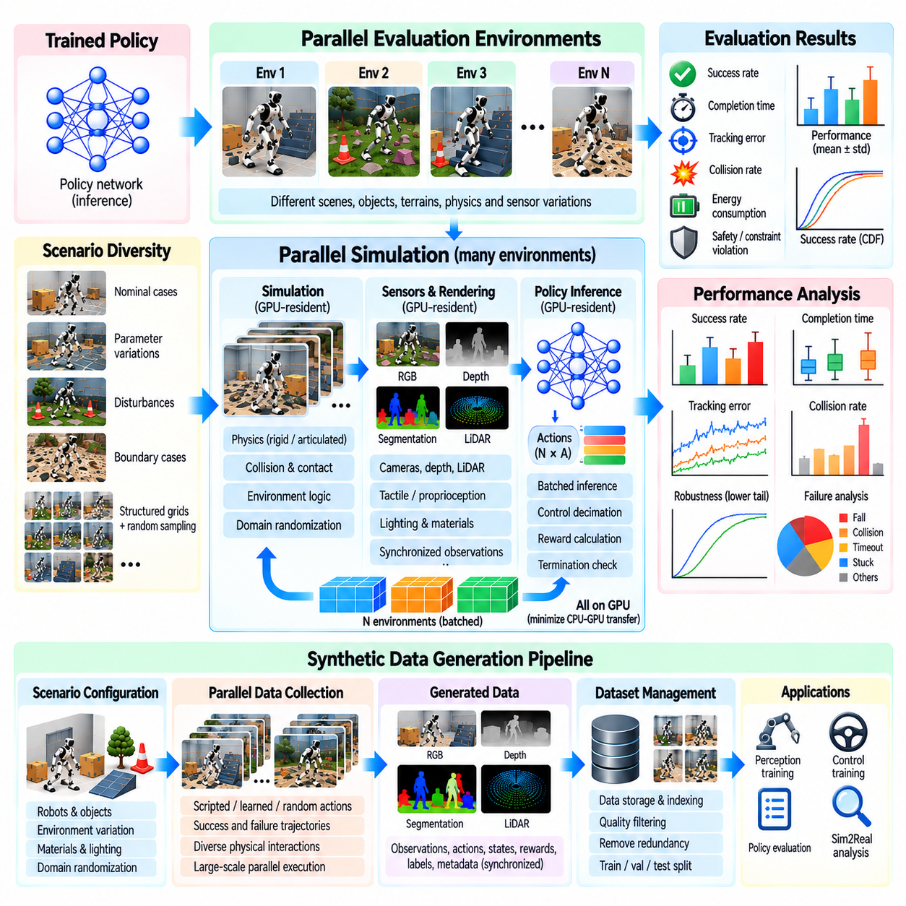{width="7.268055555555556in" height="7.268055555555556in"}

병렬 평가(Parallel Evaluation)와 데이터 생성(Data Generation)은 피지컬 AI(Physical AI)를 위한 대규모 병렬 시뮬레이션(Massive Parallel Simulation)의 핵심 기능이다. 이를 통해 로봇 시스템(Robotic System)을 수천 개의 시나리오(Scenario)에서 시험하면서 대량의 구조화된 학습 데이터(Structured Training Data)를 생성할 수 있다. 순차적 시뮬레이션(Sequential Simulation)과 달리 병렬 실행(Parallel Execution)은 다양한 환경 구성(Environment Configuration)을 동시에 평가한다. 이러한 접근 방식은 정책 검증(Policy Validation)을 가속하고, 시나리오 적용 범위(Scenario Coverage)를 확대하며, 다양한 물리적 조건(Physical Condition)에서 로봇 성능(Robot Performance)을 체계적으로 분석하도록 지원한다.

병렬 평가(Parallel Evaluation)는 학습된 정책(Trained Policy)이 독립적인 시뮬레이션 환경(Independent Simulation Environment)에서 얼마나 신뢰성 있게 동작하는지를 측정한다. 각 환경에는 서로 다른 물체 배치(Object Arrangement), 지형 조건(Terrain Condition), 마찰 계수(Friction Coefficient), 탑재 하중(Payload), 센서 교란(Sensor Disturbance)이 포함될 수 있다. 이러한 시나리오를 동시에 실행하면 폭넓은 적용 범위를 유지하면서 평가 시간(Evaluation Time)을 줄일 수 있다. 그 결과 평균 작업 성능(Average Task Performance)과 다양한 운영 조건(Operating Condition)에서 나타나는 동작 변동성(Behavior Variability)을 모두 파악할 수 있다.

평가 환경(Evaluation Environment)은 계산 자원(Computational Resource)을 공유하더라도 논리적으로 독립된 상태(Logically Independent State)를 유지해야 한다. 각 인스턴스(Instance)에는 고유한 물리 상태(Physical State), 에피소드 진행 상태(Episode Progress), 무작위화 매개변수(Randomization Parameter), 결과 기록(Outcome Record)이 필요하다. 공유 정책 추론(Shared Policy Inference)은 시뮬레이션 궤적(Simulated Trajectory)을 서로 결합하지 않으면서 GPU 효율(GPU Efficiency)을 향상시킬 수 있다. 적절한 격리(Isolation)는 한 환경의 종료(Termination), 재설정(Reset), 실패(Failure)가 다른 환경의 동작에 의도치 않게 영향을 미치는 것을 방지한다.

시나리오 다양성(Scenario Diversity)은 정책 일반화(Policy Generalization)를 추정하는 데 중요하다. 평가 작업 부하(Evaluation Workload)에는 정상 운영 조건(Nominal Operating Condition), 매개변수 변화(Parameter Variation), 환경 교란(Environmental Disturbance), 까다로운 경계 사례(Boundary Case)가 포함되어야 한다. 무작위 샘플링(Random Sampling)은 폭넓은 적용 범위를 제공하며, 구조화된 시나리오 격자(Structured Scenario Grid)는 통제된 비교(Controlled Comparison)를 가능하게 한다. 두 방법을 결합하면 성능 저하(Performance Degradation)가 특정 물리 매개변수(Physical Parameter)에서 발생하는지, 여러 요인의 복잡한 상호작용(Complex Interaction)에서 발생하는지 식별하는 데 도움이 된다.

병렬 평가(Parallel Evaluation)는 학습 시나리오(Training Scenario)를 검증 시나리오(Validation Scenario) 및 최종 시험 시나리오(Final Test Scenario)와 구분해야 한다. 개발 전반에 걸쳐 동일한 환경과 무작위 시드(Random Seed)를 반복적으로 사용하면 지나치게 낙관적인 성능 추정(Optimistic Performance Estimate)이 발생할 수 있다. 독립적인 평가 분포(Independent Evaluation Distribution)는 정책이 익숙한 조건을 넘어 일반화되는지 판단하는 데 도움이 된다. 고정된 벤치마크 시나리오(Fixed Benchmark Scenario)는 반복 가능한 비교를 지원하며, 추가적인 미경험 시나리오(Unseen Scenario)는 표준화된 시험(Standardized Test)에서 놓칠 수 있는 약점을 드러낸다.

성능 지표(Performance Metric)는 누적 보상(Cumulative Reward)에만 의존하지 않고 의도된 로봇 응용 분야(Robotic Application)를 반영해야 한다. 관련 측정값에는 작업 성공률(Task Success Rate), 완료 시간(Completion Time), 추종 오차(Tracking Error), 충돌 빈도(Collision Frequency), 에너지 소비(Energy Consumption), 복구 능력(Recovery Capability)이 포함된다. 안전 민감 응용 분야(Safety-Sensitive Application)에서는 최소 이격 거리(Minimum Separation Distance)와 제약조건 위반율(Constraint Violation Rate)도 필요할 수 있다. 병렬 평가를 사용하면 충분히 크고 다양한 환경 집단(Environment Population)에 대해 이러한 지표를 추정할 수 있다.

독립적인 평가 에피소드(Independent Evaluation Episode)가 누적될수록 통계적 신뢰성(Statistical Reliability)이 향상되지만, 상관관계가 있는 시나리오(Correlated Scenario)는 유효 표본 다양성(Effective Sample Diversity)을 감소시킬 수 있다. 평균 성능(Mean Performance)만으로는 드물지만 심각한 실패(Rare but Severe Failure)를 파악하기 어렵다. 성능 분포(Performance Distribution), 신뢰구간(Confidence Interval), 하위 꼬리 결과(Lower-Tail Outcome), 실패 범주(Failure Category)를 보고하면 더욱 유용한 평가가 가능하다. 평가 설계(Evaluation Design)는 불확실성(Uncertainty)이나 운영 위험(Operational Risk)이 높은 조건에 추가 시험을 할당해야 한다.

병렬 시뮬레이션(Parallel Simulation)은 인식(Perception), 계획(Planning), 제어(Control)를 위한 대규모 합성 데이터 생성(Large-Scale Synthetic Data Generation)도 지원한다. 시뮬레이션 카메라(Simulated Camera), 깊이 센서(Depth Sensor), 고유수용성 측정(Proprioceptive Measurement), 접촉 센서(Contact Sensor)는 실제 기반 상태(Ground-Truth State)가 알려진 동기화된 관측값(Synchronized Observation)을 생성할 수 있다. 많은 실제 데이터셋(Real-World Dataset)과 달리 합성 환경(Synthetic Environment)은 광범위한 수동 주석 작업(Manual Annotation) 없이 정확한 물체 자세(Object Pose), 분할 레이블(Segmentation Label), 물리 매개변수(Physical Parameter)를 자동으로 제공할 수 있다.

합성 데이터 파이프라인(Synthetic Data Pipeline)은 시나리오 구성(Scenario Configuration)과 시뮬레이션 매개변수(Simulation Parameter)의 통제된 변화(Controlled Variation)에서 시작된다. 로봇 모델(Robot Model), 물체 자산(Object Asset), 조명(Lighting), 재질(Material), 센서 속성(Sensor Property)은 의도된 학습 작업(Learning Task)에 따라 선택된다. 이후 병렬 환경(Parallel Environment)은 스크립트 기반 동작(Scripted Behavior), 학습된 정책(Learned Policy), 무작위 행동(Randomized Action)을 실행한다. 각 궤적(Trajectory)은 후속 학습이나 평가에 적합한 관측값(Observation), 행동(Action), 상태 전이(State Transition), 메타데이터(Metadata)를 생성한다.

데이터 품질(Data Quality)은 생성된 표본(Sample)의 총개수만으로 결정되지 않는다. 거의 동일한 수천 개의 궤적은 다양한 물리적 상호작용(Physical Interaction)을 포함하는 더 작은 데이터 집합보다 유용한 정보가 적을 수 있다. 데이터셋 구성(Dataset Construction)은 장면 다양성(Scene Diversity), 행동 적용 범위(Action Coverage), 접촉 조건(Contact Condition), 작업 결과(Task Outcome), 실패 사례(Failure Example)를 고려해야 한다. 샘플링 전략(Sampling Strategy)은 일반적인 상황의 과도한 중복(Excessive Duplication)을 피하면서 과소대표된 상태(Underrepresented State)를 강조할 수 있다.

도메인 무작위화(Domain Randomization)는 시뮬레이션 인스턴스(Simulation Instance) 전반에서 물리적 속성과 시각적 속성(Physical and Visual Property)을 변화시켜 데이터셋 적용 범위(Dataset Coverage)를 확장한다. 질량(Mass), 관성(Inertia), 마찰(Friction), 액추에이터 응답(Actuator Response), 카메라 노출(Camera Exposure), 조명(Lighting), 텍스처 외관(Texture Appearance)은 정의된 분포(Defined Distribution)에서 샘플링할 수 있다. 병렬 실행(Parallel Execution)은 이러한 변화를 대규모로 계산하는 것을 실용적으로 만든다. 그러나 무작위화 범위(Randomization Range)는 물리적으로 타당하고 실제 배포 환경(Deployment Environment)과 관련성이 있어야 한다.

데이터 생성(Data Generation)에는 성공적인 시연(Successful Demonstration)과 정보 가치가 높은 실패(Informative Failure)를 모두 포함할 수 있다. 성공 궤적(Successful Trajectory)은 효과적인 작업 수행(Task Execution)의 사례를 제공하며, 실패한 시도(Failed Attempt)는 안전하지 않은 행동(Unsafe Action), 불안정한 제어(Unstable Control), 어려운 환경 구성(Challenging Environmental Configuration)을 드러낸다. 복구 궤적(Recovery Trajectory)은 교란 이후 강건한 동작(Robust Behavior)을 학습하는 데 특히 가치가 있다. 실패 맥락(Failure Context)을 보존하면 학습 시스템이 복구 가능한 실수(Recoverable Mistake)와 최종 작업 실패(Terminal Task Failure)를 구분할 수 있다.

GPU 상주형 데이터 처리(GPU-Resident Data Processing)는 시뮬레이션과 기계학습(Machine Learning)이 가속기 자원(Accelerator Resource)을 공유할 때 처리 부담(Overhead)을 줄인다. 관측값(Observation), 행동(Action), 보상(Reward), 레이블(Label)은 선택된 표본을 저장하거나 전송해야 할 때까지 장치 메모리(Device Memory)에 유지할 수 있다. 배치 추론(Batched Inference)과 벡터화 변환(Vectorized Transformation)은 처리 효율(Processing Efficiency)을 향상시킨다. 그러나 데이터 생성 속도(Data Production Rate)가 저장 시스템 용량(Storage-System Capacity)을 초과하면 영상 렌더링(Image Rendering), 궤적 기록(Trajectory Recording), 압축(Compression)이 병목 현상(Bottleneck)이 될 수 있다.

데이터셋 저장(Dataset Storage)은 충실도(Fidelity), 처리량(Throughput), 접근성(Accessibility) 사이의 균형을 신중하게 유지해야 한다. 고해상도 영상(High-Resolution Image)과 밀집된 상태 궤적(Dense State Trajectory)은 장시간 시뮬레이션 작업(Long Simulation Campaign)에서 상당한 데이터 용량(Data Volume)을 발생시킬 수 있다. 압축(Compression), 선택적 기록(Selective Recording), 구성 가능한 샘플링 주파수(Configurable Sampling Frequency)는 저장 공간 요구량(Storage Demand)을 줄인다. 생성된 표본의 추적 가능성(Traceability)과 재현성(Reproducibility)을 유지하려면 메타데이터에 시나리오 식별자(Scenario Identifier), 시뮬레이션 버전(Simulation Version), 무작위 시드(Random Seed), 센서 설정(Sensor Setting)을 보존해야 한다.

비동기 데이터 수집(Asynchronous Data Collection)은 별도의 프로세스(Process)가 검증(Validation), 압축(Compression), 저장(Storage)을 수행하는 동안 시뮬레이션 작업자(Simulation Worker)가 경험(Experience)을 계속 생성하도록 한다. 큐(Queue)와 버퍼링 메커니즘(Buffering Mechanism)은 생산 속도(Production Rate)와 소비 속도(Consumption Rate) 사이의 일시적인 차이를 흡수한다. 후속 처리 시스템(Downstream System)이 생산 속도를 따라가지 못하면 역압 제어(Backpressure)가 필요해진다. 자원 제어(Resource Control)가 없으면 과도한 버퍼링(Excessive Buffering)으로 메모리가 고갈되거나 중요한 표본이 예측할 수 없는 방식으로 손실될 수 있다.

병렬 평가(Parallel Evaluation)와 데이터 생성(Data Generation)은 폐루프 개선 프로세스(Closed-Loop Improvement Process)로 통합할 수 있다. 평가 과정에서 취약한 운영 조건(Weak Operating Condition)을 식별하고 이를 목표 지향적 시뮬레이션 시나리오(Targeted Simulation Scenario)로 변환한다. 해당 조건에 대한 추가 궤적(Additional Trajectory)을 생성하여 후속 학습(Subsequent Training)에 반영한다. 이후 갱신된 정책(Updated Policy)을 목표 시나리오와 더 넓은 벤치마크 분포(Broader Benchmark Distribution) 모두에서 평가하여 개선 효과가 일반화되는지 확인한다.

능동적 시나리오 선택(Active Scenario Selection)은 병렬 계산(Parallel Computation)의 정보 가치를 높일 수 있다. 모든 환경 구성(Environment Configuration)에 동일한 자원을 할당하는 대신, 시스템은 불확실한 예측(Uncertain Prediction), 성공률이 낮은 영역(Low-Success Region), 안전 경계(Safety Boundary)에 가까운 시나리오를 우선 처리할 수 있다. 적응형 샘플링(Adaptive Sampling)은 새로운 증거(New Evidence)의 가치가 가장 높은 조건에 추가 시뮬레이션 자원을 집중한다. 이러한 접근 방식은 더 넓은 운영 영역(Operating Domain)에 대한 충분한 탐색(Exploration)을 유지하면서 데이터 효율(Data Efficiency)을 향상시킨다.

희귀 사건 평가(Rare-Event Evaluation)는 위험하거나 비정상적인 결과가 일반적인 샘플링(Ordinary Sampling)에서는 드물게 발생할 수 있으므로 병렬 실행의 이점을 크게 얻는다. 대규모 시나리오 집단(Large Scenario Population)은 충돌(Collision), 불안정한 접촉(Unstable Contact), 인식 실패(Perception Failure), 복구 한계(Recovery Limitation)를 관측할 기회를 늘린다. 중요도 샘플링(Importance Sampling)과 목표 지향적 매개변수 탐색(Targeted Parameter Search)은 어려운 조건에 평가를 더욱 집중할 수 있다. 실제 환경의 실패 확률(Real-World Failure Probability)을 추정할 때는 변경된 샘플링 분포(Altered Sampling Distribution)를 반드시 고려해야 한다.

수천 개의 환경이 동시에 결과를 생성하는 경우 재현성(Reproducibility)은 여전히 필수적이다. 독립적인 난수 스트림(Independent Random Stream), 안정적인 시나리오 식별자(Stable Scenario Identifier), 버전 관리된 구성(Versioned Configuration), 구조화된 실험 로그(Structured Experiment Log)는 반복 가능한 평가(Repeated Evaluation)를 지원한다. 하드웨어 플랫폼(Hardware Platform) 사이의 수치적 차이(Numerical Difference)로 인해 정확한 궤적 일치(Exact Trajectory Matching)가 어려울 수 있지만, 통계적 일관성(Statistical Consistency)은 여전히 평가할 수 있다. 재현 가능한 평가 프로토콜(Reproducible Evaluation Protocol)은 알고리즘과 인프라 구성(Infrastructure Configuration) 사이의 성능 비교에 대한 신뢰성을 높인다.

종단 간 효율(End-to-End Efficiency)은 원시 시뮬레이션 단계(Raw Simulation Step)만이 아니라 완료된 평가(Completed Evaluation)와 사용 가능한 데이터 표본(Usable Data Sample)을 기준으로 측정해야 한다. 물리 처리량(Physics Throughput)이 높더라도 렌더링(Rendering), 레이블링(Labeling), 전송(Transfer), 저장(Storage)이 전체 파이프라인(Overall Pipeline)을 제한할 수 있다. 마찬가지로 빠른 평가도 신뢰할 수 있는 결론을 도출하기에 충분한 지표(Metric)와 시나리오 적용 범위(Scenario Coverage)가 확보된 경우에만 가치가 있다. 전체 작업 흐름(Complete Workflow)을 프로파일링(Profiling)하면 추가 GPU, 개선된 배치 처리(Batching), 향상된 데이터 관리(Data Management) 중 무엇이 가장 큰 이점을 제공하는지 파악할 수 있다.

병렬 평가(Parallel Evaluation)와 데이터 생성(Data Generation)은 궁극적으로 시뮬레이션 확장성(Simulation Scalability)을 신뢰할 수 있는 피지컬 AI 개발(Trustworthy Physical AI Development)과 연결한다. 다양한 시나리오 실행(Diverse Scenario Execution), 통계적으로 의미 있는 평가(Statistically Meaningful Assessment), 자동 레이블링(Automated Labeling), 목표 지향적 데이터 수집(Targeted Data Collection)을 결합하면 엔지니어는 로봇 정책(Robotic Policy)을 효율적으로 평가하고 학습 데이터셋(Training Dataset)을 구축할 수 있다. 잘 설계된 파이프라인(Well-Designed Pipeline)은 대규모 계산 용량(Large-Scale Computational Capacity)을 실행 가능한 성능 근거(Actionable Performance Evidence)와 고품질 경험(High-Quality Experience)으로 전환하여 강건한 시뮬레이션-현실 전이(Robust Simulation-to-Real Transfer)를 지원한다.

## 05.13. Rare Event and Scenario Search at Scale

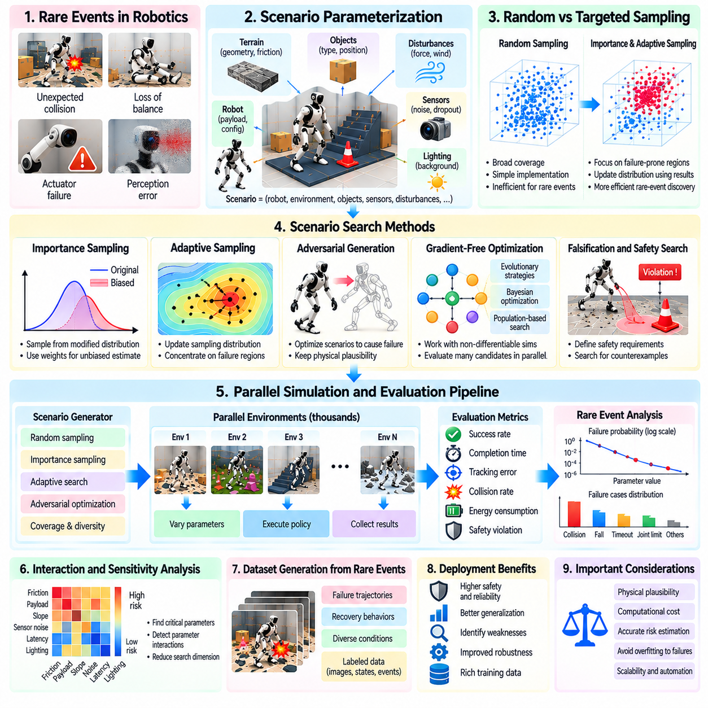{width="7.268055555555556in" height="7.268055555555556in"}

희귀 사건 분석(Rare-Event Analysis)과 시나리오 탐색(Scenario Search)은 피지컬 AI(Physical AI)를 위한 대규모 병렬 시뮬레이션(Massive Parallel Simulation)의 핵심 기능이다. 로봇 시스템(Robotic System)은 일반적인 조건에서는 성공적으로 작동하더라도 드물게 발생하는 교란(Disturbance), 센서 고장(Sensor Failure), 환경 제약(Environmental Constraint)의 조합에 취약할 수 있다. 이러한 사건은 기존 시험(Conventional Testing)을 통해 관찰하기 어렵다. 대규모 시뮬레이션(Large-Scale Simulation)은 로봇이 실제 물리 환경(Physical Environment)에서 이러한 조건에 직면하기 전에 발생 확률이 낮은 조건(Low-Probability Condition)을 체계적으로 탐색할 수 있도록 한다.

희귀 사건(Rare Event)에는 예상하지 못한 충돌(Unexpected Collision), 불안정한 접촉(Unstable Contact), 액추에이터 고장(Actuator Failure), 인식 오류(Perception Error), 비정상적인 운영 조건(Unusual Operating Condition)에서의 균형 상실(Loss of Balance)이 포함된다. 이러한 사건의 중요성은 발생 확률(Occurrence Probability)뿐만 아니라 잠재적 결과(Potential Consequence)에 따라서도 결정된다. 경미한 성능 저하(Minor Performance Degradation)를 유발하는 저빈도 사건(Low-Frequency Event)은 허용 가능할 수 있지만, 동일하게 드문 사건이라도 심각한 손상(Serious Damage)을 초래한다면 주의가 필요하다. 따라서 위험 평가(Risk Assessment)는 사건 발생 가능성(Event Likelihood)과 심각도(Severity)를 모두 고려해야 한다.

일반적인 무작위 샘플링(Ordinary Random Sampling)은 치명적인 실패(Critical Failure)가 극히 드물게 발생하는 경우 비효율적이다. 소수의 관련 사고(Relevant Incident)를 관찰하기 위해 수백만 번의 시뮬레이션 에피소드(Simulation Episode)가 필요할 수 있다. 대규모 병렬 실행(Massive Parallel Execution)은 시험을 누적하는 데 필요한 실제 경과 시간(Wall-Clock Time)을 줄이지만, 계산 규모(Computational Scale)만으로 효율적인 발견(Efficient Discovery)이 보장되지는 않는다. 정보 가치가 높고 잠재적으로 위험한 조건(Informative and Potentially Hazardous Condition)에 시뮬레이션 자원을 집중하기 위해 목표 지향적 탐색 방법(Targeted Search Method)이 필요하다.

시나리오 매개변수화(Scenario Parameterization)는 체계적인 희귀 사건 탐색(Systematic Rare-Event Exploration)의 기반을 제공한다. 시나리오는 로봇 구성(Robot Configuration), 탑재 하중(Payload), 지형 형상(Terrain Geometry), 마찰(Friction), 장애물 움직임(Obstacle Motion), 센서 잡음(Sensor Noise), 외부 교란(External Disturbance)으로 설명할 수 있다. 각 매개변수(Parameter)는 물리적으로 의미 있는 한계(Physically Meaningful Limit)와 문서화된 관계(Documented Relationship)를 가져야 한다. 구조화된 표현(Structured Representation)을 사용하면 탐색 알고리즘(Search Algorithm)이 타당한 환경 동작(Plausible Environmental Behavior)을 유지하면서 조건을 변경할 수 있다.

무작위 시나리오 생성(Random Scenario Generation)은 운영 영역(Operating Domain)에 대한 폭넓은 적용 범위(Coverage)를 확보한다. 독립적인 시뮬레이션 환경(Independent Simulation Environment)은 정의된 확률 분포(Probability Distribution)에서 매개변수 조합(Parameter Combination)을 샘플링하고 서로 다른 조건에서 동일한 로봇 정책(Robotic Policy)을 실행한다. 이러한 접근 방식은 수동 시험 설계(Manual Test Design)에서 놓칠 수 있는 예상하지 못한 상호작용(Unexpected Interaction)을 드러낸다. 그러나 매개변수 범위(Parameter Range)에 대한 균등 샘플링(Uniform Sampling)은 비현실적인 구성(Unrealistic Configuration)에 계산 자원을 낭비하거나 위험도가 낮은 영역(Low-Risk Region)을 반복적으로 탐색할 수 있다.

중요도 샘플링(Importance Sampling)은 실패가 발생할 가능성이 높은 시나리오를 의도적으로 생성하여 희귀 사건 추정(Rare-Event Estimation)을 개선한다. 표본(Sample)은 수정된 제안 분포(Modified Proposal Distribution)에서 추출되며, 통계적 가중치(Statistical Weight)를 사용하여 원래 운영 분포(Original Operating Distribution)와의 차이를 보정한다. 이를 통해 추정 위험(Estimated Risk)을 자동으로 과대평가하지 않으면서 관찰되는 실패 횟수를 증가시킬 수 있다. 신뢰할 수 있는 확률 추정(Probability Estimate)을 위해서는 올바른 가중치 적용(Valid Weighting)과 관련 실패 영역(Failure Region)에 대한 충분한 적용 범위가 필요하다.

적응형 중요도 샘플링(Adaptive Importance Sampling)은 이전 시뮬레이션 배치(Simulation Batch)의 결과를 사용하여 제안 분포(Proposal Distribution)를 갱신한다. 충돌(Collision), 불안정성(Instability), 안전 위반(Safety Violation)과 관련된 영역에는 추가적인 샘플링 자원(Sampling Resource)이 할당된다. 탐색 과정은 위험 추정(Risk Estimate)에 가장 크게 기여하는 조건에 계산 자원(Computational Resource)을 점진적으로 집중한다. 그러나 아직 발견되지 않은 실패 유형(Undiscovered Failure Mode)을 제외하거나 불확실성(Uncertainty)을 왜곡하는 지나치게 좁은 분포(Narrow Distribution)를 생성하지 않도록 주의해야 한다.

적대적 시나리오 생성(Adversarial Scenario Generation)은 로봇 정책(Robotic Policy)의 약점을 드러내는 환경 조건(Environmental Condition)을 탐색한다. 최적화 알고리즘(Optimization Algorithm)은 실패 목적함수(Failure Objective)를 극대화하기 위해 장애물 궤적(Obstacle Trajectory), 표면 특성(Surface Property), 센서 교란(Sensor Disturbance), 초기 로봇 상태(Initial Robot State)를 변경할 수 있다. 임의의 교란(Arbitrary Perturbation)과 달리 적대적 시나리오(Adversarial Scenario)는 물리적 실현 가능성(Physical Feasibility)과 운영 제약조건(Operational Constraint)을 준수해야 한다. 그렇지 않으면 발견된 실패가 실제 환경 신뢰성(Real-World Reliability)에 대해 제공하는 정보가 제한적일 수 있다.

탐색 목적(Search Objective)은 의미 있는 안전 및 성능 요구사항(Safety and Performance Requirement)을 나타내야 한다. 후보 측정값(Candidate Measure)에는 충돌 심각도(Collision Severity), 최소 장애물 거리(Minimum Obstacle Distance), 관절 한계 위반(Joint-Limit Violation), 추종 오차(Tracking Error), 안정성 상실(Loss of Stability)이 포함된다. 연속적인 위험 점수(Continuous Risk Score)는 완전한 작업 실패(Complete Task Failure)가 드물게 발생하더라도 유용한 기울기 정보(Gradient Information)를 제공할 수 있다. 여러 측정값을 결합할 때는 최적화가 덜 중요한 수치적 목표(Numerical Objective)를 극대화하는 과정에서 핵심 위험(Critical Hazard)을 간과하지 않도록 척도 조정(Scaling)을 신중하게 수행해야 한다.

기울기 비사용 최적화 방법(Gradient-Free Optimization Method)은 시뮬레이션 결과(Simulation Outcome)가 불연속적(Discontinuous)이거나 미분하기 어려운 경우 유용하다. 진화 전략(Evolutionary Strategy), 베이지안 최적화(Bayesian Optimization), 집단 기반 탐색(Population-Based Search)은 해석적 도함수(Analytic Derivative) 없이 시나리오 매개변수(Scenario Parameter)를 탐색할 수 있다. 병렬 시뮬레이션(Parallel Simulation)은 많은 후보(Candidate)를 동시에 평가하여 반복 탐색(Iterative Search)의 비용을 줄인다. 방법 선택(Method Selection)은 매개변수 차원(Parameter Dimensionality), 시뮬레이션 비용(Simulation Expense), 실패 탐색 공간의 구조(Failure Landscape Structure)에 따라 달라진다.

반증 기법(Falsification Technique)은 명시적으로 정의된 시스템 요구사항(System Requirement)을 위반하는 궤적(Trajectory)을 식별하려고 시도한다. 시간 논리 명세(Temporal Specification)는 안전 거리 유지(Maintaining Safe Separation), 과도한 힘 방지(Avoiding Excessive Force), 제한 시간 내 목표 도달(Reaching a Target Within a Deadline)과 같은 제약조건을 설명할 수 있다. 이후 탐색 절차(Search Procedure)는 각 요구사항과 관련된 강건성 측정값(Robustness Measure)을 최소화한다. 음수의 강건성 값(Negative Robustness Value)은 위반을 나타낼 수 있으며, 디버깅(Debugging)과 검증(Verification)을 위한 해석 가능한 근거(Interpretable Evidence)를 제공한다.

시나리오 탐색(Scenario Search)은 환경 변수(Environmental Variable) 사이의 상호작용(Interaction)을 고려해야 한다. 마찰(Friction), 탑재 하중(Payload), 센서 지연시간(Sensor Latency)의 중간 수준 변화(Moderate Change)는 개별적으로는 무해하더라도 결합되면 위험할 수 있다. 쌍별 시험(Pairwise Testing), 구조화된 매개변수 스윕(Structured Parameter Sweep), 적응형 탐색(Adaptive Exploration)은 이러한 상호작용을 식별하는 데 도움이 된다. 고차원 탐색(High-Dimensional Search)에서는 영향력이 큰 매개변수를 식별하고 관련성이 낮은 차원(Weakly Relevant Dimension)에 대한 불필요한 평가를 줄이는 민감도 분석(Sensitivity Analysis)이 유용하다.

희귀 사건 발견(Rare-Event Discovery)과 희귀 사건 확률 추정(Rare-Event Probability Estimation)은 서로 관련되어 있지만 구별되는 목표이다. 최적화 방법(Optimization Method)은 심각한 실패(Severe Failure)를 효율적으로 찾아낼 수 있지만, 정상 운영 조건(Normal Operating Condition)에서 그러한 실패가 얼마나 자주 발생하는지는 알려주지 못할 수 있다. 반대로 통계적으로 타당한 추정(Statistically Valid Estimation)을 위해서는 가장 위험한 시나리오를 넘어서는 광범위한 샘플링(Extensive Sampling)이 필요할 수 있다. 평가 보고서(Evaluation Report)는 발견된 실패 심각도(Discovered Failure Severity)와 추정 발생 확률(Estimated Occurrence Probability), 관련 통계적 불확실성(Statistical Uncertainty)을 구분해야 한다.

병렬 실행(Parallel Execution)은 시나리오 복잡성(Scenario Complexity)이 크게 달라지는 경우 실질적인 문제(Practical Challenge)를 발생시킨다. 일부 환경은 실패 직후 빠르게 종료되지만, 다른 환경은 결과가 명확해지기까지 긴 궤적(Long Trajectory)을 실행해야 한다. 비동기 스케줄링(Asynchronous Scheduling)과 독립적인 재설정(Independent Reset)은 하드웨어 활용률(Hardware Utilization)을 향상시킬 수 있다. 그러나 조기 종료 규칙(Early Termination Rule)은 문서화해야 한다. 시나리오를 너무 일찍 중단하면 지연된 실패(Delayed Failure)를 놓치거나 확률 추정(Probability Estimate)에 편향(Bias)을 발생시킬 수 있기 때문이다.

실패 군집화(Failure Clustering)는 대량의 실패 궤적(Failed Trajectory)을 해석 가능한 범주(Interpretable Category)로 변환한다. 유사한 사고(Incident)는 접촉 기하 형상(Contact Geometry), 환경 조건(Environmental Condition), 제어 행동(Control Action), 센서 동작(Sensor Behavior)에 따라 그룹화할 수 있다. 군집화는 하나의 근본적인 약점(Underlying Weakness)이 반복적으로 나타나는 현상과 실제로 서로 다른 실패 메커니즘(Failure Mechanism)을 구분하는 데 도움이 된다. 이후 각 범주의 대표 시나리오(Representative Scenario)를 목표 지향적 회귀 시험(Targeted Regression Test)과 학습 사례(Training Example)로 활용할 수 있다.

재현성(Reproducibility)은 대규모 탐색(Large-Scale Search)을 통해 발견된 실패를 조사하는 데 필수적이다. 모든 시나리오는 매개변수 구성(Parameter Configuration), 무작위 시드(Random Seed), 로봇 모델 버전(Robot Model Version), 정책 체크포인트(Policy Checkpoint), 관련 실행 메타데이터(Execution Metadata)를 보존해야 한다. 초기 조건(Initial Condition)과 핵심 궤적 구간(Critical Trajectory Segment)을 기록하면 반복 분석(Repeated Analysis)이 가능하다. 수치적 비결정성(Numerical Nondeterminism)으로 인해 정확한 재생(Exact Replay)이 어려울 수 있으므로 허용 오차 기반 비교(Tolerance-Based Comparison)와 반복 시험(Repeated Trial)이 필요할 수 있다.

희귀 사건 시나리오(Rare-Event Scenario)는 학습 과정에 통합될 경우 목표 지향적 정책 개선(Targeted Policy Improvement)을 지원할 수 있다. 실패 궤적(Failure Trajectory)은 취약한 제어 전략(Weak Control Strategy)을 드러내며, 성공적인 복구 사례(Successful Recovery Example)는 교란(Disturbance)에 대한 강건한 대응(Robust Response)을 보여준다. 커리큘럼 학습(Curriculum Learning)은 성능이 향상됨에 따라 시나리오 난이도(Scenario Difficulty)를 점진적으로 높일 수 있다. 그러나 적대적 사례(Adversarial Case)에 대한 과도한 학습은 정상 성능(Nominal Performance)을 저하시키거나 비현실적인 조건에 최적화된 동작을 유도할 수 있다.

검증(Validation)에는 탐색 및 학습 과정(Search and Training Process)과 독립적인 시나리오를 사용해야 한다. 이전에 발견된 실패(Previously Discovered Failure)를 해결한 정책이라도 새로운 교란 조합(Disturbance Combination)에는 여전히 취약할 수 있다. 별도의 평가 분포(Evaluation Distribution), 경험하지 않은 매개변수 조합(Unseen Parameter Combination), 실제 환경 시험(Real-World Testing)은 더 폭넓은 강건성(Broader Robustness)에 대한 근거를 제공한다. 개선 효과(Improvement)는 정상 운영(Ordinary Operation), 어려운 조건(Challenging Condition), 안전 필수 경계 사례(Safety-Critical Boundary Case) 전반에서 측정해야 한다.

계산 효율(Computational Efficiency)은 시뮬레이션 처리량(Simulation Throughput)만이 아니라 단위 시간 또는 비용당 발견된 정보 가치가 높은 실패(Informative Failure Discovered per Unit of Time or Cost)를 기준으로 평가해야 한다. 탐색이 유사한 시나리오를 반복적으로 방문한다면 높은 에피소드 수(Episode Count)는 제한적인 가치만 제공한다. 적용 범위 측정값(Coverage Measure), 실패 다양성(Failure Diversity), 불확실성 감소(Uncertainty Reduction)는 상호 보완적인 지표를 제공한다. 효율적인 시스템은 폭넓은 탐색(Broad Exploration)과 고위험 영역(High-Risk Region) 및 과소대표된 운영 조건(Underrepresented Operating Condition)에 대한 집중 조사의 균형을 유지한다.

시나리오 라이브러리(Scenario Library)는 소프트웨어 및 하드웨어 개정(Software and Hardware Revision) 전반에 걸쳐 안전 검증(Safety Validation)을 수행하기 위한 지속적인 기반을 제공한다. 저장된 각 사례(Stored Case)에는 운영 조건(Operating Condition), 예상 결과(Expected Outcome), 실패 분류(Failure Classification), 관련 안전 요구사항(Safety Requirement)이 포함될 수 있다. 자동화된 회귀 시험(Automated Regression Testing)은 정책(Policy), 제어기(Controller), 시뮬레이션 구성요소(Simulation Component)가 변경될 때마다 대표 시나리오를 재생할 수 있다. 이를 통해 발견된 약점(Discovered Weakness)과 후속 엔지니어링 개선(Subsequent Engineering Improvement) 사이에 추적 가능한 연결 관계(Traceable Connection)를 형성한다.

대규모 희귀 사건 분석(Rare-Event Analysis at Scale)은 대규모 병렬 시뮬레이션(Massive Parallel Simulation)을 고속 시험 도구(High-Speed Testing Tool)에서 운영상 취약점(Operational Vulnerability)을 체계적으로 발견하는 메커니즘(Systematic Mechanism)으로 발전시킨다. 구조화된 시나리오 표현(Structured Scenario Representation), 적응형 샘플링(Adaptive Sampling), 적대적 탐색(Adversarial Search), 통계적 추정(Statistical Estimation), 재현 가능한 실패 분석(Reproducible Failure Analysis)을 결합하면 엔지니어는 일반적인 시험에서 거의 경험하지 못하는 조건을 조사할 수 있다. 이러한 기능은 피지컬 AI 안전 평가(Physical AI Safety Evaluation)를 강화하고 더욱 신뢰할 수 있는 시뮬레이션-현실 전이 배포(Simulation-to-Real Deployment)를 지원한다.

## 05.14. Massive Parallel Simulation Pipeline [w/Code]

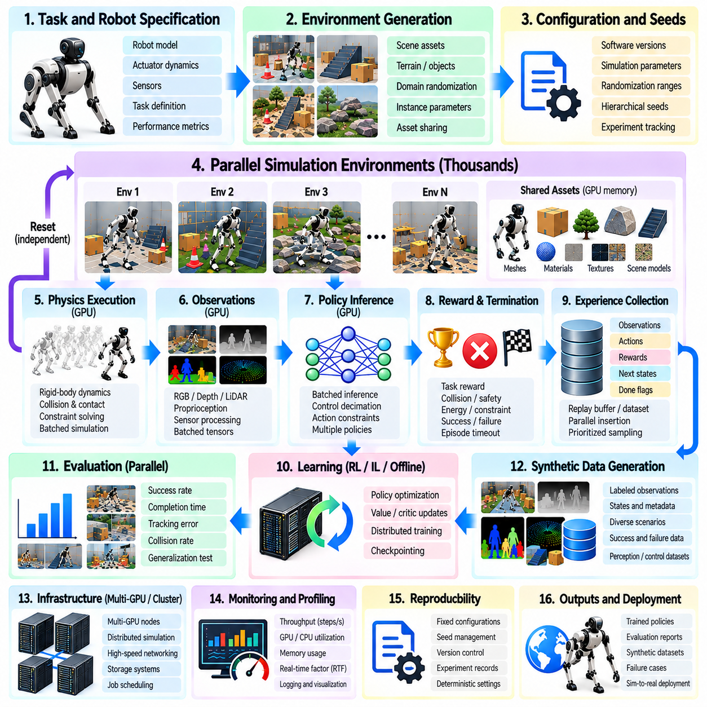{width="7.268055555555556in" height="7.268055555555556in"}

대규모 병렬 시뮬레이션 파이프라인(Massive Parallel Simulation Pipeline)은 환경 생성(Environment Generation), 물리 실행(Physics Execution), 정책 추론(Policy Inference), 경험 수집(Experience Collection), 성능 평가(Performance Evaluation)를 통합된 피지컬 AI 작업 흐름(Physical AI Workflow)으로 결합한다. 그 목적은 신뢰할 수 있는 물리적 동작(Physical Behavior)과 효율적인 자원 활용(Resource Utilization)을 유지하면서 수천 개의 로봇 시나리오(Robotic Scenario)를 동시에 실행하는 것이다. 잘 설계된 파이프라인(Well-Designed Pipeline)은 계산 용량(Computational Capacity)을 재현 가능한 학습 경험(Reproducible Training Experience), 의미 있는 평가 결과(Meaningful Evaluation Result), 시뮬레이션-현실 전이(Simulation-to-Real Transfer)를 위한 실행 가능한 근거(Actionable Evidence)로 전환한다.

파이프라인 설계(Pipeline Design)는 로봇 작업(Robotic Task), 운영 조건(Operating Condition), 계산 요구사항(Computational Requirement)을 명확하게 정의하는 것에서 시작된다. 엔지니어는 로봇 형태(Robot Morphology), 액추에이터 동역학(Actuator Dynamics), 센서 구성(Sensor Configuration), 환경 기하 형상(Environment Geometry), 예상 작업 결과(Expected Task Outcome)를 지정한다. 시뮬레이션 시간 간격(Simulation Timestep), 제어 주파수(Control Frequency), 정확도 요구사항(Accuracy Requirement)은 실행 제약조건(Execution Constraint)을 설정한다. 이러한 사양은 환경 인스턴스(Environment Instance)의 생성 방식, 자원 할당(Resource Allocation) 방식, 모니터링해야 할 성능 지표(Performance Metric)를 결정한다.

환경 생성 단계(Environment Generation Stage)는 로봇 모델(Robot Model), 충돌 기하 형상(Collision Geometry), 재질(Material), 장면 자산(Scene Asset)을 포함하는 재사용 가능한 시뮬레이션 템플릿(Reusable Simulation Template)을 구성한다. 수천 개의 독립적인 인스턴스(Independent Instance)는 개별 물리 상태(Physical State)를 유지하면서 변경되지 않는 공유 자원(Shared Immutable Resource)을 참조할 수 있다. 인스턴스별 매개변수(Instance-Specific Parameter)는 물체 배치(Object Placement), 지형(Terrain), 마찰(Friction), 탑재 하중(Payload), 교란(Disturbance)에 변화를 도입한다. 효율적인 자산 공유(Asset Sharing)는 메모리 중복(Memory Duplication)을 줄이고 사용 가능한 GPU 용량 내에서 더 많은 시뮬레이션 환경을 지원한다.

구성 관리(Configuration Management)는 대규모 실행(Large-Scale Execution)을 위한 일관된 기반을 제공한다. 각 시뮬레이션 작업(Simulation Campaign)은 소프트웨어 버전(Software Version), 로봇 설명(Robot Description), 물리 매개변수(Physics Parameter), 무작위화 분포(Randomization Distribution), 실험 식별자(Experiment Identifier)를 보존해야 한다. 계층적 시드 할당(Hierarchical Seed Assignment)은 개별 환경과 작업자(Worker)를 위한 독립적인 난수 스트림(Independent Random Stream)을 생성한다. 안정적인 구성(Stable Configuration)과 추적 가능한 시드(Traceable Seed)를 사용하면 실패 시나리오(Failed Scenario)를 재구성하고 반복 실행 간 실험 결과(Experimental Result)를 비교할 수 있다.

물리 실행 단계(Physics Execution Stage)는 수치 적분(Numerical Integration), 충돌 감지(Collision Detection), 제약조건 해결(Constraint Solving)을 통해 로봇과 환경 상태(Robot and Environment State)를 진행시킨다. GPU 상주형 물리 엔진(GPU-Resident Physics Engine)은 배치형 상태 표현(Batched State Representation)을 사용하여 많은 환경을 병렬로 처리한다. 접촉이 많은 작업(Contact-Rich Task)은 안정성(Stability)을 유지하기 위해 더 작은 시간 간격(Timestep)이나 추가적인 솔버 반복(Solver Iteration)이 필요할 수 있다. 실행 설정(Execution Setting)은 조작(Manipulation), 이동(Locomotion), 동적 상호작용(Dynamic Interaction)에 필요한 충분한 정확도를 유지하면서 계산 처리량(Computational Throughput)과 균형을 이루어야 한다.

정책 추론(Policy Inference)은 관측값(Observation)을 각 활성 환경(Active Environment)의 제어 행동(Control Action)으로 변환한다. 배치 추론(Batched Inference)을 사용하면 신경망 정책(Neural-Network Policy)이 GPU 가속기(GPU Accelerator)에서 수천 개의 로봇 상태(Robot State)를 효율적으로 처리할 수 있다. 제어 주파수(Control Frequency)는 물리 적분 주파수(Physics Integration Frequency)보다 낮을 수 있으므로 연속된 정책 결정(Policy Decision) 사이에 여러 물리 단계(Physics Step)를 수행해야 한다. 이러한 주파수를 조정하면 시뮬레이션된 액추에이터 명령(Actuator Command)과 학습된 제어 동작(Learned Control Behavior)이 물리적으로 의미 있는 상태를 유지할 수 있다.

관측값 생성(Observation Generation)은 시뮬레이션 센서 출력(Simulated Sensor Output)과 로봇 상태 정보(Robot State Information)를 결합한다. 고유수용성 측정(Proprioceptive Measurement), 접촉 신호(Contact Signal), 카메라 영상(Camera Image), 깊이 관측값(Depth Observation)은 서로 다른 샘플링 주파수(Sampling Frequency)로 생성될 수 있다. GPU 상주형 전처리(GPU-Resident Preprocessing)는 불필요한 호스트 전송(Host Transfer) 없이 관측값을 정규화(Normalization)하고 정책 입력(Policy Input)을 구성할 수 있다. 과도한 렌더링(Rendering)은 전체 시뮬레이션 처리량(Simulation Throughput)을 감소시킬 수 있으므로 센서 스케줄링(Sensor Scheduling)은 실제 제어 요구사항(Control Requirement)을 반영해야 한다.

경험 수집 단계(Experience Collection Stage)는 관측값(Observation), 행동(Action), 보상(Reward), 다음 상태(Next State), 에피소드 종료 정보(Episode Termination Information)를 기록한다. 병렬 환경(Parallel Environment)은 독립적으로 궤적(Trajectory)을 생성하므로 완료된 에피소드(Episode)는 다른 시뮬레이션을 중단하지 않고 재설정(Reset)할 수 있다. 경험 버퍼(Experience Buffer)는 이러한 상태 전이(Transition)를 강화학습(Reinforcement Learning), 모방학습(Imitation Learning), 오프라인 분석(Offline Analysis)에 활용할 수 있도록 구성한다. 버퍼 용량(Buffer Capacity)과 샘플링 정책(Sampling Policy)은 데이터 축적(Data Accumulation)이 사용 가능한 메모리 자원(Memory Resource)을 초과하지 않도록 관리해야 한다.

보상 계산(Reward Computation)과 종료 논리(Termination Logic)는 학습 파이프라인(Training Pipeline)의 핵심 요소이다. 벡터화된 보상 함수(Vectorized Reward Function)는 많은 환경에서 작업 진행 상태(Task Progress), 에너지 소비(Energy Consumption), 충돌(Collision), 제약조건 위반(Constraint Violation)을 평가한다. 종료 조건(Termination Condition)은 성공적인 작업 완료(Successful Completion), 안전하지 않은 상태(Unsafe State), 에피소드 시간 제한(Episode Time Limit)을 식별한다. 잘못된 성능 비교(Misleading Performance Comparison)를 방지하려면 이러한 계산은 학습 구성(Training Configuration)과 평가 구성(Evaluation Configuration) 전반에서 일관성을 유지해야 한다.

학습 단계(Learning Stage)는 수집된 경험(Collected Experience)을 사용하고 최적화 알고리즘(Optimization Algorithm)을 통해 정책 매개변수(Policy Parameter)를 갱신한다. 온정책 방법(On-Policy Method)은 일반적으로 롤아웃 수집(Rollout Collection)과 정책 갱신(Policy Update)을 동기화하는 반면, 오프정책 방법(Off-Policy Method)은 재생 버퍼(Replay Buffer)에 저장된 상태 전이(Transition)를 재사용할 수 있다. 분산 학습기(Distributed Learner)는 여러 가속기(Accelerator)에 걸쳐 대규모 경험 배치(Experience Batch)를 처리할 수 있다. 효율적인 스케줄링(Efficient Scheduling)은 시뮬레이션 처리량(Simulation Throughput), 추론 용량(Inference Capacity), 최적화 속도(Optimization Speed)의 균형을 맞추어 전체 학습 시간(Total Training Time)을 줄인다.

도메인 무작위화(Domain Randomization)는 학습 중 물리적 속성과 시각적 속성(Physical and Visual Property)에 통제된 변화(Controlled Variation)를 도입한다. 질량(Mass), 관성(Inertia), 마찰(Friction), 액추에이터 응답(Actuator Response), 조명(Lighting), 텍스처(Texture), 센서 잡음(Sensor Noise)은 환경별로 독립적으로 샘플링할 수 있다. 무작위화 분포(Randomization Distribution)는 임의의 극단적 조건(Arbitrary Extreme Condition)이 아니라 실제 배포 환경(Deployment Environment)에서 발생 가능한 조건을 나타내야 한다. 샘플링된 매개변수(Sampled Parameter)를 추적하면 특정 환경 변화에 대한 정책 민감도(Policy Sensitivity)와 성능을 이후에 분석할 수 있다.

병렬 평가(Parallel Evaluation)는 정책 학습(Policy Training)과 함께 또는 별도로 수행되어 일반화 성능(Generalization Performance)과 신뢰성(Reliability)을 측정한다. 독립적인 평가 환경(Independent Evaluation Environment)은 정상 조건(Nominal Condition), 매개변수 변화(Parameter Variation), 까다로운 시나리오(Challenging Scenario)에서 학습된 정책(Trained Policy)을 시험한다. 평가 지표(Evaluation Metric)에는 작업 성공률(Task Success Rate), 완료 시간(Completion Time), 추종 오차(Tracking Error), 충돌 빈도(Collision Frequency), 복구 성능(Recovery Performance)이 포함된다. 일반화에 대한 신뢰할 수 있는 근거를 제공하려면 평가 데이터셋(Evaluation Dataset)을 학습 시나리오(Training Scenario)와 충분히 구분해야 한다.

합성 데이터 생성(Synthetic Data Generation)은 파이프라인을 강화학습(Reinforcement Learning) 이외의 영역으로 확장한다. 시뮬레이션 카메라(Simulated Camera)와 센서(Sensor)는 레이블이 지정된 관측값(Labeled Observation), 물체 자세(Object Pose), 분할 마스크(Segmentation Mask), 상태 궤적(State Trajectory)을 생성한다. 자동 레이블링(Automated Labeling)은 수동 주석 작업(Manual Annotation)에 대한 의존성을 줄이며, 병렬 렌더링(Parallel Rendering)은 데이터 생산 용량(Data Production Capacity)을 증가시킨다. 저장 및 전송 연산(Storage and Transfer Operation)이 주요 병목 현상(Dominant Bottleneck)이 되지 않도록 선택적 기록(Selective Recording), 압축(Compression), 메타데이터 관리(Metadata Management)가 필요하다.

희귀 사건 탐색(Rare-Event Search)은 일반적인 샘플링(Ordinary Sampling)으로는 거의 발견하기 어려운 조건을 목표 지향적으로 탐색한다. 병렬 작업자(Parallel Worker)는 비정상적인 장애물 구성(Unusual Obstacle Configuration), 센서 고장(Sensor Failure), 불안정한 접촉(Unstable Contact), 극단적이지만 물리적으로 가능한 교란(Extreme but Plausible Disturbance)을 평가할 수 있다. 적응형 샘플링(Adaptive Sampling)과 적대적 시나리오 생성(Adversarial Scenario Generation)은 정보 가치가 높은 실패 영역(Informative Failure Region)에 계산 자원을 집중한다. 발견된 사고(Discovered Incident)는 재현 가능한 회귀 시험 시나리오(Regression Scenario)와 목표 지향적 학습 데이터(Targeted Training Data)의 잠재적 원천이 된다.

파이프라인 오케스트레이션(Pipeline Orchestration)은 시뮬레이션 작업자(Simulation Worker), 학습 프로세스(Learning Process), 평가 작업(Evaluation Job), 저장 서비스(Storage Service)를 조정한다. 스케줄러(Scheduler)는 GPU 메모리 용량(GPU Memory Capacity), 계산 요구량(Computational Demand), 통신 요구사항(Communication Requirement)에 따라 작업 부하(Workload)를 할당한다. 비동기 실행(Asynchronous Execution)은 개별 환경의 에피소드 길이(Episode Length)가 달라지는 경우 자원 활용률(Resource Utilization)을 향상시킨다. 그러나 통제되지 않은 메모리 증가(Uncontrolled Memory Growth)와 처리 지연(Delayed Processing)을 방지하려면 큐 제한(Queue Limit)과 역압 제어(Backpressure Control)가 필요하다.

다중 GPU 및 분산 실행(Multi-GPU and Distributed Execution)은 파이프라인을 단일 가속기(Single Accelerator) 이상으로 확장한다. 환경 그룹(Environment Group)은 여러 장치(Device)에 분할하여 배치할 수 있으며, 정책 매개변수(Policy Parameter)와 학습 데이터(Training Data)는 통신 메커니즘(Communication Mechanism)을 통해 교환된다. 확장 효율(Scaling Efficiency)은 작업 부하 균형(Workload Balance), 네트워크 대역폭(Network Bandwidth), 동기화 빈도(Synchronization Frequency)에 따라 달라진다. 강한 확장성 측정(Strong Scaling Measurement)과 약한 확장성 측정(Weak Scaling Measurement)은 추가 장치가 총처리량(Aggregate Throughput)을 실질적으로 향상시키는지 보여준다.

메모리 및 GPU 최적화(Memory and GPU Optimization)는 파이프라인 실행 전반에 걸쳐 필요하다. 공유 자산(Shared Asset), 간결한 상태 텐서(Compact State Tensor), 재사용 가능한 버퍼(Reusable Buffer), 효율적인 메모리 접근 패턴(Efficient Memory Access Pattern)은 자원 소비(Resource Consumption)를 줄인다. GPU 상주형 관측값(GPU-Resident Observation)과 보상(Reward)은 CPU-GPU 동기화(CPU-GPU Synchronization)를 최소화한다. 커널 프로파일링(Kernel Profiling)은 비효율적인 연산(Inefficient Operation), 과도한 메모리 전송(Excessive Memory Transfer), 충분히 활용되지 않는 계산 자원(Underutilized Compute Resource)을 식별한다. 최적화는 원시 시뮬레이션 속도(Raw Simulation Speed)만을 극대화하기보다 물리적 충실도(Physical Fidelity)를 보존해야 한다.

모니터링 시스템(Monitoring System)은 초당 물리 단계 수(Physics Steps per Second), 초당 환경 상태 전이 수(Environment Transitions per Second), 실시간 계수(Real-Time Factor), GPU 활용률(GPU Utilization), 메모리 소비량(Memory Consumption), 연산 지연시간(Operation Latency)을 측정한다. 총처리량(Aggregate Throughput)은 환경별 실행 속도(Per-Environment Execution Speed)와 구분해야 한다. 종단 간 측정(End-to-End Measurement)에는 학습 진행 상태(Training Progress), 사용 가능한 데이터 생산량(Usable Data Production), 평가 완료율(Evaluation Completion Rate)도 포함되어야 한다. 이러한 지표는 병목 현상(Bottleneck)이 물리 연산(Physics), 렌더링(Rendering), 추론(Inference), 통신(Communication), 저장(Storage) 중 어디에서 발생하는지 보여준다.

체크포인팅(Checkpointing)과 재현성 메커니즘(Reproducibility Mechanism)은 장시간 실행되는 시뮬레이션 작업(Long-Running Simulation Campaign)을 보호한다. 체크포인트(Checkpoint)는 정책 가중치(Policy Weight), 최적화기 상태(Optimizer State), 난수 생성기 상태(Random-Generator State), 학습 카운터(Training Counter), 관련 환경 구성(Environment Configuration)을 보존한다. 구조화된 로그(Structured Log)는 시뮬레이션 결과(Simulation Outcome)를 시나리오 식별자(Scenario Identifier) 및 소프트웨어 수정 버전(Software Revision)과 연결한다. 자동화된 회귀 시험(Automated Regression Testing)은 물리 엔진(Physics Engine), 로봇 모델(Robot Model), 학습 구성요소(Learning Component)가 갱신된 이후 예상하지 못한 변화를 감지한다.

실용적인 구현(Practical Implementation)은 검증된 단일 환경(Validated Single Environment)에서 시작하여 점차 더 큰 병렬 작업 부하(Parallel Workload)로 확장해야 한다. 초기 시험(Initial Test)은 올바른 물리 동작(Physics Behavior), 센서 동작(Sensor Behavior), 보상 논리(Reward Logic), 정책 인터페이스(Policy Interface)를 확인한다. 이후 확장 실험(Scaling Experiment)에서는 벡터화 실행(Vectorized Execution), GPU 상주형 데이터 처리(GPU-Resident Data Processing), 분산 작업자(Distributed Worker)를 도입한다. 성능 프로파일링(Performance Profiling)과 통계적 평가(Statistical Evaluation)는 각 확장 단계를 안내하여 계산 성능 향상(Computational Gain)이 정확성(Correctness)이나 신뢰성(Reliability)을 저해하지 않도록 한다.

완전한 파이프라인(Complete Pipeline)은 시뮬레이션(Simulation), 학습(Learning), 평가(Evaluation), 배포(Deployment)를 연결하는 지속적인 개선 주기(Continuous Improvement Cycle)를 형성한다. 평가 과정에서 발견된 실패(Evaluation Failure)는 목표 지향적 시나리오(Targeted Scenario)를 생성하고, 추가 시뮬레이션은 관련 경험(Relevant Experience)을 생산하며, 갱신된 정책(Updated Policy)은 새로운 검증(Renewed Validation)을 거친다. 실제 환경 관측값(Real-World Observation)은 물리 매개변수(Physics Parameter)와 무작위화 분포(Randomization Distribution)를 개선하는 데 활용할 수 있다. 이러한 피드백 과정(Feedback Process)을 통해 대규모 병렬 시뮬레이션은 확장 가능하고(Scalable), 재현 가능하며(Reproducible), 점점 더 신뢰성 높은 피지컬 AI 개발(Physical AI Development)을 지원할 수 있다.
