**Volume 05. Simulation and Sim2Real Transfer**

# Chapter 06. Digital Twins for Physical AI

## 06.01. Digital Model Shadow and Twin

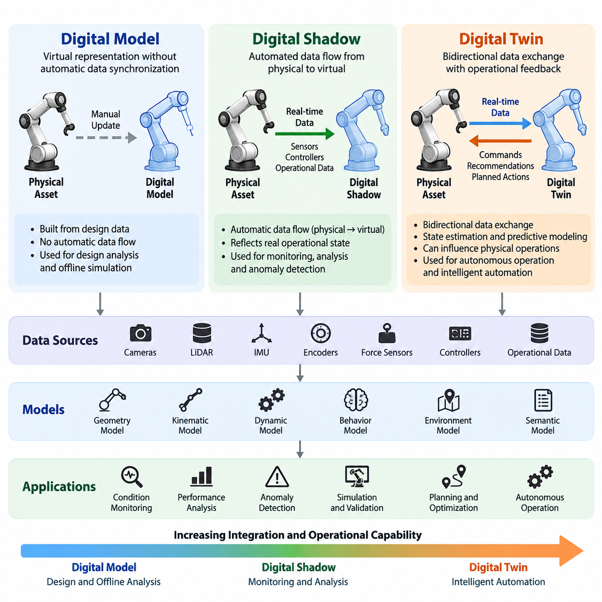{width="7.268055555555556in" height="7.268055555555556in"}

A digital model, digital shadow, and digital twin represent three progressively connected approaches to describing physical systems in a virtual environment. Although these concepts share geometric and computational foundations, they differ in how information flows between physical assets and digital representations. Understanding these distinctions is essential for designing simulation infrastructures that support Physical AI development, operational monitoring, and intelligent automation.

A digital model is a virtual representation of a physical object, machine, robot, or environment that operates without automatic data synchronization. Engineers construct the model using design specifications, geometric descriptions, physical parameters, and assumptions about operating conditions. Updates are performed manually or through independent engineering workflows, making the digital model primarily suitable for design analysis, offline simulation, and preliminary system verification.

Digital models commonly contain computer-aided design geometry, rigid-body structures, joint configurations, material properties, and simplified dynamic equations. In robotics, they provide the foundation for evaluating workspace constraints, collision behavior, actuator requirements, and motion feasibility. Their accuracy depends on the quality of initial engineering information, while their independence from live measurements limits their ability to represent changing physical conditions.

A digital shadow extends the digital model by establishing an automated information flow from the physical system to its virtual representation. Sensors, controllers, and operational databases continuously or periodically transmit measurements that update the digital state. This connection allows the virtual representation to reflect observed equipment behavior, environmental conditions, and operational changes without requiring manual synchronization.

The defining characteristic of a digital shadow is its predominantly unidirectional information flow. Physical measurements influence the digital representation, but changes within the digital environment do not automatically control the physical asset. For example, a mobile robot may transmit its position, battery status, motor temperature, and navigation events to a monitoring platform that reconstructs its operational state and supports performance analysis.

Digital shadows are valuable for condition monitoring, historical analysis, anomaly detection, and operational visualization. By combining sensor measurements with equipment models, engineers can identify deviations from expected behavior and investigate emerging performance problems. However, a digital shadow does not necessarily provide a validated predictive simulation or a mechanism for influencing physical operations through digitally generated decisions.

A digital twin introduces a more comprehensive relationship between physical and virtual systems through coordinated data exchange, state estimation, predictive modeling, and operational feedback. The digital representation receives information from the physical asset and can generate recommendations, control parameters, or planned actions that influence subsequent physical behavior. This creates the foundation for a bidirectional operational relationship.

Bidirectional connectivity does not mean that every digital twin directly controls physical equipment. Some twins provide decision recommendations that require human approval, while others exchange commands through supervised automation interfaces. The essential requirement is a defined mechanism through which digital analysis can influence physical operations, with appropriate authorization, safety constraints, and feedback verification.

In Physical AI, a digital twin can represent more than the geometry and mechanical behavior of a robot. It may integrate perception systems, actuator dynamics, power consumption, control policies, environmental interactions, and task execution states. This multidimensional representation allows intelligent systems to evaluate how physical conditions and autonomous decisions influence one another during real-world operations.

The relationship between these three concepts can be understood through their information architectures. A digital model operates independently of automatic physical updates, a digital shadow receives automated physical measurements, and a digital twin establishes an operational feedback relationship. The progression introduces increasing integration requirements, although greater connectivity does not automatically guarantee higher simulation fidelity or prediction accuracy.

Data synchronization is a fundamental requirement for operational digital twins. Measurements from cameras, LiDAR, inertial sensors, encoders, force sensors, and industrial controllers must be associated with consistent timestamps and coordinate frames. Synchronization mechanisms must account for communication delays, sensor sampling differences, missing observations, and uncertainty to maintain a coherent representation of the physical system.

A digital twin also requires suitable mathematical and computational models for interpreting incoming information. Geometric models describe spatial relationships, kinematic models describe motion constraints, and dynamic models estimate forces and system responses. Additional behavioral and semantic representations may capture operating modes, task objectives, environmental meaning, and interactions with humans or other autonomous machines.

Model fidelity should be selected according to the intended application rather than maximized indiscriminately. A fleet monitoring twin may require accurate positions, task states, and battery estimates without detailed contact physics. A manipulation twin may require precise joint dynamics, collision geometry, and friction characteristics. Selecting appropriate abstraction levels reduces computational cost while preserving information essential to operational decisions.

Physical AI digital twins frequently combine physics-based simulation with data-driven learning models. Physics models provide interpretable relationships between forces, motion, and environmental constraints, while machine learning can estimate uncertain parameters or approximate complex interactions. Hybrid approaches are particularly useful when mechanical behavior changes with payload, temperature, surface conditions, wear, or operating history.

State estimation connects imperfect physical measurements to the internal representation maintained by the twin. Because sensors contain noise and cannot directly observe every relevant variable, estimation algorithms infer hidden quantities such as velocity, friction, actuator efficiency, or contact state. The resulting estimates should include uncertainty information so downstream planning and control algorithms can distinguish reliable observations from uncertain predictions.

Predictive capability distinguishes advanced operational twins from systems limited to state visualization. By propagating estimated states through dynamic or learned models, a twin can evaluate possible future conditions under alternative actions. For autonomous robots, this supports trajectory evaluation, collision-risk assessment, energy forecasting, and the comparison of candidate control strategies before selected actions are executed physically.

Digital twins also provide a structured foundation for what-if simulation. Engineers can modify payload configurations, environmental obstacles, operating speeds, or control parameters within the virtual environment to evaluate possible outcomes. Such experiments help identify operational limits and potential failure conditions, although their conclusions remain dependent on model validity and the representativeness of simulated assumptions.

An important application is the integration of digital twins with simulation-to-real transfer. Real-world measurements can calibrate simulated dynamics, sensor characteristics, and environmental properties, reducing discrepancies between simulated and observed behavior. Updated simulation environments can then support policy training and evaluation, while controlled physical experiments provide additional evidence about whether learned behaviors transfer successfully.

The real-to-simulation process begins with collecting operational telemetry and identifying discrepancies between measured and predicted behavior. Parameter estimation and model updating procedures then adjust the virtual representation to better explain observed results. The updated model becomes a more relevant environment for testing alternative strategies, but independent validation remains necessary to avoid overfitting to recently observed operating conditions.

The simulation-to-real process transfers evaluated configurations, planning strategies, or learned policies from the virtual environment into physical deployment. Before deployment, candidate changes should undergo safety checks, compatibility verification, and performance testing. Runtime monitoring then compares actual outcomes with predicted behavior, allowing engineers to detect unexpected deviations and initiate corrective updates when required.

Digital twins can also support reinforcement learning and autonomous policy development. A calibrated virtual environment provides a controlled setting for collecting interaction experience, exploring alternative actions, and evaluating task performance. Unlike unrestricted physical experimentation, simulated exploration can investigate potentially hazardous conditions without directly exposing personnel or equipment to those experimental actions.

Nevertheless, digital twins cannot eliminate uncertainty associated with unmodeled dynamics, sensor imperfections, human behavior, or environmental variability. A highly detailed virtual representation may still produce inaccurate predictions when critical assumptions are incorrect. Continuous calibration, uncertainty quantification, scenario diversity, and comparison against independent physical measurements are therefore essential for maintaining operational credibility.

In industrial robotics, digital models are commonly used during equipment design, digital shadows support production monitoring, and digital twins can contribute to operational optimization. A manufacturing robot twin may evaluate cycle times, joint loads, and collision risks before production changes are introduced. A facility-level twin may additionally coordinate material flows, equipment availability, and interactions among multiple autonomous systems.

For autonomous mobile robots, the digital twin may combine vehicle dynamics, localization estimates, environmental maps, and mission execution data. This enables evaluation of route alternatives, congestion conditions, battery consumption, and fleet coordination strategies. When connected to operational management systems, the twin can support scheduling decisions and mission adjustments while preserving physical safety and supervisory control boundaries.

Digital twin architecture must also address computational placement and communication constraints. Edge computing can support low-latency estimation and monitoring, while on-premises or cloud infrastructure can execute computationally intensive simulations and fleet-level optimization. The division of responsibilities depends on network reliability, processing requirements, data sensitivity, and the consequences of delayed or unavailable communication.

Security and governance become increasingly important as connectivity expands from digital models to operational twins. Sensor streams, equipment configurations, and control interfaces require authentication, authorization, integrity protection, and traceable change management. Digital recommendations should pass through clearly defined safety and approval mechanisms, ensuring that compromised or inaccurate virtual information cannot directly create uncontrolled physical behavior.

A practical development strategy begins with a validated digital model, introduces reliable telemetry to establish a digital shadow, and progressively adds predictive capabilities and supervised feedback interfaces. Each stage should demonstrate measurable value before additional complexity is introduced. This incremental approach supports maintainability, clear responsibility boundaries, and systematic evaluation of synchronization quality and model performance.

The maturity of a digital twin should be evaluated through operational criteria rather than visualization quality alone. Relevant measures include state estimation accuracy, synchronization latency, prediction error, model update frequency, computational efficiency, and decision effectiveness. For Physical AI applications, additional evaluation should examine task success, safety constraint compliance, robustness to disturbances, and improvements observed during real-world deployment.

Ultimately, digital models, digital shadows, and digital twins form complementary layers of a connected engineering and intelligence infrastructure. Digital models provide structured virtual descriptions, digital shadows establish observation-driven representations, and digital twins enable predictive analysis and operational feedback. Together, they support the evolution of Physical AI from isolated simulation toward continuously informed, validated, and adaptive physical autonomy.

## 06.02. Robot and Environment Digital Twins

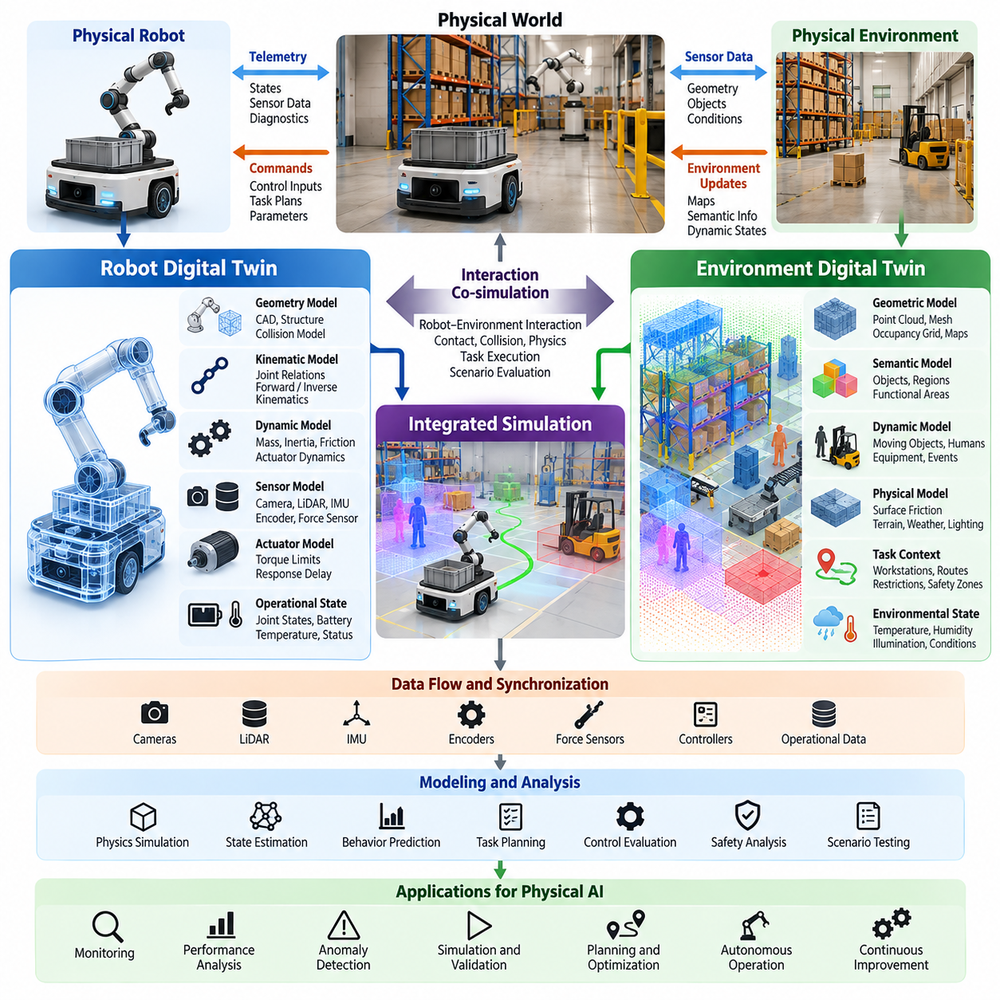{width="7.268055555555556in" height="7.268055555555556in"}

Robot and environment digital twins provide interconnected virtual representations of autonomous machines and the physical spaces in which they operate. A robot digital twin captures mechanical structure, dynamic behavior, sensing, and operational states, while an environment digital twin represents geometry, obstacles, surfaces, and changing conditions. Their integration enables Physical AI systems to analyze interactions between embodied intelligence and the surrounding world.

A robot digital twin begins with a structured representation of the robot\'s physical configuration. This includes rigid bodies, joints, actuators, sensors, mass distribution, and mechanical constraints. Geometric descriptions define the robot\'s shape and collision boundaries, while kinematic and dynamic models describe how its components move and respond to forces. These representations establish the foundation for simulation, monitoring, and control evaluation.

The geometric layer of a robot twin commonly incorporates CAD models, collision meshes, coordinate frames, and articulated structures. Visual geometry supports realistic rendering and sensor simulation, whereas simplified collision geometry improves computational efficiency. Maintaining consistency between visual and physical representations is important because geometric discrepancies can produce incorrect collision predictions, inaccurate motion planning, and unreliable task evaluations.

Kinematic modeling describes relationships between joint positions, link transformations, and the robot\'s overall configuration. Forward kinematics determines the position and orientation of robot components from joint states, while inverse kinematics identifies joint configurations that achieve desired poses. These capabilities allow the digital twin to evaluate reachable workspaces, joint limitations, manipulation trajectories, and coordinated movements.

Dynamic modeling extends the robot twin by incorporating mass, inertia, gravity, friction, contact forces, and actuator behavior. For mobile robots, this includes wheel-ground interaction, traction, steering dynamics, and payload-dependent motion. Manipulators require joint torque, transmission, and contact models, while legged robots demand detailed representations of balance, impact, and ground reaction forces.

A robot digital twin must also represent sensing and actuation systems. Cameras, LiDAR, inertial measurement units, encoders, and force sensors provide observations that connect physical operation with virtual state estimation. Actuator models describe command execution, response delays, torque limits, and control dynamics. Integrating these components supports evaluation of how sensing uncertainty and mechanical limitations influence autonomous behavior.

Operational synchronization connects the robot twin to its physical counterpart through telemetry and state updates. Joint positions, velocities, battery levels, temperatures, controller states, and diagnostic events can be transmitted to the digital environment. State estimation algorithms reconcile these measurements with internal models, allowing the twin to maintain a coherent approximation of the robot\'s current condition despite noise and communication delays.

An environment digital twin represents the physical surroundings that influence robot perception, navigation, and interaction. It may describe factories, warehouses, roads, agricultural fields, construction sites, or indoor service environments. Unlike static three-dimensional maps, operational environment twins can incorporate changing obstacles, equipment states, environmental conditions, and semantic information relevant to autonomous decision-making.

Geometric environment models commonly use point clouds, occupancy grids, meshes, and spatial maps reconstructed from sensors or engineering data. These representations describe walls, floors, machinery, pathways, and other physical structures. Their resolution must match application requirements, since navigation may tolerate simplified geometry while precise manipulation or collision-sensitive operations require substantially greater spatial accuracy.

Semantic environment modeling adds meaning to geometric structures by identifying objects, functional regions, and operational constraints. A warehouse twin may distinguish storage racks, loading zones, pedestrian areas, and restricted corridors. A manufacturing twin may represent workstations, machines, safety zones, and material transfer points. Semantic information allows Physical AI systems to interpret environments according to task requirements rather than geometry alone.

Dynamic environment twins represent changes that occur during physical operations. Moving robots, human workers, vehicles, doors, equipment, and temporary obstacles alter the conditions under which autonomous systems operate. Continuous observations and event updates can maintain estimates of these changes. Predictive models may additionally estimate future object movements, congestion patterns, and interactions that influence planning decisions.

Environmental physics is another essential component of high-fidelity digital twins. Surface friction, terrain deformation, slopes, lighting, weather, and material properties can significantly affect robot behavior. Outdoor mobility systems may require models of soil conditions, precipitation, and visibility, while industrial manipulators may depend on contact friction and object compliance. The appropriate fidelity depends on the physical interactions being evaluated.

Integrating robot and environment twins creates a unified simulation space in which autonomous behavior can be evaluated under realistic operating constraints. The robot model contributes mechanical and control characteristics, while the environment model supplies spatial structure, physical interactions, and operational context. Their combination supports navigation, manipulation, locomotion, collision avoidance, and coordinated task execution.

Coordinate alignment is fundamental to successful integration. Robot-local frames, sensor frames, map coordinates, and global reference systems must be connected through consistent transformations. Errors in calibration or localization can cause discrepancies between physical and virtual positions. Accurate synchronization of spatial and temporal references is therefore necessary for reliable collision analysis, trajectory prediction, and environmental interaction modeling.

A unified twin can support closed-loop simulation by connecting perception, planning, control, and physical dynamics. Simulated sensors observe the virtual environment, perception algorithms interpret those observations, and planning systems generate candidate actions. Controllers then execute commands within the simulated robot model, producing new physical states that influence subsequent observations and decisions.

For autonomous mobile robots, integrated twins can evaluate route feasibility, obstacle avoidance, localization robustness, and energy consumption. Warehouse simulations may reproduce narrow aisles, intersections, loading stations, and dynamic traffic conditions. Engineers can test alternative navigation policies and fleet coordination strategies before physical deployment, reducing the need for extensive experimentation in active operational environments.

For robotic manipulators, environment twins provide representations of workpieces, fixtures, tools, and surrounding equipment. The combined system can evaluate grasp feasibility, collision-free motion, contact forces, and task sequencing. Changes in object position, geometry, or material properties can be introduced to examine manipulation robustness and identify situations where perception or control strategies may fail.

Legged robots and humanoid systems benefit from integrated twins that represent terrain geometry, contact mechanics, and environmental obstacles. Walking, balancing, climbing, and whole-body manipulation require continuous interaction between robot dynamics and surrounding surfaces. Accurate modeling of friction, compliance, and contact transitions is particularly important when evaluating locomotion stability and recovery behaviors.

Robot and environment twins also support multi-robot coordination by representing shared spaces and interactions among autonomous agents. Each robot may maintain an individual operational twin, while a common environment representation provides shared spatial and semantic context. This architecture supports traffic prediction, task allocation, collision-risk evaluation, and coordinated mission planning across heterogeneous robot fleets.

Real-world data continuously improves the relevance of integrated digital twins. Robot telemetry provides information about mechanical behavior and control performance, while environmental sensing updates maps, obstacles, and operational conditions. Comparing observed outcomes with simulated predictions helps identify modeling errors and changing physical parameters. These discrepancies can guide calibration and model refinement.

The integration of real-to-simulation and simulation-to-real workflows transforms digital twins into practical development infrastructure. Physical observations update robot and environment models, while virtual experiments evaluate alternative control policies and operating strategies. Validated improvements can then be introduced into physical systems through controlled deployment procedures, creating a feedback cycle between observation, simulation, and operation.

AI-enabled robot twins can incorporate learned dynamics, predictive state estimation, and adaptive control models. Environment twins may use machine learning to infer object behavior, estimate traversability, or predict human movement. These learned components complement physics-based models by representing complex relationships that are difficult to describe analytically, although their predictions require uncertainty assessment and validation.

Digital twin accuracy depends on maintaining appropriate fidelity across both robot and environment representations. A highly accurate robot model cannot compensate for incorrect environmental geometry or friction assumptions. Similarly, a detailed environment twin provides limited value when actuator response, sensor calibration, or control latency is poorly represented. Integrated validation must therefore examine the complete interaction between physical agents and their surroundings.

Computational architecture determines how these twins operate at practical scale. Edge systems may handle low-latency telemetry, state estimation, and safety monitoring, while on-premises or cloud resources execute detailed physics simulations and scenario analysis. Selective synchronization and hierarchical modeling can reduce communication overhead and computational demand without sacrificing information essential to operational decisions.

Safety considerations require separating predictive simulation from unrestricted physical control. Candidate actions generated within a digital twin should undergo constraint checking, uncertainty evaluation, and appropriate authorization before affecting real equipment. Monitoring systems must detect synchronization failures, stale environmental information, and significant model discrepancies. Safe fallback behavior remains necessary when virtual predictions become unreliable.

Ultimately, robot and environment digital twins establish a shared computational representation of embodied machines and their operating worlds. Their combined value extends beyond visualization to predictive simulation, operational analysis, autonomous policy evaluation, and continuous model improvement. By connecting physical observations with validated virtual experimentation, integrated digital twins provide a foundation for scalable, adaptive, and reliable Physical AI systems.

## 06.03. Sensor Actuator and Power System Twins

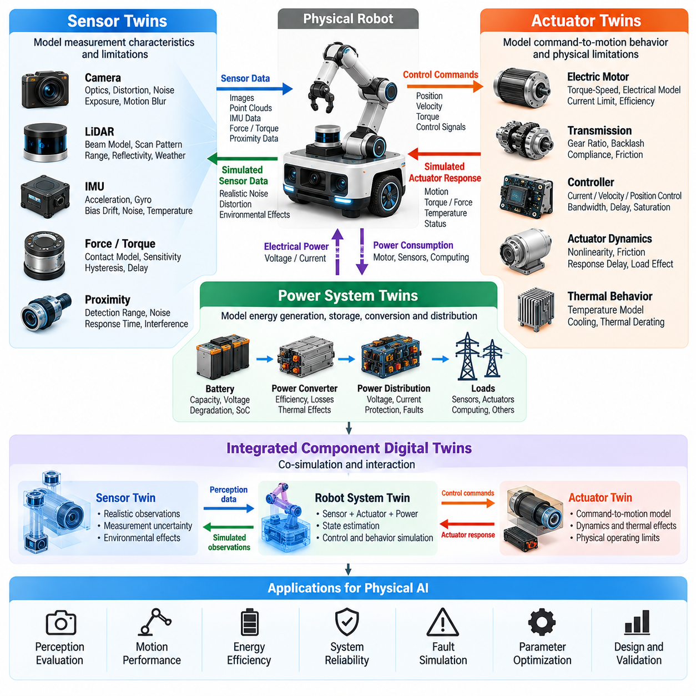{width="7.268055555555556in" height="7.268055555555556in"}

Sensor, actuator, and power system digital twins provide detailed virtual representations of the components that connect Physical AI intelligence to physical operation. Sensors observe the environment and internal states, actuators convert control commands into mechanical motion, and power systems supply the energy required for operation. Their integrated digital twins enable analysis of perception accuracy, motion performance, energy efficiency, and system reliability.

A sensor digital twin represents the measurement characteristics, operating conditions, and limitations of a physical sensing device. Rather than reproducing ideal measurements, it models how observations are affected by noise, calibration errors, environmental interference, and hardware constraints. This representation helps Physical AI systems evaluate whether perception algorithms remain reliable under realistic operating conditions and changing sensor performance.

Camera digital twins incorporate optical parameters, lens distortion, exposure behavior, image resolution, and sensor noise. Advanced models may also represent motion blur, rolling shutter effects, dynamic range, and illumination sensitivity. By reproducing these characteristics, simulation environments can generate realistic visual observations for training object detection, localization, scene understanding, and vision-based robot control algorithms.

LiDAR digital twins simulate laser emission, beam geometry, scanning patterns, distance measurements, and return intensity. Their accuracy depends on modeling range limitations, angular resolution, surface reflectivity, and measurement uncertainty. Environmental effects such as fog, rain, dust, and multipath reflections can further influence observations. These models support navigation, mapping, obstacle detection, and perception robustness evaluation.

Inertial measurement unit digital twins represent accelerometer and gyroscope behavior, including measurement noise, bias drift, scale-factor errors, and temperature sensitivity. Such effects accumulate during motion estimation and can significantly influence localization accuracy. By reproducing realistic inertial measurements, digital twins allow engineers to evaluate sensor fusion algorithms, state estimators, and navigation systems under controlled conditions.

Force, torque, tactile, and proximity sensor twins extend virtual sensing into physical interaction. They model contact measurement, sensitivity, hysteresis, saturation, and response delays. These characteristics are particularly important for robotic manipulation, compliant control, and human-robot interaction. Accurate sensor representations help determine whether a controller can detect contact transitions, regulate applied forces, and respond safely to unexpected interactions.

Sensor synchronization is essential when multiple sensing modalities contribute to a shared state estimate. Camera frames, LiDAR scans, encoder measurements, and inertial observations may arrive at different rates with varying communication delays. Digital twins must reproduce timing characteristics and coordinate transformations so perception and sensor fusion algorithms can be evaluated under realistic synchronization errors and incomplete observations.

An actuator digital twin describes how electrical, hydraulic, or pneumatic commands produce mechanical force and motion. It incorporates motor characteristics, transmission mechanisms, control interfaces, and physical operating limits. Unlike idealized motion models, actuator twins reproduce response delays, nonlinearities, friction, saturation, and thermal effects that influence how accurately physical machines follow commanded trajectories.

Electric motor twins commonly represent torque-speed relationships, winding resistance, inductance, back electromotive force, current limits, and efficiency. These parameters determine how motors respond to voltage or current commands under different loads. Integrating electrical and mechanical dynamics allows engineers to evaluate acceleration capability, torque delivery, energy consumption, and the consequences of sustained high-load operation.

Transmission system twins represent gearboxes, belts, harmonic drives, and other mechanisms connecting motors to mechanical loads. Important characteristics include gear ratios, backlash, compliance, mechanical efficiency, and friction losses. These effects influence positioning accuracy, vibration, and force transmission. Their representation is especially important for precision manipulators, steering systems, and dynamically controlled robotic joints.

Actuator control twins include current loops, velocity controllers, position controllers, and associated command-processing delays. They can reproduce controller bandwidth, sampling rates, saturation behavior, and communication latency. Such models allow simulation engineers to investigate interactions between high-level AI policies and low-level motor control, identifying situations where commanded actions exceed the physical response capability of the hardware.

Thermal behavior is another critical dimension of actuator modeling. Motor windings, power electronics, bearings, and transmissions generate heat during operation. Digital twins can estimate temperature evolution from electrical losses, mechanical friction, cooling conditions, and duty cycles. These predictions help evaluate continuous operating limits, thermal derating, and the risk of performance degradation during demanding missions.

Power system digital twins represent the generation, storage, conversion, and distribution of electrical energy within a robot. Battery packs, power converters, distribution circuits, and electrical loads form an interconnected energy architecture. Modeling these components allows Physical AI systems to predict available power, estimate mission endurance, evaluate peak demand, and understand how energy limitations constrain autonomous behavior.

Battery digital twins describe state of charge, state of health, voltage behavior, internal resistance, temperature, and degradation characteristics. Their models may combine equivalent electrical circuits, electrochemical approximations, and data-driven estimation methods. By incorporating load history and environmental conditions, battery twins can estimate remaining operating time and evaluate how charging patterns influence long-term battery performance.

Power conversion twins represent DC-DC converters, motor drives, inverters, and power distribution electronics. These models capture conversion efficiency, voltage regulation, current limitations, switching losses, and thermal behavior. Their importance increases when multiple actuators demand high power simultaneously, because voltage drops or current restrictions may affect controller performance and overall robot stability.

Power distribution modeling examines how energy flows between storage devices, computing systems, sensors, actuators, and auxiliary equipment. Each subsystem contributes a time-varying electrical load. A digital twin can evaluate transient power demand, voltage stability, and protection behavior under different operating scenarios. This helps identify conditions where simultaneous acceleration, computation, and sensing may exceed available electrical capacity.

The integration of sensor, actuator, and power twins reveals dependencies that isolated component models cannot capture. Higher motor torque increases electrical demand and heat generation, while reduced battery voltage may limit actuator performance. Sensor processing and onboard AI computation also consume energy and generate heat. These interactions influence mission duration, control responsiveness, and the reliability of autonomous operations.

A unified component-level digital twin can connect perception, decision-making, control, and energy management within a common simulation environment. Sensor models generate observations, AI policies determine actions, actuator models execute commands, and power models calculate resulting energy consumption. Feedback from the simulated physical system updates subsequent observations, enabling realistic evaluation of closed-loop Physical AI behavior.

Real-time telemetry provides the connection between physical components and their digital representations. Sensor diagnostics, motor currents, joint velocities, battery measurements, and temperature readings can continuously update model states. State estimation and parameter identification algorithms reconcile observations with predictions, helping the digital twin reflect component aging, changing operating conditions, and emerging performance deviations.

Model calibration is necessary because nominal component specifications rarely capture every characteristic of installed hardware. Manufacturing tolerances, mechanical assembly, sensor alignment, and operating history introduce differences between nominal and actual behavior. Calibration procedures use measured responses to estimate relevant parameters, improving the predictive accuracy of sensor, actuator, and power system twins.

Fault modeling extends digital twins beyond normal operating conditions. Sensor failures may involve signal loss, excessive noise, bias shifts, or communication interruptions. Actuator faults can include overheating, reduced torque, mechanical wear, and controller malfunction. Power faults may involve voltage instability, cell imbalance, or protection shutdown. Simulating these conditions supports diagnostic development and fault-tolerant control evaluation.

Predictive maintenance applications use digital twins to compare expected component behavior with operational measurements. Increasing motor current at a constant load may indicate rising mechanical resistance, while abnormal battery voltage behavior may suggest degradation. Such indicators require contextual interpretation because similar symptoms can arise from changing workloads. Reliable maintenance decisions depend on validated models and multiple supporting measurements.

Digital twins also support hardware and software co-design by revealing how component selection influences intelligent behavior. Engineers can compare alternative sensors, motor specifications, gear ratios, battery capacities, and computing configurations before physical integration. Simulation results help identify tradeoffs between perception quality, mechanical performance, energy consumption, cost, and computational requirements.

For autonomous mobile robots, integrated component twins can evaluate acceleration, steering response, braking, battery endurance, and sensor reliability under different payloads and surface conditions. For manipulators, they support torque estimation, thermal analysis, precision control, and contact sensing. Legged robots and humanoids benefit from evaluating peak actuator demands, balance-related energy consumption, and synchronized sensing during dynamic motion.

Computational fidelity must be matched to the purpose of each digital twin. Detailed electrical switching models may be appropriate for power electronics design but unnecessary for fleet-level mission planning. Similarly, high-resolution optical simulation may be essential for perception validation but excessive for energy forecasting. Hierarchical modeling allows detailed component analysis while maintaining efficient system-level simulation.

Safety and validation remain essential when digital twins influence physical operation. Predictions should be checked against measured performance across representative loads, temperatures, and failure conditions. Significant model discrepancies must trigger appropriate uncertainty handling or fallback procedures. Digital twin recommendations should not bypass independent hardware protection, emergency stopping mechanisms, or established functional safety controls.

Ultimately, sensor, actuator, and power system twins establish the component-level foundation of operational Physical AI digital twins. They connect information acquisition, mechanical action, and energy availability within a consistent computational framework. Through telemetry synchronization, predictive simulation, model calibration, and validated feedback, these representations support more efficient, adaptive, and reliable autonomous robotic systems.

## 06.04. Facility and Fleet Digital Twins

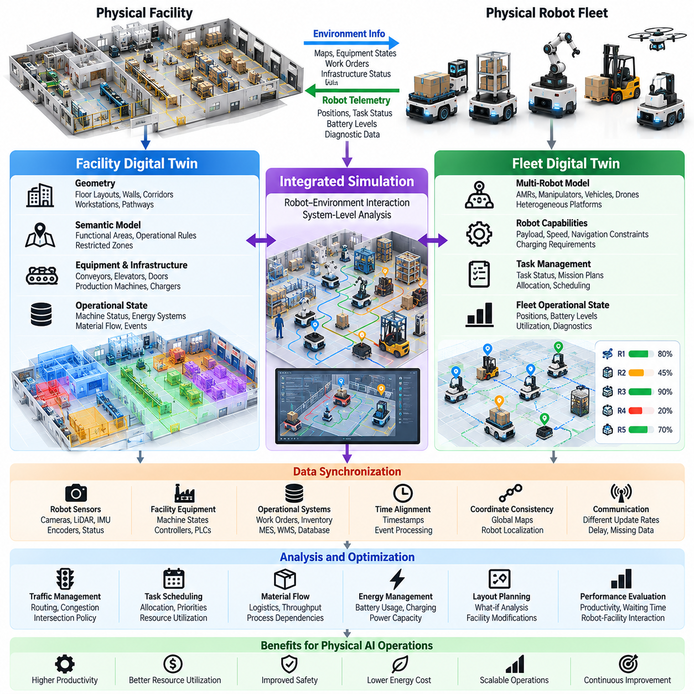{width="7.268055555555556in" height="7.268055555555556in"}

Facility and fleet digital twins extend Physical AI simulation beyond individual robots to interconnected operational environments. A facility digital twin represents buildings, infrastructure, equipment, and workflows, while a fleet digital twin represents multiple autonomous machines and their coordinated activities. Their integration enables system-level analysis of productivity, resource utilization, operational constraints, and interactions between robots and physical infrastructure.

A facility digital twin begins with a structured representation of the physical site, including floor layouts, walls, corridors, workstations, storage areas, and transportation pathways. Geometric models may originate from CAD drawings, building information models, or spatial scanning. These representations establish the foundation for evaluating robot accessibility, material movement, equipment placement, and operational safety within complex industrial environments.

Beyond geometry, facility twins incorporate semantic and operational information describing how different areas function. Manufacturing cells, loading docks, charging stations, restricted zones, and pedestrian corridors have distinct operational rules. Associating these meanings with spatial models allows autonomous systems to interpret facility constraints and supports intelligent planning across shared environments.

Facility twins also represent fixed equipment and infrastructure systems, including conveyors, elevators, automated doors, production machines, and energy distribution networks. Equipment states may be synchronized through industrial controllers, sensors, and operational databases. This connectivity allows the virtual facility to reflect changing machine availability, infrastructure conditions, and material handling requirements.

A fleet digital twin represents a collection of autonomous mobile robots, manipulators, industrial vehicles, or heterogeneous robotic platforms. Each robot contributes information about its position, operational state, capabilities, battery level, assigned tasks, and diagnostic conditions. Aggregating these individual representations provides a fleet-wide view of resource availability, mission progress, and collective operational performance.

Fleet digital twins require consistent representations of robot identity, capabilities, and task status. Different robot platforms may have distinct payload capacities, navigation constraints, operating speeds, and charging requirements. A shared data model allows fleet management systems to compare these capabilities and allocate work according to operational needs rather than treating all robots as interchangeable resources.

Integrating facility and fleet twins creates a shared operational environment where infrastructure and mobile agents influence one another. Robot movement affects corridor congestion and workstation availability, while facility conditions influence navigation and task scheduling. This bidirectional relationship supports coordinated decision-making across physical assets, transportation networks, and production workflows.

Real-time synchronization connects facility equipment, fleet telemetry, and operational management systems to their digital representations. Robot positions, machine states, task assignments, and infrastructure events may arrive at different update frequencies. Timestamp alignment, event processing, and state estimation help maintain a coherent operational picture despite communication delays, missing observations, and asynchronous updates.

Spatial consistency is essential when multiple robots operate within the same facility. Local robot maps, facility coordinate systems, and global navigation references must be aligned through validated transformations. Localization uncertainty and map changes should be represented explicitly because inaccurate spatial information can produce conflicting route plans, unsafe proximity estimates, and inefficient traffic coordination.

Traffic management is a major application of integrated facility and fleet twins. Narrow aisles, intersections, shared loading areas, and constrained passages can become operational bottlenecks. Simulation allows engineers to evaluate routing policies, intersection priorities, reservation mechanisms, and congestion mitigation strategies before applying changes to active robotic fleets.

Fleet scheduling and task allocation can also be evaluated through digital twins. Mission assignments depend on robot capabilities, travel distance, battery availability, task deadlines, and equipment readiness. By simulating alternative allocation strategies, operators can compare throughput, waiting time, utilization, and completion reliability under varying demand patterns.

Material flow modeling connects robot missions with broader facility operations. Incoming materials, intermediate products, finished goods, and empty containers move through interconnected production and storage processes. A facility twin can represent these dependencies, while a fleet twin evaluates transportation capacity and mission sequencing. Their combination helps identify whether logistics performance matches production requirements.

Digital twins enable what-if analysis of facility layout changes and fleet expansion. Engineers can examine how relocating workstations, modifying aisle directions, adding charging stations, or increasing robot numbers affects overall operations. Such experiments reveal nonlinear interactions, including situations where additional robots increase congestion rather than improving throughput.

Energy management becomes increasingly important as autonomous fleets grow. Fleet twins can estimate battery consumption, charging demand, and mission endurance, while facility twins represent charger locations and electrical capacity constraints. Integrated analysis supports charging schedules that reduce operational interruptions and helps identify peak electrical demand caused by simultaneous charging or intensive equipment operation.

Facility and fleet twins can incorporate human activity to evaluate shared-space operations. Workers, forklifts, maintenance personnel, and visitors introduce dynamic constraints that influence robot navigation and scheduling. Behavioral models can approximate pedestrian movement and interaction patterns, although uncertainty must be considered when predicting human actions or evaluating safety-critical encounters.

Operational disturbances provide another important simulation dimension. Equipment breakdowns, blocked corridors, delayed material deliveries, communication failures, and unavailable charging stations can disrupt coordinated workflows. Digital twins allow operators to evaluate alternative routing, task reassignment, and recovery strategies without intentionally introducing these disruptions into the physical facility.

A facility-level digital twin may integrate manufacturing execution systems, warehouse management systems, building management platforms, and industrial control networks. A fleet twin may connect to robot fleet managers, mission dispatchers, and maintenance databases. Interoperable interfaces and consistent operational data definitions are necessary to prevent conflicting states and duplicated control responsibilities.

AI-enabled digital twins extend conventional monitoring through predictive analytics and operational optimization. Learning models can estimate congestion, forecast equipment availability, predict mission completion times, and identify emerging bottlenecks. Optimization algorithms can then evaluate alternative schedules or routing decisions, while simulation provides a controlled environment for assessing their likely consequences.

Hierarchical architectures help manage the complexity of large facilities and robotic fleets. Individual robot twins capture local mechanical and operational states, fleet twins coordinate shared resources, and facility twins represent infrastructure and production dependencies. This separation allows detailed models to be used selectively while higher-level simulations operate with simplified representations.

Computational scalability depends on balancing simulation fidelity, update frequency, and operational coverage. Detailed physics may be necessary for collision-sensitive interactions, while discrete-event or agent-based simulation may be sufficient for fleet scheduling. Combining multiple simulation approaches allows system-level evaluation without requiring every component to operate at maximum physical detail.

Real-to-simulation workflows use operational telemetry to update facility and fleet models. Observed travel times, congestion events, equipment utilization, and mission failures provide evidence for adjusting simulation parameters. Comparing predicted and actual outcomes helps identify inaccurate assumptions and supports continuous calibration as layouts, workloads, and fleet configurations evolve.

Simulation-to-real workflows transfer validated operational improvements into physical systems. Updated routing rules, task allocation policies, and charging strategies can be evaluated virtually before controlled deployment. Subsequent monitoring determines whether expected improvements appear in real operations and whether unexpected interactions require further model refinement.

Performance evaluation should consider both local and system-wide outcomes. Individual robot efficiency does not necessarily translate into higher facility productivity. Relevant measures include mission throughput, task completion time, fleet utilization, congestion duration, equipment waiting time, energy consumption, and operational availability. Safety-related indicators and recovery performance are equally important.

Safety and cybersecurity are fundamental when facility and fleet twins influence operational decisions. Access controls, authenticated data exchange, command authorization, and audit trails help protect interconnected systems. Virtual recommendations should remain subject to independent safety constraints, and synchronization failures must not compromise emergency stopping, collision protection, or established operational safeguards.

Facility and fleet digital twins also support long-term capacity planning and infrastructure investment. Operators can compare alternative fleet sizes, facility configurations, automation levels, and maintenance strategies under projected workloads. Although simulation cannot eliminate uncertainty, validated scenario analysis provides a systematic basis for evaluating expansion decisions and identifying operational risks.

Ultimately, facility and fleet digital twins connect autonomous machines with the infrastructure, resources, and workflows that determine their collective effectiveness. Their value lies in transforming isolated robot intelligence into coordinated operational intelligence. Through synchronized data, predictive simulation, scalable optimization, and validated feedback, they establish a foundation for adaptive, efficient, and reliable Physical AI operations.

## 06.05. Geometric Kinematic and Dynamic Twins

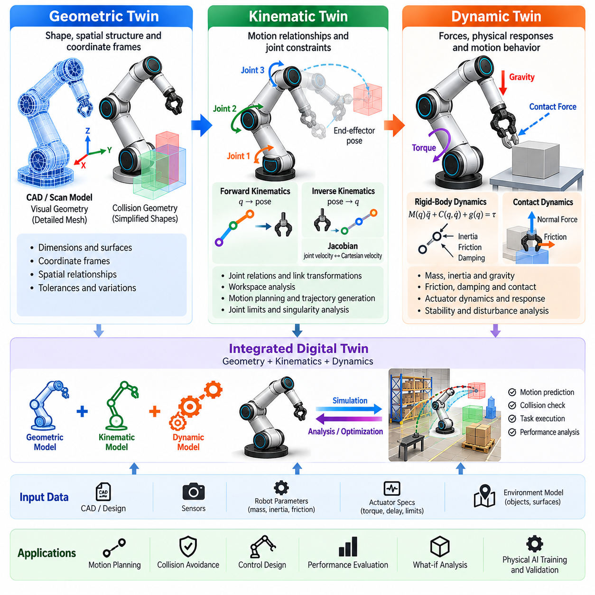{width="7.268055555555556in" height="7.268055555555556in"}

Geometric, kinematic, and dynamic digital twins form the physical modeling foundation of intelligent robotic systems. A geometric twin represents the shape and spatial structure of a robot, a kinematic twin describes motion relationships between connected components, and a dynamic twin models forces and physical responses. Their integration allows Physical AI systems to predict movement, evaluate physical constraints, and validate autonomous behavior.

A geometric digital twin captures the dimensions, surfaces, coordinate frames, and spatial relationships of physical components. It commonly originates from computer-aided design models, three-dimensional scanning, or engineering specifications. Accurate geometric representation supports visualization, collision detection, workspace analysis, and environmental interaction, establishing a consistent spatial reference for subsequent motion and physics modeling.

Geometric twins distinguish between visual geometry and collision geometry because these representations serve different computational purposes. Detailed meshes provide realistic appearance and accurate surface descriptions, while simplified collision shapes accelerate proximity calculations. Maintaining consistency between them is essential, since excessive simplification can overlook contact conditions and overly complex geometry can reduce simulation performance.

Coordinate frames establish how individual components are positioned and oriented relative to one another. Robot bases, joints, tools, sensors, and environmental objects each require clearly defined reference frames. Transformation matrices connect these frames through translation and rotation, enabling consistent spatial calculations. Errors in frame definitions can propagate into localization, manipulation planning, and collision assessment.

Geometric modeling must also account for mechanical tolerances and physical changes. Manufacturing deviations, assembly misalignment, structural deformation, and component replacement may create differences between nominal models and installed hardware. Periodic calibration and geometric updates help preserve alignment between digital representations and actual systems, particularly when precise manipulation or close-proximity operation is required.

A kinematic digital twin extends geometric representation by describing how connected components move through joints and mechanical constraints. It defines relationships among joint coordinates, link transformations, and end-effector poses without necessarily modeling the forces that generate motion. This abstraction supports motion planning, workspace evaluation, trajectory generation, and the analysis of articulated robotic structures.

Forward kinematics calculates the position and orientation of robot components from known joint configurations. It uses transformation chains that describe how motion propagates through an articulated structure. For robotic manipulators, forward kinematics determines end-effector poses, while mobile platforms use related transformations to estimate body and sensor positions. These calculations provide the spatial foundation for coordinated control.

Inverse kinematics determines joint configurations that achieve desired positions and orientations. Because multiple configurations may satisfy the same target pose, solutions must consider joint limits, collision constraints, and motion continuity. Some target poses may be unreachable or correspond to singular configurations. Digital twins allow these conditions to be examined before commands are executed on physical robots.

The Jacobian matrix connects joint velocities with Cartesian velocities and provides insight into motion sensitivity. It supports differential inverse kinematics, velocity control, and the identification of singularities. Near singular configurations, small Cartesian motion requirements may demand large joint velocities. A kinematic twin can detect these conditions and support trajectory adjustments that preserve controllability.

Kinematic constraints vary significantly across robot morphologies. Wheeled robots may experience nonholonomic constraints that prevent arbitrary sideways motion, while manipulators are limited by joint ranges and mechanical linkages. Legged robots require coordinated limb movement and contact configurations. Representing these constraints accurately is necessary to prevent motion planners from generating physically impossible trajectories.

A dynamic digital twin extends kinematic models by incorporating the forces and torques responsible for motion. It represents mass, inertia, gravity, friction, damping, and external interactions through equations of motion. Dynamic simulation predicts how a robot accelerates, decelerates, and responds to disturbances. This capability is essential when evaluating control performance, physical stability, and actuator requirements.

Rigid-body dynamics describe the movement of mechanical links under applied forces and constraints. Multibody models combine individual bodies through joints to reproduce articulated motion. Numerical solvers calculate system acceleration and integrate states over time. Model accuracy depends on physical parameters, constraint formulation, integration methods, and the treatment of contact between interacting objects.

Mass distribution and inertia strongly influence dynamic behavior. Two robots with identical external geometry may respond differently if their internal components or payloads are arranged differently. A dynamic twin must represent centers of mass, inertia tensors, and changing payload configurations. These parameters affect acceleration, braking, manipulation forces, balance, and the stability of mobile or legged systems.

Contact dynamics describe interactions between robots and surrounding objects or surfaces. Collision detection identifies potential contact, while contact models estimate normal forces, friction, restitution, and compliance. These interactions are particularly important for grasping, pushing, walking, and wheeled mobility. Inaccurate contact parameters can create substantial differences between simulated behavior and physical operation.

Friction modeling requires attention because real contact behavior is often nonlinear and dependent on operating conditions. Static friction, kinetic friction, rolling resistance, and velocity-dependent effects influence robot motion. Surface materials, contamination, temperature, and wear may change these characteristics. Dynamic twins can incorporate calibrated friction models to improve traction prediction and contact-sensitive control evaluation.

Actuator dynamics connect high-level motion commands with achievable physical responses. Motor torque limits, transmission ratios, backlash, control bandwidth, and response delays determine how accurately robots follow planned trajectories. A dynamic twin that ignores these limitations may predict movements that real hardware cannot execute. Integrating actuator models therefore improves control validation and mechanical feasibility analysis.

Numerical integration determines how continuous dynamic equations are approximated during simulation. Time-step selection affects computational cost, stability, and accuracy, particularly when impacts or stiff contacts occur. Smaller steps may improve resolution but increase processing requirements. Appropriate solver selection and convergence testing are necessary to distinguish genuine physical behavior from numerical artifacts.

Geometric, kinematic, and dynamic twins operate as interconnected modeling layers. Geometry defines physical structure and collision boundaries, kinematics determines allowable configurations and motion relationships, and dynamics predicts the consequences of applied forces. Together, they support physically consistent simulation in which perception, planning, and control algorithms interact with realistic mechanical constraints.

Model fidelity should reflect the intended application rather than maximize detail indiscriminately. Simplified geometry and kinematics may be sufficient for route planning, while high-speed manipulation requires detailed actuator and contact dynamics. Hierarchical representations allow computational resources to focus on interactions that materially affect performance. This approach supports both efficient simulation and targeted high-fidelity analysis.

Calibration connects mathematical models with measured physical behavior. Joint encoder data, actuator currents, force measurements, motion tracking, and inertial observations can reveal discrepancies between predictions and reality. Parameter identification methods estimate quantities such as friction coefficients, inertial properties, and actuator response characteristics. Repeated validation improves predictive accuracy across representative operating conditions.

Uncertainty must be represented because physical parameters and operating environments cannot be known perfectly. Geometric tolerances, sensor errors, payload variation, and uncertain friction introduce differences between predicted and actual behavior. Sensitivity analysis and probabilistic modeling help determine which uncertainties most strongly influence task outcomes. These results can guide robust control design and simulation scenario selection.

Digital twins support controller development by providing a controlled environment for evaluating trajectory tracking, disturbance rejection, and stability. Model-based controllers can use dynamic predictions to calculate appropriate actions, while learning-based policies can be trained through repeated simulation. Comparing controller behavior across different model fidelities helps identify dependencies that may limit successful deployment.

Real-to-simulation workflows update geometric, kinematic, and dynamic representations using physical measurements. Changes in component alignment, joint behavior, friction, or payload distribution can trigger model recalibration. Simulation-to-real workflows then transfer validated trajectories and control strategies into physical operation. This continuous exchange helps reduce modeling discrepancies and supports adaptive robotic performance.

Safety verification benefits from combining geometric collision analysis with kinematic feasibility and dynamic response prediction. A trajectory may be geometrically collision-free yet dynamically unsafe because of excessive acceleration, insufficient braking capability, or unstable contact forces. Integrated twins expose these distinctions and enable evaluation of operating envelopes, emergency maneuvers, and physical constraint violations.

Ultimately, geometric, kinematic, and dynamic digital twins provide complementary descriptions of robotic embodiment. Geometry explains physical structure, kinematics defines possible motion, and dynamics determines how motion occurs under forces and constraints. Their synchronized integration establishes a reliable foundation for simulation, motion planning, control validation, and the development of adaptive Physical AI systems.

## 06.06. Semantic and Behavioral Twins

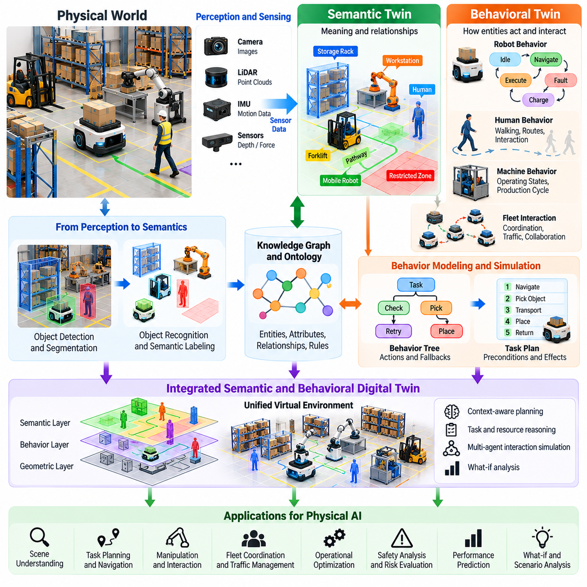{width="7.268055555555556in" height="7.268055555555556in"}

Semantic and behavioral digital twins extend physical modeling by representing the meaning, purpose, and expected behavior of objects, agents, and environments. While geometric and dynamic twins describe physical structure and motion, semantic twins explain what entities represent and how they relate to tasks. Behavioral twins describe how these entities act and interact over time, enabling Physical AI systems to reason about operational context.

A semantic digital twin organizes physical entities through meaningful descriptions, attributes, and relationships. Robots, tools, workstations, materials, and environmental regions are associated with functional identities rather than treated only as geometric objects. This additional information allows autonomous systems to distinguish between physically similar objects that have different operational roles, safety requirements, or manipulation constraints.

Semantic representations commonly incorporate object categories, properties, spatial relationships, and functional capabilities. A warehouse environment may identify storage racks, loading stations, restricted areas, and transportation corridors. Each entity can include information about accessibility, permitted operations, and resource availability. These descriptions help robots select appropriate actions according to operational requirements.

Knowledge graphs provide a structured mechanism for organizing semantic relationships within digital twins. Entities are represented as nodes, while connections describe properties, dependencies, and interactions. A robot may be associated with available tools, supported tasks, and assigned workstations. Such representations enable contextual queries, dependency analysis, and reasoning across complex robotic environments.

Ontologies establish shared definitions for entities, properties, and relationships within a semantic twin. They help ensure that different robots, software systems, and operational databases interpret information consistently. Standardized semantic descriptions support interoperability between perception systems, mission planners, fleet managers, and digital twin platforms, reducing ambiguity when information is exchanged across heterogeneous systems.

Semantic twins connect perception outputs with higher-level understanding of the environment. Object detection and segmentation identify physical entities, while semantic reasoning assigns functional meaning to those observations. A detected surface may be classified as a worktable, charging station, or restricted platform. This interpretation influences task planning, navigation decisions, and the selection of appropriate interaction strategies.

Spatial semantics describe relationships such as containment, adjacency, accessibility, and connectivity. A mobile robot may recognize that a loading area belongs to a particular production zone or that a corridor connects two workstations. These relationships allow planning systems to reason beyond raw coordinates and support task execution when geometric details change but functional relationships remain valid.

Behavioral digital twins represent how robots, humans, machines, and other agents respond to conditions and events. They describe actions, state transitions, operating rules, and interaction patterns rather than only physical motion. A behavioral twin may model how a robot selects tasks, how a production machine changes operating states, or how pedestrian movement affects shared-space navigation.

Finite-state machines and statecharts provide practical representations of operational behavior. A robot may transition between idle, assigned, navigating, executing, charging, and fault states according to defined conditions. Behavioral twins can reproduce these transitions and evaluate whether control logic responds correctly to normal events, unexpected interruptions, and recovery procedures.

Behavior trees offer another mechanism for describing complex robotic behavior. They organize actions, conditions, and fallback strategies into reusable decision structures. A manipulation robot may verify object presence, approach a target, execute grasping, and recover from failure. Simulating these sequences within a behavioral twin helps identify logical inconsistencies and evaluate task robustness before deployment.

Task-level behavioral models describe how autonomous systems pursue goals through coordinated actions. These models may include preconditions, action effects, resource dependencies, and execution constraints. A delivery mission, for example, requires a suitable robot, an accessible destination, sufficient energy, and available loading infrastructure. Behavioral twins allow planners to evaluate whether proposed task sequences remain feasible.

Human behavioral modeling is particularly important in shared operational environments. Pedestrians, operators, and maintenance personnel may follow recurring movement patterns while also exhibiting unpredictable actions. Behavioral twins can approximate walking speeds, route preferences, interaction zones, and responses to robotic movement. These predictions must remain probabilistic because human behavior cannot be represented with complete certainty.

Multi-agent behavioral twins describe interactions among robots, humans, vehicles, and infrastructure systems. Individual agents may have distinct goals, priorities, and operating constraints. Their collective behavior can produce congestion, resource competition, or coordinated cooperation. Simulating these interactions allows engineers to evaluate fleet policies, traffic management strategies, and shared-resource scheduling.

Semantic and behavioral twins become especially powerful when integrated. Semantic information identifies entities and their functional relationships, while behavioral models describe how those entities respond during operations. A charging station is not merely a spatial location but a resource with availability, capacity, and operating rules. Its behavioral model determines how charging requests, reservations, and failures affect robot missions.

Temporal reasoning extends semantic representations by describing how relationships and states change over time. Equipment availability, task assignments, access permissions, and resource occupancy may vary throughout an operating cycle. Digital twins can associate these changes with timestamps and events, enabling analysis of operational histories and prediction of future constraints.

Event-driven architectures support behavioral synchronization between physical operations and digital representations. Sensor observations, controller messages, task updates, and equipment alarms can trigger state transitions within the twin. Event processing mechanisms maintain consistency between observed conditions and modeled behavior, although communication delays and missing events must be considered when reconstructing operational states.

Uncertainty is essential in semantic interpretation and behavioral prediction. Perception systems may misclassify objects, semantic databases may contain outdated information, and behavioral models may fail to predict unusual actions. Digital twins should therefore represent confidence levels, alternative hypotheses, and model limitations. This information helps autonomous systems avoid treating uncertain interpretations as verified operational facts.

AI-enabled semantic twins can use language models, vision-language models, and learned representations to connect natural-language instructions with physical entities. A robot receiving a request to retrieve a tool must identify the intended object, locate an appropriate storage area, and determine permitted actions. Semantic grounding links linguistic concepts to observable objects and operational constraints.

Behavioral twins can incorporate imitation learning, reinforcement learning, and probabilistic models to reproduce complex action patterns. Historical trajectories and operational logs provide training data for predicting agent decisions and interaction outcomes. Learned behavioral models can complement explicit rules, but their generalization should be evaluated under unfamiliar situations and changing operating conditions.

Digital twins support behavioral verification by comparing intended policies with observed execution. Engineers can evaluate whether robots obey access restrictions, respect task priorities, and recover appropriately from failures. Scenario-based testing introduces unusual events and conflicting objectives to reveal weaknesses in decision logic. Such evaluation is particularly valuable when behavior depends on interactions among multiple autonomous agents.

Semantic consistency is necessary when information flows across different software platforms. A task planner, fleet manager, and safety controller must interpret critical concepts such as restricted zones, resource ownership, and operational permissions consistently. Versioned semantic models and validated interfaces reduce the risk of contradictory decisions caused by incompatible definitions or outdated operational information.

Real-to-simulation workflows update semantic and behavioral twins using physical observations and operational records. Newly detected objects can modify semantic maps, while recorded actions reveal differences between expected and actual behavior. Simulation-to-real workflows evaluate revised task policies and interaction strategies before controlled deployment, creating a continuous feedback process for improving contextual intelligence.

Evaluation metrics should address semantic accuracy and behavioral reliability separately. Semantic performance can be assessed through object classification, relationship correctness, and knowledge consistency. Behavioral performance may include task completion, rule compliance, recovery success, and prediction accuracy. Combined evaluation determines whether the digital twin supports dependable decisions across realistic operating scenarios.

Safety requirements place important boundaries on semantic and behavioral reasoning. A learned model may predict that an action is acceptable, but authorization and safety constraints must be verified independently. Human behavior predictions should not replace protective sensing or collision avoidance. Digital twins must distinguish inferred intentions from confirmed states and preserve safe fallback procedures when contextual understanding becomes unreliable.

Ultimately, semantic and behavioral digital twins transform virtual representations from descriptions of physical structure into models of operational meaning and intelligent interaction. Semantic twins explain what entities are and how they relate, while behavioral twins describe what they do and how they respond. Their integration supports contextual planning, coordinated autonomy, predictive analysis, and more adaptable Physical AI systems.

## 06.07. Real Time State Synchronization

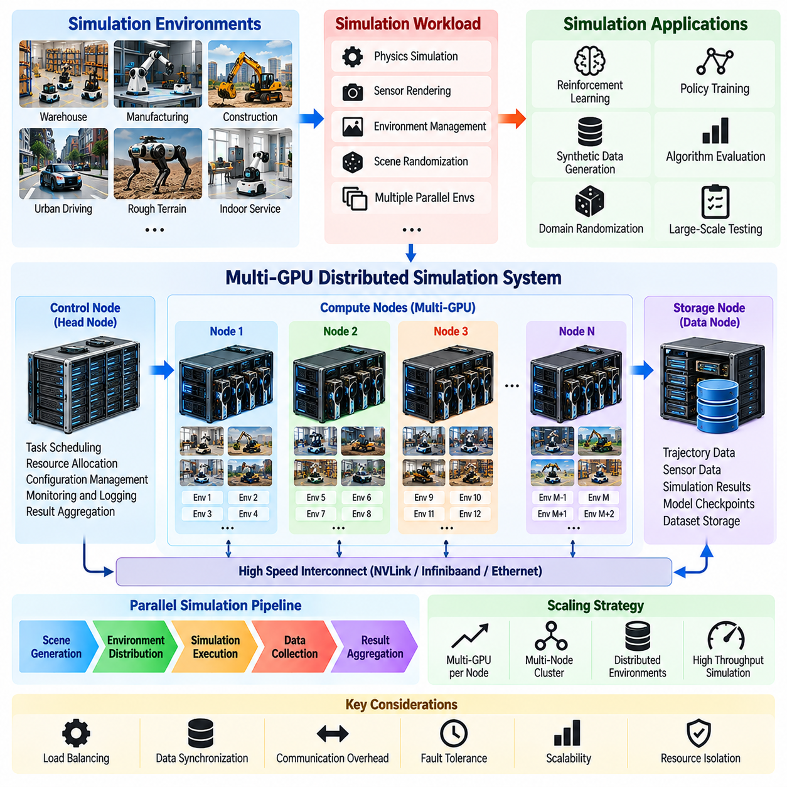{width="7.268055555555556in" height="7.268055555555556in"}

Real-time state synchronization connects physical systems with their digital twins by continuously updating virtual representations from operational measurements. It enables a digital twin to reflect the current condition of robots, sensors, actuators, and environments rather than relying on static models. For Physical AI, synchronization is essential because autonomous decisions depend on accurate, timely, and consistent representations of physical reality.

The synchronization process begins with data acquisition from physical devices and operational systems. Joint encoders, cameras, LiDAR, inertial sensors, motor controllers, and battery management systems generate observations at different frequencies. Industrial controllers and facility management platforms contribute equipment states and operational events. These heterogeneous data streams must be collected and interpreted within a common temporal framework.

State synchronization differs from simple telemetry visualization because it maintains an actionable representation of physical conditions. Raw measurements may contain noise, delays, missing values, and inconsistent timestamps. A synchronized digital twin processes these observations to estimate meaningful states, including robot pose, joint configuration, actuator condition, and environmental changes. The resulting representation supports prediction, simulation, and operational analysis.

Time synchronization establishes a consistent relationship between measurements produced by distributed devices. Sensor clocks may drift, communication networks introduce variable delays, and software components process information asynchronously. Protocols such as Network Time Protocol and Precision Time Protocol can support clock alignment. Accurate timestamps are especially important when combining camera, LiDAR, encoder, and inertial observations.

Spatial synchronization ensures that measurements and simulated states refer to compatible coordinate systems. Robot base frames, sensor frames, facility maps, and global references must be connected through calibrated transformations. Errors in coordinate alignment can cause virtual objects to appear displaced from their physical counterparts. Maintaining consistent spatial references is therefore necessary for collision assessment, localization, and motion planning.

Synchronization architectures commonly separate data collection, transport, processing, and digital twin state management. Edge devices acquire measurements and perform local preprocessing, while middleware distributes information to simulation and monitoring services. State management components reconcile incoming updates with existing representations. This separation improves scalability and allows different subsystems to operate at appropriate update rates.

Communication middleware provides the infrastructure for transferring synchronized state information. Robot Operating System 2, Data Distribution Service, MQTT, and industrial communication protocols can support different connectivity requirements. Selection depends on latency, reliability, interoperability, and deployment constraints. No single communication mechanism guarantees real-time behavior without appropriate network and system configuration.

Update frequency must reflect the dynamics and operational importance of each state variable. Joint control loops may require substantially faster updates than battery health estimates or facility equipment status. High-frequency measurements are often processed locally, while lower-frequency summaries are transmitted to centralized twins. This hierarchical approach reduces communication overhead while preserving information required for timely decisions.

Latency represents the delay between a physical event and its corresponding digital representation. It includes sensor acquisition, network transmission, processing, and state update time. Excessive latency can cause the digital twin to represent outdated conditions, particularly during rapid robot movement. Engineers must define acceptable latency budgets according to the intended monitoring, prediction, or control application.

Jitter describes variations in communication or processing delay that affect the regularity of state updates. Even when average latency is acceptable, unpredictable timing can degrade sensor fusion and closed-loop simulation. Timestamp-aware buffering, scheduling, and interpolation help manage irregular arrivals. However, buffering introduces additional delay, creating a tradeoff between temporal consistency and responsiveness.

State estimation combines incomplete or noisy observations with mathematical models to reconstruct physical conditions. Kalman filters, extended Kalman filters, particle filters, and optimization-based estimators can integrate multiple sensor measurements. These methods estimate states that cannot be observed directly and quantify uncertainty. Their effectiveness depends on model quality, sensor characteristics, and the availability of informative measurements.

Data association determines which incoming observations correspond to existing entities in the digital twin. Multiple robots, moving obstacles, and changing equipment states may produce overlapping or ambiguous measurements. Identification mechanisms, tracking algorithms, and semantic information help preserve entity continuity. Incorrect associations can create false state transitions and undermine the reliability of operational predictions.

Digital twins must distinguish measured states from estimated and predicted states. A directly observed joint position has different uncertainty characteristics from a robot pose inferred through sensor fusion. A future trajectory predicted by a motion model introduces additional assumptions. Explicit state provenance, timestamps, and confidence information prevent downstream applications from treating all virtual values as equally reliable.

Interpolation and extrapolation address differences between measurement rates and simulation time steps. Interpolation estimates intermediate states using available observations, while extrapolation predicts states beyond the latest measurement. Both methods can maintain continuity in digital twin execution. Their accuracy depends on motion dynamics, measurement quality, and prediction horizon, making uncertainty tracking essential during prolonged communication gaps.

Event-driven synchronization complements periodic state updates by transmitting significant changes when they occur. Equipment faults, emergency stops, task completion, door transitions, and charging events may require immediate attention. Event streams can reduce unnecessary data transmission while preserving operational awareness. Reliable ordering, deduplication, and event history are necessary when distributed systems process asynchronous notifications.

Consistency management becomes more complex when multiple services update related digital twin entities. Robot telemetry, fleet management systems, and facility controllers may provide overlapping information about operational states. Clear ownership rules and authoritative data sources help resolve conflicts. Version identifiers and event timestamps support reconciliation, although distributed consistency requirements must be matched to operational safety needs.

Bidirectional synchronization allows validated information or commands to flow from the digital twin toward physical systems. A simulation may recommend a revised route, charging schedule, or operating parameter based on current conditions. Such recommendations must pass authorization, feasibility, and safety checks before execution. Bidirectional connectivity should not be confused with unrestricted direct control of physical equipment.

Real-time simulation requires synchronization between physical measurements and the simulation clock. A digital twin may operate in wall-clock time, replay recorded data, or advance faster than real time for predictive analysis. These modes serve different purposes and require explicit time management. Mixing their results without distinguishing simulation time from physical time can produce misleading interpretations.

Synchronization failures must be detected and handled systematically. Network interruptions, sensor faults, delayed messages, and corrupted data can create discrepancies between physical and virtual states. Monitoring components should evaluate data freshness, update completeness, and state consistency. When reliability falls below acceptable thresholds, the system may suspend predictions, mark states as uncertain, or activate predefined fallback behavior.

Cybersecurity is essential because synchronized digital twins exchange operational information across interconnected systems. Authentication, encryption, access control, and message integrity checks protect data against unauthorized modification. Compromised state information could influence planning or monitoring decisions even without direct actuator access. Secure synchronization therefore requires protection of both communication channels and data-processing components.

Scalable synchronization becomes challenging when thousands of sensors and multiple robots continuously generate telemetry. Centralized processing may introduce network congestion and computational bottlenecks. Distributed architectures can aggregate measurements at the edge and publish selected states to fleet or facility twins. Adaptive update policies prioritize information according to operational relevance, uncertainty, and available communication capacity.

Validation compares synchronized virtual states with independently measured physical references. Relevant metrics include timestamp accuracy, end-to-end latency, state estimation error, update loss, and recovery time after communication interruptions. Testing should include normal operation, rapid motion, network congestion, and partial system failures. These evaluations determine whether synchronization performance satisfies application-specific requirements.

Real-time synchronization also supports historical reconstruction and failure analysis. Timestamped telemetry and event logs allow engineers to replay operational sequences and compare predicted behavior with observed outcomes. This capability helps identify modeling errors, control anomalies, and environmental changes. Reliable replay requires consistent time references, preserved data provenance, and reproducible state reconstruction procedures.

Ultimately, real-time state synchronization transforms digital twins from isolated virtual models into continuously updated representations of physical operations. Its effectiveness depends on coordinated sensing, temporal alignment, spatial consistency, state estimation, communication reliability, and safety-aware integration. These capabilities establish the foundation for predictive simulation, operational intelligence, and dependable Physical AI systems.

## 06.08. Telemetry and Digital Twin Data Models

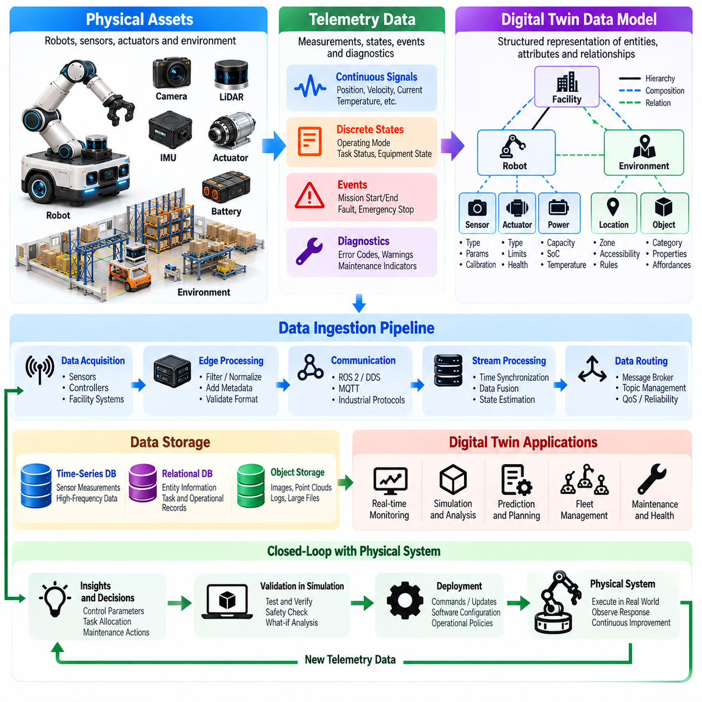{width="7.268055555555556in" height="7.268055555555556in"}

Telemetry and digital twin data models establish the information foundation for connecting physical robotic systems with their virtual representations. Telemetry captures measurements, events, and operational conditions, while data models organize this information into consistent structures. Together, they enable Physical AI systems to interpret physical states, reconstruct operational histories, and support simulation, monitoring, and autonomous decision-making.

Telemetry refers to measurements and status information collected from robots, sensors, actuators, and surrounding infrastructure. Typical signals include position, velocity, acceleration, motor current, temperature, battery state, and communication quality. Operational telemetry also includes task progress, equipment availability, safety events, and system faults. These observations provide the evidence required to maintain an accurate digital twin.

A digital twin data model defines how physical entities, attributes, relationships, and time-dependent states are represented. It connects raw telemetry to meaningful concepts such as robot configuration, actuator health, and facility occupancy. Without a consistent data model, measurements from different devices may remain isolated and difficult to interpret. Structured representations allow information to be shared across simulation and operational services.

Telemetry data generally includes numerical measurements, categorical states, event records, and diagnostic information. Continuous signals describe changing physical quantities, while discrete states represent operating modes or equipment conditions. Event records identify transitions such as mission completion or emergency stopping. Diagnostic data captures warnings, error codes, and maintenance indicators that support fault analysis.

Every telemetry record requires sufficient context to support reliable interpretation. Important fields include entity identifiers, measurement names, values, units, timestamps, and data quality indicators. Additional metadata may describe sensor location, coordinate frames, calibration versions, and acquisition methods. These attributes prevent ambiguity when measurements from multiple robots and heterogeneous devices are combined.

Time representation is particularly important because robotic telemetry originates from distributed components operating at different rates. Acquisition timestamps should be distinguished from reception and processing timestamps. Clock synchronization and explicit time references help reconstruct the order of physical events. Reliable temporal models support sensor fusion, trajectory replay, state estimation, and comparisons between observed and simulated behavior.

Spatial data models describe positions, orientations, velocities, and transformations using defined coordinate frames. A robot pose may be represented relative to its local map, facility frame, or global reference. Sensor measurements require corresponding frame identifiers and transformation histories. Maintaining these relationships allows telemetry to be interpreted consistently even when robots move or environmental maps are updated.

Entity models provide persistent identities for robots, components, tools, and environmental objects. A robot entity may contain references to its joints, sensors, actuators, batteries, and assigned tasks. Relationships describe component ownership, physical connectivity, and operational dependencies. Persistent identifiers allow data systems to associate historical measurements with the correct physical equipment despite configuration changes.

Hierarchical data models organize information at component, robot, fleet, and facility levels. Joint telemetry contributes to robot state estimation, while individual robot states support fleet monitoring and mission coordination. Facility models combine equipment status, environmental conditions, and resource availability. This hierarchy enables detailed diagnostics without requiring every application to process all underlying sensor measurements.

Data schemas specify field names, types, units, constraints, and relationships within telemetry records. Standardized schemas reduce integration errors and support automated validation. Technologies such as Protocol Buffers, JSON Schema, and structured industrial information models can describe different message formats. Schema selection should consider interoperability, processing efficiency, version management, and operational requirements.

Semantic data models extend structural schemas by defining the meaning of entities and measurements. A temperature value becomes useful when associated with a specific motor, sensor location, and operating condition. Ontologies and knowledge graphs can express relationships among equipment, tasks, locations, and operational rules. These semantic connections support contextual queries and reasoning beyond numerical signal processing.

Data ingestion pipelines collect telemetry from physical devices and transport it into digital twin services. Edge gateways may filter noise, normalize units, attach metadata, and validate message formats before forwarding information. Message brokers and streaming platforms distribute updates to consumers. Effective ingestion architectures separate device-specific communication from downstream processing to improve scalability and maintainability.

Telemetry storage requirements vary according to data characteristics and retention objectives. Time-series databases support numerical measurements and trend analysis, while relational databases manage structured entities and operational records. Object storage can retain images, point clouds, and large diagnostic files. Combining storage technologies allows digital twins to preserve both frequently accessed state information and extensive historical evidence.

High-frequency telemetry can generate substantial data volumes, particularly when multiple robots record sensor streams continuously. Compression, aggregation, downsampling, and event-triggered recording reduce storage and transmission demands. However, excessive reduction may remove short-duration faults or important dynamic transitions. Retention policies should balance operational value, diagnostic requirements, computational cost, and available capacity.

Streaming data processing transforms incoming measurements into useful state updates and operational indicators. Filtering, windowed aggregation, anomaly detection, and event correlation can operate as telemetry arrives. Derived variables such as energy consumption, actuator utilization, and estimated remaining operating time enrich the digital twin. Processing latency must remain compatible with the decisions supported by each application.

Data quality management identifies missing values, duplicated records, invalid units, inconsistent timestamps, and implausible measurements. Validation rules can check physical ranges, message completeness, and relationships between signals. Quality indicators should accompany derived states so downstream systems can distinguish trustworthy measurements from uncertain estimates. Automated monitoring helps detect sensor degradation and integration problems.

State models distinguish raw observations from estimated, predicted, and commanded values. A measured joint angle differs from a filtered estimate, while a planned joint target represents an intended future condition. Explicit state categories prevent applications from confusing physical evidence with simulation outputs or control objectives. Provenance information records how each state was generated and which measurements contributed to it.

Versioning is necessary because robot hardware, software interfaces, and data schemas evolve throughout system operation. A replacement sensor may introduce different units, sampling characteristics, or calibration parameters. Schema versions and compatibility rules allow historical data to remain interpretable. Configuration records should identify the hardware and software context associated with each telemetry sequence.

Digital twin data models also require mechanisms for representing uncertainty. Sensor accuracy, estimation covariance, confidence scores, and data freshness describe limitations in the available information. Uncertainty metadata supports robust planning and helps identify when model predictions should be treated cautiously. Applications can use these indicators to select conservative behavior or request additional measurements.

Interoperability becomes important when digital twins integrate robotic middleware, industrial controllers, manufacturing systems, and cloud platforms. ROS 2 messages, OPC UA information models, and other structured interfaces can provide different integration pathways. Mapping between formats requires consistent entity identities, units, timestamps, and semantic definitions. Poorly defined mappings may introduce errors even when communication succeeds.

Security and governance requirements apply throughout the telemetry lifecycle. Device authentication, encrypted transport, access control, and integrity verification protect operational information. Data ownership, retention rules, and audit records determine how information may be accessed and reused. Sensitive facility or operational data should be handled according to applicable organizational policies and security requirements.

Historical telemetry enables replay, model calibration, and predictive maintenance. Engineers can reconstruct robot trajectories, analyze actuator behavior, and compare actual measurements with simulation predictions. Repeated deviations may indicate component wear, parameter drift, or environmental changes. Linking historical observations to configuration and maintenance records improves diagnosis and supports continuous digital twin refinement.

Evaluation of telemetry architectures should include completeness, timestamp accuracy, ingestion latency, throughput, storage efficiency, and data consistency. Testing must also examine communication interruptions, out-of-order messages, schema changes, and recovery after failures. Application-level validation determines whether the available information is sufficiently accurate and timely for monitoring, simulation, planning, and control.

Ultimately, telemetry and digital twin data models transform heterogeneous physical measurements into structured operational knowledge. Telemetry supplies evidence of real-world behavior, while data models preserve identity, meaning, timing, relationships, and uncertainty. Their integration provides the foundation for synchronized digital twins, scalable fleet intelligence, predictive analytics, and reliable Physical AI development.

## 06.09. AI Enabled Digital Twins

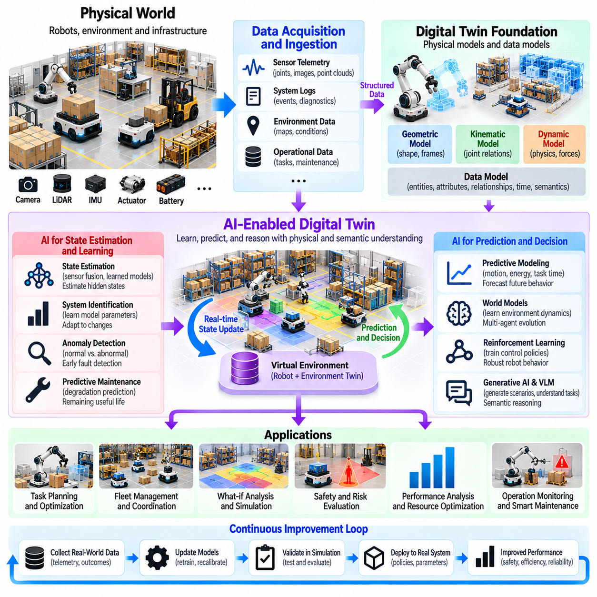{width="7.268055555555556in" height="7.268055555555556in"}

AI-enabled digital twins integrate artificial intelligence with continuously updated virtual representations of physical systems. Traditional digital twins describe geometry, dynamics, and operational states, while AI extends their ability to learn patterns, estimate hidden conditions, and predict future behavior. For Physical AI, this integration transforms digital twins from monitoring environments into adaptive platforms for perception, simulation, planning, and decision support.

The foundation of an AI-enabled digital twin is a reliable connection between physical measurements, structured data models, and simulation components. Sensor telemetry, equipment logs, robot trajectories, and environmental observations provide evidence of actual behavior. AI models analyze these inputs to identify relationships that may be difficult to represent through explicit equations, while physical models preserve mechanical consistency and operational constraints.

Machine learning can enhance digital twin state estimation when measurements are incomplete, noisy, or delayed. Neural networks and probabilistic estimators may infer unobserved variables such as contact conditions, payload characteristics, or component degradation. These estimates complement conventional filtering and model-based estimation. Confidence measures and validation checks are necessary because learned predictions do not automatically represent verified physical states.

Predictive modeling enables digital twins to estimate how physical systems may evolve under different operating conditions. Learned models can forecast robot motion, energy consumption, equipment temperature, and task completion time. Predictions may incorporate historical telemetry and current operational context. Their reliability depends on training coverage, changing environmental conditions, and the accuracy of the underlying state representation.

Hybrid digital twins combine physics-based simulation with data-driven learning. Analytical dynamics describe known mechanical relationships, while learned components approximate effects such as friction variation, actuator hysteresis, and complex contact behavior. Residual learning can estimate differences between simulated and measured responses. This approach improves model fidelity without requiring every physical interaction to be represented through detailed analytical equations.

AI-assisted system identification uses operational data to estimate uncertain parameters in geometric, kinematic, and dynamic models. Joint trajectories, motor currents, force measurements, and inertial observations reveal relationships between commands and physical responses. Optimization and learning algorithms can estimate mass properties, friction coefficients, and actuator characteristics. Periodic recalibration helps digital twins remain representative as hardware ages or operating conditions change.

Surrogate models accelerate computationally expensive simulations by learning approximations of detailed physical processes. Neural networks, Gaussian processes, and reduced-order models can predict selected simulation outputs with lower computational cost. Such models support rapid scenario evaluation and repeated optimization. However, their accuracy must be assessed within defined operating ranges, particularly near collisions, instability, and other critical conditions.

AI-enabled digital twins support anomaly detection by learning patterns associated with normal system operation. Unexpected vibration, motor current, temperature, or trajectory deviations may indicate emerging faults. Statistical methods and machine learning models can identify unusual combinations of signals before conventional thresholds are exceeded. Anomaly alerts require contextual evaluation because unfamiliar operating conditions do not necessarily indicate equipment failure.

Predictive maintenance extends anomaly detection by estimating degradation trends and potential failure risks. Historical telemetry, maintenance records, and operating loads can support remaining useful life estimation and condition-based servicing. Digital twins provide the physical context needed to interpret these predictions. Maintenance decisions should incorporate uncertainty, inspection evidence, and operational consequences rather than relying exclusively on learned forecasts.

Reinforcement learning can use digital twins as training environments for robotic control and decision policies. Simulated robots interact with modeled environments, receive observations, execute actions, and learn from resulting outcomes. AI-enabled twins can adjust simulation parameters using real-world telemetry. Domain randomization and robustness testing help reduce dependence on idealized conditions before learned policies are transferred to physical hardware.

Generative AI can support the creation of simulation scenarios, environmental variations, and task descriptions. Language models may translate operational requirements into candidate test cases, while generative visual models can produce variations in appearance or sensor conditions. These capabilities expand training diversity and testing coverage. Generated scenarios must be checked for physical plausibility, semantic consistency, and relevance to real operating environments.

Vision-language models can connect visual observations with semantic descriptions inside digital twins. They may identify objects, infer functional relationships, and interpret natural-language task requests. A robot could associate a requested tool with its likely storage location and relevant manipulation constraints. Such semantic reasoning improves contextual planning, but uncertain interpretations must remain distinguishable from confirmed observations.

World models extend AI-enabled digital twins by learning how environments and agents evolve over time. They represent relationships between observations, actions, and predicted future states. A robot can use a world model to evaluate possible action sequences before execution. When combined with physics-based simulation, learned world models support planning under uncertainty while retaining explicit mechanical and safety constraints.

AI-based optimization allows digital twins to evaluate operational alternatives before applying changes to physical systems. Candidate robot routes, task assignments, charging schedules, and facility configurations can be tested against predicted performance. Optimization objectives may include throughput, energy efficiency, completion time, and resource utilization. Feasibility and safety constraints must remain explicit throughout the decision process.

Fleet-level intelligence emerges when digital twins integrate information from multiple robots and shared infrastructure. Learning algorithms can identify congestion patterns, workload imbalances, charging bottlenecks, and recurring operational delays. Fleet models may recommend changes to scheduling or resource allocation. Aggregated analysis should preserve individual robot constraints because improvements in overall throughput may introduce localized safety or reliability risks.

Human-aware AI models can improve digital twin simulations of shared workspaces. Observed pedestrian trajectories and interaction patterns provide data for estimating movement preferences and possible responses to robots. These models support navigation planning and evaluation of collaborative operations. Human behavior remains uncertain, so learned predictions must complement rather than replace protective sensing, separation monitoring, and established safety mechanisms.

Continuous learning creates a feedback loop between physical operation and AI-enabled simulation. New telemetry is collected, curated, and used to evaluate model discrepancies or retrain selected components. Updated models are tested against historical and newly collected scenarios before deployment. Version control and performance monitoring are necessary to prevent uncontrolled changes from degrading previously validated behavior.

Model drift occurs when relationships learned from historical data no longer reflect current physical conditions. Changes in payloads, equipment wear, facility layouts, or operating procedures can reduce prediction accuracy. AI-enabled twins should monitor residual errors and changes in input distributions. Drift detection can trigger recalibration or retraining, although model replacement should require validation against representative operating conditions.

Uncertainty estimation is fundamental because AI models may produce confident predictions outside their training experience. Probabilistic outputs, ensemble models, and out-of-distribution detection can help characterize prediction reliability. Digital twins should expose these limitations to downstream planning and control systems. When uncertainty becomes excessive, conservative policies or additional physical measurements may be more appropriate than automated action.

AI-enabled twins require scalable computing architectures to support training, inference, and simulation. Edge processors can perform latency-sensitive estimation and anomaly detection, while on-premises or cloud resources handle large-scale learning and scenario evaluation. Workload placement depends on communication latency, computational requirements, data sensitivity, and availability. Safety-critical control should remain functional when remote AI services become unavailable.

Data governance and cybersecurity are essential when AI models learn from operational telemetry and influence physical decisions. Training datasets require provenance, access controls, quality checks, and appropriate retention policies. Model artifacts should be versioned and protected against unauthorized modification. Audit records help establish which data, model versions, and validation results supported particular operational recommendations.

Validation must assess both the physical fidelity of digital twins and the predictive reliability of their AI components. Relevant measures include state estimation error, prediction accuracy, simulation residuals, anomaly detection performance, and computational latency. Testing should cover normal operation, rare disturbances, changing environments, and model failures. Strong performance on historical data alone does not demonstrate safe generalization.

Deployment architectures should distinguish advisory intelligence from authority over physical control. AI-generated predictions and optimization recommendations can inform operators or supervisory systems, but commands affecting robots require explicit authorization and safety checks. Independent protective functions must remain effective during incorrect predictions or communication failures. This separation supports controlled adoption of increasingly autonomous capabilities.

Ultimately, AI-enabled digital twins combine physical modeling, operational telemetry, machine learning, and simulation into adaptive representations of robotic systems. Their value lies in improving prediction, diagnosis, training, optimization, and continuous refinement while preserving physical consistency and safety boundaries. This integration provides a foundation for scalable, data-driven, and increasingly intelligent Physical AI operations.

## 06.10. Digital Twins for Training and Validation

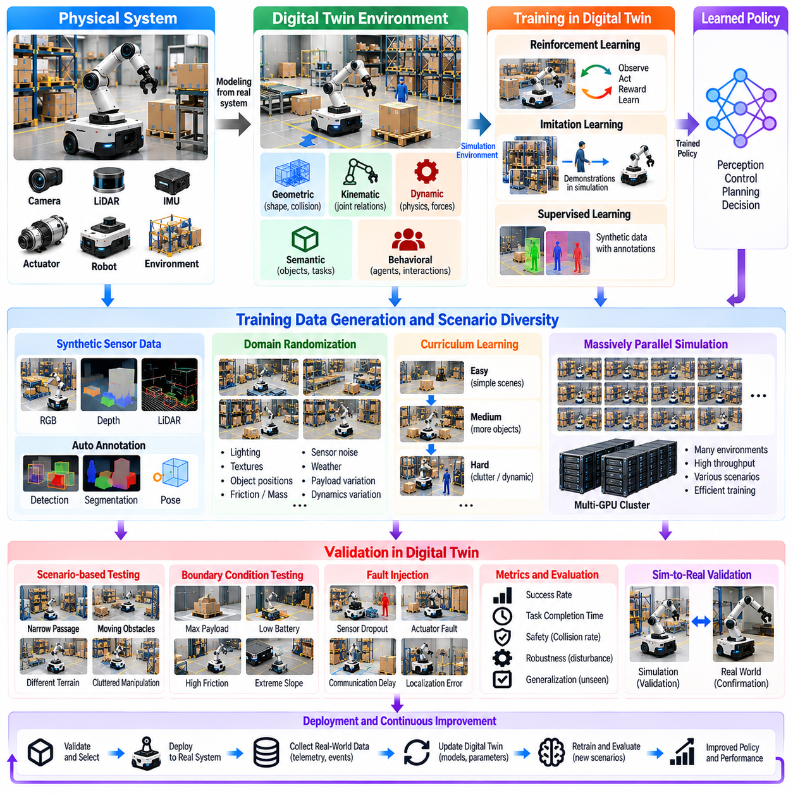{width="7.268055555555556in" height="7.268055555555556in"}

Digital twins provide controlled virtual environments for training and validating Physical AI systems before deployment in physical operations. They reproduce robot structures, sensor behavior, environmental conditions, and operational constraints within executable simulations. By connecting realistic models with learning and evaluation workflows, digital twins reduce dependence on costly experiments while supporting systematic assessment of autonomous capabilities.

Training-oriented digital twins differ from conventional simulation environments through their connection to specific physical assets and operational data. Robot geometry, actuator characteristics, sensor configurations, and environmental layouts are derived from actual systems. Telemetry and calibration results update model parameters over time. This relationship helps ensure that learned behaviors remain relevant to the equipment and conditions encountered during deployment.

A digital twin training environment integrates geometric, kinematic, dynamic, semantic, and behavioral models. Geometry defines collision boundaries, kinematics describes feasible motion, and dynamics predicts physical responses. Semantic models represent objects and task relationships, while behavioral models reproduce interactions among agents. Their integration allows learning algorithms to experience physically and operationally meaningful situations.

Synthetic data generation is a major application of training-oriented digital twins. Simulated cameras, LiDAR sensors, depth sensors, and proprioceptive devices produce observations associated with known scene states. Automatic annotations can include object identities, segmentation masks, poses, velocities, and contact events. Such datasets support perception training without requiring every example to be collected and labeled manually.

Domain randomization improves training diversity by varying simulation parameters across episodes. Lighting, textures, object positions, friction coefficients, payload masses, and sensor noise can be sampled from defined distributions. These variations discourage policies from relying on narrow environmental assumptions. Randomization ranges should remain physically plausible and reflect uncertainties relevant to actual deployment conditions.

Curriculum learning organizes training scenarios according to increasing complexity. A manipulation policy may initially learn grasping under stable conditions before encountering clutter, uncertain object poses, and contact disturbances. Navigation policies may progress from empty corridors to dynamic environments containing moving obstacles. Digital twins enable these transitions to be controlled, measured, and repeated throughout learning.

Reinforcement learning uses digital twins to generate interactions between robotic agents and simulated environments. Policies receive observations, select actions, and learn from rewards associated with task outcomes. Simulation permits repeated exploration without exposing physical equipment to every unsuccessful attempt. Reward functions must reflect operational objectives and safety constraints to avoid unintended behaviors.

Imitation learning can also benefit from digital twins by replaying demonstrations collected through teleoperation or physical robot operation. Recorded trajectories and action sequences are reconstructed within simulated environments. Additional variations can expand the conditions represented by demonstrations. However, differences between recorded states and simulated dynamics must be managed to prevent misleading training examples.

Massively parallel simulation accelerates policy training by executing many independent environments simultaneously. Each environment may contain different initial conditions, disturbances, or task configurations. Parallel execution increases experience collection and supports systematic exploration of parameter variations. Computational efficiency depends on simulation fidelity, physics solver performance, and the organization of training workloads.

Validation-oriented digital twins focus on determining whether developed models and controllers satisfy defined requirements. Training performance alone cannot establish deployment readiness because learning environments may contain unrecognized assumptions. Validation therefore uses independent scenarios, explicit acceptance criteria, and representative operating conditions. The objective is to identify limitations before they affect physical equipment or surrounding personnel.

Scenario-based validation examines how robotic systems behave under specific operational conditions. Test scenarios may include narrow passages, moving obstacles, uncertain payloads, degraded sensors, and changing floor friction. Each scenario defines initial states, environmental parameters, and expected outcomes. Reproducible execution allows engineers to compare software versions and determine whether modifications improve or degrade performance.

Boundary-condition testing evaluates behavior near the limits of robot capability. Examples include maximum payload, minimum clearance, reduced battery capacity, and actuator saturation. These situations reveal weaknesses that may remain hidden during nominal operation. Digital twins support controlled examination of operating envelopes, although simulated results must be confirmed against appropriate physical evidence.

Fault injection introduces abnormal conditions into digital twin simulations to evaluate resilience. Sensor dropout, delayed communication, actuator degradation, localization errors, and unexpected equipment states can be reproduced systematically. Validation measures whether robots detect these conditions and transition toward appropriate recovery or safe states. Fault models must distinguish realistic failures from arbitrary disturbances.

Safety validation combines collision analysis, motion constraints, dynamic stability, and supervisory control behavior. A robot may complete a task successfully while violating acceptable force, speed, or separation limits. Digital twins make these violations observable through detailed state recording. Safety-related results should support, rather than replace, physical testing and applicable engineering assurance processes.

Hardware-in-the-loop testing connects real controllers or electronic components to simulated robotic systems. Control commands are processed by actual hardware while the digital twin reproduces selected physical responses. This approach reveals timing, communication, and integration problems that purely software-based simulation may overlook. Test validity depends on realistic interfaces, timing behavior, and accurate representation of the simulated plant.

Software-in-the-loop testing executes production-oriented control and autonomy software against simulated sensors and robot dynamics. Navigation, perception, planning, and mission management components can be evaluated without requiring complete physical hardware. Automated test pipelines execute repeatable scenarios after software changes. This supports regression testing and helps detect unexpected interactions between system components.

Real-to-simulation calibration improves validation credibility by comparing simulated responses with measured physical behavior. Engineers can examine trajectory tracking errors, braking distances, contact forces, energy consumption, and sensor characteristics. Differences guide parameter identification and model refinement. Calibration should use representative operating conditions rather than fitting models exclusively to a limited demonstration dataset.

Sim-to-real transfer evaluates whether policies developed in digital twins retain acceptable performance on physical robots. Differences in actuator dynamics, sensing, contact mechanics, and environmental variation can reduce transfer reliability. Domain adaptation, system identification, and conservative deployment strategies help address these gaps. Initial physical trials should use controlled conditions with appropriate monitoring and safeguards.

Uncertainty-aware validation considers variability in both model parameters and environmental conditions. Repeated simulations can sample plausible friction values, sensor errors, payload distributions, and communication delays. Statistical analysis then estimates performance variation and identifies sensitive operating regions. Robustness claims require sufficient scenario coverage and clearly stated assumptions about the modeled uncertainty.

Evaluation metrics should reflect the intended robotic application and operational requirements. Relevant measures include task success rate, completion time, trajectory error, collision frequency, energy consumption, and recovery performance. Validation may also assess computational latency and resource utilization. Reporting results across scenario categories provides more useful evidence than relying on a single aggregated performance score.

Digital twins support regression validation by preserving reference scenarios and expected performance thresholds. When perception models, planning algorithms, or control parameters change, the same scenarios can be executed again. Differences reveal whether improvements in one capability introduce degradation elsewhere. Versioned simulation assets and recorded configurations are essential for reproducible comparisons.

Training and validation data must remain appropriately separated to avoid misleading performance estimates. Policies repeatedly optimized against particular scenarios may become specialized to those conditions. Independent test environments, withheld parameter combinations, and physical validation provide stronger evidence of generalization. Scenario diversity should include realistic rare events without assuming that simulation can represent every possible failure.

Continuous validation extends testing beyond initial deployment by incorporating new operational observations. Telemetry identifies unexpected behaviors, environmental changes, and previously untested situations. These findings can generate additional simulation scenarios and update model parameters. Revised policies undergo renewed validation before release, establishing a feedback loop between physical operation, training, and verification.

Ultimately, digital twins for training and validation connect scalable experimentation with evidence-based robotic deployment. They support synthetic data generation, policy learning, scenario testing, fault analysis, and systematic performance evaluation. Their effectiveness depends on model fidelity, reproducibility, uncertainty management, and physical confirmation. Together, these capabilities strengthen the reliability and adaptability of Physical AI systems.

## 06.11. Mission Planning and What If Simulation

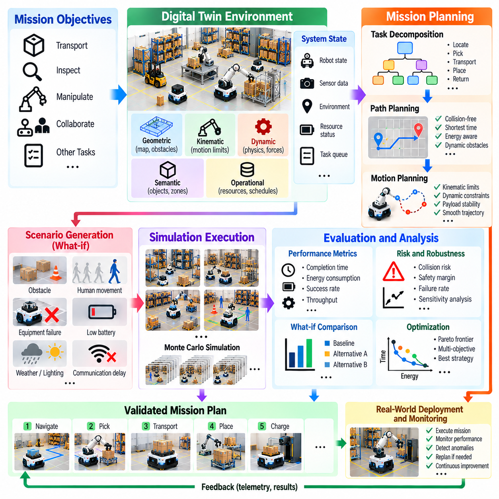{width="7.268055555555556in" height="7.268055555555556in"}

Mission planning and what-if simulation enable Physical AI systems to evaluate operational decisions before executing them in the real world. Digital twins provide virtual representations of robots, environments, resources, and operational constraints. By simulating alternative actions and possible outcomes, planners can improve task efficiency, anticipate failures, and reduce operational risks while maintaining alignment with actual physical conditions.

Mission planning defines how robotic systems transform high-level objectives into executable sequences of tasks and actions. A mission may involve transporting materials, inspecting equipment, manipulating objects, or coordinating multiple robots. Digital twins connect these objectives to available resources, environmental maps, robot capabilities, and safety requirements. This integration supports planning decisions grounded in realistic operational conditions.

What-if simulation examines hypothetical changes to operating conditions, system configurations, or mission strategies. Engineers may investigate how a robot responds to an unexpected obstacle, reduced battery capacity, delayed delivery, or unavailable charging station. Each scenario modifies selected parameters while preserving relevant physical constraints. Comparing outcomes reveals vulnerabilities and opportunities before changes are introduced into real operations.

A mission planning digital twin integrates geometric, kinematic, dynamic, semantic, and operational models. Geometric representations describe navigable spaces and obstacles, while kinematic and dynamic models define feasible robot movements. Semantic information identifies workstations, restricted areas, and task dependencies. Operational models represent schedules, resource availability, and coordination requirements across the facility.

Task decomposition converts complex missions into smaller actions with explicit dependencies and completion conditions. A warehouse delivery mission may require localization, route selection, pickup, transportation, unloading, and return. Digital twins allow these stages to be simulated individually and as an integrated workflow. Dependency modeling helps identify whether delays or failures in one activity affect subsequent operations.

Path planning uses digital twins to evaluate feasible routes through known or predicted environments. Candidate paths are assessed according to distance, travel time, energy consumption, clearance, and collision risk. Dynamic obstacles and restricted zones introduce additional constraints. Simulation allows planners to compare routes under changing conditions and determine whether alternative paths provide more reliable mission execution.

Motion planning extends route selection by considering robot geometry, actuator limits, acceleration, braking behavior, and contact constraints. A mobile manipulator must coordinate base motion with arm positioning and payload stability. Digital twins predict whether candidate trajectories satisfy mechanical and safety limits. These evaluations are particularly important when missions involve narrow passages, heavy loads, or precise manipulation.

Resource-aware planning incorporates battery energy, payload capacity, computing availability, and equipment utilization into mission decisions. A robot may have sufficient travel range but insufficient energy to complete a manipulation task afterward. Digital twins estimate resource consumption across the complete mission sequence. Planning can then include charging, workload redistribution, or task reassignment before operational limitations become critical.

Multi-robot mission planning addresses task allocation, traffic coordination, shared resources, and potential interference among robots. Digital twins represent individual robot capabilities together with fleet-level constraints. Simulated missions reveal congestion, charging conflicts, and competing access to workstations. Coordinated scheduling and route adjustments can improve overall throughput while preserving individual safety requirements.

Scenario generation expands planning beyond expected operating conditions. Simulations can introduce equipment failures, communication delays, temporary obstacles, changes in task priorities, or unexpected human movement. Each scenario tests the resilience of a proposed mission plan. Realistic variation is essential because excessively simplified disturbances may produce misleading confidence in operational robustness.

Probabilistic what-if simulation represents uncertainty through distributions of environmental and system parameters. Travel times, localization errors, friction coefficients, and task durations may vary between simulated trials. Repeated execution produces distributions of mission outcomes rather than a single deterministic prediction. This approach helps planners estimate completion probabilities, identify sensitive conditions, and select robust strategies.

Monte Carlo simulation provides a systematic method for evaluating missions under uncertain conditions. Numerous trials sample plausible disturbances, initial states, and operating parameters. Statistical results can estimate expected completion time, energy requirements, failure frequency, and performance variability. Reliable conclusions require representative uncertainty models and sufficient sampling, particularly when evaluating rare but consequential events.

Optimization algorithms use digital twins to compare candidate mission strategies against defined objectives. These objectives may include minimum completion time, reduced energy consumption, increased throughput, or balanced resource utilization. Multi-objective optimization reveals tradeoffs between competing priorities. Feasibility constraints ensure that attractive numerical solutions remain compatible with robot capabilities and operational safety.

Predictive models can accelerate what-if analysis by estimating future system states without executing every scenario through detailed physics simulation. Learned models may forecast congestion, battery consumption, task duration, or equipment availability. Hybrid approaches combine these predictions with physical simulation. Prediction uncertainty must be considered, especially when proposed plans differ substantially from previously observed operations.

Real-time mission replanning uses updated digital twin states to revise decisions during execution. Sensor telemetry may reveal blocked routes, delayed tasks, unexpected payload conditions, or changes in resource availability. The planning system evaluates feasible alternatives using the latest available information. Replanning must account for communication latency, state uncertainty, and the consequences of interrupting ongoing actions.

Event-driven simulation focuses computational resources on significant operational changes. Events such as task completion, robot arrival, equipment failure, or resource release trigger updates to mission schedules. This approach is useful for evaluating facility-scale operations over extended periods. Detailed physics simulation can be activated selectively when motion feasibility, contact behavior, or safety constraints require closer examination.

Human-robot collaboration introduces additional complexity into mission planning. Digital twins can represent shared workspaces, operator availability, pedestrian movement, and human task dependencies. What-if scenarios evaluate how changes in staffing, work sequences, or pedestrian traffic affect robotic operations. Human behavior models remain uncertain, so planning must preserve appropriate safety margins and protective mechanisms.

Failure-aware planning evaluates how missions respond when expected actions cannot be completed. A robot may fail to grasp an object, lose localization confidence, or encounter an unavailable workstation. Digital twins can simulate recovery actions, alternative task assignments, and safe stopping procedures. Mission plans should include explicit failure conditions and recovery options rather than assuming uninterrupted execution.

Safety constraints must remain active throughout mission planning and scenario evaluation. Candidate plans should respect speed limits, collision avoidance requirements, restricted zones, load stability, and emergency response conditions. Digital twins help identify potential violations before execution. However, simulated safety performance cannot replace independent protective systems, physical verification, or applicable safety engineering processes.

Performance evaluation compares mission strategies using measurable operational indicators. Relevant metrics include task success rate, completion time, energy consumption, robot utilization, congestion frequency, and recovery effectiveness. Scenario-specific results reveal whether improvements under nominal conditions create weaknesses elsewhere. Consistent metrics and repeatable simulation configurations support meaningful comparisons between planning algorithms.

Digital twin calibration is essential for reliable mission prediction. Travel times, actuator behavior, battery consumption, communication delays, and equipment availability should be compared against operational telemetry. Differences between predicted and observed outcomes identify modeling errors or changing conditions. Periodic calibration maintains planning relevance as robots, facility layouts, and operational procedures evolve.

Integration with fleet management and manufacturing systems connects mission planning to broader operational workflows. Digital twins can receive production schedules, transport requests, equipment status, and resource constraints from supervisory platforms. Candidate plans are evaluated before approved instructions are dispatched to robots. Clear interfaces and authorization boundaries prevent simulation recommendations from becoming uncontrolled physical commands.

Continuous improvement emerges when completed missions are compared with their predicted outcomes. Execution logs reveal deviations in timing, resource consumption, route selection, and task success. These observations update digital twin models and generate new what-if scenarios for future validation. Versioned plans, simulation configurations, and evaluation results provide traceability across successive planning improvements.

Ultimately, mission planning and what-if simulation transform digital twins into decision-support environments for Physical AI operations. They enable systematic evaluation of task sequences, trajectories, resource allocation, uncertainty, and failure recovery before physical execution. By combining predictive modeling, simulation, optimization, and real-world feedback, digital twins support safer, more efficient, and adaptable autonomous missions.

## 06.12. Failure Replay and Predictive Maintenance

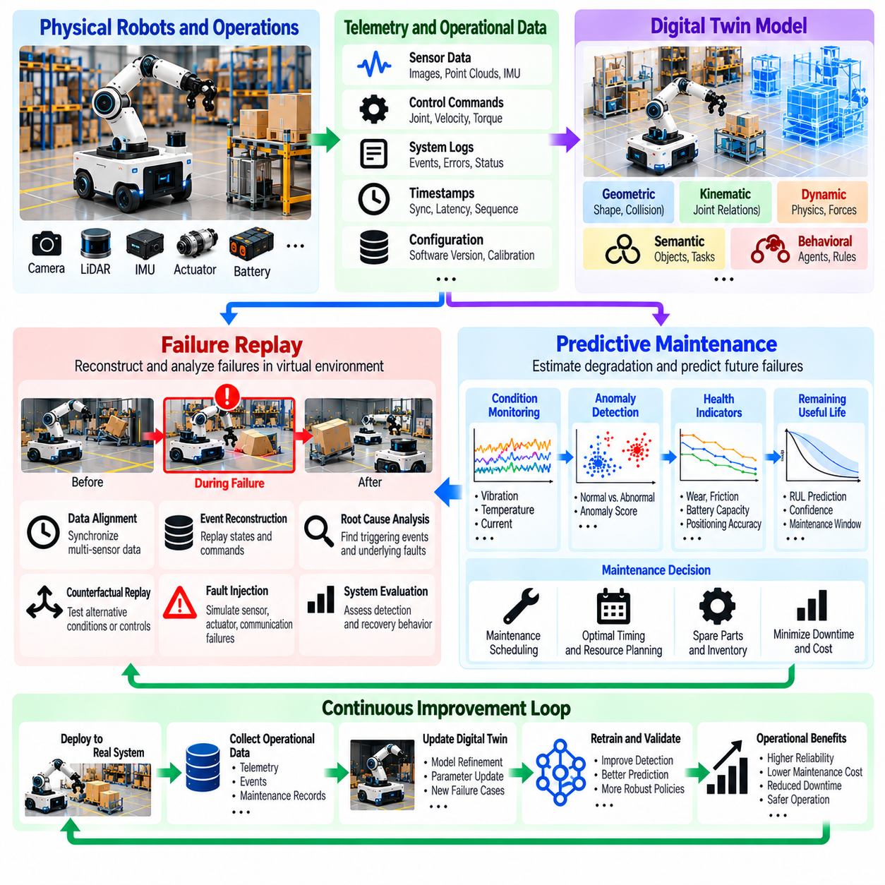{width="7.268055555555556in" height="7.268055555555556in"}

Failure replay and predictive maintenance are essential capabilities of digital twins for improving the reliability and availability of Physical AI systems. Failure replay reconstructs abnormal events using recorded operational data, while predictive maintenance estimates degradation and potential failures before they disrupt operations. Together, these capabilities transform digital twins into diagnostic and preventive tools that connect historical evidence with future operational decisions.

Failure replay reproduces the conditions surrounding a malfunction within a synchronized virtual environment. Robot trajectories, sensor observations, actuator commands, controller states, and environmental conditions are reconstructed from recorded data. Engineers can examine how events developed before, during, and after a failure. This process provides a structured foundation for identifying causes rather than relying exclusively on isolated alarms or operator reports.

Accurate replay requires comprehensive telemetry collection and consistent temporal alignment. Sensor timestamps, control commands, communication events, and system logs must be associated with a common timeline. Differences between acquisition time and processing time can otherwise distort event sequences. Clock synchronization and recorded timing uncertainty help distinguish actual physical delays from artifacts introduced by distributed data collection.

A failure replay data model preserves robot configuration, software versions, calibration parameters, and environmental context alongside telemetry. These records establish the conditions under which the failure occurred. Without configuration history, replay may use incorrect actuator characteristics or controller behavior. Versioned digital twin models allow engineers to reproduce historical operating conditions even after physical equipment or software has changed.

Event reconstruction begins by identifying the failure interval and retrieving relevant data from operational storage. A replay system restores the estimated robot state and reproduces subsequent observations or commands in chronological order. Recorded-state playback and physics-driven re-simulation serve different purposes. The former preserves observed behavior, while the latter investigates how a modeled system responds under reconstructed conditions.

Root cause analysis uses replay to investigate relationships among symptoms, triggering events, and underlying faults. A navigation failure may originate from localization drift, delayed obstacle detection, or incorrect motion commands. A manipulation failure may involve grasp instability, actuator saturation, or unexpected contact forces. Digital twins help compare these explanations against measured trajectories, sensor histories, and physical constraints.

Counterfactual replay examines how an incident might have developed under alternative conditions or control decisions. Engineers can modify a controller parameter, sensor availability, braking response, or planned trajectory and rerun the scenario. Differences between outcomes suggest potential corrective actions. However, counterfactual results remain model-dependent hypotheses and should not be treated as direct evidence of what would have happened physically.

Fault injection complements failure replay by introducing controlled disturbances into reconstructed scenarios. Simulated sensor dropout, communication latency, motor degradation, and power interruptions can reveal system vulnerabilities. Repeated experiments determine whether fault detection and recovery mechanisms respond consistently. Realistic fault models are necessary because arbitrary disturbances may exaggerate or underestimate operational risks.

Predictive maintenance uses telemetry and historical records to estimate equipment health and future maintenance needs. Motor current, vibration, temperature, joint backlash, battery behavior, and cycle counts may reveal gradual degradation. Digital twins associate these measurements with specific components and operating conditions. This contextual representation helps distinguish genuine deterioration from changes caused by workload or environmental variation.

Condition monitoring establishes reference behavior for equipment operating within expected limits. Baseline models may describe normal vibration spectra, temperature trends, energy consumption, and actuator response. Incoming measurements are compared with these references to identify deviations. Adaptive baselines account for operating modes and payload differences, reducing false alarms caused by legitimate changes in robot activity.

Anomaly detection identifies unusual behavior that may precede equipment failure. Statistical thresholds, clustering methods, neural networks, and reconstruction-error models can analyze multidimensional telemetry. An anomaly score indicates departure from expected behavior but does not necessarily establish a specific fault. Diagnostic interpretation requires operational context, component relationships, and confirmation from additional measurements.

Health indicators summarize component condition using measurable or estimated degradation features. Examples include increasing motor friction, declining battery capacity, growing gearbox vibration, and reduced positioning accuracy. Digital twins track these indicators across operating cycles and maintenance events. Trend analysis supports early intervention, although indicators must be validated against actual component behavior and failure mechanisms.

Remaining useful life estimation predicts the period or operating cycles before a component reaches a defined failure or maintenance threshold. Physics-based degradation models, statistical survival methods, and machine learning can contribute to these estimates. Predictions should include uncertainty intervals because degradation depends on future loading and environmental exposure. Maintenance planning must consider prediction confidence rather than a single expected failure date.

Hybrid prognostic models combine physical understanding with patterns learned from operational data. A thermal model may predict motor heating from electrical losses, while a learned residual model captures unmodeled cooling variations. Battery degradation models may combine electrochemical assumptions with measured charge histories. Hybrid approaches improve interpretability when their physical parameters and learned components are independently validated.

Fleet-level predictive maintenance benefits from comparing similar components across multiple robots. Aggregated telemetry can reveal recurring failure signatures, manufacturing differences, and operating conditions associated with accelerated wear. Shared models may improve detection when individual robots have limited failure histories. Fleet analysis must account for differences in hardware revisions, workloads, environments, and maintenance practices.

Maintenance decision support converts health predictions into operational actions. Digital twins can evaluate whether equipment should continue operating, undergo inspection, receive preventive servicing, or be removed from service. Decisions incorporate failure consequences, spare-part availability, production schedules, and maintenance resources. High-risk conditions may justify immediate intervention even when remaining useful life estimates are uncertain.

What-if maintenance simulation evaluates alternative servicing strategies before implementation. Engineers may compare scheduled replacement, condition-based maintenance, and delayed intervention under different workload assumptions. Simulation estimates potential effects on downtime, maintenance cost, equipment availability, and mission completion. Results depend on realistic failure probabilities, repair durations, and operational constraints.

Failure replay and predictive maintenance form a connected learning process. Reconstructed incidents reveal fault signatures that can improve anomaly detection and degradation models. Predictive alerts, in turn, identify intervals requiring detailed replay and investigation. Linking these processes creates a feedback loop between historical diagnosis and forward-looking prognosis, supporting progressive improvement in maintenance intelligence.

Data quality strongly influences both replay accuracy and predictive reliability. Missing sensor records, inconsistent timestamps, calibration errors, and incomplete maintenance histories can produce misleading conclusions. Validation pipelines should identify these limitations and preserve provenance information. Uncertain or reconstructed measurements must remain distinguishable from directly observed evidence throughout analysis.

Digital twin fidelity determines which failure mechanisms can be investigated reliably. Rigid-body dynamics may explain trajectory deviations, while detailed contact models are needed for certain manipulation failures. Thermal, electrical, and degradation models support different maintenance questions. Model complexity should match the investigated phenomenon, and conclusions should acknowledge mechanisms that the simulation does not represent.

Real-time deployment requires architectures that separate monitoring, diagnosis, prediction, and protective control. Edge systems can detect urgent abnormalities with low latency, while centralized platforms perform historical replay and computationally intensive prognostics. Predictive maintenance recommendations should not override independent safety functions. Communication failures must not prevent essential local fault detection or protective responses.

Validation of replay systems compares reconstructed events with original measurements and independently observed outcomes. Relevant measures include trajectory reconstruction error, event timing accuracy, state consistency, and reproducibility. Predictive maintenance models require evaluation of detection precision, false alarm rates, prediction horizons, and remaining useful life errors. Testing should include different operating conditions and previously unseen failure cases.

Cybersecurity and data governance protect the integrity of failure records and maintenance predictions. Access controls, authenticated telemetry sources, immutable audit records, and model versioning support trustworthy investigations. Sensitive operational information should be retained according to defined policies. Traceable evidence is particularly important when diagnostic conclusions influence equipment replacement, operational restrictions, or safety-related decisions.

Ultimately, failure replay and predictive maintenance extend digital twins beyond real-time monitoring into systematic reliability engineering. Replay explains how failures develop, while predictive models estimate when deterioration may threaten future operations. Their integration supports earlier fault detection, better maintenance scheduling, and evidence-based system improvement. Reliable deployment depends on synchronized data, validated models, uncertainty management, and physical confirmation.

## 06.13. Real to Sim and Sim to Real Loops

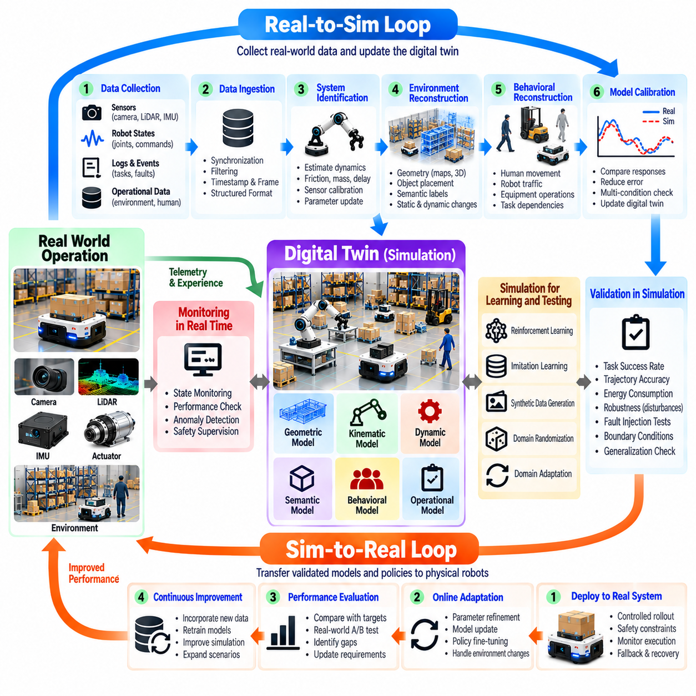{width="7.268055555555556in" height="7.268055555555556in"}

Real-to-sim and sim-to-real loops establish a continuous exchange between physical robotic systems and their digital twins. Real-to-sim transfers observations, measurements, and operational experience into simulation, while sim-to-real transfers validated models, policies, and planning decisions back to physical robots. Together, these loops support iterative improvement of Physical AI through synchronized modeling, learning, testing, and deployment.

The real-to-sim loop begins with collecting evidence from physical operations. Robot trajectories, sensor streams, actuator commands, contact events, and environmental observations describe how systems behave under actual conditions. These records provide the basis for reconstructing operational scenarios and updating digital twin parameters. Data completeness, timing accuracy, and calibration quality directly influence the reliability of subsequent simulation.

Data ingestion transforms raw operational records into structured information suitable for simulation. Sensor measurements require consistent units, timestamps, coordinate frames, and entity identifiers. Synchronization aligns observations from distributed sensors and controllers, while filtering identifies corrupted or incomplete records. Preserving original measurements alongside processed estimates enables traceability and prevents uncertain reconstructions from being mistaken for direct evidence.

System identification connects measured behavior to the parameters of digital twin models. Optimization algorithms estimate quantities such as friction coefficients, actuator delays, mass distributions, and sensor biases. Simulated responses are compared with recorded trajectories and physical measurements to calculate residual errors. Parameter updates should respect physical constraints and avoid compensating for structural modeling errors through unrealistic values.

Environment reconstruction converts physical observations into simulation-ready representations. Camera images, LiDAR point clouds, depth measurements, and localization maps can describe geometry, object placement, and navigable space. Semantic information identifies workstations, obstacles, and operational regions. Reconstruction must distinguish persistent structures from temporary changes so that digital twins represent both stable environments and relevant dynamic conditions.

Behavioral reconstruction captures interactions that cannot be explained through geometry alone. Human movement, robot traffic, equipment cycles, and task dependencies influence operational outcomes. Recorded event sequences and statistical behavior models can reproduce these interactions within simulation. Because behavior varies over time, reconstructed models should represent uncertainty rather than assume that historical patterns will repeat exactly.

Digital twin calibration evaluates whether simulated systems reproduce measurable physical responses. Engineers compare motion trajectories, braking distances, actuator currents, energy consumption, and sensor outputs under matched conditions. Differences reveal deficiencies in parameters, assumptions, or model structure. Calibration should use multiple operating conditions to avoid producing a model that matches one experiment but performs poorly elsewhere.

The sim-to-real loop begins after candidate models, control policies, or mission plans have been developed and evaluated in simulation. Digital twins provide environments for testing alternative actions without exposing physical equipment to every experimental risk. Candidate solutions must satisfy performance requirements, operational constraints, and safety limits. Successful simulation establishes preliminary evidence rather than guaranteeing equivalent physical behavior.

Simulation-based learning enables robots to acquire perception, navigation, manipulation, and coordination capabilities. Reinforcement learning generates experience through repeated interaction, while imitation learning uses demonstrations to guide policy development. Synthetic data supports perception models across diverse conditions. The resulting policies must be evaluated for robustness because simulated experience may omit important physical effects.

Domain randomization addresses simulation uncertainty by varying physical and environmental parameters during training. Friction, payload mass, lighting, sensor noise, actuator response, and object placement can change across simulation episodes. Policies learn to operate across a range of plausible conditions instead of relying on one nominal model. Randomization distributions should be informed by physical measurements and realistic operating limits.

Domain adaptation reduces differences between simulated and physical observations or learned representations. Feature alignment, image translation, calibration, and targeted fine-tuning can improve transfer performance. Adaptation may operate on sensor inputs, internal representations, or control outputs. However, improvements in visual similarity do not necessarily resolve errors in contact mechanics, actuator dynamics, or system timing.

Transfer validation compares candidate policies against independent scenarios before physical deployment. Tests should examine task success, trajectory accuracy, energy consumption, recovery behavior, and computational latency. Boundary conditions and fault scenarios reveal weaknesses hidden by average performance. Validation must separate training scenarios from evaluation cases to reduce the risk of overestimating generalization.

Physical deployment should proceed through controlled stages rather than immediate unrestricted operation. Initial trials use reduced speeds, limited workspaces, monitored execution, and defined recovery procedures where appropriate. Safety controllers and emergency functions remain independent of learned policies. Observed performance determines whether operating limits can be expanded or additional simulation refinement is required.

Once deployed, physical robots generate new telemetry that closes the learning loop. Differences between predicted and observed outcomes identify remaining simulation gaps. Unexpected obstacles, actuator responses, sensor degradation, and task failures provide valuable evidence for updating digital twins. These observations should be prioritized according to operational impact, uncertainty, and their relevance to previously untested conditions.

Residual analysis quantifies discrepancies between physical measurements and simulated predictions. Position error, velocity deviation, contact-force mismatch, and energy prediction error reveal different modeling limitations. Residual patterns may indicate parameter drift, missing dynamics, or sensor calibration problems. Separating systematic bias from random variation helps determine whether model updates or additional measurements are necessary.

Active learning improves loop efficiency by selecting informative scenarios for further investigation. Instead of collecting data indiscriminately, the system identifies situations where predictions are uncertain or competing models disagree. Targeted physical experiments can then provide measurements that reduce uncertainty. Experiment selection must respect safety constraints and avoid deliberately creating hazardous conditions.

Scenario mining transforms operational anomalies and rare events into reusable simulation tests. Recorded failures, near misses, unusual environmental configurations, and recovery actions become structured scenarios with defined initial conditions. Replaying these cases supports regression testing and policy improvement. Scenario libraries should preserve source data, reconstruction assumptions, and expected evaluation criteria.

Continuous integration connects digital twin updates with software and model development workflows. Changes to perception networks, planners, controllers, or simulation parameters trigger automated evaluations against reference scenarios. Performance regressions can prevent deployment until issues are resolved. Versioned datasets, model artifacts, simulation configurations, and test results provide reproducibility and accountability.

Multi-fidelity simulation balances computational efficiency with physical accuracy. Simplified models support large-scale policy exploration and mission scheduling, while detailed dynamics and sensor simulation evaluate sensitive interactions. High-fidelity testing is especially important near contact events, stability limits, and safety boundaries. Selecting appropriate fidelity prevents unnecessary computation without overlooking critical physical effects.

Uncertainty propagates through both real-to-sim and sim-to-real processes. Measurement noise affects reconstructed states, parameter uncertainty influences simulation predictions, and model limitations affect transferred policies. Digital twins should expose confidence estimates and validity ranges. When uncertainty exceeds acceptable limits, systems may require additional calibration, conservative operation, or rejection of proposed changes.

Fleet-scale learning extends these loops across multiple robots and operating sites. Shared telemetry reveals common failure patterns and environmental variations, while digital twins evaluate candidate improvements before fleet deployment. Aggregated learning can accelerate model refinement, but differences in hardware, calibration, and workload require careful normalization. Updates should be validated for each relevant robot configuration.

Governance and safety controls define how information and decisions move between physical and virtual systems. Real-to-sim pipelines require data integrity, access control, and traceable records. Sim-to-real deployment requires approval, validation evidence, and rollback mechanisms. Simulation outputs must not automatically become physical commands without appropriate authorization and independent safety checks.

Evaluation of closed-loop effectiveness considers more than simulation accuracy alone. Relevant measures include transfer success rate, physical task performance, model residual reduction, validation coverage, deployment failures, and adaptation time. Repeated comparison across model versions reveals whether the learning process produces measurable operational improvements. Evaluation should also account for computational cost and data collection effort.

Ultimately, real-to-sim and sim-to-real loops transform digital twins into continuously improving engineering environments for Physical AI. Physical experience updates models, simulation generates and validates candidate improvements, and controlled deployment returns those improvements to real systems. Their effectiveness depends on reliable data, calibrated physics, robust learning, reproducible validation, and explicit safety boundaries.

## 06.14. Minimal Physical AI Digital Twin [w/Code]

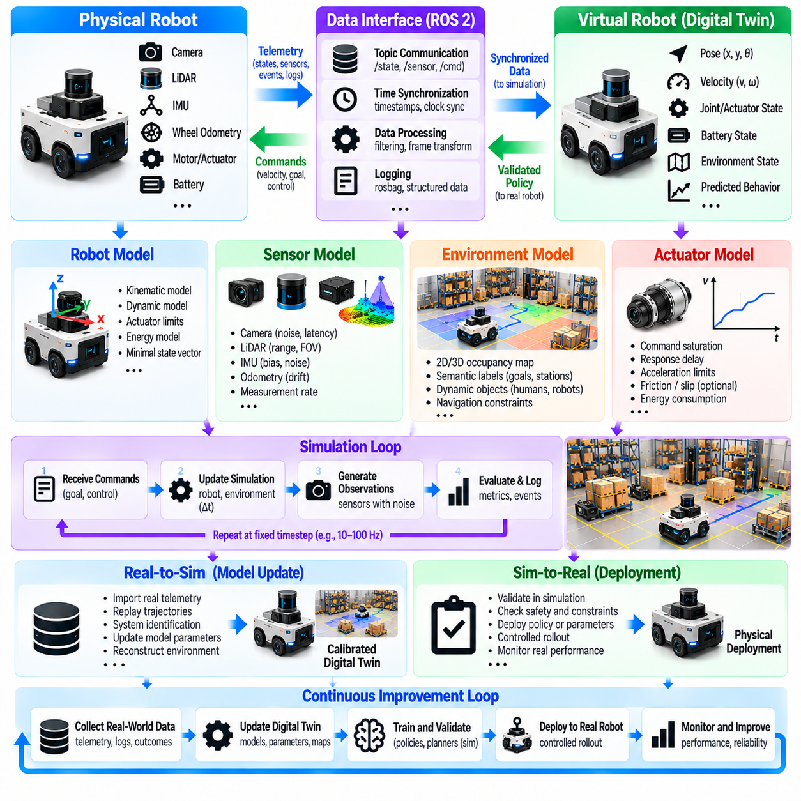{width="7.268055555555556in" height="7.268055555555556in"}

A minimal Physical AI digital twin is a compact virtual representation of a physical robot and its operating environment. Its purpose is to reproduce the essential states, behaviors, and interactions required for monitoring, simulation, and validation. Unlike comprehensive industrial digital twins, a minimal implementation prioritizes functional completeness over visual complexity. It provides a practical foundation for connecting physical operations with simulation-based intelligence.

The architecture begins with three essential elements: a physical robot, a virtual robot model, and a bidirectional data interface. The physical system generates measurements and receives authorized commands, while the virtual model estimates states and predicts behavior. The interface transfers timestamps, sensor observations, and control information. Clear separation between physical execution and virtual experimentation prevents unintended commands from reaching hardware.

A minimal robot model should represent pose, velocity, actuator states, and relevant physical constraints. For a mobile robot, the state vector may include planar position, heading, linear velocity, angular velocity, and battery level. These variables support navigation and energy-related experiments without requiring detailed mechanical modeling. Additional states should be introduced only when they materially improve prediction or operational decisions.

Robot motion can initially be represented using a simple kinematic model. A differential-drive robot, for example, updates position from linear velocity and heading while angular velocity changes its orientation. This approximation is computationally inexpensive and suitable for basic trajectory simulation. However, wheel slip, acceleration limits, and terrain interactions may require dynamic extensions when higher physical accuracy becomes necessary.

The environment model should contain only information relevant to the intended tasks. A two-dimensional occupancy grid can represent obstacles and navigable regions, while semantic labels identify charging stations, workstations, and restricted areas. Dynamic objects may be approximated through time-dependent positions. This simplified representation supports route planning and collision checking without requiring photorealistic reconstruction of the entire facility.

Sensor models connect simulated states with observations available from physical hardware. A minimal configuration may include wheel odometry, inertial measurements, and range sensing. Each sensor model should represent essential measurement characteristics such as sampling frequency, noise, bias, and latency. Matching these properties to recorded data helps ensure that simulation-based algorithms encounter realistic observation uncertainty.

Actuator models translate control commands into simulated motion or physical responses. Basic models can include command saturation, response delays, and acceleration limits. These constraints prevent simulated robots from executing physically impossible movements. More detailed representations of motor torque, friction, and electrical behavior can be added when experiments require improved dynamic fidelity or energy prediction.

State synchronization maintains correspondence between physical and virtual systems. Robot telemetry updates the digital twin at defined intervals, while timestamps preserve the sequence of observations. The virtual model may predict intermediate states between incoming measurements. Synchronization errors should be monitored because delayed or inconsistent data can cause the twin to represent conditions that no longer exist.

A minimal software implementation can use Python, ROS 2, and a lightweight simulation environment. ROS 2 topics distribute sensor measurements and robot states, while services or actions support controlled requests. Python components perform state updates, data logging, and validation calculations. The implementation should remain modular so that simulation engines, robot platforms, and communication interfaces can be replaced independently.

The core simulation loop receives commands, advances the robot model, updates the environment state, and generates simulated observations. A fixed simulation timestep simplifies reproducibility, while timestamps distinguish simulated time from wall-clock time. Each iteration should enforce actuator limits and collision constraints. Deterministic execution is useful for debugging, although controlled randomness may be introduced for robustness testing.

The real-to-sim interface imports measured robot states and operating conditions into the virtual environment. Recorded trajectories can initialize replay experiments, while sensor logs provide reference observations. Differences between physical and simulated behavior reveal calibration errors or missing dynamics. The interface should preserve raw measurements and configuration metadata so that results remain traceable across repeated experiments.

The sim-to-real interface transfers validated software configurations, planning outputs, or control policies to physical systems. Simulation results must first satisfy defined performance and safety requirements. Deployment should occur through an authorized execution layer rather than unrestricted direct control. This separation allows engineers to test candidate improvements while maintaining independent safety functions on the physical robot.

A minimal digital twin should include data logging from its earliest implementation. Logs may contain timestamps, robot poses, velocity commands, sensor measurements, simulation predictions, and execution outcomes. Structured formats simplify comparison and replay. Recording software versions and calibration parameters is equally important because identical data can produce different results when model configurations change.

Validation begins by comparing simulated trajectories against physical measurements under matched operating conditions. Position error, heading error, velocity deviation, and timing differences provide initial accuracy metrics. Experiments should include straight motion, turning, stopping, and obstacle avoidance. Repeated trials reveal whether discrepancies are systematic or caused by measurement variability and environmental uncertainty.

Parameter calibration improves agreement between the physical robot and its digital twin. Wheel radius, wheel separation, command latency, and sensor offsets can be estimated from recorded experiments. Optimization minimizes differences between predicted and measured trajectories. Calibration should use separate datasets for parameter fitting and evaluation to avoid obtaining misleading accuracy from overfitting.

A minimal digital twin becomes more useful when it supports scenario-based testing. Engineers can introduce obstacles, change initial positions, vary sensor noise, or simulate communication delays. Each scenario evaluates how navigation and control algorithms respond to altered conditions. Reusable scenario definitions enable regression testing whenever robot software, calibration, or simulation models are updated.

Failure replay can be implemented by restoring recorded states and executing the corresponding command sequence in simulation. Engineers can inspect navigation errors, unexpected stops, and abnormal sensor readings without repeatedly exposing physical hardware to the same conditions. Counterfactual experiments may test alternative control parameters. Such results remain hypotheses until confirmed through suitable physical validation.

Basic predictive maintenance capabilities can be introduced through selected health indicators. Battery voltage, motor current, temperature, and operating hours may reveal emerging performance changes. A minimal twin can track trends and compare observations with expected ranges. These indicators provide preliminary condition monitoring, but reliable failure prediction requires sufficient historical evidence and validated degradation models.

Computational efficiency is a major advantage of minimal digital twins. Simplified geometry, lightweight dynamics, and selective sensor simulation allow operation on edge computers or development workstations. The system can prioritize real-time state updates while performing expensive analysis asynchronously. Additional model fidelity should be justified by measurable improvements in prediction accuracy or task performance.

Security and operational safety must be considered even in small implementations. Communication interfaces should authenticate command sources and restrict write access to physical actuators. Simulation commands must remain isolated from hardware unless explicitly authorized. Emergency stopping, collision protection, and critical fault handling should operate independently of the digital twin and its predictive models.

Extensibility allows the minimal architecture to evolve toward more advanced Physical AI applications. Three-dimensional mapping, detailed dynamics, semantic reasoning, learned perception, and multi-robot coordination can be introduced incrementally. Each extension should preserve interface compatibility and reproducible validation. Modular development avoids unnecessary complexity while allowing the twin to grow with operational requirements.

An effective development process begins with a measurable use case and a small set of acceptance criteria. Engineers first establish telemetry connectivity, then implement state estimation, basic simulation, calibration, and comparison tests. Scenario replay and controlled deployment follow after the core model is validated. This progression creates a usable engineering system before investing in high-fidelity simulation or advanced learning algorithms.

Ultimately, a minimal Physical AI digital twin demonstrates the essential connection between physical measurements, virtual prediction, and validated operational improvement. Its value comes from accurate state representation, reproducible simulation, reliable synchronization, and controlled deployment rather than visual sophistication. By establishing these foundations, developers create a scalable platform for real-to-sim learning, sim-to-real transfer, and continuous robotic system improvement.
