**Volume 05. Simulation and Sim2Real Transfer**

# Chapter 07. Synthetic Data Generation

## 07.01. Synthetic Data for Physical AI

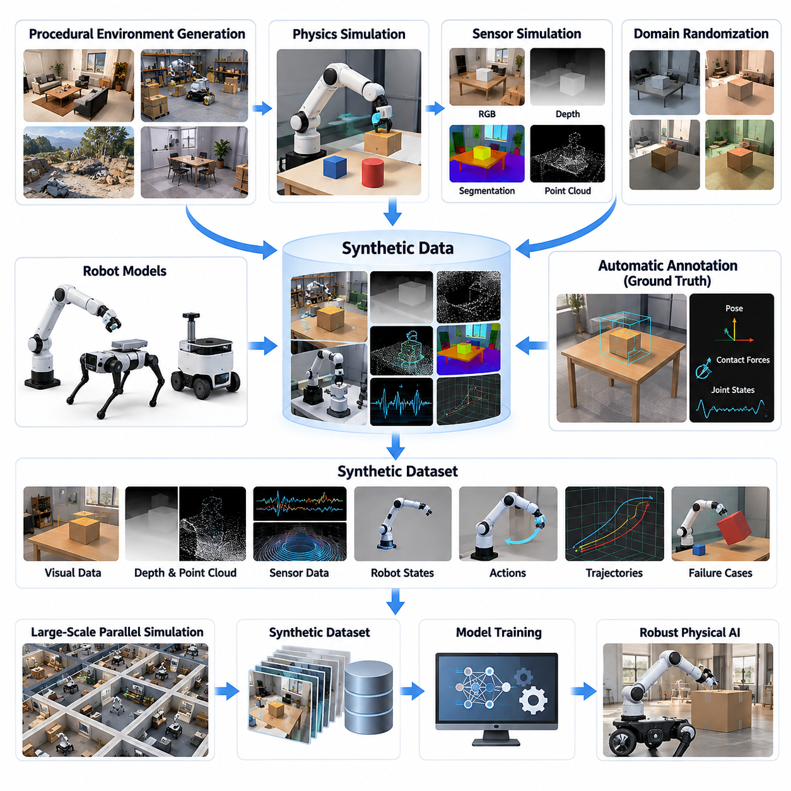{width="7.268055555555556in" height="7.268055555555556in"}

Synthetic data generation is a foundational capability for Physical AI, enabling intelligent machines to learn from artificially created observations, actions, and environmental interactions. Unlike conventional digital AI, Physical AI must understand geometry, motion, forces, contact, and temporal behavior. Synthetic data provides controlled and scalable training experiences that complement the limitations of real-world data collection.

Physical AI systems require diverse datasets representing both environmental perception and physical interaction. These datasets may include RGB images, depth maps, point clouds, segmentation masks, robot joint states, actuator commands, and motion trajectories. By generating these modalities within simulated environments, developers can create synchronized observations and precise ground-truth annotations that would otherwise require expensive measurement equipment.

The primary motivation for synthetic data generation is the difficulty of collecting sufficient real-world robotic experience. Physical experiments consume time, equipment resources, and operational budgets while introducing safety risks. Certain events, including collisions, equipment failures, and hazardous environmental conditions, are particularly difficult to reproduce. Simulation provides an alternative environment for generating such experiences systematically.

Synthetic data generation combines physics simulation, sensor rendering, procedural environment construction, and automated annotation. A simulation engine computes the evolution of physical states, while rendering systems reproduce sensor observations corresponding to those states. Procedural generation modifies objects, layouts, materials, and environmental conditions, allowing large datasets to be produced without manually constructing every scenario.

A major advantage of simulation-based synthetic data is direct access to ground truth. Object positions, velocities, orientations, contact forces, joint configurations, and environmental properties are available from the simulation state. These values can automatically generate labels for perception, localization, manipulation, and control tasks, reducing the annotation uncertainty commonly associated with human-labeled datasets.

Visual synthetic data supports the development of perception models that recognize objects, estimate spatial relationships, and interpret complex environments. Simulated cameras can produce RGB images, depth measurements, instance segmentation, and semantic segmentation. By varying camera parameters, illumination, surface materials, and object configurations, developers can expose perception systems to a broader range of visual conditions.

Synthetic data also extends beyond conventional camera imagery to include LiDAR, radar, inertial measurement units, and tactile sensing. Each sensor requires an appropriate measurement model that represents its operating principles and imperfections. Noise, measurement uncertainty, limited resolution, calibration errors, and sampling characteristics must be considered to prevent unrealistic sensor outputs from misleading learning algorithms.

For robotic control, synthetic datasets can contain proprioceptive measurements, motor commands, joint torques, velocities, accelerations, and contact interactions. Such information supports reinforcement learning, imitation learning, system identification, and predictive control. Simulated experience allows controllers to explore operating conditions and recover from disturbances before equivalent behaviors are tested on physical hardware.

Synthetic trajectory generation is particularly valuable for autonomous mobile robots, legged robots, and aerial systems. Simulated environments can produce navigation paths, locomotion sequences, obstacle avoidance maneuvers, and recovery behaviors. Each trajectory can be associated with environmental observations, robot states, control decisions, and task outcomes, supporting the development of temporally consistent learning datasets.

Manipulation-oriented synthetic data represents interactions between robotic end effectors and physical objects. Simulated grasping, pushing, lifting, placing, and assembly operations can generate demonstrations containing object poses, contact states, applied forces, and action sequences. These datasets help learning systems understand how robot actions transform physical configurations and influence task completion.

Procedural scene generation provides the environmental diversity necessary for robust Physical AI training. Instead of relying on a limited collection of manually designed scenes, procedural methods create variations in room geometry, warehouse layouts, terrain, obstacles, and object placement. The resulting environments support systematic evaluation of whether learned behaviors generalize beyond previously encountered configurations.

Domain randomization further expands synthetic data diversity by modifying visual, physical, and operational parameters. Lighting, textures, friction coefficients, object masses, actuator responses, and sensor noise can be sampled from specified distributions. The objective is not simply to maximize randomness but to expose learning systems to meaningful variations that improve robustness under real-world uncertainty.

Massive parallel simulation enables synthetic data production at a scale difficult to achieve through physical experimentation. Thousands of simulated environments may execute concurrently, depending on hardware resources and simulation complexity. Parallel execution supports extensive scenario exploration, reinforcement learning experience collection, and statistical evaluation while reducing the elapsed time required to accumulate large training datasets.

Synthetic failure data is especially important because real-world datasets often contain relatively few dangerous or unusual events. Simulated systems can reproduce wheel slip, actuator degradation, unexpected obstacles, unstable grasping, and communication delays. These experiences support anomaly detection, recovery policy development, and safety evaluation, provided that the simulated failure mechanisms adequately represent physical behavior.

Generative AI introduces additional capabilities for producing synthetic observations and environmental variations. Diffusion models and other generative approaches can create visual assets, modify appearances, or generate candidate trajectories. However, visually convincing results do not necessarily satisfy physical constraints. Generated content therefore requires geometric, temporal, and physical consistency checks before being used for safety-critical robotic learning.

Synthetic datasets can also support Vision-Language-Action models by associating visual observations with language instructions and corresponding robot actions. Simulated tasks may produce structured descriptions of objects, goals, environmental states, and action outcomes. These associations help connect semantic reasoning with embodied execution, although the quality of the resulting models depends on realistic task definitions and reliable action demonstrations.

A critical limitation of synthetic data is the simulation-to-reality gap. Differences in rendering, sensor characteristics, contact dynamics, actuator behavior, and environmental complexity can cause models trained in simulation to perform poorly on physical systems. Increasing synthetic dataset size alone does not eliminate these discrepancies. Effective transfer requires calibration, domain adaptation, randomization, and validation against representative real-world measurements.

Synthetic data quality must be evaluated through more than visual realism or dataset volume. Important criteria include physical plausibility, label accuracy, scenario diversity, temporal consistency, and relevance to target tasks. Dataset coverage should also be examined to identify missing operating conditions and systematic biases. High-quality synthetic data should improve measurable real-world performance rather than merely increase training accuracy in simulation.

Combining real and synthetic data is often more effective than treating them as competing alternatives. Real-world observations provide evidence of actual sensor behavior, environmental complexity, and physical interactions, while synthetic data supplies controllable diversity and inexpensive annotations. Mixing strategies can adjust the relative contribution of each source according to task requirements, model performance, and available real-world experience.

An effective synthetic data generation pipeline begins with task requirements and target operating conditions. Developers construct simulation assets, configure physical and sensor models, generate scenarios, execute simulations, and extract observations with corresponding labels. Data validation and filtering then remove inconsistent or unrepresentative samples before the resulting datasets are organized for training, evaluation, and reproducible experimentation.

Digital twins can strengthen this pipeline by connecting synthetic environments with measurements from operational robots and facilities. Real-world telemetry supports parameter calibration, scenario reconstruction, and identification of previously unmodeled conditions. Updated simulation models can subsequently generate new training experiences that reflect observed operational challenges, creating a feedback loop between physical deployment and virtual experimentation.

The long-term significance of synthetic data lies in its role as a scalable experience engine for Physical AI. As simulation fidelity, procedural generation, generative modeling, and distributed computing advance, synthetic datasets can support increasingly complex perception and control capabilities. Their ultimate value depends on disciplined integration with real-world evidence, enabling safer learning, stronger generalization, and more reliable autonomous physical behavior.

## 07.02. Procedural Scene and Environment Generation

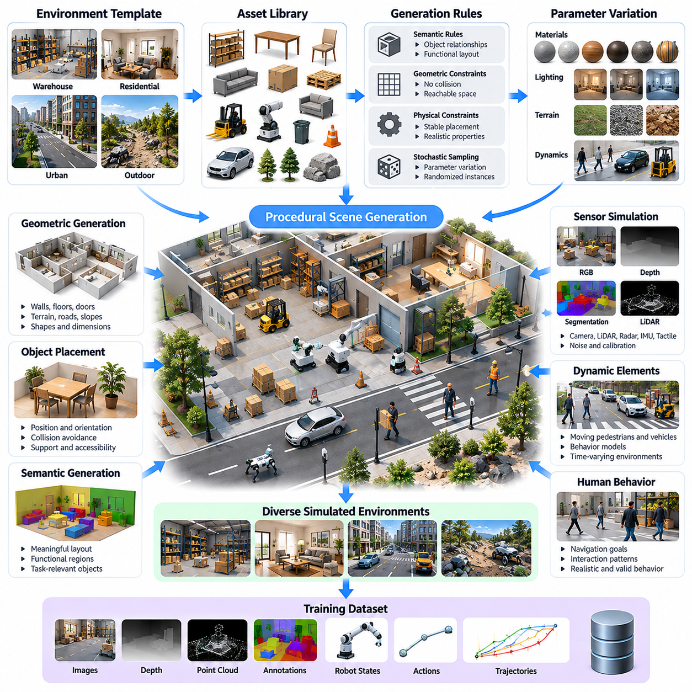{width="7.268055555555556in" height="7.268055555555556in"}

Procedural scene and environment generation is a fundamental technique for producing diverse, scalable, and controllable training environments for Physical AI. Instead of manually designing individual simulation scenes, procedural methods automatically construct environments using predefined rules, parameter distributions, and geometric constraints. This approach enables robotic systems to experience a broad range of physical conditions while reducing environment development effort.

The primary objective of procedural generation is to expand environmental diversity without sacrificing structural validity or task relevance. Physical AI systems must operate across changing layouts, object configurations, terrain conditions, and environmental disturbances. Procedurally generated environments expose learning algorithms to these variations, improving their ability to generalize beyond the limited conditions represented by manually constructed training scenes.

A procedural environment generation system typically combines geometric modeling, asset libraries, semantic rules, physical constraints, and stochastic sampling. Geometric models define spatial structures, while asset libraries provide reusable objects and environmental components. Semantic rules determine meaningful relationships between objects, and physical constraints ensure that generated scenes remain compatible with realistic robotic interactions.

Scene generation begins by defining an environment template that represents the intended operational domain. Templates may describe warehouses, manufacturing facilities, residential buildings, outdoor roads, or agricultural fields. Each template establishes structural boundaries, functional regions, and permissible object categories. Procedural algorithms then generate multiple scene instances by varying spatial arrangements and environmental parameters.

Geometric procedural generation determines the shapes, dimensions, positions, and orientations of environmental elements. Indoor environments may contain automatically generated walls, corridors, doors, shelves, and workstations. Outdoor environments may include roads, intersections, slopes, vegetation, and terrain obstacles. Geometric constraints prevent invalid intersections and preserve sufficient clearance for intended robot movements.

Semantic scene generation introduces functional meaning into procedurally created environments. A warehouse scene should contain plausible relationships between storage racks, loading zones, transportation paths, and operational equipment. Similarly, a residential environment should reflect meaningful arrangements of furniture, rooms, and household objects. Semantic consistency helps ensure that generated environments represent realistic operational situations.

Object placement is a central component of procedural scene construction. Placement algorithms determine where objects appear, how they are oriented, and which spatial relationships must be maintained. Random placement alone may produce unrealistic configurations, so constraint-based sampling is often required. Collision avoidance, support surfaces, accessibility, and task-specific relationships guide the generation of physically meaningful arrangements.

Asset libraries provide reusable geometric and semantic components for procedural environments. These assets may include industrial equipment, furniture, vehicles, tools, robotic platforms, and environmental structures. Each asset can contain geometry, material properties, collision representations, and semantic metadata. Parameterized assets allow dimensions, appearances, and physical characteristics to vary while preserving functional identity.

Procedural material generation increases visual diversity by modifying textures, colors, reflectance, roughness, and surface patterns. Such variations are particularly important for vision-based Physical AI systems because real environments exhibit substantial differences in appearance. Material generation should preserve plausible relationships between surface properties and object categories to avoid introducing misleading visual correlations.

Lighting generation creates additional environmental variation by modifying light positions, intensities, colors, and illumination distributions. Indoor scenes may simulate artificial lighting, shadows, and partially illuminated regions, while outdoor scenes may reproduce sunlight, cloud cover, and changing solar angles. These variations help perception systems remain reliable when illumination differs from conditions encountered during training.

Terrain generation is essential for mobile robots, autonomous vehicles, quadrupeds, and other locomotion systems. Procedural terrain models can generate slopes, uneven surfaces, steps, gravel, mud, and obstacles with controlled difficulty. Terrain geometry must be associated with suitable friction and contact properties so that simulated locomotion reflects meaningful mechanical challenges rather than purely visual complexity.

Environmental dynamics can also be generated procedurally to represent changing operational conditions. Moving pedestrians, vehicles, machinery, and temporary obstacles introduce time-dependent interactions. Dynamic scene generation requires motion models, behavioral rules, and collision constraints. These elements allow robotic policies to learn navigation, prediction, and decision-making in environments where surrounding objects continuously change.

Human behavior generation adds complexity to environments involving human-robot interaction. Simulated pedestrians and workers may follow navigation goals, maintain interpersonal distances, or respond to robot movements. Behavioral models can represent different walking speeds, trajectories, and interaction patterns. However, generated human behavior must be validated carefully because simplified models may not capture real human unpredictability.

Procedural generation can incorporate physical parameter variation alongside geometric and visual changes. Object masses, friction coefficients, restitution, compliance, and actuator-related conditions may be sampled from specified distributions. This integration connects procedural environment generation with domain randomization, allowing learning systems to encounter different physical responses even when environmental geometry remains similar.

Constraint-based generation is necessary to maintain physical and semantic validity. Generated objects should not penetrate solid structures, unsupported equipment should not float, and navigation routes should remain consistent with intended task requirements. Constraint solvers and rejection sampling can eliminate invalid configurations. More advanced generators may repair scenes automatically when sampled arrangements violate specified conditions.

Task-conditioned procedural generation creates environments specifically designed for learning objectives. Navigation training may require corridors, intersections, obstacles, and alternative routes, while manipulation training may require reachable objects and suitable support surfaces. Task requirements influence scene complexity, object placement, and environmental constraints, ensuring that generated experiences provide useful learning signals.

Curriculum-based environment generation gradually increases task difficulty as a learning system improves. Initial environments may contain simple geometry, predictable objects, and limited disturbances. Later environments introduce clutter, narrow passages, moving obstacles, and uncertain physical conditions. Adaptive curriculum mechanisms can adjust generation parameters using observed task success rates, enabling more efficient exploration of increasingly challenging situations.

Procedural generation also supports rare-event and failure scenario construction. Developers can intentionally generate unusual obstacle configurations, restricted passages, unstable objects, or adverse environmental conditions. Such scenarios are valuable for evaluating safety boundaries and recovery behavior. Controlled generation makes it possible to reproduce challenging events consistently without exposing physical equipment or personnel to unnecessary risks.

Massive parallel simulation significantly increases the value of procedural environment generation. Thousands of independently generated scenes can be executed concurrently when computational resources permit. Each environment may use different geometric layouts, object distributions, sensor conditions, and physical parameters. This diversity supports large-scale reinforcement learning, synthetic data collection, and statistical robustness evaluation.

Reproducibility is an essential requirement for procedural generation pipelines. Random seeds, generation parameters, asset versions, and simulation configurations should be recorded for every scene. These records allow developers to reconstruct environments associated with successful behaviors, unexpected failures, or benchmark results. Deterministic generation also supports controlled comparisons between learning algorithms under equivalent environmental conditions.

Procedural environment quality should be evaluated through geometric validity, semantic plausibility, physical consistency, diversity, and task coverage. A large number of generated scenes does not necessarily provide useful training diversity if they share similar structural patterns. Coverage analysis can identify underrepresented layouts, object relationships, and environmental conditions, helping developers refine generation distributions and constraints.

The integration of procedural generation with digital twins provides a practical connection between synthetic environments and real operational facilities. Real-world maps, facility layouts, and equipment measurements can establish baseline scene structures. Procedural algorithms then introduce controlled variations around these references, enabling robots to prepare for environmental changes while maintaining relevance to actual deployment conditions.

Generative AI can complement traditional procedural methods by creating new assets, textures, layouts, and environmental configurations. Learned generative models may capture complex visual and spatial patterns that are difficult to express through explicit rules. Nevertheless, generated content must undergo geometric validation, semantic checking, and physical consistency assessment before integration into simulation environments intended for robotic training.

An effective procedural generation pipeline connects environment specifications, asset selection, geometric construction, semantic placement, physical parameter assignment, and validation. Validated scenes are then transferred into simulation engines for sensor rendering, robotic interaction, and automated data collection. Feedback from training outcomes can guide subsequent scene generation, creating an iterative process that targets weaknesses in learned behaviors.

Procedural scene and environment generation ultimately transforms simulation from a collection of fixed virtual worlds into a scalable system for producing diverse physical experiences. Its combination with physics simulation, domain randomization, synthetic sensing, and parallel computation enables systematic training and evaluation across many operational conditions. The resulting environments provide an essential foundation for robust generalization and reliable simulation-to-reality transfer in Physical AI.

## 07.03. Synthetic Object Robot and Human Assets

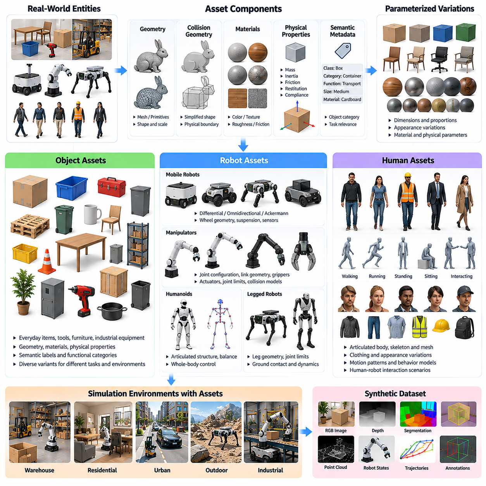{width="7.268055555555556in" height="7.268055555555556in"}

Synthetic object, robot, and human assets are essential components of simulation environments used for Physical AI training and evaluation. These assets represent the physical entities with which intelligent robots perceive, interact, and collaborate. Unlike conventional visual assets, simulation-ready assets must combine geometric appearance, physical properties, semantic information, and behavioral characteristics to support realistic sensing and interaction.

Synthetic asset generation aims to create diverse, reusable, and physically meaningful representations of real-world entities. Objects may include tools, containers, furniture, industrial equipment, and everyday items, while robotic assets represent mobile platforms, manipulators, humanoids, and aerial systems. Human assets introduce additional complexity through articulated bodies, motion patterns, and interactive behaviors within shared environments.

A simulation-ready asset typically contains visual geometry, collision geometry, material definitions, physical parameters, and semantic metadata. Visual geometry determines how an asset appears in rendered sensor observations, while collision geometry defines its physical interaction boundaries. Material properties influence both appearance and contact behavior, and semantic metadata supports automatic annotation, object identification, and task-specific reasoning.

Geometric asset modeling begins with the representation of shape, scale, and structural detail. Polygon meshes, primitive geometries, and parametric models are commonly used to describe objects and robotic components. High-resolution meshes improve visual fidelity, whereas simplified collision representations reduce computational cost. Maintaining consistency between visual and collision geometry is important for realistic contact simulation.

Parameterized object assets allow multiple variations to be generated from a common structural template. Dimensions, proportions, surface details, and component configurations can be modified while preserving the object\'s functional identity. For example, containers may vary in height, width, and handle placement, while industrial pallets may differ in dimensions and material properties. Such variation expands training diversity without requiring separate manual models.

Physical properties determine how synthetic objects behave during interaction. Mass, center of mass, inertia tensors, friction coefficients, restitution, and compliance influence motion and contact responses. These parameters must be consistent with object geometry and material characteristics. Unrealistic physical properties can produce misleading training experiences, particularly for manipulation, grasping, and dynamic control tasks.

Material modeling supports both sensor realism and physical interaction fidelity. Visual materials describe color, reflectance, roughness, transparency, and texture, while contact materials define friction and related mechanical properties. The distinction is important because visually similar surfaces may behave differently during physical interaction. Accurate material assignments improve the usefulness of synthetic perception and control datasets.

Synthetic robotic assets require more detailed structural descriptions than ordinary objects. Robot models typically contain rigid links, joints, actuators, sensors, and kinematic relationships. Articulated structures must represent joint limits, motion constraints, and mechanical connectivity. These definitions enable simulation engines to compute robot movement, contact forces, and actuator responses under different operating conditions.

Robot asset representations often use structured formats such as URDF, SDF, or USD-based descriptions, depending on the simulation platform. These formats organize geometry, articulation, physical parameters, and hierarchical relationships. However, support for particular dynamics, sensors, and materials varies between formats and simulation engines. Asset conversion therefore requires validation to preserve intended mechanical behavior.

Synthetic mobile robot assets may represent differential-drive, omnidirectional, Ackermann-steered, or independently steered platforms. Their models must capture wheel geometry, steering constraints, suspension behavior, and contact characteristics. For mobile manipulation systems, the relationship between the mobile base and manipulator is equally important because platform motion influences stability, reachability, and coordinated control.

Manipulator assets require accurate joint configurations, link dimensions, end-effector geometry, and collision boundaries. Grippers and robotic hands introduce additional contact complexity through multiple fingers, compliant surfaces, and force-dependent interactions. Simulated manipulation performance depends strongly on these representations because grasp stability and object motion are sensitive to geometric and physical modeling errors.

Humanoid and legged robot assets contain highly articulated structures that require coordinated modeling of body geometry, joint motion, mass distribution, and ground contact. Their dynamics involve balance, momentum transfer, and repeated contact transitions. Accurate representations of feet, hands, and support surfaces are especially important for locomotion and whole-body control tasks involving complex physical interactions.

Synthetic human assets extend simulation environments beyond static obstacles and predefined moving objects. Human models may include articulated skeletons, body meshes, clothing, and motion controllers. Their representations support perception, tracking, human-robot interaction, and collaborative task training. Human assets must account for variations in body dimensions, appearance, posture, and movement while preserving plausible anatomical relationships.

Human motion assets can be generated from motion capture, procedural animation, biomechanical models, or learned motion generators. Walking, reaching, lifting, turning, and gesturing provide important behavioral examples for robotic systems operating near people. Motion sequences should maintain temporal continuity, realistic joint movement, and appropriate contact with the surrounding environment.

Behavioral modeling adds decision-making capabilities to synthetic human assets. Simulated individuals may navigate toward goals, avoid obstacles, interact with objects, or respond to robotic actions. Such behaviors help create dynamic environments for social navigation and collaborative robotics. Nevertheless, simplified behavioral models cannot fully reproduce human intentions, unpredictability, or social conventions, requiring careful validation.

Human asset diversity is important for preventing systematic bias in perception and interaction models. Synthetic populations should represent variation in body shape, height, clothing, mobility, and movement patterns relevant to the intended application. Diversity must be generated through controlled and meaningful parameter distributions rather than arbitrary combinations that produce unrealistic or physically inconsistent representations.

Asset articulation and animation systems connect geometric representations with time-dependent motion. Joint hierarchies, skeletal structures, inverse kinematics, and animation controllers determine how articulated assets move. These mechanisms support synchronized generation of visual observations, joint states, contact information, and motion labels, enabling the creation of multimodal datasets for Physical AI learning.

Synthetic assets must also support sensor-specific representations. A visually realistic object may produce inaccurate LiDAR, radar, thermal, or tactile measurements if its underlying material and geometric properties are insufficient. Sensor simulation therefore requires additional metadata and response models appropriate to each modality. Consistency across sensing channels is essential for training multimodal perception systems.

Asset randomization increases the diversity of synthetic training environments by varying geometry, textures, physical parameters, and articulation characteristics. Object scale, surface appearance, joint friction, and mass distribution may be sampled within plausible ranges. Randomization should preserve functional constraints so that generated variations remain representative of real objects, robots, and human bodies.

Automatic semantic labeling is another major advantage of structured synthetic assets. Each asset can carry object identifiers, category labels, part definitions, and articulation metadata. Simulation engines can use this information to generate segmentation masks, bounding boxes, pose annotations, and state labels automatically. Hierarchical semantic descriptions also support part-level recognition and interaction-aware learning.

Asset libraries require systematic organization, version control, and quality assurance. Metadata should record geometry versions, physical parameters, coordinate conventions, units, and compatibility with simulation engines. Validation procedures should detect invalid meshes, inconsistent scales, incorrect joint axes, and unrealistic inertia values. Reliable asset management improves reproducibility and prevents modeling errors from propagating into large synthetic datasets.

The balance between asset fidelity and computational efficiency is a central engineering consideration. Highly detailed geometry and complex contact models may improve realism but reduce simulation throughput. Simplified representations can accelerate large-scale training while sacrificing important physical details. Asset complexity should therefore be selected according to task sensitivity, sensor requirements, and the accuracy needed for simulation-to-reality transfer.

Digital twins provide a mechanism for connecting synthetic assets with real-world measurements. Robot geometry, actuator characteristics, equipment dimensions, and observed motion can be used to calibrate simulation models. Updated asset parameters improve consistency between simulated and physical systems. This process is particularly valuable when synthetic assets represent specific industrial robots, facilities, or operational equipment.

Generative AI can accelerate asset creation by producing candidate geometry, textures, articulated structures, and motion sequences. However, generated assets often require geometric repair, physical parameter estimation, semantic validation, and simulation compatibility checks. Visual plausibility alone does not establish mechanical correctness. Combining generative methods with structured modeling and physics-based validation offers a more reliable asset development workflow.

Synthetic object, robot, and human assets ultimately form the reusable building blocks of scalable Physical AI simulation. Their integration with procedural environments, physics engines, sensor rendering, and automated annotation enables diverse training experiences across perception, manipulation, locomotion, and human-robot interaction. High-quality asset representations strengthen simulation realism, improve dataset reliability, and support more effective transfer of learned capabilities to physical systems.

## 07.04. Synthetic RGB Depth and Segmentation Data

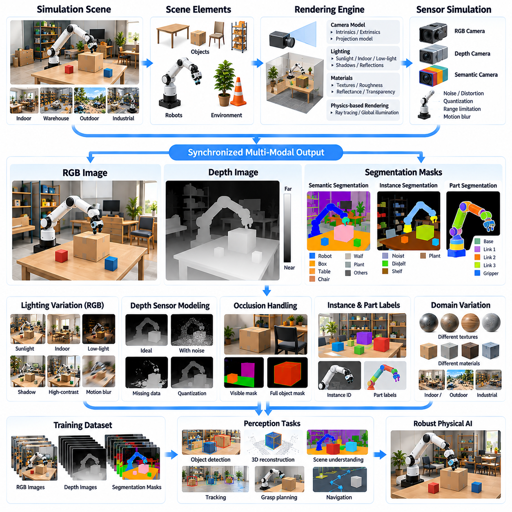{width="7.268055555555556in" height="7.268055555555556in"}

Synthetic RGB, depth, and segmentation data form a fundamental foundation for visual perception in Physical AI systems. These complementary modalities allow intelligent robots to interpret appearance, estimate spatial structure, and identify meaningful objects within their environments. Simulation-based generation provides synchronized visual observations and precise annotations, enabling scalable training without the extensive manual labeling required for real-world datasets.

RGB synthetic data represents the visual appearance of simulated environments through color images generated by virtual cameras. These images capture object textures, lighting conditions, shadows, reflections, and scene composition. By controlling rendering parameters, developers can produce diverse observations representing different operational conditions. RGB data supports object detection, classification, visual tracking, and scene understanding.

Synthetic depth data describes the distance between a virtual sensor and visible surfaces within the environment. Depth images provide geometric information that complements the appearance-based representation of RGB images. Depending on sensor conventions, depth values may represent camera-axis distance or range along viewing rays. Accurate depth generation supports obstacle detection, spatial reconstruction, robotic navigation, and manipulation planning.

Segmentation data assigns semantic or instance-level labels to pixels within rendered images. Semantic segmentation identifies categories such as floors, walls, vehicles, and objects, while instance segmentation distinguishes individual entities belonging to the same category. Part segmentation can further identify components of articulated objects and robots. These representations provide structured information for perception, interaction, and environmental reasoning.

The generation of synchronized RGB, depth, and segmentation data begins with a shared simulation scene containing geometry, materials, lighting, and camera definitions. A rendering engine produces multiple observation channels from consistent scene states and viewpoints. Maintaining alignment between these channels is essential because perception models often combine color, geometric, and semantic information during training and inference.

Virtual camera modeling determines how three-dimensional scenes are projected into two-dimensional observations. Camera intrinsics define focal length, principal point, and image resolution, while extrinsics specify position and orientation relative to the environment. Projection models must remain consistent across RGB, depth, and segmentation outputs. Incorrect camera calibration can introduce systematic errors into geometric learning and sensor fusion.

Photorealistic rendering improves synthetic RGB quality by reproducing realistic illumination, material responses, and optical effects. Physically based rendering models simulate interactions between light and surfaces, while ray tracing can represent shadows, reflections, and indirect illumination. However, visual realism alone does not guarantee useful training data. Rendering complexity must be balanced against dataset diversity, computational cost, and task requirements.

Lighting variation is particularly important for robust RGB perception. Synthetic scenes can reproduce bright sunlight, artificial illumination, low-light conditions, shadows, and high-contrast environments. Camera exposure, white balance, dynamic range, and motion blur can also be modified. These variations reduce dependence on specific appearance conditions and help perception systems generalize to changing real-world environments.

Depth rendering requires careful treatment of sensor geometry, visibility, and measurement characteristics. Ideal depth buffers provide precise geometric distances, but physical depth cameras introduce noise, missing measurements, quantization, and range limitations. Structured-light and time-of-flight sensors may exhibit different error characteristics. Sensor-specific modeling is therefore necessary when synthetic depth data is intended to approximate physical measurements.

Occlusion is a major consideration in synthetic visual data generation. Objects may be partially hidden by other objects, environmental structures, or robot components. Rendering engines naturally represent visible surfaces, while simulation metadata can preserve information about hidden geometry and complete object poses. This distinction enables the generation of both visible-region annotations and full-object ground truth for different learning objectives.

Synthetic segmentation masks can be generated automatically using object identifiers, semantic categories, and material or part assignments. Unlike manually annotated real images, simulation-derived masks can maintain exact correspondence with rendered geometry. Nevertheless, label definitions must be carefully designed. Inconsistent category hierarchies, ambiguous object boundaries, and incorrect asset metadata can reduce the reliability of segmentation datasets.

Instance segmentation becomes especially valuable in environments containing repeated objects, such as warehouse shelves, industrial components, or identical containers. Each object instance receives a distinct identifier even when multiple objects share the same semantic category. This capability supports object counting, tracking, grasp target selection, and scene inventory. Stable identifiers across frames also enable temporal association and multi-object tracking research.

Part-level segmentation provides finer representations of complex objects and articulated systems. Robot links, gripper fingers, handles, doors, and movable components can receive individual labels. Such annotations support articulated object perception, affordance recognition, and manipulation planning. Part definitions should correspond to meaningful physical structures rather than arbitrary mesh divisions to ensure that generated labels remain useful for robotic tasks.

RGB and depth information can be combined to construct RGB-D representations that associate visual appearance with geometric measurements. When camera parameters are known, depth pixels can be projected into three-dimensional point clouds. These representations support object pose estimation, surface reconstruction, collision avoidance, and spatial mapping. Accurate synchronization and coordinate transformations are necessary to preserve geometric consistency.

Procedural scene generation expands visual dataset diversity by changing object placement, environmental layouts, and scene composition. Objects can appear at different distances, orientations, scales, and levels of occlusion. Background complexity and clutter can also be controlled. Such variation helps prevent perception models from learning narrow correlations associated with a limited collection of manually designed scenes.

Domain randomization further improves synthetic visual diversity through controlled changes in textures, colors, lighting, camera parameters, and sensor imperfections. Randomization distributions should reflect plausible operating conditions while including sufficient variation to challenge learning models. Excessive or unrealistic randomization may introduce irrelevant patterns, making distribution design an important part of synthetic dataset engineering.

Automatic annotation extends beyond segmentation masks to include two-dimensional bounding boxes, three-dimensional bounding boxes, object poses, surface normals, and visibility information. These labels can be derived from simulation geometry and object metadata. The ability to generate multiple consistent annotation types from the same scene reduces labeling costs and supports multitask learning across detection, segmentation, and geometric estimation.

Temporal synthetic data generation produces sequences of RGB, depth, and segmentation observations as robots and objects move through simulated environments. Frame sequences capture motion, changing viewpoints, occlusion transitions, and environmental interactions. Temporal consistency is essential for visual tracking, dynamic scene understanding, and predictive perception. Camera motion and object trajectories must remain synchronized with simulation time.

Motion-related effects introduce additional realism into synthetic visual sequences. Camera movement, rolling shutter, exposure duration, and motion blur influence how dynamic scenes appear. These effects can significantly affect perception performance during high-speed navigation or manipulation. Accurate simulation requires consistent relationships between object motion, camera timing, and image formation rather than independent visual distortion.

Synthetic visual datasets can support multimodal learning architectures that integrate appearance, geometry, and semantic information. RGB images provide texture and contextual cues, depth maps describe spatial structure, and segmentation masks identify meaningful entities. Their combination improves the representation of complex scenes. However, learning architectures must account for missing or unreliable modalities because real sensors do not always provide complete observations.

Dataset quality depends on geometric accuracy, rendering consistency, label correctness, environmental diversity, and relevance to target tasks. Synthetic images should be evaluated for invalid depth values, incorrect segmentation boundaries, camera misalignment, and unrealistic visual artifacts. Automated quality checks can identify problematic samples before training. Representative real-world data remains necessary to assess whether synthetic observations adequately reflect deployment conditions.

The simulation-to-reality gap remains a central limitation of synthetic visual data. Differences in lighting, surface appearance, optical distortion, sensor noise, and environmental complexity can reduce real-world model performance. Domain adaptation, calibrated sensor models, and mixed real-synthetic training strategies help address these discrepancies. Validation should focus on downstream perception performance rather than visual similarity alone.

Massive parallel simulation enables the generation of large RGB, depth, and segmentation datasets across thousands of scene configurations when computational resources permit. Parallel rendering increases throughput, while automated metadata extraction produces synchronized annotations. Efficient storage formats, compression, and dataset indexing become important at scale. Reproducible scene parameters and random seeds allow difficult samples to be reconstructed for analysis.

A practical synthetic visual data pipeline begins with validated scene assets, camera configurations, and annotation requirements. The system generates scene variations, executes rendering, extracts RGB and depth images, assigns segmentation labels, and performs consistency checks. Valid samples are organized with calibration metadata, timestamps, and scene identifiers. Training feedback can then guide additional generation toward underrepresented conditions.

Synthetic RGB, depth, and segmentation data ultimately provide a scalable foundation for perception-driven Physical AI. Their synchronized generation connects visual appearance, three-dimensional geometry, and semantic understanding within a unified simulation environment. When combined with realistic sensor modeling, procedural diversity, and real-world validation, these datasets support more robust object recognition, spatial reasoning, navigation, and robotic manipulation across changing physical environments.

## 07.05. Synthetic LiDAR Radar IMU and Tactile Data

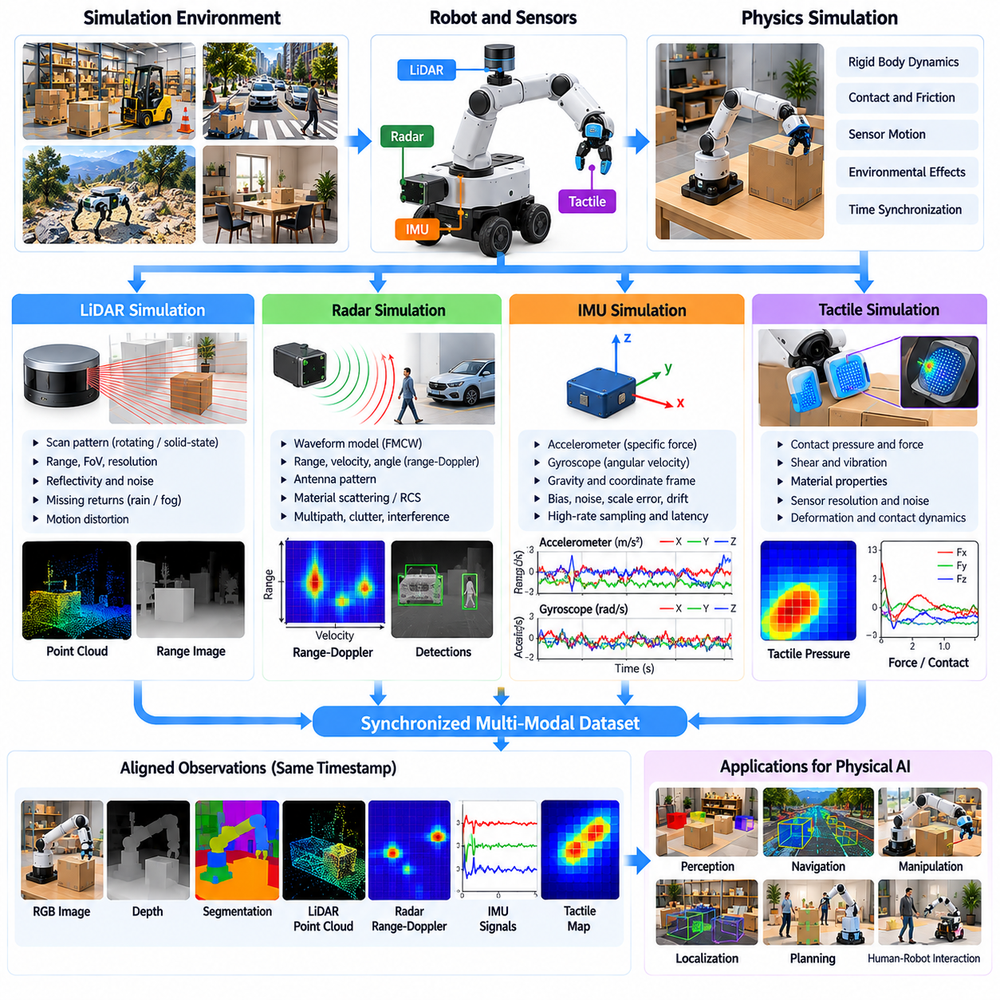{width="7.268055555555556in" height="7.268055555555556in"}

Synthetic LiDAR, radar, IMU, and tactile data provide essential sensing capabilities for Physical AI systems operating in complex physical environments. Unlike RGB cameras, these sensors measure geometric structure, motion, acceleration, and physical contact through different sensing principles. Simulation-based generation enables synchronized multimodal datasets that support perception, localization, navigation, manipulation, and control without requiring extensive physical experimentation.

Synthetic sensor generation must reproduce both ideal measurements and the imperfections of real sensing hardware. Each modality has distinct operating principles, measurement ranges, sampling frequencies, and uncertainty characteristics. A physically meaningful simulation therefore requires sensor-specific models rather than generic noise injection. Accurate sensor modeling helps learning algorithms distinguish environmental information from measurement artifacts and uncertainty.

Synthetic LiDAR data represents spatial geometry through simulated laser measurements. A virtual LiDAR sensor emits rays into the environment and calculates intersections with visible surfaces. The resulting measurements can be organized as point clouds, range images, or structured scan sequences. These representations provide three-dimensional information for obstacle detection, localization, mapping, object recognition, and autonomous navigation.

LiDAR simulation must account for sensor configuration and scanning behavior. Important parameters include angular resolution, vertical field of view, scanning frequency, maximum range, and beam arrangement. Rotating and solid-state LiDAR systems may produce different sampling patterns. Accurate simulation should also consider sensor movement during scanning because sequential measurements can introduce motion distortion into reconstructed point clouds.

Realistic LiDAR measurements require modeling range uncertainty, missing returns, surface reflectivity, and environmental interference. Dark or highly reflective materials may produce different measurement characteristics, while transparent surfaces can create ambiguous returns. Rain, fog, and airborne particles may introduce attenuation or spurious detections. These effects should be represented according to the intended sensor technology and operating conditions.

Synthetic radar data complements LiDAR by providing measurements associated with target range, radial velocity, and angular position. Radar simulation models electromagnetic wave interactions with environmental objects and moving targets. Unlike optical sensors, radar can remain useful under certain visibility limitations. However, radar observations generally contain different resolution characteristics and ambiguities that must be reflected in synthetic datasets.

Radar signal generation may represent transmitted waveforms, reflected signals, and subsequent signal processing. Frequency-modulated continuous-wave radar models can generate range-Doppler information from simulated target responses. More detailed simulations may include antenna patterns, multipath propagation, clutter, and interference. The required modeling fidelity depends on whether the dataset supports object detection, tracking, or signal-level algorithm development.

Radar target representation requires more than geometric intersection testing. Material electromagnetic properties, object orientation, surface structure, and relative motion influence reflected signal strength. Radar cross section and scattering behavior can vary significantly with viewing angle. Simplified models may support large-scale perception training, while higher-fidelity electromagnetic models are needed when accurate signal characteristics are essential.

Synthetic inertial measurement unit data describes the motion of a robot or sensor platform through accelerometer and gyroscope measurements. Accelerometers measure specific force, while gyroscopes measure angular velocity. These signals support state estimation, inertial navigation, stabilization, and feedback control. Simulation engines can derive ideal inertial measurements from rigid-body dynamics and transform them into the sensor coordinate frame.

IMU simulation requires careful treatment of gravity, coordinate conventions, and rotational dynamics. Accelerometer outputs depend on translational acceleration and gravitational effects, while gyroscope outputs reflect angular motion. Incorrect coordinate transformations or gravity conventions can produce systematic estimation errors. Consistent sensor frames and timing are therefore necessary for reliable integration with localization and control algorithms.

Real IMUs exhibit measurement imperfections such as bias, noise, scale-factor error, and temperature-dependent drift. Gyroscope bias can accumulate into substantial orientation errors during integration, while accelerometer errors affect velocity and position estimates. Synthetic IMU models should reproduce relevant stochastic and deterministic error characteristics, including bias evolution and sampling limitations.

Temporal synchronization is especially important when synthetic IMU data is combined with camera, LiDAR, or radar observations. IMUs often operate at higher sampling frequencies than visual sensors, requiring accurate timestamps and interpolation between simulation states. Sensor latency, clock offsets, and asynchronous measurements may also be modeled. These characteristics influence sensor fusion performance and the reliability of estimated robot motion.

Synthetic tactile data represents physical interaction through measurements of contact pressure, force, deformation, and sometimes shear or vibration. Tactile sensors are particularly important for robotic grasping, manipulation, and human-robot interaction. Unlike remote sensing modalities, tactile measurements depend directly on contact mechanics. Their generation therefore requires physically meaningful representations of object geometry, material behavior, and contact forces.

Tactile simulation begins with contact detection between a sensor surface and another physical object. Contact locations, penetration constraints, normal forces, and tangential forces are estimated using the simulation engine. These quantities can be transformed into pressure distributions or tactile sensor outputs. The accuracy of generated tactile data depends strongly on the contact model and the spatial resolution of the sensing surface.

High-fidelity tactile simulation may incorporate compliant materials, elastic deformation, friction, and distributed contact pressure. Soft fingertips and tactile skins deform under applied loads, producing spatial patterns that encode object shape and contact conditions. Simplified rigid-contact models may approximate overall forces but cannot fully reproduce distributed deformation. Model complexity should therefore match the intended manipulation task.

Synthetic tactile datasets can support grasp stability estimation, slip detection, force regulation, and object property recognition. During grasping, tactile measurements provide information about contact establishment, pressure distribution, and changing load conditions. Simulated slip events and unstable contacts can generate valuable training examples. These datasets help robotic controllers develop feedback strategies for maintaining secure and adaptive manipulation.

Multimodal synthetic sensing combines LiDAR, radar, IMU, tactile, and visual observations within a common simulation environment. Each sensor provides different information about the robot and surrounding world. LiDAR describes geometry, radar captures motion-related target measurements, IMUs estimate platform dynamics, and tactile sensors measure physical contact. Their integration supports more complete state estimation and robust decision-making.

Coordinate frame consistency is fundamental to multimodal synthetic datasets. Every sensor must have a defined position and orientation relative to the robot body and global environment. Extrinsic calibration parameters determine how measurements are transformed between coordinate systems. Incorrect transformations can produce artificial disagreement between modalities, reducing the effectiveness of sensor fusion and learned representations.

Sensor-specific randomization expands training diversity by varying measurement noise, calibration parameters, detection thresholds, and environmental interference. LiDAR dropout rates, radar clutter levels, IMU bias characteristics, and tactile sensitivity may be sampled within plausible ranges. Such variation helps models tolerate hardware differences and changing operating conditions while avoiding unrealistic sensor behavior.

Procedural environment generation further increases synthetic sensor diversity by modifying terrain, object geometry, materials, and dynamic obstacles. A single environment can produce different sensor observations as objects move or physical conditions change. Controlled scenario generation enables systematic examination of sensing failures and difficult operating conditions. These scenarios are particularly useful for robustness testing and safety-oriented perception development.

Automatic ground-truth generation is a major advantage of simulation-based sensor datasets. The simulation engine can provide object poses, velocities, contact states, surface properties, and robot trajectories alongside synthetic measurements. These labels support supervised learning, sensor calibration research, and state estimation evaluation. Ground-truth accuracy must nevertheless be checked against simulation numerical precision and modeling assumptions.

Sensor data quality should be evaluated through physical plausibility, measurement statistics, temporal consistency, and downstream task performance. Synthetic LiDAR point distributions, radar detections, IMU drift patterns, and tactile responses should be compared with representative real measurements. Statistical similarity alone is insufficient if learned models fail during physical deployment. Validation must therefore include task-relevant real-world testing.

The simulation-to-reality gap affects each sensing modality differently. LiDAR errors may arise from surface interactions and weather, radar errors from scattering and multipath, IMU errors from bias and vibration, and tactile errors from contact mechanics. Calibration, system identification, domain randomization, and real-synthetic data mixing can reduce these discrepancies. No single modeling strategy fully eliminates all sensor-specific transfer challenges.

Massive parallel simulation enables large-scale synthetic sensor data collection across many robot configurations and environmental scenarios. Efficient implementations can generate synchronized measurements and annotations from multiple simulated environments concurrently. Computational requirements vary substantially by modality, particularly for electromagnetic radar and deformable tactile simulation. Practical pipelines must balance fidelity, throughput, and storage requirements.

A synthetic multimodal sensor pipeline begins with validated robot models, environmental assets, and sensor configurations. The simulation executes physical dynamics, computes sensor-specific observations, applies measurement imperfections, and records synchronized ground truth. Automated validation then checks measurement ranges, coordinate consistency, timestamps, and statistical properties. Curated datasets are subsequently prepared for training, evaluation, and simulation-to-reality experiments.

Synthetic LiDAR, radar, IMU, and tactile data ultimately extend Physical AI beyond visual perception into geometric sensing, motion estimation, and physical interaction understanding. Their coordinated generation enables robots to learn from diverse and controllable experiences while reducing dependence on costly real-world experiments. When supported by accurate physics, realistic sensor models, and continuous validation, these datasets strengthen robust perception, autonomous control, and reliable physical deployment.

## 07.06. Synthetic Proprioception and Control Data

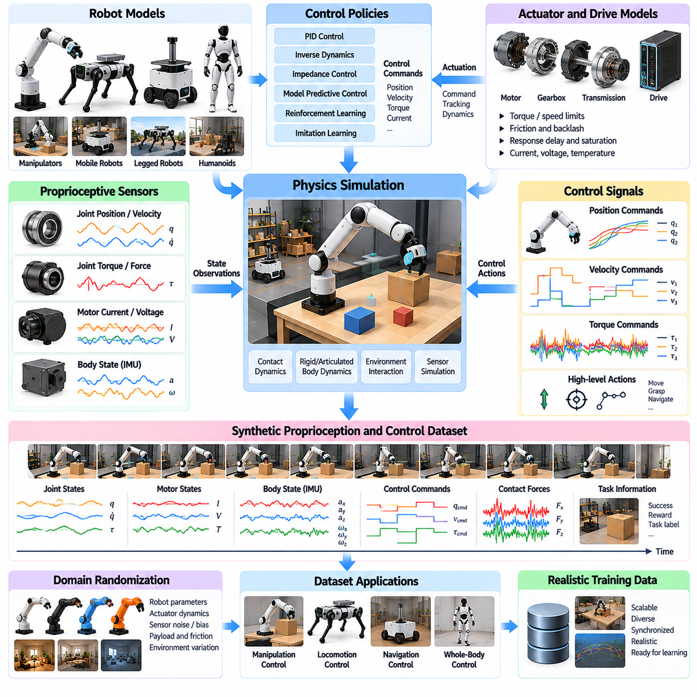{width="7.268055555555556in" height="7.268055555555556in"}

Synthetic proprioception and control data describe the internal state and commanded behavior of robotic systems operating in simulated environments. Proprioception provides information about joint positions, velocities, forces, and body motion, while control data records actions generated by controllers or learning policies. Together, these signals connect physical dynamics with decision-making and enable scalable training of robot control systems.

Unlike external perception sensors, proprioceptive sensors measure variables associated with the robot\'s own mechanical structure and motion. Encoders, torque sensors, motor current sensors, and inertial measurement units provide complementary state information. Synthetic generation reproduces these measurements from simulation states while introducing realistic sensing limitations, allowing control algorithms to learn under diverse operating conditions.

Joint position and velocity data form the foundation of robotic proprioception. Simulation engines calculate joint coordinates and their derivatives from articulated-body dynamics. These values can represent revolute, prismatic, and continuous joints within manipulators, mobile robots, and humanoids. Accurate joint definitions, coordinate conventions, and motion limits are necessary to maintain consistency between simulated observations and physical hardware.

Joint torque and force measurements provide information about mechanical loading and interaction with the environment. Simulated actuator torques, constraint forces, and external contact forces can be recorded alongside joint motion. However, commanded torque, delivered actuator torque, and measured joint torque may differ. Synthetic datasets should preserve these distinctions to avoid teaching controllers unrealistic assumptions about actuation.

Motor-level proprioception includes current, voltage, rotational speed, temperature, and estimated actuator load. These quantities can be generated using electrical and mechanical actuator models coupled to robot dynamics. Motor current may provide indirect information about torque, while temperature reflects operating history and energy dissipation. Including these signals supports actuator-aware control, diagnostics, and predictive maintenance.

Robot body-state measurements extend proprioception beyond individual joints. Base orientation, angular velocity, linear acceleration, and estimated body velocity describe the motion of mobile and legged platforms. Simulation can provide ideal state variables together with synthetic sensor measurements. Maintaining separate representations of ground truth and estimated state prevents unrealistic access to information unavailable during physical deployment.

Synthetic control data records the commands applied to robotic systems and the resulting state transitions. Control actions may represent target positions, desired velocities, torque commands, motor currents, or higher-level motion objectives. Each action must be associated with its control mode and timing. Without these definitions, identical numerical values may represent fundamentally different physical commands.

Control data generation often begins with conventional controllers such as proportional-integral-derivative control, inverse dynamics, impedance control, and model predictive control. These methods produce structured actions in response to simulated states and task objectives. Their trajectories provide useful reference behavior for supervised learning, imitation learning, and controller comparison, although controller quality depends on model accuracy.

Reinforcement learning provides another mechanism for generating synthetic control trajectories. A learning policy observes simulated robot states, selects actions, and receives rewards based on task performance. Repeated interaction produces datasets containing successful behavior, inefficient actions, and failures. Recording policy observations, actions, rewards, and termination conditions enables subsequent analysis and offline learning.

The relationship between observations and actions must reflect realistic control timing. Physical robots operate through discrete sensing, computation, communication, and actuation cycles. Simulation should distinguish physics integration steps from controller update intervals and sensor sampling rates. Incorrect timing assumptions can produce policies that perform well in simulation but fail when deployed on hardware with limited bandwidth.

Actuator dynamics strongly influence the quality of synthetic control data. Real motors and transmissions exhibit torque limits, velocity constraints, saturation, backlash, friction, and response delays. Simplified ideal actuators may generate motions that physical systems cannot reproduce. Including actuator response models improves the correspondence between simulated commands and achievable mechanical behavior.

Contact-rich control tasks require accurate relationships between proprioception and environmental interaction. During grasping, walking, pushing, or assembly, contact forces modify joint torques and body motion. Synthetic datasets should record contact states, force transitions, and controller responses. These signals help learning systems recognize physical constraints and adapt actions when interactions differ from expected behavior.

Proprioceptive sensor imperfections include encoder quantization, measurement noise, bias, latency, and occasional signal loss. Control channels may introduce command delays, rate limits, or communication jitter. These effects should be modeled according to hardware characteristics rather than arbitrary disturbances. Realistic imperfections encourage policies to tolerate uncertainty without relying on inaccessible ideal states.

Domain randomization can expand synthetic proprioception and control datasets by varying robot mass, inertia, joint friction, actuator strength, and sensor characteristics. Such variation exposes controllers to different dynamic responses under similar commands. Randomization ranges should remain physically plausible and preserve mechanical constraints. Carefully designed distributions improve robustness to manufacturing differences, wear, and calibration errors.

Safety constraints must be represented during synthetic control data generation. Joint limits, maximum torque, velocity restrictions, thermal limits, and collision boundaries define allowable operating conditions. Simulation can explore near-limit situations without exposing physical equipment to equivalent risks. Nevertheless, safety labels must distinguish simulated constraint violations from verified real-world hazards.

Dataset structure is critical for learning from proprioceptive and control signals. Each trajectory should associate observations, commanded actions, applied actions, timestamps, and resulting states. Metadata should identify robot configuration, controller version, sensor calibration, and simulation parameters. Consistent organization supports sequence modeling, system identification, offline reinforcement learning, and reproducible evaluation.

Synthetic proprioception and control data ultimately connect simulated robot dynamics with practical autonomous behavior. Their value depends on accurate mechanical models, realistic sensing, faithful actuator responses, and consistent temporal relationships. When combined with external perception and real-world validation, these datasets support robust motion control, adaptive manipulation, locomotion, and effective simulation-to-reality transfer.

## 07.07. Synthetic Navigation and Locomotion Trajectories

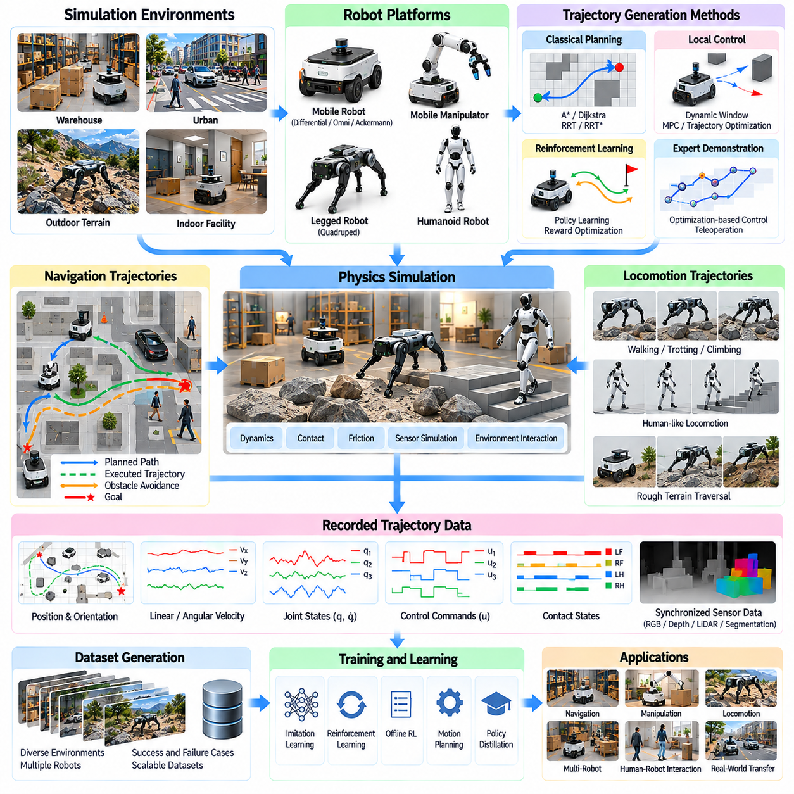{width="7.268055555555556in" height="7.268055555555556in"}

Synthetic navigation and locomotion trajectories represent sequences of robot states, actions, and environmental interactions generated within simulated environments. These trajectories describe how robots move toward goals, avoid obstacles, maintain stability, and respond to changing terrain. For Physical AI, synthetic trajectory generation provides scalable training data for motion planning, autonomous navigation, reinforcement learning, and embodied control.

Navigation trajectories describe the movement of robotic platforms through structured or unstructured environments. They typically contain positions, orientations, velocities, control commands, and timestamps associated with planned or executed paths. Additional information may include obstacle locations, map representations, and localization uncertainty. These synchronized records enable learning systems to connect environmental perception with motion decisions.

Locomotion trajectories focus on the physical mechanisms that produce movement, particularly in legged, humanoid, and dynamically controlled robotic systems. They include joint positions, joint velocities, actuator commands, contact states, and body dynamics. Unlike geometric navigation paths, locomotion trajectories must satisfy mechanical constraints and balance requirements while producing physically achievable movements.

Synthetic trajectory generation begins with a simulation environment containing robot models, terrain geometry, obstacles, and task objectives. Initial conditions and goal configurations define individual movement scenarios. Planning algorithms or learned policies generate actions while the physics engine updates robot states. Recording these interactions produces temporally consistent datasets containing both commanded behavior and resulting physical motion.

Classical navigation planners provide an important source of synthetic trajectory demonstrations. Graph-search methods such as A\\\* and Dijkstra\'s algorithm generate routes through discretized environments, while sampling-based methods explore continuous configuration spaces. These planners establish reference paths for reaching specified goals. Their outputs often require smoothing and dynamic feasibility checks before execution by physical robots.

Local navigation controllers transform reference paths into executable velocity or steering commands. Techniques such as dynamic window approaches, trajectory optimization, and model predictive control account for robot motion constraints and nearby obstacles. Simulated execution reveals differences between planned paths and actual trajectories. These differences provide valuable examples for learning robust navigation policies.

Mobile robot trajectory generation must reflect the kinematic characteristics of each platform. Differential-drive robots have different motion constraints from omnidirectional or independently steered systems. Steering angles, wheel velocities, acceleration limits, and turning radii influence achievable paths. Incorporating these constraints prevents synthetic datasets from containing motions that the intended robot cannot physically execute.

Legged locomotion trajectory generation requires coordinated control of body motion, joint articulation, and ground contact. Walking, trotting, climbing, and turning involve repeated transitions between support and swing phases. Simulation can record foot placements, contact forces, body orientation, and joint torques throughout these movements. Such datasets support gait learning, balance control, and terrain adaptation.

Humanoid locomotion introduces additional requirements involving whole-body coordination and dynamic balance. Trajectories must account for center-of-mass movement, support regions, angular momentum, and joint limitations. Walking and stepping behaviors depend on accurate contact transitions and feasible actuator responses. Synthetic demonstrations can capture recovery motions and transitions between different locomotion patterns.

Terrain diversity is essential for generating robust locomotion datasets. Procedural environments may contain slopes, stairs, uneven surfaces, gaps, obstacles, and surfaces with different friction properties. Each terrain configuration produces distinct balance and contact challenges. Controlled variation allows training systems to experience conditions ranging from simple flat-ground movement to difficult and uncertain terrain.

Dynamic environments extend navigation trajectory generation beyond static obstacle avoidance. Moving pedestrians, vehicles, mobile robots, and changing obstacles require continuous perception and replanning. Synthetic trajectories can capture yielding, stopping, overtaking, and collision avoidance. These interactions are particularly important for autonomous mobile robots operating in warehouses, factories, and human-shared environments.

Multi-agent simulation enables the generation of coordinated and competitive movement trajectories. Multiple robots may share corridors, negotiate intersections, or cooperate in transporting objects. Their trajectories reflect interactions between individual objectives and shared environmental constraints. Recording these behaviors supports multi-robot coordination, traffic management, and decentralized navigation policy development.

Reinforcement learning can generate diverse navigation and locomotion behaviors through repeated interaction with simulated environments. Policies receive observations, select actions, and optimize rewards associated with progress, stability, efficiency, and safety. Training produces both successful and unsuccessful trajectories. These records provide useful material for policy improvement, offline learning, and failure analysis.

Expert demonstrations can also be generated through optimization-based controllers and carefully designed motion planners. Such demonstrations provide structured examples of desirable behavior under known conditions. However, expert trajectories are not automatically optimal or robust outside their assumptions. Combining expert demonstrations with exploratory policy rollouts helps create datasets containing both reference behavior and realistic deviations.

Trajectory diversity can be expanded through domain randomization of robot dynamics, terrain properties, sensor noise, and environmental configurations. Variations in mass, friction, actuator response, and obstacle placement expose policies to different movement outcomes. Randomization must remain physically plausible and preserve task feasibility. Carefully selected distributions improve robustness without overwhelming training with unrealistic scenarios.

Safety-oriented trajectory generation includes controlled exposure to hazardous or near-failure conditions. Examples include sudden obstacles, reduced traction, actuator saturation, unstable footholds, and unexpected external disturbances. Simulation can record avoidance actions, balance recovery, and unsuccessful responses without risking physical equipment. These examples support recovery learning and systematic evaluation of safety boundaries.

Trajectory datasets require accurate temporal alignment between observations, actions, and resulting states. Sensor measurements, control commands, robot poses, and contact events may operate at different sampling frequencies. Consistent timestamps and coordinate transformations preserve their relationships. Poor synchronization can cause learning models to associate actions with incorrect outcomes, reducing control performance.

Automatic ground-truth annotation strengthens synthetic trajectory datasets by providing information unavailable from ordinary onboard sensors. Simulation can record exact robot poses, obstacle distances, contact forces, terrain properties, and collision events. These labels support supervised learning and evaluation. Training pipelines must nevertheless distinguish privileged simulation information from observations available during real-world deployment.

Trajectory quality should be evaluated using task completion, collision frequency, path efficiency, motion smoothness, energy consumption, and dynamic stability. For locomotion, additional measures include foot slip, body oscillation, contact consistency, and recovery success. No single metric captures overall performance. Evaluation should consider safety, efficiency, robustness, and task-specific operating requirements.

The simulation-to-reality gap affects trajectory transfer through differences in dynamics, contact behavior, sensing, and actuator response. A navigation policy may depend on unrealistically accurate localization, while a locomotion policy may exploit inaccurate friction or contact models. Hardware-calibrated simulation, domain randomization, and real-world validation help reduce these problems. Transfer success must be measured through physical execution.

Massive parallel simulation enables large trajectory collections across many initial conditions, environments, and robot configurations. Parallel rollouts accelerate reinforcement learning and provide extensive behavioral coverage. Automated filtering can identify successful demonstrations, difficult transitions, and rare failures. Dataset balancing is necessary to prevent frequently encountered easy scenarios from dominating the training distribution.

A practical trajectory generation pipeline integrates environment configuration, task sampling, motion planning, policy execution, physics simulation, and automated recording. Generated trajectories are checked for physical feasibility, annotation consistency, and task relevance. Valid samples are organized with robot parameters, environmental metadata, and performance outcomes. Training feedback then guides additional generation toward underrepresented movement conditions.

Synthetic navigation and locomotion trajectories ultimately connect environmental understanding with physically executable robot behavior. Their value comes from combining diverse scenarios, accurate dynamics, realistic sensing, and structured motion annotations. When integrated with imitation learning, reinforcement learning, and real-world testing, these datasets support adaptable navigation, stable locomotion, safer autonomous movement, and more effective simulation-to-reality transfer.

## 07.08. Synthetic Manipulation Demonstrations

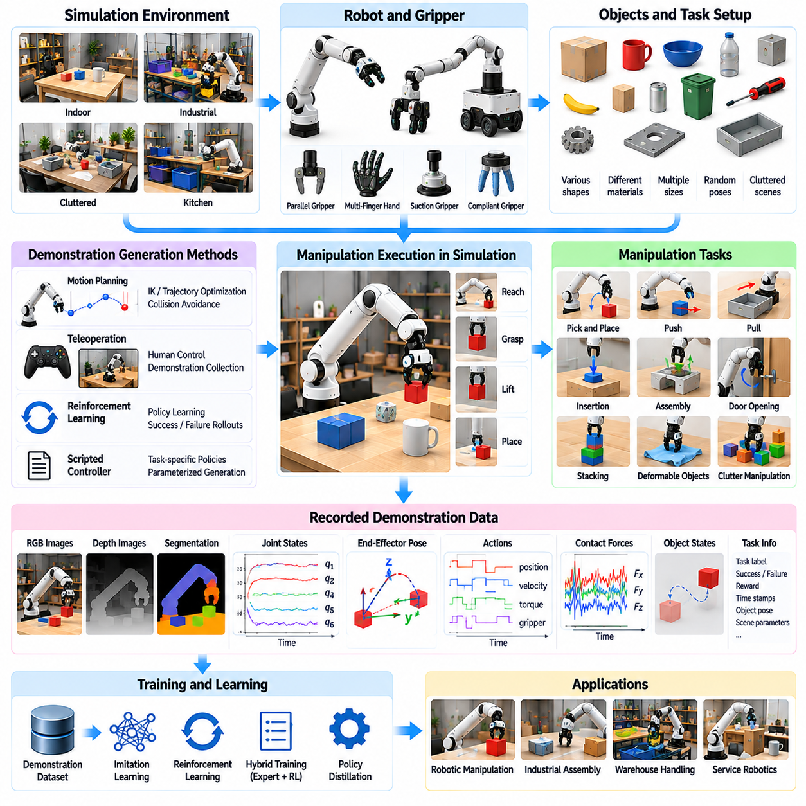{width="7.268055555555556in" height="7.268055555555556in"}

Synthetic manipulation demonstrations provide structured examples of how robots interact with objects to accomplish physical tasks. These demonstrations contain observations, actions, object states, and contact events recorded during simulated execution. For Physical AI, they support imitation learning, reinforcement learning, and policy evaluation. Simulation enables large-scale collection of manipulation experiences without the cost and risk of repeated physical experiments.

Manipulation demonstrations cover tasks such as reaching, grasping, lifting, placing, pushing, pulling, insertion, and assembly. Each task involves different geometric, kinematic, and dynamic constraints. A successful demonstration must represent not only the final task outcome but also the sequence of interactions required to achieve it. Recording intermediate states helps learning systems understand how actions influence objects and surrounding environments.

Synthetic demonstration generation begins with validated robot models, object assets, and task configurations. The simulation defines initial object poses, target states, workspace boundaries, and success conditions. Controllers or planning algorithms then execute candidate manipulation strategies. During execution, the system records robot joint states, end-effector poses, object trajectories, applied actions, and contact information.

Expert demonstrations can be generated using motion planning, inverse kinematics, trajectory optimization, and model predictive control. These methods produce structured movements that satisfy geometric and mechanical constraints. Collision avoidance and joint limits are incorporated into the planning process. However, planned motions must be tested through physics simulation because kinematic feasibility does not guarantee successful physical interaction.

Grasp generation is a central component of synthetic manipulation demonstrations. Candidate grasp poses are evaluated according to object geometry, gripper configuration, contact accessibility, and mechanical stability. Simulation can test whether the gripper establishes secure contact and maintains object control during lifting. Successful and unsuccessful grasp attempts provide valuable examples for learning grasp selection and execution policies.

Contact-rich manipulation introduces additional complexity because object motion depends on friction, compliance, force distribution, and contact transitions. Tasks such as insertion, sliding, and assembly require precise interaction with surrounding surfaces. Synthetic demonstrations should capture contact forces, joint torques, and object displacement. These signals help learning systems distinguish free-space motion from constrained physical interaction.

Robot hand and gripper characteristics strongly influence demonstration quality. Parallel grippers, multi-fingered hands, and compliant end effectors produce different contact patterns and control requirements. Finger geometry, actuator limits, and tactile sensing affect grasp stability. Synthetic datasets should preserve these hardware-specific characteristics to prevent learned policies from assuming manipulation capabilities unavailable on the target robot.

Object diversity expands the usefulness of synthetic manipulation demonstrations. Procedural asset generation can vary object dimensions, shapes, masses, surface textures, and friction properties. Objects may also appear in different orientations and cluttered arrangements. Such variation exposes learning systems to multiple interaction conditions while preserving meaningful task constraints and physically plausible object behavior.

Task parameterization enables systematic generation of manipulation demonstrations across different objectives. A pick-and-place task may vary source locations, destination regions, object categories, and required orientations. Assembly tasks may vary insertion tolerances and component configurations. Parameterized task definitions support automated scenario generation and allow demonstrations to be organized according to difficulty and required capabilities.

Teleoperation can provide another source of synthetic manipulation demonstrations. Human operators control simulated robots through input devices, motion capture, or immersive interfaces. Their actions generate trajectories reflecting practical strategies and corrective behavior. However, differences between human input devices and robotic actuation may introduce artifacts, requiring calibration, filtering, and validation before the demonstrations are used for learning.

Reinforcement learning policies can generate demonstrations through repeated interaction with simulated manipulation tasks. Policies explore different actions and gradually improve through reward-based optimization. Successful trajectories can be retained as training examples, while failed attempts reveal difficult contact conditions and ineffective strategies. Combining optimized policy rollouts with expert demonstrations increases behavioral diversity.

Imitation learning uses synthetic demonstrations to train policies that reproduce desirable manipulation behavior. Behavioral cloning maps observations to actions, while more advanced approaches model action sequences and multimodal behavior distributions. Dataset quality depends on the consistency of expert actions and coverage of relevant states. Demonstrations containing only ideal trajectories may leave policies unable to recover from unexpected deviations.

Recovery demonstrations are therefore important for robust manipulation learning. Simulation can introduce object slips, positioning errors, unexpected contacts, and partial task failures. Controllers then attempt corrective actions such as regrasping, repositioning, or adjusting applied forces. Recording these responses teaches policies how to continue tasks after disturbances rather than relying exclusively on perfectly executed manipulation sequences.

Synthetic manipulation demonstrations can combine RGB images, depth maps, segmentation labels, proprioception, tactile measurements, and force feedback. These synchronized observations provide complementary information about object appearance, spatial relationships, robot configuration, and physical contact. Multimodal datasets support policies that integrate visual reasoning with contact-aware control during complex manipulation tasks.

Temporal consistency is essential because manipulation depends on ordered sequences of actions and resulting physical changes. Demonstration records should align sensor observations, control commands, contact events, and object state transitions. Different sensor sampling rates and controller update intervals require accurate timestamps. Poor synchronization can create misleading relationships between actions and outcomes, reducing policy reliability.

Automatic ground-truth annotation is a major advantage of simulation-generated demonstrations. Object poses, joint states, contact locations, applied forces, and task completion conditions can be recorded directly from the simulation. These annotations support supervised learning, trajectory analysis, and policy evaluation. Training procedures must distinguish privileged simulation information from observations available during real-world operation.

Synthetic demonstration quality should be evaluated through task success, trajectory feasibility, contact stability, motion efficiency, and robustness to environmental variation. Successful completion alone is insufficient when demonstrations exploit unrealistic physics or excessive actuator capabilities. Validation should examine whether object interactions and robot movements remain physically plausible under representative operating conditions.

The simulation-to-reality gap remains a critical challenge for manipulation demonstrations. Differences in friction, contact stiffness, actuator dynamics, sensing, and object geometry can cause learned actions to fail on physical hardware. Domain randomization, system identification, and real-world calibration help reduce these discrepancies. Physical validation remains necessary before synthetic demonstrations can support reliable deployment.

Massive parallel simulation enables thousands of manipulation attempts to be generated across diverse task configurations. Automated pipelines can filter trajectories according to success, safety, and physical feasibility. Balanced datasets should include different objects, grasp strategies, task difficulties, and recovery behaviors. This approach reduces dependence on narrow demonstrations and improves the coverage of complex manipulation scenarios.

Synthetic manipulation demonstrations ultimately connect simulated physical interactions with data-driven robotic skill acquisition. Their effectiveness depends on realistic contact dynamics, diverse task generation, accurate multimodal recording, and systematic quality validation. When integrated with imitation learning, reinforcement learning, and real-world adaptation, these demonstrations support scalable development of robust grasping, object handling, and autonomous manipulation capabilities.

## 07.09. Synthetic Failure and Rare Event Data

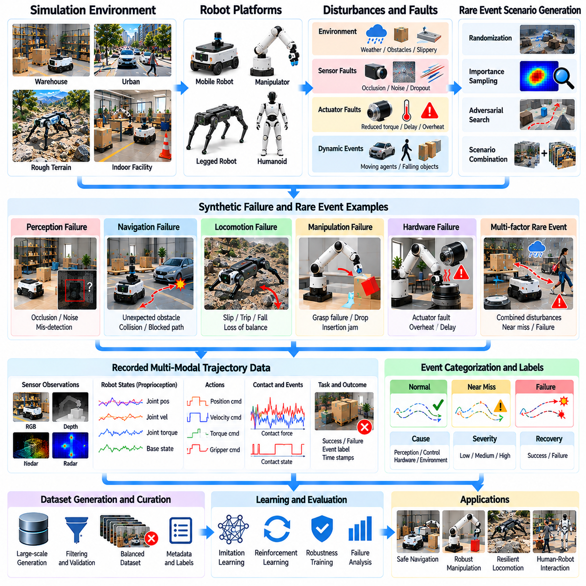{width="7.268055555555556in" height="7.268055555555556in"}

Synthetic failure and rare event data represent abnormal, hazardous, or infrequently observed situations generated within simulated robotic environments. These datasets capture how robotic systems behave when perception, planning, control, or physical interaction deviates from expected conditions. For Physical AI, they provide essential training and evaluation material for improving robustness, fault recovery, and safety under conditions difficult to reproduce experimentally.

Real-world robotic datasets often contain relatively few severe failures because dangerous situations are avoided during normal operation. Collisions, actuator faults, unstable contacts, and unexpected environmental changes may occur too rarely for effective learning. Simulation addresses this imbalance by generating controlled failure scenarios repeatedly, allowing researchers to examine their causes and consequences without exposing physical equipment or personnel to equivalent risks.

Failure events can originate from perception errors, localization uncertainty, planning mistakes, controller instability, mechanical limitations, or environmental disturbances. These causes may interact rather than occur independently. For example, inaccurate obstacle detection can trigger inappropriate navigation commands that subsequently produce a collision. Synthetic datasets should preserve such causal sequences instead of recording only the final failure outcome.

Rare event generation begins with explicit definitions of hazardous conditions, operational boundaries, and failure criteria. Simulation scenarios specify robot configurations, environmental states, task objectives, and disturbance parameters. Automated execution then identifies situations that satisfy predefined event conditions. Recording both the preceding trajectory and the resulting failure provides context for understanding how normal operation transitions into abnormal behavior.

Perception-related failures include sensor occlusion, corrupted measurements, misleading reflections, motion blur, and inaccurate object recognition. Synthetic environments can introduce these conditions while maintaining access to reference scene information. This separation enables precise evaluation of perception uncertainty and downstream decisions. Failure data becomes especially useful when it records how sensing errors propagate into planning and control.

Navigation failures may involve unexpected obstacles, localization drift, blocked routes, wheel slip, or interactions with moving agents. Simulation can reproduce near-collisions, emergency stops, and unsuccessful avoidance maneuvers. The resulting trajectories reveal how navigation policies respond when environmental assumptions become invalid. Such examples support recovery planning, uncertainty-aware navigation, and safety-oriented policy evaluation.

Locomotion failures involve loss of balance, unstable footholds, excessive body motion, and insufficient ground traction. Legged robots may experience slips, trips, falls, or actuator saturation during difficult terrain traversal. Simulated disturbances can expose weaknesses in gait control and balance recovery. Recording joint states, contact forces, and body motion enables detailed analysis of failure mechanisms and corrective responses.

Manipulation failures arise when grasp stability, object positioning, contact dynamics, or force regulation becomes inadequate. Objects may slip, rotate unexpectedly, collide with fixtures, or become jammed during insertion. Synthetic demonstrations can include failed attempts and subsequent recovery actions. These records help manipulation policies recognize deteriorating contact conditions and select corrective strategies before complete task failure.

Hardware-related failure scenarios require models of actuator degradation, sensor faults, communication interruptions, and power limitations. Simulated motors may exhibit reduced torque, increased friction, delayed responses, or thermal constraints. Sensor channels may experience bias, dropout, or intermittent corruption. Such scenarios support fault detection and fault-tolerant control, although their credibility depends on realistic hardware failure models.

Rare events frequently result from combinations of individually manageable disturbances. A mobile robot may encounter poor localization, reduced traction, and an unexpected obstacle simultaneously. Testing these interactions requires systematic variation of environmental and system parameters. Scenario generation should explore meaningful combinations while avoiding physically impossible configurations that would distort the learned relationship between causes and outcomes.

Importance sampling and targeted scenario search can improve the efficiency of rare event generation. Instead of sampling ordinary operating conditions uniformly, the simulation emphasizes regions associated with elevated failure probability. Adversarial scenario generation can search for disturbances that expose policy weaknesses. Statistical corrections are necessary when estimating real-world event probabilities from deliberately biased simulation distributions.

Failure datasets should distinguish hazardous conditions, near misses, actual failures, and successful recoveries. Labels may identify initiating disturbances, affected subsystems, event severity, and recovery outcomes. Accurate timestamps connect observations, commands, and state transitions around each event. This structure supports supervised fault classification, anomaly detection, causal analysis, and learning policies that intervene before failures become irreversible.

Safety validation requires more than generating dramatic failure examples. Simulated events must reflect plausible operating conditions, credible physical dynamics, and meaningful safety constraints. Collision severity, contact forces, stopping distances, and actuator limitations should be evaluated using appropriate models. Simulation results can reveal vulnerabilities, but they cannot independently establish real-world safety without hardware testing and supporting evidence.

Synthetic rare event data can also support curriculum learning by gradually increasing scenario difficulty. Policies may first encounter mild disturbances and then progress toward more challenging combinations of uncertainty and physical constraints. Successful recovery trajectories provide examples of resilient behavior. However, training should preserve ordinary operating performance rather than optimizing exclusively for extreme situations that seldom occur.

The practical value of synthetic failure data depends on coverage, realism, and traceability. Each generated scenario should retain its parameters, random seeds, failure definitions, and observed outcomes. Comparison with real incident records and controlled hardware tests helps calibrate event models. When integrated with real-world feedback, synthetic rare event datasets strengthen robustness evaluation, recovery learning, and evidence-based safety engineering for Physical AI.

## 07.10. Automatic 2D 3D and State Ground Truth

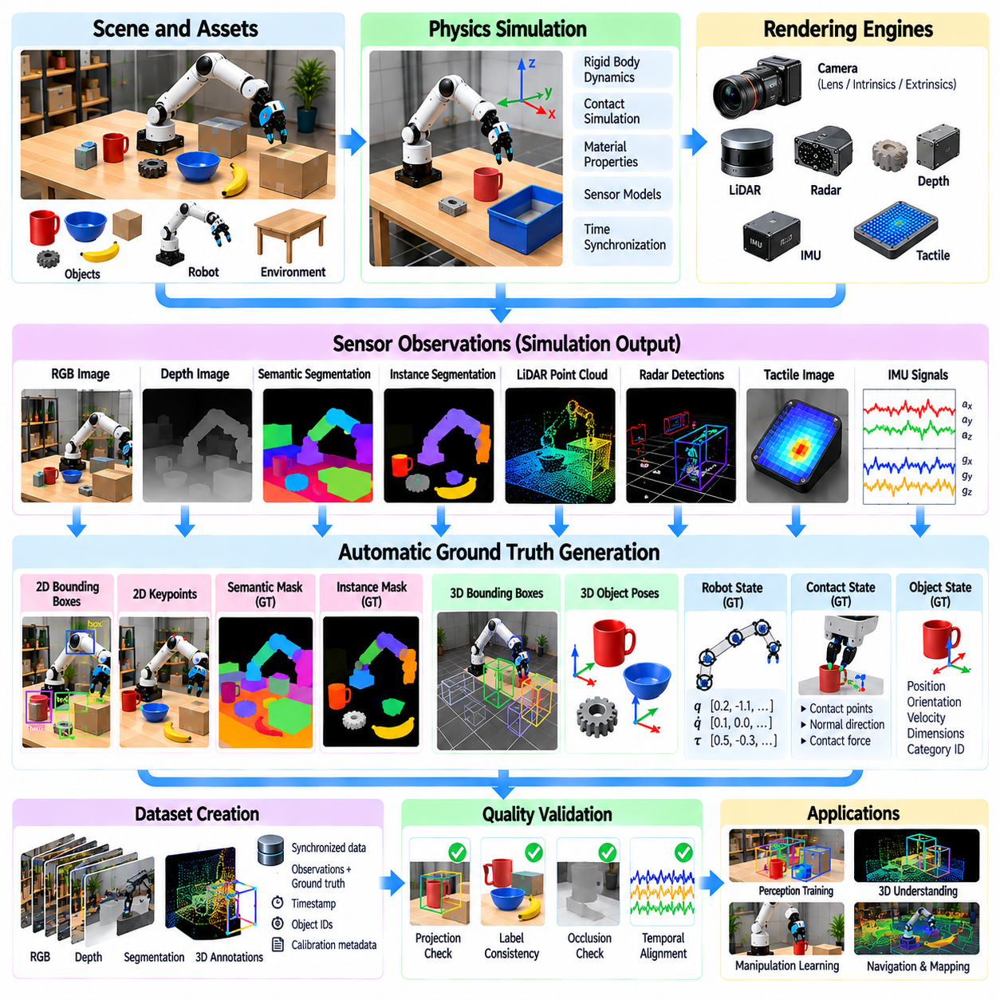{width="7.268055555555556in" height="7.268055555555556in"}

Automatic ground-truth generation is a fundamental advantage of simulation-based data production for Physical AI. Unlike real-world datasets, where annotations often require manual labeling or specialized measurement systems, simulation provides direct access to object geometry, robot states, and environmental properties. This enables consistent generation of two-dimensional, three-dimensional, and state-level labels for training and evaluating robotic perception and control systems.

Two-dimensional ground truth describes information projected onto image coordinates. Common annotations include object bounding boxes, semantic segmentation masks, instance segmentation masks, and keypoint locations. These labels can be derived from rendered scenes using object identities and camera parameters. Automatic annotation eliminates much of the repetitive labeling effort associated with large-scale visual datasets while maintaining consistent object definitions.

Semantic segmentation assigns a category label to each visible image pixel, while instance segmentation distinguishes individual objects belonging to the same category. Simulation engines generate these labels using scene identifiers and rendering passes. Accurate annotations require consistent category taxonomies and careful treatment of occlusion. Transparent materials, reflections, and partially visible objects may require specialized annotation rules.

Two-dimensional bounding boxes can be generated by projecting visible object regions or three-dimensional geometry into camera images. Visible-region boxes describe the observed image extent, whereas projected geometry may include portions hidden by obstacles. These definitions should not be confused. Dataset specifications must clearly identify annotation conventions so that detection models receive consistent training targets.

Three-dimensional ground truth represents objects and spatial relationships in world or sensor coordinate systems. Typical annotations include 3D bounding boxes, object poses, dimensions, surface geometry, and point-level semantic labels. Simulation provides these values directly from scene descriptions and rigid-body states. Such information supports robotic localization, object detection, spatial reasoning, and manipulation planning.

Object pose annotations usually contain three-dimensional position and orientation relative to a defined reference frame. Orientation may be represented through rotation matrices, quaternions, or Euler angles. Each representation has specific numerical and geometric properties. Reliable datasets must define coordinate conventions, transformation directions, units, and quaternion ordering to prevent inconsistencies between simulation and learning pipelines.

Robot state ground truth includes joint positions, joint velocities, body poses, actuator states, and contact conditions. These quantities are obtained from articulated-body simulation and controller execution. Additional labels may describe joint torques, applied forces, and dynamic constraints. Recording these states alongside sensor observations enables learning systems to associate external perception with internal robot dynamics and physical behavior.

Contact ground truth is particularly important for manipulation and locomotion tasks. Simulation can identify contacting bodies, approximate contact locations, normal directions, and forces computed by the contact solver. These labels support grasp analysis, gait evaluation, and contact-aware control. However, simulated contact impulses and forces depend on solver formulations and numerical settings, requiring careful interpretation.

Temporal ground truth describes how objects, robots, and environmental states evolve across simulation steps. Object trajectories, velocities, accelerations, and contact transitions can be recorded with synchronized timestamps. Such annotations support motion prediction, tracking, and sequential decision-making. Temporal consistency requires clear distinctions between physics integration intervals, sensor exposure times, and controller update periods.

Camera calibration metadata is essential for converting between two-dimensional and three-dimensional annotations. Intrinsic parameters describe focal length, principal point, and image geometry, while extrinsic parameters define camera position and orientation. Lens distortion and projection models must also be documented. Incorrect calibration can produce systematic errors even when underlying simulation geometry is accurate.

Automatic annotation pipelines typically connect scene generation, physics simulation, sensor rendering, and metadata extraction. Each simulation frame produces observations and corresponding labels from a shared scene state. Annotation records should retain object identifiers, reference frames, timestamps, and sensor configurations. This integrated approach reduces synchronization errors and supports reproducible generation of large synthetic datasets.

Ground-truth quality depends on more than direct access to simulation variables. Annotation errors can arise from inconsistent asset origins, incorrect coordinate transformations, mesh inaccuracies, or mismatched rendering and physics states. Automated validation should check geometric projections, object visibility, label completeness, and temporal alignment. These checks prevent systematic labeling errors from contaminating model training.

Occlusion and visibility require explicit treatment in synthetic annotation systems. An object may exist in the simulated scene while remaining partially or completely hidden from a particular sensor. Visibility-aware labels distinguish observable regions from complete object geometry. This distinction is important because training models with inaccessible information can create unrealistic assumptions about perception capabilities.

State-level annotations can include task progress, success conditions, failure events, and interaction relationships. Examples include whether an object is grasped, a robot has reached a target, or an assembly component is correctly inserted. These labels are derived from measurable simulation states and predefined task criteria. Their reliability depends on precise definitions rather than subjective interpretations of visual appearance.

Privileged ground truth must be separated from observations available to deployed robots. Simulation may expose exact object poses, contact forces, and environmental parameters that physical sensors cannot directly measure. These values are useful for supervision, reward computation, and evaluation, but unrestricted policy access may prevent successful transfer. Training architectures should explicitly control which information is available during inference.

Automatic ground-truth generation ultimately connects synthetic environments with scalable supervised learning and reliable evaluation. Its effectiveness depends on consistent annotation definitions, accurate coordinate transformations, synchronized state recording, and systematic quality checks. When combined with realistic sensor simulation and real-world validation, it provides a foundation for robust perception, spatial understanding, and embodied decision-making in Physical AI.

## 07.11. Vision Language Action Data Generation

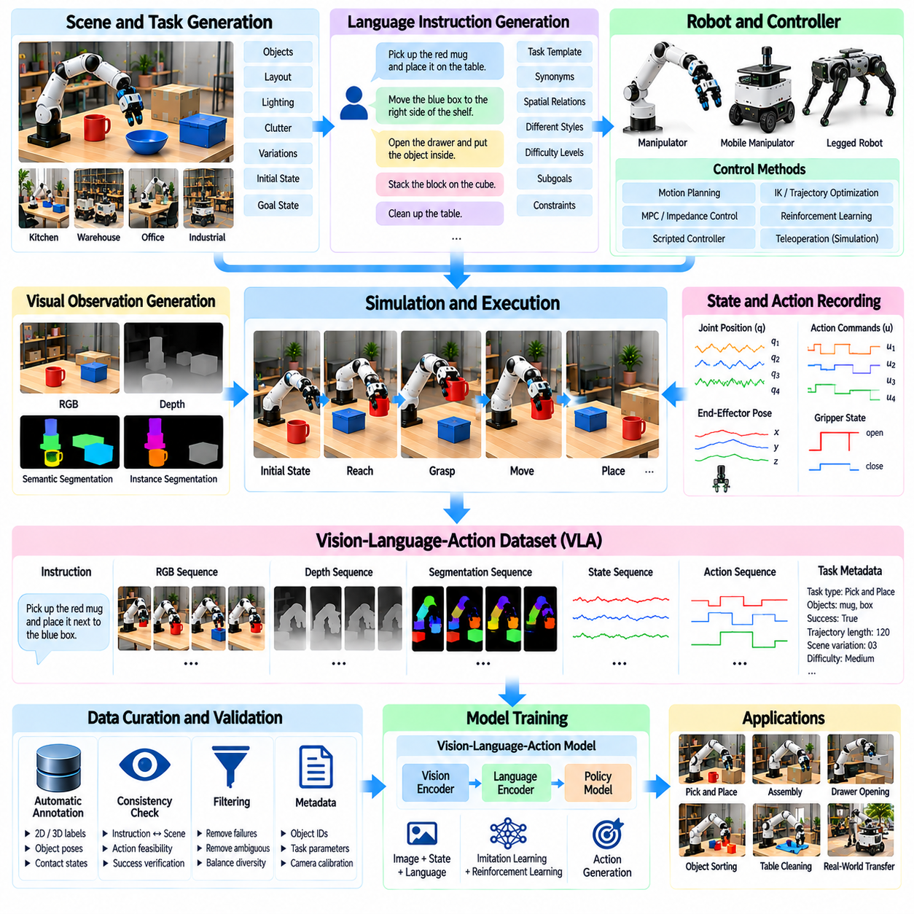{width="7.268055555555556in" height="7.268055555555556in"}

Vision-Language-Action data generation connects visual observations, natural-language instructions, and executable robot actions within a unified learning framework. For Physical AI, these datasets enable robots to interpret human intentions and translate them into physical behavior. Simulation provides controlled environments where scenes, instructions, and action trajectories can be generated together, supporting scalable development of general-purpose robotic policies.

A Vision-Language-Action dataset typically combines camera images, depth observations, language commands, robot states, and action sequences. Visual information describes the environment, while language specifies goals, constraints, or task preferences. Action data records how the robot responds over time. Accurate alignment among these components is essential because successful learning depends on connecting instructions with relevant observations and physical outcomes.

Synthetic VLA data generation begins with structured scene descriptions and parameterized robotic tasks. A simulation environment defines objects, spatial relationships, robot configurations, and task objectives. Language instructions are generated from these specifications, while planners or control policies execute corresponding actions. The resulting trajectories associate each instruction with observable conditions, executed behavior, and measurable task outcomes.

Language grounding is a central challenge in VLA dataset construction. Instructions such as placing an object beside another object require understanding object identity, spatial relationships, and intended actions. Simulation can provide exact scene metadata to generate grounded descriptions. However, language generation must preserve the meaning of task specifications and avoid references to objects or properties that the robot cannot reasonably observe.

Instruction diversity improves the ability of VLA models to interpret different expressions of the same task. A single manipulation objective may be described through direct commands, conversational requests, or spatial descriptions. Synthetic generation can vary vocabulary, sentence structure, and linguistic complexity. These variations should remain semantically equivalent to the underlying task rather than introducing contradictory or physically impossible instructions.

Visual diversity is equally important because robotic tasks occur under changing environmental conditions. Synthetic scenes can vary lighting, camera viewpoints, object textures, clutter, and background geometry. These variations help prevent VLA policies from associating instructions with narrow visual patterns. Scene generation should preserve object identities and task relationships so that visual randomization does not unintentionally alter the intended instruction.

Action trajectories provide the physical component of VLA training data. Demonstrations may contain end-effector poses, joint commands, gripper states, or higher-level action representations. Their interpretation depends on robot morphology and controller interfaces. Each trajectory should include consistent timestamps and coordinate frames, allowing learning systems to associate language-conditioned decisions with executable movements.

Expert demonstrations can be generated through motion planning, inverse kinematics, trajectory optimization, and scripted task controllers. These approaches produce action sequences for tasks such as grasping, placing, opening, and assembly. Physics simulation verifies whether planned actions achieve the intended outcomes. Failed executions should not automatically receive successful instruction labels, since this would introduce misleading supervision.

Complex tasks often require hierarchical language and action representations. A command such as organizing a workspace may involve identifying objects, selecting destinations, grasping items, and verifying completion. Synthetic datasets can represent these operations through task-level instructions and intermediate subgoals. Hierarchical annotations support models that connect high-level semantic reasoning with lower-level robotic control.

Multimodal synchronization is necessary for reliable VLA training. Camera frames, language instructions, proprioceptive measurements, and action commands may operate at different temporal resolutions. Dataset pipelines must preserve the relationships between observations and subsequent actions. Incorrect alignment can cause policies to associate commands with irrelevant images or learn actions that respond to outdated environmental states.

Automatic annotation can enrich synthetic VLA datasets with object identities, segmentation masks, spatial relations, contact states, and task success labels. These annotations support auxiliary perception objectives and structured policy evaluation. Simulation also provides privileged information that may be unavailable during deployment. Training procedures must distinguish supervisory metadata from observations accessible to the physical robot.

Data quality depends on consistency between language, visual evidence, and physical execution. A demonstration may contain grammatically correct instructions but still be invalid if the referenced object is absent or the commanded action fails. Automated validation should verify instruction grounding, trajectory feasibility, and task completion. Human review of representative samples can identify linguistic ambiguity and systematic generation errors.

The simulation-to-reality gap affects VLA models through differences in visual appearance, object dynamics, sensing, and actuator behavior. Policies trained exclusively on synthetic examples may struggle with unfamiliar objects or natural human expressions. Combining synthetic demonstrations with real robot data and carefully designed domain adaptation improves transfer. Physical evaluation remains necessary to establish reliable language-conditioned manipulation.

A scalable VLA data generation pipeline integrates procedural scene creation, instruction generation, expert policy execution, multimodal recording, and automated quality filtering. Dataset metadata should preserve task definitions, robot configurations, language variants, and success outcomes. Feedback from model evaluation can guide additional generation toward poorly represented tasks, visual conditions, and instruction patterns.

Synthetic Vision-Language-Action data ultimately connects semantic understanding with physically grounded robotic behavior. Its effectiveness depends on accurate language grounding, diverse visual environments, feasible action demonstrations, and consistent multimodal annotations. When integrated with real-world demonstrations and systematic validation, it supports transferable robotic skills, flexible task execution, and more general-purpose Physical AI systems.

## 07.12. Generative AI and Diffusion for Synthetic Data

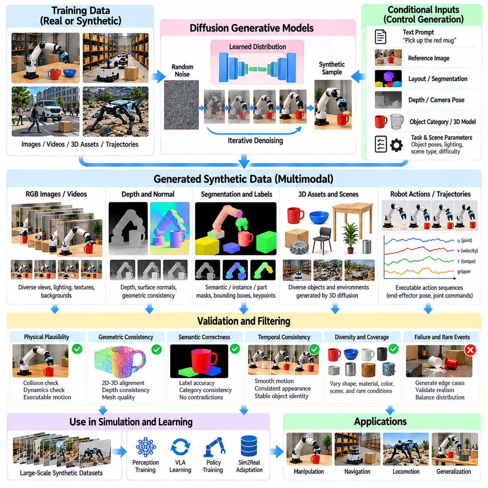{width="7.268055555555556in" height="7.268055555555556in"}

Generative AI expands synthetic data generation by learning statistical patterns from existing observations and producing new samples under specified conditions. For Physical AI, these methods can generate images, object appearances, environmental variations, and robot action trajectories. Unlike conventional simulation, generative models learn distributions from data, allowing synthetic datasets to capture variability that is difficult to describe through manually designed rules.

Diffusion models are a major class of generative methods used for synthetic data production. They learn to reverse a progressive noise process, transforming random noise into structured samples. During training, models estimate how corrupted data can be restored at different noise levels. During generation, iterative denoising produces new observations or trajectories. This approach supports flexible sampling from complex, multimodal data distributions.

Image diffusion models can generate visual variations of robotic environments, including lighting conditions, surface textures, object appearances, and background configurations. Text prompts, reference images, segmentation masks, or depth maps can guide generation toward desired scenarios. These capabilities support perception training and visual domain adaptation. However, generated images must preserve relevant geometry and task relationships when used as labeled training data.

Conditional generation is particularly valuable because robotic learning requires data associated with specific physical states and task objectives. Generative models may be conditioned on camera poses, object categories, scene layouts, robot configurations, or language instructions. Conditioning helps control the content of generated samples. Its effectiveness depends on whether the model follows constraints consistently rather than merely producing visually plausible outputs.

Diffusion-based video generation extends synthetic data production from individual images to temporally connected observations. Video models can represent changes in object appearance, camera viewpoint, and scene motion over time. These sequences may support visual tracking, motion understanding, and predictive learning. Nevertheless, temporal consistency does not guarantee physically valid motion, especially when contact forces or articulated robot dynamics are involved.

Generative models can also produce three-dimensional assets for simulation environments. Techniques based on diffusion, implicit representations, and learned shape distributions can generate object geometry and appearance. Generated assets may increase diversity in manipulation and navigation tasks. Before physics simulation, however, meshes require checks for scale, topology, collision geometry, mass properties, and mechanical plausibility.

Synthetic scene generation can combine procedural simulation with generative AI to produce varied environments. Procedural methods define structural constraints, while generative models contribute appearance, object arrangements, and contextual details. This hybrid approach balances controllability with diversity. Scene validity must still be checked against navigation accessibility, collision constraints, and task-specific requirements.

Diffusion policies apply generative modeling to robot action sequences rather than visual observations. These policies learn distributions over actions conditioned on sensory inputs, robot states, and task goals. Iterative denoising produces candidate action trajectories that can represent multiple valid manipulation strategies. Such models are useful when tasks admit different solutions, although generated actions must remain compatible with robot dynamics.

Trajectory generation can be conditioned on initial states, target configurations, environmental constraints, and previously observed behavior. Generative models may propose diverse movement sequences for manipulation, locomotion, or navigation. Physics simulation then evaluates whether these trajectories are executable. This separation between learned trajectory proposals and physical validation prevents statistical plausibility from being mistaken for dynamic feasibility.

Generative AI can improve coverage of uncommon scenarios by synthesizing unusual object arrangements, visual disturbances, or difficult task configurations. Targeted generation helps expose learning systems to conditions underrepresented in collected datasets. However, rare-event generation must distinguish realistic low-probability situations from impossible combinations. Physical constraints and scenario validation remain necessary for meaningful robustness training.

Multimodal generative models can connect language, images, depth observations, and robot actions within shared conditional representations. A language instruction may guide scene generation while the corresponding task specification determines required robot behavior. Such datasets can support Vision-Language-Action learning. Consistency between linguistic descriptions, visual evidence, and executed actions is essential for reliable supervision.

Synthetic data quality cannot be evaluated solely through visual realism or generative model likelihood. Generated samples must satisfy geometric consistency, physical plausibility, semantic correctness, and task relevance. Evaluation may include reconstruction accuracy, diversity measurements, simulation feasibility, and downstream policy performance. Human inspection and automated validation provide complementary methods for identifying generation errors.

Bias and distribution mismatch remain significant challenges in generative synthetic data. Models trained on limited datasets may reproduce existing sampling biases or generate unrealistic combinations outside their training distributions. Excessive reliance on generated examples can amplify these limitations. Balanced mixing with real observations, diversity controls, and targeted evaluation help maintain representative training distributions.

A practical generative synthetic data pipeline integrates source data preparation, model training, conditional sampling, simulation validation, annotation, and quality filtering. Generated images and assets are checked for consistency with scene metadata, while action trajectories are tested through physical execution in simulation. Versioned datasets retain generation parameters and validation results, enabling reproducibility and systematic improvement.

Generative AI and diffusion models complement rather than replace physics-based simulation in Physical AI development. Generative methods provide flexible variation and learned behavioral patterns, while simulation supplies explicit dynamics, contact constraints, and measurable outcomes. Combining both approaches with real-world validation enables more diverse and useful synthetic datasets, supporting robust perception, adaptive control, and scalable robotic learning.

## 07.13. Synthetic Data Quality and Bias

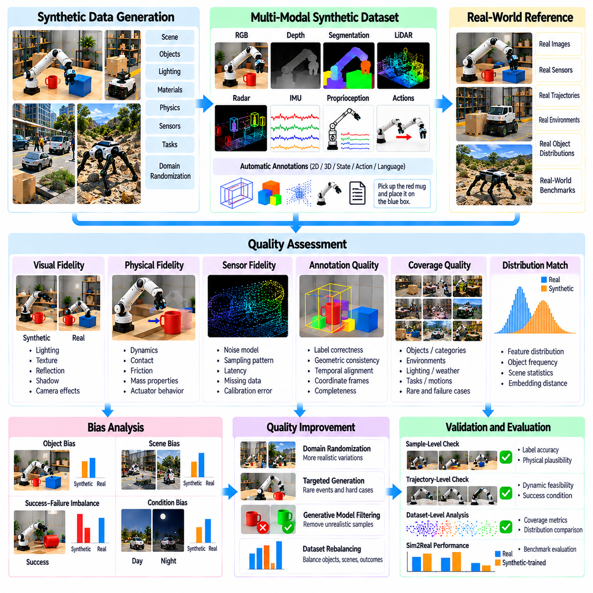{width="7.268055555555556in" height="7.268055555555556in"}

Synthetic data quality determines whether artificially generated observations improve robotic learning or introduce misleading patterns. In Physical AI, high-quality synthetic data must represent relevant visual conditions, physical interactions, sensor behavior, and task outcomes. Large dataset volume alone does not guarantee useful supervision. Quality assessment must consider how faithfully generated samples support perception, decision-making, and control in real environments.

Synthetic data bias arises when generated samples systematically overrepresent certain conditions while neglecting others. Common examples include excessive use of clean backgrounds, ideal lighting, regular object arrangements, and predictable robot trajectories. Models trained on these distributions may perform well in simulation but fail under realistic disturbances. Identifying bias requires comparing synthetic coverage with operational conditions and expected deployment scenarios.

Visual fidelity is an important dimension of synthetic data quality, particularly for camera-based perception systems. Differences in illumination, reflections, textures, shadows, and optical distortion can influence learned features. Photorealistic rendering reduces some appearance discrepancies but cannot guarantee better task performance. Evaluation should determine whether visual differences affect the specific perception capabilities required by the robot.

Physical fidelity concerns the accuracy of simulated motion, forces, contacts, and material interactions. Incorrect friction coefficients, collision geometry, actuator dynamics, or mass distributions can generate unrealistic trajectories. Such errors are particularly harmful for manipulation and locomotion learning. Physical validation should compare simulated behavior with measured robot responses and representative real-world interaction experiments.

Sensor fidelity describes how accurately synthetic observations reproduce real sensing characteristics. Camera noise, LiDAR sampling patterns, radar reflections, IMU drift, and measurement latency can influence robotic perception. Idealized sensors may produce overly clean training signals that are unavailable during deployment. Realistic sensor models should represent relevant noise distributions, calibration errors, missing measurements, and temporal effects.

Annotation quality is another essential requirement because synthetic datasets often provide automatically generated ground truth. Incorrect coordinate transformations, inconsistent object identifiers, or mismatched timestamps can corrupt otherwise realistic samples. Automated checks should verify label completeness, geometric consistency, and temporal alignment. Reliable annotation pipelines must preserve traceability between simulation states, rendered observations, and generated labels.

Coverage quality measures whether synthetic datasets include sufficient variation across important operating conditions. Relevant dimensions may include object categories, environmental layouts, lighting, motion patterns, and failure scenarios. Coverage should be evaluated against a defined operational design domain rather than arbitrary diversity targets. Rare but safety-relevant conditions deserve deliberate representation even when their natural occurrence is limited.

Statistical distribution mismatch occurs when synthetic data differs systematically from real-world observations. Differences may involve feature distributions, object frequencies, spatial relationships, or task difficulty. Distribution comparison can use embedding distances, class statistics, and scenario-level coverage measurements. However, numerical similarity alone cannot establish transferability, making downstream robotic performance an essential evaluation criterion.

Generative models introduce additional bias because they inherit limitations from their training datasets and sampling procedures. Diffusion models may reproduce dominant visual patterns while underrepresenting unusual objects or difficult interactions. Generated samples can also contain physically inconsistent geometry or implausible motion. Quality filtering must therefore combine statistical analysis with geometric checks, physical simulation, and task-specific validation.

Dataset imbalance can affect both perception and action learning. Frequently occurring objects, successful trajectories, and simple tasks may dominate synthetic collections, while failures and complex interactions remain scarce. This imbalance can produce policies that behave confidently in familiar situations but struggle with unexpected events. Targeted sampling and scenario weighting can improve representation without sacrificing realistic operational distributions.

Diversity and realism must be balanced carefully. Excessive randomization may generate scenes that are visually varied but physically impossible or operationally irrelevant. Insufficient randomization may produce narrow datasets that encourage overfitting to simulation artifacts. Effective generation strategies constrain variation through valid geometry, plausible material properties, and meaningful task configurations while preserving sufficient environmental diversity.

Synthetic data validation should operate at multiple levels, including individual samples, complete trajectories, and overall dataset distributions. Sample-level checks identify annotation errors and invalid geometry, while trajectory-level tests examine dynamics and task success. Dataset-level analysis reveals coverage gaps and systematic bias. These complementary evaluations help prevent locally plausible samples from producing globally unrepresentative training collections.

Real-world benchmark datasets provide an important reference for assessing synthetic data usefulness. Models trained on synthetic observations should be evaluated using held-out real environments, unseen objects, and realistic disturbances. Performance metrics may include detection accuracy, localization error, task completion rate, and collision frequency. Evaluation protocols must avoid leakage between training scenarios and validation conditions to preserve meaningful comparisons.

A continuous quality improvement process connects synthetic generation with model evaluation and real-world feedback. Failure analysis identifies poorly represented conditions, which guide targeted scene generation and dataset refinement. Versioned datasets should record generation parameters, validation results, and distribution changes. This closed-loop approach enables systematic reduction of bias while maintaining reproducibility across successive training iterations.

Synthetic data quality and bias management are ultimately engineering requirements rather than isolated dataset preparation tasks. Reliable Physical AI development requires coordinated control of rendering accuracy, physical realism, sensor modeling, annotation integrity, and scenario coverage. Combining automated validation with real-world testing establishes whether synthetic data improves practical robotic performance and supports robust simulation-to-reality transfer.

## 07.14. Real Synthetic Data Mixing Strategies

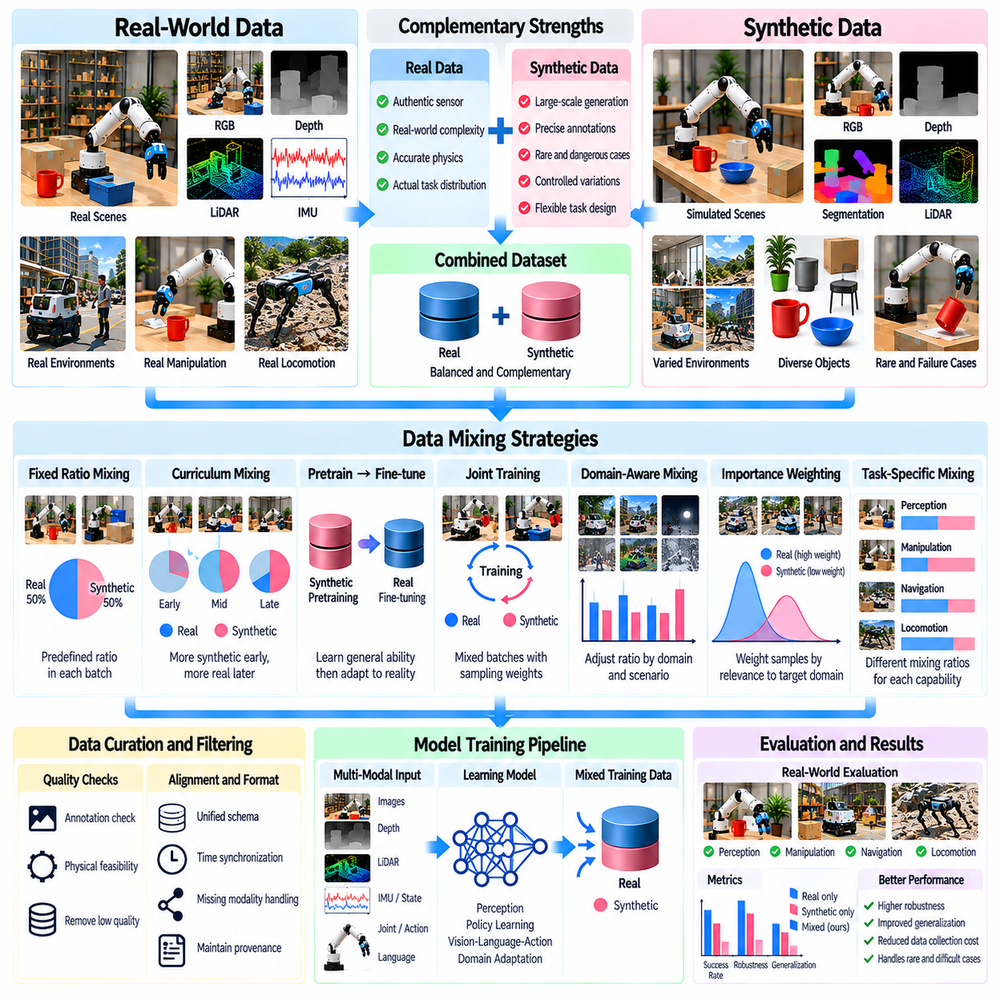{width="7.268055555555556in" height="7.268055555555556in"}

Real and synthetic data mixing is a fundamental strategy for improving the generalization of Physical AI systems. Real-world observations capture authentic sensor characteristics, environmental complexity, and physical interactions, while synthetic data provides scalable variation and precise annotations. Combining both sources can reduce dependence on expensive data collection. Effective mixing requires deliberate control of data proportions, distribution coverage, and training objectives.

The central challenge is balancing realism with diversity. Real datasets often represent actual operating conditions but may contain limited examples of rare events, unusual objects, or dangerous situations. Synthetic datasets can expand these conditions through simulation and controlled randomization. However, excessive synthetic data may introduce unrealistic patterns. Mixing strategies must preserve real-world relevance while exploiting the broader coverage available from simulation.

A fixed-ratio mixing strategy combines real and synthetic samples using predefined proportions throughout training. For example, each training batch may contain a controlled number of samples from both sources. This approach is simple to implement and supports reproducible experiments. Nevertheless, a fixed ratio may not remain optimal as model capabilities improve or task difficulty changes, making systematic ratio evaluation necessary.

Curriculum-based mixing adjusts the contribution of real and synthetic data during different training stages. Early training may emphasize large synthetic datasets to establish basic perception and control capabilities. Later stages progressively increase real-world examples to improve adaptation to deployment conditions. This approach supports efficient pretraining followed by targeted refinement, although the optimal schedule depends on task complexity and domain mismatch.

Synthetic pretraining followed by real-world fine-tuning is widely applicable to robotic learning. Models first learn general visual features, spatial relationships, or action patterns from simulated experiences. A smaller real dataset then adjusts the learned representations to actual sensor characteristics and robot dynamics. Fine-tuning should preserve useful general capabilities while correcting simulation-specific errors and reducing overfitting to limited real examples.

Joint training combines real and synthetic samples within a shared optimization process. Both data sources contribute to model updates, potentially improving representation learning and robustness. Sampling probabilities, loss weights, and batch composition determine their relative influence. Without appropriate balancing, abundant synthetic examples may dominate optimization and weaken the contribution of valuable real-world observations.

Domain-aware mixing explicitly accounts for differences between synthetic and real distributions. Samples may be grouped according to lighting, object categories, environmental layouts, sensor conditions, or task difficulty. Training then adjusts sampling to improve coverage of underrepresented operational scenarios. Domain labels and distribution statistics help identify whether synthetic data fills meaningful gaps rather than merely increasing dataset volume.

Importance weighting provides a statistical approach for adjusting the influence of individual training samples. Examples resembling relevant deployment conditions may receive greater weight, while less representative synthetic samples receive reduced emphasis. Weight estimation can use domain classifiers, feature similarity, or scenario metadata. However, inaccurate weights and extreme distribution differences can increase training variance or reinforce existing bias.

Task-specific mixing recognizes that different robotic capabilities require different combinations of data. Visual perception may benefit from extensive synthetic rendering, while contact-rich manipulation often requires carefully measured real interactions. Navigation systems may use simulation for rare obstacles and real trajectories for sensor calibration. Mixing policies should therefore reflect the physical sensitivity, observation requirements, and operational risks of each task.

Failure-oriented mixing introduces synthetic examples specifically targeting weaknesses observed during real-world evaluation. If a robot struggles with reflective objects, occluded obstacles, or unstable grasps, simulation can generate additional variations of those conditions. These targeted samples complement rather than replace representative real data. Validation must confirm that generated failures remain physically plausible and relevant to actual deployment.

Data quality filtering is essential before combining sources. Synthetic samples should be checked for annotation accuracy, physical feasibility, and consistency with task specifications. Real observations require sensor calibration checks, timestamp alignment, and reliable labels. Mixing low-quality samples from either domain can introduce contradictory supervision. Dataset provenance should remain available so that errors can be traced to their original source.

Multimodal mixing introduces additional challenges because robotic datasets may contain images, depth maps, LiDAR measurements, proprioception, language instructions, and action trajectories. Real and synthetic sources may differ in sampling rates, coordinate conventions, sensor availability, and annotation formats. Unified schemas and synchronization procedures are required. Missing modalities should be handled explicitly rather than replaced with misleading artificial measurements.

Evaluation of mixing strategies must rely on held-out real-world performance rather than synthetic validation alone. Controlled experiments should compare training ratios, curriculum schedules, and fine-tuning methods using consistent model architectures. Relevant metrics include perception accuracy, task success rate, collision frequency, and robustness under environmental variation. Separate tests on unseen conditions reveal whether improvements represent genuine transfer.

A practical mixing pipeline maintains versioned real and synthetic datasets with documented origins, sampling policies, and quality indicators. Training configurations record source proportions, weighting rules, augmentation settings, and optimization schedules. Evaluation results guide subsequent changes to the data mixture. This traceability supports reproducible comparisons and prevents accidental contamination of validation sets with related synthetic scenes.

Real and synthetic data mixing should ultimately operate as a continuous learning process. Real-world deployment identifies limitations, simulation generates targeted complementary examples, and updated models undergo controlled evaluation before redeployment. The objective is not to maximize the percentage of either source but to improve reliable robotic behavior. Well-designed mixing strategies reduce data collection costs while strengthening generalization and simulation-to-reality transfer.

## 07.15. Synthetic Data Generation Pipeline [w/Code]

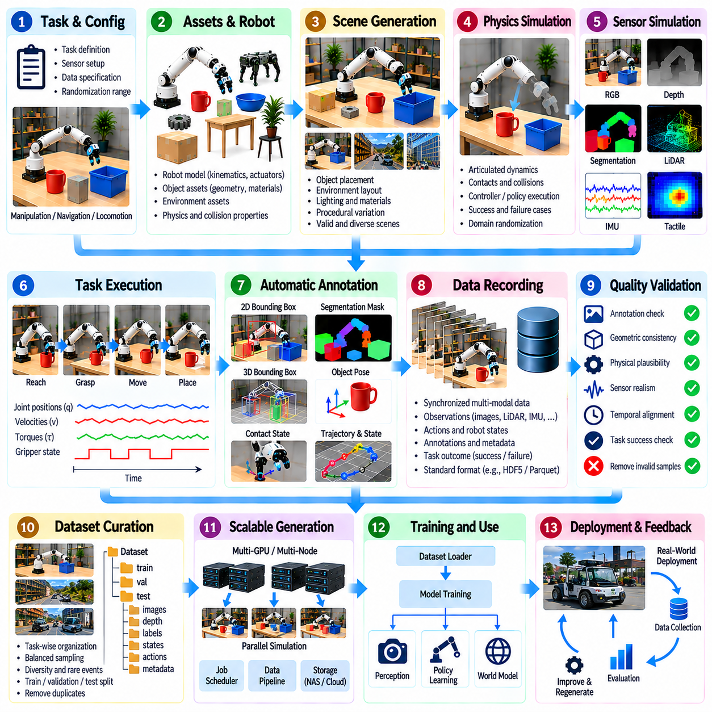{width="7.268055555555556in" height="7.268055555555556in"}

A synthetic data generation pipeline is an integrated workflow that transforms virtual environments, robot models, and task specifications into structured datasets for Physical AI training. It connects procedural scene creation, physics simulation, sensor rendering, automatic annotation, and quality validation. Unlike isolated rendering operations, a complete pipeline preserves consistency between observations, physical states, actions, and task outcomes across large-scale experiments.

Pipeline design begins by defining the target learning objectives and operational conditions. Perception tasks require labeled sensor observations, while manipulation and navigation tasks also require robot states, action trajectories, and success indicators. Dataset specifications should establish sensor modalities, annotation formats, coordinate conventions, and sampling frequencies. These decisions determine which simulation components must be implemented and validated.

Asset preparation provides the geometric and physical foundation of synthetic environments. Robot descriptions include joint structures, actuator constraints, collision models, and sensor mounting configurations. Environmental assets contain object meshes, material properties, semantic categories, and interaction parameters. Consistent asset metadata is essential because incorrect dimensions, mass distributions, or coordinate origins can propagate errors throughout the generated dataset.

Procedural scene generation assembles assets into diverse but physically meaningful environments. Scene parameters may control object positions, lighting, surface materials, obstacles, and task configurations. Random sampling expands environmental coverage, while geometric constraints prevent invalid intersections or unreachable objectives. Reproducible random seeds and scene identifiers allow individual configurations to be reconstructed for debugging and evaluation.

Physics simulation determines how robots and surrounding objects evolve under applied actions and environmental forces. The simulation engine calculates articulated motion, collisions, contacts, and dynamic responses. Controller interfaces execute navigation, manipulation, or locomotion policies. Simulation parameters must be calibrated against representative physical measurements because unrealistic friction, inertia, or actuator behavior can reduce the transferability of generated trajectories.

Sensor simulation converts virtual world states into observations resembling those produced by physical devices. Rendering pipelines generate RGB images, depth maps, segmentation outputs, and optical flow, while specialized models simulate LiDAR, radar, IMU, and tactile measurements. Sensor noise, latency, sampling patterns, and calibration errors should reflect deployment conditions. Accurate timestamps connect sensor outputs with corresponding physics states.

Task execution generates behavioral data by running scripted controllers, planning algorithms, expert demonstrations, or learned policies. Each episode begins with defined initial conditions and terminates according to task completion, failure, or time limits. Recorded trajectories may include joint commands, end-effector poses, contact events, and reward signals. Both successful and unsuccessful executions provide useful information when their outcomes are labeled correctly.

Automatic ground-truth extraction converts simulation metadata into training annotations without requiring manual labeling. Object identifiers, 2D and 3D bounding boxes, segmentation masks, poses, velocities, and contact states can be derived from synchronized simulation records. Annotation systems must distinguish visible observations from privileged simulator states. Consistent reference frames and label definitions are necessary for reliable downstream learning.

Data recording combines multimodal observations, robot actions, state information, and annotations into synchronized episode records. Each record should preserve simulation time, sensor timestamps, task identifiers, scene parameters, and robot configurations. Storage formats must support efficient sequential reading and selective retrieval. Metadata should also identify simulator versions, asset revisions, and randomization settings to ensure reproducibility.

Quality validation operates before generated samples enter the training dataset. Automated checks identify missing labels, invalid geometry, inconsistent timestamps, unrealistic dynamics, and failed sensor rendering. Task-specific validators examine collision constraints, trajectory feasibility, and success conditions. Invalid samples may be rejected or retained as explicitly labeled failure cases, depending on their relevance to the intended learning objective.

Dataset curation organizes validated samples according to task categories, environmental conditions, robot behaviors, and failure types. Sampling policies control class balance, scenario diversity, and representation of rare events. Duplicate or nearly identical episodes should be identified to avoid unnecessary redundancy. Training, validation, and test partitions must prevent leakage through shared scenes, asset configurations, or closely related trajectories.

Scalable generation distributes simulation workloads across multiple CPU and GPU resources. Independent environments can execute parallel episodes while rendering and annotation processes operate asynchronously when synchronization requirements permit. Resource scheduling must consider physics complexity, sensor resolution, and storage throughput. Performance metrics should include valid samples per hour, computational cost, and dataset quality rather than raw simulation speed alone.

Generated datasets are integrated into model training through standardized loaders and transformation pipelines. Perception models consume labeled sensor observations, while control policies use state-action trajectories and task outcomes. Synthetic samples may be combined with real-world data using controlled ratios or curriculum schedules. Evaluation on held-out real observations determines whether additional synthetic data improves generalization rather than reinforcing simulation-specific patterns.

A closed-loop data engine connects training results with subsequent simulation generation. Model failures reveal weaknesses involving particular objects, environmental conditions, or interaction dynamics. These findings guide targeted scenario generation and revised sampling policies. Dataset versions, model checkpoints, and evaluation results should remain traceable, enabling engineers to identify which synthetic data changes produce measurable improvements in robotic performance.

A reliable synthetic data generation pipeline ultimately functions as an engineering system rather than a collection of rendering scripts. Its success depends on accurate asset models, calibrated physics, realistic sensors, synchronized annotations, reproducible execution, and systematic validation. When integrated with real-world feedback and continuous model evaluation, the pipeline supports scalable data production and robust simulation-to-reality transfer for Physical AI systems.
