**Volume 05. Simulation and Sim2Real Transfer**

# Chapter 08. Sim2Real Gap Analysis

## 08.01. Defining the Sim2Real Gap

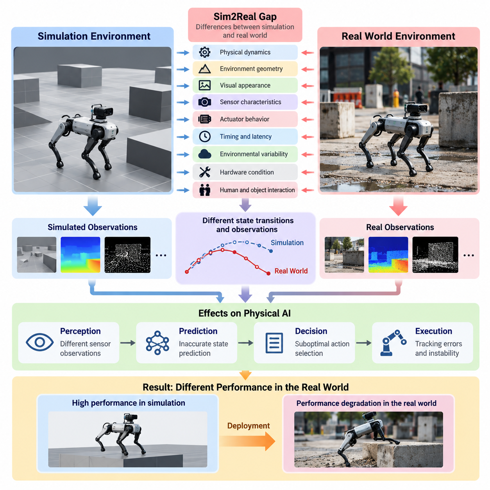{width="7.268055555555556in" height="7.268055555555556in"}

시뮬레이션과 현실 간 격차(Sim-to-Real Gap, Sim2Real Gap)는 시뮬레이션 환경(Simulated Environment)과 물리적 현실(Physical Reality) 사이에 존재하는 차이로 인해 인공지능 모델(Artificial Intelligence Model)이나 로봇 제어 정책(Robotic Control Policy)이 실제 배포 이후 서로 다른 동작을 보이는 현상을 의미한다. 시뮬레이션은 학습과 평가를 위한 통제 가능하고 확장성이 높으며 비용 효율적인 환경을 제공하지만, 현실 세계의 복잡성, 불확실성, 변동성을 완벽하게 재현할 수는 없다.

피지컬 AI(Physical AI)에서 시뮬레이션과 현실 간 격차(Sim2Real Gap)는 가상 이미지와 실제 센서 관측값 사이의 불일치 이상의 의미를 가진다. 여기에는 물리 동역학(Physical Dynamics), 환경 기하 구조(Environmental Geometry), 구동기 동작(Actuator Behavior), 센서 특성(Sensor Characteristics), 통신 지연(Communication Latency), 인간 및 물체와의 상호작용 차이가 포함된다. 이러한 불일치는 로봇이 주변 환경을 인식하고 미래 상태를 예측하며 의사결정을 수행하고 물리적 동작을 실행하는 방식에 영향을 미친다.

시뮬레이션 환경(Simulation Environment)은 수학적 모델(Mathematical Model), 수치 해석기(Numerical Solver), 디지털 자산(Digital Asset), 사전에 정의된 가정(Predefined Assumption)을 통해 현실을 근사한다. 모든 근사 과정에는 잠재적인 오차가 발생하는데, 이는 물리적 세계에 비선형 상호작용(Nonlinear Interaction), 불확실한 매개변수(Uncertain Parameter), 외란(Disturbance)이 존재하기 때문이다. 고도화된 시뮬레이션 플랫폼조차 물리적 충실도(Physical Fidelity), 계산 효율성(Computational Efficiency), 시뮬레이션 시나리오의 다양성 사이에서 균형을 유지해야 한다.

시뮬레이션과 현실 간 격차(Sim2Real Gap)는 로봇이 주로 시뮬레이션 경험(Simulated Experience)을 통해 동작을 학습할 때 특히 중요해진다. 제어 정책(Control Policy)은 시뮬레이션 조건에서 우수한 성능을 달성하더라도 실제 환경에서는 안정성, 정확성, 안전성을 유지하지 못할 수 있다. 이러한 성능 저하(Performance Degradation)는 정책이 강건한 물리적 원리(Robust Physical Principles)보다 시뮬레이션에 특화된 특성(Simulation-Specific Characteristics)에 의존하는 관계를 학습했기 때문에 발생한다.

격차를 발생시키는 근본적인 원인 중 하나는 시뮬레이션된 물리 동역학(Simulated Physical Dynamics)과 실제 물리 동역학(Actual Physical Dynamics)의 차이다. 물리 시뮬레이션 엔진(Physics Simulation Engine)은 질량(Mass), 관성(Inertia), 마찰(Friction), 접촉력(Contact Force), 탄성(Elasticity), 감쇠(Damping)를 설명하는 방정식을 사용하여 운동을 계산한다. 그러나 실제 시스템에서는 타이어 변형(Tire Deformation), 관절 백래시(Joint Backlash), 구조 진동(Structural Vibration), 불규칙한 표면 접촉(Surface Contact)과 같은 복잡한 상호작용이 발생하며, 이러한 현상은 시뮬레이션 모델에서 단순화되거나 생략될 수 있다.

시각적 및 기하학적 불일치(Visual and Geometric Discrepancy) 역시 시뮬레이션과 현실 간 격차에 크게 기여한다. 시뮬레이션 장면(Simulated Scene)은 조명(Lighting), 그림자(Shadow), 텍스처(Texture), 반사(Reflection), 물체 크기(Object Dimension), 공간 배치(Spatial Arrangement) 측면에서 실제 환경과 차이를 보일 수 있다. 이러한 차이는 객체 인식(Object Recognition), 깊이 추정(Depth Estimation), 주행 가능 영역 식별(Navigable Region Identification)을 수행하는 컴퓨터 비전 모델(Computer Vision Model)에 영향을 미치며, 특히 시뮬레이션에서 학습한 시각적 특징이 실제 관측값으로 일반화되지 않을 때 문제가 발생한다.

센서 불일치(Sensor Discrepancy)는 또 다른 불확실성을 발생시킨다. 시뮬레이션된 카메라(Camera), 라이다(LiDAR), 레이더(Radar), 관성 측정 장치(Inertial Measurement Unit, IMU), 촉각 센서(Tactile Sensor)는 현실적인 결함을 명시적으로 모델링하지 않으면 이상적인 측정값을 생성하는 경우가 많다. 실제 센서는 보정 오차(Calibration Error), 측정 잡음(Measurement Noise), 왜곡(Distortion), 간섭(Interference), 관측 누락(Missing Observation), 환경 민감도(Environmental Sensitivity)의 영향을 받으며, 이는 인식 및 제어 알고리즘(Perception and Control Algorithm)에 제공되는 정보를 변화시킨다.

구동기 및 제어 차이(Actuator and Control Difference)는 실제 배포 과정에서 추가적인 문제를 발생시킨다. 시뮬레이션된 모터(Motor)와 구동 시스템(Drive System)은 제어 명령(Control Command)에 즉각적이고 정확하게 반응할 수 있지만, 실제 구동기(Actuator)는 토크 제한(Torque Limitation), 열적 영향(Thermal Effect), 기계적 백래시(Mechanical Backlash), 포화(Saturation), 응답 지연(Response Delay)을 나타낸다. 이러한 특성은 궤적 추종(Trajectory Tracking), 조작 정확도(Manipulation Accuracy), 보행 안정성(Locomotion Stability), 다관절 협조 운동(Coordinated Multi-Joint Movement)에 상당한 영향을 미칠 수 있다.

시간적 불일치(Timing Discrepancy)는 실시간 로봇 시스템(Real-Time Robotic System)에서 특히 중요하다. 시뮬레이션 환경은 결정론적 갱신 주기(Deterministic Update Cycle)로 동작하는 경우가 많지만, 실제 로봇은 가변적인 계산 시간(Variable Computation Time), 센서 동기화 오차(Sensor Synchronization Error), 통신 지연(Communication Delay), 운영체제 스케줄링 영향(Operating System Scheduling Effect)을 처리해야 한다. 작은 시간 차이도 피드백 제어 루프(Feedback Control Loop)에서 누적되어 진동(Oscillation), 추종 오차(Tracking Error), 불안정한 동작(Unstable Behavior)을 유발할 수 있다.

환경 변동성(Environmental Variability)은 시뮬레이션과 현실 간 전이(Sim2Real Transfer)의 복잡성을 더욱 증가시킨다. 실제 운영 조건은 온도(Temperature), 습도(Humidity), 날씨(Weather), 지형(Terrain), 조명(Lighting), 인간 활동(Human Activity)에 따라 변화한다. 예측 가능한 표면에서 학습한 이동 로봇(Mobile Robot)은 예상하지 못한 마찰 변화(Friction Variation), 장애물(Obstacle), 보행자 움직임(Pedestrian Movement)에 직면할 수 있다. 이러한 조건은 시뮬레이션 학습 분포(Simulated Training Distribution)의 한계를 드러내고 학습된 정책의 강건성(Robustness)을 시험한다.

로봇 형태(Robot Morphology)와 하드웨어 상태(Hardware Condition) 역시 시뮬레이션과 현실 간 격차에 영향을 미친다. 제조 공차(Manufacturing Tolerance), 조립 차이(Assembly Difference), 부품 마모(Component Wear), 탑재 하중 변화(Payload Change), 노후화(Aging)는 개별 로봇이 디지털 표현(Digital Representation)과 다르게 동작하도록 만들 수 있다. 따라서 특정 로봇 플랫폼(Robotic Platform)에 맞춰 보정된 시뮬레이션은 다른 개체에 적용하거나 기존 하드웨어에서 점진적인 기계적 열화(Mechanical Degradation)가 발생하면 정확도가 감소할 수 있다.

시뮬레이션과 현실 간 격차는 상태 전이(State Transition), 관측값(Observation), 작업 결과(Task Outcome)의 차이를 통해 이해할 수 있다. 시뮬레이션에서는 특정 행동(Action)이 모델링된 동역학에 따라 예측된 다음 상태(Next State)를 생성하지만, 현실에서는 동일한 행동이 다른 결과를 만들어낼 수 있다. 마찬가지로 동일한 물리적 상황에서도 서로 다른 센서 관측값이 생성될 수 있다. 이러한 불일치는 내부 의사결정 과정(Decision-Making Process)과 피지컬 AI 시스템의 외부 동작(External Behavior)에 모두 영향을 미친다.

개념적으로 관측 격차(Observation Gap)와 동역학 격차(Dynamics Gap)를 구분하는 것이 유용하다. 관측 격차는 시뮬레이션 환경과 실제 환경이 인식되는 방식의 차이를 설명하며, 동역학 격차는 물리 시스템이 행동에 반응하는 방식의 차이를 의미한다. 두 범주는 밀접하게 연결되어 있는데, 부정확한 관측은 행동 선택(Action Selection)에 영향을 미치고, 부정확한 동역학은 행동의 결과와 이후 센서 측정값을 변화시키기 때문이다.

시뮬레이션과 현실 간 격차의 크기(Magnitude)는 작업(Task), 로봇 아키텍처(Robot Architecture), 운영 환경(Operating Environment), 평가 기준(Evaluation Criteria)에 따라 달라진다. 작은 시각적 불일치는 주로 관절 엔코더(Joint Encoder)에 의존하는 제어기에는 중요하지 않을 수 있지만, 비전 기반 조작 시스템(Vision-Based Manipulation System)에는 치명적일 수 있다. 마찬가지로 작은 마찰 오차(Friction Error)는 저속 주행에서는 영향이 제한적이지만, 고속 운동이나 정밀 접촉 작업에서는 결정적인 요인이 될 수 있다.

격차를 정량화(Quantification)하려면 비교 가능한 조건에서 시뮬레이션과 실제 동작을 체계적으로 비교해야 한다. 주요 측정 항목에는 궤적 편차(Trajectory Deviation), 상태 추정 오차(State Estimation Error), 접촉력 차이(Contact Force Difference), 작업 완료율(Task Completion Rate), 에너지 소비(Energy Consumption), 제어 안정성(Control Stability)이 포함된다. 분포 기반 지표(Distribution-Based Metric)는 센서 관측값이나 학습된 특징 표현(Learned Feature Representation)을 비교하여 개별 작업 결과만으로는 쉽게 확인하기 어려운 불일치를 드러낼 수 있다.

시뮬레이션 충실도(Simulation Fidelity)와 전이 성능(Transfer Performance)의 관계가 항상 단순한 것은 아니다. 그래픽 현실감(Graphical Realism)을 높인다고 반드시 물리 제어 성능이 개선되는 것은 아니며, 매우 상세한 물리 모델(Physics Model)도 중요한 매개변수가 부정확하면 실패할 수 있다. 따라서 효과적인 시뮬레이션 설계(Simulation Design)는 현실의 모든 측면을 재현하려 하기보다 목표 작업(Target Task)에 실질적인 영향을 미치는 물리적 및 지각적 특성(Physical and Perceptual Characteristics)을 식별하는 데 집중해야 한다.

시뮬레이션과 현실 간 격차 분석(Sim2Real Gap Analysis)의 핵심 목표는 성능 저하를 유발하는 불일치를 식별하고 개선된 모델링(Modeling), 보정(Calibration), 학습(Learning)을 통해 줄일 수 있는 요소를 결정하는 것이다. 도메인 무작위화(Domain Randomization)는 정책을 다양한 시뮬레이션 조건에 노출시키며, 도메인 적응(Domain Adaptation)은 환경 간 표현이나 동작을 정렬한다. 시스템 식별(System Identification)은 측정값으로부터 물리적 매개변수를 추정하여 시뮬레이션 모델의 정확도를 향상시킨다.

디지털 트윈(Digital Twin)은 시뮬레이션과 현실 간 격차를 이해하고 줄이기 위한 추가적인 메커니즘을 제공한다. 실제 원격 측정 데이터(Telemetry), 보정된 물리 모델(Calibrated Physical Model), 운영 관측값(Operational Observation)을 통합함으로써 디지털 트윈은 로봇이나 시설을 더욱 현실적으로 표현할 수 있다. 예측 동작(Predicted Behavior)과 관측 동작(Observed Behavior)을 지속적으로 비교하면 모델 드리프트(Model Drift), 매개변수 불확실성(Parameter Uncertainty), 환경 또는 하드웨어 변화로 발생하는 새로운 차이를 식별하는 데 도움이 된다.

그러나 시뮬레이션과 현실 사이의 모든 불일치를 제거하는 것은 일반적으로 현실적이지 않다. 물리적 환경에는 불확실성(Uncertainty), 모델링되지 않은 상호작용(Unmodeled Interaction), 희귀 사건(Rare Event)이 존재하며, 이를 모두 포괄적으로 표현할 수는 없다. 따라서 실질적인 목표는 관련된 차이에도 안정적으로 동작하는 정책을 개발하는 동시에, 남아 있는 모델링 오차(Residual Modeling Error)가 허용할 수 없는 운영 위험(Operational Risk)을 발생시키거나 작업 성능을 저해하지 않도록 보장하는 것이다.

안전 필수 피지컬 AI 응용 분야(Safety-Critical Physical AI Application)에서는 학습(Training), 검증(Validation), 배포(Deployment)의 전 과정에서 시뮬레이션과 현실 간 격차를 고려해야 한다. 예상하지 못한 물리적 상호작용이 위험한 결과를 초래할 수 있으므로 시뮬레이션 기반 성공만으로 실제 환경에서의 신뢰성(Real-World Reliability)을 입증할 수는 없다. 단계적 시험(Progressive Testing), 통제된 배포(Controlled Deployment), 불확실성 모니터링(Uncertainty Monitoring), 실행 중 안전 메커니즘(Runtime Safety Mechanism)을 통해 실제 운영 조건에서도 학습된 동작이 허용 가능한 수준을 유지하는지 평가해야 한다.

궁극적으로 시뮬레이션과 현실 간 격차를 정의하는 것은 인식(Perception), 동역학(Dynamics), 제어(Control), 센싱(Sensing), 타이밍(Timing), 환경 상호작용(Environmental Interaction)에 걸친 체계적인 전이 분석(Transfer Analysis)의 기반을 확립한다. 피지컬 AI 엔지니어링(Physical AI Engineering)은 시뮬레이션 실패를 단일 모델링 문제로 취급하기보다 상호 연결된 불일치 원인과 작업 성능에 미치는 영향을 분석해야 한다. 이러한 접근 방식은 목표 지향적인 개선(Targeted Improvement)과 지능형 물리 시스템(Intelligent Physical System)의 더욱 신뢰할 수 있는 배포를 가능하게 한다.

## 08.02. Visual and Appearance Gap

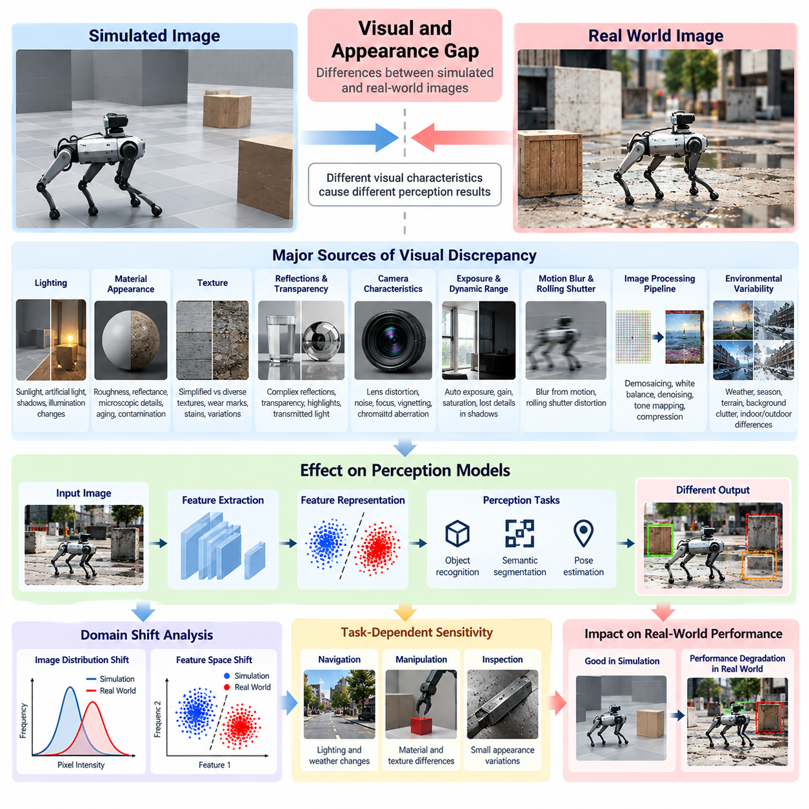{width="7.268055555555556in" height="7.268055555555556in"}

시각 및 외관 격차(Visual and Appearance Gap)는 시뮬레이션에서 생성된 이미지와 실제 환경에서 획득한 시각적 관측값(Visual Observation) 사이의 차이를 의미한다. 이러한 차이는 조명(Lighting), 재질(Material), 텍스처(Texture), 반사(Reflection), 카메라 특성(Camera Characteristics), 환경 조건(Environmental Conditions)을 불완전하게 표현하는 데서 발생한다. 피지컬 AI(Physical AI)에서는 이러한 불일치가 합성 시각 데이터(Synthetic Visual Data)로 학습한 인식 모델(Perception Model)의 신뢰성에 상당한 영향을 미칠 수 있다.

시뮬레이션 환경(Simulation Environment)은 빛과 가상 객체 및 표면 사이의 상호작용을 근사하는 렌더링 파이프라인(Rendering Pipeline)을 통해 시각적 관측값을 생성한다. 현대적인 렌더링 기술(Rendering Technology)은 매우 사실적인 이미지를 생성할 수 있지만, 시각적 유사성(Visual Similarity)이 동일한 통계적 특성(Statistical Characteristics)을 보장하지는 않는다. 색상 분포(Color Distribution), 대비(Contrast), 표면 외관(Surface Appearance), 이미지 아티팩트(Image Artifact)의 작은 차이도 학습된 인식 모델이 실제 배포 환경에서 다르게 반응하도록 만들 수 있다.

조명(Lighting)은 시각적 불일치(Visual Discrepancy)를 발생시키는 가장 중요한 원인 중 하나다. 시뮬레이션 환경에서는 사전에 정의된 광원(Light Source), 단순화된 조명 모델(Illumination Model), 통제된 노출 조건(Exposure Condition)을 사용하는 경우가 많다. 실제 환경에는 변화하는 태양광(Sunlight), 인공조명(Artificial Lighting), 간접 조명(Indirect Illumination), 그림자(Shadow), 반사(Reflection)가 존재한다. 이러한 변화는 객체 가시성(Object Visibility), 특징 추출(Feature Extraction), 로봇 인식 시스템에서 사용하는 시각적 표현(Visual Representation)의 일관성에 영향을 미친다.

재질 외관(Material Appearance)은 시뮬레이션 장면과 실제 장면 사이에 추가적인 차이를 발생시킨다. 가상 재질(Virtual Material)은 일반적으로 표면 색상(Surface Color), 거칠기(Roughness), 금속성(Metallic Properties), 반사율(Reflectance)을 설명하는 매개변수로 표현된다. 그러나 실제 재질에는 미세한 불규칙성(Microscopic Irregularity), 오염(Contamination), 긁힘(Scratch), 노후화(Aging), 복잡한 광산란 특성(Light-Scattering Behavior)이 존재할 수 있다. 이러한 특성은 정확하게 재현하기 어려운 시각적 패턴(Visual Pattern)을 만들어낸다.

텍스처 표현(Texture Representation) 역시 외관 격차(Appearance Gap)에 영향을 미친다. 합성 텍스처(Synthetic Texture)는 실제 표면보다 깨끗하고 반복적이며 다양성이 부족할 수 있다. 물리적 환경에는 제조 편차(Manufacturing Variation), 얼룩(Stain), 마모 흔적(Wear Mark), 예측하기 어려운 표면 세부 특성(Surface Detail)이 존재한다. 단순화된 텍스처로 학습한 인식 모델은 인위적인 상관관계(Artificial Correlation)를 학습하여 실제 조건에서 객체를 인식하거나 속성을 추정하는 능력이 저하될 수 있다.

반사(Reflection)와 투명성(Transparency)은 특히 해결하기 어려운 시각적 불일치를 발생시킨다. 유리(Glass), 광택 금속(Polished Metal), 투명 플라스틱(Transparent Plastic), 반사 바닥(Reflective Floor)은 빛과 복잡하게 상호작용한다. 렌더링 엔진(Rendering Engine)은 이러한 효과를 물리적 현실과 다르게 근사하여 부정확한 하이라이트(Highlight), 반사, 투과광(Transmitted Light)을 생성할 수 있다. 이러한 차이는 반사성 또는 투명 객체를 대상으로 하는 객체 검출(Object Detection), 깊이 추정(Depth Estimation), 로봇 조작(Robotic Manipulation)에 방해가 될 수 있다.

카메라 특성(Camera Characteristics)은 시각적 격차(Visual Gap)를 구성하는 또 다른 주요 요소다. 시뮬레이션 카메라(Simulated Camera)는 이상적인 투영 모델(Projection Model)을 사용하는 경우가 많지만, 실제 카메라에는 렌즈 왜곡(Lens Distortion), 색수차(Chromatic Aberration), 비네팅(Vignetting), 센서 잡음(Sensor Noise), 불완전한 초점(Imperfect Focus)이 존재한다. 초점거리(Focal Length), 조리개(Aperture), 시야각(Field of View), 광학 정렬(Optical Alignment)의 차이는 촬영 이미지의 기하 구조와 외관을 변화시켜 후속 인식 알고리즘(Perception Algorithm)에 영향을 미칠 수 있다.

노출(Exposure)과 동적 범위(Dynamic Range)의 차이는 시각적 전이(Visual Transfer)에 상당한 영향을 미칠 수 있다. 실제 카메라는 노출 제어(Exposure Control), 게인 조정(Gain Adjustment), 이미지 처리(Image Processing)를 통해 변화하는 조명에 지속적으로 적응한다. 밝은 영역은 포화(Saturation)될 수 있고 어두운 영역에서는 세부 정보가 손실될 수 있다. 이러한 효과를 정확하게 재현하지 못하는 시뮬레이션 렌더링 파이프라인은 실제 카메라 출력과 크게 다른 관측값을 생성할 수 있다.

모션 블러(Motion Blur)와 롤링 셔터(Rolling Shutter) 효과는 시각적 일관성을 더욱 복잡하게 만든다. 카메라나 객체가 움직일 때 실제 이미지 센서(Image Sensor)는 유한한 노출 시간(Exposure Period) 동안 빛을 적분한다. 롤링 셔터 센서는 이미지의 각 행(Row)을 조금씩 다른 시점에 촬영한다. 이러한 메커니즘은 움직이는 객체를 왜곡하고 겉보기 기하 구조(Apparent Geometry)를 변화시켜 시각적 추적(Visual Tracking), 위치 추정(Localization), 운동 추정(Motion Estimation)에 영향을 미치는 불일치를 발생시킨다.

이미지 처리 파이프라인(Image Processing Pipeline) 역시 시뮬레이션과 현실 사이의 차이를 발생시킨다. 실제 카메라는 일반적으로 디모자이킹(Demosaicing), 화이트 밸런스(White Balance), 잡음 제거(Denoising), 선명화(Sharpening), 톤 매핑(Tone Mapping), 압축(Compression)을 적용한다. 이러한 처리 과정은 이미지가 인식 모델에 전달되기 전에 통계적 특성을 변화시킨다. 유사한 처리 과정 없이 생성된 합성 이미지는 비현실적인 선명도(Sharpness), 색상 일관성(Color Consistency), 잡음 특성(Noise Characteristics)을 나타낼 수 있다.

환경 외관(Environmental Appearance)은 위치, 계절, 운영 조건에 따라 달라진다. 실외 로봇(Outdoor Robot)은 비(Rain), 안개(Fog), 먼지(Dust), 눈(Snow), 식생 변화(Vegetation Change), 가변적인 대기 가시성(Atmospheric Visibility)에 직면한다. 실내 로봇(Indoor Robot)은 서로 다른 조명 설비(Lighting Fixture), 바닥 재질(Floor Material), 벽 색상(Wall Color), 배경의 복잡성(Background Clutter)을 경험한다. 제한된 외관 범위만 표현하는 시뮬레이션 환경은 실제 배포 과정에서 마주하는 다양성을 충분히 반영하지 못할 수 있다.

시각적 격차(Visual Gap)는 이미지 기반 특징 추출(Image-Based Feature Extraction)에 의존하는 딥러닝 모델(Deep Learning Model)에서 특히 중요해진다. 신경망(Neural Network)은 시뮬레이션 환경에서만 유효한 시각적 패턴과 목표 레이블(Target Label) 사이의 상관관계를 학습할 수 있다. 현실에서 이러한 패턴이 변화하면 특징 표현(Feature Representation)이 이동하여 객체 인식 정확도(Object Recognition Accuracy), 의미론적 분할 품질(Semantic Segmentation Quality), 자세 추정 신뢰성(Pose Estimation Reliability)이 저하될 수 있다.

시각적 도메인 이동(Visual Domain Shift)은 이미지 분포(Image Distribution)와 학습된 특징 공간(Learned Feature Space)의 차이를 통해 분석할 수 있다. 픽셀 수준 비교(Pixel-Level Comparison)는 밝기(Brightness), 색상(Color), 텍스처(Texture), 대비(Contrast)의 변화를 드러내며, 특징 수준 분석(Feature-Level Analysis)은 신경망이 추출한 표현 사이의 차이를 측정한다. 그러나 시각적 유사성 지표(Visual Similarity Metric)만으로 특정 불일치가 로봇 작업 성능에 영향을 미치는지 완전히 판단할 수는 없다.

따라서 외관 격차(Appearance Gap)를 평가할 때는 작업 의존적 민감도(Task-Dependent Sensitivity)를 고려하는 것이 중요하다. 내비게이션 시스템(Navigation System)은 기하학적 경계(Geometric Boundary)를 계속 검출할 수 있다면 중간 수준의 텍스처 차이를 허용할 수 있지만, 정밀 파지 시스템(Precision Grasping System)은 미세한 객체 모서리(Object Edge)와 표면 반사(Surface Reflection)에 크게 의존할 수 있다. 시각적 불일치의 중요성은 인식 정확도와 후속 로봇 동작(Downstream Robotic Behavior)에 미치는 영향을 기준으로 평가해야 한다.

사실적 렌더링(Photorealistic Rendering)은 시각적 불일치를 줄이기 위한 하나의 접근 방법이다. 물리 기반 렌더링(Physically Based Rendering), 광선 추적(Ray Tracing), 정확한 재질 모델(Material Model), 보정된 조명(Calibrated Lighting)은 합성 관측값과 실제 관측값 사이의 일치도를 높일 수 있다. 그러나 렌더링 충실도(Rendering Fidelity)를 높이면 계산 비용(Computational Cost)이 증가하며, 실제 환경의 변동성이 충분히 표현되지 않는다면 도메인 이동(Domain Shift)을 반드시 제거할 수 있는 것은 아니다.

도메인 무작위화(Domain Randomization)는 시뮬레이션 기반 학습(Simulation-Based Training) 과정에서 시각적 특성을 의도적으로 변화시켜 외관 격차에 대응한다. 조명 강도(Lighting Intensity), 텍스처 패턴(Texture Pattern), 재질 색상(Material Color), 카메라 매개변수(Camera Parameter), 배경 조건(Background Condition)을 학습 에피소드(Training Episode)마다 무작위로 변경할 수 있다. 이러한 접근 방식은 인식 모델이 특정 시뮬레이션 장면의 시각적 세부 요소보다 안정적인 작업 관련 특징(Task-Relevant Feature)에 의존하도록 유도한다.

도메인 적응(Domain Adaptation)은 합성 시각 표현(Synthetic Visual Representation)과 실제 시각 표현(Real Visual Representation)을 정렬하는 또 다른 전략이다. 이미지 변환 기법(Image Translation Technique)은 시뮬레이션 이미지를 실제 카메라 관측값과 유사하도록 변경할 수 있으며, 특징 수준 적응(Feature-Level Adaptation)은 학습된 표현 내부의 불일치를 줄인다. 자기지도 적응(Self-Supervised Adaptation)은 레이블이 없는 실제 관측값(Unlabeled Real-World Observation)을 활용하여 광범위한 수작업 주석(Manual Annotation) 없이 모델의 강건성을 개선할 수 있다.

합성 시각 데이터(Synthetic Visual Data)와 실제 시각 데이터(Real Visual Data)를 결합하면 전이 성능(Transfer Performance)을 더욱 향상시킬 수 있다. 합성 데이터셋(Synthetic Dataset)은 확장 가능한 주석(Scalable Annotation)과 통제된 시나리오 생성(Controlled Scenario Generation)을 제공하며, 실제 데이터셋(Real Dataset)은 진정한 센서 특성(Sensor Characteristics)과 환경 변동성(Environmental Variability)을 반영한다. 신중하게 설계된 학습 데이터 혼합(Training Data Mixture)은 시뮬레이션 특화 패턴에 대한 의존도를 줄이고 다양한 배포 조건에서 일반화 성능(Generalization Performance)을 향상시킬 수 있다.

시각적 격차 분석(Visual Gap Analysis)에서는 외관(Appearance)과 기하 구조(Geometry) 사이의 상호작용도 고려해야 한다. 기본적인 시뮬레이션 기하 구조가 정확하더라도 부정확한 그림자(Shadow), 반사(Reflection), 표면 텍스처(Surface Texture)는 인지된 깊이(Perceived Depth)와 객체 경계(Object Boundary)에 영향을 미칠 수 있다. 따라서 시각적 불일치는 위치 추정(Localization), 지도 작성(Mapping), 장애물 검출(Obstacle Detection), 조작 의사결정(Manipulation Decision)으로 전파되어 단순한 이미지 인식 문제를 넘어 운영 오류(Operational Error)를 발생시킬 수 있다.

체계적인 평가 과정(Systematic Evaluation Process)에서는 가능한 경우 일치된 카메라 자세(Camera Pose), 조명 조건(Lighting Condition), 장면 구성(Scene Configuration)에서 합성 관측값과 실제 관측값을 비교한다. 주요 측정 항목에는 이미지 통계(Image Statistics), 특징 분포 차이(Feature Distribution Difference), 인식 정확도(Perception Accuracy), 작업 성공률(Task Success Rate)이 포함된다. 통제된 실험(Controlled Experiment)은 외관 관련 실패(Appearance-Related Failure)를 기하 구조, 동역학, 보정, 제어에서 발생한 오류와 구분하는 데 도움이 된다.

궁극적으로 시각 및 외관 격차(Visual and Appearance Gap)를 줄이려면 렌더링 현실감(Rendering Realism), 시각적 다양성(Visual Diversity), 센서 충실도(Sensor Fidelity), 작업별 강건성(Task-Specific Robustness) 사이의 균형이 필요하다. 목표는 단순히 인간 관찰자에게 사실적으로 보이는 합성 이미지를 생성하는 것이 아니라 신뢰할 수 있는 기계 인식(Machine Perception)을 지원하는 학습 조건을 구축하는 것이다. 효과적인 시각적 격차 분석(Visual Gap Analysis)은 시뮬레이션 환경에서 복잡하고 변화하는 물리적 환경으로 피지컬 AI 시스템을 전이하는 능력을 강화한다.

## 08.03. Geometric and Scene Gap

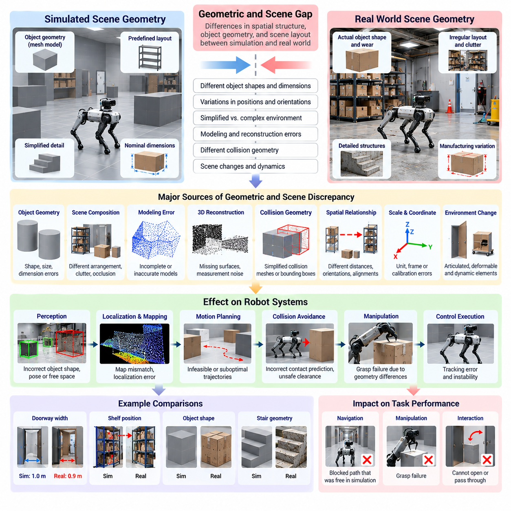{width="7.268055555555556in" height="7.268055555555556in"}

기하학적 및 장면 격차(Geometric and Scene Gap)는 시뮬레이션 환경의 공간 구조(Spatial Structure)와 실제 물리적 환경의 기하 구조(Physical Environment Geometry) 사이에 존재하는 차이를 의미한다. 이러한 불일치에는 객체 크기(Object Dimension), 위치(Position), 방향(Orientation), 표면 형상(Surface Shape), 공간적 관계(Spatial Relationship)의 차이가 포함된다. 피지컬 AI(Physical AI)에서 기하학적 불일치는 인식(Perception), 위치 추정(Localization), 충돌 회피(Collision Avoidance), 운동 계획(Motion Planning), 로봇 조작 성능(Robotic Manipulation Performance)에 직접적인 영향을 미칠 수 있다.

시뮬레이션 환경(Simulation Environment)은 메시(Mesh), 기본 도형(Primitive), 포인트 클라우드(Point Cloud), 구조화된 장면 기술(Structured Scene Description)과 같은 기하학적 모델(Geometric Model)을 통해 물리적 공간을 표현한다. 이러한 표현은 실제 객체의 크기와 배치를 근사하지만, 작은 세부 요소를 생략하거나 복잡한 구조를 단순화할 수 있다. 따라서 시뮬레이션에서 학습한 로봇은 실제 환경에서 예상하지 못한 기하학적 특징(Geometric Feature)을 만나 자유 공간(Free Space)과 물리적 접근 가능성(Physical Accessibility)에 대한 해석이 달라질 수 있다.

기하학적 충실도(Geometric Fidelity)는 객체 형상(Object Shape), 크기(Dimension), 상대적 위치(Relative Positioning)의 정확성에 따라 결정된다. 출입구 너비(Doorway Width), 플랫폼 높이(Platform Height), 장애물 위치(Obstacle Location)의 작은 오차도 로봇 내비게이션(Robotic Navigation)에 상당한 영향을 미칠 수 있다. 조작 시스템(Manipulation System)에서는 객체 기하 구조의 미세한 차이가 파지 선택(Grasp Selection), 접촉 위치(Contact Positioning), 계획된 움직임의 실행 가능성(Motion Feasibility)에 영향을 줄 수 있다.

장면 구성(Scene Composition)은 또 다른 불일치 원인이다. 시뮬레이션 환경에는 신중하게 배치된 객체, 사전에 정의된 장애물 위치(Obstacle Location), 단순화된 배경 구조(Background Structure)가 포함되는 경우가 많다. 실제 환경에서는 불규칙한 객체 배치(Irregular Object Placement), 복잡하게 쌓인 물체(Clutter), 부분 가림(Partial Occlusion), 예상하지 못한 공간 구성(Spatial Configuration)이 나타난다. 이러한 차이는 구조화된 시뮬레이션 장면에서 학습한 가정에 의존하는 인식 및 계획 시스템(Perception and Planning System)의 신뢰성을 저하시킬 수 있다.

기하학적 모델링 오차(Geometric Modeling Error)는 불완전하거나 부정확한 측정에서 자주 발생한다. 컴퓨터 지원 설계 모델(Computer-Aided Design Model, CAD Model)은 실제 제조 형상(Manufactured Geometry)보다 공칭 치수(Nominal Dimension)를 표현할 수 있으며, 재구성된 환경(Reconstructed Environment)에는 누락된 표면(Missing Surface)이나 측정 잡음(Measurement Noise)이 포함될 수 있다. 따라서 설계 사양(Design Specification)과 실제 설치 상태(Physical Installation)의 차이는 정밀한 로봇 작업에서 중요한 공간적 불일치(Spatial Inconsistency)를 발생시킬 수 있다.

3차원 재구성(Three-Dimensional Reconstruction)은 시뮬레이션 장면의 기하 구조에 추가적인 불확실성을 발생시킨다. 사진측량(Photogrammetry), 라이다 스캐닝(LiDAR Scanning), 깊이 센싱(Depth Sensing)은 측정된 관측값으로부터 공간 표현(Spatial Representation)을 생성한다. 그러나 재구성 품질(Reconstruction Quality)은 센서 해상도(Sensor Resolution), 보정(Calibration), 관측 각도(Viewing Angle), 환경 조건(Environmental Condition)에 따라 달라진다. 가려진 표면(Occluded Surface), 반사 재질(Reflective Material), 불충분한 측정(Insufficient Measurement)은 불완전하거나 왜곡된 기하학적 모델을 생성할 수 있다.

충돌 기하 구조(Collision Geometry)는 기하학적 격차(Geometric Gap)에서 특히 중요한 요소다. 시뮬레이션 엔진(Simulation Engine)은 계산 복잡도(Computational Complexity)를 줄이기 위해 단순화된 충돌 메시(Collision Mesh)나 경계 볼륨(Bounding Volume)을 자주 사용한다. 이러한 근사 표현은 객체와 로봇의 상세한 시각적 기하 구조(Visual Geometry)와 다를 수 있다. 그 결과 시뮬레이션 충돌 검출(Collision Detection)은 실제 물리적 접촉보다 빠르거나 늦게 접촉을 예측하여 운동 계획(Motion Planning)과 안전 여유(Safety Margin)에 영향을 미칠 수 있다.

시각적 기하 구조(Visual Geometry)와 충돌 기하 구조(Collision Geometry)의 구분은 시뮬레이션 정확도(Simulation Accuracy)를 이해하는 데 필수적이다. 시각적 메시(Visual Mesh)는 객체가 어떻게 보이는지를 결정하고, 충돌 표현(Collision Representation)은 시뮬레이션된 물리적 상호작용이 어떻게 계산되는지를 결정한다. 시각적으로 정확한 객체라도 부정확한 충돌 모델(Collision Model)을 가질 수 있으며, 이로 인해 로봇은 사용 가능한 여유 공간(Available Clearance), 접촉 위치(Contact Location), 조작 궤적(Manipulation Trajectory)의 실행 가능성을 잘못 판단할 수 있다.

객체 사이의 공간적 관계(Spatial Relationship) 역시 시뮬레이션과 현실 간 전이(Sim2Real Transfer)에 영향을 미친다. 상대 거리(Relative Distance), 방향(Orientation), 정렬(Alignment), 포함 관계(Containment Relationship)는 로봇이 주변 환경을 탐색하고 상호작용하는 방식을 결정한다. 시뮬레이션 창고(Simulated Warehouse)에는 완벽하게 정렬된 선반과 규칙적으로 배치된 장애물이 존재할 수 있지만, 실제 시설에서는 설치 공차(Installation Tolerance), 이동된 장비(Displaced Equipment), 임시 장애물(Temporary Obstruction)이 나타날 수 있다.

장면 축척(Scene Scale)과 좌표 일관성(Coordinate Consistency)은 신뢰할 수 있는 기하학적 전이(Geometric Transfer)를 위한 기본 요구사항이다. 측정 단위(Measurement Unit), 좌표 변환(Coordinate Transformation), 기준 좌표계(Reference Frame), 센서 외부 보정(Sensor Extrinsic Calibration)의 오류는 체계적인 공간 왜곡(Systematic Spatial Distortion)을 발생시킬 수 있다. 개별 객체 모델이 정확하더라도 로봇, 센서, 세계 좌표계(Robot, Sensor, and World Coordinate Frames) 사이의 변환이 잘못되면 상당한 위치 추정 및 계획 오차(Localization and Planning Error)가 발생할 수 있다.

기하학적 격차(Geometric Gap)는 지도 작성(Mapping)과 위치 추정(Localization) 알고리즘에도 영향을 미친다. 시뮬레이션 환경은 정확한 정답 지도(Ground-Truth Map)와 이상화된 구조적 특징(Structural Feature)을 제공하는 경우가 많지만, 실제 로봇은 잡음이 있고 불완전한 관측값으로부터 기하 구조를 추정해야 한다. 벽 위치(Wall Position), 랜드마크 위치(Landmark Location), 표면 구조(Surface Structure)의 차이는 스캔 정합(Scan Matching), 시각적 위치 추정(Visual Localization), 동시적 위치 추정 및 지도 작성(Simultaneous Localization and Mapping, SLAM)의 성능을 저하시킬 수 있다.

자율 이동 로봇(Autonomous Mobile Robot, AMR)에서 기하학적 불일치는 주행 가능 공간(Navigable Space)과 장애물 여유 거리(Obstacle Clearance)를 변화시킬 수 있다. 시뮬레이션에서 실행 가능한 것으로 판단된 경로(Route)도 실제 장애물이 약간 다른 위치에 존재하면 통과할 수 없게 될 수 있다. 좁은 복도(Narrow Corridor), 경사로(Ramp), 문턱(Door Threshold), 적재 구역(Loading Area)은 작은 공간적 차이만으로도 로봇이 계획된 궤적(Planned Trajectory)을 안전하게 완료할 수 있는지가 달라지므로 기하학적 불확실성(Geometric Uncertainty)에 특히 민감하다.

로봇 조작(Robotic Manipulation) 역시 기하학적 정확도(Geometric Accuracy)에 민감하다. 파지 계획(Grasp Planning)은 객체 형상(Object Shape), 자세(Pose), 표면 방향(Surface Orientation), 사용 가능한 접촉 영역(Contact Region)의 추정값에 의존한다. 시뮬레이션 객체가 실제 객체와 다르면 시뮬레이션에서 안정적으로 보이는 파지도 접촉점(Contact Point), 그리퍼 손가락 여유 공간(Finger Clearance), 객체 경계(Object Boundary)가 부정확하게 표현되어 실패할 수 있다.

기하학적 차이는 관절형 및 변형 가능한 환경(Articulated and Deformable Environment)에서 더욱 복잡해진다. 문(Door), 서랍(Drawer), 케이블(Cable), 유연한 용기(Flexible Container), 이동 가능한 장비(Movable Equipment)는 상호작용 중에 변화하는 기하 구조를 가진다. 정적 시뮬레이션 모델(Static Simulation Model)은 이러한 변화를 정확하게 반영하지 못할 수 있으며, 로봇 작업 전반에서 접근 가능한 영역(Accessible Region), 충돌 제약조건(Collision Constraint), 객체 구성(Object Configuration)에 대한 잘못된 예측을 초래할 수 있다.

인간의 존재(Human Presence)는 완전하게 표현하기 어려운 동적 장면 기하 구조(Dynamic Scene Geometry)를 발생시킨다. 사람은 주변 객체와 상호작용하면서 자세(Posture), 방향(Orientation), 위치(Position)를 지속적으로 변화시킨다. 시뮬레이션 인간 모델(Simulated Human Model)은 단순화된 신체 형상(Body Shape)이나 사전에 정의된 운동 궤적(Motion Trajectory)을 사용할 수 있다. 이러한 근사는 장애물 예측(Obstacle Prediction), 안전한 주행(Safe Navigation), 인간-로봇 상호작용(Human-Robot Interaction)에서 불일치를 발생시킬 수 있다.

장면 의미 정보(Scene Semantics)와 기하학적 구조(Geometric Structure)는 밀접하게 연결되어 있다. 로봇은 선반을 보관 영역(Storage Area)으로 식별하거나 개방된 바닥 영역(Open Floor Region)을 주행 가능 경로(Navigable Pathway)로 인식하는 것처럼 공간 구성(Spatial Configuration)을 기능적 의미(Functional Meaning)와 연결하는 경우가 많다. 시뮬레이션 장면에 비현실적인 객체 배치(Object Arrangement)가 포함되면 학습 모델은 기하 구조와 작업(Task), 접근 가능성(Accessibility), 환경 어포던스(Environmental Affordance) 사이의 관계에 대해 잘못된 가정을 형성할 수 있다.

기하학적 격차(Geometric Gap)를 정량화하려면 일관된 기준 좌표계(Reference Frame)에서 시뮬레이션과 실제 공간 표현(Spatial Representation)을 비교해야 한다. 주요 측정 항목에는 치수 오차(Dimensional Error), 포인트 클라우드 거리(Point-Cloud Distance), 표면 재구성 정확도(Surface Reconstruction Accuracy), 객체 자세 편차(Object Pose Deviation), 충돌 여유 거리 차이(Collision-Clearance Difference)가 포함된다. 챔퍼 거리(Chamfer Distance)와 교집합 대비 합집합 비율(Intersection over Union, IoU) 같은 지표는 기하학적 유사성(Geometric Similarity)을 평가할 수 있지만, 그 유효성은 목표 로봇 작업(Target Robotic Task)에 따라 달라진다.

기하학적 유사성(Geometric Similarity)만으로 성공적인 전이(Successful Transfer)를 보장할 수 없으므로 작업 수준 평가(Task-Level Evaluation)가 필요하다. 작은 재구성 오차(Reconstruction Error)는 넓은 개방 공간(Open Space)을 주행할 때는 중요하지 않을 수 있지만, 좁은 고정구(Fixture)에 부품을 삽입하는 작업에서는 결정적인 문제가 될 수 있다. 따라서 기하학적 격차 분석(Geometric Gap Analysis)은 공간적 불일치를 충돌 빈도(Collision Frequency), 경로 실행 가능성(Path Feasibility), 파지 성공률(Grasp Success Rate), 위치 결정 정확도(Positioning Accuracy)와 같은 운영 결과(Operational Outcome)에 연결해야 한다.

기하학적 충실도(Geometric Fidelity)를 개선하는 과정은 정확한 측정(Accurate Measurement)과 모델 보정(Model Calibration)에서 시작된다. CAD 검증(CAD Verification), 3차원 스캐닝(Three-Dimensional Scanning), 센서 보정(Sensor Calibration), 좌표계 검증(Coordinate-Frame Validation)은 디지털 표현(Digital Representation)과 실제 물리적 환경 사이의 차이를 줄일 수 있다. 설계 모델(Design Model)과 측정된 기하 구조(Measured Geometry)를 결합하는 방법은 공칭 사양(Nominal Specification)이 제조 공차(Manufacturing Tolerance)나 설치 조건(Installation Condition)을 충분히 반영하지 못할 때 특히 유용하다.

절차적 장면 생성(Procedural Scene Generation)과 기하학적 무작위화(Geometric Randomization)는 강건성(Robustness)을 향상시키기 위한 상호 보완적인 전략을 제공한다. 객체 크기(Object Dimension), 위치(Position), 방향(Orientation), 장애물 배치(Obstacle Arrangement), 장면 레이아웃(Scene Layout)을 시뮬레이션 기반 학습(Simulation-Based Training) 과정에서 다양하게 변경할 수 있다. 이러한 방법은 로봇 정책(Robotic Policy)을 다양한 공간 구성에 노출시켜 이상화된 기하 구조(Idealized Geometry)에 대한 의존도를 줄이고 이전에 경험하지 못한 환경(Unseen Environment)으로의 일반화(Generalization)를 촉진한다.

디지털 트윈(Digital Twin)은 운영 중인 로봇과 시설 센서(Facility Sensor)에서 획득한 최신 공간 측정값(Spatial Measurement)을 통합하여 기하학적 격차를 지속적으로 줄이는 데 기여할 수 있다. 장비 배치(Equipment Placement)의 변화, 구조적 수정(Structural Modification), 새롭게 등장한 장애물(New Obstacle)을 가상 환경(Virtual Environment)에 반영할 수 있다. 그러나 기하학적 일관성(Geometric Consistency)을 유지하려면 신뢰할 수 있는 데이터 연관(Data Association), 좌표 정렬(Coordinate Alignment), 불확실하거나 오래된 관측값(Uncertain or Outdated Observation)을 처리하는 메커니즘이 필요하다.

궁극적으로 기하학적 및 장면 격차 분석(Geometric and Scene Gap Analysis)은 가상 공간 표현(Virtual Spatial Representation)의 정확성과 실제 로봇 동작(Physical Robotic Behavior)의 신뢰성을 연결한다. 효과적인 시뮬레이션과 현실 간 전이(Sim2Real Transfer)에는 상세한 3차원 모델(Three-Dimensional Model) 이상의 요소가 필요하며, 적절한 기하학적 불확실성(Geometric Uncertainty), 현실적인 장면 다양성(Scene Diversity), 작업 인지형 검증(Task-Aware Validation)이 요구된다. 이러한 요소를 개선하면 변화하는 실제 환경에서 내비게이션(Navigation), 조작(Manipulation), 위치 추정(Localization), 안전한 운영(Safe Operation)의 성능을 향상시킬 수 있다.

## 08.04. Physics Dynamics and Contact Gap

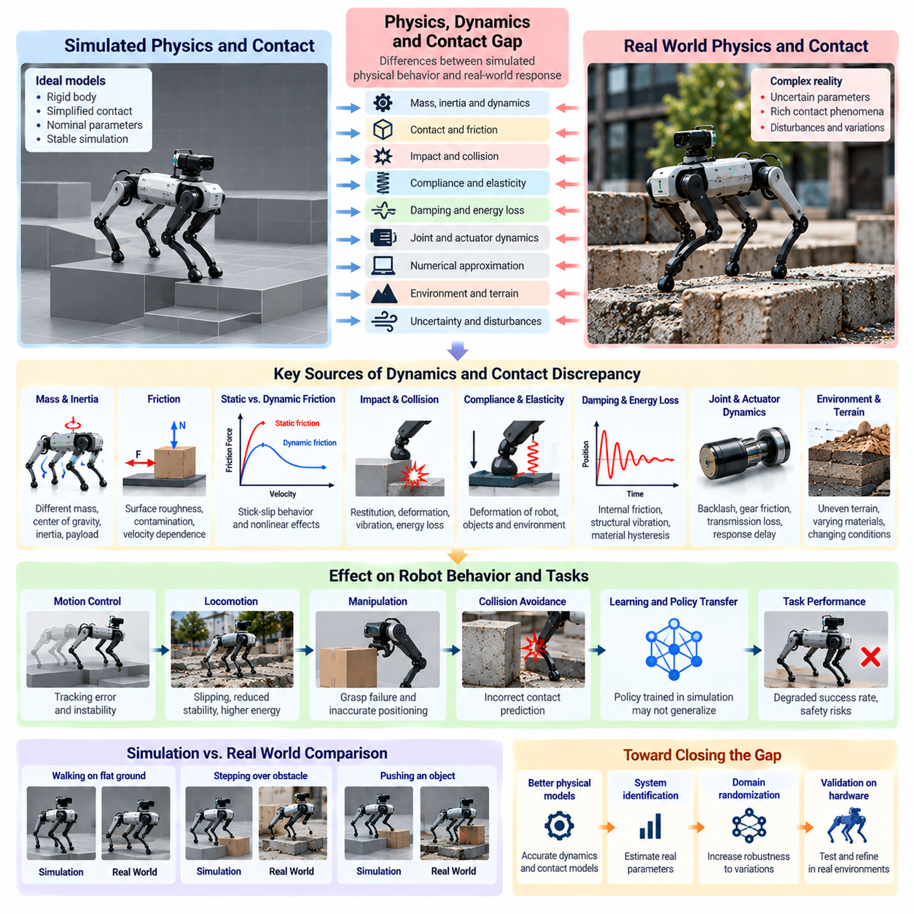{width="7.268055555555556in" height="7.268055555555556in"}

물리, 동역학 및 접촉 격차(Physics, Dynamics, and Contact Gap)는 시뮬레이션된 물리적 동작(Simulated Physical Behavior)과 실제 세계에서 상호작용하는 로봇 시스템의 물리적 반응(Physical Response) 사이에 존재하는 차이를 의미한다. 이러한 불일치는 단순화된 수학적 모델(Mathematical Model), 불확실한 물리 매개변수(Physical Parameter), 수치적 근사(Numerical Approximation), 불완전한 접촉 현상 모델링(Contact Phenomena Modeling)에서 발생한다. 피지컬 AI(Physical AI)에서 이러한 차이는 운동 안정성(Motion Stability), 조작 정확도(Manipulation Accuracy), 작업 신뢰성(Task Reliability)에 상당한 영향을 미칠 수 있다.

물리 시뮬레이션 엔진(Physics Simulation Engine)은 운동 방정식(Equations of Motion), 제약조건 모델(Constraint Model), 수치 적분 방법(Numerical Integration Method)을 사용하여 물리 시스템을 근사한다. 이러한 기술은 많은 기본적인 기계적 동작(Mechanical Behavior)을 재현할 수 있지만, 모든 물리적 상호작용을 완벽하게 표현할 수는 없다. 실제 로봇 시스템은 비선형 효과(Nonlinear Effect), 재질 특성의 변화(Material Variation), 구조적 유연성(Structural Flexibility), 예측하기 어려운 외란(Unpredictable Disturbance)을 나타내며, 이러한 요소는 시뮬레이션 환경에서 누락될 수 있다.

동역학적 불일치(Dynamic Discrepancy)는 질량(Mass), 관성(Inertia), 무게중심(Center of Gravity), 기계적 결합(Mechanical Coupling)에 대한 부정확한 추정에서 자주 발생한다. 작은 매개변수 오차(Parameter Error)도 가속도(Acceleration), 회전 운동(Rotational Motion), 하중 분포(Load Distribution)를 변화시킬 수 있다. 따라서 공칭 동역학 매개변수(Nominal Dynamic Parameter)를 사용하여 학습한 로봇 제어기(Robot Controller)는 서로 다른 탑재 하중(Payload), 부품 공차(Component Tolerance), 기계적 구성(Mechanical Configuration)을 가진 실제 하드웨어에 배포될 때 예상하지 못한 동작을 보일 수 있다.

접촉 모델링(Contact Modeling)은 시뮬레이션과 현실 간 전이(Sim2Real Transfer)에서 가장 어려운 요소 중 하나다. 물리적 접촉(Physical Contact)은 변형(Deformation), 마찰(Friction), 충격(Impact), 접착(Adhesion), 에너지 소산(Energy Dissipation)을 포함하는 복잡한 표면 간 상호작용으로 이루어진다. 시뮬레이션 엔진은 일반적으로 단순화된 접촉 제약조건(Contact Constraint)과 힘 모델(Force Model)을 통해 이러한 현상을 근사한다. 이러한 근사는 전반적인 동작을 재현할 수 있지만, 세부적인 접촉 전이(Contact Transition)를 정확하게 표현하지 못할 수 있다.

마찰 불일치(Friction Discrepancy)는 보행(Locomotion)과 조작(Manipulation)에서 특히 중요하다. 시뮬레이션 마찰 모델(Simulated Friction Model)은 일정한 마찰계수(Friction Coefficient)나 수직력(Normal Force)과 접선력(Tangential Force) 사이의 단순화된 관계를 가정하는 경우가 많다. 실제 마찰은 표면 거칠기(Surface Roughness), 오염(Contamination), 온도(Temperature), 미끄럼 속도(Sliding Velocity), 접촉 압력(Contact Pressure)에 따라 달라진다. 이러한 변화는 예상하지 못한 미끄러짐(Slipping), 부정확한 힘 예측(Force Prediction), 물리적 상호작용 중 안정성 저하(Reduced Stability)를 발생시킬 수 있다.

정지 마찰(Static Friction)과 운동 마찰(Dynamic Friction)은 추가적인 복잡성을 발생시킨다. 정지 마찰은 운동의 시작을 방해하며, 운동 마찰은 미끄러지는 동안의 저항을 결정한다. 두 영역 사이의 전이(Transition)에서는 스틱-슬립 현상(Stick-Slip Behavior)과 속도 의존적 마찰(Velocity-Dependent Friction) 같은 비선형 효과가 나타날 수 있다. 단순화된 시뮬레이션 모델은 이러한 전이를 정확하게 재현하지 못하여 정밀 위치 결정(Precision Positioning)과 힘 제어 기반 조작(Force-Controlled Manipulation)에서 오차를 발생시킬 수 있다.

충격 및 충돌 동역학(Impact and Collision Dynamics) 역시 물리적 격차(Physics Gap)에 영향을 미친다. 시뮬레이션 충돌(Simulated Collision)은 일반적으로 반발계수(Restitution Coefficient), 충격량 모델(Impulse Model), 수치 접촉 해석기(Numerical Contact Solver)를 사용하여 계산된다. 그러나 실제 충격에는 국부 변형(Local Deformation), 진동(Vibration), 음향 에너지 손실(Acoustic Energy Loss), 재질 의존적 에너지 소산(Material-Dependent Dissipation)이 포함된다. 충돌 반응(Collision Response)의 차이는 파지(Grasping), 객체 배치(Object Placement), 보행 안정성(Walking Stability), 장애물과의 상호작용에 영향을 미칠 수 있다.

컴플라이언스(Compliance)와 탄성(Elasticity)은 현실적인 접촉 동작(Contact Behavior)을 모델링하는 데 필수적이다. 물리적 부품은 명목상 강체(Rigid Body)로 간주되더라도 외력이 가해지면 변형된다. 로봇 구조물(Robot Structure), 타이어(Tire), 그리퍼(Gripper), 관절(Joint), 접촉 객체(Contacted Object)는 서로 다른 수준의 컴플라이언스를 나타낸다. 강체 시뮬레이션(Rigid-Body Simulation)은 이러한 효과를 간과하여 비현실적인 접촉력(Contact Force), 운동 궤적(Motion Trajectory), 기계적 안정성(Mechanical Stability) 예측을 생성할 수 있다.

감쇠(Damping)와 에너지 소산(Energy Dissipation)은 추가적인 불일치를 발생시킨다. 실제 기계 시스템(Mechanical System)은 내부 마찰(Internal Friction), 구조 진동(Structural Vibration), 재료 히스테리시스(Material Hysteresis), 유체 저항(Fluid Resistance)을 통해 에너지를 손실한다. 시뮬레이션 환경은 이러한 메커니즘을 단순화된 감쇠계수(Damping Coefficient)로 표현하는 경우가 많다. 부정확한 감쇠 매개변수(Damping Parameter)는 과도한 진동(Excessive Oscillation), 비현실적인 안정화 동작(Settling Behavior), 에너지 소비(Energy Consumption) 및 제어 응답(Control Response)에 대한 부정확한 예측을 발생시킬 수 있다.

관절 동역학(Joint Dynamics)과 기계적 동력 전달 특성(Mechanical Transmission Behavior)은 학습된 제어 정책(Control Policy)의 전이에 영향을 미친다. 실제 관절에는 백래시(Backlash), 베어링 마찰(Bearing Friction), 기어 컴플라이언스(Gear Compliance), 토크 전달 손실(Torque Transmission Loss)이 존재할 수 있다. 이러한 효과는 명령된 구동기 출력(Commanded Actuator Effort)과 실제 운동(Resulting Motion) 사이의 관계를 변화시킨다. 시뮬레이션이 이상적인 관절이나 동력 전달 장치를 가정하면 학습된 정책은 실제 배포 과정에서 기계적 결함(Mechanical Imperfection)에 민감해질 수 있다.

수치 적분(Numerical Integration)은 물리적 모델링 부정확성(Physical Modeling Inaccuracy)과는 별개의 오차를 발생시킨다. 시뮬레이션 엔진은 이산 시간 간격(Discrete Time Step)과 수치 해석기(Numerical Solver)를 사용하여 시스템 상태(System State)를 갱신한다. 큰 시간 간격(Large Time Step), 부족한 해석기 반복 횟수(Insufficient Solver Iteration), 조건이 나쁜 제약조건(Poorly Conditioned Constraint)은 불안정하거나 부정확한 접촉 동작을 생성할 수 있다. 수치 정밀도(Numerical Precision)를 높이면 일부 오차를 줄일 수 있지만 계산 요구량(Computational Requirement)도 증가한다.

접촉 해석기 아키텍처(Contact Solver Architecture)는 로봇 시스템의 시뮬레이션 동작에 영향을 미친다. 서로 다른 물리 엔진(Physics Engine)은 페널티 기반 방법(Penalty-Based Method), 충격량 기반 공식화(Impulse-Based Formulation), 제약조건 최적화 기법(Constraint Optimization Technique)을 사용할 수 있다. 각 접근 방식은 침투(Penetration), 접촉력(Contact Force), 제약조건 충족(Constraint Satisfaction)에 대해 서로 다른 가정을 적용한다. 따라서 동일한 로봇 모델이라도 시뮬레이션 플랫폼에 따라 서로 다른 물리적 반응을 나타낼 수 있다.

바퀴와 지면의 상호작용(Wheel-Ground Interaction)은 동역학 및 접촉 불일치의 실질적인 중요성을 보여준다. 이동 로봇(Mobile Robot)은 구름 저항(Rolling Resistance), 견인력(Traction), 횡방향 미끄러짐(Lateral Slip), 하중 이동(Load Transfer)을 정확하게 표현하는 모델에 의존한다. 단순화된 바퀴 모델(Wheel Model)은 매끄러운 표면에서는 적절하게 동작할 수 있지만, 불규칙한 지형(Uneven Terrain)이나 무거운 탑재 하중(Heavy Payload) 조건에서는 실패할 수 있다. 이러한 오차는 궤적 추종(Trajectory Tracking), 제동 성능(Braking Performance), 기동 안정성(Maneuvering Stability)을 저하시킬 수 있다.

다족 보행 로봇(Legged Robot)은 보행이 지지 단계(Support Phase)와 비행 단계(Flight Phase) 사이의 반복적인 전이에 의존하기 때문에 접촉 모델링(Contact Modeling)에 특히 민감하다. 지면 반력(Ground Reaction Force), 발 마찰(Foot Friction), 충격 시점(Impact Timing)의 작은 오차도 균형(Balance)과 보행 패턴 안정성(Gait Stability)을 변화시킬 수 있다. 부정확한 접촉 동역학(Contact Dynamics)으로 학습한 정책은 변형 가능한 지형(Compliant Terrain), 불규칙한 표면(Irregular Surface), 예상하지 못한 외란(Unexpected Disturbance)을 만났을 때 어려움을 겪을 수 있다.

로봇 조작(Robotic Manipulation)에서도 이와 유사하게 까다로운 접촉 조건(Contact Condition)이 발생한다. 파지(Grasping), 밀기(Pushing), 삽입(Insertion), 조립(Assembly) 작업에는 접촉 위치(Contact Location), 힘 분포(Force Distribution), 객체 운동(Object Motion)에 대한 정확한 예측이 필요하다. 시뮬레이션에서는 단순화된 마찰(Friction)이나 충돌 기하 구조(Collision Geometry) 때문에 파지가 안정적으로 보일 수 있지만, 실제 물리적 파지에서는 미끄러짐(Slipping), 정렬 불량(Misalignment), 예상하지 못한 변형(Unexpected Deformation)으로 실패할 수 있다.

다중 접촉 상호작용(Multi-Contact Interaction)은 모델링 복잡성(Modeling Complexity)을 더욱 증가시킨다. 휴머노이드 로봇(Humanoid Robot), 이동형 매니퓰레이터(Mobile Manipulator), 협조 로봇 시스템(Coordinated Robotic System)은 바닥, 객체, 고정구(Fixture), 기타 구조물과 동시에 접촉할 수 있다. 접촉력(Contact Force)은 기계 시스템을 통해 서로 결합되어 있으므로 힘 분포(Force Distribution)는 기하 구조(Geometry), 컴플라이언스(Compliance), 해석기 가정(Solver Assumption)에 민감하다. 작은 모델링 오차도 전신 동작(Whole-Body Behavior)에 상당한 차이를 발생시킬 수 있다.

물리적 격차(Physics Gap)는 환경 및 재질 불확실성(Environmental and Material Uncertainty)의 영향도 받는다. 바닥(Floor), 타이어(Tire), 포장재(Packaging Material), 유연한 객체(Flexible Object), 기계적 접촉면(Mechanical Interface)은 마모(Wear), 습기(Moisture), 온도(Temperature), 반복 하중(Repeated Loading)에 따라 특성이 변화한다. 따라서 특정 운영 조건(Operating Condition)에 맞춰 보정된 시뮬레이션은 환경이나 로봇 하드웨어가 시간에 따라 변화하면서 부정확해질 수 있다.

물리 및 접촉 격차(Physics and Contact Gap)를 정량화하려면 시뮬레이션 예측값(Simulated Prediction)과 실제 물리 실험(Physical Experiment)에서 측정한 값을 비교해야 한다. 관련 변수에는 관절 궤적(Joint Trajectory), 가속도(Acceleration), 접촉력(Contact Force), 미끄럼률(Slip Ratio), 충격 응답(Impact Response), 에너지 소비(Energy Consumption)가 포함된다. 통제된 실험(Controlled Experiment)은 개별 매개변수를 분리하여 분석할 수 있으며, 작업 수준 시험(Task-Level Test)은 누적된 모델링 오차가 안정성, 정확성, 작업 완료 성공률(Task Completion Success Rate)에 미치는 영향을 보여준다.

시스템 식별(System Identification)은 동역학적 불일치(Dynamic Discrepancy)를 줄이기 위한 체계적인 방법을 제공한다. 엔지니어는 알려진 입력(Known Input)을 적용하고 물리적 응답(Physical Response)을 측정하여 질량 특성(Mass Property), 마찰 매개변수(Friction Parameter), 감쇠계수(Damping Coefficient), 구동기 특성(Actuator Characteristic)을 추정할 수 있다. 이러한 추정값은 시뮬레이션 충실도(Simulation Fidelity)를 향상시킬 수 있지만, 일부 매개변수는 제한된 관측 가능성(Limited Observability)이나 서로 다른 물리 효과 사이의 상호작용 때문에 식별하기 어렵다.

도메인 무작위화(Domain Randomization)는 정확한 물리 모델링(Physical Modeling)이 현실적으로 어려울 때 상호 보완적인 접근 방식을 제공한다. 질량(Mass), 관성(Inertia), 마찰(Friction), 반발계수(Restitution), 컴플라이언스(Compliance), 감쇠(Damping) 매개변수를 시뮬레이션 학습 에피소드(Simulated Training Episode)마다 변화시킬 수 있다. 이를 통해 제어 정책(Control Policy)은 다양한 물리적 조건에 노출되고 불확실한 동역학(Uncertain Dynamics)에 대한 강건성(Robustness)을 학습하도록 유도된다. 다만 비현실적인 동작에 대한 학습을 방지하려면 무작위화 범위(Randomization Range)는 물리적으로 타당해야 한다.

하이브리드 모델링(Hybrid Modeling)은 해석적 물리 모델(Analytical Physics Model)과 데이터 기반 잔차 모델(Data-Driven Residual Model)을 결합할 수 있다. 해석적 방정식(Analytical Equation)은 알려진 기계적 관계(Mechanical Relationship)를 표현하고, 학습 기반 구성 요소(Learned Component)는 실험 관측값(Experimental Observation)을 활용하여 모델링되지 않은 효과(Unmodeled Effect)를 근사한다. 이러한 접근 방식은 완전한 물리적 재구성(Physical Reconstruction) 없이도 복잡한 접촉 동작의 예측을 개선할 수 있지만, 학습된 보정값(Learned Correction)은 학습 조건 외부에서도 검증되어야 한다.

궁극적으로 물리, 동역학 및 접촉 격차 분석(Physics, Dynamics, and Contact Gap Analysis)은 가상 학습 환경(Virtual Training Environment)에서 신뢰할 수 있는 실제 물리적 운영(Physical Operation)으로 피지컬 AI 역량(Physical AI Capability)을 전이하는 데 필수적이다. 효과적인 격차 감소(Gap Reduction)를 위해서는 보정된 기계 모델(Calibrated Mechanical Model), 적절한 수치 해석 방법(Numerical Method), 현실적인 접촉 표현(Contact Representation), 강건한 제어 정책(Robust Control Policy)이 필요하다. 목표는 물리적 현실을 완벽하게 복제하는 것이 아니라 실제 환경의 불확실성(Real-World Uncertainty) 속에서도 충분히 정확하고 회복력 있는 동작(Resilient Behavior)을 구현하는 것이다.

## 08.05. Actuator and Control Gap

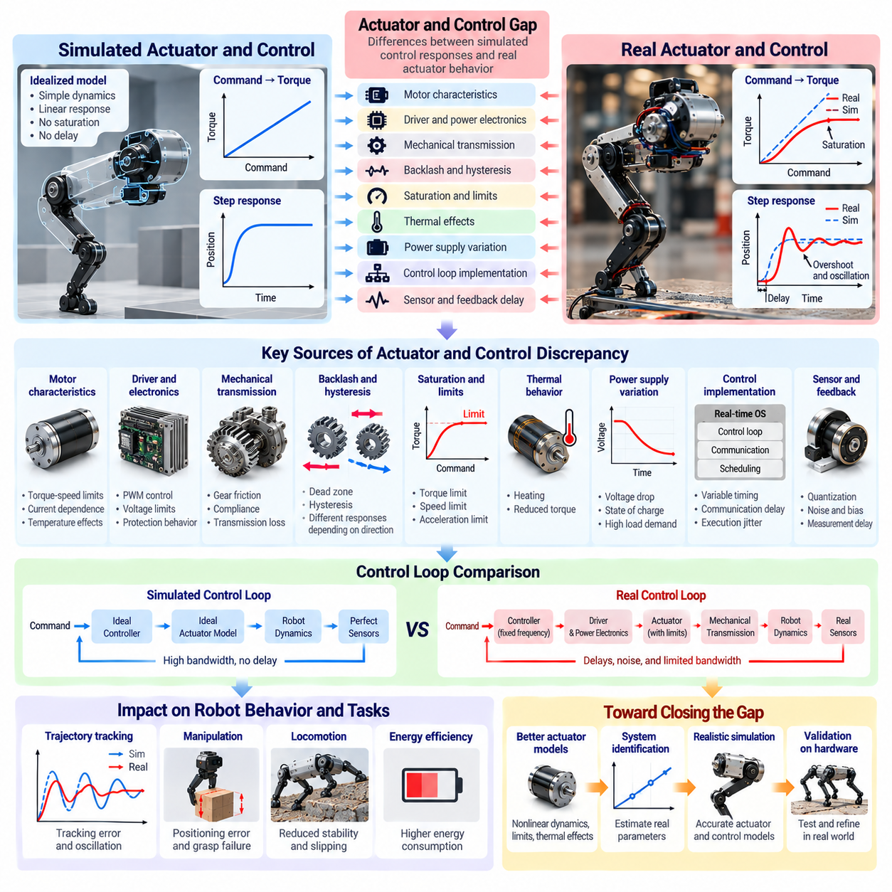{width="7.268055555555556in" height="7.268055555555556in"}

구동기 및 제어 격차(Actuator and Control Gap)는 시뮬레이션된 제어 응답(Simulated Control Response)과 실제 로봇 구동기(Robotic Actuator) 및 제어 시스템(Control System)의 동작 사이에 존재하는 차이를 의미한다. 이러한 불일치는 불완전한 구동기 모델(Actuator Model), 기계적 한계(Mechanical Limitation), 전기적 특성(Electrical Characteristic), 피드백 지연(Feedback Delay), 하드웨어별 제약조건(Hardware-Specific Constraint)에서 발생한다. 피지컬 AI(Physical AI)에서 이러한 격차는 운동 정확도(Motion Accuracy), 동적 안정성(Dynamic Stability), 에너지 효율(Energy Efficiency), 학습된 제어 정책(Learned Control Policy)의 신뢰성에 직접적인 영향을 미친다.

시뮬레이션 환경(Simulation Environment)은 제어 명령(Control Command)과 발생하는 힘(Force) 또는 토크(Torque) 사이의 관계를 단순화하여 구동기를 표현하는 경우가 많다. 실제 구동기는 비선형 응답(Nonlinear Response), 포화(Saturation), 마찰(Friction), 온도 의존성(Temperature Dependence), 제조 편차(Manufacturing Variation)를 나타낸다. 따라서 동일한 제어 명령이라도 시뮬레이션과 현실에서 서로 다른 물리적 출력(Physical Output)을 생성할 수 있으며, 이는 궤적 추종(Trajectory Tracking)과 운동 실행(Motion Execution)에서 체계적인 오차(Systematic Error)를 발생시킨다.

전기 모터 특성(Electric Motor Characteristic)은 구동기 불일치(Actuator Discrepancy)의 주요 원인이다. 모터 토크(Motor Torque)는 전류(Current), 회전 속도(Rotational Speed), 권선 저항(Winding Resistance), 자속(Magnetic Flux), 작동 온도(Operating Temperature)에 따라 달라진다. 단순화된 시뮬레이션 모델은 일정한 토크 출력 능력(Constant Torque Capability)이나 이상적인 전류 제어(Ideal Current Regulation)를 가정할 수 있다. 실제 모터는 토크-속도 특성 범위(Torque-Speed Envelope)와 열적 한계(Thermal Limit) 내에서 작동하므로 높은 부하가 요구되는 운전 조건에서 응답이 크게 달라질 수 있다.

모터 드라이버(Motor Driver)와 전력 전자 장치(Power Electronics)는 추가적인 차이를 발생시킨다. 전류 제어기(Current Controller), 펄스 폭 변조(Pulse-Width Modulation, PWM), 스위칭 동작(Switching Behavior), 전압 제한(Voltage Limitation), 보호 메커니즘(Protection Mechanism)은 구동기 성능에 영향을 미친다. 시뮬레이션 환경은 이러한 내부 과정을 생략하거나 이상화된 응답 모델(Idealized Response Model)로 근사할 수 있다. 이러한 단순화는 동적인 로봇 작업에서 비현실적인 가속(Acceleration), 제동(Braking), 토크 전달(Torque Delivery)을 발생시킬 수 있다.

기계적 동력 전달 장치(Mechanical Transmission)는 구동기 격차(Actuator Gap)를 더욱 증가시킨다. 기어박스(Gearbox), 벨트(Belt), 체인(Chain), 하모닉 드라이브(Harmonic Drive), 나사 구동 기구(Screw Mechanism)는 백래시(Backlash), 컴플라이언스(Compliance), 마찰(Friction), 동력 전달 손실(Transmission Loss)을 발생시킨다. 이러한 특성은 모터 출력(Motor Output)과 관절 운동(Joint Motion) 사이의 관계를 변화시킨다. 따라서 이상적인 동력 전달 효율(Transmission Efficiency)을 가정한 시뮬레이션 구동기는 특히 운동 방향이 반전되거나 부하가 급격하게 변화할 때 실제 구동기보다 정밀하게 응답할 수 있다.

백래시(Backlash)와 기계적 히스테리시스(Mechanical Hysteresis)는 정밀 제어(Precision Control)에서 특히 중요하다. 백래시는 모터 위치(Motor Position)가 변해도 출력 측 움직임(Output Movement)이 즉시 발생하지 않는 운동 구간을 형성한다. 히스테리시스는 이전의 하중(Loading)이나 운동 이력(Motion History)에 따라 구동기 응답이 달라지는 현상이다. 이러한 효과는 위치 결정 오차(Positioning Error), 진동(Oscillation), 일관되지 않은 동작(Inconsistent Behavior)을 발생시킬 수 있으며, 단순화된 구동기 모델은 이를 정확하게 재현하지 못할 수 있다.

구동기 포화(Actuator Saturation)는 또 다른 근본적인 불일치 원인이다. 실제 모터와 유압 또는 공압 시스템(Hydraulic or Pneumatic System)은 무제한의 힘(Force), 토크(Torque), 속도(Speed), 가속도(Acceleration)를 생성할 수 없다. 명령된 출력(Commanded Output)이 물리적 한계(Physical Limit)를 초과하면 구동기가 포화되어 가정된 제어 관계(Control Relationship)를 더 이상 따르지 못한다. 현실적인 포화 제약조건(Saturation Constraint) 없이 학습한 정책은 실행 불가능한 동작(Infeasible Action)을 요구할 수 있으며, 실제 배포 이후 상당한 성능 저하(Performance Degradation)를 경험할 수 있다.

열적 거동(Thermal Behavior)은 장시간 운전에서 구동기 성능에 영향을 미친다. 모터 권선(Motor Winding), 전력 전자 장치(Power Electronics), 기어박스(Gearbox), 제동 부품(Braking Component)은 작동 중 열을 발생시킨다. 온도가 상승하면 저항(Resistance)이 증가하고 효율(Efficiency)이 감소하며 보호를 위한 출력 저감(Protective Derating)이 발생할 수 있다. 따라서 일정한 구동기 특성(Constant Actuator Characteristic)을 가정하는 시뮬레이션은 실제 하드웨어의 출력 능력(Output Capability)이 점진적으로 감소하는 상황에서도 안정적인 성능을 예측할 수 있다.

전원 공급 한계(Power Supply Limitation)도 제어 격차(Control Gap)에 영향을 미친다. 배터리 전압(Battery Voltage)은 충전 상태(State of Charge), 전류 요구량(Current Demand), 온도(Temperature), 내부 저항(Internal Resistance)에 따라 변화한다. 여러 구동기가 동시에 가속하면 공통 전력 버스(Shared Power Bus)에서 전압 강하(Voltage Drop)가 발생할 수 있다. 시뮬레이션이 이상적인 전원(Ideal Power Source)을 가정하면 다중 구동기 운전(Multi-Actuator Operation)에서 사용 가능한 토크, 가속도, 지속 성능(Sustained Performance)을 과대평가할 수 있다.

제어 루프 구현(Control Loop Implementation)은 구동기 물리 특성(Actuator Physics) 이외의 불일치를 발생시킨다. 시뮬레이션 제어기(Simulated Controller)는 일정한 주파수(Fixed Frequency)와 결정론적 타이밍(Deterministic Timing)으로 실행되며 정확한 시스템 상태(System State)에 직접 접근하는 경우가 많다. 실제 제어기는 임베디드 프로세서(Embedded Processor), 센서 인터페이스(Sensor Interface), 통신 네트워크(Communication Network), 실시간 스케줄링 메커니즘(Real-Time Scheduling Mechanism)을 통해 작동한다. 실행 지터(Execution Jitter), 측정 지연(Delayed Measurement), 비동기 갱신(Asynchronous Update)은 폐루프 동작(Closed-Loop Behavior)을 변화시킬 수 있다.

피드백 품질(Feedback Quality)은 또 다른 핵심 요소다. 시뮬레이션 엔코더(Simulated Encoder)와 상태 추정기(State Estimator)는 거의 완벽한 위치(Position), 속도(Velocity), 가속도(Acceleration) 정보를 제공할 수 있다. 실제 센서에는 양자화(Quantization), 잡음(Noise), 편향(Bias), 보정 오차(Calibration Error), 필터링 지연(Filtering Delay)이 존재한다. 이러한 불완전성은 피드백 제어 정확도(Feedback Control Accuracy)에 영향을 미치며, 이상화된 시뮬레이션 측정값을 사용하여 제어기 이득(Controller Gain)을 조정한 경우 불안정하거나 진동하는 응답을 발생시킬 수 있다.

제어기 아키텍처(Controller Architecture)는 구동기 불일치가 시스템 동작에 영향을 미치는 방식을 결정한다. 위치 제어기(Position Controller), 속도 제어기(Velocity Controller), 토크 제어기(Torque Controller), 임피던스 제어기(Impedance Controller)는 모델링 오차(Modeling Error)와 외란(Disturbance)에 서로 다르게 반응한다. 직접 토크 제어(Direct Torque Control)를 사용하여 학습한 정책은 내부 위치 또는 속도 제어 루프(Internal Position or Velocity Loop)를 구현한 상용 드라이브(Commercial Drive)에 배포되면 다른 동작을 보일 수 있다. 숨겨진 제어 동역학(Hidden Control Dynamics)은 실제 동작 명령 인터페이스(Effective Action Interface)를 크게 변화시킬 수 있다.

제어 이득 불일치(Control Gain Mismatch)는 추가적인 전이 문제(Transfer Challenge)를 발생시킨다. 비례, 적분, 미분 이득(Proportional, Integral, and Derivative Gains)은 시뮬레이션된 관성(Inertia), 마찰(Friction), 구동기 대역폭(Actuator Bandwidth)에 맞춰 최적화될 수 있다. 이러한 이득을 실제 하드웨어에 적용하면 오버슈트(Overshoot), 과도한 정착 시간(Settling Time), 진동(Oscillation), 불충분한 외란 억제(Disturbance Rejection)가 발생할 수 있다. 따라서 제어기 튜닝(Controller Tuning)은 실제 기계 시스템(Mechanical System)과 사용 가능한 구동기 성능(Actuator Performance)을 고려해야 한다.

명령 지연(Command Latency)과 구동기 대역폭(Actuator Bandwidth)은 동적 제어(Dynamic Control)의 정확도에 영향을 미친다. 실제 시스템은 명령을 수신하고 전류를 조절하며 토크를 발생시키고 기계적 운동을 생성하기까지 유한한 시간이 필요하다. 이러한 지연은 위상 지연(Phase Lag)을 발생시키고 달성 가능한 제어 대역폭(Control Bandwidth)을 감소시킨다. 즉각적인 응답(Instantaneous Response)을 가정하는 시뮬레이션 모델은 실제 하드웨어에서 실행할 때 지나치게 공격적이거나 불안정한 제어 정책을 생성할 수 있다.

구동기 동작(Actuator Behavior)은 외부 하중 조건(External Loading Condition)에 따라서도 달라진다. 탑재 하중 변화(Payload Variation), 중력(Gravitational Force), 접촉 상호작용(Contact Interaction), 기계적 제약조건(Mechanical Constraint)은 운동을 실행하는 데 필요한 토크 또는 힘을 변화시킨다. 서로 다른 탑재 하중을 운반하는 이동형 매니퓰레이터(Mobile Manipulator)는 가속 및 제동 특성(Acceleration and Braking Characteristic)이 달라질 수 있다. 하중 의존적 구동기 모델(Load-Dependent Actuator Model)이 없으면 시뮬레이션 정책은 제어 노력(Control Effort)과 추종 오차(Tracking Error)를 과소평가할 수 있다.

바퀴형 이동 로봇(Wheeled Mobile Robot)에서 구동기 및 제어 격차는 구동 토크(Drive Torque), 조향 응답(Steering Response), 제동 동역학(Braking Dynamics), 바퀴 속도 제어(Wheel-Speed Regulation)에서 나타난다. 모터 제어기 한계(Motor Controller Limit), 조향 기어박스 백래시(Steering Gearbox Backlash), 하중 의존적 견인력(Load-Dependent Traction)은 차량 기동성(Vehicle Maneuverability)에 영향을 미친다. 이러한 불일치는 높은 탑재 하중(High Payload), 좁은 회전 공간(Tight Turning Requirement), 협조 조향 및 구동 시스템(Coordinated Steering and Drive System)을 사용하는 대형 자율 이동 로봇(Autonomous Mobile Robot, AMR)에서 특히 중요하다.

다족 보행 로봇(Legged Robot)과 휴머노이드 로봇(Humanoid Robot)은 빠르게 변화하는 하중 조건에서 여러 구동기가 협조해야 하므로 추가적인 문제를 가진다. 관절 토크 한계(Joint Torque Limit), 컴플라이언스(Compliance), 통신 지연(Communication Delay), 모터 대역폭(Motor Bandwidth)은 균형(Balance)과 보행 안정성(Locomotion Stability)에 영향을 미친다. 작은 구동기 불일치도 전신 제어(Whole-Body Control)를 통해 전파되어 발 배치(Foot Placement), 지면 반력(Ground Reaction Force), 회복 동작(Recovery Behavior)에 차이를 발생시킬 수 있다.

로봇 매니퓰레이터(Robotic Manipulator)는 정밀 조립(Precision Assembly)과 접촉이 많은 작업(Contact-Rich Operation)에서 구동기 오차에 특히 민감하다. 관절 위치 결정 오차(Joint Positioning Error), 동력 전달 컴플라이언스(Transmission Compliance), 토크 추정 부정확성(Torque Estimation Inaccuracy)은 말단 효과기 운동(End-Effector Motion)과 접촉력(Contact Force)에 영향을 미친다. 시뮬레이션에서 성공한 궤적(Trajectory)도 실제 구동기 동역학(Actuator Dynamics)으로 실행하면 정렬 불량(Misalignment), 과도한 삽입력(Excessive Insertion Force), 불안정한 접촉(Unstable Contact)을 발생시킬 수 있다.

구동기 및 제어 격차(Actuator and Control Gap)를 정량화하려면 명령 입력(Commanded Input)과 측정된 물리적 응답(Measured Physical Response)을 체계적으로 비교해야 한다. 관련 측정 항목에는 토크 추종 오차(Torque Tracking Error), 위치 편차(Position Deviation), 속도 응답(Velocity Response), 상승 시간(Rise Time), 정착 시간(Settling Time), 오버슈트(Overshoot), 제어 지연(Control Latency), 에너지 소비(Energy Consumption)가 포함된다. 주파수 응답 분석(Frequency-Response Analysis)과 통제된 가진 실험(Controlled Excitation Experiment)은 대역폭 한계(Bandwidth Limitation), 비선형성(Nonlinearity), 숨겨진 동역학(Hidden Dynamics)을 파악하는 데 도움이 된다.

시스템 식별(System Identification)은 구동기 모델(Actuator Model)을 개선하기 위한 실용적인 접근 방식을 제공한다. 엔지니어는 제어된 명령(Controlled Command)을 적용하면서 모터 전류(Motor Current), 전압(Voltage), 토크(Torque), 속도(Speed), 온도(Temperature), 관절 운동(Joint Motion)을 기록할 수 있다. 이러한 측정값은 마찰(Friction), 관성(Inertia), 응답 지연(Response Delay), 동력 전달 효율(Transmission Efficiency), 구동기 한계(Actuator Limit)를 추정하는 데 활용된다. 이후 보정된 모델(Calibrated Model)을 시뮬레이션 환경에 적용하여 이상화된 가정(Idealized Assumption)을 대체할 수 있다.

도메인 무작위화(Domain Randomization)는 구동기 특성(Actuator Characteristic)을 정확하게 모델링하기 어려울 때 강건성(Robustness)을 향상시킨다. 학습 환경에서는 토크 한계(Torque Limit), 모터 이득(Motor Gain), 마찰(Friction), 제어 지연(Control Delay), 동력 전달 효율(Transmission Efficiency), 센서 피드백 품질(Sensor Feedback Quality)을 다양하게 변화시킬 수 있다. 이러한 변화에 노출되면 정책은 하드웨어 불확실성(Hardware Uncertainty)을 견딜 수 있도록 학습된다. 다만 무작위화 범위(Randomization Range)는 물리적으로 타당한 동작(Physically Plausible Behavior)과 측정된 작동 한계(Measured Operating Limit)를 반영해야 한다.

하드웨어 인 더 루프 시험(Hardware-in-the-Loop Testing, HIL Testing)은 순수 시뮬레이션(Pure Simulation)과 전체 로봇 배포(Full Robotic Deployment) 사이의 중간 검증 단계(Intermediate Validation Stage)를 제공한다. 실제 제어기(Real Controller), 모터 드라이버(Motor Driver), 구동기(Actuator)가 시뮬레이션된 기계 시스템(Simulated Mechanical System)과 상호작용하면서 엔지니어는 타이밍(Timing), 통신(Communication), 제어 동작(Control Behavior)을 평가할 수 있다. 이 접근 방식은 전체 시스템 통합(Complete Integration) 이전에 구현 불일치(Implementation Discrepancy)를 발견할 수 있지만, 모든 물리적 상호작용을 재현할 수는 없다.

궁극적으로 구동기 및 제어 격차(Actuator and Control Gap)를 줄이기 위해서는 정확한 하드웨어 특성 분석(Hardware Characterization), 현실적인 시뮬레이션 모델(Realistic Simulation Model), 강건한 제어 설계(Robust Control Design), 단계적인 물리적 검증(Progressive Physical Validation)이 필요하다. 목표는 시뮬레이션에서 학습하거나 최적화한 명령이 실제 로봇 하드웨어(Actual Robotic Hardware)에서도 실행 가능하고 안정적이며 효과적으로 유지되도록 하는 것이다. 이러한 불일치를 해결하면 변화하는 하중(Changing Load), 운전 조건(Operating Condition), 배포 환경(Deployment Environment) 전반에서 피지컬 AI 시스템(Physical AI System)의 신뢰성을 강화할 수 있다.

## 08.06. Sensor Noise and Calibration Gap

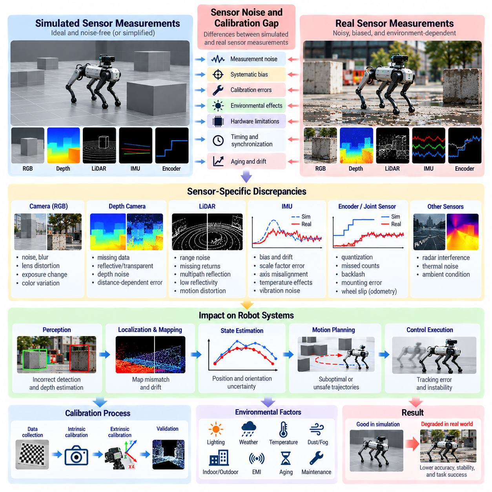{width="7.268055555555556in" height="7.268055555555556in"}

센서 잡음 및 보정 격차(Sensor Noise and Calibration Gap)는 시뮬레이션된 센서 측정값(Simulated Sensor Measurement)과 실제 로봇 시스템(Physical Robotic System)에서 획득한 관측값(Observation) 사이에 존재하는 차이를 의미한다. 이러한 불일치는 측정 잡음(Measurement Noise), 체계적 편향(Systematic Bias), 보정 오차(Calibration Error), 환경 간섭(Environmental Interference), 하드웨어 한계(Hardware Limitation)에서 발생한다. 피지컬 AI(Physical AI)에서 부정확한 센서 모델링(Sensor Modeling)은 인식(Perception), 위치 추정(Localization), 상태 추정(State Estimation), 운동 계획(Motion Planning), 학습된 정책(Learned Policy)의 신뢰성을 저하시킬 수 있다.

시뮬레이션 환경(Simulation Environment)은 정확한 기하학적 상태(Geometric State)와 물리적 상태(Physical State)로부터 생성된 이상화된 센서 출력(Idealized Sensor Output)을 제공하는 경우가 많다. 실제 센서는 불완전한 광학적(Optical), 전기적(Electrical), 기계적(Mechanical) 과정을 통해 환경을 측정한다. 센서 출력에는 작동 조건(Operating Condition)과 센서 특성(Sensor Characteristic)에 따라 달라지는 불확실성(Uncertainty)이 포함된다. 따라서 이상적인 관측값(Ideal Observation)으로 학습한 알고리즘은 실제 물리적 측정값(Physical Measurement)에 노출되면 신뢰성이 저하될 수 있다.

센서 잡음(Sensor Noise)은 실제 물리적 상태가 변하지 않더라도 측정값에 영향을 미치는 무작위 변동(Random Variation)을 포함한다. 일반적인 원인에는 전자 잡음(Electronic Noise), 광자 변동(Photon Fluctuation), 기계적 진동(Mechanical Vibration), 양자화 효과(Quantization Effect)가 있다. 특정 조건에서 잡음은 근사적으로 가우시안 분포(Gaussian Distribution)를 따를 수 있지만, 실제 측정값에는 단순화된 모델이 재현하지 못하는 상관 잡음(Correlated Noise), 비대칭 오차(Asymmetric Error), 두꺼운 꼬리 분포 오차(Heavy-Tailed Error)가 나타나는 경우가 많다.

체계적 편향(Systematic Bias)은 지속적인 측정 오프셋(Measurement Offset)이나 스케일 오차(Scale Error)를 발생시킨다는 점에서 무작위 잡음(Random Noise)과 다르다. 관성 센서(Inertial Sensor)는 정지 상태에서도 0이 아닌 각속도(Angular Velocity)를 출력할 수 있으며, 거리 센서(Distance Sensor)는 실제 거리보다 지속적으로 큰 값을 측정할 수 있다. 이러한 오차는 상태 추정(State Estimation)과 적분 과정(Integration Process)을 통해 누적되어 시뮬레이션 예측(Simulated Prediction)과 실제 로봇 동작(Actual Robotic Behavior) 사이에 상당한 차이를 발생시킬 수 있다.

카메라 센서(Camera Sensor)는 영상 잡음(Image Noise), 렌즈 왜곡(Lens Distortion), 노출(Exposure), 초점(Focus), 색상 응답(Color Response)과 관련된 복잡한 불일치를 발생시킨다. 시뮬레이션 카메라(Simulated Camera)는 정확하게 정의된 투영 매개변수(Projection Parameter)를 사용하여 깨끗한 영상을 생성하는 경우가 많다. 실제 카메라에는 롤링 셔터 효과(Rolling Shutter Effect), 모션 블러(Motion Blur), 센서 포화(Sensor Saturation), 불완전한 광학 정렬(Optical Alignment)이 존재한다. 이러한 특성은 시각적 인식(Visual Perception)과 특징 추적(Feature Tracking)의 정확도를 저하시킬 수 있다.

깊이 카메라(Depth Camera)와 구조광 센서(Structured-Light Sensor)는 깊이 측정(Depth Measurement)이 표면 반사율(Surface Reflectivity), 거리(Distance), 관측 각도(Viewing Angle), 조명(Illumination)에 따라 달라지기 때문에 추가적인 불확실성을 발생시킨다. 투명한 재질(Transparent Material), 반사 재질(Reflective Material), 어두운 재질(Dark Material)은 누락되거나 왜곡된 측정값을 생성할 수 있다. 따라서 완전한 기하학적 정보(Geometric Information)를 반환하는 시뮬레이션 깊이 센서(Simulated Depth Sensor)는 공간 인식(Spatial Perception)에 대해 비현실적인 가정을 형성할 수 있다.

라이다(LiDAR) 측정값은 거리 불확실성(Range Uncertainty), 각도 해상도(Angular Resolution), 빔 발산(Beam Divergence), 반사율(Reflectivity), 대기 조건(Atmospheric Condition)의 영향을 받는다. 실제 포인트 클라우드(Point Cloud)에는 누락된 반사 신호(Missing Return), 다중 경로 반사(Multipath Reflection), 운동으로 인한 왜곡(Motion-Induced Distortion)이 포함될 수 있다. 단순화된 시뮬레이션 라이다(Simulated LiDAR)는 이러한 효과 없이 기하학적으로 일관된 측정값을 생성하는 경우가 많아 장애물 검출(Obstacle Detection)과 지도 작성(Mapping)의 신뢰성을 과대평가할 수 있다.

관성 측정 장치(Inertial Measurement Unit, IMU)는 가속도계(Accelerometer)와 자이로스코프(Gyroscope)를 결합하여 운동(Motion)과 방향(Orientation)을 추정한다. 출력값은 편향 불안정성(Bias Instability), 스케일 계수 오차(Scale-Factor Error), 축 정렬 불량(Axis Misalignment), 진동(Vibration), 온도 변화(Temperature Variation)의 영향을 받는다. 작은 오차도 수치 적분(Numerical Integration) 과정에서 누적되어 방향 드리프트(Orientation Drift)와 위치 불확실성(Position Uncertainty)을 발생시킬 수 있다. 따라서 현실적인 시뮬레이션은 단기 잡음(Short-Term Noise)과 장기 드리프트(Long-Term Drift)를 모두 고려해야 한다.

바퀴 엔코더(Wheel Encoder)와 관절 위치 센서(Joint Position Sensor) 역시 센서 격차(Sensor Gap)에 영향을 미친다. 양자화(Quantization), 기계적 백래시(Mechanical Backlash), 펄스 누락(Missed Count), 부정확한 장착(Imperfect Mounting)은 측정된 운동(Measured Motion)과 실제 운동(Actual Motion) 사이에 불일치를 발생시킬 수 있다. 바퀴 주행 거리 추정(Wheel Odometry)은 미끄러짐(Slipping)과 유효 바퀴 반지름(Effective Wheel Radius)의 변화에도 영향을 받는다. 이러한 오차는 시뮬레이션 기계 모델(Mechanical Model)이 정확하더라도 위치 추정(Localization)과 제어(Control)의 성능을 저하시킬 수 있다.

보정(Calibration)은 원시 센서 측정값(Raw Sensor Measurement)과 의미 있는 물리량(Physical Quantity) 사이의 관계를 설정한다. 내부 보정(Intrinsic Calibration)은 센서 내부 매개변수(Internal Sensor Parameter)를 결정하며, 외부 보정(Extrinsic Calibration)은 센서와 로봇 좌표계(Robot Coordinate Frame) 사이의 공간 변환(Spatial Transformation)을 정의한다. 잘못된 보정은 측정 잡음이 비교적 작더라도 지속적인 체계적 기하학적 오차(Systematic Geometric Error)를 발생시킬 수 있다.

카메라 내부 보정(Camera Intrinsic Calibration)에는 초점 거리(Focal Length), 주점(Principal Point), 렌즈 왜곡 매개변수(Lens Distortion Parameter)가 포함된다. 이러한 값의 오차는 영상 투영(Image Projection)과 3차원 기하 구조 재구성(Three-Dimensional Geometry Reconstruction)에 영향을 미친다. 카메라, 라이다, 로봇 좌표계 사이의 외부 보정 오차(Extrinsic Calibration Error)는 관측값의 정렬 불량(Misaligned Observation)을 발생시켜 센서 융합(Sensor Fusion), 객체 위치 추정(Object Localization), 공간 지도 작성(Spatial Mapping)의 정확도를 저하시킬 수 있다.

시간적 보정(Temporal Calibration)도 중요하다. 센서는 서로 다른 샘플링 주파수(Sampling Frequency)로 작동하고 독립적인 처리 파이프라인(Processing Pipeline)을 통해 통신하는 경우가 많기 때문이다. 타임스탬프 오프셋(Timestamp Offset)과 동기화 오차(Synchronization Error)는 서로 다른 시점의 측정값이 잘못 결합되는 문제를 발생시킬 수 있다. 움직이는 로봇(Moving Robot)에서는 작은 시간 정렬 오차(Temporal Misalignment)도 인식(Perception)과 상태 추정(State Estimation) 과정에서 상당한 공간적 오차(Spatial Error)를 발생시킬 수 있다.

센서 특성(Sensor Characteristic)은 온도(Temperature), 진동(Vibration), 기계적 충격(Mechanical Shock), 노화(Aging), 유지보수 작업(Maintenance Activity)에 따라 시간적으로 변화할 수 있다. 카메라 마운트(Camera Mount)의 위치가 변하거나 관성 센서 편향(Inertial Sensor Bias)이 드리프트할 수 있으며, 광학 표면(Optical Surface)이 오염될 수도 있다. 초기 배포(Initial Deployment) 시점에 정확했던 보정도 점차 신뢰성을 잃을 수 있으므로 주기적인 검증(Periodic Verification)과 재보정(Recalibration)이 필요하다.

환경 조건(Environmental Condition)은 측정 품질(Measurement Quality)에 추가적인 영향을 미친다. 조명 변화(Lighting Variation)는 카메라에 영향을 주고, 강수(Precipitation)와 공기 중 입자(Airborne Particle)는 광학 거리 측정 센서(Optical Ranging Sensor)에 영향을 미치며, 전자기 간섭(Electromagnetic Interference)은 전자 측정(Electronic Measurement)을 방해할 수 있다. 온도 변화는 센서 응답(Sensor Response)과 보정 안정성(Calibration Stability)을 변화시킬 수 있다. 이러한 의존성을 무시하는 시뮬레이션 환경은 실제 운영 중 발생하는 불확실성(Uncertainty)을 과소평가할 수 있다.

센서 융합 시스템(Sensor Fusion System)은 카메라(Camera), 라이다(LiDAR), 관성 센서(Inertial Sensor), 엔코더(Encoder), 기타 측정 장치(Measurement Source)의 정보를 결합한다. 이러한 시스템의 성능은 정확한 불확실성 모델(Uncertainty Model)과 일관된 보정(Consistent Calibration)에 의존한다. 시뮬레이션 센서가 비현실적으로 정밀하거나 서로 독립적인 측정값을 제공하면 학습된 융합 알고리즘(Fusion Algorithm)은 실제 관측값에 부적절한 신뢰도(Confidence)를 부여하여 불안정한 상태 추정값(State Estimate)을 생성할 수 있다.

잡음 모델링(Noise Modeling)은 통계적 특성(Statistical Property)과 물리적 측정 메커니즘(Physical Measurement Mechanism)을 모두 고려해야 한다. 독립 가우시안 잡음(Independent Gaussian Noise)은 초기 실험에 충분할 수 있지만, 고급 시뮬레이션(Advanced Simulation)에서는 상관 잡음(Correlated Noise), 편향 드리프트(Bias Drift), 측정 누락(Dropout), 이상치(Outlier), 조건 의존적 불확실성(Condition-Dependent Uncertainty)이 필요할 수 있다. 적절한 모델 복잡도(Model Complexity)는 센서 유형(Sensor Type), 응용 요구사항(Application Requirement), 후속 알고리즘(Downstream Algorithm)의 민감도(Sensitivity)에 따라 결정된다.

센서 격차(Sensor Gap)를 정량화하려면 비교 가능한 조건에서 동기화된 시뮬레이션 측정값(Simulated Measurement)과 실제 측정값(Real Measurement)을 수집해야 한다. 유용한 평가 지표(Evaluation Metric)에는 측정 잔차(Measurement Residual), 편향 크기(Bias Magnitude), 분산(Variance), 드리프트율(Drift Rate), 보정 오차(Calibration Error), 검출 신뢰성(Detection Reliability)이 포함된다. 통계적 분포 비교(Statistical Distribution Comparison)는 잡음 특성의 차이를 식별할 수 있으며, 작업 수준 평가(Task-Level Evaluation)는 이러한 차이가 로봇 성능(Robotic Performance)에 미치는 영향을 보여준다.

통제된 보정 실험(Controlled Calibration Experiment)은 센서 오차(Sensor Error)를 환경적 영향(Environmental Effect)과 알고리즘 영향(Algorithmic Effect)으로부터 분리하는 실용적인 방법을 제공한다. 기준 표적(Reference Target), 정밀 운동 시스템(Precision Motion System), 독립적으로 측정된 정답 데이터(Ground Truth)를 활용하여 측정 정확도(Measurement Accuracy)를 평가할 수 있다. 다양한 온도, 거리, 방향, 작동 조건에서 반복 실험(Repeated Experiment)을 수행하면 센서 불확실성(Sensor Uncertainty)이 어떻게 변화하는지 확인할 수 있다.

도메인 무작위화(Domain Randomization)는 학습 과정에서 센서 잡음(Sensor Noise), 편향(Bias), 해상도(Resolution), 왜곡(Distortion), 측정 누락 확률(Dropout Probability), 보정 매개변수(Calibration Parameter)를 변화시켜 강건성(Robustness)을 향상시킬 수 있다. 이를 통해 인식 및 제어 정책(Perception and Control Policy)은 다양한 관측 조건(Observation Condition)에 노출된다. 그러나 과도한 무작위화(Excessive Randomization)는 비현실적인 측정값(Unrealistic Measurement)을 발생시킬 수 있으므로 가능한 경우 매개변수 범위(Parameter Range)는 실험적으로 확인된 센서 동작(Empirical Sensor Behavior)을 반영해야 한다.

센서 적응 기법(Sensor Adaptation Technique)은 합성 관측값(Synthetic Observation)과 실제 관측값(Physical Observation) 사이의 불일치를 줄일 수 있다. 보정 개선(Calibration Refinement), 필터링(Filtering), 정규화(Normalization), 학습 기반 측정 보정(Learned Measurement Correction)은 일부 체계적인 차이(Systematic Difference)를 보상할 수 있다. 충분한 실제 측정값이 확보되면 데이터 기반 적응(Data-Driven Adaptation)이 성능을 향상시킬 수 있지만, 보정 결과(Correction)는 안정성(Stability)과 일반화 성능(Generalization)에 대해 평가되어야 한다.

불확실성 인지형 인식 및 제어(Uncertainty-Aware Perception and Control)는 센서 불일치에 대한 추가적인 보호 수단을 제공한다. 확률적 상태 추정(Probabilistic State Estimation), 신뢰도 가중 센서 융합(Confidence-Weighted Sensor Fusion), 강건한 계획(Robust Planning)은 불완전한 측정값(Imperfect Measurement)을 고려할 수 있다. 이러한 방법은 모든 관측값이 정확하다고 가정하는 대신 불확실성(Uncertainty)을 명시적으로 표현하고 측정 신뢰성(Measurement Reliability)에 따라 로봇의 의사결정(Robotic Decision-Making)을 조정한다.

궁극적으로 센서 잡음 및 보정 격차(Sensor Noise and Calibration Gap)를 줄이기 위해서는 현실적인 측정 모델(Realistic Measurement Model), 정확한 공간 및 시간 보정(Spatial and Temporal Calibration), 실험적 검증(Empirical Validation), 지속적인 센서 성능 모니터링(Continuous Sensor Performance Monitoring)이 필요하다. 효과적인 시뮬레이션과 현실 간 전이(Sim2Real Transfer)는 현실적인 관측값을 생성하는 것뿐만 아니라 측정값이 불완전하거나 편향되고 잡음이 포함되거나 일시적으로 사용할 수 없는 상황에서도 신뢰성을 유지하는 알고리즘을 개발하는 데 달려 있다.

## 08.07. Latency Communication and Timing Gap

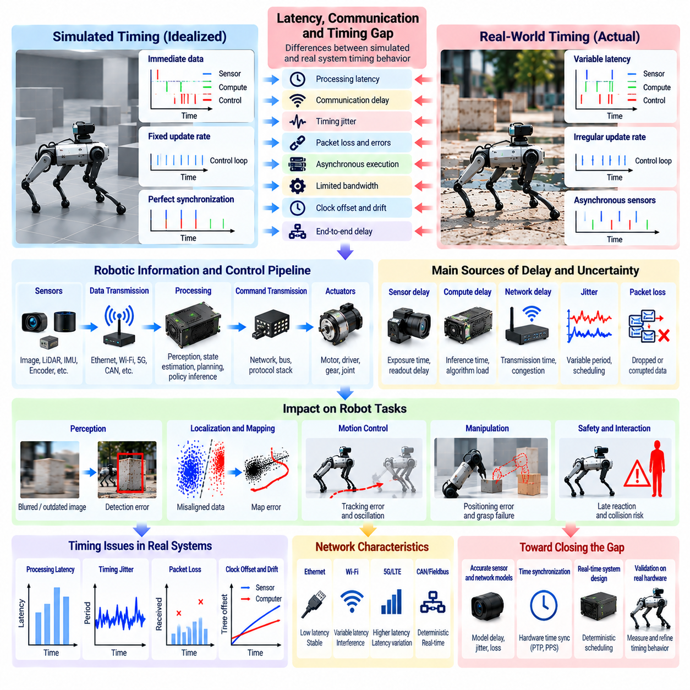{width="7.268055555555556in" height="7.268055555555556in"}

지연, 통신 및 타이밍 격차(Latency, Communication, and Timing Gap)는 시뮬레이션된 정보 교환(Simulated Information Exchange)과 실제 로봇 시스템의 시간적 동작(Temporal Behavior) 사이에 존재하는 차이를 의미한다. 시뮬레이션 환경(Simulation Environment)은 결정론적 실행(Deterministic Execution), 즉각적인 데이터 가용성(Immediate Data Availability), 정밀하게 동기화된 구성 요소(Precisely Synchronized Component)를 가정하는 경우가 많다. 피지컬 AI(Physical AI) 시스템은 처리 지연(Processing Delay), 통신 불확실성(Communication Uncertainty), 비동기 하드웨어(Asynchronous Hardware) 환경에서 작동하므로 인식(Perception), 계획(Planning), 제어(Control), 운영 안전성(Operational Safety)에 영향을 미치는 불일치가 발생한다.

지연 시간(Latency)은 특정 사건(Event)이 발생한 시점부터 이를 관측하고 해당 시스템이 응답하기까지 경과한 시간을 의미한다. 로봇 시스템에서는 센서 데이터 획득(Sensor Acquisition), 데이터 전송(Data Transmission), 연산(Computation), 의사결정(Decision-Making), 구동기 실행(Actuator Execution) 과정에서 지연이 발생한다. 이러한 지연은 전체 제어 파이프라인(Control Pipeline)에 걸쳐 누적된다. 따라서 즉각적인 관측과 동작(Instantaneous Observation and Action)을 가정하여 학습한 정책(Policy)은 실제 하드웨어에 배포되었을 때 너무 늦게 반응할 수 있다.

통신 지연(Communication Delay)은 분산 로봇 아키텍처(Distributed Robotic Architecture)에 추가적인 불확실성을 발생시킨다. 센서(Sensor), 임베디드 제어기(Embedded Controller), 엣지 컴퓨터(Edge Computer), 클라우드 서비스(Cloud Service)는 제한된 대역폭(Finite Bandwidth)과 가변적인 전송 시간(Variable Transmission Time)을 가진 네트워크를 통해 정보를 교환한다. 이더넷(Ethernet), 무선 연결(Wireless Connection), 산업용 통신 버스(Industrial Communication Bus)는 서로 다른 타이밍 특성(Timing Characteristic)을 나타낸다. 단순화된 시뮬레이션 모델은 이러한 변화를 간과하여 시스템 응답성(System Responsiveness)을 과대평가할 수 있다.

타이밍 결정성(Timing Determinism)은 시뮬레이션과 현실을 구분하는 또 다른 중요한 요소다. 시뮬레이션 엔진(Simulation Engine)은 고정된 시간 간격(Fixed Time Step)과 예측 가능한 스케줄링 규칙(Predictable Scheduling Rule)에 따라 작업을 실행하는 경우가 많다. 실제 컴퓨팅 플랫폼(Computing Platform)에서는 운영체제 스케줄링 지연(Operating-System Scheduling Delay), 프로세서 자원 경합(Processor Contention), 인터럽트(Interrupt), 백그라운드 작업 부하(Background Workload)가 발생한다. 이러한 요인은 실행 지터(Execution Jitter)를 유발하여 제어 갱신(Control Update)과 센서 처리(Sensor Processing)가 불규칙한 간격으로 수행되도록 만든다.

제어 루프 주파수(Control Loop Frequency)는 로봇 안정성(Robotic Stability)과 궤적 추종 정확도(Trajectory Tracking Accuracy)에 큰 영향을 미친다. 고정된 갱신 주기(Fixed Update Rate)를 기준으로 설계된 제어기는 관측값과 명령이 예측 가능한 간격으로 도착한다고 가정한다. 실제 실행 주기(Execution Period)가 변하면 수치 계산(Numerical Calculation)과 피드백 보정(Feedback Correction)의 일관성이 저하될 수 있다. 이러한 타이밍 편차(Timing Deviation)는 진동(Oscillation), 궤적 추종 성능 저하(Degraded Trajectory Tracking), 외란 억제 성능 감소(Reduced Disturbance Rejection)를 발생시킬 수 있다.

센서 데이터 획득 타이밍(Sensor Acquisition Timing)은 이상화된 시뮬레이션에서 드러나지 않는 불일치를 발생시킨다. 카메라(Camera), 라이다(LiDAR), 관성 센서(Inertial Sensor), 엔코더(Encoder)는 서로 다른 샘플링 주파수(Sampling Frequency)와 데이터 획득 지연(Acquisition Delay)을 가진다. 이러한 센서의 측정값은 동시에 전달되더라도 서로 다른 물리적 시점(Physical Moment)을 나타낼 수 있다. 정확한 타임스탬프(Timestamp)와 동기화(Synchronization)가 없으면 센서 융합 알고리즘(Sensor Fusion Algorithm)은 동일한 시스템 상태(System State)를 설명하지 않는 관측값을 결합할 수 있다.

시간적 동기화(Temporal Synchronization)는 다중 센서 인식(Multi-Sensor Perception)과 상태 추정(State Estimation)에 필수적이다. 클록 오프셋(Clock Offset), 클록 드리프트(Clock Drift), 일관되지 않은 타임스탬프 규칙(Inconsistent Timestamp Convention)은 독립적인 장치에서 획득한 측정값의 시간 정렬을 어긋나게 할 수 있다. 이러한 오차는 로봇이 빠르게 이동하거나 동적 객체(Dynamic Object)를 관측할 때 특히 중요해진다. 완벽하게 동기화된 센서 스트림(Sensor Stream)을 제공하는 시뮬레이션 환경은 실제 위치 추정(Localization)과 인식(Perception)에서 발생하는 오차를 과소평가할 수 있다.

통신 지터(Communication Jitter)는 일정한 전송 지연(Constant Transmission Delay)이 아니라 메시지 전달 시간(Message Delivery Time)의 변동을 의미한다. 네트워크 혼잡(Network Congestion), 패킷 스케줄링(Packet Scheduling), 무선 간섭(Wireless Interference), 재전송 메커니즘(Retransmission Mechanism)은 예측하기 어려운 도착 시간(Arrival Time)을 발생시킬 수 있다. 제어기는 일정한 지연을 허용하더라도 가변 지연(Variable Latency)에서는 불안정해질 수 있다. 따라서 현실적인 시뮬레이션은 평균 지연(Average Delay)과 시간적 변동성(Temporal Variability)을 모두 표현해야 한다.

패킷 손실(Packet Loss)과 메시지 손상(Message Corruption)은 추가적인 통신 불일치를 발생시킨다. 무선 네트워크(Wireless Network)와 과부하된 통신 채널(Overloaded Communication Channel)은 메시지를 누락시키거나 불완전한 정보를 전달할 수 있다. 로봇 소프트웨어(Robotic Software)는 누락된 데이터(Missing Data)를 감지하고 통신 타임아웃(Communication Timeout)을 처리하며 일시적인 통신 중단(Temporary Communication Interruption) 중에도 안전한 동작을 유지해야 한다. 완벽한 메시지 전달(Perfect Message Delivery)을 가정하는 시뮬레이션은 중단 없는 피드백(Uninterrupted Feedback)에 의존하는 정책을 생성할 수 있다.

대역폭 제한(Bandwidth Limitation)은 고해상도 영상(High-Resolution Image), 포인트 클라우드(Point Cloud), 빈번한 제어 메시지(Frequent Control Message)를 전송하는 시스템에 영향을 미친다. 통신 요구량(Communication Demand)이 사용 가능한 용량(Available Capacity)을 초과하면 버퍼링(Buffering), 압축(Compression), 메시지 폐기(Message Dropping)가 필요해진다. 이러한 메커니즘은 지연 시간을 증가시키거나 정보 품질(Information Quality)을 저하시킬 수 있다. 그 결과 인식 및 제어 동작은 무제한 데이터 전송(Unlimited Data Transfer)을 가정한 시뮬레이션 환경과 상당히 달라질 수 있다.

분산 컴퓨팅 아키텍처(Distributed Computing Architecture)는 처리 위치(Processing Location) 사이에 시간적 의존성(Timing Dependency)을 발생시킨다. 엣지 프로세서(Edge Processor)는 시간 민감형 인식 및 제어(Time-Critical Perception and Control)를 수행하고, 온프레미스 서버(On-Premises Server)나 클라우드 플랫폼(Cloud Platform)은 계산 집약적인 계획 및 학습(Computationally Intensive Planning and Learning)을 수행할 수 있다. 이러한 계층 사이의 통신은 가변 지연(Variable Delay)을 추가한다. 따라서 즉각적인 물리적 응답(Immediate Physical Response)이 필요한 작업은 로컬 처리(Local Processing) 및 통신 제약조건(Communication Constraint)에 적합하도록 설계되어야 한다.

종단 간 지연(End-to-End Latency)은 개별 처리 지연(Individual Processing Delay)을 독립적으로 분석하는 것보다 더 많은 정보를 제공한다. 전체 응답 경로(Response Path)에는 센서 노출(Sensor Exposure), 데이터 전송(Data Transfer), 전처리(Preprocessing), 추론(Inference), 계획(Planning), 명령 전송(Command Transmission), 구동기 응답(Actuator Response)이 포함된다. 지연은 누적되며 파이프라인 버퍼링(Pipeline Buffering)은 데이터 경과 시간(Data Age)을 증가시킬 수 있다. 전체 관측-동작 간격(Observation-to-Action Interval)을 측정하면 로봇 시스템이 운영 타이밍 요구사항(Operational Timing Requirement)을 충족할 수 있는지 판단하는 데 도움이 된다.

추론 지연(Inference Latency)은 학습 기반 로봇 제어(Learning-Based Robotic Control)에서 특히 중요하다. 심층 신경망(Deep Neural Network)은 모델 크기(Model Size), 하드웨어 가속(Hardware Acceleration), 입력 해상도(Input Resolution), 동시 작업 부하(Concurrent Workload)에 따라 상당한 연산량(Computation)을 요구할 수 있다. 시뮬레이션 학습(Simulation Training)은 빠른 정책 평가(Policy Evaluation)를 가정할 수 있지만, 실제 배포 시스템은 제한된 처리 능력(Processing Capacity)에 직면한다. 가변적인 추론 시간(Variable Inference Time)은 제어 주파수(Control Frequency)를 낮추고 오래된 상태에 기반한 동작 결정(Outdated Action Decision)을 발생시킬 수 있다.

비동기 처리(Asynchronous Processing)는 계산 효율(Computational Efficiency)을 향상시킬 수 있지만 시간적 일관성(Temporal Consistency)을 복잡하게 만든다. 인식(Perception), 지도 작성(Mapping), 계획(Planning), 제어(Control) 모듈은 서로 다른 주파수로 독립적으로 작동할 수 있다. 메시지는 순서가 뒤바뀌어 도착할 수 있으며, 후속 모듈(Downstream Module)은 오래된 정보(Stale Information)를 사용할 수 있다. 명시적인 데이터 경과 시간 관리(Data-Age Management)가 없으면 로봇은 더 이상 유효하지 않은 환경 상태(Environmental State)를 기반으로 동작을 실행할 수 있다.

타이밍 불일치(Timing Discrepancy)는 고속 또는 접촉 중심 작업(High-Speed or Contact-Rich Operation)에서 특히 중요해진다. 고속 조작(Rapid Manipulation), 동적 파지(Dynamic Grasping), 다족 보행(Legged Locomotion), 긴급 장애물 회피(Emergency Obstacle Avoidance)는 센싱(Sensing)과 구동(Actuation)의 정밀한 협조를 요구한다. 비교적 작은 지연도 접촉 시점(Contact Timing)을 변화시키고 피드백 제어(Feedback Control)를 불안정하게 만들거나 정지 거리(Stopping Distance)를 증가시킬 수 있다. 허용 가능한 지연 시간(Acceptable Latency)은 로봇 동역학(Robot Dynamics), 작업 속도(Task Speed), 안전 요구사항(Safety Requirement)에 따라 달라진다.

다중 로봇 시스템(Multi-Robot System)은 추가적인 동기화 및 통신 문제(Synchronization and Communication Challenge)에 직면한다. 플릿 협조(Fleet Coordination), 공유 지도 작성(Shared Mapping), 협조 조작(Cooperative Manipulation), 교통 관리(Traffic Management)는 적시에 이루어지는 정보 교환(Timely Information Exchange)에 의존한다. 네트워크 지연(Network Delay)은 로봇들이 공유 환경(Shared Environment)에 대해 서로 일치하지 않는 표현을 기반으로 행동하도록 만들 수 있다. 따라서 신뢰할 수 있는 협조(Reliable Coordination)를 위해서는 지연된 갱신(Delayed Update), 메시지 순서(Message Ordering), 일시적인 통신 장애(Temporary Communication Failure)를 명시적으로 처리해야 한다.

실시간 운영체제(Real-Time Operating System, RTOS)와 결정론적 통신 프로토콜(Deterministic Communication Protocol)은 타이밍 불확실성(Timing Uncertainty)을 줄일 수 있다. 우선순위 스케줄링(Priority Scheduling), 실행 시간 상한(Bounded Execution Time), 동기화된 클록(Synchronized Clock), 예약된 통신 자원(Reserved Communication Resource)은 예측 가능한 동작(Predictable Operation)을 유지하는 데 도움이 된다. 그러나 결정론적 인프라(Deterministic Infrastructure)가 모든 지연을 제거하는 것은 아니다. 하드웨어 한계(Hardware Limitation), 소프트웨어 복잡성(Software Complexity), 예상하지 못한 작업 부하(Unexpected Workload)는 시스템 설계 및 검증(System Design and Validation) 과정에서 계속 고려되어야 한다.

타이밍 격차(Timing Gap)를 정량화하려면 지연 분포(Latency Distribution), 실행 지터(Execution Jitter), 통신 처리량(Communication Throughput), 패킷 손실(Packet Loss), 동기화 정확도(Synchronization Accuracy)를 측정해야 한다. 평균 지연(Average Latency)만으로는 충분하지 않다. 드물게 발생하는 지연이 안전 필수 성능(Safety-Critical Performance)을 결정할 수 있기 때문이다. 백분위 지연(Percentile Latency), 관측된 최악 지연(Worst-Case Observation), 데드라인 미준수율(Deadline-Miss Rate), 메시지 경과 시간(Message Age)은 현실적인 운영 조건에서 시간적 동작을 더욱 완전하게 설명한다.

통제된 실험(Controlled Experiment)은 타이밍 병목현상(Timing Bottleneck)과 로봇 성능에 미치는 영향을 식별할 수 있다. 엔지니어는 인위적인 지연(Artificial Delay)을 주입하거나 네트워크 부하(Network Load)를 변화시키고 통신 중단(Communication Interruption)을 발생시키면서 시스템 응답(System Response)을 기록할 수 있다. 시뮬레이션 측정값(Simulation Measurement)과 하드웨어 측정값(Hardware Measurement)을 비교하면 모델링된 타이밍 특성(Modelled Timing Characteristic)이 실제를 대표하는지 판단할 수 있다. 작업 수준 지표(Task-Level Metric)는 이러한 불일치를 추종 오차(Tracking Error), 충돌 위험(Collision Risk), 작업 완료 신뢰성(Completion Reliability)과 연결한다.

지연 무작위화(Latency Randomization)는 시뮬레이션과 현실 간 전이(Sim2Real Transfer)의 강건성(Robustness)을 향상시키는 실용적인 전략이다. 학습 환경(Training Environment)에서는 센서 지연(Sensor Delay), 동작 지연(Action Delay), 통신 지터(Communication Jitter), 제어 갱신 간격(Control Update Interval)을 다양하게 변화시킬 수 있다. 이를 통해 정책은 즉각적인 피드백(Instantaneous Feedback)에 의존하지 않고 불완전한 타이밍(Imperfect Timing)을 견디도록 학습된다. 무작위화 분포(Randomization Distribution)는 측정된 하드웨어 동작(Measured Hardware Behavior)과 물리적으로 타당한 통신 조건(Plausible Communication Condition)을 반영해야 한다.

지연 인지형 제어 방법(Delay-Aware Control Method)은 로봇 의사결정(Robotic Decision-Making)에 타이밍 불확실성(Timing Uncertainty)을 명시적으로 반영한다. 상태 예측(State Prediction), 타임스탬프 기반 보상(Timestamp-Based Compensation), 버퍼링 전략(Buffering Strategy), 모델 예측 제어(Model Predictive Control, MPC)는 지연된 관측값(Delayed Observation)의 영향을 줄일 수 있다. 제어기는 과거 측정값(Historical Measurement)과 알려진 동역학(Known Dynamics)을 활용하여 현재 상태(Current State)를 추정할 수 있다. 이러한 방법의 효과는 예측 정확도(Prediction Accuracy)와 타이밍 변동성(Timing Variability)의 크기에 따라 달라진다.

하드웨어 인 더 루프 시험(Hardware-in-the-Loop Testing, HIL Testing)은 이상적인 시뮬레이션(Ideal Simulation)과 실제 물리적 배포(Physical Deployment) 사이의 중요한 연결 단계를 제공한다. 실제 프로세서(Real Processor), 통신 인터페이스(Communication Interface), 제어기(Controller)는 구현별 타이밍 특성(Implementation-Specific Timing Characteristic)을 유지하면서 시뮬레이션 로봇(Simulated Robot)과 상호작용할 수 있다. 이러한 시험은 순수 시뮬레이션(Pure Simulation)에서 간과하기 쉬운 스케줄링 충돌(Scheduling Conflict), 인터페이스 지연(Interface Delay), 통신 장애(Communication Failure)를 발견할 수 있지만, 완전한 물리적 검증(Physical Validation)은 여전히 필요하다.

궁극적으로 지연, 통신 및 타이밍 격차(Latency, Communication, and Timing Gap)를 줄이기 위해서는 현실적인 시간 모델링(Realistic Temporal Modeling), 동기화된 센싱(Synchronized Sensing), 신뢰할 수 있는 통신(Reliable Communication), 타이밍 인지형 제어 설계(Timing-Aware Control Design)가 필요하다. 성공적인 시뮬레이션과 현실 간 전이(Sim2Real Transfer)는 물리 동역학(Physical Dynamics)을 일치시키는 것뿐만 아니라 정보와 동작이 필요한 시점에 도착하도록 보장하는 데 달려 있다. 강건한 피지컬 AI 시스템(Robust Physical AI System)은 가변적인 연산 시간(Variable Computation Time), 네트워크 조건(Network Condition), 실행 지연(Execution Delay) 속에서도 예측 가능하고 안전한 동작(Predictable and Safe Behavior)을 유지해야 한다.

## 08.08. Environment Weather and Human Behavior Gap

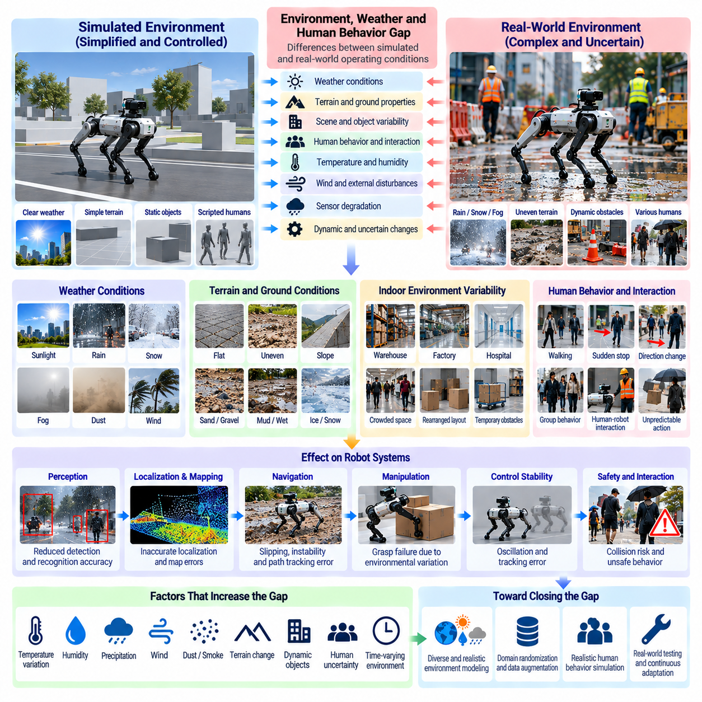{width="7.268055555555556in" height="7.268055555555556in"}

환경, 기상 및 인간 행동 격차(Environment, Weather, and Human Behavior Gap)는 시뮬레이션된 운영 조건(Simulated Operating Condition)과 실제 로봇이 직면하는 복잡하고 지속적으로 변화하는 상황 사이의 차이를 의미한다. 시뮬레이션 환경(Simulation Environment)은 단순화된 기상 조건(Weather Condition), 예측 가능한 주변 환경(Predictable Surroundings), 사전에 정의된 인간 활동(Predefined Human Activity)을 표현하는 경우가 많다. 실제 환경에는 인식(Perception), 이동성(Mobility), 조작(Manipulation), 의사결정(Decision-Making), 운영 안전성(Operational Safety)에 영향을 미치는 상호작용하는 불확실성(Interacting Uncertainty)이 존재한다.

환경 변동성(Environmental Variability)은 조명(Lighting), 온도(Temperature), 습도(Humidity), 지형(Terrain), 표면 상태(Surface Condition), 주변 객체(Surrounding Object)의 변화에서 발생한다. 이러한 요소는 장소(Location), 계절(Season), 운영 시간(Operating Period)에 따라 달라질 수 있다. 안정적인 시뮬레이션 환경에서 학습한 로봇은 환경 특성(Environmental Property)이 예상하지 못한 방식으로 변화할 때 성능이 저하될 수 있다. 신뢰할 수 있는 시뮬레이션과 현실 간 전이(Sim2Real Transfer)를 위해서는 정상 운영 조건(Nominal Operating Condition)의 가정을 넘어서는 다양한 환경에 노출되어야 한다.

기상(Weather)은 완전하게 재현하기 어려운 물리적 및 인지적 교란(Physical and Perceptual Disturbance)을 발생시킨다. 비(Rain), 눈(Snow), 안개(Fog), 바람(Wind), 극한 온도(Extreme Temperature)는 센서 측정값(Sensor Measurement)과 기계적 상호작용(Mechanical Interaction)에 영향을 미친다. 강수(Precipitation)는 가시성(Visibility)을 감소시킬 수 있으며, 바람은 이동 로봇(Mobile Robot)과 비행 로봇(Aerial Robot)에 영향을 미치는 외력(External Force)을 발생시킨다. 단순화된 기상 모델(Weather Model)은 이러한 교란의 복합적인 영향(Combined Effect)을 과소평가할 수 있다.

비와 습기(Rain and Moisture)는 여러 메커니즘을 통해 로봇 운영(Robotic Operation)에 영향을 미친다. 젖은 표면(Wet Surface)은 마찰(Friction)과 접지력(Traction)을 변화시키며, 카메라 렌즈(Camera Lens)에 맺힌 물방울은 시각적 관측값(Visual Observation)을 왜곡한다. 습기는 전기 연결부(Electrical Connection)와 외부에 노출된 기계 부품(Mechanical Component)에도 영향을 미칠 수 있다. 따라서 건조한 표면(Dry Surface)에서 학습한 내비게이션 정책(Navigation Policy)은 예상하지 못한 미끄러짐(Slipping), 부정확한 장애물 검출(Inaccurate Obstacle Detection), 제어 안정성 저하(Reduced Control Stability)를 경험할 수 있다.

눈과 얼음(Snow and Ice)은 환경의 기하학적 구조(Environmental Geometry)와 표면 특성(Surface Property)을 모두 변화시키므로 추가적인 문제를 발생시킨다. 눈의 축적(Snow Accumulation)은 도로 표시(Road Marking), 이동 경로(Pathway), 장애물(Obstacle), 지형 경계(Terrain Boundary)를 가릴 수 있다. 얼음은 사용 가능한 접지력(Available Traction)을 감소시키고 제동 동작(Braking Behavior)을 변화시킨다. 겨울철 조건(Winter Condition)을 시각적 외관(Visual Appearance)으로만 표현하는 시뮬레이션은 접촉 동역학(Contact Dynamics)과 이동성(Mobility)에 발생하는 변화를 제대로 반영하지 못할 수 있다.

안개(Fog), 먼지(Dust), 연기(Smoke), 공기 중 입자(Airborne Particle)는 광학 센싱(Optical Sensing)과 환경 해석(Environmental Interpretation)에 영향을 미친다. 카메라는 대비 감소(Reduced Contrast)를 경험할 수 있으며, 라이다(LiDAR) 측정값에는 산란(Scattering), 감쇠(Attenuation), 잘못된 반사 신호(False Return)가 포함될 수 있다. 이러한 교란은 입자 밀도(Particle Density), 거리(Distance), 조명(Illumination)에 따라 달라진다. 맑은 대기 조건(Clear Atmospheric Condition)을 가정하는 센서 모델(Sensor Model)은 인식(Perception)과 위치 추정(Localization)에 대해 비현실적으로 높은 신뢰도(Confidence)를 생성할 수 있다.

바람(Wind)은 로봇 플랫폼(Robotic Platform)의 종류에 따라 서로 다른 영향을 미치는 동적 교란(Dynamic Disturbance)을 발생시킨다. 비행 로봇(Aerial Robot)은 자세(Attitude), 위치(Position), 에너지 소비(Energy Consumption)에 영향을 주는 공기역학적 힘(Aerodynamic Force)을 받는다. 이동 로봇(Mobile Robot)은 바람에 날리는 잔해(Wind-Driven Debris)나 불안정한 경량 물체(Unstable Lightweight Object)를 마주할 수 있다. 실외 매니퓰레이터(Outdoor Manipulator)는 변화하는 접촉 조건(Contact Condition)을 경험할 수 있다. 현실적인 평가(Realistic Evaluation)에서는 풍속(Wind Intensity), 풍향(Wind Direction), 변동성(Variability), 작업 민감도(Task Sensitivity)를 고려해야 한다.

온도와 습도(Temperature and Humidity)는 센서(Sensor), 구동기(Actuator), 배터리(Battery), 기계 부품(Mechanical Component)에 영향을 미친다. 낮은 온도(Low Temperature)는 배터리 성능(Battery Performance)을 저하시키고 윤활제 특성(Lubricant Property)을 변화시킬 수 있으며, 높은 온도(High Temperature)는 열 보호 기능(Thermal Protection)을 작동시킬 수 있다. 습도는 결로(Condensation)와 재료 거동(Material Behavior)에 영향을 줄 수 있다. 환경 시뮬레이션(Environmental Simulation)은 장시간 운영(Long-Duration Operation)과 계절별 성능(Seasonal Performance)을 평가할 때 이러한 의존성을 고려해야 한다.

지형 및 지면 조건(Terrain and Ground Condition)은 환경 불일치(Environmental Discrepancy)의 또 다른 중요한 원인이다. 실제 표면(Real Surface)에는 불균일성(Unevenness), 느슨한 재료(Loose Material), 경사(Slope), 움푹 팬 지면(Pothole), 변화하는 마찰 특성(Friction Characteristic)이 존재한다. 단순화된 시뮬레이션 지형(Simulated Terrain)은 국부적인 변형(Local Deformation)이나 불규칙한 접촉(Irregular Contact)을 재현하지 못할 수 있다. 이러한 차이는 바퀴 미끄러짐(Wheel Slip), 다족 보행(Legged Locomotion), 안정성(Stability), 내비게이션 작업(Navigation Task)에 필요한 에너지에 영향을 미친다.

실내 환경(Indoor Environment)은 기상으로부터 보호받더라도 상당한 변동성(Variability)을 나타낸다. 창고(Warehouse), 공장(Factory), 병원(Hospital), 상업 시설(Commercial Facility)에는 이동 장비(Moving Equipment), 임시 장애물(Temporary Obstacle), 변화하는 배치(Changing Layout), 예측하기 어려운 활동(Unpredictable Activity)이 존재한다. 고정된 디지털 환경(Fixed Digital Environment)에서 학습한 로봇은 물체가 이동하거나 통로가 막히면 어려움을 겪을 수 있다. 따라서 장면 다양성(Scene Diversity)은 강건한 배포(Robust Deployment)를 위한 필수 요소다.

인간 행동(Human Behavior)은 정적인 환경 변화(Static Environmental Variation)와 근본적으로 다른 불확실성을 발생시킨다. 사람은 목표(Goal), 주의(Attention), 사회적 관습(Social Convention), 변화하는 상황(Changing Circumstance)에 따라 의사결정을 내린다. 인간의 움직임(Human Movement)은 현재의 기하학적 정보(Geometry)나 속도(Velocity)만으로 항상 예측할 수 있는 것은 아니다. 고정된 궤적(Fixed Trajectory)을 따르는 시뮬레이션 인간 에이전트(Simulated Human Agent)는 망설임(Hesitation), 갑작스러운 방향 전환(Sudden Direction Change), 예상하지 못한 상호작용(Unexpected Interaction)을 제대로 표현하지 못할 수 있다.

인간 움직임 예측(Human Motion Prediction)은 공유 공간(Shared Space)에서 작동하는 로봇에 특히 중요하다. 보행자(Pedestrian)는 갑자기 멈추거나 보행 속도(Walking Speed)를 변경하고, 집단(Group)을 형성하거나 로봇의 예정 경로(Intended Path)를 가로지를 수 있다. 또한 인간의 행동은 로봇 자체에 대한 반응에 따라 달라진다. 사람을 수동적으로 움직이는 장애물(Passive Moving Obstacle)로 취급하는 시뮬레이션 환경은 이러한 상호 반응(Reciprocal Interaction)을 간과하고 내비게이션 복잡성(Navigation Complexity)을 과소평가할 수 있다.

사회적 내비게이션(Social Navigation)은 단순한 충돌 회피(Collision Avoidance) 이상의 요소를 고려해야 한다. 적절한 행동(Appropriate Behavior)은 대인 거리(Interpersonal Distance), 통행 관습(Passing Convention), 통행 우선권에 대한 기대(Right-of-Way Expectation), 상황 인식(Contextual Awareness)에 따라 달라진다. 이러한 기대는 장소와 상황에 따라 차이가 있다. 단순화된 보행자 모델(Pedestrian Model)을 사용하여 학습한 정책은 기하학적 안전 제약조건(Geometric Safety Constraint)을 충족하더라도 불편하거나 사회적으로 부적절한 움직임(Socially Inappropriate Movement)을 생성할 수 있다.

인간-로봇 협업(Human-Robot Collaboration)은 추가적인 행동 불확실성(Behavioral Uncertainty)을 발생시킨다. 작업자(Worker)는 예상하지 못한 시점에 장비에 접근하거나 작업 순서(Task Sequence)를 변경하고 로봇 작업(Robotic Operation)에 개입할 수 있다. 의사소통(Communication)은 음성(Speech), 제스처(Gesture), 신체 자세(Body Posture), 암묵적 협조(Implicit Coordination)를 통해 이루어질 수 있다. 사전 정의된 스크립트(Predefined Script)를 기반으로 하는 시뮬레이션 상호작용(Simulated Interaction)은 오해(Misunderstanding), 응답 지연(Delayed Response), 개인별 행동 차이(Individual Behavioral Variation)를 충분히 반영하지 못할 수 있다.

환경 및 인간 관련 불확실성(Environmental and Human Uncertainty)은 빈번하게 상호작용한다. 비가 내리면 보행자가 더 빠르게 이동하거나 다른 경로를 선택할 수 있으며, 혼잡한 공간(Crowded Space)은 장애물 가시성(Obstacle Visibility)과 내비게이션 선택지(Navigation Option)를 변화시킬 수 있다. 조명 변화(Lighting Change)는 인간의 제스처(Gesture)와 의도(Intention)를 인식하는 능력에 영향을 줄 수 있다. 이러한 요소를 독립적으로 평가하면 더 큰 운영상의 어려움을 발생시키는 복합 상황(Compound Situation)을 간과할 수 있다.

인간 행동 모델링(Human Behavior Modeling)은 현실성(Realism), 다양성(Diversity), 계산 효율(Computational Efficiency) 사이의 균형을 요구한다. 에이전트 기반 시뮬레이션(Agent-Based Simulation), 확률적 운동 모델(Probabilistic Motion Model), 학습 기반 행동 정책(Learned Behavioral Policy)은 다양한 보행자 상호작용(Pedestrian Interaction)을 생성할 수 있다. 그러나 이러한 방법은 인간의 의사결정(Human Decision-Making)과 사회적 행동(Social Behavior)에 관한 가정에 의존한다. 따라서 생성된 결과는 현실을 완전하게 설명하는 것으로 간주하기보다 대표적인 실제 관측값(Representative Observation)과 비교하여 평가해야 한다.

도메인 무작위화(Domain Randomization)는 기상 강도(Weather Intensity), 조명(Illumination), 지형 특성(Terrain Property), 장애물 배치(Obstacle Placement), 인간 활동 패턴(Human Activity Pattern)을 변화시켜 환경 강건성(Environmental Robustness)을 향상시킬 수 있다. 다양한 조건에서 학습하면 이상화된 시나리오(Idealized Scenario)에 대한 의존성이 감소한다. 그러나 무작위화는 강수(Precipitation), 가시성(Visibility), 표면 마찰(Surface Friction) 사이의 관계와 같이 변수 간의 의미 있는 연관성(Meaningful Relationship)을 유지해야 한다.

시나리오 기반 시험(Scenario-Based Testing)은 특정 운영상의 문제(Operational Challenge)를 검토함으로써 무작위화를 보완한다. 대표적인 사례에는 혼잡한 복도(Crowded Corridor)에서의 이동, 젖은 바닥(Wet Floor) 통과, 바람에 날리는 장애물(Wind-Driven Obstacle) 회피, 갑작스러운 보행자 움직임(Sudden Pedestrian Movement)에 대한 대응이 포함된다. 시나리오는 환경 교란(Environmental Disturbance)과 인간 상호작용(Human Interaction)을 결합할 수 있다. 이러한 접근법은 일반적인 시뮬레이션 학습(Simulation Training)에서 드러나지 않는 실패를 식별하는 데 도움이 된다.

환경 및 인간 행동 격차(Environment and Human Behavior Gap)를 정량화하려면 시뮬레이션 조건(Simulated Condition)과 실제 관측값(Physical Observation)을 연결하는 측정이 필요하다. 환경 지표(Environmental Metric)에는 가시성(Visibility), 접지력(Traction), 온도(Temperature), 센서 신뢰성(Sensor Reliability)이 포함될 수 있다. 인간 상호작용 지표(Human Interaction Metric)에는 예측 오차(Prediction Error), 최소 이격 거리(Minimum Separation Distance), 개입 빈도(Intervention Frequency), 사회적 규범 준수도(Social Compliance)가 포함될 수 있다. 작업 성공률(Task Success Rate)과 안전 결과(Safety Outcome)는 이를 보완하는 필수적인 평가 근거를 제공한다.

실제 환경 데이터 수집(Real-World Data Collection)은 더욱 대표성 있는 환경 및 행동 모델(Environmental and Behavioral Model)을 구축하는 데 도움이 된다. 센서 기록(Sensor Recording), 기상 관측(Weather Observation), 운영 로그(Operational Log), 익명화된 이동 궤적(Anonymized Movement Trajectory)은 시뮬레이션에서 누락된 조건을 드러낼 수 있다. 이러한 데이터셋(Dataset)은 다양한 장소(Location), 운영 시간(Operating Period), 활동 수준(Activity Level)을 포함해야 한다. 인간 행동 정보(Human Behavior Information)를 수집할 때는 개인정보 보호(Privacy Protection)와 적절한 데이터 거버넌스(Data Governance)가 특히 중요하다.

디지털 트윈(Digital Twin)은 변화하는 환경 조건(Environmental Condition)과 운영 활동(Operational Activity)을 가상 시험 환경(Virtual Testing Environment)에 반영할 수 있다. 갱신된 지도(Updated Map), 기상 정보(Weather Information), 장비 상태(Equipment State), 관측된 이동 패턴(Observed Movement Pattern)은 시뮬레이션의 현실 적합성(Simulation Relevance)을 유지하는 데 도움이 된다. 그러나 디지털 트윈이 모든 예상하지 못한 사건(Unexpected Event)을 예측할 수 있는 것은 아니다. 그 가치는 적시 갱신(Timely Update), 불확실성 표현(Uncertainty Representation), 실제 운영 조건(Actual Operating Condition)에 대한 검증에 달려 있다.

궁극적으로 환경, 기상 및 인간 행동 격차(Environment, Weather, and Human Behavior Gap)를 줄이기 위해서는 다양한 시뮬레이션 시나리오(Diverse Simulation Scenario), 현실적인 교란 모델(Realistic Disturbance Model), 적응형 인식(Adaptive Perception), 안전 인지형 의사결정(Safety-Aware Decision-Making)이 필요하다. 성공적인 시뮬레이션과 현실 간 전이(Sim2Real Transfer)는 하나의 이상적인 환경(Ideal Environment)을 재현하는 것보다 익숙하지 않은 조건(Unfamiliar Condition)에 대응하는 능력에 달려 있다. 강건한 피지컬 AI 시스템(Robust Physical AI System)은 환경 변화(Environmental Change)와 예측하기 어려운 인간 활동(Unpredictable Human Activity)에 대응하면서도 신뢰할 수 있는 동작(Reliable Behavior)을 유지해야 한다.

## 08.09. Robot Morphology Wear and Aging Gap

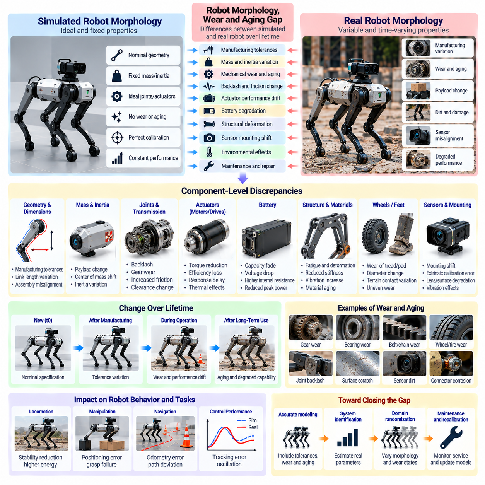{width="7.268055555555556in" height="7.268055555555556in"}

로봇 형태, 마모 및 노화 격차(Robot Morphology, Wear, and Aging Gap)는 시뮬레이션에서 가정한 구조적 및 기계적 특성(Structural and Mechanical Properties)과 실제 로봇이 전체 운영 수명(Operational Lifetime) 동안 나타내는 특성 사이의 차이를 의미한다. 시뮬레이션 로봇(Simulated Robot)은 일반적으로 고정된 기하학적 구조(Geometry), 질량 분포(Mass Distribution), 관절 특성(Joint Characteristics), 구동기 성능(Actuator Performance)을 유지한다. 실제 시스템은 제조 편차(Manufacturing Variation), 기계적 마모(Mechanical Wear), 변형(Deformation), 재료 노화(Material Aging)를 경험하며, 이러한 변화는 로봇의 동작 특성을 점진적으로 변화시킨다.

로봇 형태(Robot Morphology)는 링크(Link), 관절(Joint), 구동기(Actuator), 센서(Sensor), 지지 구조물(Supporting Structure)의 물리적 배치(Physical Arrangement)를 정의한다. 이러한 특성은 로봇의 운동학(Kinematics), 동역학(Dynamics), 도달 가능 작업 공간(Reachable Workspace), 상호작용 능력(Interaction Capability)을 결정한다. 시뮬레이션 모델(Simulation Model)은 일반적으로 공칭 설계 매개변수(Nominal Design Parameter)를 사용하여 형태를 표현한다. 그러나 실제 제조된 로봇은 공차(Tolerance), 조립 편차(Assembly Variation), 부품 차이(Component Difference)로 인해 디지털 모델(Digital Model)과 완벽하게 일치하지 않는다.

제조 공차(Manufacturing Tolerance)는 로봇이 작동을 시작하기 전부터 기하학적 불일치(Geometric Discrepancy)를 발생시킨다. 링크 길이(Link Length), 관절 위치(Joint Position), 장착 각도(Mounting Angle), 기계적 간극(Mechanical Clearance)은 설계 의도값(Intended Design Value)과 조금씩 다를 수 있다. 이러한 편차는 운동학적 체인(Kinematic Chain)을 따라 누적되어 말단효과기 위치 오차(End-Effector Positioning Error)를 발생시킬 수 있다. 따라서 이상적인 기하학적 구조(Ideal Geometry)를 기준으로 보정된 제어기(Controller)는 실제 하드웨어(Physical Hardware)에 적용되었을 때 체계적인 정확도 저하(Systematic Inaccuracy)를 나타낼 수 있다.

질량 분포(Mass Distribution)와 관성 특성(Inertia Property)도 시뮬레이션 로봇과 실제 로봇 사이에서 차이가 발생한다. 배선(Wiring), 체결 부품(Fastener), 보호 커버(Protective Cover), 배터리(Battery), 제조상의 차이(Manufacturing Difference)는 질량중심(Center of Mass)을 이동시키거나 회전 관성(Rotational Inertia)을 변화시킬 수 있다. 이러한 변화는 가속도(Acceleration), 균형(Balance), 필요한 구동기 토크(Required Actuator Torque)에 영향을 미친다. 특히 동적 조작(Dynamic Manipulation), 다족 보행(Legged Locomotion), 고속 이동 로봇(High-Speed Mobile Robotics)에서 그 영향이 중요해진다.

기계적 마모(Mechanical Wear)는 반복적인 운동(Repeated Motion), 하중(Loading), 마찰(Friction), 접촉(Contact)을 통해 발생한다. 베어링(Bearing), 기어(Gear), 벨트(Belt), 바퀴(Wheel), 관절 접촉면(Joint Interface)은 시간이 지나면서 기계적 특성(Mechanical Characteristic)이 점진적으로 변화한다. 마모는 백래시(Backlash), 마찰 변동성(Friction Variability), 진동(Vibration), 위치 불확실성(Positioning Uncertainty)을 증가시킬 수 있다. 일정한 기계적 매개변수(Mechanical Parameter)를 유지하는 시뮬레이션 모델은 장기간 운영되는 실제 로봇의 특성을 점차 정확하게 표현하지 못하게 된다.

백래시(Backlash)와 기계적 간극(Mechanical Clearance)은 특히 다관절 로봇 시스템(Articulated Robotic System)에서 중요하다. 반복적인 하중은 동력 전달 부품(Transmission Component) 사이의 간극을 확대하여 동작 지연(Delayed Motion)이나 방향 의존적 위치 오차(Direction-Dependent Positioning Error)를 발생시킬 수 있다. 이러한 현상은 히스테리시스(Hysteresis)를 유발하고 제어 정밀도(Control Precision)를 저하시킬 수 있다. 단순화된 강체 관절 모델(Rigid-Joint Model)은 명령된 움직임(Commanded Movement)과 실제 움직임(Actual Movement) 사이에 발생하는 차이를 충분히 재현하지 못하는 경우가 많다.

마찰 특성(Friction Characteristic)은 표면 마모(Surface Wear), 윤활 상태 변화(Lubrication Change), 오염물 축적(Contaminant Accumulation)에 따라 변화한다. 정지 마찰(Static Friction), 동마찰(Dynamic Friction), 속도 의존적 저항(Velocity-Dependent Resistance)은 온도(Temperature)와 운영 이력(Operating History)에 따라 달라질 수 있다. 고정된 마찰 계수(Friction Coefficient)를 사용하여 학습한 제어기는 예상하지 못한 추종 오차(Tracking Error)나 진동(Oscillation)을 경험할 수 있다. 현실적인 장기 시뮬레이션(Long-Term Simulation)은 발생 가능한 마찰 변화(Friction Variation)와 매개변수 드리프트(Parameter Drift)를 표현해야 한다.

구동기 노화(Actuator Aging)는 명령 입력(Commanded Input)과 기계적 출력(Mechanical Output) 사이의 관계를 변화시킨다. 전기 모터(Electric Motor)는 베어링 열화(Bearing Degradation), 열 스트레스(Thermal Stress), 전기 저항(Electrical Resistance)의 변화를 경험할 수 있다. 감속기(Gearbox)와 동력 전달 장치(Transmission Mechanism)는 마모로 인해 효율이 저하될 수 있다. 이러한 과정은 토크 전달(Torque Delivery)을 감소시키고 에너지 소비(Energy Consumption)를 증가시키며 응답 동역학(Response Dynamics)을 변화시켜 공칭 구동기 모델(Nominal Actuator Model)이 표현하지 못하는 불일치를 발생시킨다.

배터리 노화(Battery Aging)는 이동 로봇(Mobile Robot)과 자율 로봇(Autonomous Robot)에 추가적인 성능 변동(Performance Variation)을 발생시킨다. 반복적인 충전 주기(Charging Cycle), 온도 노출(Temperature Exposure), 운영 조건(Operating Condition)은 사용 가능한 용량(Available Capacity)과 내부 저항(Internal Resistance)에 점진적으로 영향을 미친다. 부하 상태에서 발생하는 전압 강하(Voltage Sag)는 구동기 성능(Actuator Performance)과 사용 가능한 컴퓨팅 전력(Available Computing Power)을 감소시킬 수 있다. 일정한 배터리 특성(Battery Characteristic)을 가정하는 시뮬레이션은 운용 지속시간(Endurance), 가속 능력(Acceleration Capability), 운영 일관성(Operational Consistency)을 과대평가할 수 있다.

구조적 피로(Structural Fatigue)와 변형(Deformation)은 시간이 지남에 따라 로봇 형태(Robot Morphology)를 변화시킬 수 있다. 반복적인 응력 주기(Stress Cycle)는 미세한 손상(Microscopic Damage)을 발생시킬 수 있으며, 지속적인 하중(Sustained Loading)은 특정 부품에 영구 변형(Permanent Deformation)을 유발할 수 있다. 유연한 구조물(Flexible Structure)은 강성(Stiffness)이나 감쇠(Damping) 특성의 변화를 나타낼 수도 있다. 이러한 현상은 특히 경량 매니퓰레이터(Lightweight Manipulator)와 순응형 로봇 플랫폼(Compliant Robotic Platform)에서 진동(Vibration), 위치 정확도(Positioning Accuracy), 접촉 동작(Contact Behavior)에 영향을 미친다.

바퀴와 타이어 마모(Wheel and Tire Wear)는 이동 로봇 동역학(Mobile Robot Dynamics)에 상당한 영향을 미친다. 바퀴 직경(Wheel Diameter), 트레드 상태(Tread Condition), 재료 강성(Material Stiffness)의 변화는 주행 거리 추정(Odometry), 접지력(Traction), 구름 저항(Rolling Resistance)에 영향을 준다. 바퀴 사이의 불균일한 마모(Uneven Wear)는 체계적인 조향 편차(Systematic Steering Deviation)를 발생시킬 수 있다. 따라서 차동 구동(Differential Drive)이나 독립 조향 휠 모듈(Independently Steered Wheel Module)을 사용하는 로봇은 제어 소프트웨어(Control Software)가 변경되지 않더라도 내비게이션 오차(Navigation Error)를 경험할 수 있다.

다족 로봇(Legged Robot)은 발 재료(Foot Material), 관절 동력 전달 장치(Joint Transmission), 하중 지지 구조물(Load-Bearing Structure)과 관련된 형태 변화(Morphology Change)에 직면한다. 발의 마모(Foot Wear)는 접촉 기하학(Contact Geometry)과 마찰(Friction)을 변화시키며, 관절 열화(Joint Degradation)는 운동 정확도(Motion Accuracy)와 힘 전달(Force Transmission)을 변화시킨다. 다리 사이의 작은 비대칭성(Asymmetry)은 보행 안정성(Gait Stability)과 에너지 소비(Energy Consumption)에 영향을 미칠 수 있다. 완벽하게 대칭적인 시뮬레이션 몸체(Simulated Body)에서 학습한 정책은 이러한 누적된 차이에 민감해질 수 있다.

조작 시스템(Manipulation System)은 그리퍼(Gripper), 손가락 끝(Fingertip), 접촉 인터페이스(Contact Interface)에서 노화 효과(Aging Effect)를 경험한다. 반복적인 파지(Repeated Grasping)는 표면 질감(Surface Texture), 순응성(Compliance), 마찰 특성(Friction Property)을 변화시킬 수 있다. 기계적 마모(Mechanical Wear)는 손가락 정렬(Finger Alignment)과 파지력 분포(Gripping Force Distribution)도 변화시킬 수 있다. 이러한 변화는 특히 깨지기 쉬운 물체(Fragile Object)나 불규칙한 형상의 물체(Irregularly Shaped Object)를 조작할 때 파지 안정성(Grasp Stability), 물체 취급(Object Handling), 힘 제어(Force Control)에 영향을 미친다.

센서 장착 구조물(Sensor Mounting Structure)은 진동(Vibration), 기계적 충격(Mechanical Shock), 반복적인 유지보수(Repeated Maintenance)로 인해 변화할 수 있다. 카메라(Camera), 라이다(LiDAR), 관성 센서(Inertial Sensor)의 장착 위치가 조금만 변해도 외부 보정(Extrinsic Calibration)과 좌표 변환(Coordinate Transformation)이 달라진다. 구조적 변형(Structural Deformation)은 하중이 가해지는 동안 유사한 영향을 발생시킬 수 있다. 따라서 형태 변화(Morphology Change)는 단순한 기계적 불일치(Mechanical Discrepancy)에 머무르지 않고 인식 오차(Perception Error)와 위치 추정 오차(Localization Error)로 확산될 수 있다.

환경 노출(Environmental Exposure)은 특정 노화 과정(Aging Process)을 가속한다. 온도 사이클(Temperature Cycling), 습도(Humidity), 먼지(Dust), 부식(Corrosion), 화학적 오염(Chemical Contamination)은 재료(Material), 커넥터(Connector), 밀봉 부품(Seal), 기계적 접촉면(Mechanical Interface)에 영향을 미칠 수 있다. 실외 로봇(Outdoor Robot)과 산업용 로봇 플랫폼(Industrial Robotic Platform)은 실험실 시스템(Laboratory System)과 서로 다른 열화 패턴(Degradation Pattern)을 경험할 수 있다. 시뮬레이션 모델은 장기 신뢰성(Long-Term Reliability)과 유지보수 요구사항(Maintenance Requirement)을 평가할 때 관련 운영 환경(Operating Environment)을 반영해야 한다.

형태 격차(Morphology Gap)에는 명목상 동일한 로봇 개체(Nominally Identical Robot Unit) 사이의 편차도 포함된다. 동일한 설계로 제조된 두 로봇이라도 마찰(Friction), 정렬(Alignment), 구동기 효율(Actuator Efficiency), 구조 강성(Structural Stiffness)이 서로 다를 수 있다. 한 로봇에서 우수한 성능을 나타내는 정책(Policy)도 다른 로봇에서는 조정이 필요할 수 있다. 따라서 플릿 규모 배포(Fleet-Scale Deployment)에서는 개체 간 편차(Unit-to-Unit Variation)와 각 로봇에서 시간에 따라 발생하는 변화(Temporal Change)를 모두 평가하는 것이 중요하다.

형태 및 노화 불일치(Morphology and Aging Discrepancy)를 정량화하려면 기하학적 구조(Geometry), 질량 특성(Mass Property), 관절 응답(Joint Response), 마찰(Friction), 강성(Stiffness), 구동기 성능(Actuator Performance)을 측정해야 한다. 유용한 지표(Indicator)에는 위치 오차(Positioning Error), 백래시 크기(Backlash Magnitude), 토크 효율(Torque Efficiency), 진동 수준(Vibration Level), 에너지 소비(Energy Consumption)가 포함된다. 운영 시간(Operating Hour)이나 작동 주기(Duty Cycle)에 걸쳐 반복적으로 측정하면 점진적인 열화(Gradual Degradation)와 일반적인 측정 변동성(Measurement Variability)을 구분하는 추세를 파악할 수 있다.

시스템 식별(System Identification)은 실제 로봇에서 수집한 관측값(Observation)을 활용하여 시뮬레이션 매개변수(Simulation Parameter)를 갱신할 수 있다. 관절 가진 시험(Joint Excitation Test), 하중 측정(Load Measurement), 운동 추적(Motion Tracking), 구동기 응답 분석(Actuator Response Analysis)은 변화하는 기계적 특성(Mechanical Property)을 추정하는 데 도움이 된다. 이러한 추정값은 디지털 모델 정확도(Digital Model Accuracy)를 향상시키고 제어기 재보정(Controller Recalibration)을 지원할 수 있다. 그러나 식별 절차(Identification Procedure)는 측정 불확실성(Measurement Uncertainty)을 고려하고 열화된 하드웨어(Degraded Hardware)에 위험한 가진(Unsafe Excitation)을 가하지 않도록 해야 한다.

도메인 무작위화(Domain Randomization)는 링크 치수(Link Dimension), 질량 분포(Mass Distribution), 마찰(Friction), 관절 강성(Joint Stiffness), 백래시(Backlash), 구동기 효율(Actuator Efficiency)의 변화에 정책을 노출하는 보완적인 접근법이다. 물리적으로 타당한 매개변수 범위(Plausible Parameter Range)에서 학습하면 제조 편차(Manufacturing Variation)와 노화(Aging)에 대한 허용 능력(Tolerance)을 향상시킬 수 있다. 무작위화는 물리적 일관성(Physical Consistency)을 유지해야 하며 구조적 또는 운영상 제약조건(Structural or Operational Constraint)을 위반하는 매개변수 조합(Parameter Combination)을 피해야 한다.

형태 인지형 제어(Morphology-Aware Control)는 물리적 구조(Physical Structure)와 기계적 능력(Mechanical Capability)의 변화에 로봇 동작을 적응시킨다. 적응 제어(Adaptive Control), 온라인 매개변수 추정(Online Parameter Estimation), 강건 최적화(Robust Optimization)는 중간 수준의 특성 변화(Moderate Variation)를 보상할 수 있다. 학습 기반 시스템(Learning-Based System)에서는 정책이 추정된 하드웨어 상태(Estimated Hardware Condition)나 최근 운동 이력(Recent Motion History)을 반영할 수 있다. 이러한 적응은 유효 운영 기간(Useful Operation)을 연장할 수 있지만 열화가 안전 한계(Safe Limit)를 초과하면 유지보수(Maintenance)를 대체할 수 없다.

예지보전(Predictive Maintenance)은 형태 상태 모니터링(Morphology Monitoring)과 운영 의사결정(Operational Decision-Making)을 연결한다. 진동(Vibration), 온도(Temperature), 모터 전류(Motor Current), 위치 오차(Positioning Error), 에너지 소비(Energy Consumption)의 변화 추세는 진행 중인 기계적 문제(Developing Mechanical Problem)를 나타낼 수 있다. 상태 기반 유지보수 전략(Condition-Based Maintenance Strategy)은 이러한 관측값을 활용하여 점검(Inspection)이나 부품 교체(Component Replacement) 일정을 결정한다. 유지보수 정보(Maintenance Information)를 시뮬레이션과 통합하면 잔여 성능(Remaining Performance)과 운영 위험(Operational Risk)에 대한 추정 정확도를 향상시킬 수 있다.

궁극적으로 로봇 형태, 마모 및 노화 격차(Robot Morphology, Wear, and Aging Gap)를 줄이기 위해서는 정확한 초기 모델링(Accurate Initial Modeling), 주기적인 매개변수 식별(Periodic Parameter Identification), 현실적인 열화 가정(Realistic Degradation Assumption), 적응형 제어 전략(Adaptive Control Strategy)이 필요하다. 시뮬레이션과 현실 간 전이(Sim2Real Transfer)는 로봇을 고정된 기계 구조(Fixed Mechanical Structure)가 아니라 지속적으로 변화하는 물리 시스템(Evolving Physical System)으로 고려해야 한다. 신뢰할 수 있는 피지컬 AI 배포(Reliable Physical AI Deployment)는 부품이 마모되고 재료가 노화되며 기계적 특성이 변화하는 과정에서도 성능(Performance)과 안전성(Safety)을 유지하는 데 달려 있다.

## 08.10. Unmodeled Dynamics and Parameter Error

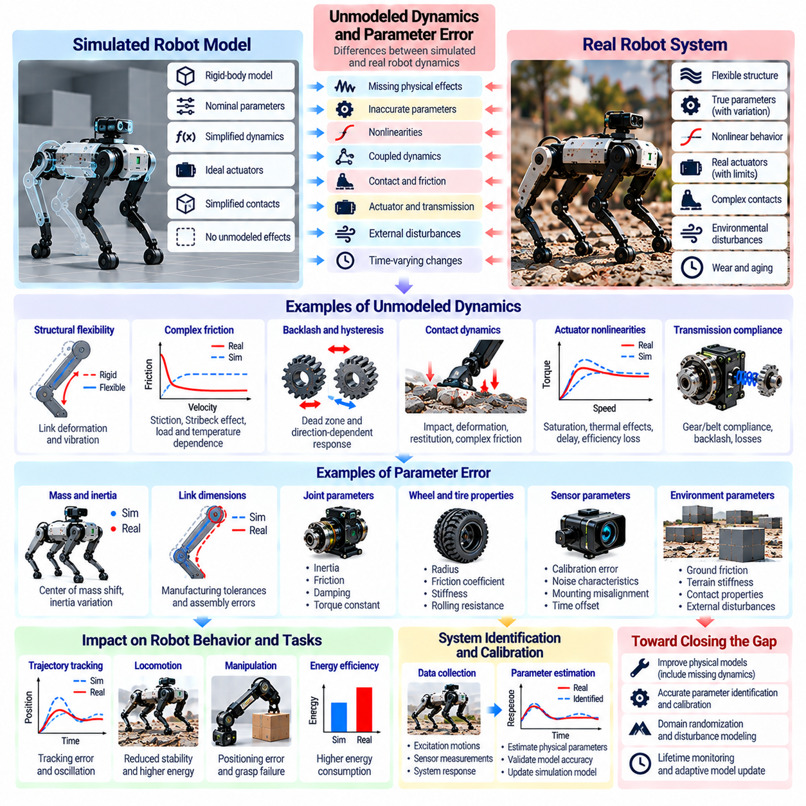{width="7.268055555555556in" height="7.268055555555556in"}

모델링되지 않은 동역학 및 매개변수 오차(Unmodeled Dynamics and Parameter Error)는 시뮬레이션 로봇(Simulated Robot)과 실제 물리 시스템(Physical System) 사이에 발생하는 주요 불일치 원인이다. 시뮬레이션 모델(Simulation Model)은 수학적 방정식(Mathematical Equation)과 추정된 매개변수(Estimated Parameter)를 사용하여 기계적 동작(Mechanical Behavior)을 근사하지만, 실제 로봇에는 식별하거나 재현하기 어려운 물리적 현상이 존재한다. 이러한 불일치는 운동 예측(Motion Prediction), 제어 안정성(Control Stability), 접촉 동작(Contact Behavior), 시뮬레이션에서 전이된 정책(Transferred Policy)의 신뢰성에 영향을 미친다.

모델링되지 않은 동역학(Unmodeled Dynamics)은 시뮬레이션 모델에서 생략되거나 충분히 표현되지 않은 물리적 현상(Physical Phenomenon)을 의미한다. 대표적인 사례에는 구조적 유연성(Structural Flexibility), 복잡한 마찰(Complex Friction), 기계적 백래시(Mechanical Backlash), 구동기 비선형성(Actuator Nonlinearity), 진동(Vibration)이 포함된다. 지배 방정식(Governing Equation)이 이론적으로 정확하더라도 누락된 상호작용(Neglected Interaction)은 고속 운동(Rapid Motion), 높은 하중(High Loading), 접촉 중심 조작(Contact-Rich Manipulation) 과정에서 상당한 예측 오차(Prediction Error)를 발생시킬 수 있다.

매개변수 오차(Parameter Error)는 시뮬레이션에 적절한 물리적 메커니즘(Physical Mechanism)이 포함되어 있지만 부정확한 수치값(Numerical Value)이 할당되었을 때 발생한다. 질량(Mass), 관성(Inertia), 마찰 계수(Friction Coefficient), 강성(Stiffness), 감쇠(Damping), 구동기 상수(Actuator Constant)는 실제 물리적 특성과 다를 수 있다. 이러한 오차는 가속도(Acceleration), 에너지 소비(Energy Consumption), 궤적 추종(Trajectory Tracking), 접촉력(Contact Force)을 변화시킬 수 있다. 그 영향은 로봇 구성(Robot Configuration)과 운영 조건(Operating Condition)에 따라 달라진다.

모델링되지 않은 동역학(Unmodeled Dynamics)과 매개변수 오차(Parameter Error)를 구분하는 것은 적절한 보정 전략(Corrective Strategy)을 선택하는 데 중요하다. 매개변수 오차는 보정(Calibration)과 시스템 식별(System Identification)을 통해 줄일 수 있지만, 누락된 물리적 메커니즘(Missing Physical Mechanism)은 모델 구조(Model Structure)의 변경이 필요하다. 수치 매개변수(Numerical Parameter)를 조정하는 것만으로는 생략된 동역학(Omitted Dynamics)을 항상 보상할 수 없다. 따라서 정확한 격차 분석(Gap Analysis)은 구조적 불확실성(Structural Uncertainty)과 매개변수 불확실성(Parametric Uncertainty)을 모두 고려해야 한다.

강체 동역학 시뮬레이션(Rigid-Body Simulation)은 로봇 운동(Robotic Motion)을 계산 효율적으로 표현할 수 있기 때문에 널리 사용된다. 그러나 실제 물리적 구조물(Physical Structure)은 하중이 가해지면 변형되며, 유연한 부품(Flexible Component)은 탄성 에너지(Elastic Energy)를 저장하고 방출한다. 이러한 효과는 진동(Oscillation), 응답 지연(Delayed Response), 예상하지 못한 접촉력(Unexpected Contact Force)을 발생시킬 수 있다. 경량 링크(Lightweight Link)나 순응형 동력 전달 장치(Compliant Transmission)를 사용하는 로봇은 강체 모델(Rigid-Body Model)로 충분히 재현하기 어려운 동작을 나타낼 수 있다.

마찰(Friction)은 속도(Velocity), 하중(Load), 온도(Temperature), 윤활(Lubrication), 표면 상태(Surface Condition)에 따라 달라지기 때문에 특히 모델링하기 어려운 오차 원인이다. 단순한 쿨롱 마찰 모델(Coulomb Friction Model)이나 점성 마찰 모델(Viscous Friction Model)은 정지 마찰에 의한 고착 현상(Stiction), 스트리벡 효과(Stribeck Effect), 히스테리시스(Hysteresis)를 충분히 표현하지 못할 수 있다. 그 결과 시뮬레이션 관절(Simulated Joint)은 실제 관절보다 부드럽게 움직일 수 있으며, 저속 위치 제어(Low-Speed Positioning)와 힘 민감형 작업(Force-Sensitive Operation)에서 오차가 발생할 수 있다.

접촉 동역학(Contact Dynamics)은 충격(Impact), 변형(Deformation), 반발(Restitution), 마찰 상호작용(Frictional Interaction)을 통해 추가적인 불확실성을 발생시킨다. 수치 접촉 해석기(Numerical Contact Solver)는 이산 시간 간격(Discrete Time Step)과 단순화된 제약조건(Simplified Constraint)을 사용하여 이러한 현상을 근사한다. 실제 접촉(Real Contact)에는 미세한 표면 불규칙성(Microscopic Surface Irregularity)과 비선형 재료 거동(Nonlinear Material Behavior)이 포함될 수 있다. 작은 모델링 차이(Modeling Difference)도 파지 안정성(Grasp Stability), 충돌 응답(Collision Response), 다족 보행(Legged Locomotion)을 크게 변화시킬 수 있다.

구동기 모델(Actuator Model)에도 시스템 동역학(System Dynamics)에 영향을 미치는 불확실성이 존재한다. 전기 모터(Electric Motor), 유압 시스템(Hydraulic System), 공압 구동기(Pneumatic Actuator)는 포화(Saturation), 열적 영향(Thermal Effect), 내부 지연(Internal Delay), 비선형 응답(Nonlinear Response)을 나타낸다. 단순화된 토크 또는 힘 발생원(Simplified Torque or Force Source)은 이러한 특성을 무시할 수 있다. 따라서 시뮬레이션 제어기(Simulated Controller)는 실제 구동기가 정확하고 일관되게 재현할 수 없는 동작을 명령할 수 있다.

기계적 동력 전달 장치(Mechanical Transmission)는 기어 순응성(Gear Compliance), 백래시(Backlash), 효율 손실(Efficiency Loss), 하중 의존적 마찰(Load-Dependent Friction)을 통해 추가적인 불일치를 발생시킨다. 벨트(Belt), 감속기(Gearbox), 하모닉 드라이브(Harmonic Drive)는 가속(Acceleration), 방향 전환(Reversal), 지속적인 하중(Sustained Loading) 조건에서 서로 다른 응답을 나타낼 수 있다. 이러한 효과는 토크 전달(Torque Transmission)과 위치 정확도(Positioning Accuracy)에 영향을 미친다. 이를 생략하면 제어 대역폭(Control Bandwidth)과 기계적 응답성(Mechanical Responsiveness)에 대한 비현실적인 가정이 형성될 수 있다.

매개변수 불확실성(Parameter Uncertainty)은 제조 공차(Manufacturing Tolerance), 불완전한 사양(Incomplete Specification), 측정 한계(Measurement Limitation), 변화하는 운영 조건(Changing Operating Condition)에서 발생할 수 있다. 로봇의 질량중심(Center of Mass)이나 관절 관성(Joint Inertia)은 배선(Wiring), 부착물(Attachment), 탑재 하중 변화(Payload Variation)로 인해 설계 추정값(Design Estimate)과 다를 수 있다. 정밀하게 보정된 매개변수(Calibrated Parameter)도 시간이 지나면서 변화할 수 있다. 따라서 고정된 시뮬레이션 매개변수(Static Simulation Parameter)는 실제 물리적 동작(Physical Behavior)의 전체 범위를 항상 표현할 수 있는 것은 아니다.

로봇 구성 요소(Robot Component) 사이의 동적 결합(Dynamic Coupling)은 모델링 불일치(Modeling Discrepancy)를 증폭시킬 수 있다. 한 관절(Joint)의 운동은 관성력(Inertial Force), 구조적 변형(Structural Deformation), 공유 전력 제한(Shared Power Limitation)을 통해 다른 관절에 영향을 미칠 수 있다. 단순화된 모델(Simplified Model)은 계산 효율(Computational Efficiency)을 높이기 위해 영향이 작은 결합 항(Coupling Term)을 생략하는 경우가 있다. 그러나 이러한 누락된 상호작용(Neglected Interaction)은 협조적인 고속 운동(Coordinated High-Speed Movement)이나 무거운 물체의 조작(Heavy Object Manipulation) 과정에서 중요해질 수 있다.

외부 교란(External Disturbance)은 예측 오차(Prediction Error)의 또 다른 원인이다. 불균일한 지형(Uneven Terrain), 예상하지 못한 접촉(Unexpected Contact), 진동(Vibration), 공기 흐름(Airflow), 움직이는 탑재물(Moving Payload)은 공칭 시뮬레이션 모델(Nominal Simulation Model)에 포함되지 않은 힘을 발생시킬 수 있다. 외란 억제(Disturbance Rejection)는 제어기 설계(Controller Design)와 상태 추정(State Estimation)의 정확도에 모두 의존한다. 현실적인 교란 없이 학습한 정책(Policy)은 비교적 작은 환경 변화(Environmental Change)에도 민감해질 수 있다.

모델 불일치(Model Mismatch)는 반복적인 예측 및 제어 주기(Prediction and Control Cycle)를 거치면서 시간에 따라 누적될 수 있다. 가속도(Acceleration)나 각속도(Angular Velocity)의 작은 오차도 위치(Position)와 방향(Orientation)에 대한 추정값을 점점 부정확하게 만들 수 있다. 모델 예측 제어(Model Predictive Control, MPC)에서는 부정확한 동역학(Inaccurate Dynamics)으로 인해 계획된 궤적(Planned Trajectory)이 실제 운동(Actual Motion)에서 벗어날 수 있다. 그 결과 발생하는 피드백 보정(Feedback Correction)은 에너지 소비(Energy Consumption), 추종 오차(Tracking Error), 불안정성(Instability)을 증가시킬 수 있다.

시스템 식별(System Identification)은 측정된 로봇 동작(Measured Robot Behavior)으로부터 알려지지 않은 물리적 매개변수(Unknown Physical Parameter)를 추정하는 체계적인 접근법을 제공한다. 통제된 가진(Controlled Excitation), 운동 추적(Motion Tracking), 힘 측정(Force Measurement), 구동기 응답 분석(Actuator Response Analysis)을 통해 질량 특성(Mass Property), 마찰(Friction), 감쇠(Damping), 동적 응답(Dynamic Response)을 파악할 수 있다. 그러나 매개변수 식별 가능성(Parameter Identifiability)은 사용 가능한 측정값(Available Measurement)과 가진 조건(Excitation Condition)에 따라 달라진다. 서로 다른 매개변수 조합(Parameter Combination)이 유사한 관측 동작(Observed Behavior)을 생성할 수도 있다.

잔차 동역학 모델링(Residual Dynamics Modeling)은 예측된 상태 전이(Predicted Transition)와 실제 측정된 상태 전이(Measured Transition) 사이의 불일치를 학습함으로써 해석적 시뮬레이션(Analytical Simulation)을 보완할 수 있다. 신경망(Neural Network)이나 기타 회귀 모델(Regression Model)은 모델링되지 않은 효과(Unmodeled Effect)에 대한 보정값(Correction)을 추정할 수 있다. 하이브리드 접근법(Hybrid Approach)은 물리 방정식(Physical Equation)과 학습된 잔차(Learned Residual)를 결합하여 예측 정확도(Prediction Accuracy)를 향상시킨다. 그러나 학습된 보정값은 학습 조건(Training Condition)을 벗어난 환경에서 일반화 성능(Generalization Performance)이 저하될 수 있으므로 반드시 검증(Validation)이 필요하다.

## 08.11. Distribution and Feature Space Gap Metrics

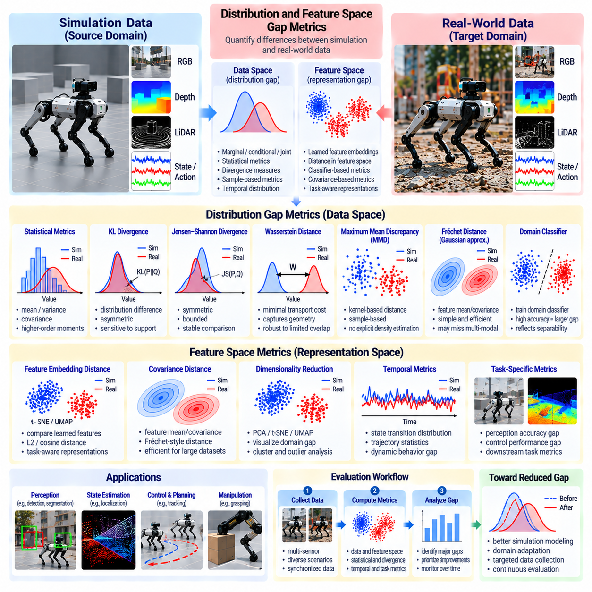{width="7.268055555555556in" height="7.268055555555556in"}

분포 및 특징 공간 격차 지표(Distribution and Feature Space Gap Metrics)는 피지컬 AI(Physical AI) 시스템에서 사용되는 시뮬레이션 데이터(Simulated Data)와 실제 환경 데이터(Real-World Data) 사이의 차이를 정량화한다. 이러한 지표는 시각적 외관(Visual Appearance)이나 물리적 매개변수(Physical Parameter)만 비교하는 것이 아니라 관측값(Observation), 상태(State), 동작(Action), 학습된 표현(Learned Representation)이 통계적으로 어떻게 다른지 분석한다. 그 목적은 도메인 불일치(Domain Discrepancy)를 식별하고 전이 난이도(Transfer Difficulty)를 추정하며 시뮬레이션과 현실 간 전이(Sim2Real Transfer) 성능의 체계적인 평가(Systematic Evaluation)를 지원하는 것이다.

분포 격차(Distribution Gap)는 시뮬레이션 관측값(Simulated Observation)과 실제 관측값(Real Observation)이 서로 다른 확률 분포(Probability Distribution)를 따를 때 발생한다. 이러한 차이는 센서 잡음(Sensor Noise), 조명(Lighting), 객체 기하학(Object Geometry), 운동 패턴(Motion Pattern), 접촉력(Contact Force), 환경 조건(Environmental Condition)과 관련될 수 있다. 개별 샘플(Individual Sample)이 유사하게 보이더라도 통계적 특성(Statistical Property)은 상당히 다를 수 있다. 이러한 차이를 측정하면 시뮬레이션 데이터가 실제 배포(Deployment) 과정에서 마주하는 조건을 적절하게 표현하는지 판단하는 데 도움이 된다.

주변 분포 격차(Marginal Distribution Gap), 조건부 분포 격차(Conditional Distribution Gap), 결합 분포 격차(Joint Distribution Gap)는 구분할 필요가 있다. 주변 분포 차이(Marginal Difference)는 개별 변수(Individual Variable)의 변화를 설명하며, 조건부 분포 차이(Conditional Difference)는 관측값(Observation), 동작(Action), 결과(Outcome) 사이의 관계와 관련된다. 결합 분포 차이(Joint Distribution Difference)는 여러 변수 사이의 상호작용(Interaction)을 포착한다. 주변 통계량(Marginal Statistic)만 평가하면 로봇 동작(Robotic Behavior)을 결정하는 중요한 의존 관계(Dependency)를 간과할 수 있다.

특징 공간 지표(Feature Space Metric)는 시뮬레이션 관측값과 실제 관측값에서 추출한 표현(Representation)을 비교한다. 특징(Feature)에는 시각적 임베딩(Visual Embedding), 기하학적 기술자(Geometric Descriptor), 운동 추정값(Motion Estimate), 촉각 측정값(Tactile Measurement), 신경망(Neural Network)이 학습한 잠재 상태(Latent State)가 포함될 수 있다. 원시 관측값(Raw Observation)을 의미 있는 표현으로 변환함으로써 특징 기반 분석(Feature-Based Analysis)은 중요하지 않은 외관 변화보다 인식(Perception)과 제어(Control)에 관련된 불일치를 드러낼 수 있다.

특징 표현(Feature Representation)의 선택은 격차 측정(Gap Measurement)에 큰 영향을 미친다. 합성 데이터(Synthetic Data)만으로 학습한 특징은 시뮬레이션 특유의 패턴(Simulation-Specific Pattern)을 강조할 수 있으며, 실제 데이터(Real Data)로 학습한 특징에는 서로 다른 편향(Bias)이 포함될 수 있다. 작업 인지형 표현(Task-Aware Representation)은 로봇 의사결정(Robotic Decision-Making)에 필요한 정보를 강조하여 관련성을 높일 수 있다. 그러나 측정된 거리(Measured Distance)가 의미 있는 도메인 차이(Domain Difference)를 반영하는지 확인하기 위해 특징 추출기(Feature Extractor)를 검증해야 한다.

단순한 통계적 지표(Statistical Metric)는 분포 불일치(Distribution Mismatch)에 대한 초기 평가를 제공한다. 평균(Mean), 분산(Variance), 공분산 행렬(Covariance Matrix), 고차 모멘트(Higher-Order Moment)의 차이는 측정 특성(Measurement Characteristic)의 변화를 드러낼 수 있다. 이러한 통계량은 계산 효율(Computational Efficiency)이 높고 해석하기 쉽다. 그러나 복잡한 다봉 분포(Multimodal Distribution)나 관측값과 로봇 상태(Robot State) 사이의 비선형 관계(Nonlinear Relationship)를 구분하지 못할 수 있다.

쿨백-라이블러 발산(Kullback--Leibler Divergence, KL Divergence)은 하나의 확률 분포(Probability Distribution)가 다른 분포와 얼마나 다른지 측정한다. 시뮬레이션과 실제 데이터에서 추정한 분포 사이의 불일치를 정량화할 수 있지만, 비대칭적(Asymmetric)이며 확률 분포의 지지 집합(Probability Support)이 다르면 정의되지 않거나 무한대가 될 수 있다. 고차원 공간(High-Dimensional Space)에서는 신뢰할 수 있는 추정이 어렵다. 따라서 KL 발산은 신중한 밀도 추정(Density Estimation)과 결과 해석(Interpretation)이 필요하다.

젠슨-섀넌 발산(Jensen--Shannon Divergence, JS Divergence)은 쿨백-라이블러 발산(Kullback--Leibler Divergence)에서 유도된 대칭적 비교 방법(Symmetric Comparison Method)을 제공한다. 이 지표는 값의 범위가 제한되어 있으며 서로 다른 특성을 가진 확률 분포를 비교하는 데 유용할 수 있다. 그러나 서로 분리된 분포(Separated Distribution) 사이의 기하학적 거리(Geometric Distance)에 대해서는 제한적인 정보를 제공할 수 있다. 그 효과는 사용 가능한 샘플(Sample)로부터 분포를 표현하고 추정하는 방식에 따라 달라진다.

바서슈타인 거리(Wasserstein Distance)는 선택한 기본 거리(Ground Distance)를 기준으로 하나의 확률 분포를 다른 분포로 변환하는 데 필요한 비용을 측정한다. 샘플 사이의 기하학적 관계(Geometric Relationship)를 반영하며, 분포 사이의 중첩(Distribution Overlap)이 제한적인 경우에도 유용한 정보를 제공할 수 있다. 로봇공학(Robotics)에서는 상태 분포(State Distribution), 궤적(Trajectory), 특징 임베딩(Feature Embedding)을 비교하는 데 활용할 수 있다. 적용할 때는 계산 비용(Computational Cost)과 특징 스케일링(Feature Scaling)을 고려해야 한다.

최대 평균 불일치(Maximum Mean Discrepancy, MMD)는 재생 커널 힐베르트 공간(Reproducing Kernel Hilbert Space)에서 분포 표현(Distribution Representation)의 차이를 비교한다. 확률 밀도 함수(Probability Density Function)를 명시적으로 적합하지 않고도 샘플에서 직접 추정할 수 있다. 커널 선택(Kernel Selection)은 어떤 불일치를 강조할지 결정한다. MMD는 도메인 적응(Domain Adaptation), 표현 정렬(Representation Alignment), 합성 센서 관측값(Synthetic Sensor Observation)과 실제 센서 관측값(Physical Sensor Observation) 사이의 차이를 평가하는 데 유용하다.

특징 분포 비교(Feature Distribution Comparison)에는 공분산 기반 거리(Covariance-Based Distance)와 가우시안 근사(Gaussian Approximation)도 활용할 수 있다. 프레셰 방식 거리(Fréchet-Style Distance)는 특징 평균(Feature Mean)과 공분산 구조(Covariance Structure)의 차이를 요약한다. 이러한 접근법은 특히 영상 임베딩(Image Embedding)과 같은 대규모 관측 데이터셋(Observation Dataset)을 비교하는 데 편리하다. 그러나 가우시안 가정(Gaussian Assumption)은 다봉 특성(Multimodal Behavior), 희귀 사건(Rare Event), 작업 필수 영역(Task-Critical Region)의 불일치를 감출 수 있다.

도메인 분류기(Domain Classifier)는 분포 분리 가능성(Distribution Separability)을 추정하는 대안적인 방법을 제공한다. 분류기는 선택된 특징(Selected Feature)을 사용하여 시뮬레이션 샘플(Simulated Sample)과 실제 샘플(Real Sample)을 구분하도록 학습된다. 높은 판별 정확도(Discrimination Accuracy)는 탐지 가능한 도메인 차이(Detectable Domain Difference)가 존재함을 시사하며, 우연 수준(Chance Level)에 가까운 성능은 분리 가능성이 제한적임을 나타낼 수 있다. 그러나 분류기 용량(Classifier Capacity), 데이터 누출(Data Leakage), 샘플링 불균형(Sampling Imbalance)은 결론을 왜곡할 수 있다.

차원 축소 방법(Dimensionality Reduction Method)은 복잡한 특징 공간(Feature Space)에서 분포 차이를 시각화하는 데 도움이 된다. 주성분 분석(Principal Component Analysis, PCA), 티-분포 확률적 이웃 임베딩(t-Distributed Stochastic Neighbor Embedding, t-SNE), 균일 다양체 근사 및 투영(Uniform Manifold Approximation and Projection, UMAP)은 고차원 관측값(High-Dimensional Observation)을 저차원 표현(Low-Dimensional Representation)으로 투영할 수 있다. 이러한 시각화는 군집(Cluster), 이상치(Outlier), 도메인 분리(Domain Separation)를 드러낼 수 있다. 그러나 투영 왜곡(Projection Distortion)이 존재하므로 시각적 중첩(Visual Overlap)만으로 통계적 동등성(Statistical Equivalence)이나 전이 준비도(Transfer Readiness)를 입증할 수는 없다.

시간적 분포 지표(Temporal Distribution Metric)는 로봇 시스템에서 특히 중요하다. 관측값이 독립적인 샘플(Independent Sample)이 아니라 연속적인 시퀀스(Sequence)를 형성하기 때문이다. 두 도메인은 개별 상태(Individual State)가 유사하더라도 상태 전이 확률(Transition Probability), 운동 상관관계(Motion Correlation), 동작-응답 지연(Action-Response Delay)이 다를 수 있다. 궤적(Trajectory), 시간적 특징(Temporal Feature), 상태 전이(State Transition)를 비교하면 정적인 관측 지표(Static Observation Metric)로는 탐지하지 못하는 불일치를 식별할 수 있다.

작업 조건부 격차 분석(Task-Conditioned Gap Analysis)은 특정 운영 상황(Operating Situation)에서 발생하는 차이를 평가한다. 내비게이션 시스템(Navigation System)은 개방된 복도(Open Corridor), 혼잡한 교차 구역(Crowded Intersection), 장애물 회피(Obstacle Avoidance)에 대해 별도의 비교가 필요할 수 있다. 조작 작업(Manipulation Task)은 자유 운동(Free Motion), 초기 접촉(Initial Contact), 지속적인 파지(Sustained Grasping)를 구분할 수 있다. 작업 단계(Task Phase)를 조건으로 측정하면 집계 통계량(Aggregate Statistic)에 의해 희석되는 불일치를 식별하는 데 도움이 된다.

희귀 사건 분포(Rare-Event Distribution)는 특별한 주의가 필요하다. 안전 필수 실패(Safety-Critical Failure)는 일반적인 운영 조건(Common Operating Condition) 밖에서 발생할 수 있기 때문이다. 충돌(Collision), 센서 데이터 누락(Sensor Dropout), 불안정한 접촉(Unstable Contact), 예상하지 못한 인간 움직임(Unexpected Human Movement)은 시뮬레이션과 실제 데이터셋 모두에서 충분히 표현되지 않을 수 있다. 분포 꼬리에 민감한 지표(Tail-Sensitive Metric)와 시나리오별 평가(Scenario-Specific Evaluation)는 이러한 격차를 식별하는 데 도움이 된다. 평균적인 분포 유사성(Average Distribution Similarity)이 높더라도 위험 사건(Hazardous Event)에 대한 충분한 포괄성(Coverage)이 보장되는 것은 아니다.

데이터셋 품질(Dataset Quality)은 격차 측정(Gap Measurement)의 타당성(Validity)에 직접적인 영향을 미친다. 시뮬레이션 데이터셋(Simulation Dataset)과 실제 데이터셋(Real Dataset)은 일관된 센서 정의(Sensor Definition), 좌표계(Coordinate Frame), 단위(Unit), 타임스탬프(Timestamp), 전처리 절차(Preprocessing Procedure)를 사용해야 한다. 데이터 처리(Data Handling)로 인해 발생한 차이가 물리적 도메인 불일치(Physical Domain Discrepancy)로 잘못 해석될 수 있다. 따라서 대표성 있는 샘플링(Representative Sampling)과 투명한 데이터셋 문서화(Dataset Documentation)는 의미 있는 비교를 위한 필수 조건이다.

통계적 신뢰도(Statistical Confidence)는 추정된 분포 거리(Estimated Distribution Distance)를 해석할 때 필요하다. 유한한 데이터셋(Finite Dataset)은 특히 고차원 특징 공간(High-Dimensional Feature Space)에서 샘플링 불확실성(Sampling Uncertainty)을 발생시킨다. 부트스트랩 분석(Bootstrap Analysis), 신뢰구간(Confidence Interval), 반복 실험(Repeated Experiment)은 실제 도메인 격차(Genuine Domain Gap)와 추정 변동성(Estimation Variability)을 구분하는 데 도움이 된다. 비교 과정에서는 서로 다른 샘플 크기(Unequal Sample Size)와 관측값 사이의 의존성(Dependency)도 고려해야 한다.

분포 지표(Distribution Metric)는 후속 로봇 성능(Downstream Robotic Performance)과 연결되어야 한다. 특징 거리(Feature Distance)가 크다고 반드시 작업 수행 성능(Task Execution Performance)이 낮은 것은 아니며, 평균 거리가 작더라도 중요한 제어 실패(Control Failure)가 숨겨져 있을 수 있다. 격차 측정값(Gap Measurement)을 성공률(Success Rate), 추종 오차(Tracking Error), 안전 위반(Safety Violation), 복구 성능(Recovery Performance)과 연관시켜 분석하면 실질적인 관련성(Practical Relevance)을 확인할 수 있다. 작업 성능(Task Performance)은 지표의 유용성(Metric Usefulness)을 검증하는 데 여전히 필수적이다.

도메인 적응(Domain Adaptation)과 시뮬레이션 개선(Simulation Refinement)은 격차 지표(Gap Metric)를 최적화 신호(Optimization Signal)로 활용할 수 있다. 렌더링(Rendering), 센서 잡음(Sensor Noise), 마찰(Friction), 환경 변동성(Environmental Variability)을 제어하는 매개변수(Parameter)를 조정하여 측정된 불일치를 줄일 수 있다. 특징 정렬 방법(Feature Alignment Method)은 도메인 사이의 공유 표현(Shared Representation)을 유도할 수도 있다. 그러나 통계적 거리(Statistical Distance)만 최소화하면 작업 관련 동역학(Task-Relevant Dynamics)이 여전히 부정확한 상태에서도 개선된 것처럼 보이는 오해를 유발할 수 있다.

포괄적인 격차 평가(Comprehensive Gap Evaluation)는 단일 수치 점수(Single Numerical Score)에 의존하기보다 상호 보완적인 지표(Complementary Metric)를 결합한다. 통계적 거리(Statistical Distance), 특징 분리 가능성(Feature Separability), 시간적 일관성(Temporal Consistency), 시나리오 포괄성(Scenario Coverage), 작업 수준 결과(Task-Level Outcome)는 시뮬레이션과 현실 간 불일치(Sim2Real Discrepancy)의 서로 다른 측면을 설명한다. 이러한 평가 프레임워크(Evaluation Framework)는 관측되지 않은 운영 조건(Unobserved Operating Condition)에 대한 불확실성을 유지하면서 진단(Diagnosis), 비교(Comparison), 우선순위 결정(Prioritization)을 지원해야 한다.

궁극적으로 분포 및 특징 공간 격차 지표(Distribution and Feature Space Gap Metrics)는 시뮬레이션과 현실 사이의 차이(Simulation-to-Reality Difference)를 이해하기 위한 정량적 기반(Quantitative Foundation)을 제공한다. 그 가치는 대표성 있는 데이터(Representative Data), 적절한 특징 선택(Feature Selection), 통계적으로 타당한 추정(Statistically Sound Estimation), 로봇 동작(Robotic Behavior)과의 입증된 연관성(Demonstrated Relationship)에 달려 있다. 효과적인 피지컬 AI 평가(Physical AI Evaluation)는 이러한 지표를 활용하여 시뮬레이션 개선(Simulation Improvement)을 추진하는 동시에 통계적 유사성(Statistical Similarity)만으로 실제 환경 전이(Real-World Transfer)의 성공을 보장할 수 없다는 점을 인식해야 한다.

## 08.12. Behavior and Task Performance Gap

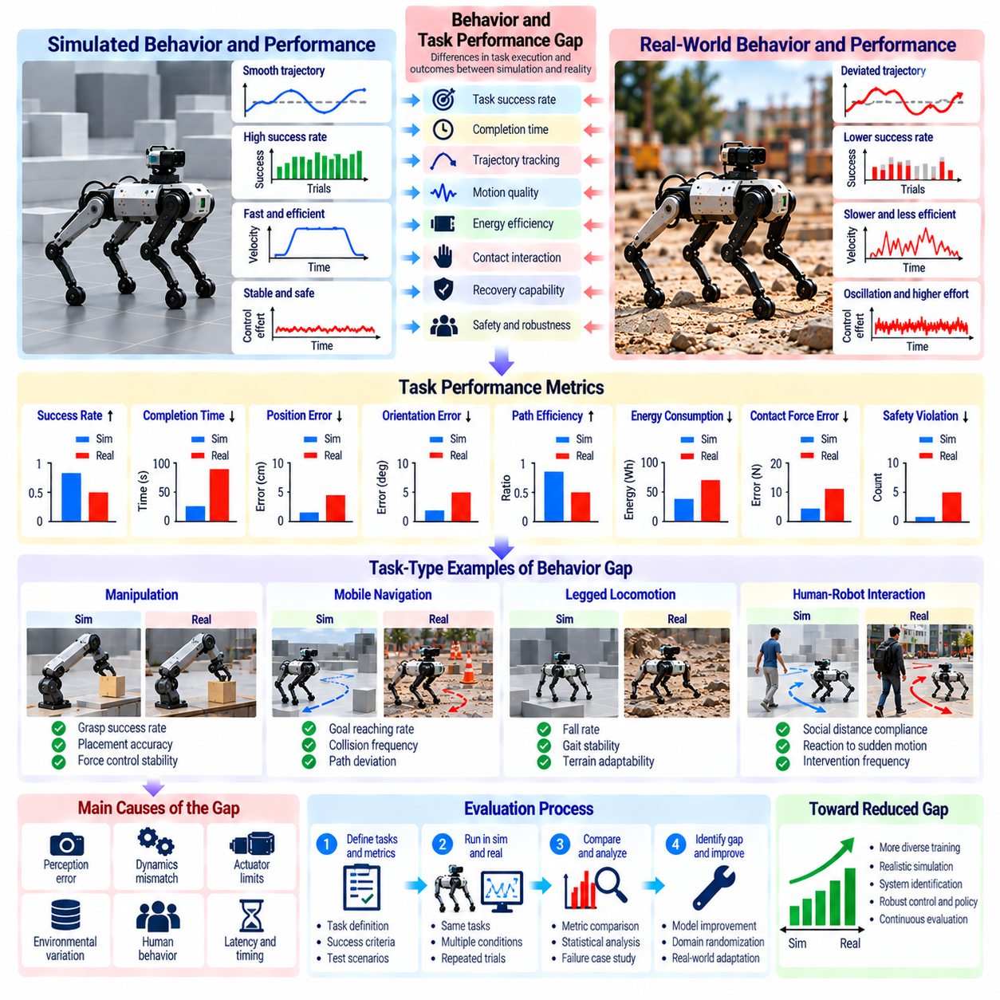{width="7.268055555555556in" height="7.268055555555556in"}

행동 및 작업 수행 성능 격차(Behavior and Task Performance Gap)는 로봇이 시뮬레이션에서 동작을 수행하는 방식과 실제 물리 환경(Physical Environment)에서 동일한 작업을 수행하는 방식 사이의 차이를 설명한다. 센서 격차(Sensor Gap)와 동역학 격차(Dynamics Gap)가 개별적인 불일치 원인을 설명한다면, 행동 격차(Behavioral Gap)는 이러한 차이가 결합되어 나타나는 결과를 보여준다. 이러한 차이는 실제 환경 배포(Real-World Deployment) 과정에서 작업 성공(Task Success), 운동 품질(Motion Quality), 운영 효율(Operational Efficiency), 복구 능력(Recovery Capability), 안전성(Safety)에 영향을 미친다.

행동 불일치(Behavioral Discrepancy)는 동일한 정책(Policy)이 시뮬레이션 환경(Simulated Environment)과 실제 환경(Real Environment)에서 서로 다른 동작 시퀀스(Action Sequence)나 결과(Outcome)를 생성할 때 발생한다. 로봇은 시뮬레이션에서 부드러운 궤적(Smooth Trajectory)을 따라 움직이지만, 실제 환경에서는 주저하거나 진동하거나 경로를 이탈할 수 있다. 이러한 차이는 인식 오차(Perception Error), 부정확한 동역학(Inaccurate Dynamics), 구동기 한계(Actuator Limitation), 피드백 지연(Delayed Feedback)에서 발생할 수 있다. 이러한 요인들의 복합적인 영향은 개별 모델링 오차(Isolated Modeling Error)보다 더 중요할 수 있다.

작업 수행 성능 격차(Task Performance Gap)는 시스템 내부 표현(Internal System Representation)이 아니라 측정 가능한 결과(Measurable Outcome)의 차이를 정량화한다. 일반적인 지표(Indicator)에는 작업 성공률(Task Success Rate), 완료 시간(Completion Time), 위치 정확도(Positioning Accuracy), 에너지 소비(Energy Consumption), 개입 빈도(Intervention Frequency)가 포함된다. 이러한 지표는 시뮬레이션에서 학습한 정책(Simulation-Trained Policy)이 성공적으로 전이되었는지에 대한 실질적인 근거를 제공한다. 그러나 결과를 해석하려면 일관된 작업 정의(Task Definition)와 비교 가능한 운영 조건(Comparable Operating Condition)이 필요하다.

작업 성공률(Task Success Rate)은 시뮬레이션과 현실 간 전이(Sim2Real Transfer)의 효과를 측정하는 기본적인 지표이다. 이는 사전에 정의된 완료 기준(Predefined Completion Criteria)을 충족한 시도의 비율을 나타낸다. 조작 작업(Manipulation Task)에서는 안정적인 물체 배치(Stable Object Placement)가 요구될 수 있으며, 내비게이션(Navigation)에서는 충돌 없이 목적지에 도달하는 것이 요구될 수 있다. 도메인 사이의 성공률을 비교하면 실제 배포의 한계를 파악할 수 있지만, 이진 결과(Binary Outcome)만으로는 실패 원인(Failure Cause)을 설명할 수 없다.

완료 시간(Completion Time)은 행동 차이(Behavioral Difference)를 평가하는 또 다른 관점을 제공한다. 실제 로봇은 보수적인 안전 제약조건(Conservative Safety Constraint), 구동기 포화(Actuator Saturation), 불확실한 인식(Uncertain Perception), 반복적인 보정(Repeated Correction)으로 인해 작업을 더 느리게 수행할 수 있다. 시뮬레이션 정책(Simulation Policy)은 비현실적으로 빠른 응답(Unrealistically Fast Response)이나 이상화된 운동(Idealized Motion)을 활용할 수 있다. 작업 소요시간 분포(Task Duration Distribution)를 비교하면 지속적인 속도 저하(Consistent Slowdown)와 어려운 시나리오에서 간헐적으로 발생하는 지연(Occasional Delay)을 구분할 수 있다.

궤적 추종 지표(Trajectory Tracking Metric)는 목표 운동(Desired Motion)과 실제 수행 운동(Executed Motion) 사이의 차이를 평가한다. 위치 오차(Position Error), 방향 오차(Orientation Error), 속도 편차(Velocity Deviation), 경로 부드러움(Path Smoothness)은 로봇이 계획된 궤적(Planned Trajectory)을 얼마나 정확하게 추종하는지 설명한다. 실제 마찰(Real Friction), 백래시(Backlash), 제어 지연(Control Latency)이 중요해지면 시뮬레이션에서의 추종 성능(Tracking Performance)이 저하될 수 있다. 실제 추종 오차(Genuine Tracking Error)와 시간 차이(Timing Difference)를 구분하려면 시간적 정렬(Temporal Alignment)이 필요하다.

운동 품질(Motion Quality)에는 기존의 성공 지표(Success Metric)가 간과할 수 있는 특성들이 포함된다. 과도한 진동(Excessive Vibration), 급격한 가속(Abrupt Acceleration), 불안정한 접촉(Unstable Contact), 반복적인 보정 동작(Repeated Corrective Movement)은 작업이 완료되더라도 전이 품질(Transfer Quality)이 낮다는 것을 나타낼 수 있다. 이러한 행동은 기계적 마모(Mechanical Wear)를 증가시키고 사용자 신뢰(User Confidence)를 낮추거나 안전 문제(Safety Concern)를 발생시킬 수 있다. 부드러움(Smoothness), 안정성(Stability), 제어 노력(Control Effort)을 평가하면 더욱 완전한 성능 평가가 가능하다.

에너지 효율(Energy Efficiency)은 행동 전이 품질(Behavioral Transfer Quality)을 나타내는 중요한 지표이다. 정책은 두 도메인에서 유사한 작업 성공률(Task Success Rate)을 달성하더라도 실제 하드웨어(Real Hardware)에서는 훨씬 많은 전기적 또는 기계적 에너지(Electrical or Mechanical Energy)를 소비할 수 있다. 이러한 차이는 마찰(Friction), 구동기 효율(Actuator Efficiency), 궤적 보정(Trajectory Correction), 부정확한 탑재 하중 모델(Inaccurate Payload Model)에서 발생할 수 있다. 에너지 측정(Energy Measurement)은 작업 소요시간(Task Duration), 운영 모드(Operating Mode), 비교 가능한 작업 부하(Comparable Workload)를 고려해야 한다.

접촉 중심 조작(Contact-Rich Manipulation)은 자유 공간 운동 시험(Free-Space Motion Test)으로 탐지하기 어려운 행동 격차(Behavioral Gap)를 드러낸다. 파지(Grasping), 삽입(Insertion), 밀기(Pushing), 조립(Assembly)은 정밀한 힘 조절(Force Regulation)과 접촉 상태 전이(Contact Transition)에 의존한다. 마찰(Friction), 순응성(Compliance), 물체 기하학(Object Geometry)의 작은 오차도 미끄러짐(Slipping), 끼임(Jamming), 과도한 힘(Excessive Force)을 발생시킬 수 있다. 따라서 평가는 접촉 안정성(Contact Stability), 힘 프로파일(Force Profile), 상호작용 단계(Interaction Phase)의 성공적인 완료 여부를 검토해야 한다.

이동 로봇 내비게이션(Mobile Robot Navigation)은 위치 추정(Localization), 장애물 회피(Obstacle Avoidance), 운동 계획(Motion Planning)과 관련된 성능 격차(Performance Gap)를 발생시킨다. 시뮬레이션에서 효율적으로 주행하는 로봇도 실제 시설(Real Facility)에서는 경로 편차(Path Deviation), 불필요한 정지(Unnecessary Stop), 충돌(Collision)을 경험할 수 있다. 센서 불확실성(Sensor Uncertainty), 동적 장애물(Dynamic Obstacle), 바퀴와 지면 사이의 상호작용(Wheel-Ground Interaction)이 이러한 차이에 영향을 미친다. 관련 지표에는 경로 완주(Route Completion), 충돌 빈도(Collision Frequency), 경로 효율(Path Efficiency), 위치 추정 정확도(Localization Accuracy)가 포함된다.

다족 보행(Legged Locomotion)은 로봇과 지면 사이의 지속적인 상호작용(Continuous Interaction)에 안정성이 의존하기 때문에 추가적인 어려움을 발생시킨다. 시뮬레이션 보행 정책(Simulated Walking Policy)은 높은 속도(High Speed)나 낮은 에너지 소비(Low Energy Consumption)를 달성할 수 있지만, 접촉 불확실성(Contact Uncertainty)과 구동기 한계(Actuator Limitation)로 인해 실제 지형(Real Terrain)에서는 실패할 수 있다. 성능 평가는 넘어짐(Fall), 보행 안정성(Gait Stability), 지형 적응성(Terrain Adaptability), 복구 성공률(Recovery Success), 안전 개입 빈도(Safety Intervention Frequency)를 고려해야 한다.

복구 행동(Recovery Behavior)은 로봇이 예상하지 못한 조건(Unexpected Condition)을 마주할 때 특히 중요하다. 시뮬레이션에서 학습한 정책(Simulation-Trained Policy)은 정상적인 작업 수행(Nominal Execution)에서는 우수한 성능을 나타내지만, 미끄러짐(Slip), 파지 실패(Grasp Failure), 위치 추정 상실(Localization Loss), 일시적인 장애물(Temporary Obstruction)로부터 복구하지 못할 수 있다. 복구 성공률(Recovery Success Rate), 복구 시간(Recovery Time), 개입 요구사항(Intervention Requirement)은 강건성(Robustness)을 측정하는 유용한 지표이다. 이러한 지표는 신뢰할 수 있는 자율성(Reliable Autonomy)과 이상적인 조건에서만 발휘되는 제한적인 성능을 구분한다.

행동 강건성(Behavioral Robustness)은 단일 표준 시험(Standardized Test)이 아니라 다양한 운영 시나리오(Operating Scenario)에서 평가해야 한다. 조명(Lighting), 탑재 하중(Payload), 표면 마찰(Surface Friction), 장애물 밀도(Obstacle Density), 작업 복잡도(Task Complexity)의 변화는 평균 성능(Average Performance)에 숨겨진 약점을 드러낼 수 있다. 시나리오 조건부 평가(Scenario-Conditioned Evaluation)는 전이가 성공하는 조건과 성능이 저하되는 조건을 식별하는 데 도움이 된다. 성능 분포(Performance Distribution)는 개별 평균값(Isolated Mean Value)보다 더 많은 정보를 제공하는 경우가 많다.

안전 관련 행동(Safety-Related Behavior)은 별도의 평가가 필요하다. 작업을 성공적으로 완료했다고 해서 안전한 수행(Safe Execution)이 보장되는 것은 아니기 때문이다. 과도한 접촉력(Excessive Contact Force), 충돌 직전 상황(Near Collision), 불안정한 움직임(Unstable Movement), 운영 경계 위반(Operational Boundary Violation)은 즉각적인 작업 실패 없이도 발생할 수 있다. 안전 지표(Safety Metric)는 실제 사고(Actual Incident)뿐 아니라 사고 전조 조건(Precursor Condition)도 포착해야 한다. 실제 환경 시험(Real-World Testing)은 하드웨어 한계(Hardware Limit)와 인간 안전 요구사항(Human Safety Requirement)도 준수해야 한다.

성능 격차(Performance Gap)는 시뮬레이션과 현실 사이의 기대 작업 보상(Expected Task Reward), 성공 확률(Success Probability), 운영 비용(Operational Cost)의 차이로 표현할 수 있다. 그러나 보상 함수(Reward Function)는 여러 목표(Objective)를 결합하여 특정 실패 메커니즘(Failure Mechanism)을 가릴 수 있다. 성능을 정확도(Accuracy), 효율(Efficiency), 안정성(Stability), 안전성(Safety)으로 분해하면 해석 가능성(Interpretability)이 향상된다. 서로 다른 작업(Heterogeneous Task)이나 로봇 플랫폼(Robot Platform)을 비교할 때는 일관된 정규화(Consistent Normalization)가 필요하다.

로봇의 작업 결과(Robotic Outcome)는 시행(Trial)에 따라 달라지므로 통계적 평가(Statistical Evaluation)가 필수적이다. 반복 실험(Repeated Experiment), 신뢰구간(Confidence Interval), 대응 시나리오 비교(Matched Scenario Comparison)는 관측된 성능 차이(Observed Performance Difference)가 의미 있는지 판단하는 데 도움이 된다. 특히 희귀 사건(Rare Event)이 위험(Risk)을 지배하는 경우 작은 데이터셋(Small Dataset)은 겉으로 나타나는 성공이나 실패를 과장할 수 있다. 평가 프로토콜(Evaluation Protocol)은 환경 조건(Environmental Condition), 하드웨어 구성(Hardware Configuration), 정책 버전(Policy Version)을 문서화해야 한다.

행동 격차 분석(Behavioral Gap Analysis)은 관측된 실패(Observed Failure)를 근본적인 시뮬레이션 불일치(Underlying Simulation Discrepancy)와 연결해야 한다. 과도한 궤적 오차(Excessive Trajectory Error)는 구동기 불일치(Actuator Mismatch)를 나타낼 수 있으며, 파지 불안정성(Grasp Instability)은 부정확한 접촉 모델링(Inaccurate Contact Modeling)을 시사할 수 있다. 반복적인 내비게이션 보정(Repeated Navigation Correction)은 인식(Perception)이나 위치 추정(Localization) 문제를 드러낼 수 있다. 행동 지표(Behavioral Metric)를 센서 로그(Sensor Log), 제어 신호(Control Signal), 물리적 측정값(Physical Measurement)과 결합하면 체계적인 오차 원인 분석(Error Attribution)을 지원할 수 있다.

폐루프 평가(Closed-Loop Evaluation)는 로봇 정책(Robotic Policy)이 자신이 수신하는 관측값(Observation)에 지속적으로 영향을 미치기 때문에 필요하다. 작은 초기 불일치(Initial Discrepancy)도 이후의 동작(Subsequent Action)을 변화시켜 서로 다른 궤적(Trajectory)과 환경 상호작용(Environmental Interaction)을 발생시킬 수 있다. 개루프 예측 정확도(Open-Loop Prediction Accuracy)만으로는 행동 동등성(Behavioral Equivalence)을 입증할 수 없다. 완전한 인식-행동 주기(Perception-Action Cycle)를 평가하면 자율 운영(Autonomous Operation) 중 오차가 어떻게 누적(Accumulation), 전파(Propagation), 보정(Correction)되는지 확인할 수 있다.

시뮬레이션 개선(Simulation Refinement)은 행동 수행 성능 차이(Behavioral Performance Difference)를 활용하여 모델링 개선(Modeling Improvement)의 우선순위를 결정할 수 있다. 내비게이션 실패(Navigation Failure)가 주로 바퀴 미끄러짐(Wheel Slip)에서 발생한다면 시각적 사실성(Visual Realism)을 높이는 것보다 지형 마찰 모델(Terrain Friction Model)을 개선하는 것이 더 큰 효과를 제공할 수 있다. 조작 실패(Manipulation Failure)가 접촉 상태 전이(Contact Transition)와 관련된다면 상세한 순응성 모델링(Compliance Modeling)과 힘 모델링(Force Modeling)이 더 중요할 수 있다. 작업 중심 개선(Task-Driven Refinement)은 결과에 영향을 미치는 불일치에 계산 자원(Computational Resource)을 집중한다.

궁극적으로 행동 및 작업 수행 성능 격차(Behavior and Task Performance Gap)는 시뮬레이션과 현실 간 불일치(Sim2Real Mismatch)가 운영에 미치는 실질적인 중요성(Operational Significance)을 나타낸다. 신뢰할 수 있는 피지컬 AI(Physical AI) 시스템은 시각적 유사성(Visual Similarity), 매개변수 정확도(Parameter Accuracy), 개별 운동 시험(Isolated Motion Test)을 넘어서는 평가가 필요하다. 작업 성공(Task Success), 궤적 품질(Trajectory Quality), 효율(Efficiency), 강건성(Robustness), 복구(Recovery), 안전성(Safety)에 대한 측정값을 결합함으로써 개발자는 시뮬레이션에서 확보한 능력(Simulated Capability)이 신뢰할 수 있는 실제 환경 동작(Dependable Real-World Behavior)으로 전환되는지 판단할 수 있다.

## 08.13. Sensitivity Analysis and Error Attribution

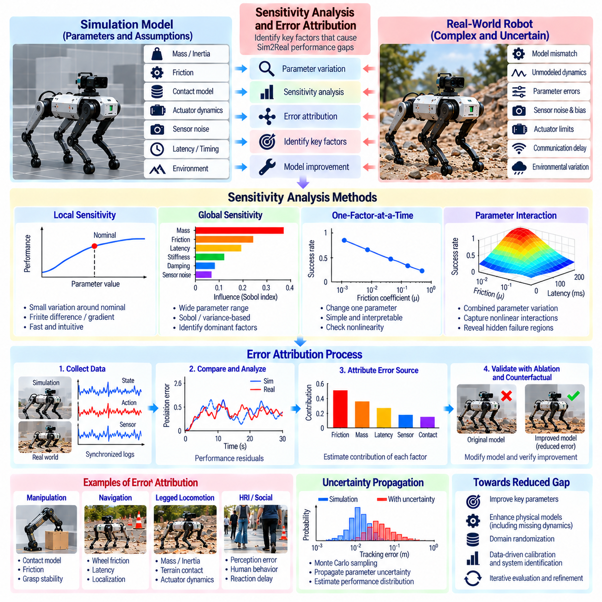{width="7.268055555555556in" height="7.268055555555556in"}

민감도 분석(Sensitivity Analysis)과 오차 원인 분석(Error Attribution)은 어떤 시뮬레이션 불일치(Simulation Discrepancy)가 실제 로봇 성능(Real-World Robotic Performance)에 가장 큰 영향을 미치는지 식별하기 위한 핵심 방법이다. 시뮬레이션과 현실 간 격차(Sim2Real Gap)는 인식(Perception), 동역학(Dynamics), 제어(Control), 환경 모델링(Environmental Modeling)에서 발생하는 오차가 상호작용하면서 형성되는 경우가 많다. 이러한 방법은 모든 불일치를 동일하게 취급하는 대신 작업 결과(Task Outcome)에 미치는 영향을 정량화하고, 측정 가능한 운영상 이점(Operational Benefit)을 제공하는 개선 항목의 우선순위를 결정하도록 지원한다.

민감도 분석(Sensitivity Analysis)은 모델 매개변수(Model Parameter)나 운영 조건(Operating Condition)의 변화가 로봇 동작(Robotic Behavior)에 어떤 영향을 미치는지 조사한다. 매개변수에는 질량(Mass), 관성(Inertia), 마찰(Friction), 구동기 지연(Actuator Delay), 센서 잡음(Sensor Noise), 접촉 강성(Contact Stiffness), 통신 지연(Communication Latency)이 포함될 수 있다. 이러한 값들을 체계적으로 변화시키면 개발자는 어떤 불확실성(Uncertainty)이 가장 큰 성능 변화(Performance Change)를 발생시키는지 식별할 수 있다. 이 과정은 영향력이 큰 매개변수(Influential Parameter)와 상대적으로 영향이 작은 매개변수를 구분한다.

국소 민감도 분석(Local Sensitivity Analysis)은 공칭 운영점(Nominal Operating Point) 주변의 작은 변화에 대한 시스템 응답(System Response)을 평가한다. 유한 차분(Finite Difference)이나 해석적 미분(Analytical Derivative)을 사용하여 개별 매개변수(Individual Parameter)에 따라 성능 지표(Performance Metric)가 어떻게 변화하는지 추정할 수 있다. 이 접근법은 계산 효율(Computational Efficiency)이 높고 보정(Calibration)에 유용하다. 그러나 국소 민감도(Local Sensitivity)는 큰 외란(Large Disturbance), 비선형 상태 전이(Nonlinear Transition), 공칭 구성(Nominal Configuration)에서 크게 벗어난 운영 조건의 동작을 충분히 표현하지 못할 수 있다.

전역 민감도 분석(Global Sensitivity Analysis)은 더 넓은 불확실성 범위(Uncertainty Range)에 걸쳐 매개변수의 영향을 평가한다. 분산 기반 분해(Variance-Based Decomposition), 소볼 지수(Sobol Indices), 모리스 스크리닝(Morris Screening)과 같은 방법을 사용하면 지배적인 매개변수(Dominant Parameter)와 상호작용(Interaction)을 식별할 수 있다. 이러한 접근법은 로봇 동작이 비선형적(Nonlinear)이거나 운영 조건에 크게 의존할 때 특히 유용하다. 주요 한계는 많은 시뮬레이션 구성(Simulation Configuration)을 평가하는 데 필요한 계산 비용(Computational Cost)이다.

한 번에 하나의 요인만 변경하는 분석(One-Factor-at-a-Time Analysis)은 다른 매개변수를 고정한 상태에서 단일 매개변수(Single Parameter)만 변화시킨다. 이 방법은 마찰(Friction), 탑재 하중 질량(Payload Mass), 구동기 응답(Actuator Response)이 작업 수행 성능(Task Performance)에 어떤 영향을 미치는지 직관적으로 조사할 수 있게 한다. 그러나 로봇 시스템에는 서로 결합된 불확실성(Coupled Uncertainty)이 자주 존재하므로 하나의 매개변수만 독립적으로 변경하면 중요한 상호작용을 놓칠 수 있다. 따라서 단일 요인 실험(Single-Factor Experiment)은 복합적인 매개변수 변화(Combined Parameter Variation)를 평가하는 방법과 함께 사용해야 한다.

매개변수 상호작용(Parameter Interaction)은 개별 민감도(Individual Sensitivity)만으로 예측할 수 없는 성능 저하(Performance Degradation)를 발생시킬 수 있다. 보통 수준의 센서 지연(Sensor Latency)은 공칭 마찰(Nominal Friction) 조건에서는 허용 가능하지만, 동일한 지연이 바퀴 미끄러짐(Wheel Slip)과 결합하면 내비게이션(Navigation)을 불안정하게 만들 수 있다. 마찬가지로 작은 기하학적 오차(Geometric Error)와 접촉 강성 불일치(Contact Stiffness Mismatch)가 함께 조작 실패(Manipulation Failure)를 유발할 수 있다. 상호작용 분석(Interaction Analysis)은 이러한 복합 효과(Compounded Effect)를 밝혀내고 더욱 현실적인 시뮬레이션 개선(Simulation Refinement)을 지원한다.

오차 원인 분석(Error Attribution)은 시뮬레이션 로봇과 실제 로봇 사이에서 관측된 동작 차이(Observed Behavioral Difference)를 어떤 근본적인 불일치가 설명하는지 판단하는 과정이다. 내비게이션 실패(Navigation Failure)에는 위치 추정 드리프트(Localization Drift), 부정확한 바퀴 동역학(Inaccurate Wheel Dynamics), 장애물 탐지 지연(Delayed Obstacle Detection), 제어 포화(Control Saturation)가 관련될 수 있다. 지배적인 기여 요인(Dominant Contributor)을 식별하려면 최종 결과(Final Outcome)를 관찰하는 것만으로는 충분하지 않다. 관련 근거에는 동기화된 센서 측정값(Synchronized Sensor Measurement), 구동기 명령(Actuator Command), 상태 추정값(State Estimate), 환경 조건(Environmental Condition)이 포함된다.

구조화된 오차 원인 분석 절차(Structured Attribution Process)는 측정 가능한 성능 잔차(Performance Residual)를 정의하는 것에서 시작한다. 이러한 잔차는 위치(Position), 속도(Velocity), 접촉력(Contact Force), 작업 소요시간(Task Duration), 에너지 소비(Energy Consumption)의 차이를 나타낼 수 있다. 시뮬레이션 예측값(Simulated Prediction)과 실제 물리적 측정값(Physical Measurement)을 비교하면 불일치가 언제 어디에서 발생하는지 확인할 수 있다. 잔차 패턴(Residual Pattern)은 특정 메커니즘(Mechanism)을 시사할 수 있지만, 유사한 패턴이 여러 근본 원인(Underlying Cause)에서 발생할 수도 있다.

시간적 오차 분석(Temporal Error Analysis)은 로봇 운영(Robotic Operation) 중 불일치가 어떻게 발생하고 발전하는지 조사한다. 접촉 직후 나타나는 오차는 부정확한 충돌 모델링(Collision Modeling)이나 순응성 모델링(Compliance Modeling)을 나타낼 수 있으며, 점진적인 궤적 드리프트(Trajectory Drift)는 마찰 불일치(Friction Mismatch)나 주행 거리 추정 불일치(Odometry Mismatch)를 시사할 수 있다. 지연되어 나타나는 진동(Delayed Oscillation)은 구동기 동역학(Actuator Dynamics)이나 제어 지연(Control Latency)과 관련될 수 있다. 이러한 패턴을 정확하게 해석하려면 시뮬레이션과 실제 환경의 시간축(Timeline)을 정렬하는 것이 필수적이다.

공간적 오차 분석(Spatial Error Analysis)은 로봇의 작업 공간(Workspace)이나 운영 환경(Operating Environment)에서 불일치가 발생하는 위치를 식별한다. 위치 오차(Positioning Error)는 관절 한계(Joint Limit) 근처에서 증가할 수 있으며, 내비게이션 실패(Navigation Failure)는 미끄러운 표면(Slippery Surface)이나 좁은 통로(Narrow Passage)에 집중될 수 있다. 로봇 구성(Configuration), 위치(Location), 환경 조건(Environmental Condition)에 따라 오차를 매핑(Error Mapping)하면 체계적인 취약점(Systematic Weakness)을 드러낼 수 있다. 이러한 패턴은 목표 지향적 보정(Targeted Calibration)과 시나리오별 모델 개선(Scenario-Specific Model Improvement)을 안내할 수 있다.

절제 실험(Ablation Experiment)은 선택한 모델 구성 요소(Model Component)를 제거하거나 교체하거나 수정하여 그 기여도를 분리한다. 개발자는 강체 접촉 모델(Rigid Contact Model)과 순응형 접촉 모델(Compliant Contact Model), 이상적인 센서 잡음(Ideal Sensor Noise)과 현실적인 센서 잡음(Realistic Sensor Noise), 단순화된 구동기 동역학(Simplified Actuator Dynamics)과 상세 구동기 동역학(Detailed Actuator Dynamics)을 비교할 수 있다. 성능 변화(Performance Change)는 추가적인 모델링 복잡도(Modeling Complexity)가 유익한지 판단하는 근거가 된다. 그러나 절제 실험 결과는 실험 통제(Experimental Control)에 의존하며, 유일한 인과적 설명(Unique Causal Explanation)을 확립하지 못할 수 있다.

반사실적 시뮬레이션(Counterfactual Simulation)은 특정 모델 불일치(Model Discrepancy)를 수정했을 경우 관측된 실패(Observed Failure)가 어떻게 달라졌을지 탐색한다. 예를 들어 기록된 내비게이션 실패(Recorded Navigation Failure)를 다른 조건은 고정한 상태에서 개선된 바퀴 마찰 추정값(Wheel Friction Estimate)을 적용하여 재현할 수 있다. 성능이 일관되게 개선된다면 마찰 불일치(Friction Mismatch)는 더욱 설득력 있는 설명 후보(Explanatory Candidate)가 된다. 그러나 반사실적 결론(Counterfactual Conclusion)은 재현 환경(Replay Environment)의 충실도(Fidelity)에 의존한다.

불확실성 전파(Uncertainty Propagation)는 매개변수 변화(Parameter Variation)를 예측된 로봇 결과(Predicted Robotic Outcome)의 불확실성과 연결한다. 몬테카를로 샘플링(Monte Carlo Sampling), 다항식 카오스 전개(Polynomial Chaos Expansion), 대리 모델링(Surrogate Modeling)을 사용하면 추종 오차(Tracking Error), 접촉력(Contact Force), 작업 성공(Task Success)의 분포를 추정할 수 있다. 이러한 기법은 작은 매개변수 불확실성(Parameter Uncertainty)이 큰 운영 위험(Operational Risk)을 발생시키는지 밝혀낸다. 또한 불확실한 조건에서 시뮬레이션 성능 예측(Simulated Performance Prediction)에 대한 신뢰 범위(Confidence Bound)를 설정하도록 지원한다.

매개변수 사이에 상관관계(Correlation)가 존재하거나 식별 가능성(Identifiability)이 낮으면 민감도 추정값(Sensitivity Estimate)이 잘못된 판단을 유도할 수 있다. 마찰(Friction)과 구동기 효율(Actuator Efficiency)은 운동에 유사한 영향을 미칠 수 있으며, 센서 편향(Sensor Bias)과 기하학적 정렬 오차(Geometric Misalignment)는 비슷한 위치 오차(Positioning Error)를 발생시킬 수 있다. 충분한 정보를 제공하는 실험(Informative Experiment)이 없다면 불일치를 특정 매개변수 하나에 귀속시키는 것은 신뢰하기 어렵다. 식별 가능성 분석(Identifiability Analysis)과 신중하게 설계된 가진 시험(Excitation Test)은 이러한 모호성(Ambiguity)을 줄이는 데 도움이 된다.

궁극적으로 민감도 분석(Sensitivity Analysis)과 오차 원인 분석(Error Attribution)은 시뮬레이션과 현실 간 전이 평가(Sim2Real Evaluation)를 단순한 서술적 비교(Descriptive Comparison)에서 체계적인 진단(Systematic Diagnosis)으로 발전시킨다. 이러한 방법의 효과는 대표성 있는 시나리오(Representative Scenario), 신뢰할 수 있는 측정값(Reliable Measurement), 통제된 실험(Controlled Experiment), 불확실성의 명시적 처리(Explicit Treatment of Uncertainty)에 달려 있다. 개발자는 지배적인 오차 원인(Dominant Error Source)과 그 상호작용(Interaction)을 식별함으로써 실제 환경 신뢰성(Real-World Reliability)을 가장 효과적으로 향상시키는 시뮬레이션 갱신(Simulation Update), 보정 절차(Calibration Procedure), 제어기 개선(Controller Improvement)의 우선순위를 결정할 수 있다.

## 08.14. System Identification for Gap Reduction

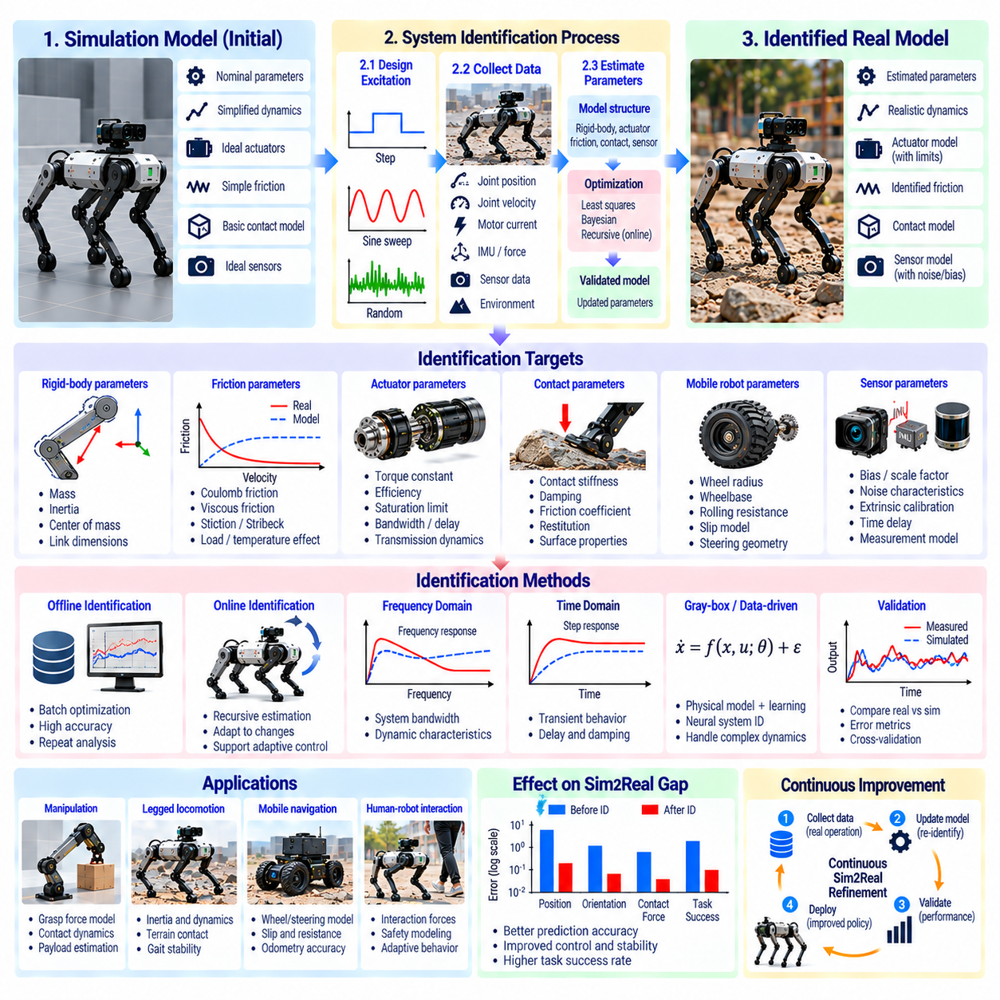{width="7.268055555555556in" height="7.268055555555556in"}

시스템 식별(System Identification)은 실제 로봇 시스템(Real Robotic System)의 물리적 매개변수(Physical Parameter)와 동적 특성(Dynamic Characteristic)을 추정하여 시뮬레이션과 현실 간 격차(Sim2Real Gap)를 줄이는 핵심적인 방법이다. 시뮬레이션 모델(Simulation Model)은 실제 하드웨어 동작(Actual Hardware Behavior)과 다른 공칭 사양(Nominal Specification)에 의존하는 경우가 많다. 측정 데이터를 수집하고 관측된 응답(Observed Response)에 수학적 모델(Mathematical Model)을 적합함으로써 시스템 식별은 시뮬레이션 충실도(Simulation Fidelity), 제어 정확도(Control Accuracy), 실제 로봇으로 전이된 정책(Transferred Policy)의 신뢰성을 향상시킨다.

시스템 식별 과정(Identification Process)은 관련된 로봇 동역학(Robot Dynamics)을 표현하는 모델 구조(Model Structure)를 정의하는 것에서 시작한다. 이러한 구조에는 강체 운동(Rigid-Body Motion), 구동기 동작(Actuator Behavior), 마찰(Friction), 접촉 상호작용(Contact Interaction), 센서 특성(Sensor Characteristic)이 포함될 수 있다. 이후 실험 관측값(Experimental Observation)으로부터 알려지지 않은 매개변수(Unknown Parameter)를 추정한다. 모델 선택(Model Selection)은 물리적 사실성(Physical Realism)과 계산 효율(Computational Efficiency) 사이의 균형을 고려해야 한다. 지나치게 복잡한 모델은 매개변수를 신뢰성 있게 식별하기 어렵게 만들 수 있기 때문이다.

매개변수 식별(Parameter Identification)은 질량(Mass), 관성(Inertia), 관절 마찰(Joint Friction), 감쇠(Damping), 강성(Stiffness), 구동기 이득(Actuator Gain), 응답 지연(Response Delay)과 같은 물리량에 초점을 맞춘다. 이러한 값은 가속도(Acceleration), 궤적 추종(Trajectory Tracking), 에너지 소비(Energy Consumption), 접촉력(Contact Force)에 영향을 미친다. 작은 부정확성(Inaccuracy)도 동적 작업(Dynamic Task) 중에는 상당한 행동 차이(Behavioral Difference)를 발생시킬 수 있다. 따라서 정확한 추정(Accurate Estimation)은 시뮬레이션 예측 오차(Simulation Prediction Error)를 줄이기 위한 실질적인 기반을 제공한다.

실험적 가진(Experimental Excitation)은 물리 시스템(Physical System)이 서로 다른 조건에서 어떻게 응답하는지 확인하기 위해 필요하다. 관절 운동(Joint Movement), 속도 스윕(Velocity Sweep), 제어된 가속(Controlled Acceleration), 하중 변화(Load Variation)는 중요한 동적 특성(Dynamic Property)을 드러낼 수 있다. 가진 신호(Excitation Signal)는 실제 배포(Deployment)와 관련된 운영 범위(Operating Range)를 포함해야 한다. 그러나 구동기 한계(Actuator Limit)를 초과하거나 로봇을 불안정하게 만들거나 기계 부품(Mechanical Component)을 손상시킬 수 있는 과도한 실험(Aggressive Experiment)은 피해야 한다.

데이터 수집 품질(Data Collection Quality)은 식별 정확도(Identification Accuracy)에 큰 영향을 미친다. 관절 위치(Joint Position), 속도(Velocity), 모터 전류(Motor Current), 힘(Force), 온도(Temperature), 제어 명령(Control Command)은 일관된 타임스탬프(Timestamp)와 함께 기록해야 한다. 센서 보정(Sensor Calibration)과 동기화(Synchronization)는 필수적이다. 측정 편향(Measurement Bias)이나 시간 오차(Timing Error)가 동적 효과(Dynamic Effect)로 잘못 해석될 수 있기 때문이다. 신뢰할 수 있는 시스템 식별에는 과도 응답(Transient Response)과 정상 상태 동작(Steady-State Behavior)을 모두 포함하는 대표성 있는 데이터셋(Representative Dataset)이 필요하다.

오프라인 시스템 식별(Offline System Identification)은 이전에 기록된 실험 데이터(Experimental Data)를 사용하여 모델 매개변수(Model Parameter)를 추정한다. 최적화 알고리즘(Optimization Algorithm)은 측정된 궤적(Measured Trajectory)과 모델 예측값(Model Prediction) 사이의 차이를 최소화한다. 이 접근법은 하드웨어에 추가적인 위험을 발생시키지 않으면서 계산 집약적 분석(Computationally Intensive Analysis)과 반복 검증(Repeated Validation)을 지원한다. 그러나 운영 조건(Operating Condition), 탑재 하중(Payload), 기계적 특성(Mechanical Property)이 변화하면 오프라인 추정값(Offline Estimate)의 정확도가 저하될 수 있다.

온라인 시스템 식별(Online System Identification)은 로봇 운영(Robot Operation) 중 매개변수 추정값(Parameter Estimate)을 지속적으로 갱신한다. 재귀 최소제곱법(Recursive Least Squares), 적응형 관측기(Adaptive Observer), 베이지안 추정(Bayesian Estimation)은 마찰(Friction), 구동기 효율(Actuator Efficiency), 탑재 하중 특성(Payload Characteristic)의 변화를 추적할 수 있다. 이러한 방법은 적응 제어(Adaptive Control)와 지속적으로 변화하는 디지털 트윈(Evolving Digital Twin)을 지원한다. 구현 과정에서는 측정 잡음(Noisy Measurement)이나 일시적인 외란(Temporary Disturbance)이 불안정한 매개변수 갱신(Unstable Parameter Update)을 발생시키지 않도록 해야 한다.

구조적 식별 가능성(Structural Identifiability)은 사용 가능한 측정값(Available Measurement)으로부터 알려지지 않은 매개변수(Unknown Parameter)를 이론적으로 구분할 수 있는지 판단한다. 실용적 식별 가능성(Practical Identifiability)은 유한하고 잡음이 포함된 관측값(Finite and Noisy Observation)이 신뢰할 수 있는 추정에 충분한 정보를 제공하는지 고려한다. 관성(Inertia), 마찰(Friction), 구동기 이득(Actuator Gain)의 서로 다른 조합이 유사한 운동 응답(Motion Response)을 생성할 수 있다. 따라서 상관관계가 있는 매개변수 효과(Correlated Parameter Effect)를 분리하려면 신중하게 설계된 실험(Carefully Designed Experiment)이 필요하다.

강체 매개변수 식별(Rigid-Body Parameter Identification)은 일반적으로 링크 질량(Link Mass), 질량중심(Center of Mass), 관성 텐서(Inertia Tensor)를 추정한다. 이러한 물리량은 관절 토크(Joint Torque)와 가속도(Acceleration) 사이의 관계에 영향을 미친다. 여러 로봇 구성(Robot Configuration)에서 수집한 측정값은 이들 매개변수의 복합적인 효과(Combined Effect)를 파악하는 데 도움이 된다. 일부 매개변수는 특정 조합을 통해서만 식별할 수 있으므로 물리적으로 타당한 제약조건(Physically Plausible Constraint)과 독립적인 측정값(Independent Measurement)이 필요할 수 있다.

마찰 식별(Friction Identification)은 마찰이 속도(Velocity), 하중(Load), 온도(Temperature), 운영 이력(Operating History)에 의존하기 때문에 어렵다. 쿨롱 마찰(Coulomb Friction), 점성 마찰(Viscous Friction), 정지 마찰에 의한 고착 현상(Stiction), 스트리벡 거동(Stribeck Behavior)은 서로 다른 모델 구성 요소(Model Component)를 필요로 할 수 있다. 저속 실험(Low-Speed Experiment)과 운동 방향 반전(Direction Reversal)은 특히 유용한 정보를 제공한다. 특정 온도나 하중 조건에서 보정된 마찰 모델(Friction Model)은 전체 운영 범위(Operating Range)에서 정확도를 유지하지 못할 수 있다.

구동기 식별(Actuator Identification)은 전기적 또는 유압적 명령(Electrical or Hydraulic Command)이 어떻게 기계적 운동(Mechanical Motion)과 힘(Force)을 발생시키는지 특성화한다. 관련 매개변수에는 모터 상수(Motor Constant), 동력 전달 효율(Transmission Efficiency), 포화 한계(Saturation Limit), 대역폭(Bandwidth), 내부 지연(Internal Delay)이 포함된다. 계단 응답(Step Response), 주파수 스윕(Frequency Sweep), 제어된 하중 시험(Controlled Load Test)은 이러한 특성을 파악하는 데 도움이 된다. 정확한 구동기 모델(Accurate Actuator Model)은 시뮬레이션 정책(Simulation Policy)이 비현실적인 토크 전달(Unrealistic Torque Delivery)이나 즉각적인 응답(Instantaneous Response)에 의존하지 않도록 한다.

접촉 매개변수 식별(Contact Parameter Identification)은 마찰(Friction), 순응성(Compliance), 감쇠(Damping), 반발(Restitution), 표면 상호작용 특성(Surface Interaction Characteristic)을 추정한다. 제어된 밀기 실험(Controlled Pushing), 압입 실험(Indentation), 파지 실험(Grasping), 충격 실험(Impact Experiment)은 유용한 관측값을 제공한다. 접촉 모델(Contact Model)은 재료 특성(Material Property)과 운영 조건(Operating Condition)을 고려해야 한다. 접촉 동작(Contact Behavior)은 비선형적(Nonlinear)이며 때로는 불연속적(Discontinuous)이기 때문에 매개변수 추정값(Parameter Estimate)이 실험 시나리오(Experimental Scenario)에 따라 상당히 달라질 수 있다.

이동 로봇 시스템 식별(Mobile Robot System Identification)에는 바퀴 반경(Wheel Radius), 축간거리(Wheelbase), 조향 기하학(Steering Geometry), 구름 저항(Rolling Resistance), 미끄러짐 특성(Slip Characteristic)이 포함된다. 엔코더 측정값(Encoder Measurement), 관성 센서(Inertial Sensor), 외부 위치 기준(External Position Reference)을 사용하면 체계적인 운동 오차(Systematic Motion Error)를 파악할 수 있다. 실험에는 직선 운동(Straight Motion), 회전(Turning), 가속(Acceleration), 서로 다른 표면 조건(Surface Condition)이 포함되어야 한다. 식별된 매개변수(Identified Parameter)는 주행 거리 추정(Odometry), 궤적 예측(Trajectory Prediction), 내비게이션 성능(Navigation Performance)을 향상시킨다.

센서 시스템 식별(Sensor System Identification)은 측정 편향(Measurement Bias), 잡음(Noise), 스케일 계수(Scale Factor), 시간 오프셋(Timing Offset), 외부 보정(Extrinsic Calibration)을 다룬다. 카메라(Camera), 라이다(LiDAR), 관성 측정 장치(Inertial Measurement Unit, IMU), 바퀴 엔코더(Wheel Encoder)의 오차는 기계적 동역학(Mechanical Dynamics)이 정확하게 모델링되어 있더라도 로봇 상태 추정값(Estimated Robot State)을 왜곡할 수 있다. 보정 실험(Calibration Experiment)과 기준 측정값(Reference Measurement)은 센서 오차(Sensor Error)와 물리적 매개변수 불일치(Physical Parameter Mismatch)를 분리하는 데 도움이 된다. 정확한 센싱 모델(Sensing Model)은 의미 있는 시뮬레이션 비교(Simulation Comparison)를 위한 필수 조건이다.

최적화 기반 시스템 식별(Optimization-Based System Identification)은 예측된 동작(Predicted Behavior)과 관측된 동작(Observed Behavior) 사이의 불일치를 나타내는 손실 함수(Loss Function)를 최소화한다. 최소제곱법(Least Squares), 최대우도법(Maximum Likelihood), 경사 기반 최적화(Gradient-Based Optimization)가 일반적인 접근법이다. 목적 함수(Objective Function)는 위치(Position), 속도(Velocity), 힘(Force), 에너지 오차(Energy Error)를 적절한 가중치(Weighting)와 함께 결합할 수 있다. 정규화(Regularization)와 물리적 제약조건(Physical Constraint)은 실제 동역학(Actual Dynamics)이 아니라 실험 잡음(Experimental Noise)에 과적합된 비현실적인 추정값(Implausible Estimate)을 방지하는 데 도움이 된다.

베이지안 시스템 식별(Bayesian System Identification)은 알려지지 않은 매개변수(Unknown Parameter)를 하나의 고정된 추정값(Single Fixed Estimate)이 아니라 확률 분포(Probability Distribution)로 표현한다. 사양(Specification)이나 이전 실험(Previous Experiment)에서 얻은 사전 지식(Prior Knowledge)을 새로운 관측값(New Observation)과 결합할 수 있다. 사후 분포(Posterior Distribution)는 불확실성(Uncertainty)을 정량화하고 모호한 매개변수(Ambiguous Parameter)를 드러낸다. 이 접근법은 제한된 데이터(Limited Data), 측정 잡음(Noisy Measurement), 변화하는 환경(Changing Environment)으로 인해 정밀한 식별이 어려운 경우에 유용하다.

검증(Validation)은 매개변수 추정(Parameter Estimation)에 사용된 데이터와 독립적인 실험(Independent Experiment)을 활용해야 한다. 식별된 모델(Identified Model)은 서로 다른 하중(Load), 속도(Speed), 운영 시나리오(Operating Scenario)에서 궤적(Trajectory), 힘(Force), 작업 결과(Task Outcome)를 예측할 수 있어야 한다. 보정 데이터(Calibration Data)에 매우 잘 적합된 모델이라도 일반화 성능(Generalization Performance)은 낮을 수 있다. 조건 간 교차 검증(Cross-Condition Testing)과 잔차 분석(Residual Analysis)은 식별된 동역학(Identified Dynamics)이 의미 있는 물리적 동작(Physical Behavior)을 포착하는지 판단하는 데 도움이 된다.

시뮬레이션 매개변수 갱신(Simulation Parameter Update)은 통제되고 추적 가능한 작업 흐름(Controlled and Traceable Workflow)을 따라야 한다. 추정값(Estimated Value), 불확실성 범위(Uncertainty Range), 하드웨어 구성(Hardware Configuration), 보정 날짜(Calibration Date)는 모델 버전(Model Version)과 함께 기록해야 한다. 자동화된 회귀 시험(Automated Regression Test)은 갱신 이후 발생하는 성능 저하(Performance Degradation)를 탐지할 수 있다. 이러한 과정은 재현성(Reproducibility)을 지원하고 특정 운영 조건에서의 개선이 다른 조건에서 실패를 유발하는 것을 방지한다.

시스템 식별(System Identification)은 잔여 불확실성(Residual Uncertainty)을 처리하기 위해 도메인 무작위화(Domain Randomization)와 결합할 수 있다. 식별된 매개변수(Identified Parameter)는 현실적인 중심값(Central Value)을 정의하고, 신뢰구간(Confidence Interval)은 물리적으로 타당한 변동 범위(Plausible Variation Range)를 설정하는 데 활용된다. 이러한 범위에서 학습한 정책(Policy)은 로봇 개체 간 차이(Unit-to-Unit Difference)와 점진적인 하드웨어 변화(Gradual Hardware Change)를 허용할 수 있다. 이러한 결합은 시뮬레이션이 모든 물리적 세부사항(Physical Detail)을 완벽하게 재현하지 않더라도 강건성(Robustness)을 향상시킨다.

궁극적으로 시스템 식별(System Identification)은 불확실한 가정(Uncertain Assumption)을 실험적으로 뒷받침되는 모델(Experimentally Supported Model)로 대체함으로써 시뮬레이션과 현실 간 격차(Sim2Real Gap)를 줄인다. 그 효과는 충분한 정보를 제공하는 가진(Informative Excitation), 신뢰할 수 있는 측정값(Reliable Measurement), 식별 가능한 매개변수(Identifiable Parameter), 독립적인 검증(Independent Validation), 지속적인 모델 유지관리(Continuous Model Maintenance)에 달려 있다. 시스템 식별을 시뮬레이션 개선(Simulation Refinement) 및 적응 제어(Adaptive Control)와 통합하면 피지컬 AI(Physical AI) 시스템이 실제 환경(Real Environment)에서 더욱 예측 가능하고(Predictable), 강건하며(Robust), 신뢰할 수 있는(Reliable) 동작을 달성할 수 있다.

## 08.15. Zero Shot and Few Shot Sim2Real Evaluation

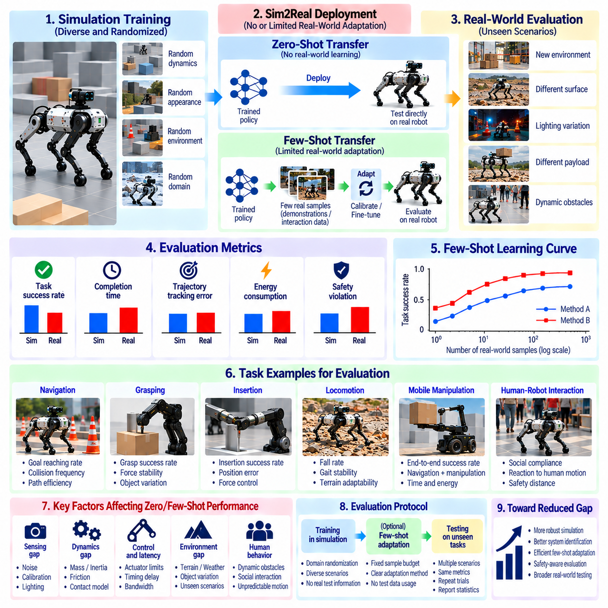{width="7.268055555555556in" height="7.268055555555556in"}

제로샷 및 퓨샷 시뮬레이션과 현실 간 전이 평가(Zero-Shot and Few-Shot Sim2Real Evaluation)는 적응 과정(Adaptation) 없이 또는 제한된 실제 환경 경험(Limited Real-World Experience)만으로 로봇 정책(Robotic Policy)이 시뮬레이션에서 물리적 환경(Physical Environment)으로 얼마나 효과적으로 전이되는지 평가한다. 이러한 평가 방법은 시뮬레이션 학습 조건(Simulated Training Condition)을 벗어난 일반화 성능(Generalization Performance)을 측정한다. 이는 피지컬 AI(Physical AI) 시스템이 광범위한 하드웨어별 재학습(Hardware-Specific Retraining), 보정(Calibration), 데이터 수집(Data Collection) 없이도 신뢰할 수 있는 성능을 달성할 수 있는지 판단하는 데 필수적이다.

제로샷 시뮬레이션과 현실 간 전이(Zero-Shot Sim2Real Transfer)는 시뮬레이션에서만 학습한 정책(Policy)을 실제 작업 데이터(Real-World Task Data)를 이용한 추가 학습 없이 물리적 로봇(Physical Robot)에 배포할 때 발생한다. 정책은 센싱(Sensing), 동역학(Dynamics), 접촉 동작(Contact Behavior), 환경 조건(Environmental Condition)의 차이를 처리해야 한다. 성공적인 제로샷 전이(Zero-Shot Transfer)는 시뮬레이션 학습(Simulation Training)이 충분히 강건한 동작(Robust Behavior)을 생성했음을 나타낸다. 그러나 제한적인 시연(Demonstration)에서의 성공만으로 광범위한 운영 신뢰성(Operational Reliability)이 입증되는 것은 아니다.

퓨샷 시뮬레이션과 현실 간 전이(Few-Shot Sim2Real Transfer)는 소량의 실제 환경 경험(Real-World Experience)을 활용하여 시뮬레이션에서 학습한 정책(Simulation-Trained Policy)을 개선할 수 있도록 한다. 적응 과정(Adaptation)에는 제한된 수의 궤적(Trajectory), 시연(Demonstration), 상호작용 에피소드(Interaction Episode)를 수집하는 작업이 포함될 수 있다. 이러한 관측값(Observation)은 매개변수 보정(Parameter Calibration), 정책 미세조정(Policy Fine-Tuning), 표현 정렬(Representation Alignment)을 지원할 수 있다. 목표는 물리적 실험(Physical Experiment), 운영 중단(Operational Disruption), 하드웨어 위험(Hardware Risk)을 최소화하면서 의미 있는 성능 향상(Performance Improvement)을 달성하는 것이다.

제로샷 평가(Zero-Shot Evaluation)와 퓨샷 평가(Few-Shot Evaluation)의 차이는 적응 프로토콜(Adaptation Protocol)에 따라 결정된다. 제로샷 시험(Zero-Shot Testing)은 실제 환경 평가 데이터(Real-World Evaluation Data)를 사용한 작업별 정책 갱신(Task-Specific Policy Update)을 허용하지 않지만, 사전에 정의된 안전 점검(Predefined Safety Check)은 여전히 필요할 수 있다. 퓨샷 시험(Few-Shot Testing)은 최종 평가(Final Evaluation) 전에 지정된 적응 예산(Adaptation Budget)을 허용한다. 두 평가 방식 모두 시스템이 어떤 정보를 언제 사용할 수 있었는지 명확하게 문서화해야 한다.

평가 프로토콜(Evaluation Protocol)은 시뮬레이션 학습(Simulation Training), 실제 환경 적응(Real-World Adaptation), 최종 시험(Final Testing)을 서로 구분된 단계로 분리해야 한다. 학습 데이터(Training Data)에는 평가용으로 별도 보류된 실제 시험 시나리오(Held-Out Physical Test Scenario)에서 유래한 정보가 포함되어서는 안 된다. 퓨샷 적응 데이터셋(Few-Shot Adaptation Dataset)은 최종 성능 측정(Final Performance Measurement) 전에 확정해야 한다. 이러한 분리는 데이터 누출(Data Leakage)을 줄이고 평가 결과가 전이된 정책(Transferred Policy)의 일반화 능력(Generalization Capability)을 과대평가하는 것을 방지한다.

작업 선택(Task Selection)은 시뮬레이션과 현실 간 전이 평가(Sim2Real Evaluation)의 해석에 큰 영향을 미친다. 내비게이션(Navigation), 파지(Grasping), 삽입(Insertion), 보행(Locomotion), 이동 조작(Mobile Manipulation)은 서로 다른 물리적 불확실성(Physical Uncertainty)을 포함한다. 정책은 자유 공간 운동(Free-Space Movement)에서는 성공적으로 전이되지만 접촉력(Contact Force)이 중요해지는 상황에서는 실패할 수 있다. 따라서 평가 작업 모음(Evaluation Suite)은 동역학(Dynamics), 인식 요구사항(Perception Requirement), 환경 복잡도(Environmental Complexity), 상호작용 강도(Interaction Intensity)가 다양한 작업을 포함해야 한다.

제로샷 성능(Zero-Shot Performance)은 일반적으로 작업 성공률(Task Success Rate), 완료 시간(Completion Time), 궤적 추종 오차(Trajectory Tracking Error), 에너지 소비(Energy Consumption), 안전 위반(Safety Violation)을 사용하여 측정한다. 이러한 지표는 시뮬레이션에서 확보한 능력(Simulated Capability)이 실제 하드웨어(Physical Hardware)에서도 효과적으로 유지되는지 보여준다. 성능은 동등한 작업 조건(Equivalent Task Condition)에서 얻은 시뮬레이션 결과(Simulation Result)와 비교해야 한다. 시뮬레이션 기준 성능(Simulated Baseline)이나 작업 난이도(Task Difficulty)가 상당히 다르다면 절대적인 성공 여부(Absolute Success)만으로는 충분하지 않다.

퓨샷 평가(Few-Shot Evaluation)는 실제 환경 적응 데이터(Real-World Adaptation Data)가 증가함에 따라 성능이 어떻게 변화하는지도 추가로 측정한다. 학습 곡선(Learning Curve)은 작업 성공률(Task Success Rate)이나 제어 정확도(Control Accuracy)를 물리적 시험 횟수(Physical Trial), 시연 횟수(Demonstration), 수집된 상태 전이(Collected Transition)의 수와 연결할 수 있다. 이를 통해 샘플 효율성(Sample Efficiency)과 적응에 필요한 실질적인 비용(Practical Adaptation Cost)을 파악할 수 있다. 제한된 경험으로 빠르게 개선되는 방법은 광범위한 물리적 상호작용(Physical Interaction)이 필요한 방법보다 유리할 수 있다.

적응 예산(Adaptation Budget)은 경쟁하는 방법(Competing Method) 사이에서 일관되게 정의해야 한다. 동일한 궤적 수(Fixed Number of Trajectories)라도 에피소드 지속시간(Episode Duration)이 다르면 실제 경험량(Amount of Experience)은 크게 달라질 수 있다. 따라서 평가에서는 상호작용 시간(Interaction Time), 상태 전이 횟수(Number of Transitions), 하드웨어 운영 시간(Hardware Operating Hours), 인간 감독 요구사항(Human Supervision Requirement)을 보고할 수 있다. 공정한 비교(Fair Comparison)를 위해 미세조정(Fine-Tuning)에 사용된 계산 자원(Computational Resource)도 문서화해야 한다.

퓨샷 적응(Few-Shot Adaptation)은 로봇 시스템(Robotic System)의 서로 다른 구성 요소(Component)를 갱신할 수 있다. 일부 방법은 기존 정책(Original Policy)을 유지하면서 시뮬레이션 매개변수(Simulation Parameter)나 구동기 보정값(Actuator Calibration)을 조정한다. 다른 방법은 신경망 가중치(Neural Network Weight)를 미세조정하거나 인식 특징(Perception Feature)을 적응시키거나 잔차 동역학 모델(Residual Dynamics Model)을 학습한다. 이러한 전략은 서로 다른 계산 비용(Computational Cost)과 운영 비용(Operational Cost)을 가진다. 평가는 어떤 구성 요소가 수정되었으며 적응이 안전성(Safety)에 어떤 영향을 미쳤는지 명시해야 한다.

도메인 무작위화(Domain Randomization)는 제로샷 전이(Zero-Shot Transfer)를 준비하기 위한 일반적인 전략이다. 시뮬레이션 학습(Simulation Training) 과정에서 물리적 매개변수(Physical Parameter), 센서 특성(Sensor Characteristic), 조명(Lighting), 환경 조건(Environmental Condition)을 물리적으로 타당한 범위(Plausible Range)에서 변화시킨다. 이를 통해 정책은 하나의 이상화된 모델(Idealized Model)에 의존하기보다 불확실성(Uncertainty)을 허용하도록 학습된다. 그러나 평가는 이러한 강건성(Robustness)이 학습 과정에서 경험한 무작위화 조건(Randomized Condition)을 벗어난 환경에서도 유지되는지 확인해야 한다.

시스템 식별(System Identification)은 제한된 로봇 관측값(Limited Robot Observation)으로부터 물리적 매개변수(Physical Parameter)를 추정하여 퓨샷 전이(Few-Shot Transfer)를 지원할 수 있다. 짧은 가진 실험(Excitation Experiment)은 마찰(Friction), 구동기 응답(Actuator Response), 탑재 하중 특성(Payload Characteristic), 센서 오프셋(Sensor Offset)을 파악하는 데 도움이 된다. 이러한 추정값은 배포 전에 시뮬레이션 모델(Simulation Model)이나 제어기 매개변수(Controller Parameter)를 갱신하는 데 사용할 수 있다. 그러나 식별 정확도(Identification Accuracy)는 제한된 관측값이 관련 시스템 동역학(System Dynamics)을 충분히 가진했는지에 따라 달라진다.

강건성 평가(Robustness Evaluation)에는 시뮬레이션 학습 데이터셋(Simulation Training Dataset)과 퓨샷 적응 데이터셋(Few-Shot Adaptation Dataset) 모두에서 벗어난 운영 조건(Operating Condition)이 포함되어야 한다. 탑재 하중(Payload), 표면 마찰(Surface Friction), 조명(Lighting), 물체 기하학(Object Geometry), 장애물 동작(Obstacle Behavior)의 변화는 제한된 실제 환경 경험에 대한 과적합(Overfitting)을 드러낼 수 있다. 여러 시나리오(Multiple Scenario)에 걸친 시험은 진정한 적응(Genuine Adaptation)과 좁은 보정 환경(Narrow Calibration Environment)에 한정된 개선을 구분하는 데 도움이 된다.

안전 제약조건(Safety Constraint)은 초기 물리적 성능(Initial Physical Performance)이 불확실할 수 있으므로 제로샷 및 퓨샷 실험(Zero-Shot and Few-Shot Experiment)에서 특히 중요하다. 속도 제한(Speed Limit), 힘 임계값(Force Threshold), 비상 정지(Emergency Stopping), 감독되는 운영 구역(Supervised Operating Region)은 실험 위험(Experimental Risk)을 줄일 수 있다. 안전 개입(Safety Intervention)은 무시하지 않고 평가 결과(Evaluation Outcome)로 기록해야 한다. 작업이 결국 성공하더라도 빈번한 인간 개입(Human Intervention)이 필요한 정책은 완전한 자율성(Full Autonomy)을 확보했다고 볼 수 없다.

통계적 신뢰성(Statistical Reliability)을 확보하려면 여러 작업(Task), 환경(Environment), 로봇 개체(Robot Unit)에 걸친 반복 시험(Repeated Trial)이 필요하다. 소수의 시연(Demonstration)에서 얻은 성공률(Success Rate)은 특히 결과가 무작위 초기 조건(Random Initial Condition)에 의존할 때 잘못된 판단을 유도할 수 있다. 신뢰구간(Confidence Interval)과 반복 적응 실행(Repeated Adaptation Run)은 불확실성(Uncertainty)을 정량화하는 데 도움이 된다. 평가는 정책 초기화(Policy Initialization), 환경 조건(Environmental Condition), 제한된 적응 샘플(Limited Adaptation Sample)로 인해 발생하는 변동성을 구분해야 한다.

부정적 전이(Negative Transfer)는 제한된 실제 환경 데이터(Real-World Data)를 사용한 적응이 성능을 개선하는 대신 저하시킬 때 발생한다. 과적합(Overfitting), 잡음이 포함된 관측값(Noisy Observation), 잘못된 매개변수 갱신(Incorrect Parameter Update), 파국적 망각(Catastrophic Forgetting)은 이전에 성공했던 동작(Previously Successful Behavior)을 악화시킬 수 있다. 따라서 퓨샷 평가(Few-Shot Evaluation)는 익숙한 시나리오(Familiar Scenario)와 처음 접하는 시나리오(Unseen Scenario) 모두에서 적응 전후 성능(Before-and-After Adaptation Performance)을 비교해야 한다. 적응 작업(Adaptation Task)에서의 개선만으로 성공적인 전이(Successful Transfer)가 입증되는 것은 아니다.

적응 효율성(Adaptation Efficiency)과 운영 비용(Operational Cost) 사이의 관계는 실제 배포(Practical Deployment)에서 핵심적인 요소이다. 물리적 실험(Physical Experiment)은 시간(Time), 에너지(Energy), 장비 수명(Equipment Lifetime), 엔지니어링 감독(Engineering Supervision)을 소모한다. 퓨샷 방법(Few-Shot Method)은 최종 작업 성능(Final Task Performance)뿐 아니라 해당 성능에 도달하는 데 필요한 자원(Resource)도 기준으로 평가해야 한다. 효율적인 적응(Efficient Adaptation)은 초기 설치 및 조정 노력(Commissioning Effort)을 줄이고 여러 로봇 구성(Robot Configuration)에 걸친 배포를 지원한다.

플랫폼 간 평가(Cross-Platform Evaluation)는 정책이 명목상 동일한 로봇(Nominally Identical Robot)이나 서로 다른 하드웨어 변형(Hardware Variant) 사이에서 전이될 수 있는지 조사한다. 제조 공차(Manufacturing Tolerance), 구동기 차이(Actuator Difference), 센서 장착 위치(Sensor Placement), 기계적 마모(Mechanical Wear)는 서로 다른 물리적 도메인(Physical Domain)을 형성할 수 있다. 제로샷 시험(Zero-Shot Testing)은 즉각적인 이식성(Immediate Portability)을 측정하고, 퓨샷 시험(Few-Shot Testing)은 각 플랫폼을 얼마나 효율적으로 보정할 수 있는지 평가한다. 이러한 평가는 플릿 규모 피지컬 AI 배포(Fleet-Scale Physical AI Deployment)에 유용하다.

평가 결과(Evaluation Result)는 정책 일반화(Policy Generalization)와 외부 시스템 지원(External System Support)을 구분해야 한다. 로봇은 강건한 정책 전이(Robust Policy Transfer) 때문이 아니라 수동으로 조정된 제어기(Manually Tuned Controller), 신중하게 선택된 운영 조건(Carefully Selected Operating Condition), 광범위한 전처리(Extensive Preprocessing) 덕분에 성공할 수 있다. 보정 노력(Calibration Effort), 소프트웨어 수정(Software Modification), 인간 지원(Human Assistance), 제외된 실패(Excluded Failure)를 보고하면 투명성(Transparency)이 향상된다. 재현 가능한 프로토콜(Reproducible Protocol)은 주장된 제로샷 또는 퓨샷 능력(Zero-Shot or Few-Shot Capability)이 실제로 의미 있는지 확인하는 데 도움이 된다.

궁극적으로 제로샷 및 퓨샷 시뮬레이션과 현실 간 전이 평가(Zero-Shot and Few-Shot Sim2Real Evaluation)는 시뮬레이션에서 학습한 피지컬 AI 시스템(Simulation-Trained Physical AI System)의 실질적인 적응 능력(Practical Adaptability)을 측정한다. 제로샷 시험(Zero-Shot Testing)은 실제 환경 정책 학습(Real-World Policy Learning) 없이 확보되는 강건성(Robustness)을 강조하며, 퓨샷 시험(Few-Shot Testing)은 제한된 물리적 경험(Limited Physical Experience)으로부터 얻는 빠른 성능 향상(Rapid Performance Improvement)을 강조한다. 신뢰할 수 있는 평가(Reliable Assessment)는 작업 성능(Task Performance), 적응 효율성(Adaptation Efficiency), 통계적 신뢰도(Statistical Confidence), 안전성(Safety), 도메인 간 강건성(Cross-Domain Robustness)을 결합하여 실제 배포 준비도(Deployment Readiness)를 판단한다.

## 08.16. Sim2Real Gap Analysis Pipeline [w/Code]

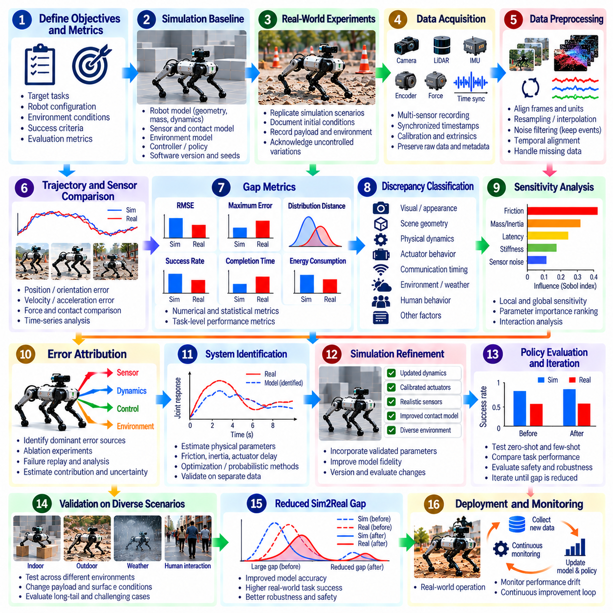{width="7.268055555555556in" height="7.268055555555556in"}

시뮬레이션과 현실 간 격차 분석 파이프라인(Sim2Real Gap Analysis Pipeline)은 시뮬레이션 로봇 시스템(Simulated Robotic System)과 실제 로봇 시스템(Physical Robotic System) 사이의 불일치(Discrepancy)를 식별하고 측정하며 진단하고 줄이기 위한 체계적인 프레임워크(Systematic Framework)를 제공한다. 이 파이프라인은 시뮬레이션 검증(Simulation Validation)을 단일 실험으로 취급하는 대신 반복 가능한 단계(Repeatable Stage)로 구성한다. 또한 모델 충실도(Model Fidelity), 정책 동작(Policy Behavior), 작업 성능(Task Performance), 배포 준비도(Deployment Readiness)를 측정 가능한 근거(Measurable Evidence)와 지속적인 개선(Continuous Improvement)을 통해 연결한다.

파이프라인(Pipeline)은 운영 목표(Operational Objective)와 수용 기준(Acceptance Criteria)을 정의하는 것에서 시작한다. 목표 작업(Target Task), 로봇 구성(Robot Configuration), 환경 조건(Environmental Condition), 예상 성능 수준(Expected Performance Level)은 시험 전에 명확하게 지정해야 한다. 관련 성능 지표(Performance Metric)에는 위치 정확도(Positioning Accuracy), 궤적 오차(Trajectory Error), 작업 성공률(Task Success Rate), 완료 시간(Completion Time), 에너지 소비(Energy Consumption), 안전 위반(Safety Violation)이 포함될 수 있다. 명확한 요구사항(Requirement)은 격차 분석(Gap Analysis)이 실제 배포에 영향을 미치는 불일치에 집중하도록 한다.

시뮬레이션 기준선(Simulation Baseline)은 통제된 조건(Controlled Condition)에서 예상되는 로봇 동작(Expected Robot Behavior)을 설정한다. 기준선에는 로봇 기하학(Robot Geometry), 질량 특성(Mass Property), 구동기 동역학(Actuator Dynamics), 센서 모델(Sensor Model), 접촉 매개변수(Contact Parameter), 환경 표현(Environmental Representation)이 포함된다. 소프트웨어 버전(Software Version), 제어기 설정(Controller Setting), 난수 시드(Random Seed), 초기 조건(Initial Condition)을 기록해야 한다. 이 구성은 실제 측정값(Physical Measurement)과 이후 시뮬레이션 갱신(Simulation Update)을 평가하는 기준(Reference)이 된다.

실제 환경 실험(Real-World Experiment)은 가능한 범위에서 시뮬레이션 시나리오(Simulation Scenario)를 최대한 유사하게 재현해야 한다. 초기 위치(Initial Position), 탑재 하중(Payload), 운동 명령(Motion Command), 장애물 배치(Obstacle Layout), 운영 조건(Operating Condition)을 문서화해야 한다. 물리적 환경(Physical Environment)에는 통제되지 않는 변동(Uncontrolled Variation)이 존재하므로 완벽한 동등성(Perfect Equivalence)을 확보하기는 어렵다. 이러한 차이를 측정하거나 명시적으로 인정해야 실험 결과(Experimental Result)를 시뮬레이션 모델 오차(Simulation Model Error)에 잘못 귀속시키는 것을 방지할 수 있다.

데이터 수집(Data Acquisition)은 카메라(Camera), 라이다(LiDAR), 관성 측정 장치(Inertial Measurement Unit, IMU), 엔코더(Encoder), 모터 제어기(Motor Controller), 힘 센서(Force Sensor), 외부 기준 시스템(External Reference System)의 측정값을 통합한다. 센서 데이터 스트림(Sensor Data Stream)은 가능한 경우 공통 시간 기준(Common Time Base)에 동기화해야 한다. 정확한 타임스탬프(Timestamp), 보정 기록(Calibration Record), 좌표 변환(Coordinate Transformation)은 필수적이다. 누락된 샘플(Missing Sample), 통신 지연(Communication Delay), 측정 불확실성(Measurement Uncertainty)은 조용히 제거하지 않고 메타데이터(Metadata)로 보존해야 한다.

데이터 전처리(Data Preprocessing)는 시뮬레이션 관측값(Simulated Observation)과 실제 관측값(Physical Observation)을 의미 있게 비교할 수 있도록 준비한다. 좌표계(Coordinate Frame), 단위(Unit), 샘플링 주파수(Sampling Frequency), 신호 규약(Signal Convention)을 정렬해야 한다. 필터링(Filtering)은 측정 잡음(Measurement Noise)을 줄일 수 있지만 과도한 평활화(Excessive Smoothing)는 동적 불일치(Dynamic Discrepancy)를 숨길 수 있다. 보간(Interpolation)과 시간 정렬(Temporal Alignment)은 충돌(Collision), 구동기 포화(Actuator Saturation), 비상 정지(Emergency Stop), 접촉력의 급격한 변화(Rapid Contact Force Change)와 같은 중요한 이벤트를 보존해야 한다.

첫 번째 분석 단계(Analytical Stage)는 시뮬레이션과 실제 환경 사이의 상태 궤적(State Trajectory)과 센서 출력(Sensor Output)을 비교한다. 위치(Position), 자세(Orientation), 속도(Velocity), 가속도(Acceleration), 힘 잔차(Force Residual)는 예측된 시스템 동작(Predicted System Behavior)의 차이를 드러낸다. 시계열 비교(Time-Series Comparison)는 과도 오차(Transient Error), 누적 드리프트(Accumulated Drift), 정상 상태 편향(Steady-State Bias)을 식별한다. 이러한 측정은 성능 저하(Performance Degradation)의 근본 원인(Underlying Cause)을 설명하기 전에 정량적 근거(Quantitative Evidence)를 확립한다.

격차 지표(Gap Metric)는 수치적 유사성(Numerical Similarity)과 운영상 결과(Operational Consequence)를 모두 포착해야 한다. 평균 제곱근 오차(Root Mean Square Error, RMSE), 최대 편차(Maximum Deviation), 분포 거리(Distribution Distance), 시간적 상관관계(Temporal Correlation)는 불일치(Mismatch)의 서로 다른 측면을 설명한다. 작업 수준 지표(Task-Level Metric)는 이러한 차이가 성공(Success), 효율성(Efficiency), 안전성(Safety)에 영향을 미치는지 보여준다. 평균 궤적 오차(Average Trajectory Error)가 작더라도 짧지만 치명적인 충돌(Critical Collision)이나 안정성 상실(Loss of Stability)이 숨겨져 있을 수 있다.

불일치 분류(Discrepancy Classification)는 관측된 오차(Observed Error)를 의미 있는 범주(Category)로 구성한다. 시각적 외관(Visual Appearance), 장면 기하학(Scene Geometry), 물리 동역학(Physical Dynamics), 구동기 응답(Actuator Response), 센서 보정(Sensor Calibration), 통신 타이밍(Communication Timing), 환경 변동성(Environmental Variability)은 서로 다른 불일치 원인(Source of Mismatch)을 나타낸다. 분류 과정은 관련 없는 증상(Unrelated Symptom)이 하나의 점수(Single Score)로 결합되는 것을 방지한다. 또한 진단 실험(Diagnostic Experiment)과 적절한 수정 방법(Corrective Method)을 선택하도록 안내한다.

민감도 분석(Sensitivity Analysis)은 불확실한 매개변수(Uncertain Parameter) 중 어떤 것이 관측된 성능(Observed Performance)에 가장 큰 영향을 미치는지 판단한다. 마찰(Friction), 관성(Inertia), 센서 지연(Sensor Latency), 구동기 대역폭(Actuator Bandwidth), 접촉 강성(Contact Stiffness)은 물리적으로 타당한 범위(Plausible Range)에서 변화시킬 수 있다. 국소 섭동(Local Perturbation)은 효율적인 초기 선별(Initial Screening)을 제공하며, 전역 분석 방법(Global Method)은 비선형 상호작용(Nonlinear Interaction)을 드러낸다. 안전성(Safety)이나 작업 성공(Task Success)에 강한 영향을 미치는 매개변수에는 더 높은 진단 우선순위(Diagnostic Priority)를 부여해야 한다.

오차 원인 분석(Error Attribution)은 지배적인 불일치(Dominant Discrepancy)가 모델 가정(Model Assumption), 측정 문제(Measurement Problem), 제어기 동작(Controller Behavior), 환경 외란(Environmental Disturbance) 중 어디에서 발생하는지 조사한다. 통제된 절제 실험(Controlled Ablation Experiment)과 실패 재현(Failure Replay)은 경쟁하는 설명(Competing Explanation)을 분리하는 데 도움이 된다. 특히 매개변수가 상호작용할 때 상관관계(Correlation)만으로 인과관계(Causation)를 입증할 수는 없다. 따라서 원인 분석 결과(Attribution Conclusion)에는 불확실성(Uncertainty)과 독립적인 실험(Independent Experiment)에서 얻은 근거를 포함해야 한다.

시스템 식별(System Identification)은 진단 결과(Diagnostic Finding)를 개선된 모델 매개변수(Model Parameter)로 변환한다. 실험 데이터(Experimental Data)를 사용하여 마찰 계수(Friction Coefficient), 구동기 지연(Actuator Delay), 관성 특성(Inertial Property), 바퀴 미끄러짐(Wheel Slip), 센서 편향(Sensor Bias)을 추정할 수 있다. 최적화(Optimization) 또는 확률적 추정 방법(Probabilistic Estimation Method)은 이러한 물리량을 관측된 동작(Observed Behavior)에 적합한다. 식별된 매개변수(Identified Parameter)는 물리적 타당성(Physical Plausibility)을 확인하고 추정 데이터셋(Estimation Dataset)에 포함되지 않은 실험을 통해 검증해야 한다.

시뮬레이션 개선(Simulation Refinement)은 검증된 수정 사항(Validated Correction)을 로봇 모델(Robot Model)과 환경 모델(Environment Model)에 반영한다. 갱신에는 더욱 정확한 접촉 동역학(Contact Dynamics), 현실적인 센서 잡음(Realistic Sensor Noise), 보정된 구동기(Calibrated Actuator), 개선된 장면 기하학(Scene Geometry)이 포함될 수 있다. 각 변경 사항(Change)은 여러 수정을 결합하기 전에 개별적으로 버전 관리(Versioning)하고 평가해야 한다. 이러한 통제된 접근법(Controlled Approach)은 충실도 향상(Fidelity Improvement)이 실제로 작업 관련 시뮬레이션과 현실 간 불일치(Task-Relevant Sim2Real Discrepancy)를 줄이는지 판단하는 데 도움이 된다.

정책 평가(Policy Evaluation)는 모델 개선(Model Refinement) 이후 수행되며 시뮬레이션 개선(Simulation Improvement)이 실제 물리적 성능(Physical Performance)의 향상으로 이어지는지 판단한다. 제로샷 시험(Zero-Shot Test)은 실제 환경 정책 학습(Real-World Policy Learning) 없이 전이 성능(Transfer Performance)을 측정하고, 퓨샷 시험(Few-Shot Test)은 제한된 물리적 경험(Limited Physical Experience)을 통한 적응 능력(Adaptation Capability)을 평가한다. 두 방법 모두 일관된 작업 정의(Task Definition)와 독립적인 평가 시나리오(Independent Evaluation Scenario)가 필요하다. 모델 정확도(Model Accuracy)의 향상은 관련 운영 조건에서 신뢰할 수 있는 동작(Reliable Behavior)을 지원할 때 실질적인 가치를 가진다.

회귀 시험(Regression Testing)은 하나의 불일치(Discrepancy)를 수정하는 과정에서 다른 영역에 새로운 실패(New Failure)가 발생하지 않는지 검증한다. 평가에는 정상 운영(Nominal Operation), 경계 조건(Boundary Condition), 외란(Disturbance), 이전에 관측된 실패 시나리오(Previously Observed Failure Scenario)가 포함되어야 한다. 자동화된 시뮬레이션 배치(Automated Simulation Batch)는 물리적 시험(Physical Trial) 전에 다양한 구성을 검증할 수 있다. 그러나 시뮬레이션만으로 물리적 안전성(Physical Safety)을 입증할 수 없으므로 중요한 안전 사례(Critical Safety Case)는 적절한 실제 환경 검증(Real-World Validation)을 거쳐야 한다.

불확실성 관리(Uncertainty Management)는 파이프라인(Pipeline)의 모든 단계에서 필요하다. 측정 잡음(Measurement Noise), 매개변수 모호성(Parameter Ambiguity), 환경 변동(Environmental Variation), 제한된 시험 범위(Limited Test Coverage)는 모두 결론에 대한 신뢰도(Confidence)에 영향을 미친다. 신뢰구간(Confidence Interval)과 반복 시험(Repeated Trial)은 이러한 한계를 정량화하는 데 도움이 된다. 해결되지 않은 불확실성(Unresolved Uncertainty)은 도메인 무작위화(Domain Randomization)와 강건 제어 설계(Robust Control Design)를 안내하여 정확하다고 가정한 단일 시뮬레이션 모델(Single Simulation Model)에 대한 의존도를 줄일 수 있다.

폐루프 개선 과정(Closed-Loop Improvement Process)은 실패 탐지(Failure Detection), 진단(Diagnosis), 모델 갱신(Model Update), 정책 평가(Policy Evaluation), 재시험(Renewed Testing)을 연결한다. 각 반복 과정(Iteration)은 어떤 불일치가 해결되었고 성능이 개선되었는지 보여주는 추적 가능한 근거(Traceable Evidence)를 생성해야 한다. 결과가 수용 기준(Acceptance Criteria)을 충족하지 못하면 파이프라인은 관련 진단 단계(Diagnostic Stage)로 돌아간다. 이러한 구조는 임의적인 모델 변경(Arbitrary Model Change)을 방지하고 누적적인 엔지니어링 개선(Cumulative Engineering Progress)을 지원한다.

플릿 규모 배포(Fleet-Scale Deployment)는 지속적인 격차 모니터링(Continuous Gap Monitoring)에 대한 추가 요구사항을 발생시킨다. 로봇은 제조 공차(Manufacturing Tolerance), 탑재 하중 변화(Payload Change), 부품 노후화(Component Aging), 유지보수 이력(Maintenance History)으로 인해 서로 다른 특성을 가질 수 있다. 운영 원격측정 데이터(Operational Telemetry)는 검증된 모델(Validated Model)에서 벗어나는 체계적인 편차(Systematic Deviation)를 드러낼 수 있다. 주기적인 재보정(Periodic Recalibration)과 목표 지향적 시스템 식별 실험(Targeted Identification Experiment)은 각 로봇을 완전히 재개발하지 않고도 시뮬레이션의 유효성(Simulation Relevance)을 유지하는 데 도움이 된다.

파이프라인 거버넌스(Pipeline Governance)는 엔지니어링 팀(Engineering Team) 전반의 재현성(Reproducibility)과 책임성(Accountability)을 보장한다. 데이터셋 버전(Dataset Version), 시뮬레이션 구성(Simulation Configuration), 보정 매개변수(Calibration Parameter), 시험 절차(Test Procedure), 수용 결정(Acceptance Decision)은 공통 기록(Common Record)으로 관리해야 한다. 자동화된 보고서(Automated Report)는 잔차 오차(Residual Error), 작업 성능(Task Performance), 불확실성(Uncertainty), 미해결 위험(Unresolved Risk)을 요약할 수 있다. 추적 가능성(Traceability)은 시뮬레이션 근거(Simulation Evidence)가 안전 필수 배포 결정(Safety-Critical Deployment Decision)을 지원할 때 특히 중요하다.

궁극적으로 시뮬레이션과 현실 간 격차 분석 파이프라인(Sim2Real Gap Analysis Pipeline)은 시뮬레이션을 독립적인 개발 도구(Isolated Development Tool)에서 지속적으로 검증되는 엔지니어링 시스템(Continuously Validated Engineering System)으로 전환한다. 그 효과는 대표성 있는 실험(Representative Experiment), 동기화된 측정값(Synchronized Measurement), 정량적 진단(Quantitative Diagnosis), 인과관계 조사(Causal Investigation), 독립적인 검증(Independent Validation)에 달려 있다. 물리적 근거(Physical Evidence)를 체계적인 모델 개선(Systematic Model Improvement) 및 정책 개선(Policy Improvement)과 연결함으로써 이 파이프라인은 더욱 강건하고(Robust), 예측 가능하며(Predictable), 신뢰할 수 있는(Trustworthy) 피지컬 AI 배포(Physical AI Deployment)를 지원한다.
