**Volume 05. Simulation and Sim2Real Transfer**


# Chapter 09. Benchmark Environments

##  

## 09.01. Benchmark Environment Design Principles

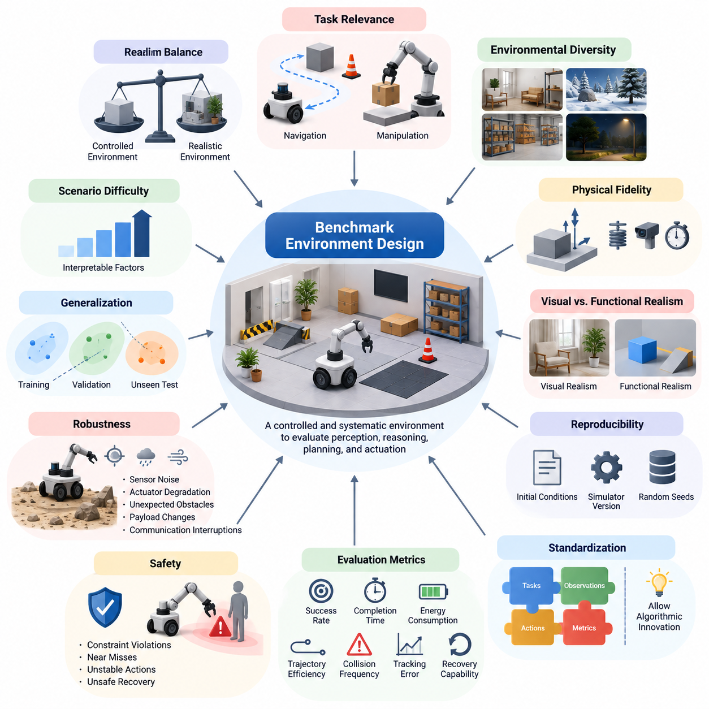{width="7.268055555555556in" height="7.268055555555556in"}

Benchmark environment design is a foundational discipline in Physical AI because evaluation results are meaningful only when tasks, conditions, and measurement procedures are clearly defined. A benchmark environment provides a controlled framework for examining how intelligent physical systems perceive, reason, plan, and act. Its purpose extends beyond measuring task completion to understanding reliability, adaptability, efficiency, and operational limitations.

A well-designed benchmark must balance scientific reproducibility with the complexity of real-world operation. Highly controlled environments make comparisons easier but may exclude important physical uncertainties. Realistic environments capture richer interactions but introduce variability that complicates interpretation. Effective benchmark design therefore combines standardized experimental conditions with carefully selected variations that represent meaningful deployment challenges.

Task relevance is the first major design principle. Benchmark tasks should reflect capabilities required in practical applications rather than reward behaviors that exploit artificial simulation conditions. Navigation benchmarks may evaluate obstacle avoidance, route planning, and localization, while manipulation benchmarks examine grasping, placement, and contact-rich interactions. Each task must connect measurable outcomes to a clearly defined physical capability.

Environmental diversity is essential for evaluating generalization. Physical AI systems encounter changing layouts, materials, lighting, terrain, obstacles, and human activities. A benchmark should incorporate these variations systematically without making comparisons arbitrary. Structured diversity allows researchers to determine whether a policy has learned transferable behavior or merely memorized recurring configurations encountered during training.

Physical fidelity determines whether benchmark outcomes accurately represent the consequences of actions. Relevant models may include rigid-body dynamics, friction, collision response, actuator limitations, sensor imperfections, and communication delays. Fidelity requirements should follow the task being evaluated. A grasping benchmark demands accurate contact behavior, whereas a navigation benchmark may prioritize geometry, perception, and motion constraints.

Benchmark environments must distinguish between visual realism and functional realism. Photorealistic rendering can improve the evaluation of vision-based systems, but realistic appearance alone does not guarantee meaningful physical behavior. Conversely, simplified rendering may be sufficient for evaluating certain control algorithms. Designers should allocate simulation fidelity according to the physical mechanisms and information channels that influence task outcomes.

Reproducibility requires precise control over initial conditions, random seeds, simulator versions, robot configurations, and evaluation procedures. Two systems should encounter equivalent experimental conditions when their performance is compared. Benchmark specifications must also document software dependencies, physical parameters, sensor configurations, and termination criteria. Without these controls, observed performance differences may reflect experimental inconsistencies.

Standardization should preserve fairness without unnecessarily restricting algorithmic innovation. A benchmark can define common tasks, observations, action interfaces, and performance measures while allowing different learning architectures and control strategies. When systems use different sensors or computational resources, those differences should be explicitly documented. Fair comparison requires transparent experimental assumptions rather than identical internal implementations.

Evaluation metrics must capture multiple dimensions of physical intelligence. Task success rate provides an intuitive measure but cannot fully describe system quality. Completion time, energy consumption, trajectory efficiency, collision frequency, tracking error, and recovery capability provide complementary information. Metrics should be selected according to operational objectives and reported together to prevent misleading conclusions based on a single performance indicator.

Safety is a fundamental requirement because successful task execution does not necessarily imply acceptable behavior. A robot may reach its destination while approaching obstacles dangerously or applying excessive force during manipulation. Benchmark environments should record constraint violations, near misses, unstable actions, and unsafe recovery attempts. Safety-related measurements must remain visible even when a system achieves high aggregate task success.

Robustness evaluation requires controlled disturbances and uncertainty. Sensor noise, actuator degradation, unexpected obstacles, payload changes, and communication interruptions can reveal weaknesses that nominal tests overlook. Disturbance intensity should be measurable and progressively adjustable. By examining performance across increasing difficulty levels, benchmark designers can identify operational boundaries rather than reporting only average outcomes under favorable conditions.

Generalization testing must separate familiar evaluation conditions from genuinely unseen situations. Training environments, validation scenarios, and final test configurations should be managed independently to reduce information leakage. Unseen object arrangements, terrain properties, lighting distributions, and task combinations can expose overfitting. Strong benchmark protocols measure whether learned capabilities transfer beyond the particular examples used during development.

Scenario difficulty should be organized around interpretable factors rather than arbitrary complexity. Navigation difficulty may depend on obstacle density, route ambiguity, or dynamic traffic, while manipulation difficulty may depend on object geometry, contact uncertainty, and precision requirements. Parameterized difficulty enables systematic performance analysis. It also supports curriculum-based development without confusing training progression with independent final evaluation.

Benchmark design must account for differences in robot morphology and embodiment. Wheeled mobile robots, manipulators, quadrupeds, humanoids, and aerial robots possess distinct capabilities and physical constraints. Identical tasks may not represent equivalent difficulty across platforms. Cross-embodiment evaluation should therefore distinguish common functional objectives from embodiment-specific execution requirements, ensuring that comparisons remain meaningful.

Observation and action interfaces are another critical consideration. Benchmarks should clearly define available sensory information, coordinate systems, sampling frequencies, control commands, and actuator limits. Privileged simulator information must not unintentionally enter policies intended to operate with real sensors. Explicit interface specifications help separate improvements in perception, decision-making, and control from advantages caused by inaccessible information.

Simulation performance influences benchmark scalability and experimental validity. Large-scale evaluations may require thousands of episodes across varied scenarios, making computational efficiency important. However, increasing simulation throughput must not introduce unacceptable numerical errors or altered physical behavior. Benchmark designers should document simulation time steps, solver settings, execution hardware, and real-time factors when these characteristics affect evaluation results.

Statistical reliability requires repeated experiments and transparent uncertainty reporting. Performance measured from a small number of episodes may be dominated by random initial conditions or rare events. Multiple seeds, representative scenario distributions, and confidence intervals provide stronger evidence of system capability. Benchmark reports should distinguish statistically meaningful improvements from fluctuations caused by sampling variation or experimental noise.

Sim2Real relevance is particularly important for benchmarks intended to support physical deployment. Simulation results should be compared with corresponding real-world experiments whenever practical. Differences in perception, dynamics, latency, and task outcomes can reveal whether the benchmark predicts deployment performance. A useful benchmark does not simply reward simulation success; it helps identify the conditions under which simulation-derived conclusions remain valid.

Failure analysis should be integrated into benchmark design rather than treated as an optional postprocessing activity. Recording trajectories, observations, control actions, contact events, and termination causes enables detailed diagnosis. Failures can be categorized according to perception errors, planning mistakes, control instability, environmental uncertainty, or safety violations. Such classifications transform benchmark results into actionable information for system improvement.

Long-horizon tasks introduce additional requirements because small errors can accumulate across extended sequences of actions. A robot may successfully complete individual navigation or manipulation operations while failing during their coordinated execution. Benchmark environments should evaluate task dependencies, recovery behavior, state consistency, and sustained operation. These measurements reveal capabilities that short isolated episodes cannot adequately characterize.

Human interaction introduces another layer of complexity. Physical AI systems deployed in shared environments must respond to unpredictable movement, communication, and behavioral variation. Benchmarks involving humans should represent realistic interaction patterns while protecting safety and privacy. Evaluation criteria may include collision avoidance, responsiveness, task coordination, and appropriate behavior under ambiguous instructions or changing human intentions.

Benchmark governance is necessary to preserve long-term credibility. Scenario definitions, scoring rules, simulator updates, and dataset revisions should be version controlled and publicly documented when appropriate. Hidden evaluation scenarios can reduce overfitting, but their construction and governance must remain trustworthy. Transparent maintenance procedures help prevent benchmark scores from becoming disconnected from genuine advances in physical intelligence.

A modular benchmark architecture supports continuous expansion without sacrificing comparability. Robot models, environment assets, task definitions, sensor configurations, and evaluation modules can be maintained as separate components with stable interfaces. This structure facilitates the introduction of new embodiments and scenarios while retaining established reference tests. Modular design also simplifies integration with automated testing and simulation pipelines.

Ultimately, benchmark environment design should establish a reliable connection between experimental evidence and real-world capability. Effective benchmarks combine task relevance, controlled diversity, physical fidelity, reproducibility, safety, and statistical rigor. Their greatest value lies not in producing rankings alone but in revealing strengths, limitations, and transferability. This foundation enables systematic development and trustworthy evaluation of increasingly capable Physical AI systems.

벤치마크 환경 설계(Benchmark Environment Design)는 평가 결과(Evaluation Results)가 작업(Task), 조건(Conditions), 측정 절차(Measurement Procedures)의 명확한 정의를 통해서만 의미를 갖기 때문에 피지컬 AI(Physical AI)의 핵심 기반 분야이다. 벤치마크 환경(Benchmark Environment)은 지능형 물리 시스템(Intelligent Physical Systems)이 인식(Perception), 추론(Reasoning), 계획(Planning), 행동(Action)을 수행하는 능력을 검증하기 위한 통제된 평가 체계이다. 그 목적은 단순한 작업 완료 여부를 넘어 신뢰성(Reliability), 적응성(Adaptability), 효율성(Efficiency), 운영상의 한계(Operational Limitations)를 이해하는 데 있다.

잘 설계된 벤치마크(Benchmark)는 과학적 재현성(Scientific Reproducibility)과 실제 환경의 복잡성(Real-World Complexity) 사이에서 균형을 유지해야 한다. 고도로 통제된 환경은 비교를 용이하게 하지만 중요한 물리적 불확실성(Physical Uncertainty)을 배제할 수 있다. 반면 현실적인 환경은 풍부한 상호작용을 반영하지만 결과 해석을 복잡하게 만드는 변동성(Variability)을 발생시킨다. 따라서 효과적인 벤치마크 설계는 표준화된 실험 조건(Standardized Experimental Conditions)과 실제 배포 환경(Deployment Environment)의 주요 도전 과제를 반영하는 변형 조건을 결합해야 한다.

작업 관련성(Task Relevance)은 첫 번째 주요 설계 원칙이다. 벤치마크 작업(Benchmark Task)은 인위적인 시뮬레이션 조건(Simulation Conditions)을 이용하는 행동에 보상을 제공하기보다 실제 응용 분야에서 요구되는 능력을 반영해야 한다. 내비게이션 벤치마크(Navigation Benchmark)는 장애물 회피(Obstacle Avoidance), 경로 계획(Route Planning), 위치 추정(Localization)을 평가할 수 있으며, 조작 벤치마크(Manipulation Benchmark)는 파지(Grasping), 배치(Placement), 접촉 중심 상호작용(Contact-Rich Interaction)을 검증한다. 각 작업은 측정 가능한 결과를 명확하게 정의된 물리적 능력과 연결해야 한다.

환경 다양성(Environmental Diversity)은 일반화 성능(Generalization Performance)을 평가하는 데 필수적이다. 피지컬 AI 시스템(Physical AI System)은 변화하는 공간 배치(Layout), 재질(Materials), 조명(Lighting), 지형(Terrain), 장애물(Obstacles), 인간 활동(Human Activities)에 직면한다. 벤치마크는 비교의 일관성을 훼손하지 않으면서 이러한 변화를 체계적으로 포함해야 한다. 구조화된 다양성(Structured Diversity)은 연구자가 정책(Policy)이 전이 가능한 행동(Transferable Behavior)을 학습했는지, 아니면 학습 과정에서 반복적으로 경험한 특정 구성만 암기했는지를 판단하도록 지원한다.

물리적 충실도(Physical Fidelity)는 벤치마크 결과가 행동의 실제 물리적 결과를 얼마나 정확하게 반영하는지를 결정한다. 관련 모델에는 강체 동역학(Rigid-Body Dynamics), 마찰(Friction), 충돌 응답(Collision Response), 액추에이터 제한(Actuator Limitations), 센서 불완전성(Sensor Imperfections), 통신 지연(Communication Delays)이 포함될 수 있다. 충실도 요구사항은 평가 대상 작업에 따라 결정해야 한다. 파지 벤치마크(Grasping Benchmark)는 정확한 접촉 거동(Contact Behavior)을 요구하지만, 내비게이션 벤치마크(Navigation Benchmark)는 기하학적 구조(Geometry), 인식(Perception), 운동 제약(Motion Constraints)을 우선할 수 있다.

벤치마크 환경(Benchmark Environment)은 시각적 사실성(Visual Realism)과 기능적 사실성(Functional Realism)을 구분해야 한다. 사실적인 렌더링(Photorealistic Rendering)은 비전 기반 시스템(Vision-Based Systems)의 평가를 개선할 수 있지만, 현실적인 외형만으로 의미 있는 물리적 행동이 보장되지는 않는다. 반대로 단순화된 렌더링(Simplified Rendering)은 특정 제어 알고리즘(Control Algorithms)을 평가하는 데 충분할 수 있다. 설계자는 작업 결과에 영향을 미치는 물리적 메커니즘(Physical Mechanisms)과 정보 채널(Information Channels)에 따라 시뮬레이션 충실도(Simulation Fidelity)를 배분해야 한다.

재현성(Reproducibility)을 확보하려면 초기 조건(Initial Conditions), 난수 시드(Random Seeds), 시뮬레이터 버전(Simulator Versions), 로봇 구성(Robot Configurations), 평가 절차(Evaluation Procedures)를 정밀하게 관리해야 한다. 두 시스템의 성능을 비교할 때는 동등한 실험 조건을 제공해야 한다. 벤치마크 사양(Benchmark Specifications)에는 소프트웨어 의존성(Software Dependencies), 물리 매개변수(Physical Parameters), 센서 구성(Sensor Configurations), 종료 기준(Termination Criteria)도 명시해야 한다. 이러한 통제가 없으면 관찰된 성능 차이가 실제 능력보다 실험 조건의 불일치에서 발생할 수 있다.

표준화(Standardization)는 알고리즘 혁신(Algorithmic Innovation)을 불필요하게 제한하지 않으면서 공정성(Fairness)을 유지해야 한다. 벤치마크는 공통 작업(Common Tasks), 관측값(Observations), 행동 인터페이스(Action Interfaces), 성능 지표(Performance Metrics)를 정의하면서 다양한 학습 아키텍처(Learning Architectures)와 제어 전략(Control Strategies)을 허용할 수 있다. 시스템마다 사용하는 센서(Sensors)나 컴퓨팅 자원(Computational Resources)이 다르다면 이러한 차이를 명확하게 문서화해야 한다. 공정한 비교는 동일한 내부 구현보다 투명한 실험 가정(Experimental Assumptions)을 요구한다.

평가 지표(Evaluation Metrics)는 물리적 지능(Physical Intelligence)의 다양한 측면을 포착해야 한다. 작업 성공률(Task Success Rate)은 직관적인 측정 기준이지만 시스템 품질(System Quality)을 완전하게 설명하지 못한다. 완료 시간(Completion Time), 에너지 소비(Energy Consumption), 궤적 효율성(Trajectory Efficiency), 충돌 빈도(Collision Frequency), 추종 오차(Tracking Error), 복구 능력(Recovery Capability)은 상호 보완적인 정보를 제공한다. 평가 지표는 운영 목표(Operational Objectives)에 따라 선정하고 함께 보고하여 단일 성능 지표에 의한 오해를 방지해야 한다.

안전성(Safety)은 성공적인 작업 수행이 반드시 허용 가능한 행동을 의미하지 않기 때문에 기본적인 요구사항이다. 로봇은 목적지에 도달하면서도 장애물에 위험하게 접근하거나 조작 과정에서 과도한 힘을 가할 수 있다. 벤치마크 환경은 제약 조건 위반(Constraint Violations), 근접 사고(Near Misses), 불안정한 행동(Unstable Actions), 안전하지 않은 복구 시도(Unsafe Recovery Attempts)를 기록해야 한다. 시스템이 높은 종합 작업 성공률(Aggregate Task Success Rate)을 달성하더라도 안전 관련 측정 결과는 명확하게 유지되어야 한다.

강건성 평가(Robustness Evaluation)에는 통제된 외란(Disturbances)과 불확실성(Uncertainty)이 필요하다. 센서 잡음(Sensor Noise), 액추에이터 성능 저하(Actuator Degradation), 예상하지 못한 장애물(Unexpected Obstacles), 적재 하중 변화(Payload Changes), 통신 중단(Communication Interruptions)은 정상 조건의 시험에서 발견되지 않는 취약점을 드러낼 수 있다. 외란 강도(Disturbance Intensity)는 측정 가능하고 단계적으로 조정할 수 있어야 한다. 난이도가 증가하는 조건에서 성능을 분석하면 유리한 조건의 평균 결과뿐 아니라 실제 운영 한계(Operational Boundaries)를 파악할 수 있다.

일반화 평가(Generalization Testing)는 익숙한 평가 조건과 실제로 경험하지 않은 상황을 구분해야 한다. 학습 환경(Training Environments), 검증 시나리오(Validation Scenarios), 최종 시험 구성(Final Test Configurations)은 정보 누출(Information Leakage)을 줄이기 위해 독립적으로 관리해야 한다. 새로운 객체 배치(Object Arrangements), 지형 특성(Terrain Properties), 조명 분포(Lighting Distributions), 작업 조합(Task Combinations)은 과적합(Overfitting)을 드러낼 수 있다. 강력한 벤치마크 프로토콜(Benchmark Protocol)은 학습에 사용된 특정 사례를 넘어 습득한 능력이 전이되는지를 측정한다.

시나리오 난이도(Scenario Difficulty)는 임의적인 복잡성이 아니라 해석 가능한 요소를 중심으로 구성해야 한다. 내비게이션 난이도(Navigation Difficulty)는 장애물 밀도(Obstacle Density), 경로 모호성(Route Ambiguity), 동적 교통 환경(Dynamic Traffic)에 따라 달라질 수 있으며, 조작 난이도(Manipulation Difficulty)는 객체 형상(Object Geometry), 접촉 불확실성(Contact Uncertainty), 정밀도 요구사항(Precision Requirements)에 따라 결정될 수 있다. 매개변수화된 난이도(Parameterized Difficulty)는 체계적인 성능 분석을 가능하게 하며, 학습 진행 과정과 독립적인 최종 평가를 혼동하지 않으면서 커리큘럼 기반 개발(Curriculum-Based Development)을 지원한다.

벤치마크 설계는 로봇 형태(Morphology)와 체화 구조(Embodiment)의 차이를 고려해야 한다. 바퀴형 이동 로봇(Wheeled Mobile Robots), 매니퓰레이터(Manipulators), 사족보행 로봇(Quadrupeds), 휴머노이드(Humanoids), 비행 로봇(Aerial Robots)은 서로 다른 능력과 물리적 제약을 가진다. 동일한 작업도 플랫폼에 따라 동등한 난이도를 의미하지 않을 수 있다. 따라서 교차 체화 평가(Cross-Embodiment Evaluation)는 공통 기능 목표(Common Functional Objectives)와 체화 구조별 실행 요구사항(Embodiment-Specific Execution Requirements)을 구분하여 비교의 의미를 유지해야 한다.

관측 및 행동 인터페이스(Observation and Action Interfaces)도 중요한 설계 요소이다. 벤치마크는 사용 가능한 센서 정보(Sensory Information), 좌표계(Coordinate Systems), 샘플링 주파수(Sampling Frequencies), 제어 명령(Control Commands), 액추에이터 제한(Actuator Limits)을 명확하게 정의해야 한다. 실제 센서로 동작하도록 설계된 정책(Policy)에 시뮬레이터의 특권 정보(Privileged Simulator Information)가 의도치 않게 유입되어서는 안 된다. 명시적인 인터페이스 사양(Interface Specifications)은 인식, 의사결정(Decision-Making), 제어 능력의 향상을 실제로 접근할 수 없는 정보에서 비롯된 이점과 구분하도록 지원한다.

시뮬레이션 성능(Simulation Performance)은 벤치마크의 확장성(Scalability)과 실험 타당성(Experimental Validity)에 영향을 미친다. 대규모 평가(Large-Scale Evaluation)는 다양한 시나리오에서 수천 번의 에피소드(Episodes)를 요구할 수 있으므로 계산 효율성(Computational Efficiency)이 중요하다. 그러나 시뮬레이션 처리량(Simulation Throughput)을 높이는 과정에서 허용할 수 없는 수치 오차(Numerical Errors)나 물리적 거동의 변화가 발생해서는 안 된다. 벤치마크 설계자는 평가 결과에 영향을 미치는 시간 간격(Time Steps), 솔버 설정(Solver Settings), 실행 하드웨어(Execution Hardware), 실시간 계수(Real-Time Factors)를 문서화해야 한다.

통계적 신뢰성(Statistical Reliability)을 확보하려면 반복 실험(Repeated Experiments)과 투명한 불확실성 보고(Uncertainty Reporting)가 필요하다. 소수의 에피소드에서 측정된 성능은 무작위 초기 조건(Random Initial Conditions)이나 희귀 사건(Rare Events)에 크게 영향을 받을 수 있다. 다중 시드(Multiple Seeds), 대표적인 시나리오 분포(Representative Scenario Distributions), 신뢰구간(Confidence Intervals)은 시스템 능력에 대한 더욱 강력한 근거를 제공한다. 벤치마크 보고서는 통계적으로 유의미한 개선(Statistically Meaningful Improvements)과 표본 변동(Sampling Variation) 또는 실험 잡음(Experimental Noise)에 따른 차이를 구분해야 한다.

시뮬레이션-현실 전이 관련성(Sim2Real Relevance)은 실제 물리적 배포(Physical Deployment)를 지원하도록 설계된 벤치마크에서 특히 중요하다. 가능한 경우 시뮬레이션 결과(Simulation Results)를 대응하는 실제 환경 실험(Real-World Experiments)과 비교해야 한다. 인식, 동역학(Dynamics), 지연 시간(Latency), 작업 결과(Task Outcomes)의 차이는 벤치마크가 실제 배포 성능을 얼마나 잘 예측하는지 보여준다. 유용한 벤치마크는 단순히 시뮬레이션 성공에 보상을 제공하는 것이 아니라 시뮬레이션에서 도출한 결론이 유효하게 유지되는 조건을 식별하도록 지원한다.

실패 분석(Failure Analysis)은 선택적인 후처리(Postprocessing)가 아니라 벤치마크 설계에 통합되어야 한다. 궤적(Trajectories), 관측값(Observations), 제어 행동(Control Actions), 접촉 이벤트(Contact Events), 종료 원인(Termination Causes)을 기록하면 상세한 진단이 가능하다. 실패는 인식 오류(Perception Errors), 계획 오류(Planning Mistakes), 제어 불안정성(Control Instability), 환경 불확실성(Environmental Uncertainty), 안전 위반(Safety Violations)에 따라 분류할 수 있다. 이러한 분류는 벤치마크 결과를 시스템 개선에 활용할 수 있는 실행 가능한 정보(Actionable Information)로 전환한다.

장기 작업(Long-Horizon Tasks)은 작은 오류가 연속적인 행동 과정에서 누적될 수 있기 때문에 추가적인 평가 요구사항을 발생시킨다. 로봇은 개별 내비게이션이나 조작 작업을 성공적으로 완료하더라도 이를 연계하여 실행하는 과정에서 실패할 수 있다. 벤치마크 환경은 작업 의존성(Task Dependencies), 복구 행동(Recovery Behavior), 상태 일관성(State Consistency), 지속 운영(Sustained Operation)을 평가해야 한다. 이러한 측정은 짧고 독립적인 에피소드만으로 충분하게 파악하기 어려운 능력을 드러낸다.

인간 상호작용(Human Interaction)은 또 다른 복잡성을 발생시킨다. 공유 환경(Shared Environments)에 배포되는 피지컬 AI 시스템은 예측하기 어려운 인간의 움직임(Movement), 의사소통(Communication), 행동 변화(Behavioral Variation)에 대응해야 한다. 인간이 포함된 벤치마크는 안전과 개인정보 보호(Privacy)를 유지하면서 현실적인 상호작용 패턴(Interaction Patterns)을 반영해야 한다. 평가 기준에는 충돌 회피(Collision Avoidance), 반응성(Responsiveness), 작업 협업(Task Coordination), 모호한 지시(Ambiguous Instructions)나 변화하는 인간의 의도(Human Intentions)에 대한 적절한 행동이 포함될 수 있다.

벤치마크 거버넌스(Benchmark Governance)는 장기적인 신뢰성(Credibility)을 유지하는 데 필요하다. 시나리오 정의(Scenario Definitions), 점수 산정 규칙(Scoring Rules), 시뮬레이터 업데이트(Simulator Updates), 데이터셋 개정(Dataset Revisions)은 버전 관리(Version Control)를 적용하고 적절한 경우 공개적으로 문서화해야 한다. 비공개 평가 시나리오(Hidden Evaluation Scenarios)는 과적합을 줄일 수 있지만 그 구성과 관리 과정은 신뢰할 수 있어야 한다. 투명한 유지관리 절차(Maintenance Procedures)는 벤치마크 점수가 실제 물리적 지능의 발전과 괴리되는 현상을 방지하도록 지원한다.

모듈형 벤치마크 아키텍처(Modular Benchmark Architecture)는 비교 가능성(Comparability)을 유지하면서 지속적인 확장을 지원한다. 로봇 모델(Robot Models), 환경 자산(Environment Assets), 작업 정의(Task Definitions), 센서 구성(Sensor Configurations), 평가 모듈(Evaluation Modules)은 안정적인 인터페이스(Stable Interfaces)를 갖춘 독립적인 구성요소로 관리할 수 있다. 이러한 구조는 기존 참조 시험(Reference Tests)을 유지하면서 새로운 체화 구조와 시나리오를 도입하도록 지원한다. 또한 모듈형 설계(Modular Design)는 자동화된 시험(Automated Testing)과 시뮬레이션 파이프라인(Simulation Pipelines)의 통합을 단순화한다.

궁극적으로 벤치마크 환경 설계(Benchmark Environment Design)는 실험적 증거(Experimental Evidence)와 실제 환경에서의 능력(Real-World Capability) 사이에 신뢰할 수 있는 연결을 구축해야 한다. 효과적인 벤치마크는 작업 관련성(Task Relevance), 통제된 다양성(Controlled Diversity), 물리적 충실도(Physical Fidelity), 재현성(Reproducibility), 안전성(Safety), 통계적 엄밀성(Statistical Rigor)을 결합한다. 가장 큰 가치는 단순한 순위(Rankings) 산출이 아니라 시스템의 강점(Strengths), 한계(Limitations), 전이 가능성(Transferability)을 규명하는 데 있다. 이러한 기반은 점점 더 높은 능력을 갖추는 피지컬 AI 시스템의 체계적인 개발과 신뢰할 수 있는 평가를 가능하게 한다.

##  

## 09.02. Reproducibility and Standardized Scenarios

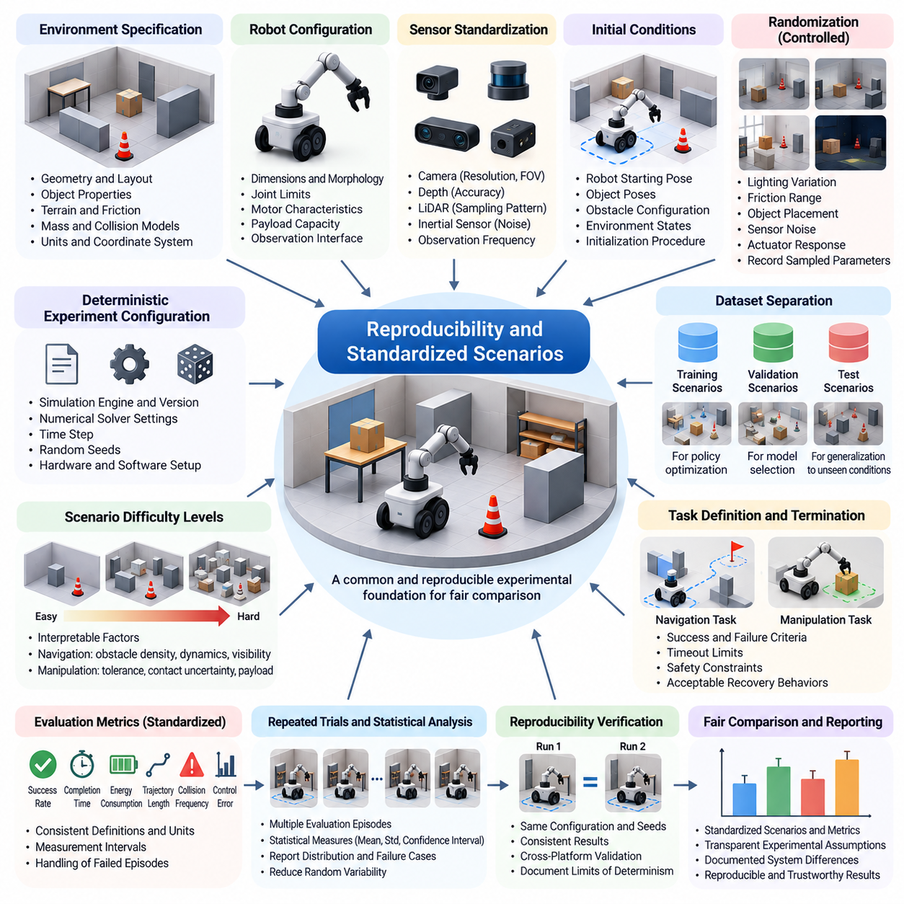{width="7.268055555555556in" height="7.268055555555556in"}

Reproducibility is a fundamental requirement for trustworthy Physical AI benchmarking because experimental results must remain consistent when equivalent conditions are repeated. A reproducible benchmark allows researchers to distinguish genuine improvements in perception, planning, and control from variations introduced by simulation settings. Standardized scenarios provide the common experimental foundation needed to compare different algorithms, robot platforms, and learning methods.

A standardized scenario defines the physical environment, robot configuration, task objective, initial conditions, and evaluation procedure. These specifications establish a shared reference against which system behavior can be measured. Without consistent scenario definitions, differences in obstacle placement, object properties, sensor configurations, or termination conditions may produce misleading performance comparisons between otherwise similar systems.

Reproducibility begins with deterministic experiment configuration. Simulation engines, numerical solvers, integration time steps, and random number generators must be configured consistently across evaluation runs. Random seeds should be recorded and controlled to reproduce environment initialization and stochastic events. However, deterministic settings alone do not guarantee identical results across different hardware architectures or software implementations.

Scenario standardization requires explicit definitions of environmental geometry and physical properties. Terrain profiles, object dimensions, surface friction, mass distributions, and collision boundaries should be documented using consistent units and coordinate systems. These specifications enable independent researchers to reconstruct equivalent conditions while reducing uncertainty caused by incomplete descriptions of the simulated physical environment.

Robot configuration is equally important because differences in morphology, actuator capabilities, and sensor placement directly influence task difficulty. Benchmark specifications should identify robot dimensions, joint limits, motor characteristics, payload restrictions, and observation interfaces. When multiple robot embodiments are supported, standardized capability categories can preserve meaningful comparisons without requiring every platform to share identical hardware.

Sensor standardization ensures that evaluated systems receive clearly defined information. Camera resolution, field of view, depth accuracy, LiDAR sampling patterns, inertial sensor noise, and observation frequency can significantly influence performance. Benchmark protocols should distinguish raw sensor observations from privileged simulator states. This separation prevents algorithms from gaining unintended advantages through information unavailable during real-world deployment.

Initial conditions must be specified carefully because small differences can change task outcomes. Robot starting positions, object poses, obstacle configurations, and environmental states should follow documented initialization procedures. Fixed scenarios support direct comparison, while controlled randomization introduces measurable diversity. Both approaches are useful when their purposes are clearly separated within the benchmark evaluation protocol.

Randomization should follow standardized probability distributions rather than arbitrary parameter selection. Variations in lighting, friction, object placement, sensor noise, and actuator response must be bounded by documented ranges. Recording sampled parameters allows experiments to be reconstructed and analyzed. Standardized randomization also helps determine whether performance differences arise from algorithm quality or unequal exposure to environmental difficulty.

A robust benchmark distinguishes training, validation, and testing scenarios. Training scenarios support policy optimization, while validation scenarios guide model selection and development decisions. Independent test scenarios provide evidence of generalization to previously unseen conditions. Maintaining this separation reduces evaluation leakage and discourages algorithms from memorizing specific environments instead of learning transferable physical behaviors.

Scenario difficulty should be organized into interpretable levels based on measurable physical and operational factors. Navigation complexity may increase through obstacle density, dynamic movement, or reduced visibility. Manipulation complexity may increase through tighter tolerances, uncertain contact properties, or changing payloads. Standardized difficulty levels allow researchers to evaluate performance degradation systematically rather than relying on isolated success measurements.

Task definitions must include unambiguous success and failure criteria. A navigation task may require reaching a specified region without collision, while manipulation may require placing an object within defined position and orientation tolerances. Timeout limits, safety constraints, and acceptable recovery behaviors must also be specified. Clear termination rules prevent different implementations from interpreting the same task outcome inconsistently.

Evaluation metrics should be calculated through standardized procedures. Success rate, completion time, energy consumption, trajectory length, collision frequency, and control error must use consistent definitions and measurement intervals. Metrics should also specify whether failed episodes contribute to aggregate statistics. Without these conventions, identical robot behaviors can produce different reported scores depending on the evaluation implementation.

Repeated trials are necessary because stochastic environments and learning algorithms introduce statistical variability. Benchmark protocols should define the number of evaluation episodes, seed selection procedures, and aggregation methods. Reporting means, dispersion measures, and confidence intervals provides a more reliable representation of performance. Statistical analysis helps distinguish meaningful algorithmic improvements from random fluctuations in experimental outcomes.

Software version control is essential for preserving reproducibility over time. Physics engines, rendering libraries, robot models, environment assets, and evaluation scripts may change between releases. Even minor updates can alter contact dynamics, numerical stability, or sensor outputs. Benchmark releases should therefore maintain identifiable versions, dependency specifications, and documented changes that could influence previously reported experimental results.

Hardware differences can introduce additional reproducibility challenges. CPU and GPU architectures, parallel execution strategies, floating-point precision, and scheduling behavior may affect simulation outcomes. These differences become especially important in large-scale parallel reinforcement learning environments. Benchmark documentation should record relevant hardware configurations and identify tolerances within which results are considered equivalent rather than assuming universal numerical identity.

Simulation timing must be standardized to preserve meaningful physical comparisons. Physics integration frequency, sensor update intervals, controller execution rates, and communication delays influence system behavior. A policy evaluated with different control frequencies may experience substantially different dynamics. Explicit timing specifications ensure that observed improvements reflect algorithmic capabilities rather than unintended differences in simulation or control execution.

Standardized logging provides the evidence required to reproduce and diagnose experimental outcomes. Benchmark systems should record scenario identifiers, configuration parameters, random seeds, robot states, observations, actions, rewards, and termination causes. Time-synchronized logs support trajectory replay and detailed failure analysis. Consistent data formats also enable automated comparison across experiments conducted by different research groups.

Automated benchmark execution reduces human intervention and procedural inconsistencies. Evaluation pipelines can initialize scenarios, deploy policies, execute trials, collect measurements, and generate reports using predefined configurations. Automated validation should verify that required assets, software versions, and robot interfaces match benchmark specifications. This approach improves experimental repeatability while supporting large-scale evaluation across many scenarios.

Scenario coverage must extend beyond nominal operating conditions to include disturbances and rare events. Unexpected obstacles, sensor failures, actuator degradation, and communication interruptions can reveal vulnerabilities hidden by routine testing. These events should be generated through documented mechanisms with controlled severity. Standardized disturbance scenarios make robustness comparisons more interpretable and support systematic identification of operational limits.

Real-world reproducibility introduces challenges that cannot be eliminated through software configuration alone. Physical robots experience variations in wear, calibration, temperature, battery condition, and environmental interaction. Benchmark protocols should document calibration procedures, maintenance conditions, and measurable environmental factors. Repeated physical trials and controlled experimental preparation help establish comparable conditions without assuming that the real world is perfectly deterministic.

Sim2Real evaluation requires paired simulation and physical scenarios with clearly defined correspondence. Robot configurations, task objectives, environmental geometry, and measurement procedures should be aligned wherever practical. Differences between simulated and physical outcomes can then be attributed more systematically to modeling errors or deployment uncertainties. Standardized paired experiments provide a stronger foundation for assessing transfer performance than unrelated simulation and real-world tests.

Benchmark governance is necessary to maintain comparability as scenarios and technologies evolve. Changes to task definitions, scoring methods, physical parameters, or evaluation assets should be documented and versioned. Historical results should remain associated with the benchmark versions under which they were obtained. Transparent governance prevents silent changes from invalidating comparisons and supports the long-term credibility of published benchmark results.

Ultimately, reproducibility and standardized scenarios transform Physical AI benchmarking from isolated demonstrations into a systematic experimental discipline. Clear specifications, controlled randomness, consistent metrics, versioned software, and transparent reporting establish a common basis for evaluating intelligent physical systems. This foundation supports reliable scientific comparison, meaningful Sim2Real analysis, and continuous improvement of increasingly capable robotic technologies.

재현성(Reproducibility)은 동일한 조건에서 실험을 반복할 때 결과가 일관되게 유지되어야 하므로 신뢰할 수 있는 피지컬 AI 벤치마킹(Physical AI Benchmarking)의 기본 요구사항이다. 재현 가능한 벤치마크(Reproducible Benchmark)는 연구자가 인식(Perception), 계획(Planning), 제어(Control)의 실제 성능 향상과 시뮬레이션 설정(Simulation Settings)에서 발생하는 변동을 구분하도록 지원한다. 표준화된 시나리오(Standardized Scenarios)는 다양한 알고리즘(Algorithms), 로봇 플랫폼(Robot Platforms), 학습 방법(Learning Methods)을 비교하는 데 필요한 공통 실험 기반을 제공한다.

표준화된 시나리오(Standardized Scenario)는 물리적 환경(Physical Environment), 로봇 구성(Robot Configuration), 작업 목표(Task Objective), 초기 조건(Initial Conditions), 평가 절차(Evaluation Procedure)를 정의한다. 이러한 사양(Specifications)은 시스템 행동(System Behavior)을 측정할 수 있는 공통 참조 기준(Shared Reference)을 수립한다. 일관된 시나리오 정의가 없으면 장애물 배치(Obstacle Placement), 객체 특성(Object Properties), 센서 구성(Sensor Configurations), 종료 조건(Termination Conditions)의 차이로 인해 유사한 시스템 사이에서도 잘못된 성능 비교가 발생할 수 있다.

재현성(Reproducibility)은 결정론적 실험 구성(Deterministic Experiment Configuration)에서 시작된다. 시뮬레이션 엔진(Simulation Engines), 수치 솔버(Numerical Solvers), 적분 시간 간격(Integration Time Steps), 난수 생성기(Random Number Generators)는 평가 실행 간에 일관되게 설정해야 한다. 난수 시드(Random Seeds)를 기록하고 제어하여 환경 초기화(Environment Initialization)와 확률적 이벤트(Stochastic Events)를 재현할 수 있어야 한다. 그러나 결정론적 설정만으로 서로 다른 하드웨어 아키텍처(Hardware Architectures)나 소프트웨어 구현(Software Implementations)에서 완전히 동일한 결과가 보장되는 것은 아니다.

시나리오 표준화(Scenario Standardization)를 위해서는 환경 기하학(Environmental Geometry)과 물리적 특성(Physical Properties)을 명시적으로 정의해야 한다. 지형 형상(Terrain Profiles), 객체 치수(Object Dimensions), 표면 마찰(Surface Friction), 질량 분포(Mass Distributions), 충돌 경계(Collision Boundaries)는 일관된 단위(Units)와 좌표계(Coordinate Systems)를 사용하여 문서화해야 한다. 이러한 사양은 독립적인 연구자가 동등한 조건을 재구성하도록 지원하며, 시뮬레이션 물리 환경(Simulated Physical Environment)에 대한 불완전한 설명으로 발생하는 불확실성을 줄인다.

로봇 구성(Robot Configuration) 역시 중요하다. 로봇 형태(Morphology), 액추에이터 성능(Actuator Capabilities), 센서 배치(Sensor Placement)의 차이가 작업 난이도(Task Difficulty)에 직접적인 영향을 미치기 때문이다. 벤치마크 사양(Benchmark Specifications)은 로봇 치수(Robot Dimensions), 관절 제한(Joint Limits), 모터 특성(Motor Characteristics), 적재 하중 제한(Payload Restrictions), 관측 인터페이스(Observation Interfaces)를 명시해야 한다. 여러 로봇 체화 구조(Robot Embodiments)를 지원하는 경우 표준화된 능력 범주(Standardized Capability Categories)를 활용하면 모든 플랫폼에 동일한 하드웨어를 요구하지 않으면서 의미 있는 비교를 유지할 수 있다.

센서 표준화(Sensor Standardization)는 평가 대상 시스템에 명확하게 정의된 정보가 제공되도록 보장한다. 카메라 해상도(Camera Resolution), 시야각(Field of View), 깊이 정확도(Depth Accuracy), 라이다 샘플링 패턴(LiDAR Sampling Patterns), 관성 센서 잡음(Inertial Sensor Noise), 관측 주파수(Observation Frequency)는 성능에 상당한 영향을 미칠 수 있다. 벤치마크 프로토콜(Benchmark Protocols)은 원시 센서 관측값(Raw Sensor Observations)과 시뮬레이터 특권 상태 정보(Privileged Simulator States)를 구분해야 한다. 이러한 구분은 실제 환경 배포(Real-World Deployment)에서 사용할 수 없는 정보를 통해 알고리즘이 의도하지 않은 이점을 얻는 것을 방지한다.

초기 조건(Initial Conditions)은 작은 차이만으로도 작업 결과가 달라질 수 있으므로 신중하게 지정해야 한다. 로봇 시작 위치(Robot Starting Positions), 객체 자세(Object Poses), 장애물 구성(Obstacle Configurations), 환경 상태(Environmental States)는 문서화된 초기화 절차(Initialization Procedures)를 따라야 한다. 고정 시나리오(Fixed Scenarios)는 직접적인 비교를 지원하며, 통제된 무작위화(Controlled Randomization)는 측정 가능한 다양성을 제공한다. 두 접근 방식은 벤치마크 평가 프로토콜(Benchmark Evaluation Protocol)에서 각각의 목적이 명확하게 구분될 때 효과적으로 활용할 수 있다.

무작위화(Randomization)는 임의적인 매개변수 선택보다 표준화된 확률 분포(Standardized Probability Distributions)를 따라야 한다. 조명(Lighting), 마찰(Friction), 객체 배치(Object Placement), 센서 잡음(Sensor Noise), 액추에이터 응답(Actuator Response)의 변화는 문서화된 범위 내에서 제한해야 한다. 샘플링된 매개변수(Sampled Parameters)를 기록하면 실험을 재구성하고 분석할 수 있다. 표준화된 무작위화는 성능 차이가 알고리즘 품질(Algorithm Quality)에서 발생했는지, 아니면 서로 다른 환경 난이도(Environmental Difficulty)에 노출된 결과인지를 판단하는 데에도 도움이 된다.

강건한 벤치마크(Robust Benchmark)는 학습(Training), 검증(Validation), 시험(Testing) 시나리오를 구분한다. 학습 시나리오(Training Scenarios)는 정책 최적화(Policy Optimization)를 지원하며, 검증 시나리오(Validation Scenarios)는 모델 선택(Model Selection)과 개발 의사결정(Development Decisions)을 안내한다. 독립적인 시험 시나리오(Independent Test Scenarios)는 이전에 경험하지 않은 조건에 대한 일반화(Generalization)의 근거를 제공한다. 이러한 구분을 유지하면 평가 정보 누출(Evaluation Leakage)을 줄이고, 전이 가능한 물리적 행동(Transferable Physical Behaviors)을 학습하는 대신 특정 환경을 암기하는 현상을 방지할 수 있다.

시나리오 난이도(Scenario Difficulty)는 측정 가능한 물리적 요소(Physical Factors)와 운영 요소(Operational Factors)를 기준으로 해석 가능한 수준으로 구성해야 한다. 내비게이션 복잡도(Navigation Complexity)는 장애물 밀도(Obstacle Density), 동적 움직임(Dynamic Movement), 가시성 감소(Reduced Visibility)를 통해 증가할 수 있다. 조작 복잡도(Manipulation Complexity)는 더욱 엄격한 허용오차(Tighter Tolerances), 불확실한 접촉 특성(Uncertain Contact Properties), 변화하는 적재 하중(Changing Payloads)에 따라 증가할 수 있다. 표준화된 난이도 수준(Standardized Difficulty Levels)은 개별 성공 측정에 의존하지 않고 성능 저하를 체계적으로 평가하도록 지원한다.

작업 정의(Task Definitions)에는 모호하지 않은 성공 및 실패 기준(Success and Failure Criteria)이 포함되어야 한다. 내비게이션 작업(Navigation Task)은 충돌 없이 지정된 영역에 도달하도록 요구할 수 있으며, 조작 작업(Manipulation Task)은 정의된 위치 및 방향 허용오차(Position and Orientation Tolerances) 내에서 객체를 배치하도록 요구할 수 있다. 시간 초과 제한(Timeout Limits), 안전 제약(Safety Constraints), 허용 가능한 복구 행동(Acceptable Recovery Behaviors)도 명시해야 한다. 명확한 종료 규칙(Termination Rules)은 서로 다른 구현에서 동일한 작업 결과를 일관되지 않게 해석하는 문제를 방지한다.

평가 지표(Evaluation Metrics)는 표준화된 절차(Standardized Procedures)를 통해 계산해야 한다. 성공률(Success Rate), 완료 시간(Completion Time), 에너지 소비(Energy Consumption), 궤적 길이(Trajectory Length), 충돌 빈도(Collision Frequency), 제어 오차(Control Error)는 일관된 정의와 측정 간격(Measurement Intervals)을 사용해야 한다. 또한 실패한 에피소드(Failed Episodes)가 종합 통계(Aggregate Statistics)에 포함되는지도 명시해야 한다. 이러한 규칙이 없으면 동일한 로봇 행동이라도 평가 구현(Evaluation Implementation)에 따라 서로 다른 점수로 보고될 수 있다.

확률적 환경(Stochastic Environments)과 학습 알고리즘(Learning Algorithms)은 통계적 변동성(Statistical Variability)을 발생시키므로 반복 시험(Repeated Trials)이 필요하다. 벤치마크 프로토콜은 평가 에피소드 수(Number of Evaluation Episodes), 시드 선택 절차(Seed Selection Procedures), 집계 방법(Aggregation Methods)을 정의해야 한다. 평균값(Means), 산포도 지표(Dispersion Measures), 신뢰구간(Confidence Intervals)을 보고하면 성능을 더욱 신뢰성 있게 표현할 수 있다. 통계 분석(Statistical Analysis)은 의미 있는 알고리즘 개선과 실험 결과의 무작위 변동(Random Fluctuations)을 구분하도록 지원한다.

소프트웨어 버전 관리(Software Version Control)는 시간의 경과에 따른 재현성을 유지하는 데 필수적이다. 물리 엔진(Physics Engines), 렌더링 라이브러리(Rendering Libraries), 로봇 모델(Robot Models), 환경 자산(Environment Assets), 평가 스크립트(Evaluation Scripts)는 릴리스(Release) 사이에 변경될 수 있다. 작은 업데이트도 접촉 동역학(Contact Dynamics), 수치적 안정성(Numerical Stability), 센서 출력(Sensor Outputs)을 변화시킬 수 있다. 따라서 벤치마크 릴리스(Benchmark Releases)는 식별 가능한 버전, 의존성 사양(Dependency Specifications), 기존 실험 결과에 영향을 미칠 수 있는 변경 내역을 유지해야 한다.

하드웨어 차이(Hardware Differences)는 추가적인 재현성 문제를 발생시킬 수 있다. CPU 및 GPU 아키텍처(CPU and GPU Architectures), 병렬 실행 전략(Parallel Execution Strategies), 부동소수점 정밀도(Floating-Point Precision), 스케줄링 동작(Scheduling Behavior)은 시뮬레이션 결과에 영향을 줄 수 있다. 이러한 차이는 특히 대규모 병렬 강화학습 환경(Large-Scale Parallel Reinforcement Learning Environments)에서 중요하다. 벤치마크 문서는 관련 하드웨어 구성을 기록하고, 모든 환경에서 수치적으로 완전히 동일한 결과를 가정하기보다 결과가 동등하다고 판단할 수 있는 허용오차(Tolerances)를 정의해야 한다.

시뮬레이션 타이밍(Simulation Timing)은 의미 있는 물리적 비교를 유지하도록 표준화해야 한다. 물리 적분 주파수(Physics Integration Frequency), 센서 업데이트 간격(Sensor Update Intervals), 컨트롤러 실행 주기(Controller Execution Rates), 통신 지연(Communication Delays)은 시스템 행동에 영향을 미친다. 서로 다른 제어 주파수(Control Frequencies)에서 평가된 정책(Policy)은 상당히 다른 동역학(Dynamics)을 경험할 수 있다. 명시적인 타이밍 사양(Timing Specifications)은 관찰된 성능 향상이 시뮬레이션이나 제어 실행의 의도하지 않은 차이가 아니라 알고리즘 능력을 반영하도록 보장한다.

표준화된 로깅(Standardized Logging)은 실험 결과를 재현하고 진단하는 데 필요한 근거를 제공한다. 벤치마크 시스템은 시나리오 식별자(Scenario Identifiers), 구성 매개변수(Configuration Parameters), 난수 시드(Random Seeds), 로봇 상태(Robot States), 관측값(Observations), 행동(Actions), 보상(Rewards), 종료 원인(Termination Causes)을 기록해야 한다. 시간 동기화 로그(Time-Synchronized Logs)는 궤적 재생(Trajectory Replay)과 상세한 실패 분석(Failure Analysis)을 지원한다. 일관된 데이터 형식(Data Formats)은 서로 다른 연구 그룹에서 수행한 실험을 자동으로 비교할 수 있도록 한다.

자동화된 벤치마크 실행(Automated Benchmark Execution)은 인간의 개입(Human Intervention)과 절차적 불일치(Procedural Inconsistencies)를 줄인다. 평가 파이프라인(Evaluation Pipelines)은 사전에 정의된 구성에 따라 시나리오 초기화(Scenario Initialization), 정책 배포(Policy Deployment), 시험 실행(Trial Execution), 측정값 수집(Measurement Collection), 보고서 생성(Report Generation)을 수행할 수 있다. 자동 검증(Automated Validation)은 필수 자산(Required Assets), 소프트웨어 버전(Software Versions), 로봇 인터페이스(Robot Interfaces)가 벤치마크 사양과 일치하는지 확인해야 한다. 이러한 접근 방식은 다양한 시나리오에 대한 대규모 평가를 지원하면서 실험 반복성을 향상시킨다.

시나리오 적용 범위(Scenario Coverage)는 정상 운영 조건(Nominal Operating Conditions)을 넘어 외란(Disturbances)과 희귀 사건(Rare Events)을 포함해야 한다. 예상하지 못한 장애물(Unexpected Obstacles), 센서 고장(Sensor Failures), 액추에이터 성능 저하(Actuator Degradation), 통신 중단(Communication Interruptions)은 일반적인 시험에서 발견되지 않는 취약점을 드러낼 수 있다. 이러한 사건은 강도가 통제된 문서화된 메커니즘(Documented Mechanisms)을 통해 생성해야 한다. 표준화된 외란 시나리오(Standardized Disturbance Scenarios)는 강건성 비교(Robustness Comparisons)의 해석 가능성을 높이고 운영 한계(Operational Limits)를 체계적으로 식별하도록 지원한다.

실제 환경의 재현성(Real-World Reproducibility)은 소프트웨어 구성만으로 해결할 수 없는 문제를 포함한다. 물리적 로봇(Physical Robots)은 마모(Wear), 보정(Calibration), 온도(Temperature), 배터리 상태(Battery Condition), 환경 상호작용(Environmental Interaction)의 변화를 경험한다. 벤치마크 프로토콜은 보정 절차(Calibration Procedures), 유지보수 조건(Maintenance Conditions), 측정 가능한 환경 요소(Measurable Environmental Factors)를 문서화해야 한다. 반복적인 실제 시험(Repeated Physical Trials)과 통제된 실험 준비(Controlled Experimental Preparation)는 현실 세계가 완전히 결정론적이라고 가정하지 않으면서 비교 가능한 조건을 구축하도록 지원한다.

시뮬레이션-현실 전이 평가(Sim2Real Evaluation)에는 대응 관계가 명확하게 정의된 시뮬레이션 및 실제 환경 시나리오(Paired Simulation and Physical Scenarios)가 필요하다. 로봇 구성(Robot Configurations), 작업 목표(Task Objectives), 환경 기하학(Environmental Geometry), 측정 절차(Measurement Procedures)는 가능한 범위에서 일치시켜야 한다. 이를 통해 시뮬레이션 결과와 실제 결과의 차이를 모델링 오류(Modeling Errors)나 배포 불확실성(Deployment Uncertainties)에 더욱 체계적으로 연결할 수 있다. 표준화된 대응 실험(Standardized Paired Experiments)은 서로 관련 없는 시뮬레이션 시험과 실제 환경 시험보다 전이 성능(Transfer Performance)을 평가하는 데 강력한 기반을 제공한다.

벤치마크 거버넌스(Benchmark Governance)는 시나리오와 기술이 발전하는 과정에서 비교 가능성(Comparability)을 유지하기 위해 필요하다. 작업 정의(Task Definitions), 점수 산정 방법(Scoring Methods), 물리 매개변수(Physical Parameters), 평가 자산(Evaluation Assets)의 변경 사항은 문서화하고 버전 관리(Versioning)를 적용해야 한다. 과거 결과(Historical Results)는 해당 결과가 생성된 벤치마크 버전(Benchmark Versions)과 연결된 상태로 유지되어야 한다. 투명한 거버넌스(Transparent Governance)는 공개되지 않은 변경 사항으로 인해 비교의 유효성이 훼손되는 것을 방지하고 발표된 벤치마크 결과의 장기적인 신뢰성(Credibility)을 지원한다.

궁극적으로 재현성(Reproducibility)과 표준화된 시나리오(Standardized Scenarios)는 피지컬 AI 벤치마킹(Physical AI Benchmarking)을 개별적인 시연(Isolated Demonstrations)에서 체계적인 실험 분야(Systematic Experimental Discipline)로 발전시킨다. 명확한 사양(Clear Specifications), 통제된 무작위성(Controlled Randomness), 일관된 평가 지표(Consistent Metrics), 버전 관리된 소프트웨어(Versioned Software), 투명한 보고(Transparent Reporting)는 지능형 물리 시스템(Intelligent Physical Systems)을 평가하는 공통 기반을 구축한다. 이러한 기반은 신뢰할 수 있는 과학적 비교(Scientific Comparison), 의미 있는 시뮬레이션-현실 전이 분석(Sim2Real Analysis), 점점 더 높은 능력을 갖추는 로봇 기술(Robotic Technologies)의 지속적인 개선을 지원한다.

##  

## 09.03. Standard Robots Sensors Tasks and Metrics

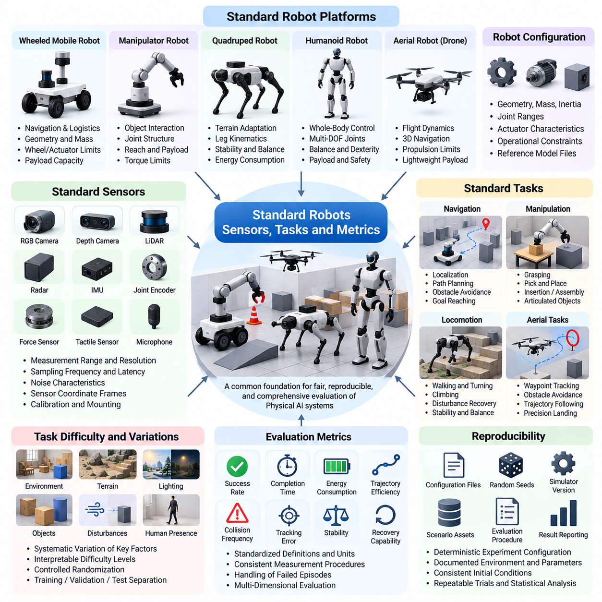{width="7.268055555555556in" height="7.268055555555556in"}

Standard robots, sensors, tasks, and metrics establish a common foundation for evaluating Physical AI systems under comparable experimental conditions. Without standardized reference configurations, performance differences may reflect hardware advantages or inconsistent measurement procedures rather than algorithmic improvements. A well-structured benchmark defines representative robotic platforms, observation capabilities, task objectives, and evaluation criteria while preserving sufficient flexibility for technological innovation.

Standard robot models provide consistent physical embodiments for testing perception, planning, learning, and control algorithms. These models specify geometry, mass, inertia, joint structures, actuator characteristics, and operational constraints. Reference platforms reduce uncertainty when comparing methods developed by different research groups. They also enable repeatable experiments across simulation engines, although numerical and modeling differences must still be documented.

Robot selection should reflect the diversity of Physical AI applications. Wheeled mobile robots represent navigation and logistics, manipulators represent object interaction, quadrupeds represent terrain adaptation, and humanoids represent whole-body coordination. Aerial robots introduce flight dynamics and three-dimensional navigation. Each platform category requires representative configurations that capture its essential capabilities without unnecessarily increasing benchmark complexity.

Robot morphology directly influences benchmark difficulty and achievable performance. Wheel dimensions, joint ranges, manipulator reach, payload capacity, and actuator torque determine the actions available to a system. Standard configurations should therefore include physical limits and relevant dynamic parameters. When alternative embodiments are evaluated, performance comparisons must account for differences in mobility, dexterity, stability, and energy requirements.

Sensor standardization defines the information available to intelligent agents during evaluation. Common sensing modalities include RGB cameras, depth cameras, LiDAR, radar, inertial measurement units, joint encoders, force sensors, and tactile arrays. Each sensor model should specify measurement range, resolution, sampling frequency, latency, and noise characteristics. Consistent specifications prevent differences in observation quality from being mistaken for improvements in algorithmic intelligence.

Observation interfaces should distinguish realistic sensor measurements from privileged simulation information. Ground-truth object poses, perfect velocity estimates, and exact contact forces may be useful for debugging or training but are not always available during deployment. Benchmarks should explicitly define which information channels are accessible to evaluated policies. This separation supports fair comparisons and strengthens the relevance of simulation results to physical systems.

Sensor placement and calibration are as important as sensor type. Camera orientation, LiDAR mounting height, inertial sensor alignment, and force sensor location influence perception and control performance. Reference configurations should document sensor coordinate frames and calibration transformations. Standardized mounting and calibration procedures reduce unintended differences between implementations while supporting reliable reconstruction of observations across experimental platforms.

Task standardization connects robot capabilities to measurable objectives. A benchmark task should specify the initial state, target condition, allowed actions, environmental constraints, and termination rules. Navigation tasks may require reaching a destination, while manipulation tasks may involve grasping, transporting, or assembling objects. Explicit task definitions ensure that different algorithms solve equivalent problems rather than superficially similar activities.

Navigation benchmarks typically evaluate localization, path planning, obstacle avoidance, and motion execution. Standard scenarios may include structured corridors, cluttered warehouses, outdoor terrain, and environments containing moving obstacles. Performance depends on successful goal completion as well as route efficiency and collision avoidance. Scenario specifications should control map availability, obstacle distributions, and permissible localization information.

Manipulation benchmarks evaluate how robots interact with objects through physical contact. Representative tasks include grasping, pick-and-place operations, insertion, stacking, and articulated object manipulation. Object geometry, mass, friction, and placement tolerances must be defined consistently. Evaluation should distinguish successful task completion from unstable grasps, excessive contact forces, or actions that damage objects or surrounding equipment.

Locomotion benchmarks require task definitions suited to legged and humanoid robots. Walking, turning, balancing, climbing, and recovering from disturbances reveal different aspects of embodied control. Standardized terrain geometry, friction conditions, and disturbance profiles support meaningful comparisons. Metrics should capture stability, progression, energy efficiency, and recovery performance rather than relying exclusively on distance traveled.

Aerial robot benchmarks introduce additional considerations related to flight dynamics and environmental constraints. Tasks may include waypoint tracking, obstacle avoidance, trajectory following, and precision landing. Reference models should specify vehicle mass, propulsion limits, aerodynamic assumptions, and sensor configurations. Wind disturbances, communication delays, and limited onboard energy can be introduced systematically to evaluate operational robustness.

Task difficulty should be parameterized to support progressive and interpretable evaluation. Obstacle density, object complexity, terrain roughness, sensor degradation, and time constraints provide measurable difficulty dimensions. Standardized difficulty levels help identify where performance begins to deteriorate. They also enable comparisons between specialized systems and generalist policies across increasingly demanding physical conditions.

Evaluation metrics translate observed robot behavior into quantitative evidence. Task success rate remains a fundamental measure, but it should be complemented by completion time, trajectory length, tracking accuracy, energy consumption, and safety indicators. Metrics must have explicit mathematical definitions and consistent measurement procedures. A benchmark should avoid reducing multidimensional performance to a single score without preserving underlying measurements.

Efficiency metrics are particularly important for physical systems operating under resource constraints. Energy consumed per completed task, computational latency, actuator utilization, and execution time influence deployment feasibility. A robot that completes tasks reliably but requires excessive power or computation may be unsuitable for practical operation. Standardized efficiency measurements reveal tradeoffs between intelligence, hardware capability, and operational cost.

Safety metrics measure whether task execution respects physical and operational constraints. Collision frequency, minimum obstacle clearance, excessive force events, joint-limit violations, and loss-of-stability incidents provide useful indicators. Safety evaluation should distinguish minor deviations from hazardous failures. Reporting safety performance independently from task success prevents high completion rates from concealing unacceptable physical behavior.

Robustness metrics quantify performance under disturbances and uncertain conditions. Sensor noise, actuator errors, payload variations, friction changes, and unexpected obstacles can be introduced through controlled experimental protocols. Performance degradation relative to nominal conditions provides a measure of sensitivity. Recovery time and successful continuation after disturbances further characterize a system\'s ability to maintain reliable operation.

Generalization metrics evaluate whether learned capabilities transfer across environments, objects, tasks, and robot configurations. Standardized testing should include scenarios that differ systematically from training distributions. Cross-environment and cross-embodiment comparisons can reveal whether policies depend on narrow assumptions. Generalization results should identify the dimensions of variation being tested rather than presenting a single unrestricted transfer score.

Statistical reporting is necessary to interpret benchmark metrics reliably. Multiple evaluation episodes, controlled random seeds, and representative scenario distributions reduce dependence on individual outcomes. Mean performance, variability, confidence intervals, and failure frequencies provide complementary evidence. Evaluation reports should identify sample sizes and aggregation procedures so that differences between algorithms can be interpreted with appropriate statistical caution.

Standard robot, sensor, task, and metric specifications must also support reproducibility across software and hardware platforms. Model versions, calibration parameters, control frequencies, physics settings, and scoring implementations should be documented. Automated validation can detect configuration mismatches before evaluation begins. These practices reduce experimental ambiguity and make benchmark results easier to reproduce, audit, and compare over time.

Sim2Real benchmarking benefits from maintaining correspondence between simulated reference configurations and physical test platforms. Robot geometry, sensor characteristics, actuator limits, and task conditions should be aligned wherever practical. Differences between simulated and real-world metrics can then reveal modeling inaccuracies and deployment uncertainties. Such comparisons help determine whether benchmark performance predicts practical robotic capability.

Ultimately, standardized robots, sensors, tasks, and metrics create a shared experimental language for Physical AI development. Their purpose is not to impose identical designs on every intelligent machine but to establish transparent reference conditions for meaningful evaluation. By combining representative embodiments, realistic observations, well-defined tasks, and multidimensional measurements, benchmarks support scientific comparison, reliable Sim2Real transfer, and continuous improvement of intelligent physical systems.

표준 로봇(Standard Robots), 센서(Sensors), 작업(Tasks), 평가 지표(Metrics)는 비교 가능한 실험 조건(Experimental Conditions)에서 피지컬 AI 시스템(Physical AI Systems)을 평가하기 위한 공통 기반을 구축한다. 표준화된 참조 구성(Standardized Reference Configurations)이 없으면 성능 차이가 알고리즘 개선(Algorithmic Improvements)이 아니라 하드웨어의 이점(Hardware Advantages)이나 일관되지 않은 측정 절차(Measurement Procedures)에서 발생할 수 있다. 체계적으로 구성된 벤치마크(Benchmark)는 대표적인 로봇 플랫폼(Robotic Platforms), 관측 능력(Observation Capabilities), 작업 목표(Task Objectives), 평가 기준(Evaluation Criteria)을 정의하면서 기술 혁신(Technological Innovation)을 위한 충분한 유연성을 유지한다.

표준 로봇 모델(Standard Robot Models)은 인식(Perception), 계획(Planning), 학습(Learning), 제어(Control) 알고리즘을 시험하기 위한 일관된 물리적 체화 구조(Physical Embodiments)를 제공한다. 이러한 모델은 기하학적 형상(Geometry), 질량(Mass), 관성(Inertia), 관절 구조(Joint Structures), 액추에이터 특성(Actuator Characteristics), 운영 제약(Operational Constraints)을 정의한다. 참조 플랫폼(Reference Platforms)은 서로 다른 연구 그룹에서 개발한 방법을 비교할 때 불확실성을 줄인다. 또한 시뮬레이션 엔진(Simulation Engines) 간 반복 가능한 실험을 지원하지만, 수치적 차이(Numerical Differences)와 모델링 차이(Modeling Differences)는 여전히 문서화해야 한다.

로봇 선정(Robot Selection)은 피지컬 AI 응용 분야(Physical AI Applications)의 다양성을 반영해야 한다. 바퀴형 이동 로봇(Wheeled Mobile Robots)은 내비게이션(Navigation)과 물류(Logistics)를 대표하고, 매니퓰레이터(Manipulators)는 객체 상호작용(Object Interaction)을, 사족보행 로봇(Quadrupeds)은 지형 적응(Terrain Adaptation)을, 휴머노이드(Humanoids)는 전신 협응(Whole-Body Coordination)을 대표한다. 비행 로봇(Aerial Robots)은 비행 동역학(Flight Dynamics)과 3차원 내비게이션(Three-Dimensional Navigation)을 추가한다. 각 플랫폼 범주(Platform Category)는 벤치마크 복잡성을 불필요하게 증가시키지 않으면서 핵심 능력을 반영하는 대표 구성을 필요로 한다.

로봇 형태(Robot Morphology)는 벤치마크 난이도(Benchmark Difficulty)와 달성 가능한 성능(Achievable Performance)에 직접적인 영향을 미친다. 바퀴 치수(Wheel Dimensions), 관절 가동 범위(Joint Ranges), 매니퓰레이터 도달 범위(Manipulator Reach), 적재 하중 용량(Payload Capacity), 액추에이터 토크(Actuator Torque)는 시스템이 수행할 수 있는 행동을 결정한다. 따라서 표준 구성(Standard Configurations)에는 물리적 제한(Physical Limits)과 관련 동적 매개변수(Dynamic Parameters)가 포함되어야 한다. 서로 다른 체화 구조(Embodiments)를 평가할 때는 이동성(Mobility), 조작성(Dexterity), 안정성(Stability), 에너지 요구사항(Energy Requirements)의 차이를 고려해야 한다.

센서 표준화(Sensor Standardization)는 평가 과정에서 지능형 에이전트(Intelligent Agents)가 사용할 수 있는 정보를 정의한다. 일반적인 센싱 방식(Sensing Modalities)에는 RGB 카메라(RGB Cameras), 깊이 카메라(Depth Cameras), 라이다(LiDAR), 레이더(Radar), 관성 측정 장치(Inertial Measurement Units), 관절 엔코더(Joint Encoders), 힘 센서(Force Sensors), 촉각 센서 배열(Tactile Arrays)이 포함된다. 각 센서 모델(Sensor Model)은 측정 범위(Measurement Range), 해상도(Resolution), 샘플링 주파수(Sampling Frequency), 지연 시간(Latency), 잡음 특성(Noise Characteristics)을 명시해야 한다. 일관된 사양은 관측 품질(Observation Quality)의 차이를 알고리즘 지능(Algorithmic Intelligence)의 향상으로 잘못 해석하는 것을 방지한다.

관측 인터페이스(Observation Interfaces)는 현실적인 센서 측정값(Realistic Sensor Measurements)과 시뮬레이션 특권 정보(Privileged Simulation Information)를 구분해야 한다. 객체의 실제 자세 정보(Ground-Truth Object Poses), 완벽한 속도 추정값(Perfect Velocity Estimates), 정확한 접촉력(Exact Contact Forces)은 디버깅(Debugging)이나 학습(Training)에 유용할 수 있지만 실제 배포 환경(Deployment Environment)에서 항상 사용할 수 있는 것은 아니다. 벤치마크는 평가 대상 정책(Evaluated Policies)이 접근할 수 있는 정보 채널(Information Channels)을 명시적으로 정의해야 한다. 이러한 구분은 공정한 비교를 지원하고 시뮬레이션 결과와 실제 물리 시스템(Physical Systems) 사이의 관련성을 강화한다.

센서 배치(Sensor Placement)와 보정(Calibration)은 센서 유형(Sensor Type)만큼 중요하다. 카메라 방향(Camera Orientation), 라이다 장착 높이(LiDAR Mounting Height), 관성 센서 정렬(Inertial Sensor Alignment), 힘 센서 위치(Force Sensor Location)는 인식 및 제어 성능에 영향을 미친다. 참조 구성(Reference Configurations)은 센서 좌표계(Sensor Coordinate Frames)와 보정 변환(Calibration Transformations)을 문서화해야 한다. 표준화된 장착 및 보정 절차(Standardized Mounting and Calibration Procedures)는 구현 간 의도하지 않은 차이를 줄이고 실험 플랫폼(Experimental Platforms) 전반에서 관측값을 신뢰성 있게 재구성하도록 지원한다.

작업 표준화(Task Standardization)는 로봇 능력(Robot Capabilities)을 측정 가능한 목표(Measurable Objectives)와 연결한다. 벤치마크 작업(Benchmark Task)은 초기 상태(Initial State), 목표 조건(Target Condition), 허용된 행동(Allowed Actions), 환경 제약(Environmental Constraints), 종료 규칙(Termination Rules)을 명시해야 한다. 내비게이션 작업(Navigation Tasks)은 목적지 도달을 요구할 수 있으며, 조작 작업(Manipulation Tasks)은 객체 파지(Grasping), 운반(Transporting), 조립(Assembling)을 포함할 수 있다. 명시적인 작업 정의는 서로 다른 알고리즘이 겉으로만 유사한 활동이 아니라 동등한 문제를 해결하도록 보장한다.

내비게이션 벤치마크(Navigation Benchmarks)는 일반적으로 위치 추정(Localization), 경로 계획(Path Planning), 장애물 회피(Obstacle Avoidance), 이동 실행(Motion Execution)을 평가한다. 표준 시나리오(Standard Scenarios)에는 구조화된 복도(Structured Corridors), 복잡한 창고(Cluttered Warehouses), 실외 지형(Outdoor Terrain), 이동 장애물(Moving Obstacles)이 존재하는 환경이 포함될 수 있다. 성능은 목표 도달 성공뿐 아니라 경로 효율성(Route Efficiency)과 충돌 회피 능력에 따라 결정된다. 시나리오 사양(Scenario Specifications)은 지도 사용 가능 여부(Map Availability), 장애물 분포(Obstacle Distributions), 허용되는 위치 추정 정보(Permissible Localization Information)를 통제해야 한다.

조작 벤치마크(Manipulation Benchmarks)는 로봇이 물리적 접촉(Physical Contact)을 통해 객체와 상호작용하는 능력을 평가한다. 대표적인 작업에는 파지(Grasping), 집기 및 놓기(Pick-and-Place Operations), 삽입(Insertion), 적층(Stacking), 관절형 객체 조작(Articulated Object Manipulation)이 포함된다. 객체 형상(Object Geometry), 질량(Mass), 마찰(Friction), 배치 허용오차(Placement Tolerances)는 일관되게 정의해야 한다. 평가에서는 작업 완료 성공과 불안정한 파지(Unstable Grasps), 과도한 접촉력(Excessive Contact Forces), 객체 또는 주변 장비를 손상시키는 행동을 구분해야 한다.

보행 벤치마크(Locomotion Benchmarks)는 다족보행 로봇(Legged Robots)과 휴머노이드(Humanoids)에 적합한 작업 정의를 필요로 한다. 걷기(Walking), 방향 전환(Turning), 균형 유지(Balancing), 등반(Climbing), 외란 복구(Disturbance Recovery)는 체화 제어(Embodied Control)의 서로 다른 측면을 드러낸다. 표준화된 지형 형상(Terrain Geometry), 마찰 조건(Friction Conditions), 외란 프로파일(Disturbance Profiles)은 의미 있는 비교를 지원한다. 평가 지표는 단순한 이동 거리(Distance Traveled)에만 의존하지 않고 안정성(Stability), 이동 진행도(Progression), 에너지 효율성(Energy Efficiency), 복구 성능(Recovery Performance)을 포착해야 한다.

비행 로봇 벤치마크(Aerial Robot Benchmarks)는 비행 동역학(Flight Dynamics)과 환경 제약(Environmental Constraints)에 관련된 추가적인 고려사항을 포함한다. 작업에는 경유점 추종(Waypoint Tracking), 장애물 회피(Obstacle Avoidance), 궤적 추종(Trajectory Following), 정밀 착륙(Precision Landing)이 포함될 수 있다. 참조 모델(Reference Models)은 기체 질량(Vehicle Mass), 추진력 제한(Propulsion Limits), 공기역학적 가정(Aerodynamic Assumptions), 센서 구성(Sensor Configurations)을 명시해야 한다. 바람 외란(Wind Disturbances), 통신 지연(Communication Delays), 제한된 탑재 에너지(Limited Onboard Energy)를 체계적으로 도입하여 운영 강건성(Operational Robustness)을 평가할 수 있다.

작업 난이도(Task Difficulty)는 단계적이고 해석 가능한 평가를 지원하도록 매개변수화(Parameterized)해야 한다. 장애물 밀도(Obstacle Density), 객체 복잡도(Object Complexity), 지형 거칠기(Terrain Roughness), 센서 성능 저하(Sensor Degradation), 시간 제약(Time Constraints)은 측정 가능한 난이도 차원(Difficulty Dimensions)을 제공한다. 표준화된 난이도 수준(Standardized Difficulty Levels)은 성능 저하가 시작되는 지점을 식별하도록 지원한다. 또한 점점 더 까다로워지는 물리적 조건에서 특화 시스템(Specialized Systems)과 범용 정책(Generalist Policies)을 비교할 수 있도록 한다.

평가 지표(Evaluation Metrics)는 관찰된 로봇 행동(Robot Behavior)을 정량적 근거(Quantitative Evidence)로 변환한다. 작업 성공률(Task Success Rate)은 기본적인 측정 기준이지만 완료 시간(Completion Time), 궤적 길이(Trajectory Length), 추종 정확도(Tracking Accuracy), 에너지 소비(Energy Consumption), 안전 지표(Safety Indicators)로 보완해야 한다. 평가 지표에는 명시적인 수학적 정의(Mathematical Definitions)와 일관된 측정 절차(Measurement Procedures)가 필요하다. 벤치마크는 기본 측정값(Underlying Measurements)을 유지하지 않은 채 다차원 성능(Multidimensional Performance)을 단일 점수(Single Score)로 축약하는 것을 피해야 한다.

효율성 지표(Efficiency Metrics)는 자원 제약(Resource Constraints) 아래에서 작동하는 물리 시스템(Physical Systems)에 특히 중요하다. 작업 완료당 에너지 소비(Energy Consumed per Completed Task), 계산 지연 시간(Computational Latency), 액추에이터 활용률(Actuator Utilization), 실행 시간(Execution Time)은 실제 배포 가능성(Deployment Feasibility)에 영향을 미친다. 작업을 신뢰성 있게 완료하더라도 과도한 전력(Power)이나 연산 자원(Computation)을 요구하는 로봇은 실제 운영에 적합하지 않을 수 있다. 표준화된 효율성 측정(Standardized Efficiency Measurements)은 지능(Intelligence), 하드웨어 성능(Hardware Capability), 운영 비용(Operational Cost) 사이의 절충 관계(Tradeoffs)를 드러낸다.

안전 지표(Safety Metrics)는 작업 실행이 물리적 제약(Physical Constraints)과 운영 제약(Operational Constraints)을 준수하는지 측정한다. 충돌 빈도(Collision Frequency), 최소 장애물 이격 거리(Minimum Obstacle Clearance), 과도한 힘 발생 이벤트(Excessive Force Events), 관절 제한 위반(Joint-Limit Violations), 안정성 상실 사고(Loss-of-Stability Incidents)는 유용한 평가 지표이다. 안전성 평가(Safety Evaluation)는 경미한 편차(Minor Deviations)와 위험한 실패(Hazardous Failures)를 구분해야 한다. 작업 성공률과 별도로 안전 성능(Safety Performance)을 보고하면 높은 완료율이 허용할 수 없는 물리적 행동을 은폐하는 것을 방지할 수 있다.

강건성 지표(Robustness Metrics)는 외란(Disturbances)과 불확실한 조건(Uncertain Conditions)에서의 성능을 정량화한다. 센서 잡음(Sensor Noise), 액추에이터 오류(Actuator Errors), 적재 하중 변화(Payload Variations), 마찰 변화(Friction Changes), 예상하지 못한 장애물(Unexpected Obstacles)은 통제된 실험 프로토콜(Controlled Experimental Protocols)을 통해 도입할 수 있다. 정상 조건(Nominal Conditions) 대비 성능 저하(Performance Degradation)는 민감도(Sensitivity)를 측정하는 기준이 된다. 복구 시간(Recovery Time)과 외란 이후 작업 지속 성공 여부(Successful Continuation after Disturbances)는 시스템이 신뢰성 있는 운영을 유지하는 능력을 추가로 설명한다.

일반화 지표(Generalization Metrics)는 학습된 능력(Learned Capabilities)이 환경(Environments), 객체(Objects), 작업(Tasks), 로봇 구성(Robot Configurations) 전반으로 전이되는지를 평가한다. 표준화된 시험(Standardized Testing)에는 학습 분포(Training Distributions)와 체계적으로 다른 시나리오가 포함되어야 한다. 환경 간 비교(Cross-Environment Comparisons)와 체화 구조 간 비교(Cross-Embodiment Comparisons)는 정책이 제한적인 가정(Narrow Assumptions)에 의존하는지를 드러낼 수 있다. 일반화 결과는 제한 없는 단일 전이 점수(Single Unrestricted Transfer Score)를 제시하기보다 시험한 변화 차원(Dimensions of Variation)을 명시해야 한다.

통계적 보고(Statistical Reporting)는 벤치마크 지표(Benchmark Metrics)를 신뢰성 있게 해석하는 데 필요하다. 다수의 평가 에피소드(Evaluation Episodes), 통제된 난수 시드(Controlled Random Seeds), 대표적인 시나리오 분포(Representative Scenario Distributions)는 개별 결과에 대한 의존성을 줄인다. 평균 성능(Mean Performance), 변동성(Variability), 신뢰구간(Confidence Intervals), 실패 빈도(Failure Frequencies)는 상호 보완적인 근거를 제공한다. 평가 보고서(Evaluation Reports)는 표본 크기(Sample Sizes)와 집계 절차(Aggregation Procedures)를 명시하여 알고리즘 간 차이를 적절한 통계적 주의(Statistical Caution)를 바탕으로 해석하도록 해야 한다.

표준 로봇(Standard Robots), 센서(Sensors), 작업(Tasks), 평가 지표(Metrics)의 사양은 소프트웨어 및 하드웨어 플랫폼(Software and Hardware Platforms) 전반에서 재현성(Reproducibility)을 지원해야 한다. 모델 버전(Model Versions), 보정 매개변수(Calibration Parameters), 제어 주파수(Control Frequencies), 물리 설정(Physics Settings), 점수 계산 구현(Scoring Implementations)은 문서화해야 한다. 자동 검증(Automated Validation)은 평가가 시작되기 전에 구성 불일치(Configuration Mismatches)를 탐지할 수 있다. 이러한 방식은 실험의 모호성(Experimental Ambiguity)을 줄이고 벤치마크 결과를 장기간 재현, 감사(Audit), 비교하기 쉽게 만든다.

시뮬레이션-현실 전이 벤치마킹(Sim2Real Benchmarking)은 시뮬레이션 참조 구성(Simulated Reference Configurations)과 실제 시험 플랫폼(Physical Test Platforms) 사이의 대응 관계(Correspondence)를 유지할 때 효과적이다. 로봇 형상(Robot Geometry), 센서 특성(Sensor Characteristics), 액추에이터 제한(Actuator Limits), 작업 조건(Task Conditions)은 가능한 범위에서 일치시켜야 한다. 시뮬레이션과 실제 환경의 평가 지표 차이(Metric Differences)는 모델링 부정확성(Modeling Inaccuracies)과 배포 불확실성(Deployment Uncertainties)을 드러낼 수 있다. 이러한 비교는 벤치마크 성능이 실제 로봇 능력(Practical Robotic Capability)을 예측하는지 판단하도록 지원한다.

궁극적으로 표준화된 로봇(Standardized Robots), 센서(Sensors), 작업(Tasks), 평가 지표(Metrics)는 피지컬 AI 개발(Physical AI Development)을 위한 공통 실험 언어(Shared Experimental Language)를 형성한다. 그 목적은 모든 지능형 기계(Intelligent Machines)에 동일한 설계를 강제하는 것이 아니라 의미 있는 평가를 위한 투명한 참조 조건(Transparent Reference Conditions)을 수립하는 데 있다. 대표적인 체화 구조(Representative Embodiments), 현실적인 관측값(Realistic Observations), 명확하게 정의된 작업(Well-Defined Tasks), 다차원 측정(Multidimensional Measurements)을 결합함으로써 벤치마크는 과학적 비교(Scientific Comparison), 신뢰성 있는 시뮬레이션-현실 전이(Reliable Sim2Real Transfer), 지능형 물리 시스템(Intelligent Physical Systems)의 지속적인 개선을 지원한다.

##  

## 09.04. Navigation and AMR Benchmarks

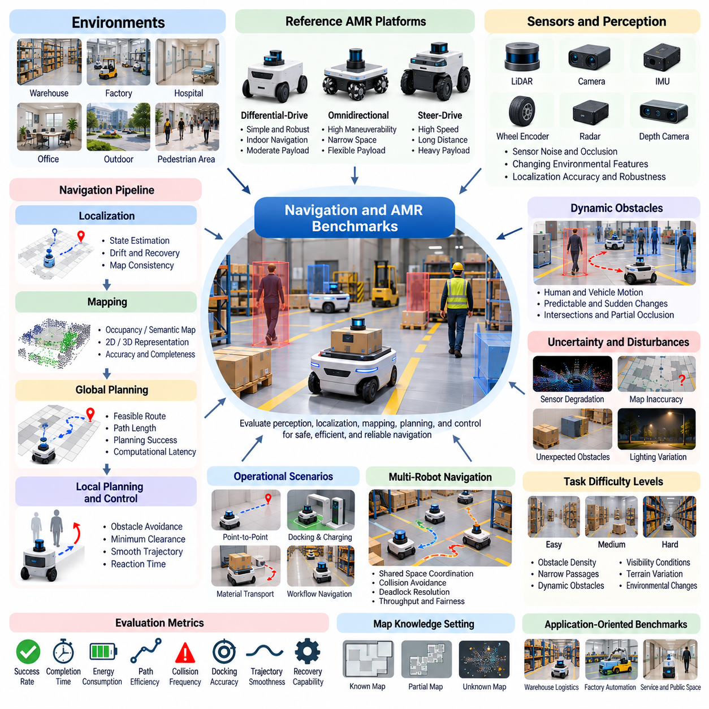{width="7.268055555555556in" height="7.268055555555556in"}

Navigation and Autonomous Mobile Robot (AMR) benchmarks provide standardized methods for evaluating how intelligent robots move through physical environments while maintaining safety, efficiency, and reliability. These benchmarks examine perception, localization, mapping, path planning, obstacle avoidance, and motion control as interconnected capabilities. Their primary purpose is to determine whether navigation systems can perform consistently across realistic operating conditions rather than succeed only in simplified demonstrations.

A comprehensive navigation benchmark must represent the diversity of environments encountered by mobile robots. Warehouses, factories, hospitals, offices, outdoor facilities, and mixed pedestrian areas impose different operational constraints. Narrow passages, intersections, uneven surfaces, and dynamic obstacles influence navigation difficulty. Standardized environment configurations allow researchers to evaluate whether algorithms generalize across layouts and operational contexts.

Reference AMR platforms establish consistent physical assumptions for benchmark experiments. Robot dimensions, wheel configurations, payload capacity, maximum velocity, acceleration limits, and turning capabilities determine feasible motion. Differential-drive, omnidirectional, and steer-drive robots exhibit different kinematic constraints. Benchmark specifications should document these differences and avoid comparing platforms without accounting for their physical capabilities.

Navigation evaluation begins with reliable localization and environmental understanding. Robots may use LiDAR, cameras, inertial sensors, wheel encoders, and localization maps to estimate their positions. Benchmark scenarios should introduce controlled sensor noise, partial occlusion, and changing environmental features. Localization accuracy, drift, recovery time, and map consistency help characterize the robustness of perception and state estimation.

Mapping benchmarks evaluate how effectively robots construct and maintain representations of their surroundings. Occupancy grids, semantic maps, and three-dimensional representations support different navigation strategies. Standardized mapping scenarios should include repeated structures, temporary obstacles, and partially observable regions. Map accuracy, completeness, update efficiency, and consistency provide complementary measures of environmental understanding.

Global path planning benchmarks examine whether robots can identify feasible routes between specified locations. Evaluation scenarios may include alternative corridors, restricted zones, blocked passages, and changing destination requirements. Path length, computational latency, route feasibility, and planning success rate reveal algorithmic performance. Benchmarks should distinguish planning quality from limitations introduced by localization errors or low-level control behavior.

Local planning and obstacle avoidance benchmarks focus on immediate motion decisions. Robots must respond to nearby obstacles while respecting acceleration limits, stopping distances, and collision constraints. Dynamic environments introduce moving pedestrians, forklifts, and other mobile robots. Evaluation should consider minimum clearance, collision frequency, reaction time, and trajectory smoothness, ensuring that successful navigation does not conceal unsafe behavior.

Dynamic obstacle scenarios require realistic motion patterns rather than purely random movement. Human walking trajectories, vehicle turning behavior, and interactions at intersections create structured uncertainty. Benchmarks should include predictable movement, sudden changes, and partially occluded obstacles. These conditions reveal whether navigation policies anticipate future motion or rely exclusively on reactive obstacle avoidance.

Navigation under uncertainty is particularly important for real-world AMR deployment. Sensor degradation, localization ambiguity, map inaccuracies, and unexpected environmental changes can undermine otherwise successful planning algorithms. Standardized disturbance profiles allow systematic testing of these limitations. Robust navigation systems should recognize uncertainty, adjust motion conservatively, and recover when reliable state estimates become available.

Warehouse and industrial AMR benchmarks should reflect operational workflows rather than isolated point-to-point movement. Robots may transport materials between storage locations, production stations, and loading areas while sharing space with equipment and personnel. Evaluation should consider mission completion, route congestion, docking accuracy, and payload-dependent motion. Such scenarios connect navigation performance with practical logistics productivity.

Docking and precision positioning represent specialized navigation capabilities. AMRs frequently need to align with charging stations, conveyors, racks, or robotic workstations. Small positioning errors can prevent successful mechanical or electrical interfaces. Benchmarks should define target pose tolerances, approach constraints, and acceptable correction behavior. Docking success rate, final alignment error, and completion time provide relevant evaluation measures.

Multi-robot navigation benchmarks introduce coordination and shared-space constraints. Multiple AMRs may compete for narrow corridors, intersections, charging stations, and task destinations. Congestion, deadlock, and communication delays can reduce fleet performance even when individual robots navigate successfully. Standardized fleet scenarios should evaluate throughput, waiting time, collision avoidance, fairness, and recovery from coordination failures.

Navigation benchmarks must account for different levels of environmental knowledge. Some systems operate with complete prior maps, while others must explore unknown spaces or adapt to changing layouts. These conditions should be evaluated separately to avoid unfair comparisons. Exploration efficiency, coverage, information gain, and successful return to known locations provide additional metrics for autonomous operation in unfamiliar environments.

Terrain and surface conditions influence navigation beyond geometric path feasibility. Floor friction, slopes, thresholds, debris, and uneven ground affect traction, stability, and energy consumption. Outdoor AMRs may additionally encounter gravel, mud, and weather-related disturbances. Benchmark environments should model these factors according to platform capabilities and report motion failures caused by physical constraints rather than planning errors.

Energy efficiency is an important navigation benchmark dimension because mobile robots operate with limited battery capacity. Route selection, acceleration profiles, stopping frequency, and payload weight influence energy consumption. A shorter path may not always minimize energy expenditure. Benchmarks should measure energy per mission, energy per distance, and productivity under battery constraints while maintaining consistent assumptions about robot hardware.

Safety evaluation must remain independent of navigation success. A robot may reach its destination while passing dangerously close to people or violating restricted zones. Benchmark metrics should capture collisions, near misses, emergency stops, excessive speed, and minimum separation distances. Safety-critical scenarios should also test behavior during sensor failures, unexpected obstacles, and loss of communication with supervisory systems.

Long-horizon navigation benchmarks evaluate sustained autonomy across multiple missions. Robots may need to navigate repeatedly, update maps, manage battery resources, recover from blocked routes, and respond to changing task priorities. Errors that appear insignificant during individual journeys can accumulate over extended operation. Mission completion rate, intervention frequency, recovery effectiveness, and operational availability reveal long-term system reliability.

Simulation-based navigation benchmarks support large-scale experimentation with controlled variations. Thousands of scenarios can be generated by changing obstacle arrangements, traffic patterns, lighting, sensor noise, and physical parameters. Parallel simulation accelerates evaluation but requires consistent timing and physics configurations. Standardized seeds and scenario definitions enable reproducible comparisons across navigation algorithms and learning methods.

Sim2Real navigation benchmarks connect simulation results with physical AMR performance. Corresponding scenarios should align robot geometry, sensor configurations, environmental layouts, and operational constraints. Differences in localization accuracy, collision avoidance, tracking error, and mission completion reveal transfer limitations. Real-world validation is necessary to determine whether simulation success predicts dependable navigation under actual operating conditions.

Benchmark reporting should combine task success with efficiency, robustness, safety, and statistical reliability. Evaluation protocols should specify scenario difficulty, trial counts, random seeds, termination conditions, and metric definitions. Results should be separated by environment type and disturbance level to expose performance limitations. Aggregate scores can support comparisons, but detailed measurements are essential for identifying practical deployment risks.

Ultimately, navigation and AMR benchmarks establish a systematic framework for evaluating autonomous mobility as an integrated Physical AI capability. Their value extends beyond comparing path planning algorithms to assessing perception, physical constraints, operational efficiency, and sustained reliability. By combining standardized environments, representative robot platforms, multidimensional metrics, and Sim2Real validation, these benchmarks support the development of safer and more dependable autonomous mobile systems.

내비게이션 및 자율이동로봇(Autonomous Mobile Robot, AMR) 벤치마크(Benchmarks)는 지능형 로봇(Intelligent Robots)이 안전성(Safety), 효율성(Efficiency), 신뢰성(Reliability)을 유지하면서 물리적 환경(Physical Environments)을 이동하는 능력을 평가하기 위한 표준화된 방법을 제공한다. 이러한 벤치마크는 인식(Perception), 위치 추정(Localization), 지도 작성(Mapping), 경로 계획(Path Planning), 장애물 회피(Obstacle Avoidance), 운동 제어(Motion Control)를 상호 연결된 능력으로 평가한다. 주요 목적은 내비게이션 시스템(Navigation Systems)이 단순화된 시연 환경에서만 성공하는 것이 아니라 현실적인 운영 조건에서도 일관된 성능을 발휘하는지 확인하는 것이다.

포괄적인 내비게이션 벤치마크(Comprehensive Navigation Benchmark)는 이동 로봇(Mobile Robots)이 직면하는 다양한 환경을 반영해야 한다. 창고(Warehouses), 공장(Factories), 병원(Hospitals), 사무실(Offices), 실외 시설(Outdoor Facilities), 보행자 혼재 구역(Mixed Pedestrian Areas)은 서로 다른 운영 제약(Operational Constraints)을 가진다. 좁은 통로(Narrow Passages), 교차로(Intersections), 불균일한 표면(Uneven Surfaces), 동적 장애물(Dynamic Obstacles)은 내비게이션 난이도(Navigation Difficulty)에 영향을 미친다. 표준화된 환경 구성(Standardized Environment Configurations)은 알고리즘이 다양한 공간 배치와 운영 상황에서 일반화(Generalization)되는지 평가하도록 지원한다.

참조 자율이동로봇 플랫폼(Reference AMR Platforms)은 벤치마크 실험(Benchmark Experiments)을 위한 일관된 물리적 가정(Physical Assumptions)을 수립한다. 로봇 치수(Robot Dimensions), 바퀴 구성(Wheel Configurations), 적재 하중 용량(Payload Capacity), 최대 속도(Maximum Velocity), 가속도 제한(Acceleration Limits), 회전 능력(Turning Capabilities)은 실현 가능한 움직임을 결정한다. 차동구동(Differential-Drive), 전방향 구동(Omnidirectional Drive), 조향구동(Steer-Drive) 로봇은 서로 다른 운동학적 제약(Kinematic Constraints)을 가진다. 벤치마크 사양(Benchmark Specifications)은 이러한 차이를 문서화하고 물리적 능력을 고려하지 않은 플랫폼 간 비교를 피해야 한다.

내비게이션 평가(Navigation Evaluation)는 신뢰할 수 있는 위치 추정(Localization)과 환경 이해(Environmental Understanding)에서 시작된다. 로봇은 라이다(LiDAR), 카메라(Cameras), 관성 센서(Inertial Sensors), 휠 엔코더(Wheel Encoders), 위치 추정 지도(Localization Maps)를 활용하여 자신의 위치를 추정할 수 있다. 벤치마크 시나리오(Benchmark Scenarios)는 통제된 센서 잡음(Sensor Noise), 부분 가림(Partial Occlusion), 변화하는 환경 특징(Changing Environmental Features)을 포함해야 한다. 위치 추정 정확도(Localization Accuracy), 누적 오차(Drift), 복구 시간(Recovery Time), 지도 일관성(Map Consistency)은 인식 및 상태 추정(State Estimation)의 강건성(Robustness)을 평가하는 데 도움이 된다.

지도 작성 벤치마크(Mapping Benchmarks)는 로봇이 주변 환경의 표현(Representations)을 얼마나 효과적으로 구축하고 유지하는지 평가한다. 점유 격자(Occupancy Grids), 의미 지도(Semantic Maps), 3차원 표현(Three-Dimensional Representations)은 서로 다른 내비게이션 전략(Navigation Strategies)을 지원한다. 표준화된 지도 작성 시나리오(Standardized Mapping Scenarios)에는 반복 구조(Repeated Structures), 일시적인 장애물(Temporary Obstacles), 부분 관측 영역(Partially Observable Regions)이 포함되어야 한다. 지도 정확도(Map Accuracy), 완전성(Completeness), 업데이트 효율성(Update Efficiency), 일관성(Consistency)은 환경 이해 능력을 상호 보완적으로 측정한다.

전역 경로 계획 벤치마크(Global Path Planning Benchmarks)는 로봇이 지정된 위치 사이에서 실행 가능한 경로(Feasible Routes)를 찾을 수 있는지 평가한다. 평가 시나리오(Evaluation Scenarios)에는 대체 통로(Alternative Corridors), 제한 구역(Restricted Zones), 차단된 통로(Blocked Passages), 변경되는 목적지 요구사항(Changing Destination Requirements)이 포함될 수 있다. 경로 길이(Path Length), 계산 지연 시간(Computational Latency), 경로 실행 가능성(Route Feasibility), 계획 성공률(Planning Success Rate)은 알고리즘 성능을 보여준다. 벤치마크는 경로 계획 품질(Planning Quality)을 위치 추정 오류(Localization Errors)나 저수준 제어(Low-Level Control)의 한계와 구분해야 한다.

지역 경로 계획 및 장애물 회피 벤치마크(Local Planning and Obstacle Avoidance Benchmarks)는 즉각적인 운동 의사결정(Motion Decisions)에 초점을 맞춘다. 로봇은 가속도 제한(Acceleration Limits), 정지 거리(Stopping Distances), 충돌 제약(Collision Constraints)을 준수하면서 주변 장애물에 대응해야 한다. 동적 환경(Dynamic Environments)에는 이동하는 보행자(Pedestrians), 지게차(Forklifts), 다른 이동 로봇(Mobile Robots)이 포함된다. 평가에서는 최소 이격 거리(Minimum Clearance), 충돌 빈도(Collision Frequency), 반응 시간(Reaction Time), 궤적 부드러움(Trajectory Smoothness)을 고려하여 성공적인 이동이 안전하지 않은 행동을 은폐하지 않도록 해야 한다.

동적 장애물 시나리오(Dynamic Obstacle Scenarios)는 완전히 무작위적인 움직임보다 현실적인 이동 패턴(Realistic Motion Patterns)을 필요로 한다. 인간의 보행 궤적(Human Walking Trajectories), 차량 회전 행동(Vehicle Turning Behavior), 교차로 상호작용(Intersection Interactions)은 구조화된 불확실성(Structured Uncertainty)을 발생시킨다. 벤치마크에는 예측 가능한 움직임(Predictable Movement), 갑작스러운 변화(Sudden Changes), 부분적으로 가려진 장애물(Partially Occluded Obstacles)이 포함되어야 한다. 이러한 조건은 내비게이션 정책(Navigation Policies)이 미래 움직임(Future Motion)을 예측하는지, 아니면 반응형 장애물 회피(Reactive Obstacle Avoidance)에만 의존하는지를 보여준다.

불확실성 환경에서의 내비게이션(Navigation under Uncertainty)은 실제 자율이동로봇 배포(Real-World AMR Deployment)에서 특히 중요하다. 센서 성능 저하(Sensor Degradation), 위치 추정의 모호성(Localization Ambiguity), 지도 부정확성(Map Inaccuracies), 예상하지 못한 환경 변화(Unexpected Environmental Changes)는 정상적으로 작동하던 경로 계획 알고리즘(Planning Algorithms)의 성능을 저하시킬 수 있다. 표준화된 외란 프로파일(Standardized Disturbance Profiles)은 이러한 한계를 체계적으로 시험하도록 지원한다. 강건한 내비게이션 시스템(Robust Navigation Systems)은 불확실성을 인식하고 보수적으로 움직임을 조정하며 신뢰할 수 있는 상태 추정값(State Estimates)이 확보되면 정상 동작으로 복구해야 한다.

창고 및 산업용 자율이동로봇 벤치마크(Warehouse and Industrial AMR Benchmarks)는 독립적인 지점 간 이동(Point-to-Point Movement)보다 실제 운영 워크플로(Operational Workflows)를 반영해야 한다. 로봇은 장비 및 작업자와 공간을 공유하면서 보관 위치(Storage Locations), 생산 스테이션(Production Stations), 상하차 구역(Loading Areas) 사이에서 자재를 운반할 수 있다. 평가에서는 임무 완료(Mission Completion), 경로 혼잡(Route Congestion), 도킹 정확도(Docking Accuracy), 적재 하중에 따른 움직임(Payload-Dependent Motion)을 고려해야 한다. 이러한 시나리오는 내비게이션 성능을 실제 물류 생산성(Logistics Productivity)과 연결한다.

도킹 및 정밀 위치 결정(Docking and Precision Positioning)은 특화된 내비게이션 능력(Specialized Navigation Capabilities)을 나타낸다. 자율이동로봇은 충전 스테이션(Charging Stations), 컨베이어(Conveyors), 랙(Racks), 로봇 작업 스테이션(Robotic Workstations)에 정확하게 정렬해야 하는 경우가 많다. 작은 위치 오차(Positioning Errors)도 기계적 또는 전기적 인터페이스(Mechanical or Electrical Interfaces)의 정상적인 연결을 방해할 수 있다. 벤치마크는 목표 자세 허용오차(Target Pose Tolerances), 접근 제약(Approach Constraints), 허용 가능한 보정 행동(Acceptable Correction Behavior)을 정의해야 한다. 도킹 성공률(Docking Success Rate), 최종 정렬 오차(Final Alignment Error), 완료 시간(Completion Time)은 주요 평가 지표가 된다.

다중 로봇 내비게이션 벤치마크(Multi-Robot Navigation Benchmarks)는 협조(Coordination)와 공유 공간 제약(Shared-Space Constraints)을 추가한다. 여러 자율이동로봇은 좁은 통로(Narrow Corridors), 교차로(Intersections), 충전 스테이션(Charging Stations), 작업 목적지(Task Destinations)를 공동으로 사용하거나 경쟁할 수 있다. 혼잡(Congestion), 교착 상태(Deadlock), 통신 지연(Communication Delays)은 개별 로봇의 이동 성능이 우수하더라도 전체 플릿 성능(Fleet Performance)을 저하시킬 수 있다. 표준화된 플릿 시나리오(Standardized Fleet Scenarios)는 처리량(Throughput), 대기 시간(Waiting Time), 충돌 회피(Collision Avoidance), 공정성(Fairness), 협조 실패 복구(Recovery from Coordination Failures)를 평가해야 한다.

내비게이션 벤치마크는 환경에 대한 사전 지식(Environmental Knowledge)의 수준 차이를 고려해야 한다. 일부 시스템은 완전한 사전 지도(Complete Prior Maps)를 사용하지만, 다른 시스템은 미지의 공간(Unknown Spaces)을 탐색하거나 변화하는 배치(Changing Layouts)에 적응해야 한다. 이러한 조건은 불공정한 비교를 방지하기 위해 별도로 평가해야 한다. 탐색 효율성(Exploration Efficiency), 탐색 범위(Coverage), 정보 획득량(Information Gain), 알려진 위치로의 성공적인 복귀(Successful Return to Known Locations)는 익숙하지 않은 환경에서 자율 운영(Autonomous Operation)을 평가하는 추가 지표를 제공한다.

지형 및 표면 조건(Terrain and Surface Conditions)은 기하학적인 경로 실행 가능성(Geometric Path Feasibility)을 넘어 내비게이션에 영향을 미친다. 바닥 마찰(Floor Friction), 경사(Slopes), 문턱(Thresholds), 잔해물(Debris), 불균일한 지면(Uneven Ground)은 접지력(Traction), 안정성(Stability), 에너지 소비(Energy Consumption)에 영향을 준다. 실외 자율이동로봇(Outdoor AMRs)은 자갈(Gravel), 진흙(Mud), 기상 관련 외란(Weather-Related Disturbances)에 추가로 직면할 수 있다. 벤치마크 환경은 플랫폼 능력(Platform Capabilities)에 따라 이러한 요소를 모델링하고 경로 계획 오류가 아닌 물리적 제약(Physical Constraints)으로 발생한 이동 실패(Motion Failures)를 구분하여 보고해야 한다.

에너지 효율성(Energy Efficiency)은 이동 로봇이 제한된 배터리 용량(Battery Capacity)으로 작동하기 때문에 중요한 내비게이션 벤치마크 요소이다. 경로 선택(Route Selection), 가속도 프로파일(Acceleration Profiles), 정지 빈도(Stopping Frequency), 적재 하중(Payload Weight)은 에너지 소비에 영향을 미친다. 가장 짧은 경로가 항상 에너지 소비를 최소화하는 것은 아니다. 벤치마크는 로봇 하드웨어에 대한 일관된 가정(Consistent Hardware Assumptions)을 유지하면서 임무당 에너지(Energy per Mission), 거리당 에너지(Energy per Distance), 배터리 제약하의 생산성(Productivity under Battery Constraints)을 측정해야 한다.

안전성 평가(Safety Evaluation)는 내비게이션 성공(Navigation Success)과 독립적으로 유지되어야 한다. 로봇은 목적지에 도달하더라도 사람에게 위험할 정도로 가까이 접근하거나 제한 구역(Restricted Zones)을 침범할 수 있다. 벤치마크 지표(Benchmark Metrics)는 충돌(Collisions), 근접 사고(Near Misses), 비상 정지(Emergency Stops), 과속(Excessive Speed), 최소 분리 거리(Minimum Separation Distances)를 포착해야 한다. 안전 필수 시나리오(Safety-Critical Scenarios)는 센서 고장(Sensor Failures), 예상하지 못한 장애물(Unexpected Obstacles), 상위 감독 시스템(Supervisory Systems)과의 통신 두절(Loss of Communication) 상황에서의 행동도 시험해야 한다.

장기 내비게이션 벤치마크(Long-Horizon Navigation Benchmarks)는 여러 임무에 걸친 지속적인 자율성(Sustained Autonomy)을 평가한다. 로봇은 반복적으로 이동하고 지도를 업데이트하며 배터리 자원(Battery Resources)을 관리하고 차단된 경로(Blocked Routes)에서 복구하며 변화하는 작업 우선순위(Changing Task Priorities)에 대응해야 할 수 있다. 개별 이동에서는 중요하지 않아 보이는 오류도 장시간 운영 과정에서 누적될 수 있다. 임무 완료율(Mission Completion Rate), 인간 개입 빈도(Intervention Frequency), 복구 효과(Recovery Effectiveness), 운영 가용성(Operational Availability)은 장기적인 시스템 신뢰성(System Reliability)을 보여준다.

시뮬레이션 기반 내비게이션 벤치마크(Simulation-Based Navigation Benchmarks)는 통제된 변형(Controlled Variations)을 통해 대규모 실험(Large-Scale Experimentation)을 지원한다. 장애물 배치(Obstacle Arrangements), 교통 패턴(Traffic Patterns), 조명(Lighting), 센서 잡음(Sensor Noise), 물리 매개변수(Physical Parameters)를 변경하여 수천 개의 시나리오를 생성할 수 있다. 병렬 시뮬레이션(Parallel Simulation)은 평가 속도를 높이지만 일관된 타이밍(Timing)과 물리 설정(Physics Configurations)을 필요로 한다. 표준화된 시드(Standardized Seeds)와 시나리오 정의(Scenario Definitions)는 내비게이션 알고리즘과 학습 방법(Learning Methods) 사이의 재현 가능한 비교를 지원한다.

시뮬레이션-현실 전이 내비게이션 벤치마크(Sim2Real Navigation Benchmarks)는 시뮬레이션 결과(Simulation Results)를 실제 자율이동로봇 성능(Physical AMR Performance)과 연결한다. 대응하는 시나리오는 로봇 형상(Robot Geometry), 센서 구성(Sensor Configurations), 환경 배치(Environmental Layouts), 운영 제약(Operational Constraints)을 일치시켜야 한다. 위치 추정 정확도(Localization Accuracy), 충돌 회피(Collision Avoidance), 추종 오차(Tracking Error), 임무 완료(Mission Completion)의 차이는 전이 한계(Transfer Limitations)를 드러낸다. 시뮬레이션에서의 성공이 실제 운영 조건에서 신뢰할 수 있는 내비게이션을 예측하는지 확인하려면 실제 환경 검증(Real-World Validation)이 필요하다.

벤치마크 보고(Benchmark Reporting)는 작업 성공(Task Success), 효율성(Efficiency), 강건성(Robustness), 안전성(Safety), 통계적 신뢰성(Statistical Reliability)을 함께 다루어야 한다. 평가 프로토콜(Evaluation Protocols)은 시나리오 난이도(Scenario Difficulty), 시험 횟수(Trial Counts), 난수 시드(Random Seeds), 종료 조건(Termination Conditions), 평가 지표 정의(Metric Definitions)를 명시해야 한다. 결과는 환경 유형(Environment Type)과 외란 수준(Disturbance Level)에 따라 구분하여 성능 한계를 드러내야 한다. 종합 점수(Aggregate Scores)는 비교를 지원할 수 있지만 실제 배포 위험(Deployment Risks)을 식별하려면 상세한 측정값(Detailed Measurements)이 필수적이다.

궁극적으로 내비게이션 및 자율이동로봇 벤치마크(Navigation and AMR Benchmarks)는 자율 이동성(Autonomous Mobility)을 통합된 피지컬 AI 능력(Integrated Physical AI Capability)으로 평가하기 위한 체계적인 프레임워크(Systematic Framework)를 구축한다. 그 가치는 경로 계획 알고리즘(Path Planning Algorithms)의 비교를 넘어 인식(Perception), 물리적 제약(Physical Constraints), 운영 효율성(Operational Efficiency), 지속적인 신뢰성(Sustained Reliability)을 평가하는 데 있다. 표준화된 환경(Standardized Environments), 대표적인 로봇 플랫폼(Representative Robot Platforms), 다차원 평가 지표(Multidimensional Metrics), 시뮬레이션-현실 전이 검증(Sim2Real Validation)을 결합함으로써 이러한 벤치마크는 더욱 안전하고 신뢰할 수 있는 자율이동 시스템(Autonomous Mobile Systems)의 개발을 지원한다.

##  

## 09.05. Manipulation and Mobile Manipulation Benchmarks

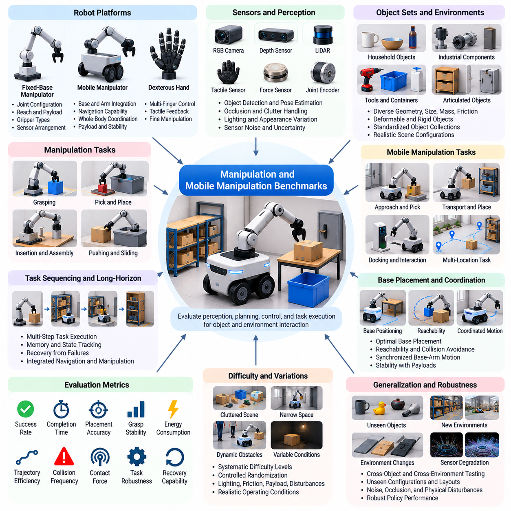{width="7.268055555555556in" height="7.268055555555556in"}

Manipulation and mobile manipulation benchmarks provide standardized frameworks for evaluating how Physical AI systems interact with objects and perform purposeful actions in physical environments. These benchmarks examine perception, grasp planning, motion generation, contact control, and task execution. Mobile manipulation extends these capabilities by combining navigation with robotic arm operation, requiring coordinated decisions across mobility and object interaction.

A comprehensive manipulation benchmark must represent diverse objects, tasks, and environmental conditions. Industrial components, household objects, tools, containers, and articulated mechanisms introduce different geometric and physical challenges. Object size, shape, mass, friction, and deformability influence manipulation difficulty. Standardized object collections and scene configurations allow researchers to compare algorithms under consistent yet representative operating conditions.

Reference robot platforms establish common assumptions for manipulation evaluation. Fixed-base manipulators provide controlled conditions for studying arm motion and object interaction, while mobile manipulators introduce base positioning and whole-system coordination. Benchmark specifications should define joint configurations, reachability, payload limits, gripper characteristics, and sensor arrangements. These parameters determine the feasible action space and influence task performance.

Manipulation benchmarks depend on accurate perception and object state estimation. Robots must identify objects, estimate their poses, understand geometric relationships, and recognize relevant interaction regions. RGB cameras, depth sensors, tactile arrays, and force sensors provide complementary information. Evaluation scenarios should include occlusion, clutter, lighting variation, and uncertain object placement to measure perception robustness under realistic conditions.

Grasping benchmarks evaluate whether robots can establish stable and useful contact with objects. Representative tasks include parallel-jaw grasping, suction grasping, precision grasping, and handling objects with irregular geometry. Grasp success depends on contact placement, friction, force distribution, and object properties. Benchmark metrics should distinguish initial grasp acquisition from sustained stability during lifting, transport, and placement.

Pick-and-place benchmarks examine the complete sequence of detecting, grasping, transporting, and releasing objects. Standardized scenarios may include sorting, bin picking, stacking, and transferring components between workstations. Successful execution requires collision-free motion and accurate placement. Evaluation should measure task completion, placement error, execution time, object drops, and unintended contacts rather than reporting grasp success alone.

Contact-rich manipulation introduces challenges that cannot be captured through geometric motion planning alone. Insertion, assembly, pushing, sliding, and surface following require precise regulation of interaction forces. Small errors in alignment or contact dynamics may cause jamming, instability, or damage. Benchmarks should specify contact properties, tolerances, and force limits while measuring task success, interaction stability, and excessive-force events.

Dexterous manipulation benchmarks assess coordinated control of multi-fingered hands and complex object interactions. Tasks may involve reorienting objects, manipulating tools, opening mechanisms, or performing fine adjustments. These activities require accurate finger coordination, tactile feedback, and continuous state estimation. Standardized evaluation should account for object motion, contact transitions, manipulation precision, and recovery from unstable grasps.

Articulated object manipulation evaluates interaction with doors, drawers, cabinets, valves, and mechanical joints. Robots must infer movement constraints and apply appropriate forces along permitted directions. Task difficulty depends on joint friction, handle geometry, accessibility, and mechanism uncertainty. Benchmark scenarios should measure successful operation, applied force, trajectory quality, and the ability to adapt when articulation properties differ from expectations.

Mobile manipulation benchmarks combine navigation, base positioning, arm planning, and object interaction within a single task. A robot may need to approach a workstation, align its base, reach an object, manipulate it, and move to another location. Errors in navigation or positioning can reduce manipulation success. Evaluation should therefore examine integrated task completion rather than treating mobility and arm control as independent capabilities.

Base placement is a critical factor in mobile manipulation because it determines arm reachability and collision constraints. A mobile robot must select positions that support stable and efficient manipulation while respecting surrounding obstacles. Benchmark scenarios should include constrained workspaces, narrow approaches, and variable object locations. Metrics may capture base positioning accuracy, reachability success, repositioning frequency, and overall execution efficiency.

Whole-body coordination becomes important when mobile bases and manipulators move simultaneously. Coordinated motion can extend reach, reduce execution time, and improve adaptability, but it introduces dynamic coupling and stability constraints. Benchmarks should evaluate synchronized base-arm trajectories, collision avoidance, balance, and control smoothness. These considerations are especially relevant for heavy payloads, extended reaches, and dynamically changing environments.

Task sequencing and long-horizon manipulation require robots to complete multiple dependent actions. A system may need to open a cabinet, retrieve an object, transport it, and place it at a destination. Individual action success does not guarantee completion of the full sequence. Benchmarks should measure planning consistency, intermediate state verification, recovery behavior, and final task success across extended execution horizons.

Manipulation under uncertainty requires robust responses to imperfect perception and unpredictable contact. Object pose errors, unknown friction, payload variation, and sensor noise can cause planned actions to fail. Standardized disturbance scenarios should introduce controlled uncertainty and evaluate adaptation. Recovery strategies such as regrasping, repositioning, and force adjustment provide important indicators of practical manipulation intelligence.

Simulation fidelity is particularly important for contact-intensive tasks. Friction models, collision geometry, compliance, actuator dynamics, and numerical solver behavior influence manipulation outcomes. Simplified physics may produce unrealistic grasp stability or insertion success. Benchmark environments should document relevant physical parameters and validate critical contact behaviors against experimental observations when practical, ensuring that simulation scores remain meaningful.

Synthetic data and domain randomization can expand manipulation benchmark coverage. Object appearances, poses, masses, friction coefficients, lighting conditions, and sensor noise can be varied systematically. These variations help evaluate whether learned policies generalize beyond specific training configurations. Test distributions should remain independent from training scenarios, and randomization parameters should be recorded to preserve reproducibility and meaningful performance comparisons.

Safety evaluation must consider both robot behavior and the physical consequences of object interaction. Excessive gripping forces, unexpected arm motion, collisions, unstable payloads, and dropped objects may create operational hazards. Benchmarks should record force-limit violations, collision events, emergency stops, and object damage. Safety metrics should be reported separately from task success to prevent efficient but hazardous manipulation strategies from appearing superior.

Efficiency metrics connect manipulation performance with practical deployment requirements. Cycle time, motion distance, energy consumption, computational latency, and successful operations per hour influence industrial productivity. Mobile manipulation additionally requires consideration of travel distance and base repositioning. Benchmark reports should preserve these measurements individually because optimizing task speed may increase energy use, mechanical stress, or safety risk.

Sim2Real manipulation benchmarks compare simulated performance with corresponding physical robot experiments. Robot geometry, actuator limits, sensor calibration, object properties, and task conditions should be aligned wherever possible. Differences in grasp success, contact forces, placement accuracy, and execution time reveal transfer limitations. Physical validation is especially important for contact-rich tasks where small modeling errors can significantly change outcomes.

Statistical reliability requires repeated trials across representative objects, initial conditions, and difficulty levels. Benchmark protocols should specify success criteria, random seeds, episode counts, and aggregation procedures. Reporting average performance, variability, failure categories, and confidence intervals supports meaningful algorithm comparisons. Results should also distinguish perception failures, planning errors, grasp instability, and control limitations to guide system improvement.

Ultimately, manipulation and mobile manipulation benchmarks establish a systematic foundation for evaluating Physical AI systems that act directly upon their environments. Their value lies in measuring not only isolated grasping or movement skills but also coordinated perception, planning, contact control, mobility, and recovery. Standardized tasks, representative robot platforms, realistic physics, and multidimensional metrics support reliable comparison and the development of adaptable robotic manipulation systems.

조작 및 이동 조작 벤치마크(Manipulation and Mobile Manipulation Benchmarks)는 피지컬 AI 시스템(Physical AI Systems)이 물리적 환경(Physical Environments)에서 객체와 상호작용하고 목적 지향적인 행동(Purposeful Actions)을 수행하는 능력을 평가하기 위한 표준화된 프레임워크(Standardized Frameworks)를 제공한다. 이러한 벤치마크는 인식(Perception), 파지 계획(Grasp Planning), 동작 생성(Motion Generation), 접촉 제어(Contact Control), 작업 실행(Task Execution)을 평가한다. 이동 조작(Mobile Manipulation)은 내비게이션(Navigation)과 로봇 팔 동작(Robotic Arm Operation)을 결합하여 이러한 능력을 확장하며, 이동성과 객체 상호작용 전반에 걸친 협조된 의사결정(Coordinated Decisions)을 요구한다.

포괄적인 조작 벤치마크(Comprehensive Manipulation Benchmark)는 다양한 객체(Objects), 작업(Tasks), 환경 조건(Environmental Conditions)을 반영해야 한다. 산업용 부품(Industrial Components), 가정용 물체(Household Objects), 도구(Tools), 용기(Containers), 관절형 기구(Articulated Mechanisms)는 서로 다른 기하학적 및 물리적 과제(Geometric and Physical Challenges)를 제시한다. 객체의 크기(Size), 형상(Shape), 질량(Mass), 마찰(Friction), 변형 가능성(Deformability)은 조작 난이도(Manipulation Difficulty)에 영향을 미친다. 표준화된 객체 집합(Standardized Object Collections)과 장면 구성(Scene Configurations)은 연구자들이 일관되면서도 대표성 있는 운영 조건에서 알고리즘을 비교하도록 지원한다.

참조 로봇 플랫폼(Reference Robot Platforms)은 조작 평가(Manipulation Evaluation)를 위한 공통 가정(Common Assumptions)을 수립한다. 고정식 매니퓰레이터(Fixed-Base Manipulators)는 로봇 팔 동작(Arm Motion)과 객체 상호작용(Object Interaction)을 연구하기 위한 통제된 조건을 제공하며, 이동 매니퓰레이터(Mobile Manipulators)는 이동 베이스 위치 결정(Base Positioning)과 전체 시스템 협조(Whole-System Coordination)를 추가한다. 벤치마크 사양(Benchmark Specifications)은 관절 구성(Joint Configurations), 도달 가능성(Reachability), 적재 하중 제한(Payload Limits), 그리퍼 특성(Gripper Characteristics), 센서 배치(Sensor Arrangements)를 정의해야 한다. 이러한 매개변수는 실행 가능한 행동 공간(Feasible Action Space)을 결정하고 작업 성능(Task Performance)에 영향을 미친다.

조작 벤치마크(Manipulation Benchmarks)는 정확한 인식(Perception)과 객체 상태 추정(Object State Estimation)에 의존한다. 로봇은 객체를 식별하고 자세(Pose)를 추정하며 기하학적 관계(Geometric Relationships)를 이해하고 관련 상호작용 영역(Interaction Regions)을 인식해야 한다. RGB 카메라(RGB Cameras), 깊이 센서(Depth Sensors), 촉각 센서 배열(Tactile Arrays), 힘 센서(Force Sensors)는 상호 보완적인 정보를 제공한다. 평가 시나리오(Evaluation Scenarios)에는 가림(Occlusion), 복잡하게 배치된 물체(Clutter), 조명 변화(Lighting Variation), 불확실한 객체 배치(Uncertain Object Placement)를 포함하여 현실적인 조건에서 인식 강건성(Perception Robustness)을 측정해야 한다.

파지 벤치마크(Grasping Benchmarks)는 로봇이 객체와 안정적이고 유용한 접촉(Stable and Useful Contact)을 형성할 수 있는지 평가한다. 대표적인 작업에는 평행 조 그리퍼 파지(Parallel-Jaw Grasping), 흡착 파지(Suction Grasping), 정밀 파지(Precision Grasping), 불규칙한 형상의 객체 취급(Handling Objects with Irregular Geometry)이 포함된다. 파지 성공(Grasp Success)은 접촉 위치(Contact Placement), 마찰(Friction), 힘 분포(Force Distribution), 객체 특성(Object Properties)에 따라 달라진다. 벤치마크 지표(Benchmark Metrics)는 초기 파지 확보(Initial Grasp Acquisition)와 들어 올리기(Lifting), 운반(Transport), 배치(Placement) 과정에서 유지되는 안정성(Sustained Stability)을 구분해야 한다.

집기 및 놓기 벤치마크(Pick-and-Place Benchmarks)는 객체를 감지(Detecting), 파지(Grasping), 운반(Transporting), 해제(Releasing)하는 전체 과정을 평가한다. 표준화된 시나리오(Standardized Scenarios)에는 분류(Sorting), 빈 피킹(Bin Picking), 적층(Stacking), 작업 스테이션 간 부품 이송(Transferring Components between Workstations)이 포함될 수 있다. 성공적인 실행에는 충돌 없는 동작(Collision-Free Motion)과 정확한 배치(Accurate Placement)가 필요하다. 평가에서는 파지 성공률만 보고하는 대신 작업 완료(Task Completion), 배치 오차(Placement Error), 실행 시간(Execution Time), 객체 낙하(Object Drops), 의도하지 않은 접촉(Unintended Contacts)을 측정해야 한다.

접촉 중심 조작(Contact-Rich Manipulation)은 기하학적 동작 계획(Geometric Motion Planning)만으로 설명할 수 없는 과제를 포함한다. 삽입(Insertion), 조립(Assembly), 밀기(Pushing), 미끄러뜨리기(Sliding), 표면 추종(Surface Following)은 상호작용 힘(Interaction Forces)의 정밀한 조절을 요구한다. 정렬(Alignment)이나 접촉 동역학(Contact Dynamics)에서 발생하는 작은 오차도 끼임(Jamming), 불안정성(Instability), 손상(Damage)을 유발할 수 있다. 벤치마크는 접촉 특성(Contact Properties), 허용오차(Tolerances), 힘 제한(Force Limits)을 명시하고 작업 성공(Task Success), 상호작용 안정성(Interaction Stability), 과도한 힘 발생 이벤트(Excessive-Force Events)를 측정해야 한다.

정교한 조작 벤치마크(Dexterous Manipulation Benchmarks)는 다지형 로봇 손(Multi-Fingered Hands)의 협조 제어(Coordinated Control)와 복잡한 객체 상호작용(Complex Object Interactions)을 평가한다. 작업에는 객체 방향 재조정(Object Reorientation), 도구 조작(Tool Manipulation), 기구 개방(Opening Mechanisms), 미세 조정(Fine Adjustments)이 포함될 수 있다. 이러한 활동에는 정확한 손가락 협조(Finger Coordination), 촉각 피드백(Tactile Feedback), 지속적인 상태 추정(Continuous State Estimation)이 필요하다. 표준화된 평가는 객체 움직임(Object Motion), 접촉 전환(Contact Transitions), 조작 정밀도(Manipulation Precision), 불안정한 파지로부터의 복구(Recovery from Unstable Grasps)를 고려해야 한다.

관절형 객체 조작(Articulated Object Manipulation)은 문(Doors), 서랍(Drawers), 캐비닛(Cabinets), 밸브(Valves), 기계식 관절(Mechanical Joints)과의 상호작용을 평가한다. 로봇은 움직임 제약(Movement Constraints)을 추론하고 허용된 방향(Permitted Directions)을 따라 적절한 힘을 가해야 한다. 작업 난이도는 관절 마찰(Joint Friction), 손잡이 형상(Handle Geometry), 접근 가능성(Accessibility), 기구의 불확실성(Mechanism Uncertainty)에 따라 달라진다. 벤치마크 시나리오는 성공적인 작동(Successful Operation), 가해진 힘(Applied Force), 궤적 품질(Trajectory Quality), 관절 기구 특성(Articulation Properties)이 예상과 다를 때의 적응 능력을 측정해야 한다.

이동 조작 벤치마크(Mobile Manipulation Benchmarks)는 내비게이션(Navigation), 베이스 위치 결정(Base Positioning), 로봇 팔 계획(Arm Planning), 객체 상호작용(Object Interaction)을 하나의 작업으로 통합한다. 로봇은 작업 스테이션(Workstation)에 접근하고 베이스를 정렬한 다음 객체에 도달하여 조작하고 다른 위치로 이동해야 할 수 있다. 내비게이션이나 위치 결정에서 발생한 오류는 조작 성공률(Manipulation Success)을 낮출 수 있다. 따라서 평가에서는 이동성과 로봇 팔 제어를 독립적인 능력으로 취급하기보다 통합 작업 완료(Integrated Task Completion)를 검토해야 한다.

베이스 배치(Base Placement)는 로봇 팔의 도달 가능성(Arm Reachability)과 충돌 제약(Collision Constraints)을 결정하기 때문에 이동 조작(Mobile Manipulation)에서 핵심적인 요소이다. 이동 로봇(Mobile Robot)은 주변 장애물을 고려하면서 안정적이고 효율적인 조작을 지원하는 위치를 선택해야 한다. 벤치마크 시나리오에는 제약된 작업 공간(Constrained Workspaces), 좁은 접근 경로(Narrow Approaches), 가변적인 객체 위치(Variable Object Locations)가 포함되어야 한다. 평가 지표는 베이스 위치 결정 정확도(Base Positioning Accuracy), 도달 성공률(Reachability Success), 재배치 빈도(Repositioning Frequency), 전체 실행 효율성(Overall Execution Efficiency)을 포함할 수 있다.

전신 협조(Whole-Body Coordination)는 이동 베이스(Mobile Bases)와 매니퓰레이터(Manipulators)가 동시에 움직일 때 중요해진다. 협조된 움직임(Coordinated Motion)은 도달 범위를 확장하고 실행 시간을 단축하며 적응성(Adaptability)을 향상시킬 수 있지만, 동적 결합(Dynamic Coupling)과 안정성 제약(Stability Constraints)을 추가한다. 벤치마크는 동기화된 베이스-로봇 팔 궤적(Synchronized Base-Arm Trajectories), 충돌 회피(Collision Avoidance), 균형(Balance), 제어 부드러움(Control Smoothness)을 평가해야 한다. 이러한 요소는 무거운 적재 하중(Heavy Payloads), 확장된 도달 범위(Extended Reaches), 동적으로 변화하는 환경(Dynamically Changing Environments)에서 특히 중요하다.

작업 순서 결정(Task Sequencing)과 장기 조작(Long-Horizon Manipulation)은 로봇이 여러 개의 상호 의존적인 행동(Dependent Actions)을 완료하도록 요구한다. 시스템은 캐비닛을 열고 객체를 꺼낸 다음 운반하여 목적지에 배치해야 할 수 있다. 개별 행동의 성공(Individual Action Success)이 전체 작업 순서의 완료를 보장하지는 않는다. 벤치마크는 장시간 실행 구간(Extended Execution Horizons)에 걸쳐 계획 일관성(Planning Consistency), 중간 상태 검증(Intermediate State Verification), 복구 행동(Recovery Behavior), 최종 작업 성공(Final Task Success)을 측정해야 한다.

불확실성 환경에서의 조작(Manipulation under Uncertainty)은 불완전한 인식(Imperfect Perception)과 예측하기 어려운 접촉(Unpredictable Contact)에 대한 강건한 대응을 요구한다. 객체 자세 오차(Object Pose Errors), 알려지지 않은 마찰(Unknown Friction), 적재 하중 변화(Payload Variation), 센서 잡음(Sensor Noise)은 계획된 행동의 실패를 유발할 수 있다. 표준화된 외란 시나리오(Standardized Disturbance Scenarios)는 통제된 불확실성(Controlled Uncertainty)을 도입하고 적응 능력(Adaptation)을 평가해야 한다. 재파지(Regrasping), 위치 재조정(Repositioning), 힘 조정(Force Adjustment)과 같은 복구 전략(Recovery Strategies)은 실제 조작 지능(Practical Manipulation Intelligence)을 나타내는 중요한 지표이다.

시뮬레이션 충실도(Simulation Fidelity)는 접촉 집약적 작업(Contact-Intensive Tasks)에서 특히 중요하다. 마찰 모델(Friction Models), 충돌 형상(Collision Geometry), 순응성(Compliance), 액추에이터 동역학(Actuator Dynamics), 수치 해석 솔버 동작(Numerical Solver Behavior)은 조작 결과에 영향을 미친다. 단순화된 물리 모델(Simplified Physics)은 비현실적인 파지 안정성(Grasp Stability)이나 삽입 성공(Insertion Success)을 만들어낼 수 있다. 벤치마크 환경은 관련 물리 매개변수(Physical Parameters)를 문서화하고 가능한 경우 핵심 접촉 동작(Critical Contact Behaviors)을 실험 관측값(Experimental Observations)과 비교하여 검증함으로써 시뮬레이션 점수(Simulation Scores)의 의미를 유지해야 한다.

합성 데이터(Synthetic Data)와 도메인 무작위화(Domain Randomization)는 조작 벤치마크의 평가 범위(Benchmark Coverage)를 확장할 수 있다. 객체 외형(Object Appearances), 자세(Poses), 질량(Masses), 마찰 계수(Friction Coefficients), 조명 조건(Lighting Conditions), 센서 잡음(Sensor Noise)을 체계적으로 변화시킬 수 있다. 이러한 변화는 학습된 정책(Learned Policies)이 특정 학습 구성(Training Configurations)을 넘어 일반화(Generalization)되는지 평가하도록 지원한다. 시험 분포(Test Distributions)는 학습 시나리오(Training Scenarios)와 독립적으로 유지해야 하며, 재현성(Reproducibility)과 의미 있는 성능 비교를 보장하기 위해 무작위화 매개변수(Randomization Parameters)를 기록해야 한다.

안전성 평가(Safety Evaluation)는 로봇 행동(Robot Behavior)과 객체 상호작용(Object Interaction)의 물리적 결과(Physical Consequences)를 모두 고려해야 한다. 과도한 파지력(Excessive Gripping Forces), 예상하지 못한 로봇 팔 움직임(Unexpected Arm Motion), 충돌(Collisions), 불안정한 적재물(Unstable Payloads), 객체 낙하(Dropped Objects)는 운영 위험(Operational Hazards)을 발생시킬 수 있다. 벤치마크는 힘 제한 위반(Force-Limit Violations), 충돌 이벤트(Collision Events), 비상 정지(Emergency Stops), 객체 손상(Object Damage)을 기록해야 한다. 효율적이지만 위험한 조작 전략(Hazardous Manipulation Strategies)이 우수한 것으로 평가되지 않도록 안전 지표(Safety Metrics)는 작업 성공(Task Success)과 별도로 보고해야 한다.

효율성 지표(Efficiency Metrics)는 조작 성능(Manipulation Performance)을 실제 배포 요구사항(Practical Deployment Requirements)과 연결한다. 사이클 시간(Cycle Time), 이동 거리(Motion Distance), 에너지 소비(Energy Consumption), 계산 지연 시간(Computational Latency), 시간당 성공 작업 수(Successful Operations per Hour)는 산업 생산성(Industrial Productivity)에 영향을 미친다. 이동 조작(Mobile Manipulation)에서는 추가로 주행 거리(Travel Distance)와 베이스 재배치(Base Repositioning)를 고려해야 한다. 작업 속도(Task Speed)를 최적화하면 에너지 사용(Energy Use), 기계적 응력(Mechanical Stress), 안전 위험(Safety Risk)이 증가할 수 있으므로 벤치마크 보고서는 이러한 측정값을 개별적으로 유지해야 한다.

시뮬레이션-현실 전이 조작 벤치마크(Sim2Real Manipulation Benchmarks)는 시뮬레이션 성능(Simulated Performance)을 이에 대응하는 실제 로봇 실험(Physical Robot Experiments)과 비교한다. 로봇 형상(Robot Geometry), 액추에이터 제한(Actuator Limits), 센서 보정(Sensor Calibration), 객체 특성(Object Properties), 작업 조건(Task Conditions)은 가능한 범위에서 일치시켜야 한다. 파지 성공률(Grasp Success), 접촉력(Contact Forces), 배치 정확도(Placement Accuracy), 실행 시간(Execution Time)의 차이는 전이 한계(Transfer Limitations)를 드러낸다. 작은 모델링 오차(Modeling Errors)가 결과를 크게 변화시킬 수 있는 접촉 중심 작업(Contact-Rich Tasks)에서는 실제 환경 검증(Physical Validation)이 특히 중요하다.

통계적 신뢰성(Statistical Reliability)을 확보하려면 대표적인 객체(Representative Objects), 초기 조건(Initial Conditions), 난이도 수준(Difficulty Levels)에 걸친 반복 시험(Repeated Trials)이 필요하다. 벤치마크 프로토콜(Benchmark Protocols)은 성공 기준(Success Criteria), 난수 시드(Random Seeds), 에피소드 수(Episode Counts), 집계 절차(Aggregation Procedures)를 명시해야 한다. 평균 성능(Average Performance), 변동성(Variability), 실패 유형(Failure Categories), 신뢰구간(Confidence Intervals)을 보고하면 의미 있는 알고리즘 비교(Algorithm Comparisons)를 지원할 수 있다. 또한 결과에서는 인식 실패(Perception Failures), 계획 오류(Planning Errors), 파지 불안정성(Grasp Instability), 제어 한계(Control Limitations)를 구분하여 시스템 개선(System Improvement)을 위한 방향을 제시해야 한다.

궁극적으로 조작 및 이동 조작 벤치마크(Manipulation and Mobile Manipulation Benchmarks)는 환경에 직접 작용하는 피지컬 AI 시스템(Physical AI Systems)을 평가하기 위한 체계적인 기반(Systematic Foundation)을 구축한다. 그 가치는 개별적인 파지 또는 이동 기술(Isolated Grasping or Movement Skills)뿐 아니라 협조된 인식(Coordinated Perception), 계획(Planning), 접촉 제어(Contact Control), 이동성(Mobility), 복구(Recovery)를 함께 측정하는 데 있다. 표준화된 작업(Standardized Tasks), 대표적인 로봇 플랫폼(Representative Robot Platforms), 현실적인 물리 모델(Realistic Physics), 다차원 평가 지표(Multidimensional Metrics)는 신뢰할 수 있는 비교와 적응형 로봇 조작 시스템(Adaptable Robotic Manipulation Systems)의 개발을 지원한다.

##  

## 09.06. Quadruped and Locomotion Benchmarks

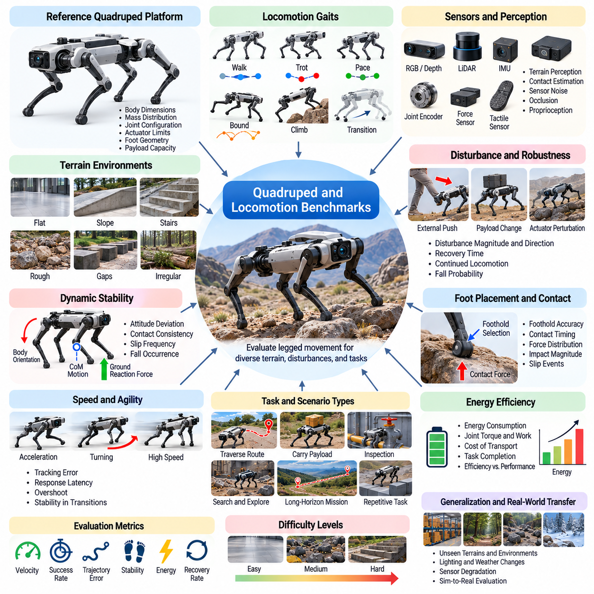{width="7.268055555555556in" height="7.268055555555556in"}

Quadruped and locomotion benchmarks provide standardized methods for evaluating how legged robots move, maintain balance, and adapt to physical environments. Unlike wheeled navigation, legged locomotion involves intermittent ground contact, dynamic stability, and coordinated joint control. These benchmarks assess whether robotic systems can achieve reliable mobility across varying terrain, disturbances, and operating conditions while maintaining efficiency and safety.

Quadruped robots are particularly suitable for locomotion benchmarking because their four-legged morphology supports diverse gait patterns and terrain interactions. Walking, trotting, pacing, bounding, and climbing require different coordination strategies. Reference platforms should specify body dimensions, mass distribution, joint configurations, actuator limits, and foot geometry. Consistent robot models enable meaningful comparisons between classical controllers and learned policies.

Locomotion benchmark environments must represent the physical diversity of real operating conditions. Flat surfaces provide baseline measurements, while slopes, stairs, rocks, gaps, and irregular terrain introduce increasing complexity. Surface friction, compliance, and obstacle dimensions influence locomotion performance. Standardized terrain parameters allow researchers to isolate the effects of environmental difficulty from differences in control algorithms.

Gait evaluation examines the coordination of leg movements and ground contact patterns. Different gaits produce distinct tradeoffs between speed, stability, energy consumption, and mechanical loading. Benchmarks should measure forward velocity, stride consistency, duty factor, foot clearance, and gait transition behavior. These measurements help determine whether locomotion policies generate efficient movement while respecting physical constraints.

Dynamic stability is a central consideration in quadruped locomotion evaluation. Robots must regulate body orientation, center-of-mass motion, and ground reaction forces during movement. Stability cannot be represented adequately by a single measurement because different locomotion modes require different balance strategies. Benchmark protocols should combine body attitude deviation, contact consistency, slip frequency, and fall occurrence.

Terrain adaptation benchmarks evaluate how robots modify their movement in response to changing ground conditions. Uneven surfaces, variable friction, loose materials, and unexpected height differences require adjustments in foot placement and body posture. Evaluation should measure traversal success, speed degradation, slip events, and recovery actions. These scenarios reveal whether controllers generalize beyond the terrain distributions encountered during training.

Disturbance rejection benchmarks assess the ability to maintain locomotion when unexpected forces affect the robot. External pushes, sudden payload changes, and actuator perturbations can disrupt gait stability. Standardized disturbance magnitude, direction, duration, and timing are necessary for reproducible comparisons. Recovery time, maximum body deviation, continued locomotion, and fall probability provide useful robustness indicators.

Foot placement and contact control are essential for reliable legged mobility. Robots must select feasible footholds while accounting for terrain geometry, friction, and body dynamics. Inaccurate contact timing or excessive impact forces can produce instability and mechanical stress. Benchmarks should evaluate foothold accuracy, contact force distribution, impact magnitude, and unintended slipping during challenging terrain traversal.

Speed and agility benchmarks examine the ability to execute rapid movements while maintaining control. Acceleration, deceleration, turning, and directional changes introduce dynamic constraints beyond steady walking. Standardized trajectories and velocity commands enable consistent comparisons. Tracking error, response latency, overshoot, and stability during transitions indicate whether controllers can perform agile maneuvers without compromising safety.

Energy efficiency is particularly important because legged robots require continuous actuator effort to support and propel their bodies. Joint torque, angular velocity, mechanical work, and electrical power consumption influence operating endurance. Cost of transport provides a useful normalized efficiency measure when consistently defined. Benchmarks should also report task completion and stability to prevent energy optimization from rewarding ineffective movement.

Payload locomotion benchmarks investigate how additional mass and altered load distribution affect robot behavior. Carrying tools, inspection equipment, or transported materials changes inertia, joint loading, and balance requirements. Standardized payload configurations should specify mass, mounting position, and center-of-mass displacement. Evaluation should measure traversal success, speed, energy consumption, and stability across different loading conditions.

Perception-aware locomotion benchmarks integrate environmental sensing with movement planning. Depth cameras, LiDAR, and proprioceptive sensors help robots estimate terrain geometry and contact conditions. Scenarios may include limited visibility, sensor noise, occlusion, and uncertain surface properties. Evaluation should distinguish failures caused by inaccurate terrain perception from those resulting from motion planning or low-level control limitations.

Long-horizon locomotion benchmarks evaluate sustained movement across extended routes and repeated tasks. Small tracking errors, thermal effects, battery depletion, and mechanical limitations can accumulate during prolonged operation. Benchmark scenarios should include varied terrain segments and operational interruptions. Distance traveled, intervention frequency, mission completion, and recovery effectiveness reveal sustained autonomy beyond short demonstrations.

Simulation-based locomotion benchmarks support large-scale training and evaluation through parallel physics environments. Thousands of robot instances can experience randomized terrain, friction, mass, actuator characteristics, and external disturbances. Consistent simulation settings and controlled random seeds are essential for reproducibility. Evaluation scenarios should remain separate from training distributions to avoid overstating generalization performance.

Physics fidelity strongly influences quadruped benchmark validity. Contact solvers, friction models, joint damping, actuator dynamics, and integration time steps affect simulated locomotion behavior. Simplified contact models may produce unrealistic stability or excessive traction. Benchmark specifications should document these assumptions and compare important dynamic responses with physical measurements whenever practical.

Sim2Real locomotion benchmarks assess whether policies trained or evaluated in simulation remain effective on physical quadruped robots. Differences in actuator response, sensor latency, contact friction, and structural compliance can degrade transferred performance. Matched simulation and hardware trials should compare gait stability, tracking accuracy, energy consumption, and recovery behavior. Such evaluations identify transfer gaps and guide model refinement.

Safety benchmarks must examine both locomotion failures and their physical consequences. Falls, excessive joint loading, foot collisions, uncontrolled motion, and instability near obstacles may create hazards. Evaluation protocols should define safe operating boundaries and termination conditions. Safety metrics should remain distinct from traversal success because a robot may complete a route while exposing itself or nearby personnel to unacceptable risk.

Statistical evaluation requires repeated trials across representative terrain types, initial conditions, and disturbance levels. Benchmark reports should specify robot configurations, control frequencies, trial counts, and success criteria. Mean performance, variability, confidence intervals, and categorized failure events support meaningful comparisons. Results should identify whether limitations arise from perception, planning, actuator capability, or dynamic control.

Ultimately, quadruped and locomotion benchmarks establish a systematic foundation for evaluating embodied mobility under realistic physical constraints. Their purpose extends beyond measuring walking speed to understanding stability, adaptability, efficiency, robustness, and operational safety. Standardized robot models, terrain scenarios, disturbance protocols, and Sim2Real validation enable reliable comparison and support the development of increasingly capable legged robotic systems.

사족보행 및 보행 벤치마크(Quadruped and Locomotion Benchmarks)는 다리형 로봇(Legged Robots)이 이동하고 균형을 유지하며 물리적 환경(Physical Environments)에 적응하는 능력을 평가하기 위한 표준화된 방법을 제공한다. 바퀴형 내비게이션(Wheeled Navigation)과 달리 다리형 보행(Legged Locomotion)은 간헐적인 지면 접촉(Intermittent Ground Contact), 동적 안정성(Dynamic Stability), 협조된 관절 제어(Coordinated Joint Control)를 포함한다. 이러한 벤치마크는 로봇 시스템이 다양한 지형(Terrain), 외란(Disturbances), 운영 조건(Operating Conditions)에서 효율성(Efficiency)과 안전성(Safety)을 유지하면서 신뢰할 수 있는 이동성(Reliable Mobility)을 확보할 수 있는지 평가한다.

사족보행 로봇(Quadruped Robots)은 네 개의 다리로 구성된 형태(Morphology)가 다양한 보행 패턴(Gait Patterns)과 지형 상호작용(Terrain Interactions)을 지원하기 때문에 보행 벤치마킹(Locomotion Benchmarking)에 특히 적합하다. 걷기(Walking), 트로트 보행(Trotting), 페이스 보행(Pacing), 바운딩 보행(Bounding), 등반(Climbing)은 서로 다른 협조 전략(Coordination Strategies)을 요구한다. 참조 플랫폼(Reference Platforms)은 몸체 치수(Body Dimensions), 질량 분포(Mass Distribution), 관절 구성(Joint Configurations), 액추에이터 제한(Actuator Limits), 발 형상(Foot Geometry)을 명시해야 한다. 일관된 로봇 모델(Robot Models)은 전통적인 제어기(Classical Controllers)와 학습 기반 정책(Learned Policies) 사이의 의미 있는 비교를 가능하게 한다.

보행 벤치마크 환경(Locomotion Benchmark Environments)은 실제 운영 조건(Real Operating Conditions)의 물리적 다양성을 반영해야 한다. 평탄한 표면(Flat Surfaces)은 기준 측정값(Baseline Measurements)을 제공하며, 경사면(Slopes), 계단(Stairs), 암석(Rocks), 틈새(Gaps), 불규칙한 지형(Irregular Terrain)은 점차 높은 복잡성을 도입한다. 표면 마찰(Surface Friction), 순응성(Compliance), 장애물 치수(Obstacle Dimensions)는 보행 성능(Locomotion Performance)에 영향을 미친다. 표준화된 지형 매개변수(Standardized Terrain Parameters)는 연구자들이 제어 알고리즘(Control Algorithms)의 차이와 환경 난이도(Environmental Difficulty)의 영향을 구분하도록 지원한다.

보행 패턴 평가(Gait Evaluation)는 다리 움직임(Leg Movements)과 지면 접촉 패턴(Ground Contact Patterns)의 협조를 분석한다. 서로 다른 보행 패턴은 속도(Speed), 안정성(Stability), 에너지 소비(Energy Consumption), 기계적 하중(Mechanical Loading) 사이에서 서로 다른 절충 관계(Tradeoffs)를 나타낸다. 벤치마크는 전진 속도(Forward Velocity), 보폭 일관성(Stride Consistency), 지지 시간 비율(Duty Factor), 발의 지면 이격 높이(Foot Clearance), 보행 패턴 전환 동작(Gait Transition Behavior)을 측정해야 한다. 이러한 측정값은 보행 정책(Locomotion Policies)이 물리적 제약(Physical Constraints)을 준수하면서 효율적인 움직임을 생성하는지 판단하는 데 도움이 된다.

동적 안정성(Dynamic Stability)은 사족보행 평가(Quadruped Locomotion Evaluation)의 핵심 고려사항이다. 로봇은 이동하는 동안 몸체 자세(Body Orientation), 질량중심 운동(Center-of-Mass Motion), 지면 반력(Ground Reaction Forces)을 조절해야 한다. 서로 다른 보행 방식(Locomotion Modes)은 각기 다른 균형 전략(Balance Strategies)을 요구하므로 단일 측정값만으로 안정성을 충분히 표현할 수 없다. 벤치마크 프로토콜(Benchmark Protocols)은 몸체 자세 편차(Body Attitude Deviation), 접촉 일관성(Contact Consistency), 미끄러짐 빈도(Slip Frequency), 넘어짐 발생(Fall Occurrence)을 종합적으로 평가해야 한다.

지형 적응 벤치마크(Terrain Adaptation Benchmarks)는 변화하는 지면 조건(Ground Conditions)에 대응하여 로봇이 움직임을 어떻게 수정하는지 평가한다. 불균일한 표면(Uneven Surfaces), 가변적인 마찰(Variable Friction), 느슨한 지반 재료(Loose Materials), 예상하지 못한 높이 차이(Unexpected Height Differences)는 발 배치(Foot Placement)와 몸체 자세(Body Posture)의 조정을 요구한다. 평가에서는 지형 통과 성공률(Traversal Success), 속도 저하(Speed Degradation), 미끄러짐 이벤트(Slip Events), 복구 행동(Recovery Actions)을 측정해야 한다. 이러한 시나리오는 제어기가 학습 과정에서 경험한 지형 분포(Terrain Distributions)를 넘어 일반화(Generalization)되는지 보여준다.

외란 억제 벤치마크(Disturbance Rejection Benchmarks)는 예상하지 못한 힘이 로봇에 작용할 때 보행을 유지하는 능력을 평가한다. 외부 밀림(External Pushes), 갑작스러운 적재 하중 변화(Sudden Payload Changes), 액추에이터 교란(Actuator Perturbations)은 보행 안정성(Gait Stability)을 저하시킬 수 있다. 재현 가능한 비교를 위해서는 외란 크기(Disturbance Magnitude), 방향(Direction), 지속 시간(Duration), 적용 시점(Timing)을 표준화해야 한다. 복구 시간(Recovery Time), 최대 몸체 편차(Maximum Body Deviation), 보행 지속 여부(Continued Locomotion), 넘어짐 확률(Fall Probability)은 유용한 강건성 지표(Robustness Indicators)를 제공한다.

발 배치(Foot Placement)와 접촉 제어(Contact Control)는 신뢰할 수 있는 다리형 이동성(Legged Mobility)에 필수적이다. 로봇은 지형 형상(Terrain Geometry), 마찰(Friction), 몸체 동역학(Body Dynamics)을 고려하면서 실행 가능한 발 디딤 위치(Feasible Footholds)를 선택해야 한다. 부정확한 접촉 시점(Contact Timing)이나 과도한 충격력(Impact Forces)은 불안정성(Instability)과 기계적 응력(Mechanical Stress)을 유발할 수 있다. 벤치마크는 어려운 지형을 통과하는 동안 발 디딤 정확도(Foothold Accuracy), 접촉력 분포(Contact Force Distribution), 충격 크기(Impact Magnitude), 의도하지 않은 미끄러짐(Unintended Slipping)을 평가해야 한다.

속도 및 민첩성 벤치마크(Speed and Agility Benchmarks)는 제어를 유지하면서 빠른 움직임을 실행하는 능력을 평가한다. 가속(Acceleration), 감속(Deceleration), 회전(Turning), 방향 전환(Directional Changes)은 일정 속도의 보행(Steady Walking)을 넘어서는 동적 제약(Dynamic Constraints)을 도입한다. 표준화된 궤적(Standardized Trajectories)과 속도 명령(Velocity Commands)은 일관된 비교를 가능하게 한다. 추종 오차(Tracking Error), 응답 지연(Response Latency), 오버슈트(Overshoot), 전환 과정의 안정성(Stability during Transitions)은 제어기가 안전성을 저해하지 않으면서 민첩한 동작(Agile Maneuvers)을 수행할 수 있는지 나타낸다.

에너지 효율성(Energy Efficiency)은 다리형 로봇(Legged Robots)이 몸체를 지지하고 추진하기 위해 지속적인 액추에이터 구동(Actuator Effort)을 필요로 하므로 특히 중요하다. 관절 토크(Joint Torque), 각속도(Angular Velocity), 기계적 일(Mechanical Work), 전력 소비(Electrical Power Consumption)는 운영 지속 시간(Operating Endurance)에 영향을 미친다. 이동 비용(Cost of Transport)은 일관되게 정의할 경우 유용한 정규화 효율성 지표(Normalized Efficiency Measure)를 제공한다. 벤치마크는 에너지 최적화(Energy Optimization)가 비효율적인 움직임을 유리하게 평가하지 않도록 작업 완료(Task Completion)와 안정성(Stability)도 함께 보고해야 한다.

적재 하중 보행 벤치마크(Payload Locomotion Benchmarks)는 추가 질량(Additional Mass)과 변경된 하중 분포(Altered Load Distribution)가 로봇 행동(Robot Behavior)에 미치는 영향을 조사한다. 도구(Tools), 검사 장비(Inspection Equipment), 운반 자재(Transported Materials)를 탑재하면 관성(Inertia), 관절 하중(Joint Loading), 균형 요구사항(Balance Requirements)이 변화한다. 표준화된 적재 하중 구성(Standardized Payload Configurations)은 질량(Mass), 장착 위치(Mounting Position), 질량중심 변위(Center-of-Mass Displacement)를 명시해야 한다. 평가에서는 다양한 하중 조건(Loading Conditions)에 따른 지형 통과 성공률(Traversal Success), 속도(Speed), 에너지 소비(Energy Consumption), 안정성(Stability)을 측정해야 한다.

인식 기반 보행 벤치마크(Perception-Aware Locomotion Benchmarks)는 환경 센싱(Environmental Sensing)을 동작 계획(Motion Planning)과 통합한다. 깊이 카메라(Depth Cameras), 라이다(LiDAR), 고유수용감각 센서(Proprioceptive Sensors)는 로봇이 지형 형상(Terrain Geometry)과 접촉 조건(Contact Conditions)을 추정하도록 지원한다. 시나리오에는 제한된 가시성(Limited Visibility), 센서 잡음(Sensor Noise), 가림(Occlusion), 불확실한 표면 특성(Uncertain Surface Properties)이 포함될 수 있다. 평가에서는 부정확한 지형 인식(Inaccurate Terrain Perception)으로 발생한 실패와 동작 계획(Motion Planning) 또는 저수준 제어(Low-Level Control)의 한계로 발생한 실패를 구분해야 한다.

장기 보행 벤치마크(Long-Horizon Locomotion Benchmarks)는 확장된 이동 경로(Extended Routes)와 반복 작업(Repeated Tasks)에 걸친 지속적인 이동(Sustained Movement)을 평가한다. 작은 추종 오차(Tracking Errors), 열적 영향(Thermal Effects), 배터리 소모(Battery Depletion), 기계적 한계(Mechanical Limitations)는 장시간 운영(Prolonged Operation) 중 누적될 수 있다. 벤치마크 시나리오에는 다양한 지형 구간(Varied Terrain Segments)과 운영 중단 상황(Operational Interruptions)이 포함되어야 한다. 이동 거리(Distance Traveled), 개입 빈도(Intervention Frequency), 임무 완료(Mission Completion), 복구 효과(Recovery Effectiveness)는 짧은 시연을 넘어서는 지속적인 자율성(Sustained Autonomy)을 보여준다.

시뮬레이션 기반 보행 벤치마크(Simulation-Based Locomotion Benchmarks)는 병렬 물리 환경(Parallel Physics Environments)을 통해 대규모 학습 및 평가(Large-Scale Training and Evaluation)를 지원한다. 수천 개의 로봇 인스턴스(Robot Instances)는 무작위화된 지형(Randomized Terrain), 마찰(Friction), 질량(Mass), 액추에이터 특성(Actuator Characteristics), 외부 외란(External Disturbances)을 경험할 수 있다. 일관된 시뮬레이션 설정(Consistent Simulation Settings)과 통제된 난수 시드(Controlled Random Seeds)는 재현성(Reproducibility)을 확보하는 데 필수적이다. 일반화 성능(Generalization Performance)을 과대평가하지 않도록 평가 시나리오(Evaluation Scenarios)는 학습 분포(Training Distributions)와 분리되어야 한다.

물리 충실도(Physics Fidelity)는 사족보행 벤치마크(Quadruped Benchmarks)의 타당성(Validity)에 큰 영향을 미친다. 접촉 솔버(Contact Solvers), 마찰 모델(Friction Models), 관절 감쇠(Joint Damping), 액추에이터 동역학(Actuator Dynamics), 적분 시간 간격(Integration Time Steps)은 시뮬레이션된 보행 동작(Simulated Locomotion Behavior)에 영향을 준다. 단순화된 접촉 모델(Simplified Contact Models)은 비현실적인 안정성(Unrealistic Stability)이나 과도한 접지력(Excessive Traction)을 만들어낼 수 있다. 벤치마크 사양(Benchmark Specifications)은 이러한 가정을 문서화하고 가능한 경우 중요한 동적 응답(Dynamic Responses)을 실제 물리적 측정값(Physical Measurements)과 비교해야 한다.

시뮬레이션-현실 전이 보행 벤치마크(Sim2Real Locomotion Benchmarks)는 시뮬레이션에서 학습하거나 평가한 정책(Policies)이 실제 사족보행 로봇(Physical Quadruped Robots)에서도 효과적으로 작동하는지 평가한다. 액추에이터 응답(Actuator Response), 센서 지연(Sensor Latency), 접촉 마찰(Contact Friction), 구조적 순응성(Structural Compliance)의 차이는 전이 성능(Transferred Performance)을 저하시킬 수 있다. 대응되는 시뮬레이션 및 하드웨어 시험(Matched Simulation and Hardware Trials)은 보행 안정성(Gait Stability), 추종 정확도(Tracking Accuracy), 에너지 소비(Energy Consumption), 복구 행동(Recovery Behavior)을 비교해야 한다. 이러한 평가는 전이 격차(Transfer Gaps)를 식별하고 모델 개선(Model Refinement)의 방향을 제시한다.

안전성 벤치마크(Safety Benchmarks)는 보행 실패(Locomotion Failures)와 그 물리적 결과(Physical Consequences)를 모두 평가해야 한다. 넘어짐(Falls), 과도한 관절 하중(Excessive Joint Loading), 발 충돌(Foot Collisions), 제어되지 않는 움직임(Uncontrolled Motion), 장애물 근처의 불안정성(Instability near Obstacles)은 위험을 발생시킬 수 있다. 평가 프로토콜(Evaluation Protocols)은 안전 운영 경계(Safe Operating Boundaries)와 종료 조건(Termination Conditions)을 정의해야 한다. 로봇이 경로를 완주하더라도 자신이나 주변 작업자를 허용할 수 없는 위험(Unacceptable Risk)에 노출시킬 수 있으므로 안전 지표(Safety Metrics)는 지형 통과 성공률(Traversal Success)과 구분하여 관리해야 한다.

통계적 평가(Statistical Evaluation)는 대표적인 지형 유형(Representative Terrain Types), 초기 조건(Initial Conditions), 외란 수준(Disturbance Levels)에 걸친 반복 시험(Repeated Trials)을 필요로 한다. 벤치마크 보고서(Benchmark Reports)는 로봇 구성(Robot Configurations), 제어 주파수(Control Frequencies), 시험 횟수(Trial Counts), 성공 기준(Success Criteria)을 명시해야 한다. 평균 성능(Mean Performance), 변동성(Variability), 신뢰구간(Confidence Intervals), 분류된 실패 이벤트(Categorized Failure Events)는 의미 있는 비교를 지원한다. 결과에서는 성능 한계가 인식(Perception), 계획(Planning), 액추에이터 능력(Actuator Capability), 동적 제어(Dynamic Control) 중 어느 요소에서 발생하는지 식별해야 한다.

궁극적으로 사족보행 및 보행 벤치마크(Quadruped and Locomotion Benchmarks)는 현실적인 물리적 제약(Realistic Physical Constraints) 아래에서 체화된 이동성(Embodied Mobility)을 평가하기 위한 체계적인 기반(Systematic Foundation)을 구축한다. 그 목적은 보행 속도(Walking Speed)를 측정하는 데 그치지 않고 안정성(Stability), 적응성(Adaptability), 효율성(Efficiency), 강건성(Robustness), 운영 안전성(Operational Safety)을 종합적으로 이해하는 데 있다. 표준화된 로봇 모델(Standardized Robot Models), 지형 시나리오(Terrain Scenarios), 외란 프로토콜(Disturbance Protocols), 시뮬레이션-현실 전이 검증(Sim2Real Validation)은 신뢰할 수 있는 비교를 가능하게 하고 더욱 높은 능력을 갖춘 다리형 로봇 시스템(Legged Robotic Systems)의 개발을 지원한다.

##  

## 09.07. Humanoid Benchmarks

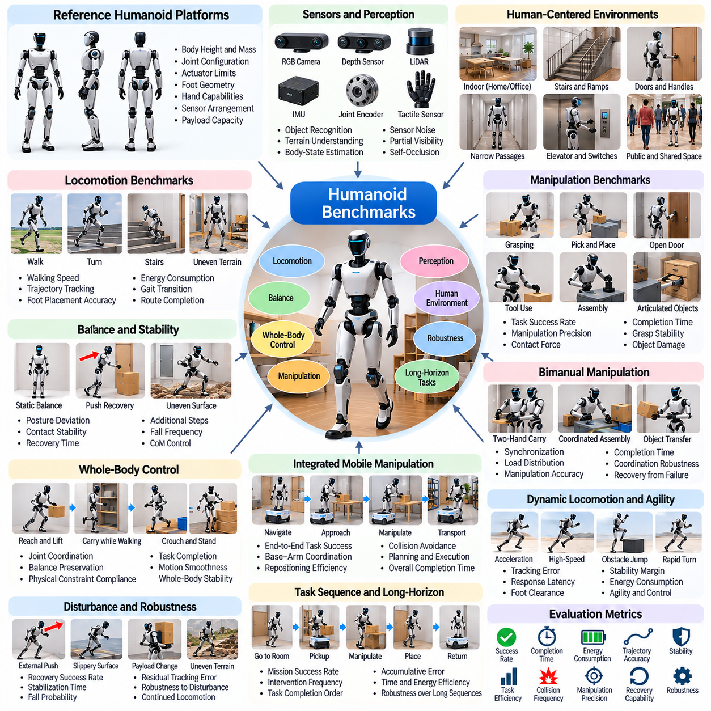{width="7.268055555555556in" height="7.268055555555556in"}

Humanoid benchmarks establish standardized methods for evaluating robots designed to operate with human-like body structures and movement capabilities. Unlike specialized industrial robots, humanoids combine bipedal locomotion, upper-body manipulation, balance, and environmental interaction. These benchmarks assess whether integrated Physical AI systems can perform reliably in human-centered environments while maintaining safety, adaptability, and operational efficiency.

Reference humanoid platforms provide consistent physical assumptions for comparing control and learning algorithms. Important specifications include body height, mass distribution, joint configurations, actuator limits, foot geometry, and hand capabilities. Differences in morphology strongly influence achievable performance. Benchmark protocols should document these characteristics and distinguish algorithmic improvements from advantages introduced by mechanical design.

Humanoid locomotion benchmarks evaluate walking, turning, stopping, and navigating environments designed for people. Standard scenarios may include corridors, doorways, ramps, stairs, and uneven surfaces. Bipedal motion requires continuous coordination between body dynamics and intermittent foot contacts. Evaluation metrics should include walking speed, trajectory tracking accuracy, foot placement precision, energy consumption, and successful route completion.

Balance and posture control represent fundamental humanoid capabilities. Robots must regulate their center of mass, body orientation, and contact forces while standing or moving. Static balance tests provide baseline measurements, while dynamic scenarios introduce pushes, uneven support surfaces, and changing body configurations. Recovery time, posture deviation, contact stability, and fall frequency reveal the effectiveness of balance controllers.

Whole-body control benchmarks examine coordinated movement across the legs, torso, arms, and head. Humanoids often need to maintain balance while reaching, lifting, carrying, or interacting with objects. Arm movements can significantly alter the overall center of mass and contact requirements. Evaluation should measure task completion, balance preservation, joint coordination, and the ability to respect physical constraints during complex actions.

Humanoid manipulation benchmarks assess object interaction using hands and upper-body mechanisms. Representative tasks include grasping tools, opening doors, moving containers, and operating human-designed equipment. Task difficulty depends on object geometry, contact conditions, reachability, and hand dexterity. Benchmarks should distinguish successful object interaction from excessive force, unstable grasping, or unintended environmental contact.

Bimanual manipulation introduces coordination requirements beyond single-arm operation. Humanoids may need to hold an object with one hand while manipulating it with the other or distribute loads across both arms. Standardized tasks should include carrying, assembly, object transfer, and coordinated tool use. Evaluation metrics may capture synchronization, manipulation precision, load distribution, completion time, and recovery from coordination failures.

Locomotion and manipulation integration is essential for practical humanoid autonomy. A robot may approach a workstation, reposition its feet, reach for an object, and transport it while maintaining balance. These operations require continuous coordination between navigation, contact planning, and manipulation control. Integrated benchmarks should measure complete task success rather than evaluating walking and grasping as unrelated capabilities.

Human-centered environments create additional challenges because their geometry and organization assume human proportions and behavior. Stairs, handles, switches, furniture, and narrow passages impose specific accessibility constraints. Benchmarks should represent these features using consistent dimensions and interaction requirements. Performance evaluation must account for reachability, maneuverability, collision avoidance, and successful operation of everyday infrastructure.

Perception benchmarks for humanoids evaluate the interpretation of complex environments during movement and interaction. Cameras, depth sensors, inertial measurements, joint encoders, and tactile sensors provide complementary information. Dynamic viewpoints and self-occlusion complicate state estimation. Standardized scenarios should assess object recognition, terrain understanding, body-state estimation, and robustness to sensor noise or partial visibility.

Disturbance recovery benchmarks test how humanoids respond to unexpected physical interactions. External pushes, slipping contacts, uneven terrain, and sudden load changes can threaten balance. Recovery may require stepping, adjusting posture, or changing support contacts. Benchmark protocols should standardize disturbance magnitude, direction, and timing while measuring recovery success, stabilization time, additional steps, and fall probability.

Dynamic locomotion benchmarks extend beyond steady walking to rapid changes in movement. Acceleration, deceleration, turning, obstacle negotiation, and gait transitions introduce demanding coordination requirements. Standardized motion commands allow meaningful controller comparisons. Tracking error, response latency, foot clearance, stability margins, and energy consumption reveal tradeoffs between agility, precision, and physical robustness.

Long-horizon humanoid benchmarks evaluate sustained execution of multiple dependent activities. A robot may navigate between rooms, retrieve objects, manipulate equipment, and return to a designated location. Errors in perception, planning, or balance can accumulate across the sequence. Evaluation should measure overall mission completion, intervention frequency, recovery effectiveness, task sequencing accuracy, and operational availability.

Simulation-based humanoid benchmarks enable large-scale experimentation with complex whole-body dynamics. Parallel environments can vary terrain, object placement, friction, actuator parameters, and external disturbances. However, humanoid simulation requires careful treatment of contact mechanics and joint constraints. Standardized physics configurations, controlled random seeds, and consistent evaluation protocols are essential for reproducible results.

Contact modeling is especially important because humanoids frequently transition between multiple support conditions. Foot-ground interaction, hand-object contact, and occasional hand-supported balance introduce discontinuities in system dynamics. Friction, compliance, collision geometry, and numerical integration influence simulated stability. Benchmark specifications should document these assumptions and validate critical contact behaviors against physical measurements when feasible.

Sim2Real humanoid benchmarks assess whether simulated control policies remain effective on physical hardware. Differences in actuator response, sensor latency, structural compliance, and contact friction can significantly affect walking and manipulation. Matched simulation and hardware experiments should compare task success, tracking accuracy, balance recovery, and energy use. These comparisons identify transfer limitations and guide improvements in models and controllers.

Safety evaluation is particularly important because humanoids operate near people and interact with human-designed infrastructure. Falls, unexpected arm movements, excessive contact forces, and unstable object handling can create serious hazards. Benchmark protocols should define operational boundaries, emergency stopping conditions, and acceptable interaction forces. Safety metrics must remain separate from task success to prevent hazardous behavior from receiving favorable scores.

Energy and computational efficiency influence the practical deployment of humanoid systems. Whole-body control requires continuous sensing, state estimation, planning, and actuator coordination. Electrical power consumption, computational latency, thermal behavior, and task execution time affect endurance and reliability. Benchmark reports should evaluate these factors alongside task performance to expose tradeoffs between intelligence, physical capability, and operating cost.

Generalization benchmarks examine whether humanoid policies adapt to unfamiliar objects, environments, and task combinations. Variations in floor conditions, object properties, obstacle arrangements, and interaction requirements reveal dependence on narrow training distributions. Evaluation should separate previously encountered scenarios from unseen configurations. Successful generalization requires maintaining coordinated mobility and manipulation despite changes in environmental conditions.

Statistical reporting should include repeated trials across representative tasks, difficulty levels, and disturbance conditions. Robot configurations, control frequencies, success criteria, and evaluation seeds must be documented. Mean performance, variability, confidence intervals, and categorized failures support reliable comparisons. Reports should distinguish limitations arising from perception, locomotion, manipulation, balance, and high-level planning.

Ultimately, humanoid benchmarks provide a systematic framework for evaluating integrated embodied intelligence in human-centered environments. Their purpose extends beyond demonstrating human-like movement to measuring dependable task execution, whole-body coordination, adaptability, safety, and sustained autonomy. Standardized platforms, realistic scenarios, multidimensional metrics, and Sim2Real validation support the development of increasingly capable and reliable humanoid robotic systems.

휴머노이드 벤치마크(Humanoid Benchmarks)는 인간과 유사한 신체 구조(Human-Like Body Structures)와 운동 능력(Movement Capabilities)을 갖도록 설계된 로봇을 평가하기 위한 표준화된 방법을 수립한다. 특수 목적 산업용 로봇(Specialized Industrial Robots)과 달리 휴머노이드(Humanoids)는 이족보행(Bipedal Locomotion), 상체 조작(Upper-Body Manipulation), 균형 유지(Balance), 환경 상호작용(Environmental Interaction)을 결합한다. 이러한 벤치마크는 통합된 피지컬 AI 시스템(Integrated Physical AI Systems)이 인간 중심 환경(Human-Centered Environments)에서 안전성(Safety), 적응성(Adaptability), 운영 효율성(Operational Efficiency)을 유지하면서 신뢰성 있게 작업을 수행할 수 있는지 평가한다.

참조 휴머노이드 플랫폼(Reference Humanoid Platforms)은 제어 및 학습 알고리즘(Control and Learning Algorithms)을 비교하기 위한 일관된 물리적 가정(Physical Assumptions)을 제공한다. 주요 사양에는 신체 높이(Body Height), 질량 분포(Mass Distribution), 관절 구성(Joint Configurations), 액추에이터 제한(Actuator Limits), 발 형상(Foot Geometry), 손의 기능(Hand Capabilities)이 포함된다. 로봇 형태(Morphology)의 차이는 달성 가능한 성능(Achievable Performance)에 큰 영향을 미친다. 벤치마크 프로토콜(Benchmark Protocols)은 이러한 특성을 문서화하고 알고리즘 개선(Algorithmic Improvements)과 기계적 설계(Mechanical Design)에서 비롯된 이점을 구분해야 한다.

휴머노이드 보행 벤치마크(Humanoid Locomotion Benchmarks)는 사람이 이용하도록 설계된 환경에서 걷기(Walking), 회전(Turning), 정지(Stopping), 이동(Navigation)을 평가한다. 표준 시나리오(Standard Scenarios)에는 복도(Corridors), 출입구(Doorways), 경사로(Ramps), 계단(Stairs), 불균일한 표면(Uneven Surfaces)이 포함될 수 있다. 이족보행(Bipedal Motion)은 몸체 동역학(Body Dynamics)과 간헐적인 발 접촉(Intermittent Foot Contacts) 사이의 지속적인 협조를 요구한다. 평가 지표(Evaluation Metrics)에는 보행 속도(Walking Speed), 궤적 추종 정확도(Trajectory Tracking Accuracy), 발 배치 정밀도(Foot Placement Precision), 에너지 소비(Energy Consumption), 경로 완료 성공률(Successful Route Completion)이 포함되어야 한다.

균형 및 자세 제어(Balance and Posture Control)는 휴머노이드의 기본적인 능력(Fundamental Humanoid Capabilities)을 나타낸다. 로봇은 서 있거나 움직이는 동안 질량중심(Center of Mass), 몸체 방향(Body Orientation), 접촉력(Contact Forces)을 조절해야 한다. 정적 균형 시험(Static Balance Tests)은 기준 측정값(Baseline Measurements)을 제공하며, 동적 시나리오(Dynamic Scenarios)는 외부 밀림(Pushes), 불균일한 지지면(Uneven Support Surfaces), 변화하는 신체 구성(Changing Body Configurations)을 도입한다. 복구 시간(Recovery Time), 자세 편차(Posture Deviation), 접촉 안정성(Contact Stability), 넘어짐 빈도(Fall Frequency)는 균형 제어기(Balance Controllers)의 효과를 보여준다.

전신 제어 벤치마크(Whole-Body Control Benchmarks)는 다리(Legs), 몸통(Torso), 팔(Arms), 머리(Head) 사이의 협조된 움직임(Coordinated Movement)을 평가한다. 휴머노이드는 물체에 손을 뻗거나(Reaching), 들어 올리고(Lifting), 운반하고(Carrying), 상호작용(Interacting)하는 동안 균형을 유지해야 하는 경우가 많다. 팔 움직임(Arm Movements)은 전체 질량중심(Overall Center of Mass)과 접촉 요구사항(Contact Requirements)을 크게 변화시킬 수 있다. 평가에서는 복잡한 행동 중 작업 완료(Task Completion), 균형 유지(Balance Preservation), 관절 협조(Joint Coordination), 물리적 제약(Physical Constraints) 준수 능력을 측정해야 한다.

휴머노이드 조작 벤치마크(Humanoid Manipulation Benchmarks)는 손(Hands)과 상체 기구(Upper-Body Mechanisms)를 이용한 객체 상호작용(Object Interaction)을 평가한다. 대표적인 작업에는 도구 파지(Grasping Tools), 문 열기(Opening Doors), 용기 이동(Moving Containers), 인간용으로 설계된 장비 조작(Operating Human-Designed Equipment)이 포함된다. 작업 난이도(Task Difficulty)는 객체 형상(Object Geometry), 접촉 조건(Contact Conditions), 도달 가능성(Reachability), 손의 조작성(Hand Dexterity)에 따라 달라진다. 벤치마크는 성공적인 객체 상호작용과 과도한 힘(Excessive Force), 불안정한 파지(Unstable Grasping), 의도하지 않은 환경 접촉(Unintended Environmental Contact)을 구분해야 한다.

양손 조작(Bimanual Manipulation)은 단일 팔 동작(Single-Arm Operation)을 넘어서는 협조 요구사항(Coordination Requirements)을 추가한다. 휴머노이드는 한 손으로 객체를 잡은 상태에서 다른 손으로 조작하거나 양팔에 하중을 분산해야 할 수 있다. 표준화된 작업(Standardized Tasks)에는 운반(Carrying), 조립(Assembly), 객체 전달(Object Transfer), 협조된 도구 사용(Coordinated Tool Use)이 포함되어야 한다. 평가 지표(Evaluation Metrics)는 동기화(Synchronization), 조작 정밀도(Manipulation Precision), 하중 분포(Load Distribution), 완료 시간(Completion Time), 협조 실패 복구(Recovery from Coordination Failures)를 측정할 수 있다.

보행과 조작의 통합(Locomotion and Manipulation Integration)은 실용적인 휴머노이드 자율성(Practical Humanoid Autonomy)에 필수적이다. 로봇은 작업 스테이션(Workstation)에 접근하고 발 위치를 재조정한 다음 객체에 손을 뻗어 잡고 균형을 유지하면서 운반해야 할 수 있다. 이러한 동작에는 내비게이션(Navigation), 접촉 계획(Contact Planning), 조작 제어(Manipulation Control) 사이의 지속적인 협조가 필요하다. 통합 벤치마크(Integrated Benchmarks)는 걷기와 파지를 서로 관련 없는 능력으로 평가하기보다 전체 작업 성공(Complete Task Success)을 측정해야 한다.

인간 중심 환경(Human-Centered Environments)은 공간 형상(Geometry)과 구성(Organization)이 인간의 신체 비율(Human Proportions)과 행동(Behavior)을 전제로 하기 때문에 추가적인 과제를 발생시킨다. 계단(Stairs), 손잡이(Handles), 스위치(Switches), 가구(Furniture), 좁은 통로(Narrow Passages)는 특정한 접근성 제약(Accessibility Constraints)을 부과한다. 벤치마크는 일관된 치수(Consistent Dimensions)와 상호작용 요구사항(Interaction Requirements)을 사용하여 이러한 요소를 표현해야 한다. 성능 평가(Performance Evaluation)에서는 도달 가능성(Reachability), 기동성(Maneuverability), 충돌 회피(Collision Avoidance), 일상 시설(Everyday Infrastructure)의 성공적인 조작을 고려해야 한다.

휴머노이드 인식 벤치마크(Perception Benchmarks for Humanoids)는 이동 및 상호작용 과정에서 복잡한 환경(Complex Environments)을 해석하는 능력을 평가한다. 카메라(Cameras), 깊이 센서(Depth Sensors), 관성 측정값(Inertial Measurements), 관절 엔코더(Joint Encoders), 촉각 센서(Tactile Sensors)는 상호 보완적인 정보를 제공한다. 동적으로 변화하는 시점(Dynamic Viewpoints)과 자기 가림(Self-Occlusion)은 상태 추정(State Estimation)을 어렵게 만든다. 표준화된 시나리오(Standardized Scenarios)는 객체 인식(Object Recognition), 지형 이해(Terrain Understanding), 신체 상태 추정(Body-State Estimation), 센서 잡음(Sensor Noise)이나 부분 가시성(Partial Visibility)에 대한 강건성(Robustness)을 평가해야 한다.

외란 복구 벤치마크(Disturbance Recovery Benchmarks)는 휴머노이드가 예상하지 못한 물리적 상호작용(Unexpected Physical Interactions)에 어떻게 대응하는지 시험한다. 외부 밀림(External Pushes), 접촉면 미끄러짐(Slipping Contacts), 불균일한 지형(Uneven Terrain), 갑작스러운 하중 변화(Sudden Load Changes)는 균형을 위협할 수 있다. 복구(Recovery)에는 발걸음 이동(Stepping), 자세 조정(Adjusting Posture), 지지 접촉 변경(Changing Support Contacts)이 필요할 수 있다. 벤치마크 프로토콜(Benchmark Protocols)은 외란 크기(Disturbance Magnitude), 방향(Direction), 적용 시점(Timing)을 표준화하면서 복구 성공률(Recovery Success), 안정화 시간(Stabilization Time), 추가 발걸음(Additional Steps), 넘어짐 확률(Fall Probability)을 측정해야 한다.

동적 보행 벤치마크(Dynamic Locomotion Benchmarks)는 일정한 속도의 걷기(Steady Walking)를 넘어 빠른 움직임 변화(Rapid Changes in Movement)를 평가한다. 가속(Acceleration), 감속(Deceleration), 회전(Turning), 장애물 통과(Obstacle Negotiation), 보행 패턴 전환(Gait Transitions)은 높은 수준의 협조 능력을 요구한다. 표준화된 운동 명령(Standardized Motion Commands)은 의미 있는 제어기 비교(Controller Comparisons)를 가능하게 한다. 추종 오차(Tracking Error), 응답 지연(Response Latency), 발의 지면 이격 높이(Foot Clearance), 안정성 여유도(Stability Margins), 에너지 소비(Energy Consumption)는 민첩성(Agility), 정밀도(Precision), 물리적 강건성(Physical Robustness) 사이의 절충 관계(Tradeoffs)를 보여준다.

장기 휴머노이드 벤치마크(Long-Horizon Humanoid Benchmarks)는 여러 상호 의존적인 활동(Dependent Activities)을 지속적으로 수행하는 능력을 평가한다. 로봇은 방 사이를 이동하고 객체를 가져오며 장비를 조작한 다음 지정된 위치로 돌아와야 할 수 있다. 인식(Perception), 계획(Planning), 균형(Balance)에서 발생한 오류는 전체 작업 순서에 걸쳐 누적될 수 있다. 평가에서는 전체 임무 완료율(Overall Mission Completion), 인간 개입 빈도(Intervention Frequency), 복구 효과(Recovery Effectiveness), 작업 순서 정확도(Task Sequencing Accuracy), 운영 가용성(Operational Availability)을 측정해야 한다.

시뮬레이션 기반 휴머노이드 벤치마크(Simulation-Based Humanoid Benchmarks)는 복잡한 전신 동역학(Whole-Body Dynamics)을 이용한 대규모 실험(Large-Scale Experimentation)을 가능하게 한다. 병렬 환경(Parallel Environments)에서는 지형(Terrain), 객체 배치(Object Placement), 마찰(Friction), 액추에이터 매개변수(Actuator Parameters), 외부 외란(External Disturbances)을 변화시킬 수 있다. 그러나 휴머노이드 시뮬레이션(Humanoid Simulation)은 접촉 역학(Contact Mechanics)과 관절 제약(Joint Constraints)을 신중하게 처리해야 한다. 표준화된 물리 설정(Standardized Physics Configurations), 통제된 난수 시드(Controlled Random Seeds), 일관된 평가 프로토콜(Consistent Evaluation Protocols)은 재현 가능한 결과(Reproducible Results)를 확보하는 데 필수적이다.

접촉 모델링(Contact Modeling)은 휴머노이드가 여러 지지 조건(Support Conditions) 사이를 자주 전환하기 때문에 특히 중요하다. 발과 지면의 상호작용(Foot-Ground Interaction), 손과 객체의 접촉(Hand-Object Contact), 간헐적인 손 지지 균형(Hand-Supported Balance)은 시스템 동역학(System Dynamics)에 불연속성(Discontinuities)을 발생시킨다. 마찰(Friction), 순응성(Compliance), 충돌 형상(Collision Geometry), 수치 적분(Numerical Integration)은 시뮬레이션 안정성(Simulated Stability)에 영향을 미친다. 벤치마크 사양(Benchmark Specifications)은 이러한 가정을 문서화하고 가능한 경우 핵심 접촉 동작(Critical Contact Behaviors)을 실제 물리적 측정값(Physical Measurements)과 비교하여 검증해야 한다.

시뮬레이션-현실 전이 휴머노이드 벤치마크(Sim2Real Humanoid Benchmarks)는 시뮬레이션된 제어 정책(Simulated Control Policies)이 실제 하드웨어(Physical Hardware)에서도 효과적으로 작동하는지 평가한다. 액추에이터 응답(Actuator Response), 센서 지연(Sensor Latency), 구조적 순응성(Structural Compliance), 접촉 마찰(Contact Friction)의 차이는 걷기와 조작에 상당한 영향을 미칠 수 있다. 대응되는 시뮬레이션 및 하드웨어 실험(Matched Simulation and Hardware Experiments)은 작업 성공(Task Success), 추종 정확도(Tracking Accuracy), 균형 복구(Balance Recovery), 에너지 사용(Energy Use)을 비교해야 한다. 이러한 비교는 전이 한계(Transfer Limitations)를 식별하고 모델(Model)과 제어기(Controllers)의 개선 방향을 제시한다.

안전성 평가(Safety Evaluation)는 휴머노이드가 사람 가까이에서 작동하고 인간용으로 설계된 시설(Human-Designed Infrastructure)과 상호작용하기 때문에 특히 중요하다. 넘어짐(Falls), 예상하지 못한 팔 움직임(Unexpected Arm Movements), 과도한 접촉력(Excessive Contact Forces), 불안정한 객체 취급(Unstable Object Handling)은 심각한 위험을 발생시킬 수 있다. 벤치마크 프로토콜(Benchmark Protocols)은 운영 경계(Operational Boundaries), 비상 정지 조건(Emergency Stopping Conditions), 허용 가능한 상호작용 힘(Acceptable Interaction Forces)을 정의해야 한다. 위험한 행동(Hazardous Behavior)이 높은 점수를 받지 않도록 안전 지표(Safety Metrics)는 작업 성공(Task Success)과 별도로 관리해야 한다.

에너지 및 계산 효율성(Energy and Computational Efficiency)은 휴머노이드 시스템(Humanoid Systems)의 실제 배포(Practical Deployment)에 영향을 미친다. 전신 제어(Whole-Body Control)는 지속적인 센싱(Sensing), 상태 추정(State Estimation), 계획(Planning), 액추에이터 협조(Actuator Coordination)를 필요로 한다. 전력 소비(Electrical Power Consumption), 계산 지연 시간(Computational Latency), 열적 동작(Thermal Behavior), 작업 실행 시간(Task Execution Time)은 운영 지속 시간(Endurance)과 신뢰성(Reliability)에 영향을 준다. 벤치마크 보고서(Benchmark Reports)는 지능(Intelligence), 물리적 능력(Physical Capability), 운영 비용(Operating Cost) 사이의 절충 관계(Tradeoffs)를 드러내기 위해 이러한 요소를 작업 성능(Task Performance)과 함께 평가해야 한다.

일반화 벤치마크(Generalization Benchmarks)는 휴머노이드 정책(Humanoid Policies)이 익숙하지 않은 객체(Unfamiliar Objects), 환경(Environments), 작업 조합(Task Combinations)에 적응하는지 평가한다. 바닥 조건(Floor Conditions), 객체 특성(Object Properties), 장애물 배치(Obstacle Arrangements), 상호작용 요구사항(Interaction Requirements)의 변화는 제한적인 학습 분포(Narrow Training Distributions)에 대한 의존성을 드러낸다. 평가에서는 이전에 경험한 시나리오(Previously Encountered Scenarios)와 처음 접하는 구성(Unseen Configurations)을 분리해야 한다. 성공적인 일반화(Successful Generalization)를 위해서는 환경 조건이 변화하더라도 협조된 이동성(Coordinated Mobility)과 조작(Manipulation)을 유지해야 한다.

통계적 보고(Statistical Reporting)에는 대표적인 작업(Representative Tasks), 난이도 수준(Difficulty Levels), 외란 조건(Disturbance Conditions)에 걸친 반복 시험(Repeated Trials)이 포함되어야 한다. 로봇 구성(Robot Configurations), 제어 주파수(Control Frequencies), 성공 기준(Success Criteria), 평가 난수 시드(Evaluation Seeds)는 문서화해야 한다. 평균 성능(Mean Performance), 변동성(Variability), 신뢰구간(Confidence Intervals), 분류된 실패 유형(Categorized Failures)은 신뢰할 수 있는 비교를 지원한다. 보고서에서는 인식(Perception), 보행(Locomotion), 조작(Manipulation), 균형(Balance), 상위 수준 계획(High-Level Planning)에서 발생하는 한계를 구분해야 한다.

궁극적으로 휴머노이드 벤치마크(Humanoid Benchmarks)는 인간 중심 환경(Human-Centered Environments)에서 통합된 체화 지능(Integrated Embodied Intelligence)을 평가하기 위한 체계적인 프레임워크(Systematic Framework)를 제공한다. 그 목적은 인간과 유사한 움직임(Human-Like Movement)을 시연하는 데 그치지 않고 신뢰할 수 있는 작업 실행(Dependable Task Execution), 전신 협조(Whole-Body Coordination), 적응성(Adaptability), 안전성(Safety), 지속적인 자율성(Sustained Autonomy)을 측정하는 데 있다. 표준화된 플랫폼(Standardized Platforms), 현실적인 시나리오(Realistic Scenarios), 다차원 평가 지표(Multidimensional Metrics), 시뮬레이션-현실 전이 검증(Sim2Real Validation)은 더욱 높은 능력과 신뢰성을 갖춘 휴머노이드 로봇 시스템(Humanoid Robotic Systems)의 개발을 지원한다.

##  

## 09.08. Aerial Robot Benchmarks

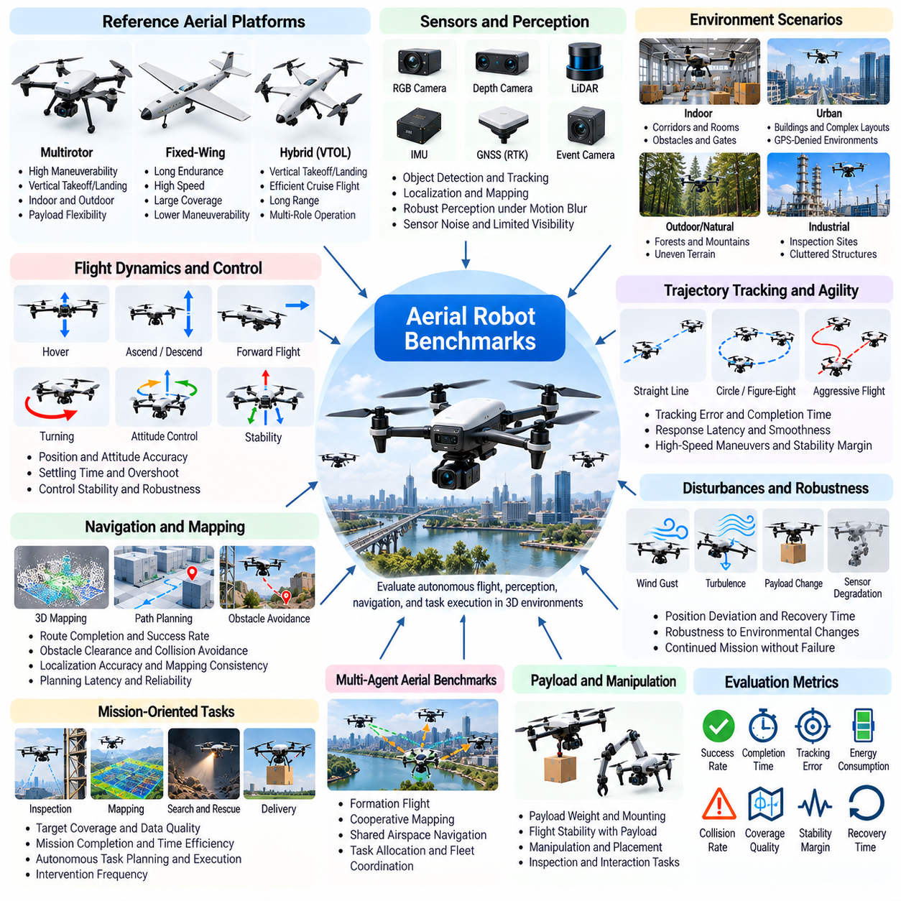{width="7.268055555555556in" height="7.268055555555556in"}

Aerial robot benchmarks establish standardized methods for evaluating autonomous flight, perception, navigation, and control in three-dimensional environments. Unlike ground robots, aerial systems must continuously manage aerodynamic forces, attitude, and propulsion while performing assigned tasks. These benchmarks measure flight stability, trajectory accuracy, environmental awareness, energy efficiency, and operational safety under reproducible conditions.

Reference aerial platforms provide consistent physical assumptions for comparing flight algorithms. Multirotor, fixed-wing, and hybrid aircraft exhibit different maneuverability, endurance, and control constraints. Benchmark specifications should define vehicle mass, inertia, propulsion characteristics, actuator limits, aerodynamic parameters, and sensor configurations. Platform differences must be documented to separate algorithmic improvements from hardware advantages.

Flight dynamics benchmarks evaluate the accuracy and responsiveness of attitude and position control. Standardized scenarios include hovering, vertical ascent, descent, forward flight, and coordinated turning. Controllers must regulate thrust and rotational motion while respecting actuator limitations. Evaluation metrics should include position error, attitude deviation, settling time, overshoot, and control stability across operating conditions.

Trajectory tracking benchmarks examine whether aerial robots can follow predefined spatial paths. Reference trajectories may include straight segments, circular paths, figure-eight patterns, and complex three-dimensional maneuvers. Difficulty can be increased through higher velocities, sharper turns, and tighter spatial constraints. Tracking error, completion time, acceleration smoothness, and constraint violations provide complementary performance measurements.

Aerial navigation benchmarks assess autonomous movement through environments containing obstacles and restricted regions. Indoor corridors, industrial facilities, forests, and urban structures introduce different geometric challenges. Robots must combine localization, mapping, path planning, and collision avoidance. Standardized scenarios should evaluate route completion, obstacle clearance, planning latency, and navigation reliability.

Perception benchmarks examine how aerial robots interpret their surroundings while experiencing rapid viewpoint changes and platform motion. Cameras, depth sensors, LiDAR, inertial measurement units, and positioning systems provide complementary observations. Motion blur, limited visibility, and sensor noise can degrade perception. Evaluation should measure localization accuracy, obstacle detection, mapping consistency, and robustness under degraded sensing.

Visual-inertial odometry and simultaneous localization and mapping are important benchmark components for autonomous flight. Rapid rotations, low-texture surfaces, repetitive structures, and illumination changes can challenge state estimation. Standardized datasets and simulated flight sequences should include ground-truth trajectories. Position drift, orientation error, tracking loss, and recovery time reveal estimator performance.

Obstacle avoidance benchmarks evaluate real-time decisions under strict flight dynamics and sensing constraints. Aerial robots must identify feasible trajectories while accounting for vehicle dimensions, braking capability, and limited reaction time. Dynamic obstacles introduce additional uncertainty. Collision rate, minimum separation distance, response latency, and successful avoidance maneuvers provide important safety and performance indicators.

Agility benchmarks assess the ability to perform rapid maneuvers near dynamic and physical limits. High-speed turns, sudden acceleration, obstacle passages, and aggressive trajectory changes require coordinated perception and control. Standardized flight courses should specify gate dimensions, waypoint tolerances, and velocity requirements. Performance measurements must consider both maneuver completion and stability margins.

Environmental disturbance benchmarks evaluate flight robustness under changing atmospheric and operational conditions. Wind gusts, turbulence, variable air density, and aerodynamic interactions can disrupt planned motion. Disturbance profiles should specify magnitude, direction, frequency, and duration. Position deviation, recovery time, energy consumption, and mission continuation indicate whether flight controllers maintain reliable operation.

Payload benchmarks investigate how additional equipment affects aerial vehicle dynamics and mission performance. Cameras, inspection sensors, delivery packages, and manipulators alter mass distribution, inertia, and propulsion requirements. Standardized payload configurations should define weight, mounting location, and aerodynamic effects. Evaluation should measure stability, tracking accuracy, endurance, and successful task execution.

Mission-oriented aerial benchmarks extend beyond isolated flight control. Inspection, mapping, search, delivery, and environmental monitoring require coordinated perception, planning, and execution. Standardized missions should specify target coverage, observation requirements, time limits, and completion criteria. Mission success, coverage quality, operational efficiency, and intervention frequency provide integrated performance measures.

Multi-agent aerial benchmarks examine coordination among multiple autonomous aircraft. Cooperative mapping, formation flight, distributed inspection, and shared airspace navigation introduce communication and collision-avoidance challenges. Standardized scenarios should control fleet size, communication delays, and task allocation requirements. Evaluation metrics include mission throughput, coordination efficiency, separation violations, and resilience to individual vehicle failures.

Energy efficiency is a fundamental aerial benchmark dimension because flight endurance is constrained by onboard power. Hovering, acceleration, payload transport, and wind compensation impose different energy demands. Benchmarks should measure electrical energy consumption, flight duration, distance traveled, and useful work completed. Comparisons must account for vehicle configuration and battery characteristics to avoid misleading efficiency conclusions.

Safety benchmarks evaluate whether aerial robots remain within acceptable operational boundaries. Loss of localization, propulsion degradation, communication interruptions, and unexpected obstacles may require emergency responses. Evaluation protocols should define restricted regions, altitude limits, safe landing conditions, and termination rules. Safety metrics should include boundary violations, collision events, recovery success, and controlled landing performance.

Long-horizon flight benchmarks assess sustained autonomy over extended missions. Aerial robots must manage navigation uncertainty, energy reserves, changing environmental conditions, and mission priorities. Repeated maneuvers may accumulate localization drift or expose thermal and mechanical limitations. Mission completion, intervention frequency, energy reserve, and operational reliability reveal performance beyond short flight demonstrations.

Simulation-based aerial benchmarks enable large-scale evaluation without exposing physical aircraft to unnecessary experimental risk. Parallel environments can vary terrain, obstacle placement, wind conditions, sensor noise, and vehicle parameters. Reproducibility requires standardized simulation settings, controlled random seeds, and consistent scenario definitions. Training and evaluation environments should remain sufficiently separated to measure generalization.

Aerodynamic and propulsion fidelity strongly influence benchmark validity. Rotor thrust models, motor response, aerodynamic drag, ground effect, and numerical integration affect simulated flight behavior. Simplified models may overestimate stability or maneuverability. Benchmark specifications should document physical assumptions and validate critical dynamic responses against experimental measurements when feasible.

Sim2Real aerial benchmarks compare simulated policies with corresponding physical flight experiments. Differences in aerodynamic behavior, sensor latency, actuator response, and environmental disturbances can reduce transferred performance. Matched scenarios should compare trajectory tracking, disturbance rejection, energy consumption, and mission success. Physical validation helps determine whether simulation performance predicts reliable autonomous flight.

Statistical evaluation requires repeated trials across representative environments, vehicle configurations, and disturbance levels. Benchmark reports should document flight conditions, controller frequencies, random seeds, success criteria, and failure categories. Mean performance, variability, confidence intervals, and safety incidents support meaningful comparisons. Results should distinguish perception failures, planning limitations, control instability, and hardware constraints.

Ultimately, aerial robot benchmarks provide a systematic foundation for evaluating autonomous intelligence in three-dimensional physical environments. Their purpose extends beyond measuring flight speed or trajectory accuracy to understanding perception, adaptability, robustness, efficiency, and safety. Standardized platforms, realistic flight scenarios, multidimensional metrics, and Sim2Real validation support the development of dependable aerial robotic systems.

항공 로봇 벤치마크(Aerial Robot Benchmarks)는 3차원 환경(Three-Dimensional Environments)에서 자율 비행(Autonomous Flight), 인식(Perception), 내비게이션(Navigation), 제어(Control)를 평가하기 위한 표준화된 방법을 수립한다. 지상 로봇(Ground Robots)과 달리 항공 시스템(Aerial Systems)은 주어진 작업을 수행하는 동안 공기역학적 힘(Aerodynamic Forces), 기체 자세(Attitude), 추진력(Propulsion)을 지속적으로 관리해야 한다. 이러한 벤치마크는 재현 가능한 조건(Reproducible Conditions)에서 비행 안정성(Flight Stability), 궤적 정확도(Trajectory Accuracy), 환경 인식(Environmental Awareness), 에너지 효율성(Energy Efficiency), 운영 안전성(Operational Safety)을 측정한다.

참조 항공 플랫폼(Reference Aerial Platforms)은 비행 알고리즘(Flight Algorithms)을 비교하기 위한 일관된 물리적 가정(Physical Assumptions)을 제공한다. 멀티로터(Multirotor), 고정익 항공기(Fixed-Wing Aircraft), 하이브리드 항공기(Hybrid Aircraft)는 서로 다른 기동성(Maneuverability), 비행 지속 시간(Endurance), 제어 제약(Control Constraints)을 나타낸다. 벤치마크 사양(Benchmark Specifications)은 기체 질량(Vehicle Mass), 관성(Inertia), 추진 특성(Propulsion Characteristics), 액추에이터 제한(Actuator Limits), 공기역학 매개변수(Aerodynamic Parameters), 센서 구성(Sensor Configurations)을 정의해야 한다. 알고리즘 개선(Algorithmic Improvements)과 하드웨어 이점(Hardware Advantages)을 구분하기 위해 플랫폼 간 차이를 문서화해야 한다.

비행 동역학 벤치마크(Flight Dynamics Benchmarks)는 자세 및 위치 제어(Attitude and Position Control)의 정확도와 응답성을 평가한다. 표준화된 시나리오(Standardized Scenarios)에는 제자리 비행(Hovering), 수직 상승(Vertical Ascent), 하강(Descent), 전진 비행(Forward Flight), 협조 선회(Coordinated Turning)가 포함된다. 제어기(Controllers)는 액추에이터 제한(Actuator Limitations)을 준수하면서 추력(Thrust)과 회전 운동(Rotational Motion)을 조절해야 한다. 평가 지표(Evaluation Metrics)에는 위치 오차(Position Error), 자세 편차(Attitude Deviation), 정착 시간(Settling Time), 오버슈트(Overshoot), 다양한 운영 조건에서의 제어 안정성(Control Stability)이 포함되어야 한다.

궤적 추종 벤치마크(Trajectory Tracking Benchmarks)는 항공 로봇이 사전에 정의된 공간 경로(Predefined Spatial Paths)를 따라 비행할 수 있는지 평가한다. 참조 궤적(Reference Trajectories)에는 직선 구간(Straight Segments), 원형 경로(Circular Paths), 8자형 패턴(Figure-Eight Patterns), 복잡한 3차원 기동(Three-Dimensional Maneuvers)이 포함될 수 있다. 높은 속도(Higher Velocities), 급격한 선회(Sharper Turns), 엄격한 공간 제약(Tighter Spatial Constraints)을 통해 난이도를 높일 수 있다. 추종 오차(Tracking Error), 완료 시간(Completion Time), 가속도 평활성(Acceleration Smoothness), 제약 위반(Constraint Violations)은 상호 보완적인 성능 측정값을 제공한다.

항공 내비게이션 벤치마크(Aerial Navigation Benchmarks)는 장애물(Obstacles)과 제한 구역(Restricted Regions)이 존재하는 환경에서 자율 이동(Autonomous Movement)을 평가한다. 실내 복도(Indoor Corridors), 산업 시설(Industrial Facilities), 산림(Forests), 도시 구조물(Urban Structures)은 서로 다른 기하학적 과제(Geometric Challenges)를 발생시킨다. 로봇은 위치 추정(Localization), 지도 작성(Mapping), 경로 계획(Path Planning), 충돌 회피(Collision Avoidance)를 결합해야 한다. 표준화된 시나리오(Standardized Scenarios)는 경로 완료율(Route Completion), 장애물 이격 거리(Obstacle Clearance), 계획 지연 시간(Planning Latency), 내비게이션 신뢰성(Navigation Reliability)을 평가해야 한다.

인식 벤치마크(Perception Benchmarks)는 빠른 시점 변화(Rapid Viewpoint Changes)와 기체 운동(Platform Motion)을 경험하는 항공 로봇이 주변 환경을 어떻게 해석하는지 평가한다. 카메라(Cameras), 깊이 센서(Depth Sensors), 라이다(LiDAR), 관성 측정 장치(Inertial Measurement Units), 위치 측정 시스템(Positioning Systems)은 상호 보완적인 관측 정보(Complementary Observations)를 제공한다. 모션 블러(Motion Blur), 제한된 가시성(Limited Visibility), 센서 잡음(Sensor Noise)은 인식 성능을 저하시킬 수 있다. 평가에서는 위치 추정 정확도(Localization Accuracy), 장애물 탐지(Obstacle Detection), 지도 일관성(Mapping Consistency), 센싱 성능 저하(Degraded Sensing)에 대한 강건성(Robustness)을 측정해야 한다.

시각-관성 오도메트리(Visual-Inertial Odometry)와 동시적 위치 추정 및 지도 작성(Simultaneous Localization and Mapping, SLAM)은 자율 비행(Autonomous Flight)을 위한 중요한 벤치마크 구성 요소(Benchmark Components)이다. 빠른 회전(Rapid Rotations), 텍스처가 부족한 표면(Low-Texture Surfaces), 반복적인 구조물(Repetitive Structures), 조명 변화(Illumination Changes)는 상태 추정(State Estimation)을 어렵게 만들 수 있다. 표준화된 데이터셋(Standardized Datasets)과 시뮬레이션 비행 시퀀스(Simulated Flight Sequences)에는 실제 기준 궤적(Ground-Truth Trajectories)이 포함되어야 한다. 위치 드리프트(Position Drift), 방향 오차(Orientation Error), 추적 손실(Tracking Loss), 복구 시간(Recovery Time)은 추정기 성능(Estimator Performance)을 보여준다.

장애물 회피 벤치마크(Obstacle Avoidance Benchmarks)는 엄격한 비행 동역학(Flight Dynamics)과 센싱 제약(Sensing Constraints) 아래에서 실시간 의사결정(Real-Time Decisions)을 평가한다. 항공 로봇은 기체 치수(Vehicle Dimensions), 제동 능력(Braking Capability), 제한된 반응 시간(Limited Reaction Time)을 고려하면서 실행 가능한 궤적(Feasible Trajectories)을 식별해야 한다. 동적 장애물(Dynamic Obstacles)은 추가적인 불확실성(Uncertainty)을 도입한다. 충돌률(Collision Rate), 최소 분리 거리(Minimum Separation Distance), 응답 지연(Response Latency), 회피 기동 성공률(Successful Avoidance Maneuvers)은 중요한 안전 및 성능 지표(Safety and Performance Indicators)를 제공한다.

민첩성 벤치마크(Agility Benchmarks)는 동적 한계(Dynamic Limits)와 물리적 한계(Physical Limits)에 가까운 빠른 기동(Rapid Maneuvers)을 수행하는 능력을 평가한다. 고속 선회(High-Speed Turns), 급가속(Sudden Acceleration), 장애물 통과(Obstacle Passages), 공격적인 궤적 변경(Aggressive Trajectory Changes)은 인식과 제어의 협조(Coordinated Perception and Control)를 요구한다. 표준화된 비행 코스(Standardized Flight Courses)는 게이트 치수(Gate Dimensions), 경유점 허용 오차(Waypoint Tolerances), 속도 요구사항(Velocity Requirements)을 명시해야 한다. 성능 측정에서는 기동 완료(Maneuver Completion)와 안정성 여유도(Stability Margins)를 모두 고려해야 한다.

환경 외란 벤치마크(Environmental Disturbance Benchmarks)는 변화하는 대기 및 운영 조건(Atmospheric and Operational Conditions)에서 비행 강건성(Flight Robustness)을 평가한다. 돌풍(Wind Gusts), 난류(Turbulence), 가변적인 공기 밀도(Variable Air Density), 공기역학적 상호작용(Aerodynamic Interactions)은 계획된 운동(Planned Motion)을 방해할 수 있다. 외란 프로파일(Disturbance Profiles)은 크기(Magnitude), 방향(Direction), 주파수(Frequency), 지속 시간(Duration)을 명시해야 한다. 위치 편차(Position Deviation), 복구 시간(Recovery Time), 에너지 소비(Energy Consumption), 임무 지속 여부(Mission Continuation)는 비행 제어기(Flight Controllers)가 신뢰할 수 있는 운영을 유지하는지 나타낸다.

적재 하중 벤치마크(Payload Benchmarks)는 추가 장비(Additional Equipment)가 항공기 동역학(Aerial Vehicle Dynamics)과 임무 성능(Mission Performance)에 미치는 영향을 조사한다. 카메라(Cameras), 검사 센서(Inspection Sensors), 배송 화물(Delivery Packages), 매니퓰레이터(Manipulators)는 질량 분포(Mass Distribution), 관성(Inertia), 추진 요구사항(Propulsion Requirements)을 변화시킨다. 표준화된 적재 하중 구성(Standardized Payload Configurations)은 무게(Weight), 장착 위치(Mounting Location), 공기역학적 영향(Aerodynamic Effects)을 정의해야 한다. 평가에서는 안정성(Stability), 추종 정확도(Tracking Accuracy), 비행 지속 시간(Endurance), 작업 실행 성공률(Successful Task Execution)을 측정해야 한다.

임무 중심 항공 벤치마크(Mission-Oriented Aerial Benchmarks)는 개별적인 비행 제어(Isolated Flight Control)를 넘어서는 통합 능력을 평가한다. 검사(Inspection), 지도 작성(Mapping), 탐색(Search), 배송(Delivery), 환경 모니터링(Environmental Monitoring)은 인식(Perception), 계획(Planning), 실행(Execution)의 협조를 요구한다. 표준화된 임무(Standardized Missions)는 목표 커버리지(Target Coverage), 관측 요구사항(Observation Requirements), 시간 제한(Time Limits), 완료 기준(Completion Criteria)을 명시해야 한다. 임무 성공률(Mission Success), 커버리지 품질(Coverage Quality), 운영 효율성(Operational Efficiency), 개입 빈도(Intervention Frequency)는 통합 성능 측정값(Integrated Performance Measures)을 제공한다.

다중 에이전트 항공 벤치마크(Multi-Agent Aerial Benchmarks)는 여러 자율 항공기(Autonomous Aircraft) 사이의 협조를 평가한다. 협력 지도 작성(Cooperative Mapping), 편대 비행(Formation Flight), 분산 검사(Distributed Inspection), 공유 공역 내비게이션(Shared Airspace Navigation)은 통신(Communication)과 충돌 회피(Collision Avoidance)에 관한 과제를 도입한다. 표준화된 시나리오(Standardized Scenarios)는 기체 수(Fleet Size), 통신 지연(Communication Delays), 작업 할당 요구사항(Task Allocation Requirements)을 통제해야 한다. 평가 지표(Evaluation Metrics)에는 임무 처리량(Mission Throughput), 협조 효율성(Coordination Efficiency), 분리 거리 위반(Separation Violations), 개별 기체 고장에 대한 복원력(Resilience to Individual Vehicle Failures)이 포함된다.

에너지 효율성(Energy Efficiency)은 비행 지속 시간(Flight Endurance)이 탑재 전원(Onboard Power)에 의해 제한되므로 항공 벤치마크의 핵심 평가 차원(Fundamental Benchmark Dimension)이다. 제자리 비행(Hovering), 가속(Acceleration), 적재물 운송(Payload Transport), 바람 보상(Wind Compensation)은 서로 다른 에너지 요구량(Energy Demands)을 발생시킨다. 벤치마크는 전기 에너지 소비(Electrical Energy Consumption), 비행 시간(Flight Duration), 이동 거리(Distance Traveled), 완료된 유효 작업량(Useful Work Completed)을 측정해야 한다. 잘못된 효율성 비교(Misleading Efficiency Conclusions)를 방지하기 위해 기체 구성(Vehicle Configuration)과 배터리 특성(Battery Characteristics)을 고려해야 한다.

안전성 벤치마크(Safety Benchmarks)는 항공 로봇이 허용 가능한 운영 경계(Acceptable Operational Boundaries) 내에서 작동하는지 평가한다. 위치 추정 손실(Loss of Localization), 추진 성능 저하(Propulsion Degradation), 통신 중단(Communication Interruptions), 예상하지 못한 장애물(Unexpected Obstacles)은 비상 대응(Emergency Responses)을 요구할 수 있다. 평가 프로토콜(Evaluation Protocols)은 제한 구역(Restricted Regions), 고도 제한(Altitude Limits), 안전 착륙 조건(Safe Landing Conditions), 종료 규칙(Termination Rules)을 정의해야 한다. 안전 지표(Safety Metrics)에는 경계 위반(Boundary Violations), 충돌 이벤트(Collision Events), 복구 성공률(Recovery Success), 제어 착륙 성능(Controlled Landing Performance)이 포함되어야 한다.

장기 비행 벤치마크(Long-Horizon Flight Benchmarks)는 확장된 임무(Extended Missions)에 걸친 지속적인 자율성(Sustained Autonomy)을 평가한다. 항공 로봇은 내비게이션 불확실성(Navigation Uncertainty), 에너지 잔량(Energy Reserves), 변화하는 환경 조건(Changing Environmental Conditions), 임무 우선순위(Mission Priorities)를 관리해야 한다. 반복적인 기동(Repeated Maneuvers)은 위치 추정 드리프트(Localization Drift)를 누적시키거나 열적 및 기계적 한계(Thermal and Mechanical Limitations)를 드러낼 수 있다. 임무 완료(Mission Completion), 개입 빈도(Intervention Frequency), 에너지 잔량(Energy Reserve), 운영 신뢰성(Operational Reliability)은 짧은 비행 시연(Short Flight Demonstrations)을 넘어서는 성능을 보여준다.

시뮬레이션 기반 항공 벤치마크(Simulation-Based Aerial Benchmarks)는 실제 항공기를 불필요한 실험 위험(Unnecessary Experimental Risk)에 노출하지 않으면서 대규모 평가(Large-Scale Evaluation)를 가능하게 한다. 병렬 환경(Parallel Environments)은 지형(Terrain), 장애물 배치(Obstacle Placement), 바람 조건(Wind Conditions), 센서 잡음(Sensor Noise), 기체 매개변수(Vehicle Parameters)를 변화시킬 수 있다. 재현성(Reproducibility)을 확보하려면 표준화된 시뮬레이션 설정(Standardized Simulation Settings), 통제된 난수 시드(Controlled Random Seeds), 일관된 시나리오 정의(Consistent Scenario Definitions)가 필요하다. 일반화(Generalization)를 측정하기 위해 학습 환경(Training Environments)과 평가 환경(Evaluation Environments)은 충분히 분리되어야 한다.

공기역학 및 추진 충실도(Aerodynamic and Propulsion Fidelity)는 벤치마크 타당성(Benchmark Validity)에 큰 영향을 미친다. 로터 추력 모델(Rotor Thrust Models), 모터 응답(Motor Response), 공기역학적 항력(Aerodynamic Drag), 지면 효과(Ground Effect), 수치 적분(Numerical Integration)은 시뮬레이션 비행 동작(Simulated Flight Behavior)에 영향을 준다. 단순화된 모델(Simplified Models)은 안정성(Stability)이나 기동성(Maneuverability)을 과대평가할 수 있다. 벤치마크 사양(Benchmark Specifications)은 물리적 가정(Physical Assumptions)을 문서화하고 가능한 경우 핵심 동적 응답(Critical Dynamic Responses)을 실험 측정값(Experimental Measurements)과 비교하여 검증해야 한다.

시뮬레이션-현실 전이 항공 벤치마크(Sim2Real Aerial Benchmarks)는 시뮬레이션 정책(Simulated Policies)과 이에 대응하는 실제 비행 실험(Physical Flight Experiments)을 비교한다. 공기역학적 동작(Aerodynamic Behavior), 센서 지연(Sensor Latency), 액추에이터 응답(Actuator Response), 환경 외란(Environmental Disturbances)의 차이는 전이 성능(Transferred Performance)을 저하시킬 수 있다. 대응되는 시나리오(Matched Scenarios)는 궤적 추종(Trajectory Tracking), 외란 억제(Disturbance Rejection), 에너지 소비(Energy Consumption), 임무 성공률(Mission Success)을 비교해야 한다. 실제 환경 검증(Physical Validation)은 시뮬레이션 성능(Simulation Performance)이 신뢰할 수 있는 자율 비행(Reliable Autonomous Flight)을 예측하는지 판단하는 데 도움이 된다.

통계적 평가(Statistical Evaluation)는 대표적인 환경(Representative Environments), 기체 구성(Vehicle Configurations), 외란 수준(Disturbance Levels)에 걸친 반복 시험(Repeated Trials)을 필요로 한다. 벤치마크 보고서(Benchmark Reports)는 비행 조건(Flight Conditions), 제어기 주파수(Controller Frequencies), 난수 시드(Random Seeds), 성공 기준(Success Criteria), 실패 유형(Failure Categories)을 문서화해야 한다. 평균 성능(Mean Performance), 변동성(Variability), 신뢰구간(Confidence Intervals), 안전 사고(Safety Incidents)는 의미 있는 비교를 지원한다. 결과에서는 인식 실패(Perception Failures), 계획 한계(Planning Limitations), 제어 불안정성(Control Instability), 하드웨어 제약(Hardware Constraints)을 구분해야 한다.

궁극적으로 항공 로봇 벤치마크(Aerial Robot Benchmarks)는 3차원 물리 환경(Three-Dimensional Physical Environments)에서 자율 지능(Autonomous Intelligence)을 평가하기 위한 체계적인 기반(Systematic Foundation)을 제공한다. 그 목적은 비행 속도(Flight Speed)나 궤적 정확도(Trajectory Accuracy)를 측정하는 데 그치지 않고 인식(Perception), 적응성(Adaptability), 강건성(Robustness), 효율성(Efficiency), 안전성(Safety)을 종합적으로 이해하는 데 있다. 표준화된 플랫폼(Standardized Platforms), 현실적인 비행 시나리오(Realistic Flight Scenarios), 다차원 평가 지표(Multidimensional Metrics), 시뮬레이션-현실 전이 검증(Sim2Real Validation)은 신뢰할 수 있는 항공 로봇 시스템(Dependable Aerial Robotic Systems)의 개발을 지원한다.

##  

## 09.09. Perception and Control Benchmarks

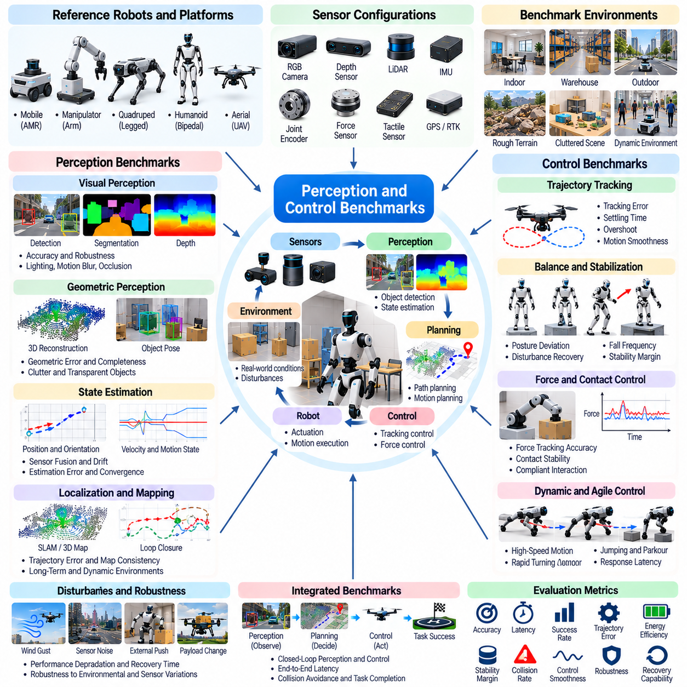{width="7.268055555555556in" height="7.268055555555556in"}

Perception and control benchmarks establish standardized methods for evaluating how Physical AI systems interpret sensor information and convert it into reliable physical actions. Perception estimates environmental and robot states, while control determines actions that achieve desired objectives. These benchmarks assess accuracy, responsiveness, robustness, and safety across representative operating conditions, connecting individual algorithm performance with real-world robotic behavior.

Benchmark design should distinguish perception quality, control performance, and their interaction within closed-loop systems. A perception model may achieve high accuracy on recorded data yet fail when its predictions influence robot movement. Similarly, a controller may perform well with perfect state information but degrade under realistic sensing uncertainty. Integrated evaluation is therefore necessary to reveal dependencies between observation, estimation, planning, and action.

Reference environments provide consistent conditions for comparing perception and control algorithms. Standardized robot models, sensor configurations, coordinate systems, and task definitions reduce experimental ambiguity. Scenarios should include both simple baseline conditions and progressively challenging disturbances. Reproducibility requires documented simulation parameters, initialization procedures, evaluation datasets, and clearly defined success criteria.

Visual perception benchmarks evaluate the interpretation of camera observations for robotic decision-making. Representative tasks include object detection, semantic segmentation, depth estimation, pose estimation, and scene understanding. Image quality may vary because of lighting, motion blur, reflections, and occlusion. Evaluation should consider prediction accuracy, uncertainty calibration, inference latency, and consistency across changing viewpoints.

Depth and geometric perception benchmarks examine the reconstruction of spatial relationships from cameras, LiDAR, and other range sensors. Robots must estimate obstacle locations, surface geometry, free space, and object dimensions. Standardized scenes should contain reflective materials, transparent objects, clutter, and partial observations. Geometric error, reconstruction completeness, detection reliability, and computational cost provide complementary evaluation measures.

State estimation benchmarks assess how accurately robots infer position, velocity, orientation, and other internal variables from noisy measurements. Sensor fusion may combine inertial data, joint encoders, cameras, and external positioning systems. Bias, drift, delayed measurements, and intermittent sensor failures introduce uncertainty. Evaluation metrics include estimation error, convergence time, uncertainty consistency, and recovery after measurement loss.

Localization and mapping benchmarks evaluate the ability to maintain spatial awareness during extended operation. Simultaneous localization and mapping systems must manage accumulated drift, loop closure, and changing environments. Benchmark sequences should include repetitive structures, dynamic objects, and limited visual features. Trajectory error, map consistency, relocalization success, and computational requirements reveal practical system limitations.

Sensor robustness benchmarks investigate perception performance under degraded operating conditions. Noise, calibration errors, missing measurements, occlusion, and environmental interference can reduce observation reliability. Standardized perturbation profiles should control disturbance magnitude and duration. Performance degradation, confidence calibration, recovery time, and failure detection accuracy indicate whether perception systems remain dependable beyond ideal conditions.

Control benchmarks evaluate the ability to regulate robot motion and interaction while respecting physical constraints. Position, velocity, torque, and force control represent different levels of actuation. Standardized reference commands should include steady-state targets, transient responses, and changing trajectories. Tracking error, settling time, overshoot, control effort, and constraint violations provide quantitative comparisons across controller designs.

Trajectory tracking benchmarks measure how accurately robots follow desired paths in joint space or Cartesian space. Reference motions may include smooth curves, rapid transitions, and contact-dependent actions. Dynamic limits, actuator saturation, and model uncertainty affect achievable accuracy. Evaluation should report tracking deviation, motion smoothness, completion time, and stability while distinguishing feasible commands from physically unrealistic demands.

Force and contact control benchmarks examine robot behavior during physical interaction with objects and surfaces. Assembly, grasping, pushing, and compliant manipulation require appropriate regulation of contact forces. Incorrect force estimates or delayed control responses can cause instability or damage. Benchmarks should measure force tracking accuracy, contact stability, interaction smoothness, and compliance with predefined safety limits.

Closed-loop perception-control benchmarks evaluate how sensing errors propagate into physical behavior. A robot may detect an obstacle, estimate its position, plan a response, and execute avoidance within a limited time. Delays or inaccuracies at any stage can affect task success. Integrated metrics should capture end-to-end response latency, collision frequency, tracking performance, and recovery behavior rather than relying only on isolated subsystem scores.

Latency and real-time performance are critical because robotic systems interact with continuously changing physical environments. Sensor acquisition, inference, communication, planning, and actuation each contribute to response delay. Benchmark protocols should measure both average latency and worst-case execution behavior. Deadline violations, timing jitter, and control stability under computational load reveal whether systems satisfy operational requirements.

Disturbance rejection benchmarks assess controller robustness when unexpected forces or modeling errors affect robot dynamics. External pushes, payload variations, friction changes, and actuator uncertainty can disrupt intended motion. Standardized disturbance profiles enable reproducible comparisons. Maximum deviation, recovery time, residual tracking error, and failure probability provide meaningful indicators of robustness under physical uncertainty.

Adaptive control benchmarks examine whether systems adjust their behavior when operating conditions change. Variations in payload, joint friction, actuator performance, or environmental dynamics may invalidate fixed model assumptions. Benchmark scenarios should introduce controlled changes during operation. Adaptation speed, post-change tracking accuracy, stability preservation, and computational overhead indicate whether adaptive strategies improve practical reliability.

Learning-based perception and control benchmarks compare data-driven methods with conventional estimation and control approaches. Neural perception models, reinforcement learning policies, and learned dynamics models may offer flexibility but can introduce unpredictable failure modes. Evaluation should use common observations, action limits, and task conditions. Comparisons must account for training data, computational resources, and generalization to unseen scenarios.

Simulation-based benchmarks support systematic evaluation through controlled variations in sensor and physical parameters. Parallel environments can introduce randomized lighting, noise, friction, mass, and actuator dynamics. Ground-truth states enable precise error measurement and failure analysis. However, unrealistic sensing or physics assumptions may inflate performance, making simulation fidelity and independent evaluation scenarios essential.

Sim2Real perception and control benchmarks measure how algorithms transfer from simulated environments to physical robots. Differences in sensor calibration, timing, contact dynamics, and actuator response can create substantial performance gaps. Matched simulation and hardware trials should compare perception accuracy, trajectory tracking, response latency, and task completion. These measurements help identify which modeling assumptions most strongly influence transfer reliability.

Safety benchmarks examine whether perception and control systems recognize hazards and maintain acceptable operating boundaries. False obstacle detection, missed hazards, unstable commands, and delayed emergency responses can create physical risks. Evaluation protocols should define safe states, intervention thresholds, and termination conditions. Safety metrics should include constraint violations, collision events, emergency response effectiveness, and unsafe action frequency.

Statistical evaluation requires repeated trials across representative tasks, environmental conditions, and disturbance levels. Reports should document sensor specifications, controller frequencies, random seeds, hardware configurations, and success criteria. Mean performance, variability, confidence intervals, and categorized failure events support reproducible comparisons. Separate subsystem and end-to-end results help identify whether failures originate in sensing, estimation, planning, or control.

Ultimately, perception and control benchmarks provide a unified framework for evaluating the reliability of robotic intelligence in physical environments. Their purpose extends beyond measuring prediction accuracy or trajectory error to understanding the complete relationship between sensing, decision-making, and action. Standardized scenarios, integrated metrics, robustness testing, and Sim2Real validation support the development of dependable Physical AI systems.

인식 및 제어 벤치마크(Perception and Control Benchmarks)는 피지컬 AI 시스템(Physical AI Systems)이 센서 정보(Sensor Information)를 해석하고 이를 신뢰할 수 있는 물리적 행동(Physical Actions)으로 변환하는 과정을 평가하기 위한 표준화된 방법을 수립한다. 인식(Perception)은 환경 및 로봇 상태(Environmental and Robot States)를 추정하며, 제어(Control)는 원하는 목표(Desired Objectives)를 달성하기 위한 행동을 결정한다. 이러한 벤치마크는 대표적인 운영 조건(Representative Operating Conditions)에서 정확도(Accuracy), 응답성(Responsiveness), 강건성(Robustness), 안전성(Safety)을 평가하며, 개별 알고리즘 성능(Algorithm Performance)과 실제 로봇 행동(Real-World Robotic Behavior)을 연결한다.

벤치마크 설계(Benchmark Design)는 인식 품질(Perception Quality), 제어 성능(Control Performance), 폐루프 시스템(Closed-Loop Systems) 내에서 이들 사이의 상호작용(Interaction)을 구분해야 한다. 인식 모델(Perception Model)은 기록된 데이터(Recorded Data)에서 높은 정확도를 달성하더라도 예측 결과(Predictions)가 로봇 움직임에 영향을 미치는 상황에서는 실패할 수 있다. 마찬가지로 제어기(Controller)는 완벽한 상태 정보(Perfect State Information)를 사용할 때 우수한 성능을 보이지만 실제적인 센싱 불확실성(Sensing Uncertainty)에서는 성능이 저하될 수 있다. 따라서 관측(Observation), 추정(Estimation), 계획(Planning), 행동(Action) 사이의 의존 관계(Dependencies)를 파악하려면 통합 평가(Integrated Evaluation)가 필요하다.

참조 환경(Reference Environments)은 인식 및 제어 알고리즘(Perception and Control Algorithms)을 비교하기 위한 일관된 조건을 제공한다. 표준화된 로봇 모델(Standardized Robot Models), 센서 구성(Sensor Configurations), 좌표계(Coordinate Systems), 작업 정의(Task Definitions)는 실험적 모호성(Experimental Ambiguity)을 줄인다. 시나리오(Scenarios)에는 단순한 기준 조건(Baseline Conditions)과 점진적으로 난이도가 증가하는 외란(Disturbances)이 모두 포함되어야 한다. 재현성(Reproducibility)을 확보하려면 시뮬레이션 매개변수(Simulation Parameters), 초기화 절차(Initialization Procedures), 평가 데이터셋(Evaluation Datasets), 명확하게 정의된 성공 기준(Success Criteria)을 문서화해야 한다.

시각 인식 벤치마크(Visual Perception Benchmarks)는 로봇 의사결정(Robotic Decision-Making)을 위한 카메라 관측(Camera Observations)의 해석 능력을 평가한다. 대표적인 작업에는 객체 탐지(Object Detection), 의미론적 분할(Semantic Segmentation), 깊이 추정(Depth Estimation), 자세 추정(Pose Estimation), 장면 이해(Scene Understanding)가 포함된다. 영상 품질(Image Quality)은 조명(Lighting), 모션 블러(Motion Blur), 반사(Reflections), 가림(Occlusion)에 따라 달라질 수 있다. 평가에서는 예측 정확도(Prediction Accuracy), 불확실성 보정(Uncertainty Calibration), 추론 지연 시간(Inference Latency), 변화하는 시점(Changing Viewpoints)에 대한 일관성(Consistency)을 고려해야 한다.

깊이 및 기하학적 인식 벤치마크(Depth and Geometric Perception Benchmarks)는 카메라(Cameras), 라이다(LiDAR), 기타 거리 센서(Range Sensors)로부터 공간적 관계(Spatial Relationships)를 재구성하는 능력을 평가한다. 로봇은 장애물 위치(Obstacle Locations), 표면 형상(Surface Geometry), 자유 공간(Free Space), 객체 치수(Object Dimensions)를 추정해야 한다. 표준화된 장면(Standardized Scenes)에는 반사 재료(Reflective Materials), 투명 객체(Transparent Objects), 복잡하게 배치된 물체(Clutter), 부분 관측(Partial Observations)이 포함되어야 한다. 기하학적 오차(Geometric Error), 재구성 완전성(Reconstruction Completeness), 탐지 신뢰성(Detection Reliability), 계산 비용(Computational Cost)은 상호 보완적인 평가 지표를 제공한다.

상태 추정 벤치마크(State Estimation Benchmarks)는 잡음이 포함된 측정값(Noisy Measurements)으로부터 로봇의 위치(Position), 속도(Velocity), 방향(Orientation), 기타 내부 변수(Internal Variables)를 얼마나 정확하게 추론하는지 평가한다. 센서 융합(Sensor Fusion)은 관성 데이터(Inertial Data), 관절 엔코더(Joint Encoders), 카메라(Cameras), 외부 위치 측정 시스템(External Positioning Systems)을 결합할 수 있다. 편향(Bias), 드리프트(Drift), 지연된 측정값(Delayed Measurements), 간헐적인 센서 고장(Intermittent Sensor Failures)은 불확실성(Uncertainty)을 발생시킨다. 평가 지표에는 추정 오차(Estimation Error), 수렴 시간(Convergence Time), 불확실성 일관성(Uncertainty Consistency), 측정값 손실 이후의 복구(Recovery after Measurement Loss)가 포함된다.

위치 추정 및 지도 작성 벤치마크(Localization and Mapping Benchmarks)는 장시간 운영(Extended Operation) 중 공간 인식(Spatial Awareness)을 유지하는 능력을 평가한다. 동시적 위치 추정 및 지도 작성(Simultaneous Localization and Mapping, SLAM) 시스템은 누적 드리프트(Accumulated Drift), 루프 폐쇄(Loop Closure), 변화하는 환경(Changing Environments)을 관리해야 한다. 벤치마크 시퀀스(Benchmark Sequences)에는 반복적인 구조물(Repetitive Structures), 동적 객체(Dynamic Objects), 제한된 시각적 특징(Limited Visual Features)이 포함되어야 한다. 궤적 오차(Trajectory Error), 지도 일관성(Map Consistency), 재위치 추정 성공률(Relocalization Success), 계산 요구사항(Computational Requirements)은 실제 시스템의 한계를 보여준다.

센서 강건성 벤치마크(Sensor Robustness Benchmarks)는 성능이 저하된 운영 조건(Degraded Operating Conditions)에서 인식 성능(Perception Performance)을 조사한다. 잡음(Noise), 보정 오차(Calibration Errors), 측정값 누락(Missing Measurements), 가림(Occlusion), 환경 간섭(Environmental Interference)은 관측 신뢰성(Observation Reliability)을 감소시킬 수 있다. 표준화된 교란 프로파일(Standardized Perturbation Profiles)은 외란의 크기(Disturbance Magnitude)와 지속 시간(Duration)을 통제해야 한다. 성능 저하(Performance Degradation), 신뢰도 보정(Confidence Calibration), 복구 시간(Recovery Time), 고장 탐지 정확도(Failure Detection Accuracy)는 이상적인 조건을 벗어난 환경에서도 인식 시스템이 신뢰성을 유지하는지 나타낸다.

제어 벤치마크(Control Benchmarks)는 물리적 제약(Physical Constraints)을 준수하면서 로봇의 운동(Motion)과 상호작용(Interaction)을 조절하는 능력을 평가한다. 위치 제어(Position Control), 속도 제어(Velocity Control), 토크 제어(Torque Control), 힘 제어(Force Control)는 서로 다른 구동 수준(Actuation Levels)을 나타낸다. 표준화된 참조 명령(Standardized Reference Commands)에는 정상 상태 목표(Steady-State Targets), 과도 응답(Transient Responses), 변화하는 궤적(Changing Trajectories)이 포함되어야 한다. 추종 오차(Tracking Error), 정착 시간(Settling Time), 오버슈트(Overshoot), 제어 입력 크기(Control Effort), 제약 위반(Constraint Violations)은 제어기 설계(Controller Designs) 사이의 정량적 비교를 가능하게 한다.

궤적 추종 벤치마크(Trajectory Tracking Benchmarks)는 로봇이 관절 공간(Joint Space) 또는 직교 좌표 공간(Cartesian Space)에서 원하는 경로를 얼마나 정확하게 따라가는지 측정한다. 참조 동작(Reference Motions)에는 부드러운 곡선(Smooth Curves), 빠른 전환(Rapid Transitions), 접촉 의존적 행동(Contact-Dependent Actions)이 포함될 수 있다. 동적 한계(Dynamic Limits), 액추에이터 포화(Actuator Saturation), 모델 불확실성(Model Uncertainty)은 달성 가능한 정확도(Achievable Accuracy)에 영향을 미친다. 평가에서는 물리적으로 실현 가능한 명령(Feasible Commands)과 비현실적인 요구(Physically Unrealistic Demands)를 구분하면서 추종 편차(Tracking Deviation), 동작 평활성(Motion Smoothness), 완료 시간(Completion Time), 안정성(Stability)을 보고해야 한다.

힘 및 접촉 제어 벤치마크(Force and Contact Control Benchmarks)는 객체 및 표면과의 물리적 상호작용(Physical Interaction) 중 로봇의 행동을 평가한다. 조립(Assembly), 파지(Grasping), 밀기(Pushing), 순응적 조작(Compliant Manipulation)은 접촉력(Contact Forces)의 적절한 조절을 요구한다. 부정확한 힘 추정(Incorrect Force Estimates)이나 지연된 제어 응답(Delayed Control Responses)은 불안정성(Instability)이나 손상(Damage)을 발생시킬 수 있다. 벤치마크는 힘 추종 정확도(Force Tracking Accuracy), 접촉 안정성(Contact Stability), 상호작용 평활성(Interaction Smoothness), 사전에 정의된 안전 한계(Safety Limits) 준수 여부를 측정해야 한다.

폐루프 인식-제어 벤치마크(Closed-Loop Perception-Control Benchmarks)는 센싱 오차(Sensing Errors)가 물리적 행동(Physical Behavior)으로 어떻게 전파되는지 평가한다. 로봇은 장애물을 탐지하고 위치를 추정한 다음 대응 행동을 계획하고 제한된 시간 내에 회피 동작을 실행할 수 있다. 어느 단계에서든 지연(Delays)이나 부정확성(Inaccuracies)이 발생하면 작업 성공(Task Success)에 영향을 줄 수 있다. 통합 지표(Integrated Metrics)는 개별 하위 시스템 점수(Isolated Subsystem Scores)에만 의존하지 않고 종단 간 응답 지연 시간(End-to-End Response Latency), 충돌 빈도(Collision Frequency), 추종 성능(Tracking Performance), 복구 행동(Recovery Behavior)을 측정해야 한다.

지연 시간 및 실시간 성능(Latency and Real-Time Performance)은 로봇 시스템이 지속적으로 변화하는 물리적 환경(Physical Environments)과 상호작용하기 때문에 중요하다. 센서 데이터 획득(Sensor Acquisition), 추론(Inference), 통신(Communication), 계획(Planning), 구동(Actuation)은 각각 응답 지연(Response Delay)에 영향을 준다. 벤치마크 프로토콜(Benchmark Protocols)은 평균 지연 시간(Average Latency)과 최악 조건 실행 특성(Worst-Case Execution Behavior)을 모두 측정해야 한다. 마감 시간 위반(Deadline Violations), 타이밍 지터(Timing Jitter), 계산 부하(Computational Load) 상황에서의 제어 안정성(Control Stability)은 시스템이 운영 요구사항(Operational Requirements)을 충족하는지 보여준다.

외란 억제 벤치마크(Disturbance Rejection Benchmarks)는 예상하지 못한 힘이나 모델링 오차(Modeling Errors)가 로봇 동역학(Robot Dynamics)에 영향을 미칠 때 제어기의 강건성(Controller Robustness)을 평가한다. 외부 밀림(External Pushes), 적재 하중 변화(Payload Variations), 마찰 변화(Friction Changes), 액추에이터 불확실성(Actuator Uncertainty)은 의도한 움직임을 방해할 수 있다. 표준화된 외란 프로파일(Standardized Disturbance Profiles)은 재현 가능한 비교를 가능하게 한다. 최대 편차(Maximum Deviation), 복구 시간(Recovery Time), 잔류 추종 오차(Residual Tracking Error), 실패 확률(Failure Probability)은 물리적 불확실성(Physical Uncertainty) 아래에서 강건성을 평가하는 유용한 지표를 제공한다.

적응 제어 벤치마크(Adaptive Control Benchmarks)는 운영 조건(Operating Conditions)이 변화할 때 시스템이 행동을 조정하는지 평가한다. 적재 하중(Payload), 관절 마찰(Joint Friction), 액추에이터 성능(Actuator Performance), 환경 동역학(Environmental Dynamics)의 변화는 고정된 모델 가정(Fixed Model Assumptions)을 무효화할 수 있다. 벤치마크 시나리오(Benchmark Scenarios)는 운영 중 통제된 변화(Controlled Changes)를 도입해야 한다. 적응 속도(Adaptation Speed), 변화 이후 추종 정확도(Post-Change Tracking Accuracy), 안정성 유지(Stability Preservation), 계산 오버헤드(Computational Overhead)는 적응 전략(Adaptive Strategies)이 실제 신뢰성(Practical Reliability)을 향상시키는지 나타낸다.

학습 기반 인식 및 제어 벤치마크(Learning-Based Perception and Control Benchmarks)는 데이터 기반 방법(Data-Driven Methods)과 전통적인 추정 및 제어 접근법(Conventional Estimation and Control Approaches)을 비교한다. 신경망 인식 모델(Neural Perception Models), 강화학습 정책(Reinforcement Learning Policies), 학습된 동역학 모델(Learned Dynamics Models)은 유연성(Flexibility)을 제공할 수 있지만 예측하기 어려운 실패 유형(Unpredictable Failure Modes)을 발생시킬 수도 있다. 평가에서는 공통 관측 정보(Common Observations), 행동 제한(Action Limits), 작업 조건(Task Conditions)을 사용해야 한다. 비교 과정에서는 학습 데이터(Training Data), 계산 자원(Computational Resources), 미경험 시나리오(Unseen Scenarios)에 대한 일반화(Generalization)를 고려해야 한다.

시뮬레이션 기반 벤치마크(Simulation-Based Benchmarks)는 센서 및 물리 매개변수(Sensor and Physical Parameters)를 통제된 방식으로 변화시키면서 체계적인 평가(Systematic Evaluation)를 지원한다. 병렬 환경(Parallel Environments)은 조명(Lighting), 잡음(Noise), 마찰(Friction), 질량(Mass), 액추에이터 동역학(Actuator Dynamics)을 무작위화할 수 있다. 실제 기준 상태(Ground-Truth States)는 정밀한 오차 측정(Precise Error Measurement)과 실패 분석(Failure Analysis)을 가능하게 한다. 그러나 비현실적인 센싱 또는 물리 가정(Unrealistic Sensing or Physics Assumptions)은 성능을 과대평가할 수 있으므로 시뮬레이션 충실도(Simulation Fidelity)와 독립적인 평가 시나리오(Independent Evaluation Scenarios)가 필수적이다.

시뮬레이션-현실 전이 인식 및 제어 벤치마크(Sim2Real Perception and Control Benchmarks)는 알고리즘이 시뮬레이션 환경(Simulated Environments)에서 실제 로봇(Physical Robots)으로 얼마나 효과적으로 전이되는지 측정한다. 센서 보정(Sensor Calibration), 타이밍(Timing), 접촉 동역학(Contact Dynamics), 액추에이터 응답(Actuator Response)의 차이는 상당한 성능 격차(Performance Gaps)를 발생시킬 수 있다. 대응되는 시뮬레이션 및 하드웨어 시험(Matched Simulation and Hardware Trials)은 인식 정확도(Perception Accuracy), 궤적 추종(Trajectory Tracking), 응답 지연 시간(Response Latency), 작업 완료(Task Completion)를 비교해야 한다. 이러한 측정값은 어떤 모델링 가정(Modeling Assumptions)이 전이 신뢰성(Transfer Reliability)에 가장 큰 영향을 미치는지 식별하는 데 도움이 된다.

안전성 벤치마크(Safety Benchmarks)는 인식 및 제어 시스템(Perception and Control Systems)이 위험 요소(Hazards)를 인식하고 허용 가능한 운영 경계(Acceptable Operating Boundaries)를 유지하는지 평가한다. 잘못된 장애물 탐지(False Obstacle Detection), 위험 요소 미탐지(Missed Hazards), 불안정한 명령(Unstable Commands), 지연된 비상 대응(Delayed Emergency Responses)은 물리적 위험(Physical Risks)을 발생시킬 수 있다. 평가 프로토콜(Evaluation Protocols)은 안전 상태(Safe States), 개입 임계값(Intervention Thresholds), 종료 조건(Termination Conditions)을 정의해야 한다. 안전 지표(Safety Metrics)에는 제약 위반(Constraint Violations), 충돌 이벤트(Collision Events), 비상 대응 효과(Emergency Response Effectiveness), 위험 행동 빈도(Unsafe Action Frequency)가 포함되어야 한다.

통계적 평가(Statistical Evaluation)는 대표적인 작업(Representative Tasks), 환경 조건(Environmental Conditions), 외란 수준(Disturbance Levels)에 걸친 반복 시험(Repeated Trials)을 필요로 한다. 보고서(Reports)는 센서 사양(Sensor Specifications), 제어기 주파수(Controller Frequencies), 난수 시드(Random Seeds), 하드웨어 구성(Hardware Configurations), 성공 기준(Success Criteria)을 문서화해야 한다. 평균 성능(Mean Performance), 변동성(Variability), 신뢰구간(Confidence Intervals), 분류된 실패 이벤트(Categorized Failure Events)는 재현 가능한 비교(Reproducible Comparisons)를 지원한다. 개별 하위 시스템 결과(Subsystem Results)와 종단 간 결과(End-to-End Results)를 분리하면 실패 원인이 센싱(Sensing), 추정(Estimation), 계획(Planning), 제어(Control) 중 어디에서 발생하는지 식별하는 데 도움이 된다.

궁극적으로 인식 및 제어 벤치마크(Perception and Control Benchmarks)는 물리적 환경(Physical Environments)에서 로봇 지능(Robotic Intelligence)의 신뢰성을 평가하기 위한 통합 프레임워크(Unified Framework)를 제공한다. 그 목적은 예측 정확도(Prediction Accuracy)나 궤적 오차(Trajectory Error)를 측정하는 데 그치지 않고 센싱(Sensing), 의사결정(Decision-Making), 행동(Action) 사이의 전체적인 관계를 이해하는 데 있다. 표준화된 시나리오(Standardized Scenarios), 통합 평가 지표(Integrated Metrics), 강건성 시험(Robustness Testing), 시뮬레이션-현실 전이 검증(Sim2Real Validation)은 신뢰할 수 있는 피지컬 AI 시스템(Dependable Physical AI Systems)의 개발을 지원한다.

##  

## 09.10. RL and Imitation Learning Benchmarks

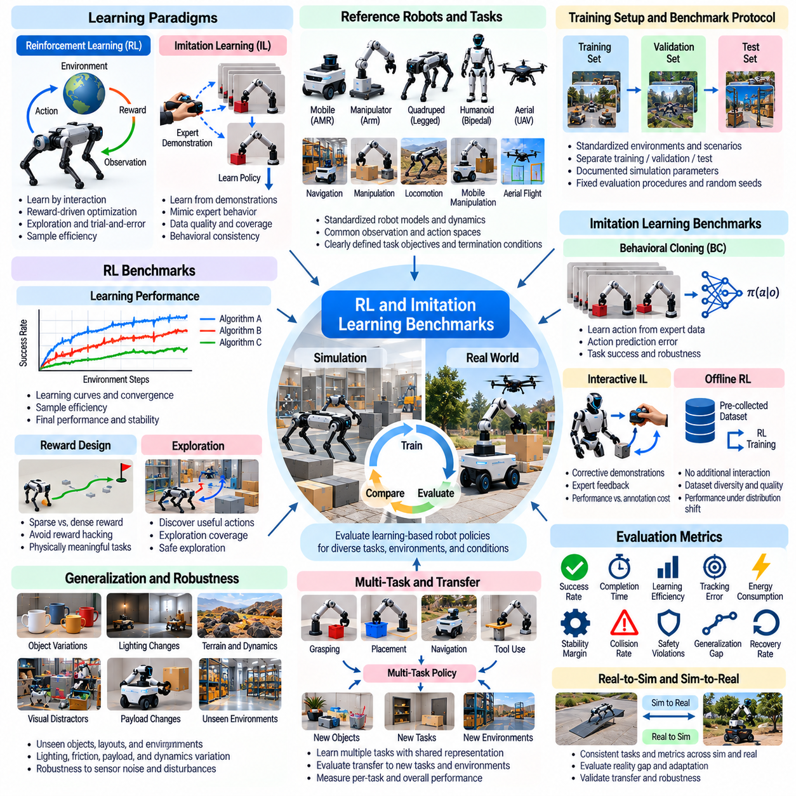{width="7.268055555555556in" height="7.268055555555556in"}

Reinforcement learning and imitation learning benchmarks provide standardized methods for evaluating how robots acquire physical skills through interaction and demonstration. Reinforcement learning optimizes behavior using rewards from environmental feedback, while imitation learning reproduces patterns observed in expert data. These benchmarks assess learning efficiency, task success, generalization, robustness, and safety under consistent experimental conditions.

Benchmark design must account for fundamental differences between learning paradigms. Reinforcement learning depends on exploration, reward design, and environmental interaction, whereas imitation learning depends on demonstration quality, coverage, and behavioral consistency. Direct comparisons require equivalent task objectives and evaluation conditions. Training resources and data availability should be reported separately to avoid misleading conclusions.

Reference environments establish common foundations for evaluating learning algorithms across robotic tasks. Standardized robot models, observation spaces, action spaces, reward definitions, and termination conditions reduce experimental ambiguity. Representative tasks include locomotion, grasping, object manipulation, navigation, and mobile manipulation. Benchmark specifications should distinguish training configurations from independent evaluation scenarios.

Reinforcement learning benchmarks measure how efficiently policies improve through repeated interaction with simulated or physical environments. Learning curves describe performance as a function of environment steps, training time, or computational resources. Sample efficiency is particularly important when physical interaction is expensive. Evaluation should report convergence behavior, final task performance, learning stability, and variability across random seeds.

Reward design strongly influences reinforcement learning performance and benchmark validity. Sparse rewards emphasize task completion but may create difficult exploration problems, while dense rewards provide intermediate guidance. Poorly designed rewards can encourage unintended shortcuts or physically undesirable behavior. Benchmark protocols should document reward functions and distinguish genuine task achievement from reward exploitation.

Exploration benchmarks evaluate how effectively agents discover useful actions in unfamiliar environments. Contact-rich manipulation, complex navigation, and multi-stage tasks often require sequences of actions before meaningful rewards appear. Exploration strategies should be tested under controlled task difficulty and interaction budgets. Evaluation metrics include discovery time, successful exploration coverage, and the frequency of unsafe interactions.

Imitation learning benchmarks evaluate the ability to reproduce expert behavior from recorded demonstrations. Demonstrations may originate from teleoperation, kinesthetic teaching, human motion capture, or previously trained controllers. Dataset specifications should document observation modalities, action representations, trajectory lengths, and demonstration quality. Evaluation should distinguish behavioral similarity from actual task success in closed-loop execution.

Behavioral cloning benchmarks examine supervised learning of actions from expert observations. Although behavioral cloning can provide efficient policy initialization, prediction errors may accumulate when the robot encounters states absent from the demonstration dataset. Standardized evaluation should include both familiar and shifted initial conditions. Action prediction error, task completion, recovery capability, and distribution sensitivity reveal practical limitations.

Interactive imitation learning benchmarks address the mismatch between expert demonstration distributions and states encountered by learned policies. Methods that collect corrective demonstrations or expert feedback can reduce accumulated execution errors. Benchmark protocols should measure the amount and type of additional supervision. Performance improvements must be evaluated against annotation cost, interaction requirements, and final policy robustness.

Offline reinforcement learning benchmarks investigate policy improvement using previously collected datasets without additional environment interaction during training. Dataset composition, behavioral diversity, and action coverage strongly influence achievable performance. Standardized datasets should include successful, unsuccessful, and intermediate-quality trajectories. Evaluation should measure task performance, sensitivity to dataset quality, and behavior outside observed distributions.

Demonstration quality benchmarks examine how expert consistency and dataset diversity influence imitation learning. Highly successful demonstrations may provide precise guidance but insufficient coverage of recovery situations. Diverse demonstrations can improve generalization while introducing inconsistent actions. Benchmark scenarios should vary demonstration quantity, expertise, and task coverage to identify relationships between data characteristics and learned performance.

Multi-task learning benchmarks evaluate whether a single policy can perform several related robotic tasks. Shared representations may support transfer between grasping, placement, navigation, and manipulation behaviors. However, differences in task objectives and action requirements can create interference. Evaluation should report per-task success, average performance, negative transfer, and adaptability to new task combinations.

Generalization benchmarks examine whether learned policies remain effective under unfamiliar environmental conditions. Changes in object geometry, friction, lighting, payload, terrain, and robot dynamics can expose dependence on narrow training distributions. Evaluation scenarios should separate interpolation within known variations from extrapolation to unseen conditions. Success rates, performance degradation, and recovery behavior indicate generalization capability.

Robustness benchmarks introduce disturbances during policy execution to assess reliability beyond nominal conditions. Sensor noise, delayed observations, actuator uncertainty, unexpected contacts, and external forces may disrupt learned behavior. Standardized perturbations should specify magnitude, duration, and application timing. Evaluation metrics include task continuation, recovery time, stability, and failure probability across disturbance levels.

Safety is particularly important because reinforcement learning exploration may produce unpredictable physical actions. Excessive joint torque, collisions, unstable contact, and unsafe trajectories can damage hardware or create hazards. Benchmark environments should define operational constraints, safety monitors, and termination conditions. Safety evaluation should include constraint violations, hazardous exploration events, and successful completion without unsafe behavior.

Long-horizon learning benchmarks evaluate policies that must complete multiple dependent actions over extended periods. Tasks such as navigating to an object, grasping it, transporting it, and placing it require coordinated decision-making. Small errors can accumulate and invalidate later stages. Evaluation should measure complete task success, subtask dependencies, recovery frequency, and the ability to resume progress after unexpected events.

Simulation-based benchmarks enable large-scale reinforcement learning through parallel environment execution. Thousands of simulated robots can collect experiences under randomized initial states, physical parameters, and task conditions. This improves experimental throughput but introduces sensitivity to simulator fidelity. Benchmark reports should document environment versions, physics settings, parallelization levels, and computational resources.

Sim2Real benchmarks assess whether learned policies retain performance when transferred from simulation to physical robots. Differences in contact mechanics, sensor latency, actuator dynamics, and environmental variability can cause substantial degradation. Matched simulation and hardware evaluations should compare task success, trajectory behavior, energy consumption, and safety outcomes. Transfer performance should be reported separately from simulation-only results.

Evaluation fairness requires consistent treatment of training data, computational budgets, and prior knowledge. Some methods benefit from extensive demonstrations, pretrained representations, or large-scale simulated interaction. Comparing final success rates alone may conceal these advantages. Benchmark reports should disclose pretraining sources, demonstration counts, environment steps, optimization settings, and hardware requirements.

Statistical reporting is essential because learning algorithms often exhibit substantial variation across training runs. Multiple random seeds, repeated evaluation episodes, and confidence intervals support reliable comparisons. Learning curves should include variability rather than only best-performing runs. Failure analysis should distinguish insufficient exploration, poor demonstrations, optimization instability, distribution shift, and control limitations.

Ultimately, reinforcement learning and imitation learning benchmarks provide a systematic framework for measuring how Physical AI systems acquire and generalize robotic skills. Their purpose extends beyond final task success to understanding data efficiency, learning stability, transferability, robustness, and safety. Standardized environments, transparent resource reporting, independent evaluation, and Sim2Real validation support reproducible progress toward adaptable robotic intelligence.

강화학습 및 모방학습 벤치마크(Reinforcement Learning and Imitation Learning Benchmarks)는 로봇이 환경과의 상호작용(Interaction)과 시연(Demonstration)을 통해 물리적 기술(Physical Skills)을 습득하는 과정을 평가하기 위한 표준화된 방법을 제공한다. 강화학습(Reinforcement Learning)은 환경 피드백(Environmental Feedback)에서 얻은 보상(Rewards)을 이용하여 행동을 최적화하며, 모방학습(Imitation Learning)은 전문가 데이터(Expert Data)에서 관찰한 행동 패턴(Behavioral Patterns)을 재현한다. 이러한 벤치마크는 일관된 실험 조건(Consistent Experimental Conditions)에서 학습 효율성(Learning Efficiency), 작업 성공률(Task Success), 일반화(Generalization), 강건성(Robustness), 안전성(Safety)을 평가한다.

벤치마크 설계(Benchmark Design)는 학습 패러다임(Learning Paradigms) 사이의 근본적인 차이를 고려해야 한다. 강화학습(Reinforcement Learning)은 탐색(Exploration), 보상 설계(Reward Design), 환경 상호작용(Environmental Interaction)에 의존하는 반면, 모방학습(Imitation Learning)은 시연 품질(Demonstration Quality), 데이터 범위(Data Coverage), 행동 일관성(Behavioral Consistency)에 의존한다. 직접적인 비교(Direct Comparisons)를 위해서는 동등한 작업 목표(Task Objectives)와 평가 조건(Evaluation Conditions)이 필요하다. 잘못된 결론을 방지하기 위해 학습 자원(Training Resources)과 데이터 가용성(Data Availability)은 별도로 보고해야 한다.

참조 환경(Reference Environments)은 다양한 로봇 작업(Robotic Tasks)에 걸쳐 학습 알고리즘(Learning Algorithms)을 평가하기 위한 공통 기반을 제공한다. 표준화된 로봇 모델(Standardized Robot Models), 관측 공간(Observation Spaces), 행동 공간(Action Spaces), 보상 정의(Reward Definitions), 종료 조건(Termination Conditions)은 실험적 모호성(Experimental Ambiguity)을 줄인다. 대표적인 작업에는 보행(Locomotion), 파지(Grasping), 객체 조작(Object Manipulation), 내비게이션(Navigation), 모바일 매니퓰레이션(Mobile Manipulation)이 포함된다. 벤치마크 사양(Benchmark Specifications)은 학습 구성(Training Configurations)과 독립적인 평가 시나리오(Independent Evaluation Scenarios)를 구분해야 한다.

강화학습 벤치마크(Reinforcement Learning Benchmarks)는 시뮬레이션 또는 실제 물리 환경(Simulated or Physical Environments)과의 반복적인 상호작용을 통해 정책(Policies)이 얼마나 효율적으로 개선되는지 측정한다. 학습 곡선(Learning Curves)은 환경 상호작용 단계(Environment Steps), 학습 시간(Training Time), 계산 자원(Computational Resources)에 따른 성능 변화를 나타낸다. 샘플 효율성(Sample Efficiency)은 실제 물리적 상호작용(Physical Interaction)에 높은 비용이 발생하는 경우 특히 중요하다. 평가에서는 수렴 특성(Convergence Behavior), 최종 작업 성능(Final Task Performance), 학습 안정성(Learning Stability), 난수 시드(Random Seeds)에 따른 변동성(Variability)을 보고해야 한다.

보상 설계(Reward Design)는 강화학습 성능(Reinforcement Learning Performance)과 벤치마크 타당성(Benchmark Validity)에 큰 영향을 미친다. 희소 보상(Sparse Rewards)은 작업 완료(Task Completion)를 강조하지만 어려운 탐색 문제(Exploration Problems)를 발생시킬 수 있으며, 밀집 보상(Dense Rewards)은 중간 단계의 학습 지침(Intermediate Guidance)을 제공한다. 부적절하게 설계된 보상(Poorly Designed Rewards)은 의도하지 않은 지름길(Unintended Shortcuts)이나 물리적으로 바람직하지 않은 행동(Physically Undesirable Behavior)을 유도할 수 있다. 벤치마크 프로토콜(Benchmark Protocols)은 보상 함수(Reward Functions)를 문서화하고 실제 작업 달성(Genuine Task Achievement)과 보상 악용(Reward Exploitation)을 구분해야 한다.

탐색 벤치마크(Exploration Benchmarks)는 에이전트(Agents)가 익숙하지 않은 환경(Unfamiliar Environments)에서 유용한 행동(Useful Actions)을 얼마나 효과적으로 발견하는지 평가한다. 접촉이 많은 조작(Contact-Rich Manipulation), 복잡한 내비게이션(Complex Navigation), 다단계 작업(Multi-Stage Tasks)은 의미 있는 보상(Meaningful Rewards)이 나타나기 전에 일련의 행동을 요구하는 경우가 많다. 탐색 전략(Exploration Strategies)은 통제된 작업 난이도(Task Difficulty)와 상호작용 예산(Interaction Budgets) 아래에서 시험해야 한다. 평가 지표에는 발견 시간(Discovery Time), 성공적인 탐색 범위(Successful Exploration Coverage), 위험한 상호작용 빈도(Frequency of Unsafe Interactions)가 포함된다.

모방학습 벤치마크(Imitation Learning Benchmarks)는 기록된 시연(Recorded Demonstrations)으로부터 전문가 행동(Expert Behavior)을 재현하는 능력을 평가한다. 시연 데이터(Demonstrations)는 원격조작(Teleoperation), 직접 교시(Kinesthetic Teaching), 인간 동작 캡처(Human Motion Capture), 이전에 학습된 제어기(Previously Trained Controllers)에서 수집될 수 있다. 데이터셋 사양(Dataset Specifications)은 관측 모달리티(Observation Modalities), 행동 표현(Action Representations), 궤적 길이(Trajectory Lengths), 시연 품질(Demonstration Quality)을 문서화해야 한다. 평가에서는 행동 유사성(Behavioral Similarity)과 폐루프 실행(Closed-Loop Execution)에서의 실제 작업 성공(Actual Task Success)을 구분해야 한다.

행동 복제 벤치마크(Behavioral Cloning Benchmarks)는 전문가 관측(Expert Observations)으로부터 행동을 학습하는 지도학습(Supervised Learning)을 평가한다. 행동 복제(Behavioral Cloning)는 효율적인 정책 초기화(Policy Initialization)를 제공할 수 있지만, 로봇이 시연 데이터셋(Demonstration Dataset)에 없는 상태를 경험하면 예측 오차(Prediction Errors)가 누적될 수 있다. 표준화된 평가(Standardized Evaluation)에는 익숙한 초기 조건(Familiar Initial Conditions)과 변화된 초기 조건(Shifted Initial Conditions)이 모두 포함되어야 한다. 행동 예측 오차(Action Prediction Error), 작업 완료(Task Completion), 복구 능력(Recovery Capability), 분포 변화 민감도(Distribution Sensitivity)는 실제 적용상의 한계를 보여준다.

상호작용형 모방학습 벤치마크(Interactive Imitation Learning Benchmarks)는 전문가 시연 분포(Expert Demonstration Distributions)와 학습된 정책(Learned Policies)이 실제로 경험하는 상태 사이의 불일치를 다룬다. 교정 시연(Corrective Demonstrations)이나 전문가 피드백(Expert Feedback)을 수집하는 방법은 누적 실행 오차(Accumulated Execution Errors)를 줄일 수 있다. 벤치마크 프로토콜(Benchmark Protocols)은 추가 지도 정보(Additional Supervision)의 양과 유형을 측정해야 한다. 성능 개선(Performance Improvements)은 주석 비용(Annotation Cost), 상호작용 요구사항(Interaction Requirements), 최종 정책 강건성(Final Policy Robustness)을 기준으로 평가해야 한다.

오프라인 강화학습 벤치마크(Offline Reinforcement Learning Benchmarks)는 학습 중 추가적인 환경 상호작용(Additional Environment Interaction) 없이 기존에 수집된 데이터셋(Previously Collected Datasets)을 이용하여 정책을 개선하는 방법을 조사한다. 데이터셋 구성(Dataset Composition), 행동 다양성(Behavioral Diversity), 행동 범위(Action Coverage)는 달성 가능한 성능(Achievable Performance)에 큰 영향을 미친다. 표준화된 데이터셋(Standardized Datasets)에는 성공한 궤적(Successful Trajectories), 실패한 궤적(Unsuccessful Trajectories), 중간 품질의 궤적(Intermediate-Quality Trajectories)이 포함되어야 한다. 평가에서는 작업 성능(Task Performance), 데이터셋 품질에 대한 민감도(Sensitivity to Dataset Quality), 관측된 분포 밖의 행동(Behavior Outside Observed Distributions)을 측정해야 한다.

시연 품질 벤치마크(Demonstration Quality Benchmarks)는 전문가 일관성(Expert Consistency)과 데이터셋 다양성(Dataset Diversity)이 모방학습(Imitation Learning)에 미치는 영향을 평가한다. 성공률이 높은 시연(Highly Successful Demonstrations)은 정확한 지침(Precise Guidance)을 제공할 수 있지만 복구 상황(Recovery Situations)에 대한 데이터 범위가 부족할 수 있다. 다양한 시연(Diverse Demonstrations)은 일반화(Generalization)를 개선하면서도 일관되지 않은 행동(Inconsistent Actions)을 도입할 수 있다. 벤치마크 시나리오(Benchmark Scenarios)는 시연 수량(Demonstration Quantity), 전문가 숙련도(Expertise), 작업 범위(Task Coverage)를 변화시켜 데이터 특성(Data Characteristics)과 학습 성능(Learned Performance) 사이의 관계를 식별해야 한다.

다중 작업 학습 벤치마크(Multi-Task Learning Benchmarks)는 단일 정책(Single Policy)이 여러 관련 로봇 작업(Related Robotic Tasks)을 수행할 수 있는지 평가한다. 공유 표현(Shared Representations)은 파지(Grasping), 배치(Placement), 내비게이션(Navigation), 조작(Manipulation) 행동 사이의 전이(Transfer)를 지원할 수 있다. 그러나 작업 목표(Task Objectives)와 행동 요구사항(Action Requirements)의 차이는 간섭(Interference)을 발생시킬 수 있다. 평가에서는 작업별 성공률(Per-Task Success), 평균 성능(Average Performance), 부정적 전이(Negative Transfer), 새로운 작업 조합(New Task Combinations)에 대한 적응성(Adaptability)을 보고해야 한다.

일반화 벤치마크(Generalization Benchmarks)는 학습된 정책(Learned Policies)이 익숙하지 않은 환경 조건(Unfamiliar Environmental Conditions)에서도 효과적으로 작동하는지 평가한다. 객체 형상(Object Geometry), 마찰(Friction), 조명(Lighting), 적재 하중(Payload), 지형(Terrain), 로봇 동역학(Robot Dynamics)의 변화는 제한적인 학습 분포(Narrow Training Distributions)에 대한 의존성을 드러낼 수 있다. 평가 시나리오(Evaluation Scenarios)는 알려진 변화 범위 내의 보간(Interpolation)과 처음 접하는 조건으로의 외삽(Extrapolation)을 구분해야 한다. 성공률(Success Rates), 성능 저하(Performance Degradation), 복구 행동(Recovery Behavior)은 일반화 능력(Generalization Capability)을 나타낸다.

강건성 벤치마크(Robustness Benchmarks)는 정상적인 조건(Nominal Conditions)을 넘어서는 신뢰성을 평가하기 위해 정책 실행(Policy Execution) 중 외란(Disturbances)을 도입한다. 센서 잡음(Sensor Noise), 지연된 관측(Delayed Observations), 액추에이터 불확실성(Actuator Uncertainty), 예상하지 못한 접촉(Unexpected Contacts), 외력(External Forces)은 학습된 행동(Learned Behavior)을 방해할 수 있다. 표준화된 교란(Standardized Perturbations)은 크기(Magnitude), 지속 시간(Duration), 적용 시점(Application Timing)을 명시해야 한다. 평가 지표에는 작업 지속 여부(Task Continuation), 복구 시간(Recovery Time), 안정성(Stability), 외란 수준별 실패 확률(Failure Probability)이 포함된다.

안전성(Safety)은 강화학습 탐색(Reinforcement Learning Exploration)이 예측하기 어려운 물리적 행동(Unpredictable Physical Actions)을 생성할 수 있기 때문에 특히 중요하다. 과도한 관절 토크(Excessive Joint Torque), 충돌(Collisions), 불안정한 접촉(Unstable Contact), 위험한 궤적(Unsafe Trajectories)은 하드웨어를 손상시키거나 위험을 발생시킬 수 있다. 벤치마크 환경(Benchmark Environments)은 운영 제약(Operational Constraints), 안전 감시 장치(Safety Monitors), 종료 조건(Termination Conditions)을 정의해야 한다. 안전성 평가(Safety Evaluation)에는 제약 위반(Constraint Violations), 위험한 탐색 이벤트(Hazardous Exploration Events), 위험 행동 없이 달성한 작업 완료(Successful Completion without Unsafe Behavior)가 포함되어야 한다.

장기 학습 벤치마크(Long-Horizon Learning Benchmarks)는 장시간에 걸쳐 여러 상호 의존적인 행동(Dependent Actions)을 완료해야 하는 정책(Policies)을 평가한다. 객체가 있는 위치로 이동하고(Navigating), 객체를 파지하고(Grasping), 운반하고(Transporting), 배치하는(Placing) 작업은 협조된 의사결정(Coordinated Decision-Making)을 요구한다. 작은 오류(Small Errors)가 누적되어 이후 단계(Later Stages)를 실패하게 만들 수 있다. 평가에서는 전체 작업 성공률(Complete Task Success), 하위 작업 의존성(Subtask Dependencies), 복구 빈도(Recovery Frequency), 예상하지 못한 이벤트 이후의 작업 재개 능력(Ability to Resume Progress)을 측정해야 한다.

시뮬레이션 기반 벤치마크(Simulation-Based Benchmarks)는 병렬 환경 실행(Parallel Environment Execution)을 통해 대규모 강화학습(Large-Scale Reinforcement Learning)을 가능하게 한다. 수천 개의 시뮬레이션 로봇(Simulated Robots)은 무작위화된 초기 상태(Randomized Initial States), 물리 매개변수(Physical Parameters), 작업 조건(Task Conditions)에서 경험 데이터를 수집할 수 있다. 이는 실험 처리량(Experimental Throughput)을 향상시키지만 시뮬레이터 충실도(Simulator Fidelity)에 대한 민감성을 발생시킨다. 벤치마크 보고서(Benchmark Reports)는 환경 버전(Environment Versions), 물리 설정(Physics Settings), 병렬화 수준(Parallelization Levels), 계산 자원(Computational Resources)을 문서화해야 한다.

시뮬레이션-현실 전이 벤치마크(Sim2Real Benchmarks)는 학습된 정책(Learned Policies)이 시뮬레이션에서 실제 로봇(Physical Robots)으로 전이될 때 성능을 유지하는지 평가한다. 접촉 역학(Contact Mechanics), 센서 지연(Sensor Latency), 액추에이터 동역학(Actuator Dynamics), 환경 변동성(Environmental Variability)의 차이는 상당한 성능 저하(Performance Degradation)를 발생시킬 수 있다. 대응되는 시뮬레이션 및 하드웨어 평가(Matched Simulation and Hardware Evaluations)는 작업 성공률(Task Success), 궤적 동작(Trajectory Behavior), 에너지 소비(Energy Consumption), 안전성 결과(Safety Outcomes)를 비교해야 한다. 전이 성능(Transfer Performance)은 시뮬레이션 전용 결과(Simulation-Only Results)와 별도로 보고해야 한다.

평가 공정성(Evaluation Fairness)을 확보하려면 학습 데이터(Training Data), 계산 예산(Computational Budgets), 사전 지식(Prior Knowledge)을 일관되게 취급해야 한다. 일부 방법은 광범위한 시연(Extensive Demonstrations), 사전 학습된 표현(Pretrained Representations), 대규모 시뮬레이션 상호작용(Large-Scale Simulated Interaction)에서 이점을 얻는다. 최종 성공률(Final Success Rates)만 비교하면 이러한 이점이 드러나지 않을 수 있다. 벤치마크 보고서(Benchmark Reports)는 사전 학습 데이터 출처(Pretraining Sources), 시연 횟수(Demonstration Counts), 환경 상호작용 단계(Environment Steps), 최적화 설정(Optimization Settings), 하드웨어 요구사항(Hardware Requirements)을 공개해야 한다.

통계적 보고(Statistical Reporting)는 학습 알고리즘(Learning Algorithms)이 학습 실행(Training Runs)에 따라 상당한 변동성을 나타내는 경우가 많기 때문에 필수적이다. 여러 난수 시드(Multiple Random Seeds), 반복 평가 에피소드(Repeated Evaluation Episodes), 신뢰구간(Confidence Intervals)은 신뢰할 수 있는 비교를 지원한다. 학습 곡선(Learning Curves)은 가장 높은 성능을 보인 실행(Best-Performing Runs)만이 아니라 변동성(Variability)도 포함해야 한다. 실패 분석(Failure Analysis)은 불충분한 탐색(Insufficient Exploration), 낮은 품질의 시연(Poor Demonstrations), 최적화 불안정성(Optimization Instability), 분포 변화(Distribution Shift), 제어 한계(Control Limitations)를 구분해야 한다.

궁극적으로 강화학습 및 모방학습 벤치마크(Reinforcement Learning and Imitation Learning Benchmarks)는 피지컬 AI 시스템(Physical AI Systems)이 로봇 기술(Robotic Skills)을 습득하고 일반화하는 능력을 측정하기 위한 체계적인 프레임워크(Systematic Framework)를 제공한다. 그 목적은 최종 작업 성공률(Final Task Success)을 측정하는 데 그치지 않고 데이터 효율성(Data Efficiency), 학습 안정성(Learning Stability), 전이 가능성(Transferability), 강건성(Robustness), 안전성(Safety)을 종합적으로 이해하는 데 있다. 표준화된 환경(Standardized Environments), 투명한 자원 보고(Transparent Resource Reporting), 독립적인 평가(Independent Evaluation), 시뮬레이션-현실 전이 검증(Sim2Real Validation)은 적응 가능한 로봇 지능(Adaptable Robotic Intelligence)을 향한 재현 가능한 발전(Reproducible Progress)을 지원한다.

##  

## 09.11. World Model and VLA Benchmarks

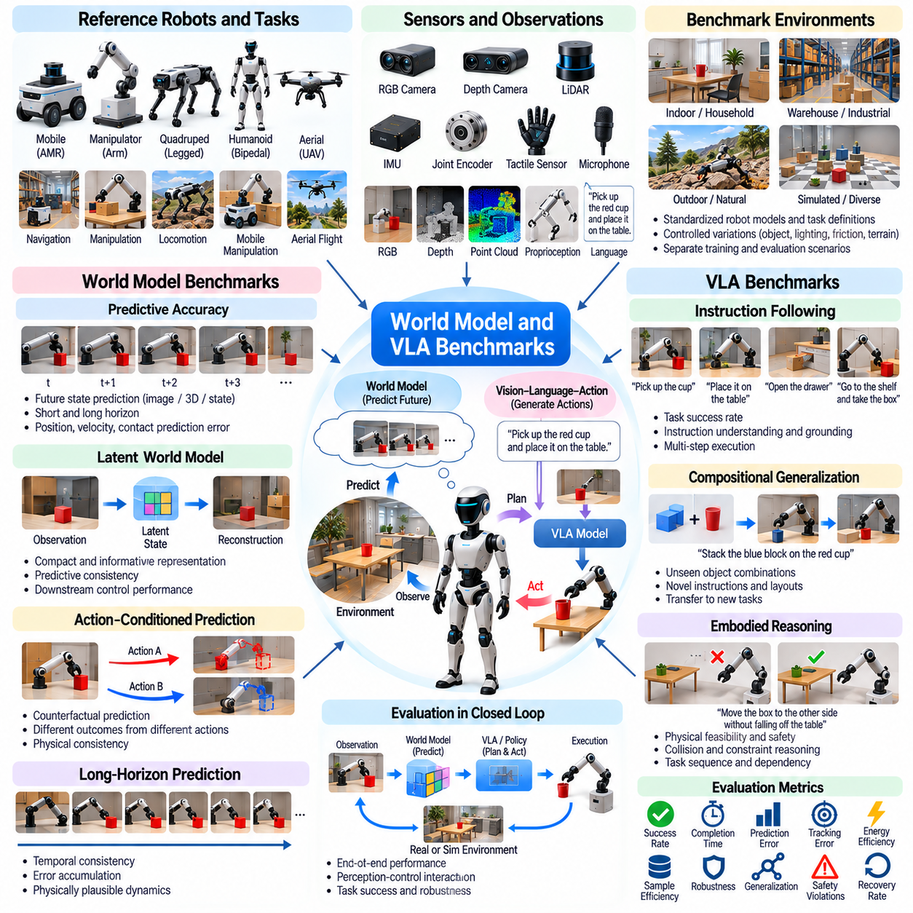{width="7.268055555555556in" height="7.268055555555556in"}

World model and Vision-Language-Action (VLA) benchmarks establish standardized methods for evaluating robotic systems that predict environmental dynamics, interpret multimodal information, and generate physical actions. World models represent how environments evolve under different actions, while VLA models connect visual observations and language instructions to robot behavior. These benchmarks assess prediction quality, task execution, generalization, robustness, and safety.

World model benchmarks evaluate whether learned representations capture the physical structure and temporal evolution of robotic environments. Models may predict future observations, latent states, object motion, or contact outcomes from current conditions and candidate actions. Accurate predictions should preserve relationships between robot movements and environmental changes. Evaluation must distinguish visually plausible predictions from physically consistent dynamics.

Reference benchmark environments should provide standardized robot configurations, object properties, observation modalities, and task definitions. Manipulation, navigation, locomotion, and mobile manipulation scenarios expose different requirements for predictive reasoning. Controlled variations in geometry, friction, lighting, and object placement support systematic testing. Training environments and evaluation scenarios must remain separate to assess generalization reliably.

Predictive accuracy benchmarks measure how closely world model outputs match observed future states. Evaluation may compare predicted object positions, robot configurations, velocities, and contact events against ground-truth trajectories. Prediction horizons should range from immediate transitions to extended action sequences. Error growth over time reveals whether models maintain useful physical predictions beyond short-term observation matching.

Latent world model benchmarks examine representations that compress high-dimensional sensor observations into compact internal states. Effective latent representations should preserve information necessary for prediction, planning, and control. Reconstruction quality alone is insufficient because visually accurate representations may omit important physical variables. Evaluation should measure predictive consistency, task relevance, representation stability, and downstream control performance.

Action-conditioned prediction benchmarks assess whether world models correctly represent the consequences of alternative robot actions. Identical initial observations may lead to different outcomes depending on applied forces, motion commands, or contact decisions. Standardized counterfactual scenarios should vary actions while controlling initial conditions. Evaluation should compare predicted outcomes with executed trajectories and identify physically inconsistent responses.

Long-horizon prediction benchmarks investigate whether models maintain coherent environmental dynamics across extended time intervals. Small prediction errors can accumulate, producing unrealistic object motion, incorrect contact states, or unstable simulated trajectories. Benchmark protocols should measure temporal consistency, error accumulation, and preservation of physical constraints. Results should distinguish short-horizon accuracy from sustained predictive reliability.

Planning-oriented world model benchmarks evaluate whether learned dynamics improve action selection and task completion. Robots may simulate candidate trajectories, estimate future outcomes, and select actions that satisfy task objectives. A model with moderate prediction error may still support effective planning if relevant consequences are represented accurately. Evaluation should include planning success, computational cost, prediction uncertainty, and real execution performance.

VLA benchmarks examine how robotic systems translate visual observations and natural-language instructions into executable actions. Representative tasks include object retrieval, placement, tool use, navigation, and multi-step manipulation. Instructions may specify target objects, spatial relationships, and operational constraints. Evaluation should measure instruction understanding, action grounding, task completion, and consistency between requested goals and executed behavior.

Language grounding benchmarks assess whether VLA models associate linguistic expressions with the correct objects, locations, and actions. Ambiguous descriptions, relational instructions, and multiple similar objects create challenging conditions. Standardized scenarios should vary vocabulary, object arrangement, and linguistic complexity. Evaluation metrics should distinguish semantic misunderstanding from visual recognition errors and physical execution failures.

Compositional generalization benchmarks test whether models can combine previously learned concepts into unfamiliar task configurations. A robot may understand individual actions such as opening, grasping, and placing but struggle when these actions appear in new sequences. Evaluation should include unseen object combinations, novel instructions, and rearranged environments. Success rates reveal whether models learn transferable relationships rather than memorized demonstrations.

Embodied reasoning benchmarks examine whether model predictions and language understanding remain grounded in physical feasibility. Instructions may require reasoning about reachability, object support, collision risks, or manipulation order. Correct language interpretation does not guarantee executable behavior. Benchmark scenarios should assess whether generated actions respect geometric constraints, contact conditions, actuator limits, and task dependencies.

Multimodal integration benchmarks evaluate how visual, linguistic, proprioceptive, and tactile information contribute to robotic decisions. Missing observations, conflicting sensor signals, and delayed feedback can expose weaknesses in learned representations. Standardized perturbations should vary modality availability and reliability. Evaluation should measure task degradation, uncertainty awareness, and recovery when individual information sources become unreliable.

Closed-loop VLA benchmarks assess whether models adapt their actions using feedback from ongoing execution. Open-loop action sequences may fail when objects move unexpectedly or contact outcomes differ from predictions. Closed-loop evaluation should introduce controlled disturbances and changing task states. Recovery success, correction latency, action consistency, and final task completion indicate whether policies can respond effectively to environmental feedback.

Long-horizon VLA benchmarks evaluate complex tasks requiring multiple dependent decisions and sustained context understanding. A robot may navigate to a workstation, identify equipment, manipulate several objects, and verify completion. Errors in grounding or action execution can propagate across the sequence. Evaluation should measure complete mission success, subtask ordering, intervention frequency, and recovery from intermediate failures.

Data efficiency benchmarks investigate how world models and VLA policies improve with increasing training data. Robot demonstrations, human videos, simulated trajectories, and language annotations provide different forms of supervision. Dataset size alone does not determine learning quality because diversity and physical relevance also matter. Benchmark reports should relate performance to data volume, coverage, annotation requirements, and computational resources.

Simulation-based benchmarks support controlled testing of predictive models and multimodal policies across diverse environments. Randomized objects, lighting, physical parameters, and task instructions enable systematic generalization studies. Ground-truth states allow detailed analysis of prediction and action errors. However, unrealistic physics or simplified language tasks can inflate results, making benchmark realism and independent testing essential.

Sim2Real benchmarks assess whether world models and VLA policies remain effective when deployed on physical robots. Sensor characteristics, contact dynamics, actuator behavior, and environmental variability may differ from simulation. Matched evaluation scenarios should compare prediction accuracy, instruction following, task completion, and recovery behavior. Physical trials reveal whether simulated reasoning translates into dependable embodied action.

Safety benchmarks evaluate whether models recognize physical risks and avoid generating hazardous actions. Incorrect predictions, ambiguous instructions, and overconfident decisions may cause collisions, excessive forces, or unsafe task execution. Benchmark protocols should include constraint violations, uncertainty-sensitive decisions, and emergency intervention scenarios. Safety performance must be reported independently from task success.

Evaluation fairness requires transparent reporting of training sources, pretrained components, robot embodiments, and computational budgets. Large multimodal models may benefit from extensive external datasets unavailable to smaller systems. Benchmark datasets should control contamination and identify overlapping training examples where possible. Comparisons should distinguish model capability from advantages in data access, hardware, and prior knowledge.

Statistical reporting should include repeated trials across task categories, difficulty levels, and environmental variations. Prediction errors, task success rates, uncertainty calibration, latency, and failure categories provide complementary evidence. Confidence intervals and evaluation seeds support reproducibility. Reports should distinguish failures originating in prediction, language grounding, planning, perception, and physical control.

Ultimately, world model and VLA benchmarks provide a unified framework for evaluating predictive and instruction-driven Physical AI. Their purpose extends beyond accurate future observations or language-conditioned actions to measuring physically grounded reasoning, adaptive execution, generalization, and safety. Standardized environments, integrated evaluation, transparent reporting, and Sim2Real validation support progress toward reliable general-purpose robotic intelligence.

월드 모델 및 시각-언어-행동 벤치마크(World Model and Vision-Language-Action Benchmarks)는 환경 동역학(Environmental Dynamics)을 예측하고, 다중모달 정보(Multimodal Information)를 해석하며, 물리적 행동(Physical Actions)을 생성하는 로봇 시스템(Robotic Systems)을 평가하기 위한 표준화된 방법을 수립한다. 월드 모델(World Models)은 다양한 행동에 따라 환경이 어떻게 변화하는지 표현하며, 시각-언어-행동 모델(Vision-Language-Action Models, VLA Models)은 시각적 관측(Visual Observations)과 언어 명령(Language Instructions)을 로봇 행동(Robot Behavior)에 연결한다. 이러한 벤치마크는 예측 품질(Prediction Quality), 작업 실행(Task Execution), 일반화(Generalization), 강건성(Robustness), 안전성(Safety)을 평가한다.

월드 모델 벤치마크(World Model Benchmarks)는 학습된 표현(Learned Representations)이 로봇 환경의 물리적 구조(Physical Structure)와 시간적 변화(Temporal Evolution)를 얼마나 정확하게 포착하는지 평가한다. 모델은 현재 조건(Current Conditions)과 후보 행동(Candidate Actions)을 바탕으로 미래 관측(Future Observations), 잠재 상태(Latent States), 객체 움직임(Object Motion), 접촉 결과(Contact Outcomes)를 예측할 수 있다. 정확한 예측(Accurate Predictions)은 로봇 움직임(Robot Movements)과 환경 변화(Environmental Changes) 사이의 관계를 유지해야 한다. 평가에서는 시각적으로 그럴듯한 예측(Visually Plausible Predictions)과 물리적으로 일관된 동역학(Physically Consistent Dynamics)을 구분해야 한다.

참조 벤치마크 환경(Reference Benchmark Environments)은 표준화된 로봇 구성(Robot Configurations), 객체 속성(Object Properties), 관측 모달리티(Observation Modalities), 작업 정의(Task Definitions)를 제공해야 한다. 조작(Manipulation), 내비게이션(Navigation), 보행(Locomotion), 모바일 매니퓰레이션(Mobile Manipulation) 시나리오는 예측 추론(Predictive Reasoning)에 대한 서로 다른 요구사항을 드러낸다. 기하학적 형상(Geometry), 마찰(Friction), 조명(Lighting), 객체 배치(Object Placement)를 통제된 방식으로 변화시키면 체계적인 시험(Systematic Testing)이 가능하다. 일반화(Generalization)를 신뢰성 있게 평가하려면 학습 환경(Training Environments)과 평가 시나리오(Evaluation Scenarios)를 분리해야 한다.

예측 정확도 벤치마크(Predictive Accuracy Benchmarks)는 월드 모델 출력(World Model Outputs)이 실제로 관측된 미래 상태(Observed Future States)와 얼마나 일치하는지 측정한다. 평가에서는 예측된 객체 위치(Predicted Object Positions), 로봇 구성(Robot Configurations), 속도(Velocities), 접촉 이벤트(Contact Events)를 실제 기준 궤적(Ground-Truth Trajectories)과 비교할 수 있다. 예측 구간(Prediction Horizons)은 즉각적인 상태 전이(Immediate Transitions)부터 장시간의 행동 시퀀스(Extended Action Sequences)까지 포함해야 한다. 시간에 따른 오차 증가(Error Growth)는 모델이 단기 관측 일치(Short-Term Observation Matching)를 넘어 유용한 물리적 예측(Physical Predictions)을 유지하는지 보여준다.

잠재 월드 모델 벤치마크(Latent World Model Benchmarks)는 고차원 센서 관측(High-Dimensional Sensor Observations)을 압축된 내부 상태(Compact Internal States)로 변환하는 표현을 평가한다. 효과적인 잠재 표현(Latent Representations)은 예측(Prediction), 계획(Planning), 제어(Control)에 필요한 정보를 보존해야 한다. 시각적으로 정확한 표현(Visually Accurate Representations)이라도 중요한 물리적 변수(Physical Variables)를 누락할 수 있으므로 재구성 품질(Reconstruction Quality)만으로는 충분하지 않다. 평가에서는 예측 일관성(Predictive Consistency), 작업 관련성(Task Relevance), 표현 안정성(Representation Stability), 후속 제어 성능(Downstream Control Performance)을 측정해야 한다.

행동 조건부 예측 벤치마크(Action-Conditioned Prediction Benchmarks)는 월드 모델(World Models)이 서로 다른 로봇 행동(Robot Actions)의 결과를 올바르게 표현하는지 평가한다. 동일한 초기 관측(Initial Observations)이라도 적용된 힘(Applied Forces), 운동 명령(Motion Commands), 접촉 결정(Contact Decisions)에 따라 서로 다른 결과가 나타날 수 있다. 표준화된 반사실적 시나리오(Standardized Counterfactual Scenarios)는 초기 조건(Initial Conditions)을 통제하면서 행동을 변화시켜야 한다. 평가에서는 예측 결과(Predicted Outcomes)를 실제 실행 궤적(Executed Trajectories)과 비교하고 물리적으로 일관되지 않은 응답(Physically Inconsistent Responses)을 식별해야 한다.

장기 예측 벤치마크(Long-Horizon Prediction Benchmarks)는 모델이 긴 시간 구간(Extended Time Intervals)에 걸쳐 일관된 환경 동역학(Coherent Environmental Dynamics)을 유지하는지 조사한다. 작은 예측 오차(Prediction Errors)가 누적되면 비현실적인 객체 움직임(Unrealistic Object Motion), 부정확한 접촉 상태(Incorrect Contact States), 불안정한 시뮬레이션 궤적(Unstable Simulated Trajectories)이 발생할 수 있다. 벤치마크 프로토콜(Benchmark Protocols)은 시간적 일관성(Temporal Consistency), 오차 누적(Error Accumulation), 물리적 제약 유지(Preservation of Physical Constraints)를 측정해야 한다. 평가 결과는 단기 예측 정확도(Short-Horizon Accuracy)와 지속적인 예측 신뢰성(Sustained Predictive Reliability)을 구분해야 한다.

계획 중심 월드 모델 벤치마크(Planning-Oriented World Model Benchmarks)는 학습된 동역학(Learned Dynamics)이 행동 선택(Action Selection)과 작업 완료(Task Completion)를 개선하는지 평가한다. 로봇은 후보 궤적(Candidate Trajectories)을 시뮬레이션하고, 미래 결과(Future Outcomes)를 추정하며, 작업 목표(Task Objectives)를 충족하는 행동을 선택할 수 있다. 예측 오차(Prediction Error)가 어느 정도 존재하는 모델이라도 중요한 결과를 정확하게 표현한다면 효과적인 계획(Effective Planning)을 지원할 수 있다. 평가에는 계획 성공률(Planning Success), 계산 비용(Computational Cost), 예측 불확실성(Prediction Uncertainty), 실제 실행 성능(Real Execution Performance)이 포함되어야 한다.

시각-언어-행동 벤치마크(Vision-Language-Action Benchmarks, VLA Benchmarks)는 로봇 시스템이 시각적 관측(Visual Observations)과 자연어 명령(Natural-Language Instructions)을 실행 가능한 행동(Executable Actions)으로 변환하는 과정을 평가한다. 대표적인 작업에는 객체 가져오기(Object Retrieval), 배치(Placement), 도구 사용(Tool Use), 내비게이션(Navigation), 다단계 조작(Multi-Step Manipulation)이 포함된다. 명령에는 대상 객체(Target Objects), 공간적 관계(Spatial Relationships), 운영 제약(Operational Constraints)이 명시될 수 있다. 평가에서는 명령 이해(Instruction Understanding), 행동 그라운딩(Action Grounding), 작업 완료(Task Completion), 요청된 목표(Requested Goals)와 실행된 행동(Executed Behavior) 사이의 일관성을 측정해야 한다.

언어 그라운딩 벤치마크(Language Grounding Benchmarks)는 VLA 모델(VLA Models)이 언어적 표현(Linguistic Expressions)을 올바른 객체(Objects), 위치(Locations), 행동(Actions)과 연결하는지 평가한다. 모호한 설명(Ambiguous Descriptions), 관계형 명령(Relational Instructions), 유사한 객체(Multiple Similar Objects)는 어려운 조건을 만든다. 표준화된 시나리오(Standardized Scenarios)는 어휘(Vocabulary), 객체 배치(Object Arrangement), 언어적 복잡성(Linguistic Complexity)을 변화시켜야 한다. 평가 지표(Evaluation Metrics)는 의미적 오해(Semantic Misunderstanding)를 시각적 인식 오류(Visual Recognition Errors) 및 물리적 실행 실패(Physical Execution Failures)와 구분해야 한다.

조합적 일반화 벤치마크(Compositional Generalization Benchmarks)는 모델이 이전에 학습한 개념(Previously Learned Concepts)을 새로운 작업 구성(Unfamiliar Task Configurations)으로 결합할 수 있는지 시험한다. 로봇은 열기(Opening), 파지(Grasping), 배치(Placing)와 같은 개별 행동을 이해하더라도 이러한 행동이 새로운 순서(New Sequences)로 등장하면 어려움을 겪을 수 있다. 평가에는 처음 접하는 객체 조합(Unseen Object Combinations), 새로운 명령(Novel Instructions), 재배치된 환경(Rearranged Environments)이 포함되어야 한다. 성공률(Success Rates)은 모델이 암기된 시연(Memorized Demonstrations)이 아니라 전이 가능한 관계(Transferable Relationships)를 학습했는지 보여준다.

체화 추론 벤치마크(Embodied Reasoning Benchmarks)는 모델 예측(Model Predictions)과 언어 이해(Language Understanding)가 물리적 실행 가능성(Physical Feasibility)에 기반하는지 평가한다. 명령에는 도달 가능성(Reachability), 객체 지지(Object Support), 충돌 위험(Collision Risks), 조작 순서(Manipulation Order)에 관한 추론이 필요할 수 있다. 올바른 언어 해석(Correct Language Interpretation)이 실행 가능한 행동(Executable Behavior)을 보장하지는 않는다. 벤치마크 시나리오(Benchmark Scenarios)는 생성된 행동(Generated Actions)이 기하학적 제약(Geometric Constraints), 접촉 조건(Contact Conditions), 액추에이터 한계(Actuator Limits), 작업 의존성(Task Dependencies)을 준수하는지 평가해야 한다.

다중모달 통합 벤치마크(Multimodal Integration Benchmarks)는 시각(Visual), 언어(Linguistic), 고유수용감각(Proprioceptive), 촉각(Tactile) 정보가 로봇 의사결정(Robotic Decisions)에 어떻게 기여하는지 평가한다. 관측 누락(Missing Observations), 상충하는 센서 신호(Conflicting Sensor Signals), 지연된 피드백(Delayed Feedback)은 학습된 표현(Learned Representations)의 약점을 드러낼 수 있다. 표준화된 교란(Standardized Perturbations)은 모달리티 가용성(Modality Availability)과 신뢰성(Reliability)을 변화시켜야 한다. 평가에서는 작업 성능 저하(Task Degradation), 불확실성 인식(Uncertainty Awareness), 개별 정보원(Information Sources)의 신뢰성이 감소했을 때의 복구 능력(Recovery)을 측정해야 한다.

폐루프 VLA 벤치마크(Closed-Loop VLA Benchmarks)는 모델이 진행 중인 실행(Ongoing Execution)에서 얻은 피드백(Feedback)을 이용하여 행동을 조정하는지 평가한다. 개방루프 행동 시퀀스(Open-Loop Action Sequences)는 객체가 예상하지 못하게 움직이거나 접촉 결과(Contact Outcomes)가 예측과 다를 때 실패할 수 있다. 폐루프 평가(Closed-Loop Evaluation)는 통제된 외란(Controlled Disturbances)과 변화하는 작업 상태(Changing Task States)를 도입해야 한다. 복구 성공률(Recovery Success), 수정 지연 시간(Correction Latency), 행동 일관성(Action Consistency), 최종 작업 완료(Final Task Completion)는 정책(Policies)이 환경 피드백(Environmental Feedback)에 효과적으로 대응하는지 나타낸다.

장기 VLA 벤치마크(Long-Horizon VLA Benchmarks)는 여러 상호 의존적인 의사결정(Dependent Decisions)과 지속적인 문맥 이해(Sustained Context Understanding)가 필요한 복잡한 작업(Complex Tasks)을 평가한다. 로봇은 작업대로 이동하고, 장비를 식별하며, 여러 객체를 조작한 다음 완료 여부를 확인할 수 있다. 그라운딩 오류(Grounding Errors)나 행동 실행 오류(Action Execution Errors)는 전체 시퀀스(Sequence)에 걸쳐 전파될 수 있다. 평가에서는 전체 임무 성공률(Complete Mission Success), 하위 작업 순서(Subtask Ordering), 개입 빈도(Intervention Frequency), 중간 단계 실패(Intermediate Failures)로부터의 복구 능력을 측정해야 한다.

데이터 효율성 벤치마크(Data Efficiency Benchmarks)는 학습 데이터(Training Data)가 증가함에 따라 월드 모델(World Models)과 VLA 정책(VLA Policies)이 어떻게 개선되는지 조사한다. 로봇 시연(Robot Demonstrations), 인간 영상(Human Videos), 시뮬레이션 궤적(Simulated Trajectories), 언어 주석(Language Annotations)은 서로 다른 형태의 지도 정보(Supervision)를 제공한다. 데이터셋 크기(Dataset Size)만으로는 학습 품질(Learning Quality)이 결정되지 않으며, 다양성(Diversity)과 물리적 관련성(Physical Relevance)도 중요하다. 벤치마크 보고서(Benchmark Reports)는 성능을 데이터 규모(Data Volume), 데이터 범위(Coverage), 주석 요구사항(Annotation Requirements), 계산 자원(Computational Resources)과 연관 지어 분석해야 한다.

시뮬레이션 기반 벤치마크(Simulation-Based Benchmarks)는 다양한 환경에서 예측 모델(Predictive Models)과 다중모달 정책(Multimodal Policies)을 통제된 방식으로 시험하도록 지원한다. 무작위화된 객체(Randomized Objects), 조명(Lighting), 물리 매개변수(Physical Parameters), 작업 명령(Task Instructions)은 체계적인 일반화 연구(Systematic Generalization Studies)를 가능하게 한다. 실제 기준 상태(Ground-Truth States)는 예측 및 행동 오차(Prediction and Action Errors)에 대한 상세한 분석을 지원한다. 그러나 비현실적인 물리 모델(Unrealistic Physics)이나 단순화된 언어 작업(Simplified Language Tasks)은 성능을 과대평가할 수 있으므로 벤치마크 현실성(Benchmark Realism)과 독립적인 시험(Independent Testing)이 필수적이다.

시뮬레이션-현실 전이 벤치마크(Sim2Real Benchmarks)는 월드 모델(World Models)과 VLA 정책(VLA Policies)이 실제 로봇(Physical Robots)에 배포되었을 때도 효과적으로 작동하는지 평가한다. 센서 특성(Sensor Characteristics), 접촉 동역학(Contact Dynamics), 액추에이터 동작(Actuator Behavior), 환경 변동성(Environmental Variability)은 시뮬레이션과 다를 수 있다. 대응되는 평가 시나리오(Matched Evaluation Scenarios)는 예측 정확도(Prediction Accuracy), 명령 수행(Instruction Following), 작업 완료(Task Completion), 복구 행동(Recovery Behavior)을 비교해야 한다. 실제 로봇 시험(Physical Trials)은 시뮬레이션 기반 추론(Simulated Reasoning)이 신뢰할 수 있는 체화 행동(Dependable Embodied Action)으로 전환되는지 보여준다.

안전성 벤치마크(Safety Benchmarks)는 모델이 물리적 위험(Physical Risks)을 인식하고 위험한 행동(Hazardous Actions)의 생성을 회피하는지 평가한다. 부정확한 예측(Incorrect Predictions), 모호한 명령(Ambiguous Instructions), 과도한 확신에 기반한 결정(Overconfident Decisions)은 충돌(Collisions), 과도한 힘(Excessive Forces), 위험한 작업 실행(Unsafe Task Execution)을 유발할 수 있다. 벤치마크 프로토콜(Benchmark Protocols)에는 제약 위반(Constraint Violations), 불확실성을 고려한 의사결정(Uncertainty-Sensitive Decisions), 비상 개입 시나리오(Emergency Intervention Scenarios)가 포함되어야 한다. 안전 성능(Safety Performance)은 작업 성공률(Task Success)과 독립적으로 보고해야 한다.

평가 공정성(Evaluation Fairness)을 확보하려면 학습 데이터 출처(Training Sources), 사전 학습된 구성요소(Pretrained Components), 로봇 체화 형태(Robot Embodiments), 계산 예산(Computational Budgets)을 투명하게 보고해야 한다. 대규모 다중모달 모델(Large Multimodal Models)은 소규모 시스템(Smaller Systems)이 접근할 수 없는 방대한 외부 데이터셋(External Datasets)의 이점을 얻을 수 있다. 벤치마크 데이터셋(Benchmark Datasets)은 데이터 오염(Data Contamination)을 관리하고 가능한 경우 학습 데이터와 중복되는 사례(Overlapping Training Examples)를 식별해야 한다. 비교에서는 모델 자체의 능력(Model Capability)과 데이터 접근성(Data Access), 하드웨어(Hardware), 사전 지식(Prior Knowledge)에서 비롯된 이점을 구분해야 한다.

통계적 보고(Statistical Reporting)에는 작업 범주(Task Categories), 난이도 수준(Difficulty Levels), 환경 변화(Environmental Variations)에 걸친 반복 시험(Repeated Trials)이 포함되어야 한다. 예측 오차(Prediction Errors), 작업 성공률(Task Success Rates), 불확실성 보정(Uncertainty Calibration), 지연 시간(Latency), 실패 유형(Failure Categories)은 상호 보완적인 평가 근거를 제공한다. 신뢰구간(Confidence Intervals)과 평가 난수 시드(Evaluation Seeds)는 재현성(Reproducibility)을 지원한다. 보고서(Reports)는 예측(Prediction), 언어 그라운딩(Language Grounding), 계획(Planning), 인식(Perception), 물리적 제어(Physical Control)에서 발생하는 실패를 구분해야 한다.

궁극적으로 월드 모델 및 VLA 벤치마크(World Model and VLA Benchmarks)는 예측 기반 피지컬 AI(Predictive Physical AI)와 명령 기반 피지컬 AI(Instruction-Driven Physical AI)를 평가하기 위한 통합 프레임워크(Unified Framework)를 제공한다. 그 목적은 정확한 미래 관측(Future Observations)이나 언어 조건부 행동(Language-Conditioned Actions)을 평가하는 데 그치지 않고 물리적 현실에 기반한 추론(Physically Grounded Reasoning), 적응적 실행(Adaptive Execution), 일반화(Generalization), 안전성(Safety)을 측정하는 데 있다. 표준화된 환경(Standardized Environments), 통합 평가(Integrated Evaluation), 투명한 보고(Transparent Reporting), 시뮬레이션-현실 전이 검증(Sim2Real Validation)은 신뢰할 수 있는 범용 로봇 지능(Reliable General-Purpose Robotic Intelligence)의 발전을 지원한다.

##  

## 09.12. Sim2Real and Domain Generalization Benchmarks

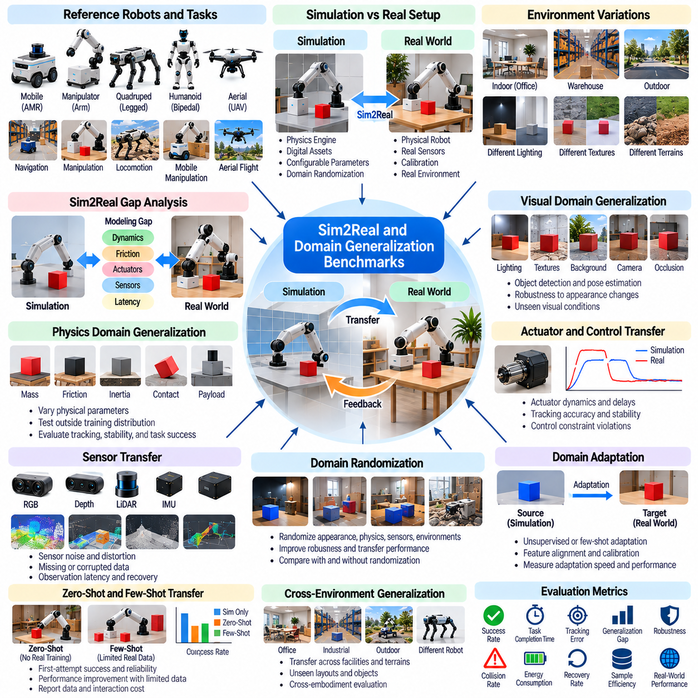{width="7.268055555555556in" height="7.268055555555556in"}

Sim2Real and domain generalization benchmarks establish standardized methods for evaluating whether robotic systems trained in simulation can operate reliably in physical environments and unfamiliar conditions. Sim2Real measures performance transfer between simulated and real systems, while domain generalization examines robustness across changing environments. These benchmarks assess transfer accuracy, task success, adaptability, and safety beyond controlled training conditions.

Benchmark design should distinguish simulation fidelity, transfer effectiveness, and generalization capability. A robot may perform successfully in a high-fidelity simulator yet fail on physical hardware because of unmodeled dynamics or sensing differences. Conversely, a policy trained with simplified physics may generalize effectively through robust representations. Evaluation must therefore measure real-world outcomes rather than assuming that simulation accuracy guarantees successful transfer.

Reference benchmark environments should define consistent robot platforms, sensor configurations, task objectives, and physical operating conditions. Representative tasks include navigation, manipulation, locomotion, and mobile manipulation. Each task should provide corresponding simulation and hardware configurations whenever feasible. Standardized initialization, calibration, termination criteria, and evaluation procedures reduce ambiguity when comparing transfer methods.

Simulation-to-reality gap benchmarks quantify differences between simulated predictions and physical observations. These gaps may originate from geometry, mass distribution, friction, contact dynamics, actuator response, sensor noise, or communication latency. Matched experiments should apply comparable commands under equivalent initial conditions. Trajectory deviation, force error, timing differences, and task performance provide complementary measurements of model mismatch.

Visual domain generalization benchmarks evaluate whether perception systems remain effective across changing appearance conditions. Lighting, textures, reflections, backgrounds, camera properties, and object appearances may differ substantially between simulation and deployment. Evaluation should separate familiar visual variations from previously unseen conditions. Detection accuracy, localization error, uncertainty calibration, and downstream task success indicate practical generalization.

Physics domain generalization benchmarks examine robustness to changes in mechanical and environmental parameters. Variations in mass, inertia, friction, restitution, joint damping, and contact compliance affect robot behavior. Benchmark scenarios should include parameter combinations outside the training distribution. Tracking accuracy, stability, energy consumption, and task completion reveal whether learned policies depend excessively on nominal physical assumptions.

Actuator and control transfer benchmarks assess whether simulated control commands produce comparable physical responses. Real actuators exhibit torque limits, backlash, thermal effects, dead zones, and response delays that may be simplified in simulation. Standardized command sequences should include acceleration, reversal, sustained loading, and transient disturbances. Evaluation should measure response error, tracking stability, control effort, and actuator constraint violations.

Sensor transfer benchmarks investigate discrepancies between synthetic observations and real sensor measurements. Camera exposure, lens distortion, depth noise, LiDAR returns, inertial bias, and synchronization errors can influence perception and control. Controlled sensor degradation enables systematic comparison. Evaluation should consider estimation accuracy, inference stability, observation latency, and recovery from missing or corrupted measurements.

Domain randomization benchmarks evaluate whether training across diverse simulated conditions improves physical deployment. Randomized parameters may include lighting, object geometry, friction, payload, sensor noise, and actuator dynamics. Randomization ranges should reflect plausible uncertainty while permitting controlled stress testing. Benchmark reports should compare transfer performance against randomization coverage, computational cost, and training stability.

Domain adaptation benchmarks assess methods that adjust models using information from a target environment. Adaptation may involve feature alignment, sensor calibration, parameter identification, or limited real-world fine-tuning. Evaluation should distinguish unsupervised adaptation from methods requiring labeled data or expert intervention. Adaptation speed, target-domain performance, data requirements, and retained source-domain capability provide useful comparisons.

Zero-shot transfer benchmarks examine whether policies can operate on physical robots without task-specific real-world adaptation. This setting tests whether simulation training has produced sufficiently robust behavior for immediate deployment. Evaluation should strictly document any hardware calibration or prior real-world information. First-attempt success, safety interventions, performance degradation, and repeated-trial reliability indicate the strength of zero-shot transfer.

Few-shot adaptation benchmarks evaluate how efficiently robotic systems improve after limited physical experience. A small number of real-world demonstrations, calibration trials, or interaction episodes may correct simulation-induced errors. Benchmark protocols should establish explicit adaptation budgets. Performance gains should be reported against physical interaction time, data volume, computational resources, and safety risks during adaptation.

Cross-environment generalization benchmarks investigate performance across facilities, terrains, workspaces, and operating conditions. A navigation policy trained in one warehouse may encounter different aisle layouts, lighting, obstacles, and floor surfaces elsewhere. Manipulation policies may face unfamiliar objects or fixtures. Evaluation should measure task success across distinct environments while documenting the degree of overlap with training conditions.

Cross-robot generalization benchmarks assess whether learned capabilities transfer between different robotic embodiments. Differences in kinematics, actuator characteristics, sensor placement, and payload capacity can invalidate assumptions embedded in a policy. Benchmark tasks should identify shared objectives while respecting platform-specific constraints. Transfer success, required adaptation, performance retention, and safety provide indicators of embodiment generalization.

Compositional generalization benchmarks evaluate whether robots can handle unfamiliar combinations of previously encountered conditions. A system may tolerate unusual lighting or altered friction separately but fail when both occur simultaneously. Benchmark matrices should include controlled combinations of visual, physical, and task variations. Performance across combined shifts reveals interactions that isolated robustness tests may overlook.

Long-horizon Sim2Real benchmarks examine whether transfer reliability persists during extended task execution. Small errors in localization, contact estimation, or actuator response can accumulate across repeated actions. Representative scenarios include continuous navigation, multi-object manipulation, and sustained locomotion. Evaluation should measure mission completion, accumulated error, intervention frequency, and recovery from unexpected events.

Safety and failure recovery benchmarks evaluate robotic behavior when transfer assumptions become invalid. Unexpected collisions, unstable contact, sensor failures, and actuator saturation may create hazardous conditions. Standardized tests should define safe operating limits, intervention mechanisms, and termination procedures. Safety metrics include constraint violations, near misses, recovery time, and successful transition to safe states.

Benchmark automation supports reproducible testing across many simulation parameters and physical operating conditions. Automated pipelines can configure environments, deploy policies, execute trials, collect telemetry, and generate standardized reports. Hardware testing additionally requires calibration checks and controlled reset procedures. Version tracking should associate every result with simulator settings, robot configuration, policy checkpoints, and evaluation datasets.

Statistical evaluation should use repeated trials across independent random seeds, environmental variations, and physical test sessions. Average success rates alone may conceal rare but consequential failures. Reports should include variability, confidence intervals, worst-case outcomes, and categorized failure mechanisms. Comparisons should also disclose training budgets, adaptation data, simulator versions, and differences in hardware calibration.

A comprehensive benchmark framework should separate simulation-only performance, direct physical transfer, post-adaptation performance, and unseen-domain generalization. These categories represent distinct capabilities and should not be combined into a single score without transparent weighting. Performance matrices across tasks and domain shifts reveal where methods succeed or fail. Such reporting supports meaningful comparisons between simulation strategies and transfer algorithms.

Ultimately, Sim2Real and domain generalization benchmarks provide a systematic foundation for evaluating whether Physical AI systems remain dependable beyond their training environments. Their purpose extends beyond minimizing simulation error to measuring reliable behavior under physical uncertainty and distribution shift. Standardized paired experiments, independent domain testing, transparent reporting, and safety validation support scalable deployment of adaptable robotic intelligence.

시뮬레이션-현실 전이 및 도메인 일반화 벤치마크(Sim2Real and Domain Generalization Benchmarks)는 시뮬레이션에서 학습된 로봇 시스템(Robotic Systems)이 실제 물리 환경(Physical Environments)과 익숙하지 않은 조건(Unfamiliar Conditions)에서도 신뢰성 있게 작동할 수 있는지 평가하기 위한 표준화된 방법을 수립한다. 시뮬레이션-현실 전이(Sim2Real)는 시뮬레이션 시스템과 실제 시스템 사이의 성능 전이(Performance Transfer)를 측정하며, 도메인 일반화(Domain Generalization)는 변화하는 환경에서의 강건성(Robustness)을 평가한다. 이러한 벤치마크는 통제된 학습 조건(Controlled Training Conditions)을 벗어난 상황에서 전이 정확도(Transfer Accuracy), 작업 성공률(Task Success), 적응성(Adaptability), 안전성(Safety)을 평가한다.

벤치마크 설계(Benchmark Design)는 시뮬레이션 충실도(Simulation Fidelity), 전이 효과(Transfer Effectiveness), 일반화 능력(Generalization Capability)을 구분해야 한다. 로봇은 고충실도 시뮬레이터(High-Fidelity Simulator)에서 성공적으로 작동하더라도 모델링되지 않은 동역학(Unmodeled Dynamics)이나 센싱 차이(Sensing Differences) 때문에 실제 하드웨어(Physical Hardware)에서 실패할 수 있다. 반대로 단순화된 물리 모델(Simplified Physics)로 학습된 정책(Policy)은 강건한 표현(Robust Representations)을 통해 효과적으로 일반화할 수 있다. 따라서 평가에서는 시뮬레이션 정확도(Simulation Accuracy)가 성공적인 전이(Successful Transfer)를 보장한다고 가정하지 않고 실제 환경에서의 결과(Real-World Outcomes)를 측정해야 한다.

참조 벤치마크 환경(Reference Benchmark Environments)은 일관된 로봇 플랫폼(Robot Platforms), 센서 구성(Sensor Configurations), 작업 목표(Task Objectives), 물리적 운영 조건(Physical Operating Conditions)을 정의해야 한다. 대표적인 작업에는 내비게이션(Navigation), 조작(Manipulation), 보행(Locomotion), 모바일 매니퓰레이션(Mobile Manipulation)이 포함된다. 각 작업은 가능한 경우 서로 대응되는 시뮬레이션 및 하드웨어 구성(Simulation and Hardware Configurations)을 제공해야 한다. 표준화된 초기화(Standardized Initialization), 보정(Calibration), 종료 기준(Termination Criteria), 평가 절차(Evaluation Procedures)는 전이 방법(Transfer Methods)을 비교할 때 발생하는 모호성을 줄인다.

시뮬레이션-현실 격차 벤치마크(Simulation-to-Reality Gap Benchmarks)는 시뮬레이션 예측(Simulated Predictions)과 실제 물리적 관측(Physical Observations) 사이의 차이를 정량화한다. 이러한 격차는 기하학적 형상(Geometry), 질량 분포(Mass Distribution), 마찰(Friction), 접촉 동역학(Contact Dynamics), 액추에이터 응답(Actuator Response), 센서 잡음(Sensor Noise), 통신 지연(Communication Latency)에서 발생할 수 있다. 대응 실험(Matched Experiments)은 동등한 초기 조건(Equivalent Initial Conditions)에서 비교 가능한 명령(Comparable Commands)을 적용해야 한다. 궤적 편차(Trajectory Deviation), 힘 오차(Force Error), 타이밍 차이(Timing Differences), 작업 성능(Task Performance)은 모델 불일치(Model Mismatch)를 측정하는 상호 보완적인 지표를 제공한다.

시각적 도메인 일반화 벤치마크(Visual Domain Generalization Benchmarks)는 외관 조건(Appearance Conditions)이 변화할 때 인식 시스템(Perception Systems)이 효과적으로 작동하는지 평가한다. 조명(Lighting), 텍스처(Textures), 반사(Reflections), 배경(Backgrounds), 카메라 특성(Camera Properties), 객체 외관(Object Appearances)은 시뮬레이션과 실제 배포 환경(Deployment Environments) 사이에서 상당한 차이를 보일 수 있다. 평가에서는 익숙한 시각적 변화(Familiar Visual Variations)와 이전에 경험하지 못한 조건(Previously Unseen Conditions)을 구분해야 한다. 탐지 정확도(Detection Accuracy), 위치 추정 오차(Localization Error), 불확실성 보정(Uncertainty Calibration), 후속 작업 성공률(Downstream Task Success)은 실제적인 일반화 능력을 나타낸다.

물리 도메인 일반화 벤치마크(Physics Domain Generalization Benchmarks)는 기계적 및 환경적 매개변수(Mechanical and Environmental Parameters)의 변화에 대한 강건성(Robustness)을 평가한다. 질량(Mass), 관성(Inertia), 마찰(Friction), 반발계수(Restitution), 관절 감쇠(Joint Damping), 접촉 순응성(Contact Compliance)의 변화는 로봇 행동(Robot Behavior)에 영향을 미친다. 벤치마크 시나리오(Benchmark Scenarios)에는 학습 분포(Training Distribution)를 벗어나는 매개변수 조합(Parameter Combinations)이 포함되어야 한다. 추종 정확도(Tracking Accuracy), 안정성(Stability), 에너지 소비(Energy Consumption), 작업 완료(Task Completion)는 학습된 정책(Learned Policies)이 명목상 물리 가정(Nominal Physical Assumptions)에 과도하게 의존하는지 보여준다.

액추에이터 및 제어 전이 벤치마크(Actuator and Control Transfer Benchmarks)는 시뮬레이션 제어 명령(Simulated Control Commands)이 실제 물리적 응답(Physical Responses)과 유사한 결과를 생성하는지 평가한다. 실제 액추에이터(Real Actuators)는 시뮬레이션에서 단순화될 수 있는 토크 한계(Torque Limits), 백래시(Backlash), 열적 영향(Thermal Effects), 데드존(Dead Zones), 응답 지연(Response Delays)을 가진다. 표준화된 명령 시퀀스(Standardized Command Sequences)에는 가속(Acceleration), 방향 반전(Reversal), 지속 하중(Sustained Loading), 과도 외란(Transient Disturbances)이 포함되어야 한다. 평가에서는 응답 오차(Response Error), 추종 안정성(Tracking Stability), 제어 입력 크기(Control Effort), 액추에이터 제약 위반(Actuator Constraint Violations)을 측정해야 한다.

센서 전이 벤치마크(Sensor Transfer Benchmarks)는 합성 관측(Synthetic Observations)과 실제 센서 측정값(Real Sensor Measurements) 사이의 불일치를 조사한다. 카메라 노출(Camera Exposure), 렌즈 왜곡(Lens Distortion), 깊이 잡음(Depth Noise), 라이다 반사 신호(LiDAR Returns), 관성 센서 편향(Inertial Bias), 동기화 오차(Synchronization Errors)는 인식(Perception)과 제어(Control)에 영향을 미칠 수 있다. 통제된 센서 성능 저하(Controlled Sensor Degradation)는 체계적인 비교(Systematic Comparison)를 가능하게 한다. 평가에서는 추정 정확도(Estimation Accuracy), 추론 안정성(Inference Stability), 관측 지연 시간(Observation Latency), 누락되거나 손상된 측정값(Missing or Corrupted Measurements)으로부터의 복구 능력을 고려해야 한다.

도메인 무작위화 벤치마크(Domain Randomization Benchmarks)는 다양한 시뮬레이션 조건(Simulated Conditions)에서의 학습이 실제 환경 배포(Physical Deployment)를 개선하는지 평가한다. 무작위화된 매개변수(Randomized Parameters)에는 조명(Lighting), 객체 형상(Object Geometry), 마찰(Friction), 적재 하중(Payload), 센서 잡음(Sensor Noise), 액추에이터 동역학(Actuator Dynamics)이 포함될 수 있다. 무작위화 범위(Randomization Ranges)는 통제된 스트레스 시험(Controlled Stress Testing)을 허용하면서 현실적으로 발생 가능한 불확실성(Plausible Uncertainty)을 반영해야 한다. 벤치마크 보고서(Benchmark Reports)는 전이 성능(Transfer Performance)을 무작위화 범위(Randomization Coverage), 계산 비용(Computational Cost), 학습 안정성(Training Stability)과 비교해야 한다.

도메인 적응 벤치마크(Domain Adaptation Benchmarks)는 대상 환경(Target Environment)의 정보를 이용하여 모델을 조정하는 방법을 평가한다. 적응(Adaptation)에는 특징 정렬(Feature Alignment), 센서 보정(Sensor Calibration), 매개변수 식별(Parameter Identification), 제한적인 실제 환경 미세조정(Limited Real-World Fine-Tuning)이 포함될 수 있다. 평가에서는 비지도 적응(Unsupervised Adaptation)과 레이블이 지정된 데이터(Labeled Data) 또는 전문가 개입(Expert Intervention)이 필요한 방법을 구분해야 한다. 적응 속도(Adaptation Speed), 대상 도메인 성능(Target-Domain Performance), 데이터 요구사항(Data Requirements), 원본 도메인 능력 유지(Retained Source-Domain Capability)는 유용한 비교 기준을 제공한다.

제로샷 전이 벤치마크(Zero-Shot Transfer Benchmarks)는 작업별 실제 환경 적응(Task-Specific Real-World Adaptation) 없이 정책(Policies)이 실제 로봇(Physical Robots)에서 작동할 수 있는지 평가한다. 이러한 설정은 시뮬레이션 학습(Simulation Training)이 즉각적인 배포(Immediate Deployment)에 충분할 만큼 강건한 행동(Robust Behavior)을 생성했는지 시험한다. 평가에서는 하드웨어 보정(Hardware Calibration)이나 사전에 확보한 실제 환경 정보(Prior Real-World Information)를 엄격하게 문서화해야 한다. 최초 시도 성공률(First-Attempt Success), 안전 개입(Safety Interventions), 성능 저하(Performance Degradation), 반복 시험 신뢰성(Repeated-Trial Reliability)은 제로샷 전이(Zero-Shot Transfer)의 효과를 나타낸다.

퓨샷 적응 벤치마크(Few-Shot Adaptation Benchmarks)는 제한된 실제 물리적 경험(Limited Physical Experience) 이후 로봇 시스템이 얼마나 효율적으로 성능을 개선하는지 평가한다. 소수의 실제 환경 시연(Real-World Demonstrations), 보정 시험(Calibration Trials), 상호작용 에피소드(Interaction Episodes)는 시뮬레이션으로 인해 발생한 오차(Simulation-Induced Errors)를 수정할 수 있다. 벤치마크 프로토콜(Benchmark Protocols)은 명시적인 적응 예산(Adaptation Budgets)을 설정해야 한다. 성능 향상(Performance Gains)은 물리적 상호작용 시간(Physical Interaction Time), 데이터 규모(Data Volume), 계산 자원(Computational Resources), 적응 중 안전 위험(Safety Risks)을 기준으로 보고해야 한다.

환경 간 일반화 벤치마크(Cross-Environment Generalization Benchmarks)는 서로 다른 시설(Facilities), 지형(Terrains), 작업 공간(Workspaces), 운영 조건(Operating Conditions)에서의 성능을 조사한다. 하나의 창고에서 학습된 내비게이션 정책(Navigation Policy)은 다른 장소에서 서로 다른 통로 배치(Aisle Layouts), 조명(Lighting), 장애물(Obstacles), 바닥 표면(Floor Surfaces)을 경험할 수 있다. 조작 정책(Manipulation Policies)은 익숙하지 않은 객체(Unfamiliar Objects)나 고정 장치(Fixtures)를 다루어야 할 수 있다. 평가에서는 학습 조건(Training Conditions)과의 중복 정도(Degree of Overlap)를 문서화하면서 서로 다른 환경에서의 작업 성공률(Task Success)을 측정해야 한다.

로봇 간 일반화 벤치마크(Cross-Robot Generalization Benchmarks)는 학습된 능력(Learned Capabilities)이 서로 다른 로봇 체화 형태(Robotic Embodiments) 사이에서 전이될 수 있는지 평가한다. 운동학(Kinematics), 액추에이터 특성(Actuator Characteristics), 센서 배치(Sensor Placement), 적재 용량(Payload Capacity)의 차이는 정책(Policy)에 내재된 가정(Assumptions)을 무효화할 수 있다. 벤치마크 작업(Benchmark Tasks)은 플랫폼별 제약(Platform-Specific Constraints)을 준수하면서 공통 목표(Shared Objectives)를 식별해야 한다. 전이 성공률(Transfer Success), 필요한 적응(Required Adaptation), 성능 유지(Performance Retention), 안전성(Safety)은 체화 형태 일반화(Embodiment Generalization)의 지표를 제공한다.

조합적 일반화 벤치마크(Compositional Generalization Benchmarks)는 로봇이 이전에 경험한 조건들의 새로운 조합(Unfamiliar Combinations)을 처리할 수 있는지 평가한다. 시스템은 비정상적인 조명(Unusual Lighting)이나 변화된 마찰(Altered Friction)을 각각 견딜 수 있지만 두 조건이 동시에 발생하면 실패할 수 있다. 벤치마크 매트릭스(Benchmark Matrices)에는 시각적 변화(Visual Variations), 물리적 변화(Physical Variations), 작업 변화(Task Variations)의 통제된 조합이 포함되어야 한다. 복합적인 분포 변화(Combined Shifts)에 대한 성능은 개별 강건성 시험(Isolated Robustness Tests)에서 놓칠 수 있는 상호작용(Interactions)을 드러낸다.

장기 시뮬레이션-현실 전이 벤치마크(Long-Horizon Sim2Real Benchmarks)는 장시간의 작업 실행(Extended Task Execution) 중에도 전이 신뢰성(Transfer Reliability)이 유지되는지 조사한다. 위치 추정(Localization), 접촉 추정(Contact Estimation), 액추에이터 응답(Actuator Response)에서 발생하는 작은 오차는 반복적인 행동(Repeated Actions)에 걸쳐 누적될 수 있다. 대표적인 시나리오에는 연속 내비게이션(Continuous Navigation), 다중 객체 조작(Multi-Object Manipulation), 지속적인 보행(Sustained Locomotion)이 포함된다. 평가에서는 임무 완료(Mission Completion), 누적 오차(Accumulated Error), 개입 빈도(Intervention Frequency), 예상하지 못한 이벤트(Unexpected Events)로부터의 복구 능력을 측정해야 한다.

안전성 및 실패 복구 벤치마크(Safety and Failure Recovery Benchmarks)는 전이 가정(Transfer Assumptions)이 더 이상 유효하지 않을 때 로봇의 행동을 평가한다. 예상하지 못한 충돌(Unexpected Collisions), 불안정한 접촉(Unstable Contact), 센서 고장(Sensor Failures), 액추에이터 포화(Actuator Saturation)는 위험한 상황(Hazardous Conditions)을 발생시킬 수 있다. 표준화된 시험(Standardized Tests)은 안전 운영 한계(Safe Operating Limits), 개입 메커니즘(Intervention Mechanisms), 종료 절차(Termination Procedures)를 정의해야 한다. 안전 지표(Safety Metrics)에는 제약 위반(Constraint Violations), 아차 사고(Near Misses), 복구 시간(Recovery Time), 안전 상태로의 성공적인 전환(Successful Transition to Safe States)이 포함된다.

벤치마크 자동화(Benchmark Automation)는 다양한 시뮬레이션 매개변수(Simulation Parameters)와 실제 물리적 운영 조건(Physical Operating Conditions)에 걸쳐 재현 가능한 시험(Reproducible Testing)을 지원한다. 자동화된 파이프라인(Automated Pipelines)은 환경을 구성하고, 정책(Policies)을 배포하며, 시험을 실행하고, 텔레메트리(Telemetry)를 수집하며, 표준화된 보고서(Standardized Reports)를 생성할 수 있다. 하드웨어 시험(Hardware Testing)에는 추가적으로 보정 점검(Calibration Checks)과 통제된 초기화 절차(Controlled Reset Procedures)가 필요하다. 버전 추적(Version Tracking)은 모든 결과를 시뮬레이터 설정(Simulator Settings), 로봇 구성(Robot Configuration), 정책 체크포인트(Policy Checkpoints), 평가 데이터셋(Evaluation Datasets)과 연결해야 한다.

통계적 평가(Statistical Evaluation)는 독립적인 난수 시드(Independent Random Seeds), 환경 변화(Environmental Variations), 실제 물리적 시험 세션(Physical Test Sessions)에 걸친 반복 시험(Repeated Trials)을 사용해야 한다. 평균 성공률(Average Success Rates)만으로는 드물지만 심각한 결과를 초래할 수 있는 실패(Rare but Consequential Failures)가 드러나지 않을 수 있다. 보고서에는 변동성(Variability), 신뢰구간(Confidence Intervals), 최악 조건 결과(Worst-Case Outcomes), 분류된 실패 메커니즘(Categorized Failure Mechanisms)이 포함되어야 한다. 또한 비교에서는 학습 예산(Training Budgets), 적응 데이터(Adaptation Data), 시뮬레이터 버전(Simulator Versions), 하드웨어 보정 차이(Differences in Hardware Calibration)를 공개해야 한다.

포괄적인 벤치마크 프레임워크(Comprehensive Benchmark Framework)는 시뮬레이션 전용 성능(Simulation-Only Performance), 실제 환경으로의 직접 전이(Direct Physical Transfer), 적응 이후 성능(Post-Adaptation Performance), 미경험 도메인 일반화(Unseen-Domain Generalization)를 구분해야 한다. 이러한 범주는 서로 다른 능력(Distinct Capabilities)을 나타내므로 명확한 가중치(Transparent Weighting) 없이 단일 점수(Single Score)로 통합해서는 안 된다. 작업과 도메인 변화(Domain Shifts)에 따른 성능 매트릭스(Performance Matrices)는 각 방법의 성공 및 실패 영역을 보여준다. 이러한 보고 방식은 시뮬레이션 전략(Simulation Strategies)과 전이 알고리즘(Transfer Algorithms) 사이의 의미 있는 비교를 지원한다.

궁극적으로 시뮬레이션-현실 전이 및 도메인 일반화 벤치마크(Sim2Real and Domain Generalization Benchmarks)는 피지컬 AI 시스템(Physical AI Systems)이 학습 환경(Training Environments)을 벗어난 상황에서도 신뢰성을 유지하는지 평가하기 위한 체계적인 기반(Systematic Foundation)을 제공한다. 그 목적은 시뮬레이션 오차(Simulation Error)를 최소화하는 데 그치지 않고 물리적 불확실성(Physical Uncertainty)과 분포 변화(Distribution Shift) 아래에서 신뢰할 수 있는 행동(Reliable Behavior)을 측정하는 데 있다. 표준화된 대응 실험(Standardized Paired Experiments), 독립적인 도메인 시험(Independent Domain Testing), 투명한 보고(Transparent Reporting), 안전성 검증(Safety Validation)은 적응 가능한 로봇 지능(Adaptable Robotic Intelligence)의 확장 가능한 배포(Scalable Deployment)를 지원한다.

##  

## 09.13. Safety Robustness and Long Horizon Benchmarks

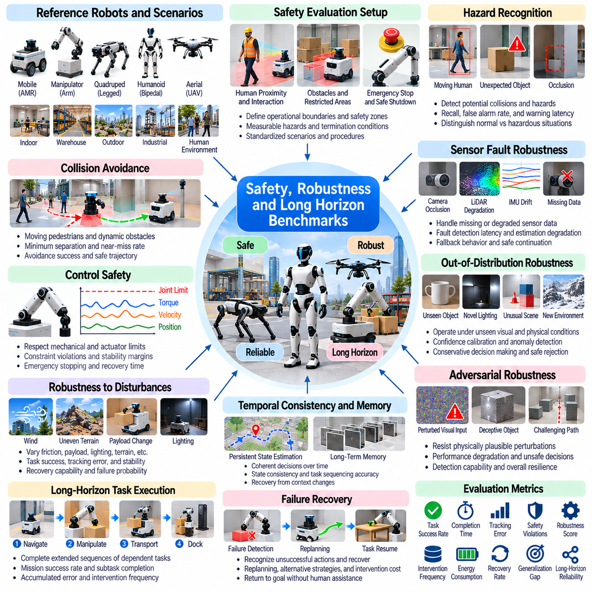{width="7.268055555555556in" height="7.268055555555556in"}

Safety, robustness, and long-horizon benchmarks establish standardized methods for evaluating whether Physical AI systems can operate reliably under uncertainty, disturbances, and extended execution periods. Safety concerns the prevention of unacceptable harm, robustness measures resistance to changing conditions, and long-horizon evaluation examines sustained task performance. Together, these benchmarks assess dependable robotic behavior beyond short demonstrations.

Benchmark design should distinguish nominal performance from behavior under abnormal or hazardous conditions. A robot may achieve high task success in controlled environments yet fail when sensors degrade, obstacles move unexpectedly, or control errors accumulate. Evaluation must therefore include representative disturbances, rare events, and extended operating scenarios. Success metrics should be accompanied by safety violations, recovery outcomes, and failure severity.

Safety benchmark environments should define explicit operational boundaries, protected regions, and acceptable interaction forces. Robot configurations, actuator limits, sensor coverage, and emergency mechanisms must be documented. Standardized scenarios may involve human proximity, obstacle encounters, contact-rich manipulation, and navigation through constrained spaces. Each test should specify measurable hazards, termination conditions, and intervention procedures.

Hazard recognition benchmarks evaluate whether robots detect situations that could lead to collisions, instability, or equipment damage. Perception systems must distinguish ordinary environmental changes from conditions requiring preventive action. Occlusion, sensor noise, ambiguous objects, and unexpected movement increase difficulty. Detection recall, false alarm rates, warning latency, and missed critical events provide complementary safety indicators.

Collision avoidance benchmarks assess whether robots maintain safe separation from people, equipment, and environmental obstacles. Dynamic scenarios should include moving pedestrians, intersecting trajectories, restricted passages, and sudden obstacle appearances. Evaluation must consider relative velocity, stopping distance, and available maneuvering space. Collision frequency, minimum separation, near-miss events, and avoidance success quantify protective behavior.

Control safety benchmarks examine whether generated actions remain within mechanical and operational constraints. Excessive joint torque, unstable acceleration, actuator saturation, and uncontrolled contact can create hazardous conditions. Standardized tests should introduce challenging commands and controlled disturbances. Constraint violations, maximum force, stability margins, emergency stopping behavior, and recovery time indicate controller safety.

Robustness benchmarks evaluate performance when environmental or system parameters deviate from nominal assumptions. Variations in friction, payload, lighting, terrain, communication delay, and actuator response may affect robot behavior. Disturbance levels should increase systematically to reveal performance limits. Task success, tracking error, stability, recovery capability, and failure probability characterize robustness across operating conditions.

Sensor fault benchmarks investigate whether robotic systems remain dependable when observations become unreliable. Camera occlusion, LiDAR degradation, inertial drift, missing measurements, and synchronization errors can undermine perception and control. Fault injection should specify onset time, severity, and duration. Evaluation should measure fault detection latency, estimation degradation, fallback behavior, and safe continuation or shutdown.

Out-of-distribution benchmarks examine robot behavior under conditions not represented adequately in training data. Unfamiliar objects, unusual lighting, unexpected human actions, and novel physical interactions may expose hidden weaknesses. Evaluation should distinguish uncertainty recognition from successful task execution. Confidence calibration, anomaly detection, conservative decision-making, and safe rejection rates reveal how systems handle unfamiliar situations.

Adversarial robustness benchmarks investigate sensitivity to deliberately challenging observations or environmental configurations. Perturbations may involve misleading visual patterns, deceptive object placement, or difficult navigation geometry. Tests should remain physically plausible and avoid assuming that digital attacks directly translate into real-world failures. Evaluation should measure performance degradation, unsafe decisions, detection capability, and resilience to controlled perturbations.

Long-horizon benchmarks evaluate whether robots can sustain reliable behavior across extended sequences of dependent tasks. A mobile manipulator may navigate between stations, identify objects, execute manipulation, and verify completion repeatedly. Minor errors can accumulate and disrupt later operations. Evaluation should include complete mission success, subtask completion, accumulated deviation, and intervention frequency over time.

Temporal consistency benchmarks assess whether robot decisions remain coherent as environmental conditions and task context evolve. Long missions require persistent state estimation, memory management, and reliable transitions between behaviors. Incorrect assumptions about earlier actions may cause repeated failures or skipped operations. State consistency, task sequencing accuracy, memory reliability, and context recovery provide important evaluation measures.

Failure recovery benchmarks measure whether robots can recognize unsuccessful actions and restore operational progress. Examples include failed grasps, blocked navigation paths, localization loss, and incomplete docking. Recovery strategies may involve retrying, replanning, recalibration, or requesting assistance. Evaluation should report recovery success, time to resume, repeated failure frequency, and whether corrective actions preserve safety constraints.

Human intervention benchmarks examine how effectively robotic systems request and incorporate assistance during uncertain or hazardous situations. Intervention may involve remote supervision, task clarification, manual recovery, or emergency stopping. Excessive dependence on operators reduces practical autonomy. Benchmark protocols should measure intervention frequency, response time, operator workload, and the proportion of missions completed without assistance.

Reliability benchmarks evaluate sustained operation through repeated trials and extended missions. Component degradation, thermal effects, calibration drift, and intermittent communication failures may emerge only after prolonged use. Testing should record operating hours, mission cycles, failure events, and recovery actions. Mean time between failures, availability, mission completion rate, and accumulated downtime support operational reliability assessment.

Energy and resource robustness benchmarks examine whether robots maintain performance under constrained power and computational conditions. Battery depletion, processor overload, thermal throttling, and communication congestion can affect mission execution. Standardized scenarios should introduce resource limitations gradually. Evaluation should measure energy consumption, deadline violations, degraded-mode performance, and safe transition to charging or standby states.

Multi-robot safety benchmarks evaluate coordinated operation when several autonomous agents share workspaces and infrastructure. Congestion, conflicting routes, communication delays, and inconsistent task priorities can create hazards. Standardized scenarios should include intersecting paths, shared docking stations, and temporary network failures. Collision avoidance, deadlock resolution, coordination latency, and fleet mission completion provide system-level metrics.

Simulation-based safety testing enables controlled exposure to rare or dangerous scenarios that would be difficult to reproduce physically. Parameterized disturbances, randomized initial conditions, and automated fault injection support broad scenario coverage. However, unrealistic physics or incomplete hazard models may conceal real risks. Simulation results should therefore be complemented by carefully controlled hardware validation.

Sim2Real safety benchmarks assess whether protective behavior demonstrated in simulation remains effective on physical robots. Differences in braking response, contact dynamics, sensor timing, and actuator limitations may invalidate simulated safety margins. Matched tests should compare stopping distance, intervention latency, obstacle clearance, and recovery behavior. Physical validation must use appropriate safeguards and predefined termination conditions.

Statistical evaluation should capture both frequent operational failures and rare high-severity events. Repeated trials, scenario coverage, confidence intervals, and severity-weighted reporting improve interpretability. Average task success alone cannot establish safety or reliability. Benchmark reports should distinguish collision events, constraint violations, recoverable faults, mission failures, and conditions requiring human intervention.

Ultimately, safety, robustness, and long-horizon benchmarks provide a comprehensive framework for evaluating dependable Physical AI systems. Their purpose extends beyond successful isolated tasks to understanding how robots respond to uncertainty, preserve safety boundaries, recover from failures, and sustain operation over time. Standardized scenarios, systematic fault testing, transparent reporting, and physical validation support trustworthy robotic deployment.

안전성, 강건성 및 장기 수행 벤치마크(Safety, Robustness, and Long-Horizon Benchmarks)는 피지컬 AI 시스템(Physical AI Systems)이 불확실성(Uncertainty), 외란(Disturbances), 장시간 실행(Extended Execution Periods) 조건에서도 신뢰성 있게 작동할 수 있는지 평가하기 위한 표준화된 방법을 수립한다. 안전성(Safety)은 허용할 수 없는 피해(Unacceptable Harm)의 예방을 의미하고, 강건성(Robustness)은 변화하는 조건에 대한 저항 능력을 측정하며, 장기 수행 평가(Long-Horizon Evaluation)는 지속적인 작업 성능(Sustained Task Performance)을 조사한다. 이러한 벤치마크는 단기 시연(Short Demonstrations)을 넘어 신뢰할 수 있는 로봇 행동(Dependable Robotic Behavior)을 종합적으로 평가한다.

벤치마크 설계(Benchmark Design)는 정상 조건 성능(Nominal Performance)과 비정상적이거나 위험한 조건(Abnormal or Hazardous Conditions)에서의 행동을 구분해야 한다. 로봇은 통제된 환경(Controlled Environments)에서 높은 작업 성공률(Task Success)을 달성하더라도 센서 성능이 저하되거나, 장애물이 예상하지 못하게 움직이거나, 제어 오차(Control Errors)가 누적되면 실패할 수 있다. 따라서 평가에는 대표적인 외란(Representative Disturbances), 드문 이벤트(Rare Events), 장시간 운영 시나리오(Extended Operating Scenarios)가 포함되어야 한다. 성공 지표(Success Metrics)와 함께 안전 위반(Safety Violations), 복구 결과(Recovery Outcomes), 실패 심각도(Failure Severity)를 평가해야 한다.

안전성 벤치마크 환경(Safety Benchmark Environments)은 명시적인 운영 경계(Operational Boundaries), 보호 구역(Protected Regions), 허용 가능한 상호작용 힘(Acceptable Interaction Forces)을 정의해야 한다. 로봇 구성(Robot Configurations), 액추에이터 한계(Actuator Limits), 센서 감지 범위(Sensor Coverage), 비상 메커니즘(Emergency Mechanisms)을 문서화해야 한다. 표준화된 시나리오(Standardized Scenarios)에는 사람과의 근접 상황(Human Proximity), 장애물 조우(Obstacle Encounters), 접촉이 많은 조작(Contact-Rich Manipulation), 제한된 공간에서의 내비게이션(Navigation through Constrained Spaces)이 포함될 수 있다. 각 시험은 측정 가능한 위험 요소(Measurable Hazards), 종료 조건(Termination Conditions), 개입 절차(Intervention Procedures)를 명시해야 한다.

위험 요소 인식 벤치마크(Hazard Recognition Benchmarks)는 로봇이 충돌(Collisions), 불안정성(Instability), 장비 손상(Equipment Damage)으로 이어질 수 있는 상황을 탐지하는지 평가한다. 인식 시스템(Perception Systems)은 일반적인 환경 변화(Ordinary Environmental Changes)와 예방적 조치(Preventive Action)가 필요한 조건을 구분해야 한다. 가림(Occlusion), 센서 잡음(Sensor Noise), 모호한 객체(Ambiguous Objects), 예상하지 못한 움직임(Unexpected Movement)은 평가 난이도를 증가시킨다. 탐지 재현율(Detection Recall), 오경보율(False Alarm Rates), 경고 지연 시간(Warning Latency), 미탐지된 중대 이벤트(Missed Critical Events)는 상호 보완적인 안전 지표(Safety Indicators)를 제공한다.

충돌 회피 벤치마크(Collision Avoidance Benchmarks)는 로봇이 사람(People), 장비(Equipment), 환경 장애물(Environmental Obstacles)과 안전한 이격 거리(Safe Separation)를 유지하는지 평가한다. 동적 시나리오(Dynamic Scenarios)에는 이동하는 보행자(Moving Pedestrians), 교차 궤적(Intersecting Trajectories), 제한된 통로(Restricted Passages), 갑작스러운 장애물 출현(Sudden Obstacle Appearances)이 포함되어야 한다. 평가에서는 상대 속도(Relative Velocity), 정지 거리(Stopping Distance), 회피 가능한 공간(Available Maneuvering Space)을 고려해야 한다. 충돌 빈도(Collision Frequency), 최소 이격 거리(Minimum Separation), 아차 사고(Near-Miss Events), 회피 성공률(Avoidance Success)은 보호 행동(Protective Behavior)을 정량화한다.

제어 안전성 벤치마크(Control Safety Benchmarks)는 생성된 행동(Generated Actions)이 기계적 및 운영 제약(Mechanical and Operational Constraints)을 준수하는지 평가한다. 과도한 관절 토크(Excessive Joint Torque), 불안정한 가속(Unstable Acceleration), 액추에이터 포화(Actuator Saturation), 제어되지 않는 접촉(Uncontrolled Contact)은 위험한 상황(Hazardous Conditions)을 발생시킬 수 있다. 표준화된 시험(Standardized Tests)에는 도전적인 명령(Challenging Commands)과 통제된 외란(Controlled Disturbances)이 포함되어야 한다. 제약 위반(Constraint Violations), 최대 힘(Maximum Force), 안정성 여유(Stability Margins), 비상 정지 동작(Emergency Stopping Behavior), 복구 시간(Recovery Time)은 제어기 안전성(Controller Safety)을 나타낸다.

강건성 벤치마크(Robustness Benchmarks)는 환경 또는 시스템 매개변수(Environmental or System Parameters)가 정상적인 가정(Nominal Assumptions)에서 벗어날 때의 성능을 평가한다. 마찰(Friction), 적재 하중(Payload), 조명(Lighting), 지형(Terrain), 통신 지연(Communication Delay), 액추에이터 응답(Actuator Response)의 변화는 로봇 행동(Robot Behavior)에 영향을 미칠 수 있다. 외란 수준(Disturbance Levels)은 성능 한계(Performance Limits)를 파악할 수 있도록 체계적으로 증가시켜야 한다. 작업 성공률(Task Success), 추종 오차(Tracking Error), 안정성(Stability), 복구 능력(Recovery Capability), 실패 확률(Failure Probability)은 운영 조건 전반의 강건성을 나타낸다.

센서 고장 벤치마크(Sensor Fault Benchmarks)는 관측 정보(Observations)의 신뢰성이 저하될 때 로봇 시스템이 안정적으로 작동하는지 조사한다. 카메라 가림(Camera Occlusion), 라이다 성능 저하(LiDAR Degradation), 관성 센서 드리프트(Inertial Drift), 측정값 누락(Missing Measurements), 동기화 오차(Synchronization Errors)는 인식(Perception)과 제어(Control)의 신뢰성을 약화시킬 수 있다. 고장 주입(Fault Injection)은 발생 시점(Onset Time), 심각도(Severity), 지속 시간(Duration)을 명시해야 한다. 평가에서는 고장 탐지 지연 시간(Fault Detection Latency), 추정 성능 저하(Estimation Degradation), 대체 동작(Fallback Behavior), 안전한 작업 지속 또는 종료(Safe Continuation or Shutdown)를 측정해야 한다.

분포 외 벤치마크(Out-of-Distribution Benchmarks)는 학습 데이터(Training Data)에 충분히 표현되지 않은 조건에서 로봇의 행동을 평가한다. 익숙하지 않은 객체(Unfamiliar Objects), 비정상적인 조명(Unusual Lighting), 예상하지 못한 인간 행동(Unexpected Human Actions), 새로운 물리적 상호작용(Novel Physical Interactions)은 숨겨진 취약점(Hidden Weaknesses)을 드러낼 수 있다. 평가에서는 불확실성 인식(Uncertainty Recognition)과 성공적인 작업 실행(Successful Task Execution)을 구분해야 한다. 신뢰도 보정(Confidence Calibration), 이상 탐지(Anomaly Detection), 보수적 의사결정(Conservative Decision-Making), 안전한 거부율(Safe Rejection Rates)은 시스템이 익숙하지 않은 상황을 처리하는 방식을 보여준다.

적대적 강건성 벤치마크(Adversarial Robustness Benchmarks)는 의도적으로 어려움을 유발하도록 구성된 관측(Observations)이나 환경 설정(Environmental Configurations)에 대한 민감도를 조사한다. 교란(Perturbations)에는 오해를 유발하는 시각적 패턴(Misleading Visual Patterns), 기만적인 객체 배치(Deceptive Object Placement), 어려운 내비게이션 기하 구조(Difficult Navigation Geometry)가 포함될 수 있다. 시험은 물리적으로 실현 가능해야 하며, 디지털 공격(Digital Attacks)이 실제 환경의 실패로 직접 이어진다고 가정해서는 안 된다. 평가에서는 성능 저하(Performance Degradation), 위험한 의사결정(Unsafe Decisions), 탐지 능력(Detection Capability), 통제된 교란에 대한 회복력(Resilience)을 측정해야 한다.

장기 수행 벤치마크(Long-Horizon Benchmarks)는 로봇이 상호 의존적인 작업(Dependent Tasks)의 긴 시퀀스(Extended Sequences)에 걸쳐 신뢰할 수 있는 행동을 유지하는지 평가한다. 모바일 매니퓰레이터(Mobile Manipulator)는 여러 스테이션 사이를 이동하고, 객체를 식별하고, 조작을 수행하며, 완료 여부를 반복적으로 확인할 수 있다. 작은 오차(Minor Errors)가 누적되어 이후 작업(Later Operations)을 방해할 수 있다. 평가에는 전체 임무 성공률(Complete Mission Success), 하위 작업 완료(Subtask Completion), 누적 편차(Accumulated Deviation), 시간에 따른 개입 빈도(Intervention Frequency)가 포함되어야 한다.

시간적 일관성 벤치마크(Temporal Consistency Benchmarks)는 환경 조건(Environmental Conditions)과 작업 문맥(Task Context)이 변화함에 따라 로봇의 의사결정(Robot Decisions)이 일관성을 유지하는지 평가한다. 장기 임무(Long Missions)에는 지속적인 상태 추정(Persistent State Estimation), 메모리 관리(Memory Management), 행동 사이의 신뢰할 수 있는 전환(Reliable Transitions)이 필요하다. 이전 행동(Earlier Actions)에 대한 잘못된 가정(Incorrect Assumptions)은 반복적인 실패(Repeated Failures)나 작업 누락(Skipped Operations)을 발생시킬 수 있다. 상태 일관성(State Consistency), 작업 순서 정확도(Task Sequencing Accuracy), 메모리 신뢰성(Memory Reliability), 문맥 복구(Context Recovery)는 중요한 평가 지표를 제공한다.

실패 복구 벤치마크(Failure Recovery Benchmarks)는 로봇이 실패한 행동(Unsuccessful Actions)을 인식하고 운영 진행 상태(Operational Progress)를 복원할 수 있는지 측정한다. 대표적인 사례에는 파지 실패(Failed Grasps), 차단된 내비게이션 경로(Blocked Navigation Paths), 위치 추정 손실(Localization Loss), 불완전한 도킹(Incomplete Docking)이 포함된다. 복구 전략(Recovery Strategies)에는 재시도(Retrying), 재계획(Replanning), 재보정(Recalibration), 지원 요청(Requesting Assistance)이 포함될 수 있다. 평가에서는 복구 성공률(Recovery Success), 작업 재개 시간(Time to Resume), 반복 실패 빈도(Repeated Failure Frequency), 수정 행동(Corrective Actions)의 안전 제약(Safety Constraints) 준수 여부를 보고해야 한다.

인간 개입 벤치마크(Human Intervention Benchmarks)는 불확실하거나 위험한 상황에서 로봇 시스템이 지원을 얼마나 효과적으로 요청하고 활용하는지 평가한다. 개입(Intervention)에는 원격 감독(Remote Supervision), 작업 명확화(Task Clarification), 수동 복구(Manual Recovery), 비상 정지(Emergency Stopping)가 포함될 수 있다. 운영자(Operators)에 대한 과도한 의존은 실제 자율성(Practical Autonomy)을 감소시킨다. 벤치마크 프로토콜(Benchmark Protocols)은 개입 빈도(Intervention Frequency), 응답 시간(Response Time), 운영자 작업 부하(Operator Workload), 지원 없이 완료한 임무 비율(Proportion of Missions Completed without Assistance)을 측정해야 한다.

신뢰성 벤치마크(Reliability Benchmarks)는 반복 시험(Repeated Trials)과 장기 임무(Extended Missions)를 통한 지속적인 운영(Sustained Operation)을 평가한다. 구성요소 성능 저하(Component Degradation), 열적 영향(Thermal Effects), 보정 드리프트(Calibration Drift), 간헐적인 통신 장애(Intermittent Communication Failures)는 장시간 사용 이후에만 나타날 수 있다. 시험에서는 운영 시간(Operating Hours), 임무 주기(Mission Cycles), 고장 이벤트(Failure Events), 복구 행동(Recovery Actions)을 기록해야 한다. 평균 고장 간격(Mean Time Between Failures), 가용성(Availability), 임무 완료율(Mission Completion Rate), 누적 가동 중단 시간(Accumulated Downtime)은 운영 신뢰성(Operational Reliability) 평가를 지원한다.

에너지 및 자원 강건성 벤치마크(Energy and Resource Robustness Benchmarks)는 전력 및 계산 자원(Power and Computational Resources)이 제한된 조건에서도 로봇이 성능을 유지하는지 조사한다. 배터리 소모(Battery Depletion), 프로세서 과부하(Processor Overload), 열 스로틀링(Thermal Throttling), 통신 혼잡(Communication Congestion)은 임무 실행(Mission Execution)에 영향을 미칠 수 있다. 표준화된 시나리오(Standardized Scenarios)는 자원 제약(Resource Limitations)을 점진적으로 도입해야 한다. 평가에서는 에너지 소비(Energy Consumption), 마감 시간 위반(Deadline Violations), 성능 저하 모드에서의 동작(Degraded-Mode Performance), 충전 또는 대기 상태로의 안전한 전환(Safe Transition to Charging or Standby States)을 측정해야 한다.

다중 로봇 안전성 벤치마크(Multi-Robot Safety Benchmarks)는 여러 자율 에이전트(Autonomous Agents)가 작업 공간(Workspaces)과 인프라(Infrastructure)를 공유할 때의 협조 운영(Coordinated Operation)을 평가한다. 혼잡(Congestion), 충돌하는 경로(Conflicting Routes), 통신 지연(Communication Delays), 일관되지 않은 작업 우선순위(Inconsistent Task Priorities)는 위험을 발생시킬 수 있다. 표준화된 시나리오(Standardized Scenarios)에는 교차 경로(Intersecting Paths), 공유 도킹 스테이션(Shared Docking Stations), 일시적인 네트워크 장애(Temporary Network Failures)가 포함되어야 한다. 충돌 회피(Collision Avoidance), 교착 상태 해결(Deadlock Resolution), 협조 지연 시간(Coordination Latency), 플릿 임무 완료(Fleet Mission Completion)는 시스템 수준 지표(System-Level Metrics)를 제공한다.

시뮬레이션 기반 안전성 시험(Simulation-Based Safety Testing)은 실제 환경에서 재현하기 어려운 드물거나 위험한 시나리오(Rare or Dangerous Scenarios)를 통제된 방식으로 시험할 수 있게 한다. 매개변수화된 외란(Parameterized Disturbances), 무작위화된 초기 조건(Randomized Initial Conditions), 자동화된 고장 주입(Automated Fault Injection)은 광범위한 시나리오 적용 범위(Scenario Coverage)를 지원한다. 그러나 비현실적인 물리 모델(Unrealistic Physics)이나 불완전한 위험 모델(Incomplete Hazard Models)은 실제 위험을 은폐할 수 있다. 따라서 시뮬레이션 결과(Simulation Results)는 신중하게 통제된 하드웨어 검증(Carefully Controlled Hardware Validation)으로 보완해야 한다.

시뮬레이션-현실 전이 안전성 벤치마크(Sim2Real Safety Benchmarks)는 시뮬레이션에서 입증된 보호 행동(Protective Behavior)이 실제 로봇(Physical Robots)에서도 효과적으로 유지되는지 평가한다. 제동 응답(Braking Response), 접촉 동역학(Contact Dynamics), 센서 타이밍(Sensor Timing), 액추에이터 한계(Actuator Limitations)의 차이는 시뮬레이션에서 설정한 안전 여유(Simulated Safety Margins)를 무효화할 수 있다. 대응 시험(Matched Tests)은 정지 거리(Stopping Distance), 개입 지연 시간(Intervention Latency), 장애물 이격 거리(Obstacle Clearance), 복구 행동(Recovery Behavior)을 비교해야 한다. 실제 환경 검증(Physical Validation)에는 적절한 안전장치(Safeguards)와 사전에 정의된 종료 조건(Predefined Termination Conditions)을 적용해야 한다.

통계적 평가(Statistical Evaluation)는 빈번한 운영 실패(Frequent Operational Failures)와 드물지만 심각도가 높은 이벤트(Rare High-Severity Events)를 모두 포착해야 한다. 반복 시험(Repeated Trials), 시나리오 적용 범위(Scenario Coverage), 신뢰구간(Confidence Intervals), 심각도 가중 보고(Severity-Weighted Reporting)는 결과의 해석 가능성(Interpretability)을 향상시킨다. 평균 작업 성공률(Average Task Success)만으로는 안전성(Safety)이나 신뢰성(Reliability)을 입증할 수 없다. 벤치마크 보고서(Benchmark Reports)는 충돌 이벤트(Collision Events), 제약 위반(Constraint Violations), 복구 가능한 고장(Recoverable Faults), 임무 실패(Mission Failures), 인간 개입이 필요한 조건(Conditions Requiring Human Intervention)을 구분해야 한다.

궁극적으로 안전성, 강건성 및 장기 수행 벤치마크(Safety, Robustness, and Long-Horizon Benchmarks)는 신뢰할 수 있는 피지컬 AI 시스템(Dependable Physical AI Systems)을 평가하기 위한 포괄적인 프레임워크(Comprehensive Framework)를 제공한다. 그 목적은 개별 작업의 성공(Successful Isolated Tasks)을 넘어 로봇이 불확실성(Uncertainty)에 대응하고, 안전 경계(Safety Boundaries)를 유지하며, 실패로부터 복구하고, 장시간 운영(Sustained Operation)을 지속하는 방식을 이해하는 데 있다. 표준화된 시나리오(Standardized Scenarios), 체계적인 고장 시험(Systematic Fault Testing), 투명한 보고(Transparent Reporting), 실제 환경 검증(Physical Validation)은 신뢰할 수 있는 로봇 배포(Trustworthy Robotic Deployment)를 지원한다.

##  

## 09.14. Benchmark Automation [w/Code]

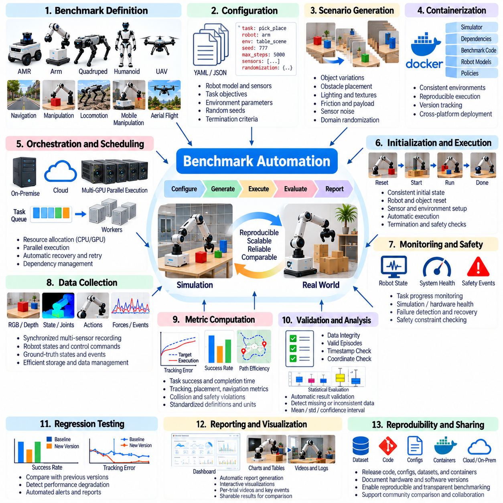{width="7.268055555555556in" height="7.268055555555556in"}

Benchmark automation provides a systematic framework for executing, monitoring, and evaluating robotic experiments with minimal manual intervention. In Physical AI, automated benchmarking connects simulation environments, robot controllers, evaluation metrics, and reporting systems into a reproducible workflow. Its primary objectives are experimental consistency, scalable testing, reliable comparison, and early detection of performance regressions across different algorithms and robot configurations.

An automated benchmark architecture typically separates experiment configuration, execution management, data collection, metric computation, and result reporting. Each component should operate through clearly defined interfaces to reduce dependencies between simulation platforms and evaluation tools. This modular organization enables researchers to replace policies, robot models, or scenarios without redesigning the entire pipeline, supporting long-term maintenance and extensibility.

Experiment configuration defines the conditions under which each benchmark is executed. Configuration files should specify robot models, sensor parameters, environment assets, task objectives, initial states, random seeds, and termination criteria. Machine-readable formats such as YAML or JSON support automated validation and version tracking. Explicit configurations prevent undocumented changes from affecting comparisons between experiments or software releases.

Scenario generation automates the creation of diverse testing conditions from predefined templates and parameter distributions. Variables may include obstacle placement, object geometry, lighting, friction, payload, sensor noise, and environmental disturbances. Controlled randomization produces repeatable scenario variations while expanding test coverage. Scenario identifiers and random seeds should be recorded so that individual failures can be reproduced precisely.

Benchmark orchestration coordinates experiment scheduling, resource allocation, execution, and recovery. An orchestration service may launch simulation instances, assign robot policies, monitor execution status, and collect results. Parallel execution improves throughput when sufficient computing resources are available. Scheduling mechanisms should account for GPU memory, CPU utilization, simulator limitations, and dependencies between experiments to avoid resource conflicts.

Containerization supports consistent benchmark execution across development workstations, laboratory servers, and cloud infrastructure. Container images can preserve software dependencies, simulation libraries, evaluation scripts, and runtime configurations. However, GPU drivers, hardware interfaces, and kernel dependencies may remain platform-specific. Reproducibility therefore requires recording container versions together with host operating systems, accelerator drivers, and relevant hardware specifications.

Automated simulation initialization ensures that every trial begins from a defined state. Robot poses, joint configurations, object placements, sensor settings, and environment parameters must be reset consistently. Residual velocities, cached observations, or incomplete physics resets can introduce hidden experimental differences. Initialization verification should confirm that required conditions are satisfied before benchmark execution begins.

Execution monitoring tracks robot behavior and simulator health throughout each trial. Relevant signals include task progress, robot state, controller frequency, sensor availability, computational load, and safety events. Automated monitors should identify simulation crashes, stalled policies, communication failures, and exceeded execution limits. Distinguishing infrastructure failures from algorithm failures is essential for accurate benchmark interpretation.

Telemetry collection provides the evidence required for detailed performance analysis. Recorded information may include sensor observations, robot trajectories, control commands, estimated states, ground-truth states, collision events, and task outcomes. All measurements should use consistent timestamps and coordinate conventions. Data collection systems must balance recording completeness against storage consumption and interference with real-time execution.

Metric computation transforms recorded trajectories and events into standardized performance indicators. Navigation benchmarks may calculate path efficiency and collision frequency, while manipulation benchmarks evaluate grasp success and placement accuracy. Control benchmarks measure tracking error and stability, whereas learning benchmarks assess task success and sample efficiency. Metric definitions must specify units, aggregation methods, and treatment of incomplete trials.

Automated validation checks whether benchmark results satisfy predefined quality requirements. Validation rules may detect missing telemetry, invalid timestamps, inconsistent coordinate frames, incomplete episodes, or impossible physical measurements. Failed validation should produce explicit diagnostic information rather than silently excluding data. Separating data-quality failures from task-performance failures improves transparency and prevents misleading aggregate statistics.

Statistical evaluation aggregates repeated trials across random seeds, scenario variations, and algorithm configurations. Mean values, standard deviations, confidence intervals, and failure distributions provide complementary evidence. Automated analysis should preserve individual trial results alongside aggregate summaries. Comparing complete distributions helps identify unstable algorithms whose average performance appears acceptable despite occasional severe failures.

Regression testing determines whether changes to robot software, simulation assets, or learned models degrade previously established performance. Reference results provide baselines for evaluating new versions. Automated comparison should apply consistent scenarios and predefined acceptance thresholds. Changes in success rates, latency, safety violations, or tracking accuracy can trigger further investigation before updated software is approved for deployment.

Continuous integration pipelines can execute selected benchmark suites whenever software or model changes are introduced. Lightweight tests may verify configuration validity, interface compatibility, and basic task execution, while larger suites evaluate robustness and generalization. Computationally expensive experiments can be scheduled separately. Benchmark outcomes should support development decisions without assuming that passing simulation tests guarantees physical safety.

Failure replay enables engineers to investigate unsuccessful trials using preserved configurations, telemetry, and simulator states. A replay system should reconstruct initial conditions and reproduce relevant action sequences whenever deterministic execution is supported. Event timelines can reveal whether failures originated in perception, planning, control, or infrastructure. Repeated replay under modified parameters supports diagnosis and corrective testing.

Simulation determinism is an important consideration because identical random seeds do not always guarantee identical results. Parallel execution, floating-point operations, asynchronous sensors, and physics solver behavior may introduce nondeterministic differences. Benchmark systems should document reproducibility limits and control sources of variation where practical. Statistical repetition remains necessary when exact replay cannot be guaranteed.

Sim2Real benchmark automation extends the evaluation pipeline from virtual environments to physical robot platforms. Hardware trials require calibration verification, safety supervision, controlled initialization, and reliable telemetry synchronization. Automated procedures may deploy policies, execute approved test sequences, and collect comparable measurements. Physical experiments should retain independent emergency stopping and operator intervention capabilities.

Safety automation continuously checks operational constraints during benchmark execution. Monitoring may include joint limits, actuator temperatures, collision distances, contact forces, and emergency states. Constraint violations should be recorded with timestamps, severity classifications, and relevant system context. Automated termination can reduce exposure to hazardous conditions, but protective mechanisms must remain independent of experimental software when required.

Result reporting converts benchmark outputs into interpretable evidence for researchers and system engineers. Standardized reports should present experiment identifiers, software versions, task configurations, performance metrics, statistical summaries, and categorized failures. Trend analysis can reveal gradual performance degradation across development cycles. Traceable reports allow reviewers to connect conclusions with original measurements and reproducible experiments.

Benchmark governance defines how scenarios, metrics, datasets, and reference baselines are maintained over time. Version-controlled specifications should identify approved changes and preserve historical evaluation conditions. Access permissions and data retention policies protect experimental integrity. Benchmark updates must distinguish genuine algorithm improvements from changes in task difficulty, simulator behavior, or metric implementation.

Ultimately, benchmark automation transforms isolated robotic experiments into a repeatable engineering process. Its value extends beyond reducing manual effort to improving reproducibility, traceability, statistical confidence, and development efficiency. By integrating scenario generation, orchestration, telemetry, validation, regression testing, and Sim2Real evaluation, automated benchmarking supports systematic verification and continuous improvement of dependable Physical AI systems.

벤치마크 자동화(Benchmark Automation)는 최소한의 수동 개입(Manual Intervention)으로 로봇 실험(Robotic Experiments)을 실행, 모니터링 및 평가하기 위한 체계적인 프레임워크(Systematic Framework)를 제공한다. 피지컬 AI(Physical AI)에서 자동화된 벤치마킹(Automated Benchmarking)은 시뮬레이션 환경(Simulation Environments), 로봇 제어기(Robot Controllers), 평가 지표(Evaluation Metrics), 보고 시스템(Reporting Systems)을 재현 가능한 작업 흐름(Reproducible Workflow)으로 연결한다. 주요 목표는 다양한 알고리즘(Algorithms)과 로봇 구성(Robot Configurations)에 걸쳐 실험 일관성(Experimental Consistency), 확장 가능한 시험(Scalable Testing), 신뢰할 수 있는 비교(Reliable Comparison), 성능 회귀(Performance Regressions)의 조기 탐지를 확보하는 것이다.

자동화된 벤치마크 아키텍처(Automated Benchmark Architecture)는 일반적으로 실험 구성(Experiment Configuration), 실행 관리(Execution Management), 데이터 수집(Data Collection), 지표 계산(Metric Computation), 결과 보고(Result Reporting)를 분리한다. 각 구성요소(Component)는 시뮬레이션 플랫폼(Simulation Platforms)과 평가 도구(Evaluation Tools) 사이의 의존성(Dependencies)을 줄이기 위해 명확하게 정의된 인터페이스(Interfaces)를 통해 동작해야 한다. 이러한 모듈형 구성(Modular Organization)은 전체 파이프라인(Pipeline)을 재설계하지 않고도 정책(Policies), 로봇 모델(Robot Models), 시나리오(Scenarios)를 교체할 수 있게 하며, 장기적인 유지보수(Maintenance)와 확장성(Extensibility)을 지원한다.

실험 구성(Experiment Configuration)은 각 벤치마크가 실행되는 조건을 정의한다. 구성 파일(Configuration Files)에는 로봇 모델(Robot Models), 센서 매개변수(Sensor Parameters), 환경 자산(Environment Assets), 작업 목표(Task Objectives), 초기 상태(Initial States), 난수 시드(Random Seeds), 종료 기준(Termination Criteria)을 명시해야 한다. YAML이나 JSON과 같은 기계 판독 가능 형식(Machine-Readable Formats)은 자동 검증(Automated Validation)과 버전 추적(Version Tracking)을 지원한다. 명시적인 구성(Explicit Configurations)은 문서화되지 않은 변경(Undocumented Changes)이 실험이나 소프트웨어 릴리스(Software Releases) 사이의 비교에 영향을 미치는 것을 방지한다.

시나리오 생성(Scenario Generation)은 사전에 정의된 템플릿(Predefined Templates)과 매개변수 분포(Parameter Distributions)를 이용하여 다양한 시험 조건(Testing Conditions)을 자동으로 생성한다. 변수(Variables)에는 장애물 배치(Obstacle Placement), 객체 형상(Object Geometry), 조명(Lighting), 마찰(Friction), 적재 하중(Payload), 센서 잡음(Sensor Noise), 환경 외란(Environmental Disturbances)이 포함될 수 있다. 통제된 무작위화(Controlled Randomization)는 시험 범위(Test Coverage)를 확장하면서 재현 가능한 시나리오 변화(Repeatable Scenario Variations)를 생성한다. 개별 실패(Individual Failures)를 정확하게 재현할 수 있도록 시나리오 식별자(Scenario Identifiers)와 난수 시드(Random Seeds)를 기록해야 한다.

벤치마크 오케스트레이션(Benchmark Orchestration)은 실험 일정 관리(Experiment Scheduling), 자원 할당(Resource Allocation), 실행(Execution), 복구(Recovery)를 조정한다. 오케스트레이션 서비스(Orchestration Service)는 시뮬레이션 인스턴스(Simulation Instances)를 실행하고, 로봇 정책(Robot Policies)을 할당하며, 실행 상태(Execution Status)를 모니터링하고, 결과를 수집할 수 있다. 충분한 계산 자원(Computing Resources)이 확보되면 병렬 실행(Parallel Execution)을 통해 처리량(Throughput)을 향상시킬 수 있다. 일정 관리 메커니즘(Scheduling Mechanisms)은 자원 충돌(Resource Conflicts)을 방지하기 위해 GPU 메모리(GPU Memory), CPU 사용률(CPU Utilization), 시뮬레이터 제약(Simulator Limitations), 실험 간 의존성(Dependencies)을 고려해야 한다.

컨테이너화(Containerization)는 개발 워크스테이션(Development Workstations), 연구실 서버(Laboratory Servers), 클라우드 인프라(Cloud Infrastructure) 전반에서 일관된 벤치마크 실행(Consistent Benchmark Execution)을 지원한다. 컨테이너 이미지(Container Images)는 소프트웨어 의존성(Software Dependencies), 시뮬레이션 라이브러리(Simulation Libraries), 평가 스크립트(Evaluation Scripts), 런타임 구성(Runtime Configurations)을 보존할 수 있다. 그러나 GPU 드라이버(GPU Drivers), 하드웨어 인터페이스(Hardware Interfaces), 커널 의존성(Kernel Dependencies)은 플랫폼별 특성(Platform-Specific Characteristics)을 유지할 수 있다. 따라서 재현성(Reproducibility)을 확보하려면 컨테이너 버전(Container Versions)과 함께 호스트 운영체제(Host Operating Systems), 가속기 드라이버(Accelerator Drivers), 관련 하드웨어 사양(Hardware Specifications)을 기록해야 한다.

자동화된 시뮬레이션 초기화(Automated Simulation Initialization)는 모든 시험(Trial)이 정의된 상태(Defined State)에서 시작하도록 보장한다. 로봇 자세(Robot Poses), 관절 구성(Joint Configurations), 객체 배치(Object Placements), 센서 설정(Sensor Settings), 환경 매개변수(Environment Parameters)는 일관되게 초기화되어야 한다. 잔류 속도(Residual Velocities), 캐시된 관측값(Cached Observations), 불완전한 물리 상태 초기화(Incomplete Physics Resets)는 숨겨진 실험 차이(Hidden Experimental Differences)를 발생시킬 수 있다. 초기화 검증(Initialization Verification)은 벤치마크 실행(Benchmark Execution)이 시작되기 전에 필요한 조건이 충족되었는지 확인해야 한다.

실행 모니터링(Execution Monitoring)은 각 시험 과정에서 로봇 행동(Robot Behavior)과 시뮬레이터 상태(Simulator Health)를 추적한다. 관련 신호(Relevant Signals)에는 작업 진행 상태(Task Progress), 로봇 상태(Robot State), 제어기 주파수(Controller Frequency), 센서 가용성(Sensor Availability), 계산 부하(Computational Load), 안전 이벤트(Safety Events)가 포함된다. 자동화된 모니터(Automated Monitors)는 시뮬레이션 충돌(Simulation Crashes), 정지된 정책(Stalled Policies), 통신 장애(Communication Failures), 실행 제한 초과(Exceeded Execution Limits)를 식별해야 한다. 정확한 벤치마크 해석(Benchmark Interpretation)을 위해서는 인프라 장애(Infrastructure Failures)와 알고리즘 실패(Algorithm Failures)를 구분하는 것이 필수적이다.

텔레메트리 수집(Telemetry Collection)은 상세한 성능 분석(Performance Analysis)에 필요한 근거 데이터를 제공한다. 기록되는 정보(Recorded Information)에는 센서 관측(Sensor Observations), 로봇 궤적(Robot Trajectories), 제어 명령(Control Commands), 추정 상태(Estimated States), 실제 기준 상태(Ground-Truth States), 충돌 이벤트(Collision Events), 작업 결과(Task Outcomes)가 포함될 수 있다. 모든 측정값(Measurements)은 일관된 타임스탬프(Timestamps)와 좌표계 규약(Coordinate Conventions)을 사용해야 한다. 데이터 수집 시스템(Data Collection Systems)은 기록의 완전성(Recording Completeness)과 저장 공간 소비(Storage Consumption), 실시간 실행(Real-Time Execution)에 대한 간섭 사이에서 균형을 유지해야 한다.

지표 계산(Metric Computation)은 기록된 궤적(Recorded Trajectories)과 이벤트(Events)를 표준화된 성능 지표(Standardized Performance Indicators)로 변환한다. 내비게이션 벤치마크(Navigation Benchmarks)는 경로 효율성(Path Efficiency)과 충돌 빈도(Collision Frequency)를 계산할 수 있으며, 조작 벤치마크(Manipulation Benchmarks)는 파지 성공률(Grasp Success)과 배치 정확도(Placement Accuracy)를 평가한다. 제어 벤치마크(Control Benchmarks)는 추종 오차(Tracking Error)와 안정성(Stability)을 측정하고, 학습 벤치마크(Learning Benchmarks)는 작업 성공률(Task Success)과 샘플 효율성(Sample Efficiency)을 평가한다. 지표 정의(Metric Definitions)에는 단위(Units), 집계 방법(Aggregation Methods), 미완료 시험(Incomplete Trials)의 처리 방식을 명시해야 한다.

자동 검증(Automated Validation)은 벤치마크 결과(Benchmark Results)가 사전에 정의된 품질 요구사항(Quality Requirements)을 충족하는지 확인한다. 검증 규칙(Validation Rules)은 누락된 텔레메트리(Missing Telemetry), 유효하지 않은 타임스탬프(Invalid Timestamps), 일관되지 않은 좌표 프레임(Inconsistent Coordinate Frames), 불완전한 에피소드(Incomplete Episodes), 물리적으로 불가능한 측정값(Impossible Physical Measurements)을 탐지할 수 있다. 검증 실패(Failed Validation)는 데이터를 조용히 제외하는 대신 명시적인 진단 정보(Diagnostic Information)를 생성해야 한다. 데이터 품질 실패(Data-Quality Failures)와 작업 성능 실패(Task-Performance Failures)를 분리하면 투명성(Transparency)을 높이고 잘못된 집계 통계(Misleading Aggregate Statistics)를 방지할 수 있다.

통계적 평가(Statistical Evaluation)는 난수 시드(Random Seeds), 시나리오 변화(Scenario Variations), 알고리즘 구성(Algorithm Configurations)에 걸친 반복 시험(Repeated Trials)을 집계한다. 평균값(Mean Values), 표준편차(Standard Deviations), 신뢰구간(Confidence Intervals), 실패 분포(Failure Distributions)는 상호 보완적인 근거를 제공한다. 자동화된 분석(Automated Analysis)은 집계 요약(Aggregate Summaries)과 함께 개별 시험 결과(Individual Trial Results)를 보존해야 한다. 전체 분포(Complete Distributions)를 비교하면 평균 성능(Average Performance)은 허용 가능한 수준이지만 간헐적으로 심각한 실패(Severe Failures)를 발생시키는 불안정한 알고리즘(Unstable Algorithms)을 식별하는 데 도움이 된다.

회귀 시험(Regression Testing)은 로봇 소프트웨어(Robot Software), 시뮬레이션 자산(Simulation Assets), 학습된 모델(Learned Models)의 변경이 이전에 확립된 성능(Previously Established Performance)을 저하시키는지 판단한다. 참조 결과(Reference Results)는 새로운 버전(New Versions)을 평가하기 위한 기준선(Baselines)을 제공한다. 자동 비교(Automated Comparison)는 일관된 시나리오(Consistent Scenarios)와 사전에 정의된 허용 임계값(Predefined Acceptance Thresholds)을 적용해야 한다. 성공률(Success Rates), 지연 시간(Latency), 안전 위반(Safety Violations), 추종 정확도(Tracking Accuracy)의 변화는 업데이트된 소프트웨어가 배포 승인을 받기 전에 추가 조사를 유도할 수 있다.

지속적 통합 파이프라인(Continuous Integration Pipelines)은 소프트웨어 또는 모델 변경(Software or Model Changes)이 도입될 때마다 선택된 벤치마크 모음(Benchmark Suites)을 실행할 수 있다. 경량 시험(Lightweight Tests)은 구성 유효성(Configuration Validity), 인터페이스 호환성(Interface Compatibility), 기본 작업 실행(Basic Task Execution)을 검증할 수 있으며, 대규모 시험(Larger Suites)은 강건성(Robustness)과 일반화(Generalization)를 평가한다. 계산 비용이 높은 실험(Computationally Expensive Experiments)은 별도로 예약하여 실행할 수 있다. 벤치마크 결과(Benchmark Outcomes)는 시뮬레이션 시험 통과(Passing Simulation Tests)가 실제 물리적 안전성(Physical Safety)을 보장한다고 가정하지 않으면서 개발 의사결정(Development Decisions)을 지원해야 한다.

실패 재현(Failure Replay)은 보존된 구성(Preserved Configurations), 텔레메트리(Telemetry), 시뮬레이터 상태(Simulator States)를 이용하여 엔지니어가 실패한 시험(Unsuccessful Trials)을 조사할 수 있도록 한다. 재현 시스템(Replay System)은 결정론적 실행(Deterministic Execution)이 지원되는 경우 초기 조건(Initial Conditions)을 재구성하고 관련 행동 시퀀스(Action Sequences)를 재현해야 한다. 이벤트 타임라인(Event Timelines)은 실패가 인식(Perception), 계획(Planning), 제어(Control), 인프라(Infrastructure) 중 어디에서 발생했는지 보여줄 수 있다. 수정된 매개변수(Modified Parameters)를 이용한 반복 재현(Repeated Replay)은 원인 진단(Diagnosis)과 수정 검증(Corrective Testing)을 지원한다.

시뮬레이션 결정론(Simulation Determinism)은 동일한 난수 시드(Identical Random Seeds)가 항상 동일한 결과(Identical Results)를 보장하지 않기 때문에 중요한 고려사항이다. 병렬 실행(Parallel Execution), 부동소수점 연산(Floating-Point Operations), 비동기 센서(Asynchronous Sensors), 물리 솔버 동작(Physics Solver Behavior)은 비결정론적 차이(Nondeterministic Differences)를 발생시킬 수 있다. 벤치마크 시스템(Benchmark Systems)은 재현성의 한계(Reproducibility Limits)를 문서화하고 가능한 범위에서 변동 원인(Sources of Variation)을 통제해야 한다. 정확한 재현(Exact Replay)을 보장할 수 없는 경우에도 통계적 반복(Statistical Repetition)은 필요하다.

시뮬레이션-현실 전이 벤치마크 자동화(Sim2Real Benchmark Automation)는 평가 파이프라인(Evaluation Pipeline)을 가상 환경(Virtual Environments)에서 실제 로봇 플랫폼(Physical Robot Platforms)으로 확장한다. 하드웨어 시험(Hardware Trials)에는 보정 검증(Calibration Verification), 안전 감독(Safety Supervision), 통제된 초기화(Controlled Initialization), 신뢰할 수 있는 텔레메트리 동기화(Reliable Telemetry Synchronization)가 필요하다. 자동화된 절차(Automated Procedures)는 정책(Policies)을 배포하고 승인된 시험 시퀀스(Approved Test Sequences)를 실행하며 비교 가능한 측정값(Comparable Measurements)을 수집할 수 있다. 실제 물리 실험(Physical Experiments)은 독립적인 비상 정지(Emergency Stopping) 및 운영자 개입(Operator Intervention) 기능을 유지해야 한다.

안전성 자동화(Safety Automation)는 벤치마크 실행(Benchmark Execution) 중 운영 제약(Operational Constraints)을 지속적으로 확인한다. 모니터링 항목에는 관절 한계(Joint Limits), 액추에이터 온도(Actuator Temperatures), 충돌 거리(Collision Distances), 접촉력(Contact Forces), 비상 상태(Emergency States)가 포함될 수 있다. 제약 위반(Constraint Violations)은 타임스탬프(Timestamps), 심각도 분류(Severity Classifications), 관련 시스템 문맥(System Context)과 함께 기록해야 한다. 자동 종료(Automated Termination)는 위험한 조건(Hazardous Conditions)에 대한 노출을 줄일 수 있지만, 필요한 경우 보호 메커니즘(Protective Mechanisms)은 실험 소프트웨어(Experimental Software)와 독립적으로 유지되어야 한다.

결과 보고(Result Reporting)는 벤치마크 출력(Benchmark Outputs)을 연구자(Researchers)와 시스템 엔지니어(System Engineers)가 해석할 수 있는 근거 자료(Interpretable Evidence)로 변환한다. 표준화된 보고서(Standardized Reports)에는 실험 식별자(Experiment Identifiers), 소프트웨어 버전(Software Versions), 작업 구성(Task Configurations), 성능 지표(Performance Metrics), 통계 요약(Statistical Summaries), 분류된 실패(Categorized Failures)가 포함되어야 한다. 추세 분석(Trend Analysis)은 개발 주기(Development Cycles)에 걸쳐 점진적인 성능 저하(Gradual Performance Degradation)를 드러낼 수 있다. 추적 가능한 보고서(Traceable Reports)는 검토자가 결론(Conclusions)을 원본 측정값(Original Measurements) 및 재현 가능한 실험(Reproducible Experiments)과 연결할 수 있도록 한다.

벤치마크 거버넌스(Benchmark Governance)는 시나리오(Scenarios), 지표(Metrics), 데이터셋(Datasets), 참조 기준선(Reference Baselines)을 장기간 유지하고 관리하는 방법을 정의한다. 버전 관리되는 사양(Version-Controlled Specifications)은 승인된 변경(Approved Changes)을 식별하고 과거 평가 조건(Historical Evaluation Conditions)을 보존해야 한다. 접근 권한(Access Permissions)과 데이터 보존 정책(Data Retention Policies)은 실험 무결성(Experimental Integrity)을 보호한다. 벤치마크 업데이트(Benchmark Updates)는 실제 알고리즘 개선(Genuine Algorithm Improvements)과 작업 난이도(Task Difficulty), 시뮬레이터 동작(Simulator Behavior), 지표 구현(Metric Implementation)의 변화로 인한 결과 차이를 구분해야 한다.

궁극적으로 벤치마크 자동화(Benchmark Automation)는 개별적인 로봇 실험(Isolated Robotic Experiments)을 반복 가능한 엔지니어링 프로세스(Repeatable Engineering Process)로 전환한다. 그 가치는 수동 작업(Manual Effort)을 줄이는 데 그치지 않고 재현성(Reproducibility), 추적성(Traceability), 통계적 신뢰도(Statistical Confidence), 개발 효율성(Development Efficiency)을 향상시키는 데 있다. 시나리오 생성(Scenario Generation), 오케스트레이션(Orchestration), 텔레메트리(Telemetry), 검증(Validation), 회귀 시험(Regression Testing), 시뮬레이션-현실 전이 평가(Sim2Real Evaluation)를 통합함으로써 자동화된 벤치마킹(Automated Benchmarking)은 신뢰할 수 있는 피지컬 AI 시스템(Dependable Physical AI Systems)의 체계적인 검증(Systematic Verification)과 지속적인 개선(Continuous Improvement)을 지원한다.
