**Volume 05. Simulation and Sim2Real Transfer**

# Chapter 10. Case Studies

## 10.01. Autonomous Driving Simulation

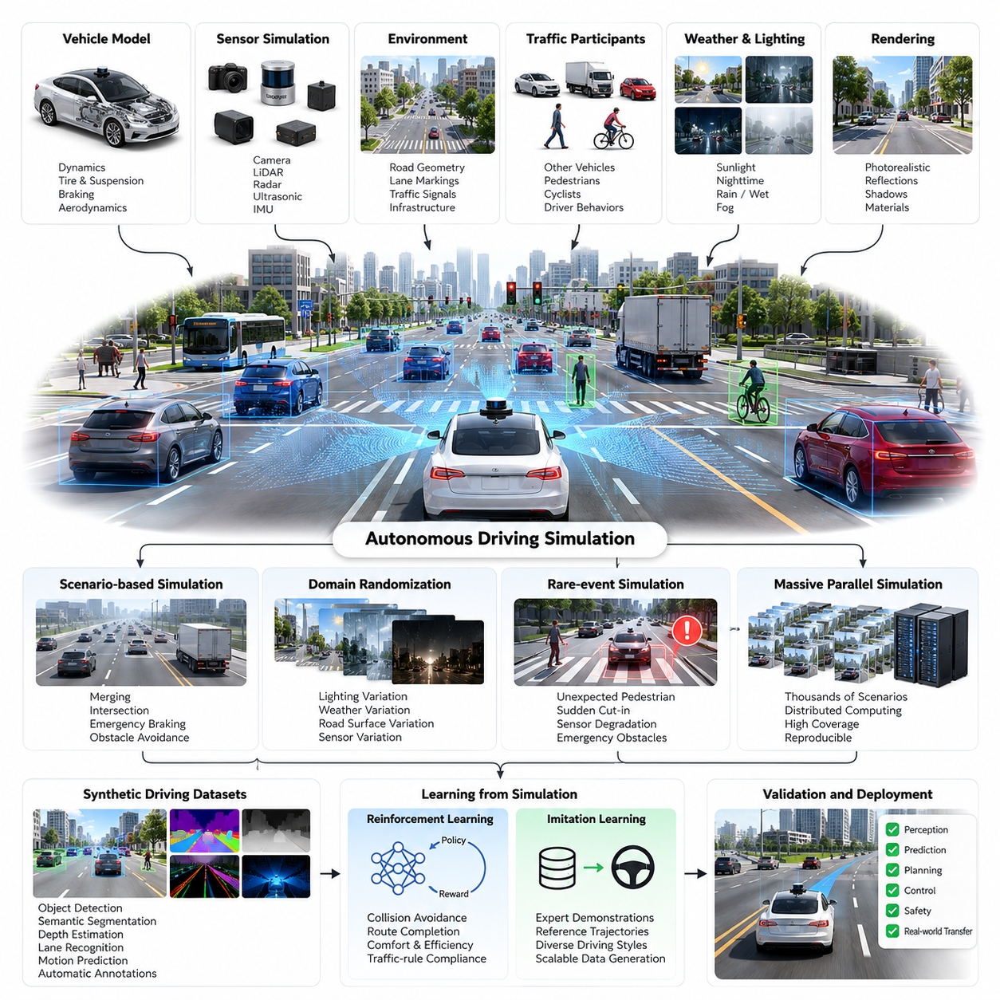{width="7.268055555555556in" height="7.268055555555556in"}

Autonomous driving simulation is one of the most advanced applications of Physical AI, combining perception, prediction, planning, control, and environmental interaction within a virtual driving environment. It enables autonomous vehicles to experience diverse traffic situations without exposing real road users to unnecessary risks, supporting systematic development, testing, and validation before physical deployment.

A comprehensive autonomous driving simulator represents the vehicle, surrounding infrastructure, traffic participants, road conditions, and environmental dynamics. The simulated world includes road geometry, intersections, lane markings, traffic signals, pedestrians, cyclists, and other vehicles. These elements interact through physical and behavioral models that reproduce the complexity of real-world transportation systems.

Vehicle dynamics simulation forms the foundation of realistic autonomous driving behavior. Mathematical models describe longitudinal acceleration, lateral motion, steering response, tire friction, suspension behavior, and braking performance. High-fidelity models additionally consider load transfer, road gradients, aerodynamic forces, and changing tire characteristics to reproduce vehicle responses under different operating conditions.

Sensor simulation provides synthetic observations corresponding to cameras, LiDAR, radar, ultrasonic sensors, and inertial measurement units. Each sensor model incorporates its measurement principles, field of view, resolution, sampling frequency, and uncertainty characteristics. Realistic sensor outputs allow perception algorithms to process simulated environments through interfaces similar to those used in actual vehicles.

Photorealistic rendering is particularly important for camera-based autonomous driving systems. Physically based materials, dynamic illumination, reflections, shadows, and atmospheric effects influence the appearance of roads and surrounding objects. Simulated scenes can reproduce challenging visual conditions such as direct sunlight, nighttime illumination, wet pavement, fog, and partially obscured traffic signs.

LiDAR and radar simulation require physical models that extend beyond conventional image rendering. LiDAR models approximate laser propagation, surface reflection, range measurement, and point-cloud generation, while radar models represent range, relative velocity, and angular measurements. Sensor noise, multipath effects, occlusion, and environmental interference must be considered according to the required simulation fidelity.

Traffic behavior modeling introduces dynamic interactions between autonomous vehicles and surrounding road users. Simulated drivers may exhibit different acceleration preferences, following distances, lane-changing strategies, and reactions to traffic signals. Pedestrians and cyclists require separate behavioral models that account for movement intentions, crossing decisions, visibility, and interactions with approaching vehicles.

Scenario-based simulation organizes driving situations into reproducible test cases with defined initial conditions, environmental parameters, participant behaviors, and expected outcomes. Typical scenarios include highway merging, intersection negotiation, emergency braking, pedestrian crossings, and obstacle avoidance. Parameterized scenarios allow engineers to explore systematic variations rather than relying on isolated driving examples.

Domain randomization expands the diversity of simulated driving experiences by varying lighting, weather, road surfaces, vehicle appearances, sensor characteristics, and traffic behavior. Randomized conditions reduce dependence on specific visual or physical configurations and encourage more robust learning. However, randomization distributions must remain sufficiently realistic to avoid training policies on physically implausible situations.

Rare-event simulation addresses situations that occur infrequently during ordinary driving but may have serious safety consequences. Examples include unexpected pedestrian movement, sudden vehicle cut-ins, sensor degradation, and emergency obstacles. Large-scale scenario generation makes these events more accessible for evaluation, although simulated coverage cannot establish that every possible hazardous situation has been examined.

Massive parallel simulation enables thousands of independent driving scenarios to execute across distributed computing resources. Different environments can evaluate perception models, prediction algorithms, planning strategies, and control policies simultaneously. Parallel execution increases scenario coverage and accelerates data generation, while careful resource scheduling and reproducibility controls support meaningful comparisons between software versions.

Synthetic driving datasets provide automatically generated annotations for object detection, semantic segmentation, depth estimation, lane recognition, and motion prediction. Unlike manually labeled real-world recordings, simulated environments can expose exact object positions, trajectories, and scene geometry. These annotations support supervised learning, multimodal training, and systematic investigation of perception failures.

Reinforcement learning can use autonomous driving simulation to train decision-making policies through repeated interaction with virtual traffic environments. Reward functions may represent collision avoidance, route completion, passenger comfort, traffic-rule compliance, and operational efficiency. Effective training requires carefully balanced objectives because poorly specified rewards can encourage unsafe shortcuts or unrealistic driving strategies.

Imitation learning provides another approach by training driving policies from expert demonstrations or reference trajectories. Simulated expert behavior can generate diverse examples of lane following, intersection handling, and obstacle avoidance. Combining imitation learning with controlled scenario variation may improve policy robustness, although differences between simulated experts and real human behavior require careful examination.

Simulation also supports testing of modular and end-to-end autonomous driving architectures. Modular systems separately evaluate perception, localization, prediction, planning, and control components, while end-to-end systems learn mappings from sensor observations to driving actions. Both approaches benefit from controlled environments that expose failure modes and enable repeatable comparisons under identical conditions.

Closed-loop simulation is essential because autonomous vehicle actions influence subsequent environmental states and sensor observations. Unlike open-loop evaluation, which compares predictions against recorded data, closed-loop testing reveals accumulated errors, unstable decisions, and interactions with other road users. Realistic feedback between vehicle behavior and traffic participants is necessary for evaluating sustained autonomous operation.

Digital twins extend autonomous driving simulation by incorporating calibrated representations of actual vehicles, roads, and operating environments. Real-world measurements can update vehicle parameters, infrastructure geometry, traffic patterns, and environmental conditions. These synchronized models support scenario reconstruction, operational analysis, and investigation of differences between predicted and observed driving behavior.

Sim2Real transfer remains challenging because virtual environments cannot perfectly reproduce real-world sensing, dynamics, and human behavior. Differences in camera response, tire-road interaction, traffic participant decisions, and system latency can affect deployed performance. Domain adaptation, system identification, and targeted real-world validation help reduce these discrepancies without assuming complete simulation equivalence.

Simulation fidelity should be selected according to the engineering objective rather than maximized uniformly. Detailed optical rendering may be necessary for camera perception evaluation, while simplified traffic models may be sufficient for preliminary route-planning experiments. Computational efficiency improves when simulation components allocate modeling accuracy to the physical and behavioral factors that most strongly influence the evaluated function.

Autonomous driving evaluation requires measurable indicators of safety, reliability, and task performance. Relevant metrics include collision frequency, minimum separation distance, traffic-rule violations, route completion, intervention frequency, and passenger comfort. Scenario-level results should be accompanied by uncertainty analysis and coverage information because favorable aggregate metrics may conceal failures in critical operating conditions.

A representative development workflow begins with constructing vehicle and environment models, calibrating sensor and dynamics parameters, and generating structured traffic scenarios. Perception and driving policies are trained using synthetic and real-world datasets before closed-loop evaluation. Identified failures guide scenario refinement, model updates, and additional testing, establishing an iterative development process.

Safety validation requires combining simulation with software-in-the-loop, hardware-in-the-loop, proving-ground testing, and controlled real-world operation. Each stage addresses different uncertainties and system interfaces. Simulation offers repeatability and scalable exposure to difficult situations, but it cannot independently demonstrate the safety of a deployed autonomous driving system across its entire operational design domain.

The central lesson of autonomous driving simulation is that effective Physical AI development depends on integrating realistic physical models, diverse synthetic experiences, scalable computation, and continuous real-world feedback. Simulation becomes most valuable when it operates as a measurable engineering system that identifies weaknesses, improves generalization, and supports evidence-based progression toward reliable autonomous mobility.

## 10.02. AMR and Outdoor Mobility Sim2Real

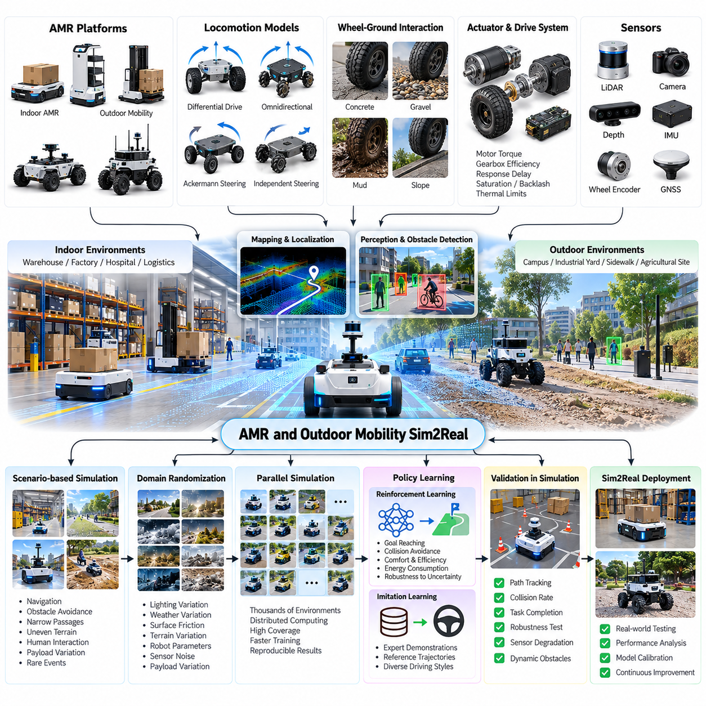{width="7.268055555555556in" height="7.268055555555556in"}

Autonomous Mobile Robots (AMRs) and outdoor mobility platforms represent important applications of Sim2Real transfer because they must navigate environments where physical conditions, obstacles, and human activities continuously change. Simulation enables these robots to develop navigation, perception, and control capabilities before deployment, reducing experimentation costs while improving operational reliability across indoor and outdoor environments.

Unlike autonomous vehicles operating primarily on structured roads, AMRs encounter diverse surfaces, narrow passages, irregular terrain, and unpredictable obstacles. Indoor environments include warehouses, factories, hospitals, and logistics facilities, while outdoor applications extend to campuses, industrial yards, sidewalks, and agricultural sites. Simulation must represent these different operating conditions to support meaningful transfer into physical environments.

A representative AMR simulation environment combines robot geometry, drivetrain dynamics, sensor models, navigation maps, and environmental interactions. The virtual robot includes wheel dimensions, mass distribution, actuator characteristics, steering constraints, and payload configurations. Accurate representation of these properties is essential because mobility performance depends directly on the relationship between mechanical structure and control behavior.

Robot locomotion modeling must account for differential drive, omnidirectional drive, Ackermann steering, and independently steered wheel configurations. Each architecture exhibits different turning characteristics, traction limitations, and motion constraints. Simulation provides a controlled environment for evaluating how these configurations respond to acceleration commands, curved trajectories, uneven surfaces, and changes in payload.

Wheel-ground interaction is a major source of Sim2Real discrepancies in mobile robotics. Friction coefficients, rolling resistance, tire deformation, and surface irregularities influence acceleration, braking, and trajectory tracking. Outdoor conditions introduce additional uncertainty through gravel, wet pavement, mud, slopes, and loose soil. Simplified contact models may produce unrealistic mobility performance when these effects become significant.

Accurate actuator simulation requires modeling motor torque, gearbox efficiency, wheel inertia, controller response, and communication delays. Real drive systems exhibit saturation, backlash, dead zones, thermal limitations, and variations in available traction. Including these characteristics allows simulated controllers to experience realistic operating constraints rather than relying on idealized motion commands.

Sensor simulation provides synthetic observations from LiDAR, RGB cameras, depth cameras, wheel encoders, inertial measurement units, and positioning systems. Indoor AMRs frequently depend on LiDAR-based localization and obstacle detection, while outdoor platforms may combine cameras, GNSS, IMU, and LiDAR. Sensor models should reproduce measurement noise, field-of-view limitations, calibration errors, and environmental interference.

Localization and mapping are central components of AMR navigation. Simulated environments support the evaluation of simultaneous localization and mapping, map matching, visual odometry, and sensor fusion algorithms. Controlled experiments can introduce map inaccuracies, dynamic obstacles, and sensor degradation to determine whether localization remains sufficiently accurate for safe navigation.

Navigation simulation integrates global path planning, local trajectory generation, obstacle avoidance, and motion control. Global planners identify feasible routes through known or partially known environments, while local planners respond to nearby obstacles and changing conditions. Closed-loop simulation reveals whether planning decisions remain dynamically feasible when vehicle inertia, steering limits, and sensor delays are considered.

Outdoor mobility introduces terrain traversability as an additional planning requirement. A route that is geometrically unobstructed may still be unsafe because of steep slopes, low traction, surface deformation, or insufficient ground clearance. Terrain-aware simulation evaluates elevation, roughness, friction, and vehicle stability to distinguish physically traversable paths from routes that are merely collision-free.

Domain randomization improves mobility robustness by varying robot parameters and environmental conditions during simulation. Wheel friction, payload mass, motor response, sensor noise, obstacle placement, and terrain characteristics can be sampled from defined distributions. This approach exposes navigation policies to uncertainty and reduces their dependence on a single idealized robot or operating environment.

Payload variation is particularly important for industrial AMRs because transported loads change the system\'s total mass, center of gravity, braking distance, and turning response. Simulation can evaluate empty, partially loaded, and fully loaded operating conditions. For heavy-duty platforms, realistic load distribution and wheel contact forces are necessary to understand traction, stability, and actuator requirements.

Massive parallel simulation allows numerous AMR instances to train and evaluate navigation behaviors simultaneously. Each environment can contain different layouts, obstacles, terrain properties, and robot parameters. Parallel execution accelerates reinforcement learning and scenario testing, although numerical stability, computational throughput, and reproducibility must be managed carefully.

Reinforcement learning can train AMR policies to navigate complex environments through repeated interaction with simulated obstacles and destinations. Reward functions may combine progress toward goals, collision avoidance, energy efficiency, and smooth motion. However, reward design must discourage unsafe shortcuts, excessive acceleration, and behaviors that exploit weaknesses in the simulated environment.

Imitation learning provides an alternative approach by using expert trajectories generated through conventional navigation algorithms or human teleoperation. These demonstrations can teach obstacle avoidance, corridor navigation, docking, and route-following behaviors. Combining imitation learning with reinforcement learning may improve training efficiency while preserving constraints derived from established navigation practices.

Synthetic data generation supports perception training by producing labeled images, depth maps, LiDAR point clouds, and obstacle trajectories. Simulated warehouses and outdoor environments can provide diverse object configurations, lighting conditions, and environmental appearances. Automatic annotations reduce manual labeling effort and support systematic evaluation of perception performance under controlled conditions.

Digital twins extend AMR simulation by maintaining calibrated representations of deployed robots and their operating environments. Real-world telemetry can update robot states, battery conditions, payload information, and environmental maps. These models enable mission rehearsal, route optimization, failure reconstruction, and evaluation of operational changes before they are introduced into active facilities.

A practical Sim2Real workflow begins with robot modeling and system identification using measured hardware characteristics. The simulator is calibrated against real motion tests involving acceleration, braking, turning, and trajectory tracking. Differences between simulated and measured behavior guide parameter adjustments, allowing the virtual model to reproduce the most important physical characteristics of the actual platform.

Controller transfer requires consistent interfaces between simulated and physical robots. Navigation software should receive comparable sensor messages and issue equivalent velocity, steering, or torque commands in both environments. Middleware architectures such as ROS 2 can support this consistency, while hardware abstraction layers separate navigation algorithms from device-specific communication and actuator implementations.

Sim2Real gap analysis compares virtual and physical performance using measurable indicators. Position error, heading error, path-tracking accuracy, stopping distance, wheel slip, obstacle clearance, and mission completion rate provide useful evaluation criteria. Differences should be analyzed across operating conditions because a controller that performs well on smooth floors may fail on slopes or irregular outdoor terrain.

Safety validation must include emergency stopping, obstacle detection failures, localization uncertainty, actuator faults, and communication interruptions. Simulated fault injection can expose unsafe behavior before physical testing, while hardware-in-the-loop evaluation examines interactions with actual controllers and devices. Real-world safety verification remains essential because simulation cannot reproduce every environmental hazard.

A representative outdoor AMR case study involves transferring a navigation controller from a simulated industrial campus to a physical mobility platform. The virtual environment reproduces roads, sidewalks, ramps, intersections, and moving obstacles. After calibrating vehicle dynamics and sensors, the controller is evaluated under randomized conditions before progressing to controlled outdoor trials and operational validation.

The primary lesson from AMR and outdoor mobility Sim2Real development is that successful transfer depends on matching the physical factors that directly influence navigation and control. Accurate drivetrain models, realistic sensor behavior, terrain interaction, domain randomization, and systematic validation form a unified engineering process. Simulation becomes a reliable development tool when its limitations are continuously measured against physical robot performance.

## 10.03. Mobile Manipulator Sim2Real

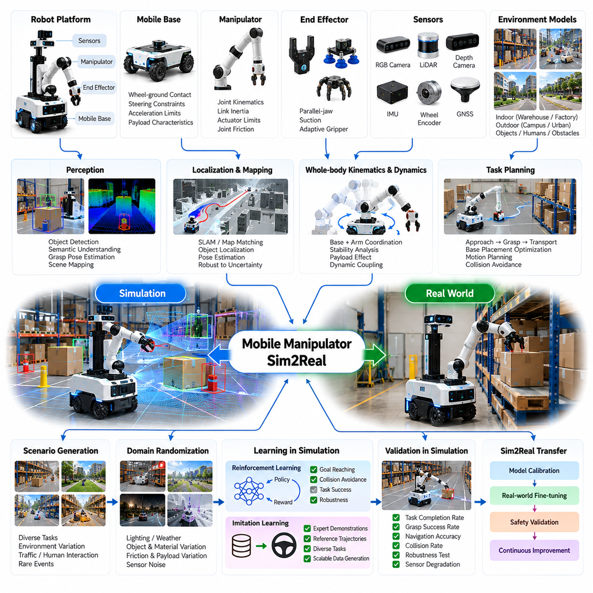{width="7.268055555555556in" height="7.268055555555556in"}

Mobile manipulator Sim2Real transfer represents a major challenge in Physical AI because it combines autonomous navigation, robotic manipulation, perception, and coordinated control within a single embodied system. Unlike stationary manipulators, mobile manipulators must account for changing base positions, environmental uncertainty, and interactions between locomotion and manipulation. Simulation provides a controlled foundation for developing these integrated capabilities.

A mobile manipulator typically consists of a mobile base, robotic arm, end effector, sensors, and an integrated control architecture. The mobile base provides spatial mobility, while the manipulator performs grasping, positioning, assembly, and object-handling tasks. Successful operation requires coordination between these subsystems because base motion directly affects the manipulator workspace, stability, and task execution accuracy.

Simulation models must represent both mobile platform dynamics and articulated manipulator behavior. The mobile base requires accurate wheel-ground contact, steering constraints, acceleration limits, and payload characteristics. The manipulator requires joint kinematics, link inertia, actuator torque limits, and joint friction models. Combining these elements enables realistic evaluation of the complete robot under changing configurations and loads.

Whole-body kinematics describes the relationship between mobile base motion and manipulator joint movement. The robot configuration includes base position, orientation, and arm joint states, forming a combined configuration space. Planning algorithms must determine feasible movements across this space while respecting joint limits, collision constraints, and environmental obstacles. Simulation allows these coordinated movements to be evaluated systematically.

Whole-body dynamics becomes particularly important when the manipulator carries heavy objects or operates at extended reach. Arm acceleration generates reaction forces that influence mobile base stability and wheel loading. Payload position changes the combined center of mass and may increase tipping risk. High-fidelity simulation helps identify configurations where manipulation performance becomes limited by physical stability rather than kinematic reachability.

Perception simulation provides synthetic RGB images, depth measurements, LiDAR observations, and object pose information for mobile manipulation tasks. These sensor streams support object detection, semantic understanding, grasp pose estimation, and environmental mapping. Realistic sensor modeling must consider occlusion, reflective surfaces, calibration uncertainty, and changing viewpoints caused by movement of the mobile platform.

Localization and mapping provide the spatial foundation for coordinated navigation and manipulation. The robot must estimate its position relative to the environment while identifying objects and target workspaces. Errors in base localization propagate into end-effector positioning, particularly when manipulation requires precise alignment. Simulation can introduce controlled localization disturbances to evaluate robustness against accumulated spatial uncertainty.

Task planning integrates navigation objectives with manipulation requirements. A mobile manipulator may need to approach a workstation, position its base, identify an object, execute a grasp, and transport the object to another location. Each stage influences subsequent actions, making task sequencing and spatial coordination essential. Simulation supports testing of complete task sequences rather than isolated movement primitives.

Base placement optimization determines where the mobile platform should stop to maximize manipulation feasibility. A geometrically reachable target may still require uncomfortable joint configurations, poor visibility, or unstable arm extension. Simulation can evaluate candidate base poses using reachability, manipulability, collision clearance, and stability criteria. This reduces failed grasp attempts and unnecessary repositioning during physical operation.

Motion planning must coordinate mobile base trajectories with manipulator movement. Sequential strategies move the base first and manipulate afterward, while simultaneous strategies allow coordinated motion of both subsystems. Simultaneous operation may improve efficiency but introduces additional dynamic coupling and collision risks. Simulation enables comparison of these strategies under different environmental and task constraints.

Contact-rich manipulation creates significant Sim2Real challenges because grasping, pushing, insertion, and object placement depend on complex physical interactions. Contact forces are influenced by friction, compliance, surface geometry, and actuator behavior. Small modeling errors can produce substantial differences between simulated and physical manipulation outcomes. Accurate contact models are therefore essential for tasks requiring precise force control.

Gripper simulation must represent finger geometry, contact surfaces, grasp forces, and object properties. Parallel-jaw grippers, suction devices, and adaptive end effectors exhibit different physical constraints and failure modes. Simulation can evaluate grasp stability across variations in object mass, shape, surface friction, and positioning uncertainty. These evaluations help identify robust grasp strategies before hardware experimentation.

Domain randomization improves transfer robustness by varying physical and visual properties across simulation episodes. Relevant parameters include object geometry, material appearance, friction, payload mass, joint damping, sensor noise, and base localization error. Training across these variations reduces dependence on idealized conditions and encourages policies that tolerate uncertainty in real-world manipulation environments.

Reinforcement learning can develop coordinated navigation and manipulation policies through repeated simulated interaction. Reward functions may consider task completion, grasp success, collision avoidance, energy consumption, and execution time. However, reward design must prevent unstable arm movements, excessive contact forces, and unsafe base positioning. Safety constraints should remain explicit rather than relying exclusively on learned reward optimization.

Imitation learning offers a complementary approach by using expert demonstrations from teleoperation, motion planning, or human-guided manipulation. Demonstrations provide structured examples of approach trajectories, grasp execution, object transport, and placement. Simulation can expand these examples through controlled environmental variations, supporting policy learning without requiring every task configuration to be demonstrated physically.

Massive parallel simulation accelerates mobile manipulation training by executing many robot-task combinations simultaneously. Different environments can vary object positions, workstation layouts, payloads, and robot configurations. Parallel training improves experience collection and supports systematic evaluation of policy generalization. Computational efficiency depends on balancing rigid-body dynamics, contact resolution, rendering fidelity, and available hardware resources.

Synthetic data generation provides labeled observations for object recognition, pose estimation, grasp detection, and manipulation planning. Simulated environments can automatically produce segmentation masks, depth maps, object poses, and contact information. These annotations reduce manual labeling requirements and enable targeted training on difficult configurations. Synthetic datasets become more effective when combined with representative real-world observations.

Digital twins provide continuously updated representations of mobile manipulators and their operating environments. Real telemetry can synchronize joint states, base positions, payload conditions, and task progress with the virtual system. This supports operational monitoring, failure replay, maintenance analysis, and evaluation of new task strategies. Digital twins also help identify differences between predicted and observed robot behavior.

A practical Sim2Real workflow begins with mechanical modeling, actuator characterization, and sensor calibration. The mobile base and manipulator are initially validated through separate motion experiments before integrated whole-body behavior is examined. System identification adjusts friction, inertia, latency, and control parameters using measured hardware responses. This staged process reduces uncertainty before transferring complex manipulation policies.

Controller transfer requires consistent command interfaces and observation formats between simulated and physical systems. Navigation controllers, arm controllers, and task planners should operate through compatible middleware and hardware abstraction layers. ROS 2 and related robotics frameworks can support modular integration, although timing, synchronization, and communication behavior must be validated under actual operating conditions.

Sim2Real gap analysis compares simulated and physical performance using navigation error, end-effector positioning accuracy, grasp success rate, contact force deviation, and task completion time. Additional indicators include base stability, wheel slip, actuator saturation, and recovery frequency. Evaluating these metrics across different payloads and workspaces reveals whether transfer failures originate from perception, dynamics, planning, or control.

Safety validation must consider collisions, unexpected contact forces, unstable payload handling, localization failures, and emergency stopping behavior. Mobile manipulators introduce hazards that arise from simultaneous movement of the base and arm, particularly near people and equipment. Simulation supports fault injection and hazardous scenario testing, while hardware-in-the-loop and controlled physical trials provide additional validation.

A representative industrial case involves a mobile manipulator transporting components between workstations and performing automated loading operations. The robot navigates through a factory, aligns its mobile base with a machine, identifies the target component, and executes a controlled grasp and placement. Simulation supports optimization of approach positions, coordinated trajectories, and recovery behavior before deployment.

The central lesson of mobile manipulator Sim2Real development is that navigation and manipulation cannot be treated as completely independent capabilities. Physical coupling, perception uncertainty, contact dynamics, and task-level coordination determine overall system performance. Reliable transfer requires calibrated simulation, diversified training, integrated control, and continuous real-world validation throughout the development lifecycle.

## 10.04. Manipulation and Grasping Sim2Real

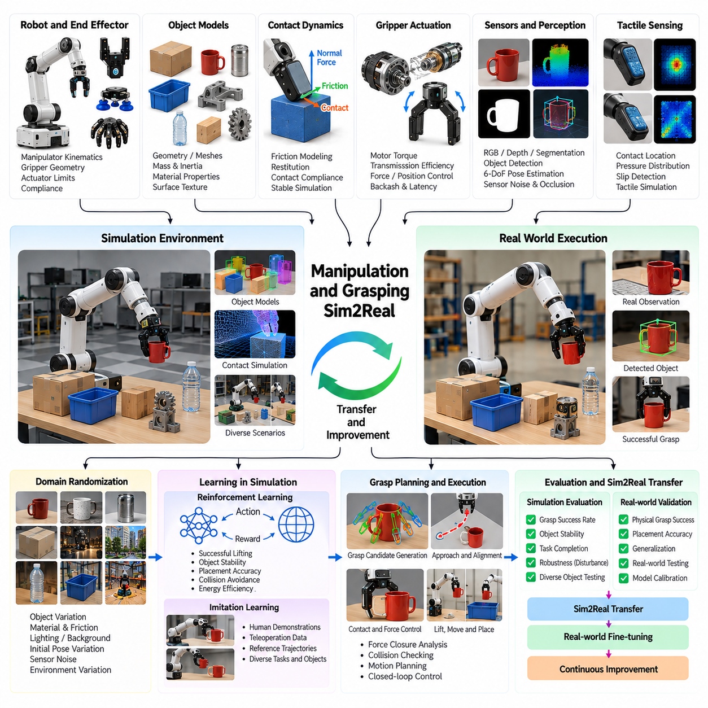{width="7.268055555555556in" height="7.268055555555556in"}

Manipulation and grasping Sim2Real transfer is a fundamental challenge in Physical AI because robotic hands and grippers must interact with objects whose geometry, material properties, and physical behavior vary significantly. Simulation enables robots to acquire grasping and manipulation skills through repeated virtual experiences, reducing hardware wear and experimentation costs while supporting systematic evaluation of contact-rich interactions.

Robotic manipulation involves coordinated motion between the manipulator, end effector, target object, and surrounding environment. A successful grasp requires accurate perception, appropriate contact placement, sufficient gripping force, and stable object control. Simulation must represent these interacting components because small errors in object positioning or contact dynamics can produce substantial differences between virtual and physical outcomes.

Grasping simulation begins with accurate geometric representations of objects and robotic end effectors. Object meshes, collision geometries, surface normals, and contact regions determine where interactions occur. Gripper models include finger dimensions, joint configurations, actuator limits, and mechanical compliance. Appropriate geometric resolution is necessary to reproduce grasp stability without introducing excessive computational complexity.

Contact dynamics is one of the most difficult aspects of manipulation simulation. Normal forces, tangential friction, restitution, and contact compliance influence whether an object remains stable, slides, rotates, or escapes from a grasp. Numerical contact solvers approximate these interactions using discrete time steps. Their accuracy depends on solver parameters, contact geometry, material properties, and integration stability.

Friction modeling is particularly important because grasp success often depends on maintaining sufficient tangential resistance at contact surfaces. Coulomb friction models provide a practical approximation, but real materials may exhibit velocity-dependent friction, surface contamination, and nonlinear deformation. Sim2Real transfer requires evaluating how uncertainty in friction coefficients affects grasp stability and manipulation performance.

Gripper actuation models must account for motor torque, transmission efficiency, finger speed, force limits, and control latency. Real grippers may exhibit backlash, hysteresis, compliance, and variations in gripping force. Simulating these characteristics prevents learning algorithms from relying on unrealistically precise actuation. Force-controlled and position-controlled gripping strategies can then be compared under consistent physical assumptions.

Object physical properties strongly influence manipulation behavior. Mass, center of gravity, inertia, stiffness, damping, and surface texture affect lifting, rotation, pushing, and placement. Objects with identical shapes may respond differently because of internal mass distribution or material composition. Simulation should therefore represent uncertainty in object parameters rather than assuming perfectly known physical characteristics.

Perception simulation provides synthetic RGB images, depth maps, segmentation masks, and object pose annotations for grasp planning. These observations support object recognition, six-degree-of-freedom pose estimation, and grasp candidate generation. Realistic rendering must consider occlusion, reflective materials, transparent surfaces, sensor noise, and camera calibration errors that commonly affect physical manipulation systems.

Grasp planning determines suitable contact configurations based on object geometry, end-effector capabilities, and task requirements. Analytical approaches evaluate force closure, contact wrench feasibility, and grasp quality, while learning-based methods estimate successful grasp candidates from sensory observations. Simulation enables large-scale comparison of these methods across diverse objects, poses, and environmental constraints.

Grasp execution requires more than selecting a geometrically feasible contact configuration. The robot must approach the object without collision, align the gripper, establish contact, regulate gripping force, and lift or manipulate the object. Closed-loop control adjusts actions using visual, tactile, or force feedback. Simulation helps evaluate how execution errors accumulate across these sequential interaction stages.

Tactile sensing provides valuable information about contact location, pressure distribution, slip, and object deformation. Simulated tactile sensors can approximate contact forces and pressure patterns generated during grasping. However, reproducing detailed tactile signals remains difficult because real sensors respond to complex material interactions. Calibration against physical tactile measurements is important for reliable transfer.

Domain randomization addresses uncertainty by varying object dimensions, mass, friction, stiffness, initial pose, lighting, and sensor characteristics. Randomized training exposes manipulation policies to conditions beyond a single nominal configuration. Effective distributions should reflect plausible physical variations while including sufficient diversity to improve robustness against unmodeled environmental differences.

Reinforcement learning can develop grasping and manipulation policies through repeated simulated interactions. Reward functions may combine successful lifting, object stability, placement accuracy, collision avoidance, and energy efficiency. Training becomes challenging when rewards are sparse or contact dynamics are unstable. Curriculum learning can progressively introduce more difficult objects, disturbances, and manipulation objectives.

Imitation learning provides an alternative training strategy using demonstrations from human teleoperation, expert controllers, or recorded robot trajectories. Demonstrations establish useful motion patterns for reaching, grasping, lifting, and placement. Simulation can augment these trajectories with randomized object configurations and controlled perturbations, reducing the amount of physical demonstration data required for initial policy development.

Dexterous manipulation introduces additional complexity through multiple fingers, numerous joints, and coordinated contact transitions. In-hand rotation, object reorientation, and finger gaiting require precise control of changing contact states. Simulation must capture the interaction between joint dynamics, contact forces, and object motion. Policies trained under simplified assumptions may struggle when transferred to physical robotic hands.

Bimanual manipulation requires coordination between two robotic arms or hands that jointly interact with an object. Tasks such as carrying large components, folding flexible materials, and coordinated assembly involve coupled motion and force distribution. Simulation supports evaluation of synchronization, shared load handling, and collision avoidance, while revealing potential instability caused by mismatched controller responses.

Deformable object manipulation presents further challenges because fabrics, cables, soft packages, and flexible components change shape during interaction. Rigid-body approximations are insufficient for tasks where deformation determines success. Specialized simulation methods represent elasticity, bending, stretching, and contact behavior, although computational cost and uncertain material parameters complicate accurate Sim2Real transfer.

Synthetic data generation supports manipulation learning by producing labeled grasp poses, contact states, object trajectories, and success outcomes. Large collections of simulated interactions can train perception models and grasp quality predictors. Automatic ground-truth generation reduces annotation effort, but synthetic labels must be validated because unrealistic contact behavior can introduce systematic errors into learned models.

Massive parallel simulation accelerates grasp policy training by evaluating many objects and robot configurations simultaneously. Each simulated environment can vary geometry, friction, pose, and control parameters. GPU-accelerated physics engines improve experience throughput, although contact-rich interactions may require careful numerical tuning. Parallel evaluation also supports systematic discovery of failure conditions and sensitivity to physical parameters.

A practical Sim2Real workflow begins with geometric modeling, gripper characterization, and object parameter estimation. Physical experiments measure gripping force, actuator response, friction, and representative contact behavior. The simulator is calibrated using these observations before policies are trained under randomized conditions. Initial deployment then proceeds through controlled grasp trials with progressively increasing object diversity.

Sim2Real gap analysis compares virtual and physical outcomes using grasp success rate, object slip frequency, contact force error, placement accuracy, and execution time. Additional measurements include trajectory deviation, actuator saturation, and recovery success. Differences across object categories reveal whether failures arise primarily from perception, physical modeling, control behavior, or unsuitable training distributions.

Safety considerations include excessive gripping force, unexpected object release, collisions, unstable payload handling, and damage to fragile materials. Simulation enables fault injection and testing of abnormal contact conditions without repeatedly risking hardware or objects. Nevertheless, physical validation remains necessary because simulated contact models cannot reproduce every material behavior or mechanical failure mechanism.

A representative industrial case involves transferring a simulated robotic picking policy to a physical gripper handling mixed components. The virtual environment generates objects with different shapes, orientations, masses, and surface properties. After training and calibration, the policy is tested on real objects, and observed failures guide additional simulation scenarios, parameter refinement, and targeted retraining.

The central lesson of manipulation and grasping Sim2Real development is that successful transfer depends on accurately representing contact interactions while maintaining sufficient diversity for generalization. Realistic geometry, calibrated actuation, friction uncertainty, tactile feedback, and closed-loop control must operate together. Simulation becomes an effective Physical AI training environment when its predictions are continuously evaluated against real manipulation performance.

## 10.05. Quadruped Locomotion Sim2Real

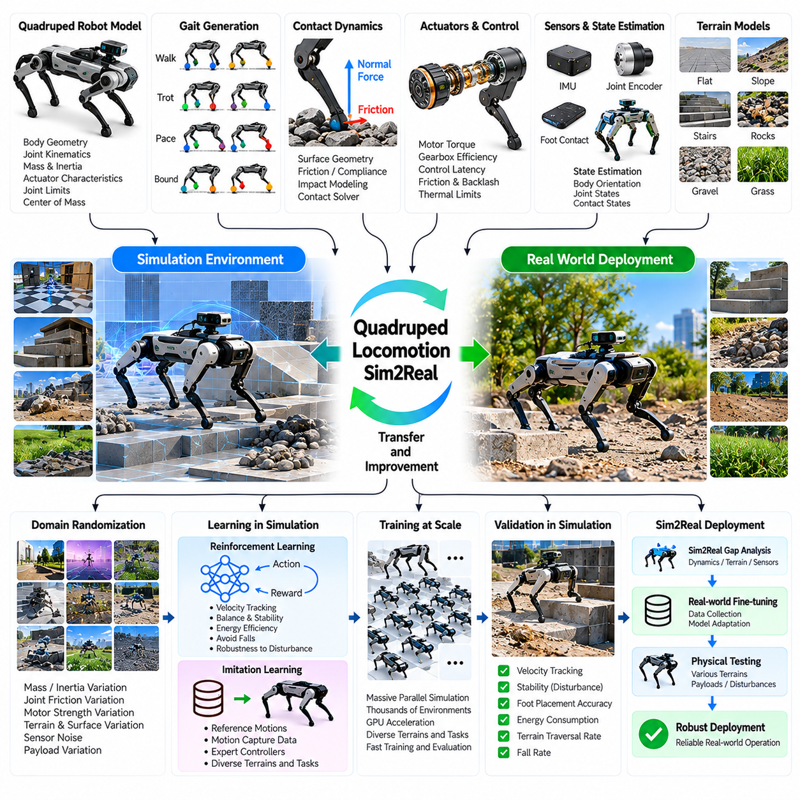{width="7.268055555555556in" height="7.268055555555556in"}

Quadruped locomotion Sim2Real transfer is a major research area in Physical AI because four-legged robots must maintain balance while interacting with complex and unpredictable terrain. Simulation enables locomotion policies to learn walking, trotting, climbing, and disturbance recovery through repeated virtual experiences. Successful transfer requires realistic dynamics, robust control, and systematic validation against physical robot behavior.

Quadruped robots possess multiple articulated joints distributed across four legs, creating a highly coupled dynamic system. Each leg contributes to propulsion, balance, and body stabilization through coordinated ground contact. Unlike wheeled platforms, quadrupeds continuously alternate between support and swing phases. Simulation must capture these changing contact configurations to reproduce realistic locomotion and stability.

A quadruped simulation model includes body geometry, joint kinematics, link inertia, actuator characteristics, and foot-ground contact dynamics. Accurate mass distribution and center-of-mass representation are particularly important because they influence balance and dynamic response. Joint limits, transmission ratios, and mechanical compliance must also be modeled to ensure that simulated movements remain physically achievable.

Legged locomotion depends on coordinated gait generation and precise timing of foot placement. Common gaits include walking, trotting, pacing, and bounding, each exhibiting different stability and energy characteristics. Simulation allows engineers to evaluate gait transitions, step frequency, duty factor, and body motion under controlled conditions. These experiments reveal how locomotion strategies respond to changing speed and terrain.

Contact dynamics represents one of the most challenging aspects of quadruped simulation. Each foot experiences intermittent contact forces determined by surface geometry, friction, compliance, and impact velocity. Numerical contact solvers must handle rapid transitions between contact and separation without excessive instability. Modeling errors can produce unrealistic foot penetration, artificial traction, or inaccurate impact responses.

Ground reaction forces directly influence quadruped balance and propulsion. During stance phases, each supporting leg generates forces that maintain body posture and produce desired motion. Force distribution changes continuously as the robot accelerates, turns, or encounters uneven terrain. Simulation supports evaluation of contact force allocation, support stability, and actuator loading across different locomotion conditions.

Actuator modeling is essential because real quadruped joints operate under torque, velocity, temperature, and power constraints. Electric motors, gear transmissions, and joint controllers exhibit delays, saturation, friction, and mechanical losses. Simplified actuator models may allow unrealistic accelerations or sustained torque outputs. Calibrated models help ensure that learned policies remain compatible with physical hardware limitations.

State estimation provides locomotion controllers with information about body orientation, angular velocity, joint positions, and estimated contact states. Simulated inertial measurement units, joint encoders, and contact sensors reproduce observations available on physical robots. Noise, bias, latency, and calibration errors must be considered because inaccurate state estimates can destabilize locomotion during rapid movements.

Terrain simulation introduces slopes, stairs, rocks, gravel, grass, and irregular surfaces that challenge legged mobility. Each terrain type produces different contact conditions and requires adjustments in foot placement, body posture, and gait selection. Procedural terrain generation enables diverse training environments, while physically plausible surface properties are necessary for meaningful transfer to outdoor operation.

Domain randomization is widely used to improve quadruped Sim2Real robustness. Training environments vary mass, inertia, joint friction, motor strength, control latency, ground friction, and terrain geometry. These variations expose locomotion policies to uncertainty in robot dynamics and environmental conditions. Carefully designed randomization distributions help prevent overfitting to a single idealized simulator.

Reinforcement learning enables quadrupeds to acquire locomotion skills through repeated interaction with simulated environments. Reward functions may encourage velocity tracking, balance, energy efficiency, smooth joint motion, and avoidance of falls. Policies learn coordinated joint actions that satisfy these objectives. However, poorly designed rewards may encourage unnatural gaits or exploit inaccuracies in simulated physics.

Curriculum learning improves training efficiency by gradually increasing locomotion difficulty. Robots may initially learn stable standing and walking on flat terrain before encountering slopes, obstacles, and external disturbances. More advanced stages introduce variable friction, payload changes, and complex terrain transitions. This progression supports stable policy development while expanding the range of operating conditions.

Massive parallel simulation accelerates reinforcement learning by executing thousands of quadruped environments simultaneously. GPU-accelerated physics engines can generate large quantities of locomotion experience within practical training periods. Each environment may contain different terrain, disturbances, and robot parameters. Parallel training improves exploration, although numerical accuracy and reproducibility remain essential considerations.

Imitation learning provides an alternative or complementary approach using reference motions from optimization, motion capture, or expert controllers. Demonstrations can guide the development of walking, trotting, jumping, and recovery behaviors. Reinforcement learning may subsequently refine these behaviors under randomized conditions. This combination can improve learning efficiency while preserving useful motion structures.

Model predictive control offers a complementary framework for quadruped locomotion by optimizing future body motion and contact forces over a limited prediction horizon. Simulation allows systematic comparison between model-based controllers and learned policies. Hybrid approaches may combine predictive planning with neural control, using learned components to handle complex dynamics while retaining explicit physical constraints.

Disturbance recovery is a critical capability for quadruped robots operating outside controlled laboratory environments. Unexpected pushes, foot slips, terrain collapse, and imperfect landings can destabilize the body. Simulation enables repeated testing of these disturbances without risking physical hardware. Recovery policies must learn to adjust foot placement, redistribute contact forces, and restore stable motion.

Payload variation introduces additional challenges because mounted equipment changes body mass, inertia, and center-of-gravity position. Quadrupeds carrying sensors, manipulators, or transported objects may require different gait and balance strategies. Simulation can evaluate payload configurations and determine whether locomotion controllers remain stable within specified mechanical and actuator limits.

Sim2Real transfer begins with system identification and calibration of the quadruped\'s mechanical and electrical characteristics. Physical experiments measure joint response, motor torque behavior, friction, latency, and body dynamics. These measurements guide simulator parameter adjustments. Accurate calibration reduces systematic differences between simulated locomotion and the behavior observed on actual hardware.

Controller deployment requires consistency between simulated observations and physical robot interfaces. Joint commands, sensor sampling rates, control frequencies, and communication delays must be represented accurately. Policies trained with idealized timing may become unstable when deployed on embedded controllers. Hardware-in-the-loop testing helps identify timing and integration problems before unrestricted physical operation.

Sim2Real gap analysis compares simulated and physical locomotion using velocity tracking error, body orientation stability, foot slip, energy consumption, and fall frequency. Additional metrics include joint torque demand, terrain completion rate, and disturbance recovery performance. Evaluating these indicators across multiple surfaces and speeds helps identify weaknesses in physics models, policy robustness, and actuator representation.

Safety validation must consider falls, joint overload, excessive contact forces, actuator overheating, and unexpected environmental interactions. Simulation supports fault injection and stress testing under conditions that would be expensive or dangerous to reproduce repeatedly. Nevertheless, controlled physical testing remains essential because real contact dynamics and mechanical failures cannot be represented perfectly.

A representative quadruped case study involves training a locomotion policy across procedurally generated terrain with randomized physical parameters. The trained controller is transferred to a physical quadruped and evaluated on flat ground, ramps, stairs, and uneven outdoor surfaces. Observed tracking errors, slips, and instability guide simulator recalibration and additional training before broader deployment.

The central lesson of quadruped locomotion Sim2Real development is that robust legged mobility depends on the integration of realistic contact physics, actuator modeling, diverse training conditions, and continuous physical validation. Simulation provides scalable experience generation, while real-world measurements establish the limits of model accuracy. Their iterative combination enables increasingly reliable locomotion across complex environments.

## 10.06. Humanoid Simulation and Sim2Real

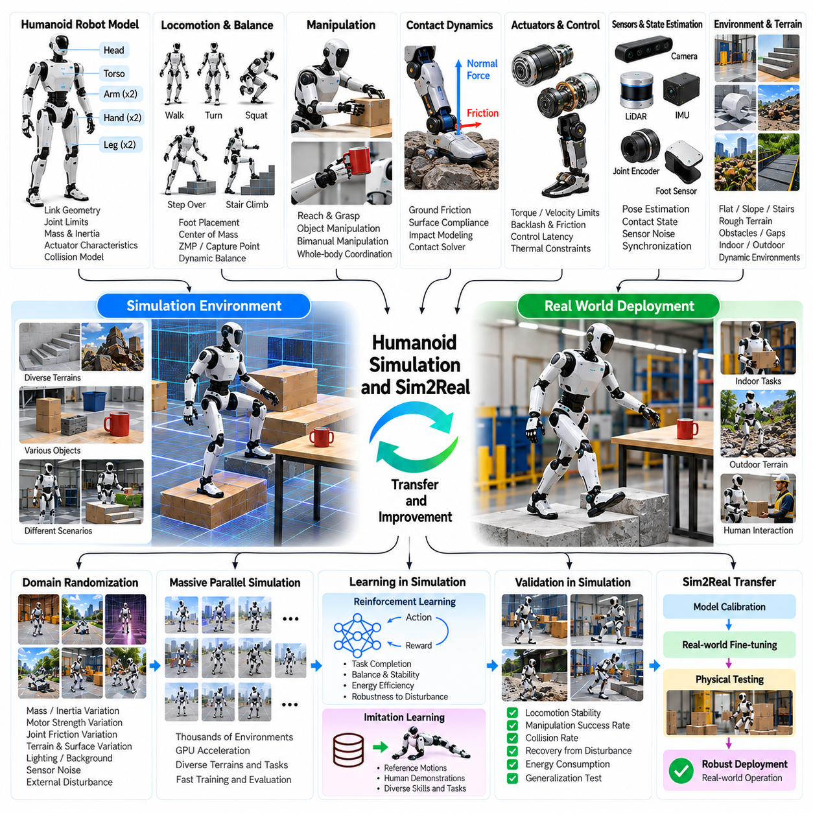{width="7.268055555555556in" height="7.268055555555556in"}

Humanoid simulation and Sim2Real transfer represent a major frontier in Physical AI because humanoid robots must coordinate locomotion, manipulation, balance, and perception within a highly articulated body. Their human-inspired morphology enables interaction with environments designed for people but introduces substantial control complexity. Simulation provides a scalable foundation for learning and validating these capabilities before physical deployment.

Humanoid robots typically combine a torso, two legs, two arms, a head, and multiple articulated joints. Their configuration creates a high-dimensional system in which movement of one body segment influences the stability and motion of others. Unlike fixed manipulators, humanoids must continuously manage their support conditions. Accurate simulation must therefore represent whole-body kinematics, dynamics, and contact interactions.

A humanoid digital model includes link geometry, joint limits, mass distribution, inertia tensors, actuator characteristics, and collision structures. The center of mass changes as the robot moves its arms, bends its knees, or carries objects. Small errors in these parameters can affect predicted balance and joint loading. Model calibration is essential for reproducing physically achievable movements and meaningful stability margins.

Bipedal locomotion presents a distinctive challenge because humanoids alternate between single-support and double-support phases. Walking requires coordinated foot placement, body momentum regulation, and controlled transitions between contact states. Simulation enables evaluation of stride length, step timing, walking speed, and turning behavior. These variables influence both locomotion efficiency and resistance to external disturbances.

Balance control depends on managing the relationship between the center of mass, support region, and ground reaction forces. Concepts such as the zero moment point and capture point provide useful approximations for planning stable motion. Dynamic movements also require consideration of angular momentum and contact wrench constraints. Simulation supports comparison of balance strategies under different postures and environmental conditions.

Contact modeling is critical because humanoid feet, hands, and other body surfaces may interact with the environment. Ground friction, surface compliance, impact forces, and contact transitions determine whether movements remain stable. Numerical inaccuracies can produce artificial foot traction or unrealistic contact impulses. Reliable Sim2Real transfer requires careful validation of contact behavior against physical measurements.

Humanoid actuator systems operate under torque, velocity, power, and thermal constraints. Joint transmissions may introduce friction, backlash, elasticity, and response delays that influence movement accuracy. Simplified actuator models can encourage policies to demand physically impossible forces or accelerations. Calibrated actuator representations help align simulated control actions with the capabilities of actual robot hardware.

State estimation integrates inertial measurements, joint encoders, foot contact information, and external perception to estimate body posture and motion. Humanoids require reliable estimates of base orientation, joint configuration, and support state during locomotion. Sensor noise, synchronization errors, and delayed observations can destabilize control. Simulation should reproduce these uncertainties rather than providing unrealistically perfect feedback.

Whole-body control coordinates multiple joints to satisfy locomotion, manipulation, posture, and balance objectives simultaneously. Hierarchical optimization can prioritize contact stability while allowing secondary tasks such as reaching or head orientation. Simulation enables systematic testing of competing objectives and physical constraints. Successful transfer requires controllers to handle changing contacts and actuator limitations without losing stability.

Motion planning for humanoids must consider full-body collision avoidance, joint reachability, and dynamic feasibility. A robot reaching toward an object may need to shift its weight, adjust foot placement, or reposition its torso. Planning isolated arm trajectories can therefore produce unstable configurations. Integrated simulation helps evaluate coordinated movements that preserve balance while accomplishing manipulation tasks.

Reinforcement learning provides a mechanism for acquiring humanoid behaviors through repeated simulated interaction. Policies may learn standing, walking, turning, squatting, reaching, and recovery from disturbances. Reward functions typically combine task completion, stability, velocity tracking, smooth movement, and energy efficiency. Poor reward design may encourage unnatural movements or exploitation of numerical simulation artifacts.

Curriculum learning introduces humanoid capabilities through progressively more demanding training conditions. Initial stages may focus on stable standing and simple stepping before introducing walking, turning, uneven terrain, and object interaction. Advanced stages can include external pushes, variable payloads, and complex task sequences. Gradual progression improves training stability and supports the development of reusable motor skills.

Domain randomization strengthens Sim2Real robustness by varying body mass, inertia, motor strength, joint friction, contact properties, sensor noise, and control latency. Environmental variations may include floor friction, slopes, obstacles, and unexpected disturbances. These changes expose policies to uncertainty that is difficult to model exactly. Randomization ranges should remain physically plausible while covering likely deployment conditions.

Massive parallel simulation accelerates humanoid policy learning by running numerous robot instances across diverse environments. GPU-accelerated physics engines enable large-scale experience collection for locomotion and manipulation tasks. However, humanoid models contain many joints and simultaneous contacts, increasing computational demands. Training efficiency must be balanced against contact accuracy, numerical stability, and simulation fidelity.

Imitation learning can use motion capture, teleoperation, expert controllers, or optimized reference trajectories to guide humanoid behavior. Human motion data provides useful patterns for walking, reaching, and coordinated body movement. However, direct imitation may fail because humanoid robots differ from humans in proportions, actuator capabilities, and joint limits. Motion retargeting and physical feasibility checks are therefore necessary.

Model predictive control and trajectory optimization provide complementary approaches to humanoid movement generation. These methods predict future motion and optimize control actions subject to dynamics and contact constraints. Learned policies may improve adaptability, while optimization-based controllers provide explicit constraint handling. Hybrid architectures can combine both approaches to balance computational efficiency, robustness, and physical consistency.

Humanoid manipulation introduces additional challenges because arm movement changes whole-body momentum and balance. Lifting objects, opening doors, or carrying equipment may require coordinated adjustments of the torso, legs, and feet. Simulation must capture payload effects and contact forces during these interactions. Integrated locomotion-manipulation policies are particularly important for tasks that require movement while handling objects.

Disturbance recovery is essential for humanoids because a loss of balance can result in damaging falls. Unexpected pushes, slipping feet, uneven surfaces, and imperfect object interactions may destabilize the robot. Simulation enables repeated testing of recovery stepping, posture adjustment, and controlled fall responses. Physical transfer requires additional safety mechanisms because simulated recovery performance does not guarantee real-world reliability.

Synthetic data generation supports humanoid perception, pose estimation, terrain understanding, and manipulation planning. Simulated cameras, depth sensors, and contact measurements provide labeled observations across varied scenes and tasks. Synthetic demonstrations can also support training of vision-language-action policies. Their usefulness depends on realistic sensory variation and consistency between simulated observations and physical robot interfaces.

A practical humanoid Sim2Real workflow begins with mechanical modeling, actuator identification, sensor calibration, and isolated joint testing. Standing and balance controllers are validated before introducing stepping, walking, and coordinated manipulation. Simulation parameters are refined using measured robot responses. Policies are then transferred through controlled hardware experiments with explicit limits on speed, force, and operating conditions.

Sim2Real gap analysis compares simulated and physical behavior using balance stability, walking speed error, foot slip, joint tracking accuracy, energy consumption, and task success rate. Additional indicators include contact force deviation, recovery performance, actuator temperature, and fall frequency. Testing across different surfaces and task conditions helps determine whether failures originate from dynamics, perception, control, or training assumptions.

Safety validation must address falls, joint overload, unstable payload handling, unexpected collisions, and interactions with nearby people. Simulation supports hazardous scenario testing, fault injection, and evaluation of emergency stopping behavior. Nevertheless, physical testing remains necessary to verify actual hardware responses. Protective equipment, controlled test spaces, and conservative operating limits reduce risks during early deployment.

A representative humanoid case study involves training a whole-body policy to walk toward a workstation, maintain balance, grasp an object, and transport it to another location. Simulation provides randomized terrain, object placement, payload conditions, and external disturbances. Physical evaluation reveals differences in foot contact, actuator response, and manipulation accuracy, guiding recalibration and targeted policy improvement.

The central lesson of humanoid simulation and Sim2Real development is that reliable humanoid intelligence requires coordinated treatment of locomotion, manipulation, perception, and whole-body dynamics. High-fidelity models alone are insufficient without diverse training and continuous physical validation. Iterative integration of simulation, learning, optimization, and hardware feedback provides a practical path toward increasingly capable humanoid robots.

## 10.07. Aerial and Cargo UAV Simulation

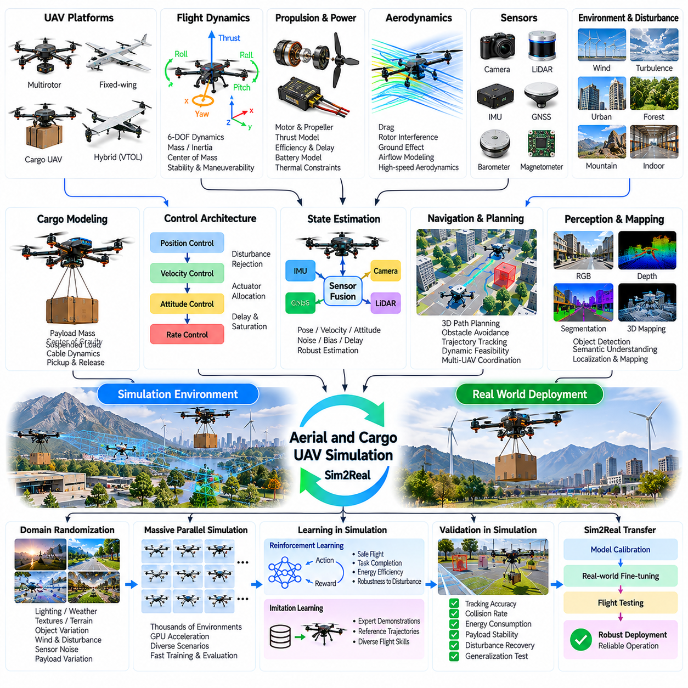{width="7.268055555555556in" height="7.268055555555556in"}

Aerial and cargo UAV simulation is an essential component of Physical AI because unmanned aerial vehicles must operate within dynamic three-dimensional environments while maintaining stability, navigation accuracy, and operational safety. Cargo UAVs introduce additional challenges associated with payload mass, shifting centers of gravity, and external disturbances. Simulation enables systematic development and validation before exposing expensive aircraft to physical flight risks.

Aerial robot simulation begins with accurate representation of vehicle geometry, mass distribution, propulsion systems, and flight dynamics. Multirotor UAVs generate lift and control moments through coordinated rotor thrust, while fixed-wing aircraft rely on aerodynamic lift and control surfaces. Hybrid configurations combine these principles. Each architecture requires specialized models to reproduce realistic flight behavior and control limitations.

Six-degree-of-freedom flight dynamics describes the translational and rotational motion of an aerial vehicle. Position, velocity, orientation, and angular velocity evolve according to aerodynamic forces, rotor thrust, gravity, and external disturbances. Accurate inertia tensors and center-of-mass locations are essential for predicting rotational response. Simulation integrates these equations over time to evaluate stability and maneuverability.

Propulsion modeling represents the relationship between motor commands, rotor speed, thrust generation, and electrical power consumption. Real propulsion systems exhibit response delays, saturation, efficiency losses, and thermal constraints. Battery voltage variation can further influence available thrust. Simulators must account for these characteristics to prevent flight controllers from depending on unrealistically instantaneous or unlimited propulsion responses.

Aerodynamic modeling is particularly important during high-speed flight, aggressive maneuvering, and operations near structures. Drag, induced airflow, rotor interference, and ground effect influence vehicle stability and energy consumption. Simplified models may be sufficient for basic hovering, but complex operations require greater fidelity. Simulation accuracy should therefore match the expected flight envelope and mission requirements.

Environmental disturbances represent a major source of uncertainty in aerial Sim2Real transfer. Wind speed, gust intensity, turbulence, temperature, and air density affect vehicle motion and propulsion efficiency. Cargo UAVs may experience amplified disturbances because of larger dimensions or suspended loads. Simulation can introduce stochastic atmospheric conditions to evaluate controller robustness across realistic operating environments.

Flight control architectures commonly include attitude stabilization, angular-rate control, velocity regulation, and position tracking. These control loops operate at different frequencies and rely on consistent state estimates. Simulation supports evaluation of controller gains, disturbance rejection, and actuator allocation. Accurate representation of command delays and control saturation is necessary for reliable deployment on embedded flight computers.

State estimation combines inertial measurements, GNSS observations, barometric altitude, magnetometer data, and visual information. Sensor fusion algorithms estimate position, velocity, orientation, and motion uncertainty. Simulation should reproduce sensor noise, bias drift, measurement delays, and temporary signal loss. These effects become particularly important during low-altitude operations, indoor navigation, and flights near large structures.

Autonomous navigation requires three-dimensional path planning, obstacle detection, localization, and trajectory tracking. Aerial robots must avoid buildings, vegetation, cables, and other aircraft while respecting vehicle dynamics. Simulation allows planners to evaluate collision-free trajectories under varying environmental conditions. Dynamic feasibility is essential because a geometrically valid route may exceed acceleration or braking capabilities.

Cargo UAV simulation introduces payload-dependent dynamics that differ from conventional lightweight drone operation. Payload mass affects thrust requirements, acceleration, braking distance, and flight endurance. Uneven payload distribution changes inertia and center-of-gravity position. Simulation supports analysis of allowable loading configurations and helps identify flight conditions where available control authority becomes insufficient.

Suspended cargo introduces additional complexity because the payload behaves as a coupled dynamic system. Cable tension, pendulum motion, attachment geometry, and aerodynamic drag influence aircraft stability. Rapid acceleration or abrupt turns can generate large payload oscillations. Simulation must capture vehicle-load coupling to evaluate swing suppression, trajectory planning, and safe delivery operations.

Cargo pickup and release require accurate modeling of transient changes in vehicle mass and external forces. During attachment, the aircraft may experience sudden loading, while release changes thrust requirements and dynamic response. Ground contact and cargo positioning also influence operation near delivery locations. Simulation supports development of controlled pickup, transport, lowering, and release procedures.

Energy modeling is essential because aerial vehicles operate under strict battery and propulsion limitations. Flight endurance depends on payload mass, airspeed, altitude, wind, maneuver intensity, and battery condition. Cargo missions may require substantial reserve energy for return flight or emergency landing. Simulation enables mission feasibility assessment and comparison of energy-aware trajectory planning strategies.

Domain randomization improves Sim2Real robustness by varying vehicle mass, inertia, motor efficiency, thrust coefficients, wind conditions, sensor noise, and control latency. Cargo-related variations may include payload weight, attachment location, and suspended-load length. Training across these distributions helps controllers tolerate uncertainty in aircraft characteristics and environmental conditions encountered during physical operation.

Reinforcement learning can develop adaptive flight control and navigation policies through repeated simulated experience. Training objectives may include stable hovering, trajectory tracking, obstacle avoidance, energy efficiency, and disturbance recovery. However, unconstrained exploration can produce unsafe maneuvers. Safety constraints, action limits, and conventional stabilization controllers are important when integrating learned policies into real aircraft.

Massive parallel simulation accelerates aerial policy development by executing numerous flight environments simultaneously. Each instance may contain different wind fields, obstacles, payload configurations, and mission objectives. Parallel training supports large-scale exploration and systematic robustness evaluation. Computational requirements depend on aerodynamic fidelity, sensor rendering, collision modeling, and the complexity of coupled cargo dynamics.

Synthetic sensor generation provides RGB images, depth observations, segmentation labels, and simulated range measurements for aerial perception. These datasets support obstacle recognition, landing-zone detection, visual localization, and infrastructure inspection. Photorealistic rendering can improve visual realism, but synthetic observations must also represent motion blur, exposure variation, atmospheric visibility, and sensor imperfections.

Digital twins provide synchronized virtual representations of aircraft, propulsion systems, batteries, payloads, and mission environments. Flight telemetry can update estimated vehicle states and operational conditions during deployment. These models support mission rehearsal, anomaly analysis, maintenance planning, and post-flight reconstruction. Differences between predicted and observed behavior can guide model refinement and controller improvements.

A practical aerial Sim2Real workflow begins with mechanical parameter identification, propulsion characterization, sensor calibration, and flight controller validation. Software-in-the-loop testing evaluates algorithms against simulated dynamics, while hardware-in-the-loop testing introduces actual flight electronics. Controlled flight trials then verify hovering, trajectory tracking, disturbance response, and payload handling before expanding operational complexity.

Sim2Real gap analysis compares simulated and physical flights using position tracking error, attitude deviation, thrust response, energy consumption, and disturbance rejection. Cargo-specific indicators include payload swing amplitude, load stabilization time, and delivery positioning accuracy. Testing across payload weights and wind conditions helps distinguish aerodynamic modeling errors from actuator, sensor, and control limitations.

Safety validation must address propulsion failures, communication loss, GNSS degradation, battery depletion, payload release faults, and unexpected obstacles. Simulation enables fault injection and emergency procedure testing without repeatedly risking aircraft or personnel. Nevertheless, physical flight testing remains essential because real aerodynamic interactions and mechanical failures cannot be modeled perfectly.

A representative cargo UAV case study involves transporting industrial components between designated logistics points. The virtual environment includes terrain, obstacles, wind disturbances, variable payloads, and energy constraints. Controllers are evaluated for takeoff, loaded flight, precision approach, cargo delivery, and return operations. Physical trials reveal discrepancies that guide recalibration, trajectory refinement, and additional scenario testing.

The central lesson of aerial and cargo UAV simulation is that reliable Sim2Real transfer requires integrated modeling of flight dynamics, propulsion, environmental disturbances, payload interactions, and onboard autonomy. High-fidelity simulation reduces development risk but cannot eliminate physical uncertainty. Continuous comparison between virtual predictions and measured flight performance provides the foundation for safe and increasingly autonomous aerial operations.

## 10.08. Multi Robot and Fleet Simulation

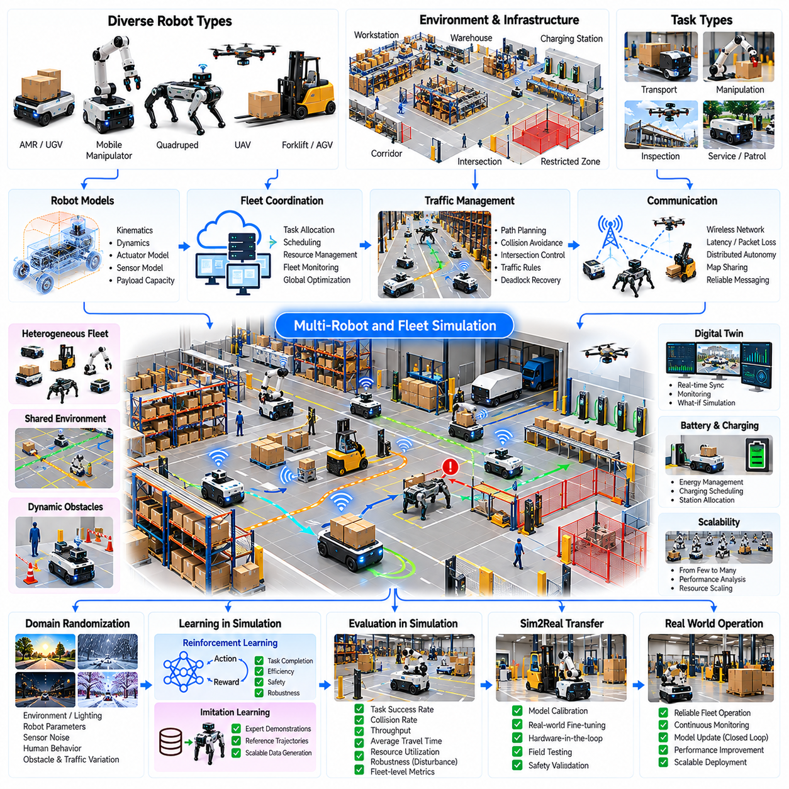{width="7.268055555555556in" height="7.268055555555556in"}

Multi-robot and fleet simulation is an essential component of Physical AI because coordinated robotic systems must operate efficiently within shared environments. Unlike single-robot simulation, fleet-level environments must represent interactions among multiple autonomous agents, infrastructure, and centralized management systems. Simulation enables evaluation of coordination strategies, resource utilization, and operational reliability before large-scale physical deployment.

Multi-robot systems may include autonomous mobile robots, robotic manipulators, inspection platforms, delivery vehicles, and heterogeneous robotic agents. Each robot possesses individual sensing, planning, and control capabilities while participating in shared operational objectives. Simulation must represent both individual robot behavior and collective system dynamics to evaluate whether local decisions produce efficient fleet-level outcomes.

Fleet simulation environments combine robot dynamics, facility geometry, navigation networks, task definitions, and operational constraints. Digital representations of warehouses, factories, hospitals, and logistics centers provide realistic testing conditions. The environment must include corridors, intersections, charging stations, workstations, and restricted zones. These elements determine how robots interact with physical infrastructure and one another.

Robot heterogeneity introduces additional complexity because different platforms possess distinct payload capacities, movement speeds, turning radii, and sensing capabilities. A fleet may combine differential-drive robots, omnidirectional platforms, forklifts, and mobile manipulators. Simulation enables coordinated evaluation of these platforms while preserving their individual kinematic, dynamic, and operational constraints.

Task allocation determines how available robots are assigned to transportation, inspection, manipulation, or service requests. Centralized scheduling systems can optimize assignments using robot location, battery state, payload capacity, and task priority. Distributed approaches allow robots to negotiate responsibilities through local communication. Simulation supports comparison of allocation strategies under changing demand and fleet availability.

Multi-robot path planning must prevent collisions while maintaining efficient movement through shared spaces. Independent shortest-path planning can produce conflicts when several robots approach narrow corridors or intersections simultaneously. Coordinated planning considers spatial occupancy and time-dependent reservations. Simulation enables evaluation of collision avoidance, path conflicts, congestion, and traffic throughput across different fleet densities.

Traffic management becomes increasingly important as robot population grows. Shared corridors, elevators, loading stations, and intersections can become operational bottlenecks. Traffic controllers may apply priority rules, directional routing, or reservation-based access. Simulation helps identify congestion patterns and determine whether infrastructure capacity is sufficient for expected fleet demand.

Deadlock and livelock represent critical coordination failures in multi-robot environments. Deadlock occurs when robots block one another while waiting for unavailable resources, whereas livelock occurs when repeated avoidance actions prevent progress. Simulation can reproduce these situations through controlled traffic scenarios. Recovery mechanisms may include priority reassignment, route replanning, and temporary movement restrictions.

Fleet communication supports task coordination, state reporting, map sharing, and operational supervision. Wireless networks introduce latency, packet loss, bandwidth limitations, and intermittent connectivity. Simulation should represent communication uncertainty because delayed information can produce inconsistent task assignments or conflicting movement decisions. Communication-aware planning improves resilience when centralized coordination becomes temporarily unavailable.

Distributed autonomy enables individual robots to continue safe operation when communication with a fleet controller is interrupted. Local navigation, obstacle avoidance, and emergency stopping should not depend entirely on continuous network connectivity. Simulation can evaluate degraded operating modes and recovery after reconnection. These tests help establish appropriate boundaries between centralized orchestration and onboard autonomy.

Fleet-level perception requires robots to interpret dynamic environments containing people, equipment, temporary obstacles, and other autonomous systems. Shared maps and collaborative observations can improve situational awareness, but inconsistent localization may create conflicting spatial information. Simulation enables controlled testing of perception uncertainty, map synchronization, and dynamic obstacle handling across multiple robots.

Digital twin technology provides a virtual representation of fleet operations synchronized with physical robot telemetry. Robot positions, task states, battery levels, traffic conditions, and equipment availability can be reflected in the simulation environment. This enables operational monitoring, performance forecasting, and evaluation of alternative scheduling strategies. Digital twins also support replay of incidents and identification of recurring inefficiencies.

Battery management and charging coordination are essential for sustained fleet operation. Robots must balance task execution with remaining energy, charging availability, and expected mission duration. Poor charging schedules may create station congestion or reduce effective fleet capacity. Simulation supports evaluation of charging policies, battery degradation assumptions, and energy-aware task assignment strategies.

Fleet sizing determines the number and types of robots required to satisfy operational demand. Adding robots may initially increase throughput, but excessive fleet density can create congestion and coordination overhead. Simulation enables capacity analysis by varying robot population, task arrival rates, and infrastructure constraints. These experiments reveal operating regions where additional robots provide diminishing productivity gains.

Massive parallel simulation accelerates fleet development by evaluating many operating scenarios simultaneously. Different instances may vary facility layouts, robot counts, task distributions, traffic conditions, and equipment failures. Parallel experiments support statistical performance analysis and identification of rare coordination failures. Computational efficiency depends on balancing detailed robot physics with scalable fleet-level event simulation.

Domain randomization improves robustness by varying navigation uncertainty, communication latency, task arrival patterns, obstacle positions, and robot performance characteristics. These variations expose coordination algorithms to conditions beyond idealized operation. Simulation can also introduce temporary workstation failures, blocked corridors, and unexpected demand surges. Such diversity helps identify strategies that remain effective under operational uncertainty.

Multi-agent reinforcement learning provides an approach for developing cooperative fleet behaviors through simulated interaction. Agents may learn task allocation, traffic negotiation, formation control, or collaborative exploration. Reward functions must balance individual efficiency with collective objectives. Training becomes challenging when agents pursue conflicting goals or when policy behavior changes as the fleet population increases.

Hierarchical control architectures separate strategic fleet management from local robot execution. High-level systems assign missions, optimize resource usage, and coordinate traffic, while individual robots perform navigation and manipulation. Simulation supports validation of these control layers and their interfaces. Clear responsibility boundaries reduce the risk that fleet-level optimization compromises local safety.

A practical fleet Sim2Real workflow begins with accurate facility mapping, robot capability modeling, and operational data collection. Task arrival patterns, travel times, charging behavior, and infrastructure constraints are incorporated into the simulator. Individual robot navigation is validated before multi-robot coordination is introduced. Progressive deployment then compares simulated fleet performance with measured physical operations.

Sim2Real gap analysis evaluates differences between predicted and actual throughput, task completion time, travel distance, congestion frequency, and robot utilization. Additional metrics include charging delays, communication failures, collision avoidance events, and recovery time. Discrepancies may originate from inaccurate task distributions, simplified traffic behavior, localization uncertainty, or unmodeled human activity.

Safety validation must consider robot collisions, blocked emergency routes, communication failures, unexpected human movement, and coordination software faults. Simulation supports stress testing of high-density traffic and abnormal operational scenarios. However, physical validation remains necessary because real human behavior and environmental changes are difficult to reproduce completely. Local safety functions should remain effective independently of fleet optimization.

A representative fleet case study involves autonomous mobile robots transporting materials between warehouse storage areas and production workstations. Simulation models task requests, robot availability, route conflicts, charging demand, and facility congestion. Fleet controllers are evaluated under normal demand and peak workloads. Physical deployment data then guides refinement of traffic rules, scheduling policies, and infrastructure configuration.

The central lesson of multi-robot and fleet simulation is that overall performance depends on coordinated system behavior rather than individual robot capability alone. Reliable Sim2Real transfer requires realistic operational models, robust communication, effective traffic management, and continuous performance validation. Integrating simulation with fleet telemetry and digital twins enables scalable, resilient, and increasingly autonomous robotic operations.

## 10.09. Robot Foundation Model and VLA Simulation

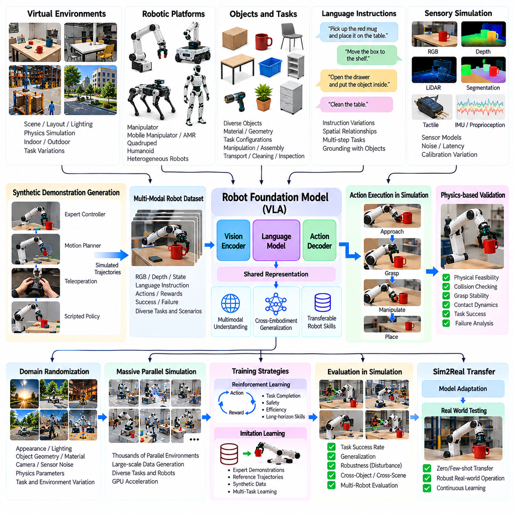{width="7.268055555555556in" height="7.268055555555556in"}

Robot foundation models and vision-language-action simulation represent an emerging direction in Physical AI, where robots learn generalizable behaviors from diverse visual observations, language instructions, and physical interactions. Unlike task-specific controllers, foundation models aim to transfer knowledge across objects, environments, and robotic platforms. Simulation provides scalable environments for generating training experiences and evaluating these capabilities before physical deployment.

A robot foundation model learns reusable representations of perception, actions, spatial relationships, and task structure from large datasets. Training sources may include robot demonstrations, human videos, synthetic trajectories, and multimodal annotations. The model can support multiple downstream tasks through shared representations. Simulation expands the available experience by generating controlled variations of scenes, objects, and interaction outcomes.

Vision-language-action models integrate visual perception, natural language understanding, and robotic action generation within a unified architecture. Camera observations describe the environment, language specifies intended objectives, and action outputs control the robot. The model must connect semantic instructions with physically executable behavior. Simulation enables testing of this connection under diverse spatial arrangements and task conditions.

A typical VLA simulation pipeline begins with virtual environment construction, robot embodiment modeling, and task instruction generation. Simulated cameras provide visual observations while physics engines calculate interactions between robots and objects. The system records observations, instructions, actions, and resulting states as synchronized trajectories. These trajectories form structured datasets for supervised learning, imitation learning, and policy evaluation.

Robot embodiment plays an important role because foundation models must account for differences in joint configurations, gripper mechanisms, workspace dimensions, and motion constraints. A policy trained on one manipulator may not directly control another platform. Simulation supports embodiment-aware training through robot-specific action representations and shared task descriptions. This approach improves the potential for transferring learned capabilities across heterogeneous robots.

Language grounding connects abstract instructions with objects, locations, and actions in the physical environment. Commands such as placing a component into a container require identifying the correct object, interpreting spatial relationships, and executing a feasible manipulation sequence. Simulation can generate instruction variations and corresponding task configurations. Grounding accuracy is evaluated by whether the robot performs the intended physical operation.

Visual grounding requires the model to associate image regions with relevant objects and actionable properties. Object appearance, lighting, occlusion, viewpoint, and background clutter influence recognition reliability. Simulation can vary these conditions while preserving accurate object labels and scene geometry. Synthetic visual diversity helps models distinguish task-relevant features from incidental appearance patterns that may change during deployment.

Action representation determines how a VLA model translates learned intentions into robot commands. Outputs may include joint positions, end-effector poses, velocities, or short action sequences. Different representations impose distinct requirements on control frequency, stability, and embodiment compatibility. Simulation allows evaluation of action decoding, trajectory feasibility, and integration with low-level controllers before real-world execution.

Temporal reasoning is essential because robotic tasks unfold through sequences of observations and actions. A robot may need to approach an object, establish contact, adjust its grasp, and complete placement while responding to changing conditions. VLA models must preserve task context and update decisions as new observations arrive. Simulation supports evaluation of multi-step execution, error recovery, and long-horizon task completion.

Physics-based simulation provides interaction feedback that visual or language-only datasets cannot fully capture. Grasp stability, friction, collision forces, object mass, and contact transitions influence whether an action succeeds. A model may predict a semantically appropriate action that is physically infeasible. Integrating physics validation helps identify such failures and improves the consistency between generated actions and robot capabilities.

Synthetic demonstration generation can reduce dependence on expensive physical robot data. Expert controllers, motion planners, teleoperation interfaces, and scripted procedures can produce trajectories in simulated environments. Successful and unsuccessful executions provide complementary learning signals. Dataset quality depends on physical validity, behavioral diversity, annotation consistency, and alignment with the target robot\'s observation and action interfaces.

Domain randomization strengthens VLA generalization by varying textures, illumination, object geometry, camera positions, sensor noise, and physical parameters. Task randomization introduces different object arrangements, instruction formulations, and interaction sequences. These variations reduce dependence on narrow training conditions. However, unrealistic randomization can introduce misleading correlations or physically invalid demonstrations.

Massive parallel simulation enables foundation model development through large-scale generation of interaction trajectories. Thousands of virtual environments may execute related tasks with different objects, layouts, and robot configurations. Parallel execution increases coverage of rare failures and difficult manipulation conditions. Efficient data collection requires balancing simulation fidelity, computational cost, trajectory diversity, and annotation accuracy.

Simulation-generated datasets can support pretraining, fine-tuning, and targeted adaptation of robot foundation models. Broad pretraining develops general visual and action representations, while task-specific adaptation improves performance in selected operational environments. Synthetic data is particularly useful for underrepresented scenarios. Mixing simulated and physical demonstrations can reduce dependence on either source and improve transfer robustness.

Closed-loop policy evaluation distinguishes physically grounded VLA systems from models assessed only through offline prediction accuracy. A predicted action may appear correct in a dataset but fail when executed because it changes the environment unexpectedly. Simulation allows the model to act, observe consequences, and revise subsequent decisions. Success rates, recovery behavior, and constraint violations provide more meaningful evaluation than prediction error alone.

Long-horizon robotic tasks require coordination between semantic planning and continuous motor control. A language-level objective may involve navigation, object identification, grasping, transportation, and placement. Hierarchical architectures can separate task planning from motion execution while maintaining feedback between layers. Simulation enables testing of task decomposition, subgoal completion, and recovery when intermediate actions fail.

World models can complement VLA policies by predicting future observations and physical consequences of candidate actions. Learned dynamics representations may estimate object movement, contact outcomes, and changes in scene configuration. Simulation provides controlled data for training and evaluating these predictive models. Combining action policies with predictive reasoning can improve planning efficiency, although model errors may accumulate over extended horizons.

Sim2Real gaps in VLA systems arise from differences in visual appearance, physical interactions, sensing, action timing, and task interpretation. A model may recognize an object correctly but fail to grasp it because friction or actuator response differs from simulation. Another model may execute precise movements but misunderstand ambiguous instructions. Gap analysis must therefore separate semantic, perceptual, physical, and control-related failures.

Safety evaluation is especially important because foundation models may generate actions outside familiar training distributions. Unexpected instructions, unfamiliar objects, and environmental changes can produce unsafe behavior. Simulation supports adversarial task testing, collision analysis, and evaluation of operational constraints. Independent safety controllers and action validation mechanisms remain necessary because learned policies cannot guarantee physical safety.

A practical VLA Sim2Real workflow begins with defining robot embodiments, observation interfaces, action spaces, and representative task distributions. Synthetic demonstrations are generated and combined with available physical data for model training. Closed-loop simulation evaluates task success and robustness before controlled hardware deployment. Physical failures are recorded, categorized, and incorporated into subsequent training and validation cycles.

Evaluation metrics should measure task success rate, instruction grounding accuracy, object interaction reliability, trajectory feasibility, and recovery performance. Additional indicators include action latency, generalization to unseen objects, sensitivity to visual changes, and physical safety violations. Cross-environment testing helps identify memorization of simulation-specific features. Consistent evaluation protocols are essential for meaningful comparison between models and training strategies.

A representative case study involves a VLA-controlled mobile manipulator receiving natural language instructions to retrieve and organize objects in a workspace. Simulation generates varied instructions, object arrangements, lighting conditions, and manipulation challenges. The model learns to associate visual observations with task goals and executable actions. Physical trials reveal perception and contact mismatches that guide data refinement and policy adaptation.

The central lesson of robot foundation model and VLA simulation is that general-purpose robotic intelligence requires integration of semantic understanding, visual grounding, physical reasoning, and reliable action execution. Large synthetic datasets alone cannot guarantee successful deployment. Iterative training, closed-loop evaluation, physics-aware simulation, and real-world feedback provide a practical foundation for developing adaptable and increasingly capable robotic systems.

## 10.10. World Model Training from Simulation

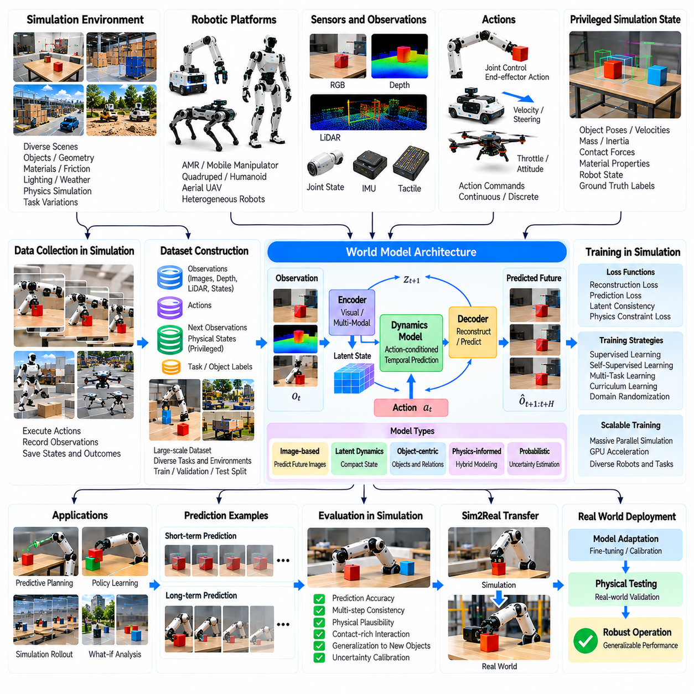{width="7.268055555555556in" height="7.268055555555556in"}

World model training from simulation is an important direction in Physical AI because autonomous robots must predict how environments evolve in response to their actions. A world model learns representations of physical states, temporal transitions, and interaction outcomes. Simulation provides controlled environments for generating extensive experience without exposing physical robots to unnecessary risks. This enables systematic development of predictive intelligence for planning and control.

A robotic world model represents the relationship between observations, actions, hidden states, and future outcomes. Observations may include camera images, depth measurements, joint states, and contact information. Actions modify the physical environment, producing new observations and state transitions. Training seeks to capture these relationships so the robot can anticipate consequences rather than relying exclusively on immediate sensor feedback.

Simulation offers a distinctive advantage because the underlying physical state is often directly accessible. Object positions, velocities, masses, contact forces, and material properties can be recorded alongside rendered sensor observations. These privileged measurements provide supervision that is difficult to obtain from real environments. However, models intended for deployment must eventually operate using observations available to the physical robot.

World model architectures may predict future images, compact latent states, object trajectories, or structured scene representations. Image-based models preserve visual detail but can require substantial computation. Latent dynamics models compress observations into representations suitable for efficient prediction. Object-centric models emphasize entities and their interactions. Architecture selection depends on planning requirements, observation complexity, and computational constraints.

A simulation-based training pipeline begins with environment generation, robot configuration, task definition, and interaction policy selection. Robots execute actions while the simulator records synchronized observations, controls, physical states, and outcomes. Collected trajectories are divided into training and evaluation datasets. Coverage of diverse initial conditions and interaction sequences is essential for learning meaningful transition dynamics.

Data diversity determines whether a world model captures general physical relationships or memorizes narrow simulation patterns. Training environments can vary object geometry, material properties, lighting, friction, gravity, and actuator response. Different robot behaviors expose the model to distinct contact and motion regimes. Carefully designed variation improves generalization while preserving physically plausible relationships between actions and outcomes.

Action-conditioned prediction is central to robotic world models because future states depend on the robot\'s chosen behavior. A model may estimate how an object moves after pushing, how a mobile robot turns under steering commands, or how a gripper changes object pose. Conditioning predictions on actions supports counterfactual evaluation of alternative decisions. Simulation provides repeatable experiments for comparing predicted consequences with actual transitions.

Temporal prediction requires models to capture both immediate responses and longer-term environmental evolution. Short-horizon prediction often emphasizes local motion and contact dynamics, while long-horizon prediction must represent accumulated effects and changing task conditions. Small prediction errors can compound across repeated transitions. Training and evaluation should therefore measure accuracy at multiple prediction horizons rather than only one-step performance.

Latent state learning compresses high-dimensional observations into representations that preserve information relevant to future prediction. Encoders transform images and sensor measurements into compact features, while transition models estimate their evolution under actions. Decoders may reconstruct observations or task-relevant variables. Useful latent states should retain physical structure without requiring exact reconstruction of every visual detail.

Object-centric world models represent scenes through individual objects, attributes, and relationships. This structure can improve reasoning about collisions, support surfaces, containment, and manipulation. Simulation provides precise object identities and interaction labels for training structured representations. Such models can support transfer to new object arrangements, although performance depends on reliable object discovery and consistent tracking.

Physics-informed learning introduces physical principles into world model development. Conservation relationships, rigid-body dynamics, contact constraints, and kinematic structure can guide model predictions. Hybrid approaches combine analytical simulation with learned corrections for uncertain effects. These methods may improve data efficiency and physical consistency, but inaccurate assumptions can introduce systematic errors that persist during deployment.

Contact-rich manipulation presents a difficult world modeling problem because small changes in geometry or friction can produce discontinuous outcomes. Grasping, pushing, sliding, and stacking involve transitions between free motion and constrained contact. Simulation generates examples across different contact conditions. Training must capture uncertainty near these transitions rather than assuming smooth and deterministic dynamics everywhere.

Uncertainty estimation is necessary because a world model cannot predict every physical interaction accurately. Probabilistic models, ensembles, and stochastic latent transitions can represent alternative outcomes. Uncertainty may increase when the robot encounters unfamiliar objects or poorly observed contact conditions. Planning systems can use these estimates to avoid risky predictions and request additional observations when necessary.

Model-based reinforcement learning uses world models to generate imagined trajectories for policy improvement. Instead of requiring every candidate action to be executed physically, the agent evaluates possible outcomes through learned dynamics. Simulation can train both the predictive model and the resulting policy. However, imagined experience must be constrained because policy optimization may exploit inaccuracies in the learned model.

Model predictive control can use a learned world model to evaluate candidate action sequences over a finite horizon. The controller selects actions that satisfy task objectives while considering predicted motion, collisions, and constraints. After executing an action, new observations update the planning process. This closed-loop approach reduces dependence on long-range predictions, although computational latency remains an important deployment limitation.

World models can also support robot foundation models and vision-language-action systems by connecting semantic goals with predicted physical consequences. A language instruction identifies the desired outcome, while the world model evaluates whether proposed actions are likely to achieve it. Simulation supplies interaction examples for training this predictive capability. The resulting architecture can improve task planning when semantic understanding alone is insufficient.

Massive parallel simulation accelerates world model training by generating diverse trajectories across many virtual environments. Different instances may vary robot embodiments, object configurations, physical parameters, and task objectives. Parallel execution expands coverage of uncommon interactions and failure conditions. Efficient dataset construction requires balancing trajectory volume, information diversity, computational cost, and the quality of recorded physical states.

Synthetic data curation is important because large simulation datasets may contain redundant or uninformative transitions. Automated filtering can identify unusual contacts, prediction failures, rare events, and trajectories with high learning value. Active data collection can prioritize scenarios where the model exhibits uncertainty. This creates a feedback loop in which predictive weaknesses guide subsequent simulation experiments and dataset expansion.

Sim2Real transfer introduces challenges because learned world models may internalize simulation-specific dynamics and visual characteristics. Real robots experience unmodeled friction, actuator delays, sensor artifacts, and environmental variability. A model that predicts simulated interactions accurately may therefore perform poorly on physical hardware. Domain randomization, parameter calibration, and real-world fine-tuning help reduce these discrepancies.

World model evaluation should examine prediction accuracy, physical consistency, uncertainty calibration, and downstream planning performance. Metrics may include object position error, trajectory deviation, contact prediction accuracy, and task completion rate. Multi-step rollouts reveal accumulated model errors that single-step tests may overlook. Evaluation across unfamiliar objects and environments helps determine whether learned representations generalize beyond training scenarios.

Safety validation requires examining whether inaccurate world predictions could lead to collisions, unstable manipulation, or unsafe navigation. Simulation enables testing of rare disturbances, unexpected object behavior, and model uncertainty under controlled conditions. Planning systems should incorporate physical constraints and independent safety checks. A predictive model must not be treated as a complete substitute for verified control and protection mechanisms.

A practical case study involves training a world model for robotic tabletop manipulation. Simulated robots push, grasp, and rearrange objects with randomized geometry, mass, friction, and initial positions. The model learns action-conditioned predictions of object movement and contact outcomes. Physical experiments identify systematic prediction errors, guiding simulator recalibration, targeted data generation, and adaptation of the learned dynamics.

The central lesson of world model training from simulation is that predictive intelligence emerges from combining diverse interaction data, structured representations, physical reasoning, and continuous validation. Simulation supplies scalable supervision and repeatable experiments, but predictive accuracy in virtual environments does not guarantee real-world reliability. Iterative integration of simulation, uncertainty-aware learning, planning, and physical feedback supports increasingly capable autonomous robots.

## 10.11. Digital Twin and Synthetic Data Case Study

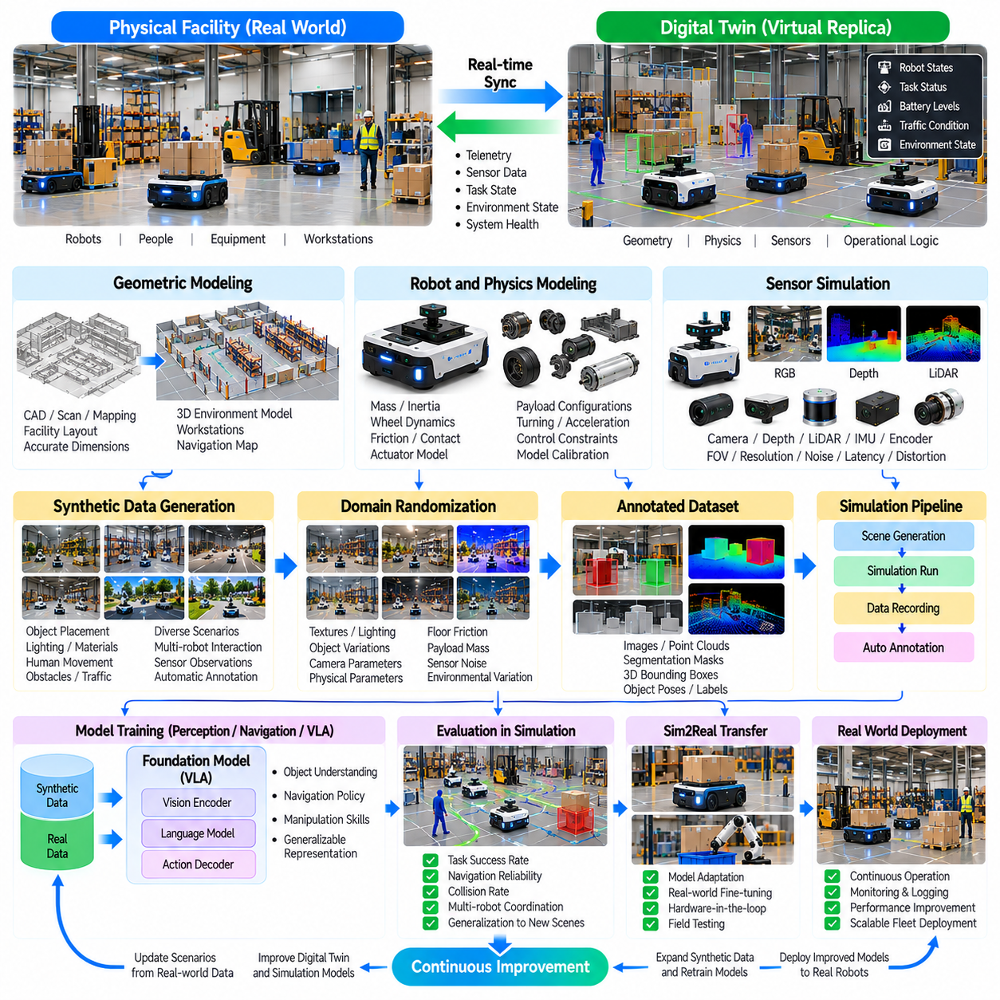{width="7.268055555555556in" height="7.268055555555556in"}

Digital twin and synthetic data integration represents a practical approach to Physical AI development by connecting virtual representations of robotic systems with data generated through simulation. A digital twin reflects the geometry, dynamics, sensors, and operational conditions of a physical environment. Synthetic data expands the range of training and testing scenarios. Together, these technologies support robot learning, validation, and continuous improvement.

A digital twin differs from a conventional simulation model because it maintains an explicit relationship with a physical asset or operating system. Robot telemetry, sensor measurements, equipment states, and environmental observations can update the virtual representation. The twin may support monitoring, prediction, and scenario evaluation. Its accuracy depends on reliable synchronization, calibrated parameters, and clearly defined model boundaries.

A representative case study involves autonomous mobile robots operating within an industrial logistics facility. The robots transport materials between storage locations, production workstations, and inspection areas. The facility includes corridors, intersections, charging stations, and human-operated equipment. A digital twin reproduces these elements while synthetic data generation creates diverse operational conditions for perception and navigation development.

The initial development stage constructs a geometric model of the facility using CAD drawings, mapping measurements, and available infrastructure records. Robot dimensions, wheel configurations, sensor mounting positions, and collision boundaries are incorporated into the scene. Coordinate systems must remain consistent between physical and virtual environments. Geometric validation compares simulated dimensions and navigation paths with measured facility characteristics.

Physical modeling adds robot mass, inertia, wheel-ground friction, actuator response, and contact behavior to the geometric representation. These parameters influence acceleration, braking, turning, and payload transportation. Initial estimates may come from engineering specifications, but physical measurements are necessary for calibration. The objective is to reproduce behavior accurately enough for the intended training and validation tasks.

Sensor simulation reproduces observations from cameras, LiDAR, depth sensors, inertial measurement units, and wheel encoders. Rendering models account for field of view, resolution, sensor placement, and environmental appearance. Additional models introduce measurement noise, motion distortion, and observation delays. Realistic sensor characteristics are important because perception algorithms may otherwise learn assumptions that fail during physical deployment.

Synthetic data generation begins by defining scene variables that influence robot perception and task execution. Object placement, lighting, surface materials, obstacle positions, and human movement patterns can be varied automatically. Each generated scene produces sensor observations and corresponding ground-truth annotations. These datasets support object detection, semantic segmentation, localization, and navigation policy development.

Domain randomization expands dataset diversity by modifying visual and physical parameters across simulation episodes. Lighting intensity, texture appearance, camera exposure, floor friction, and robot payload may vary within specified ranges. Randomization reduces dependence on a single virtual environment configuration. However, distributions should remain consistent with plausible facility conditions to avoid training on misleading or physically impossible examples.

Synthetic annotation is a major advantage because simulation provides precise access to object identities, positions, segmentation masks, and depth values. Labels can be generated automatically without extensive manual annotation. This improves dataset scalability and enables consistent supervision across many scenarios. Nevertheless, annotation accuracy depends on correct scene definitions, coordinate transformations, and synchronization between sensor frames.

The digital twin can incorporate live operational telemetry to maintain an updated representation of the facility. Robot positions, velocities, battery levels, task assignments, and equipment availability are transmitted from physical systems. The virtual environment uses this information to reconstruct current operating conditions. Synchronization latency and missing measurements must be considered when interpreting the twin as a representation of real-time operations.

Data synchronization requires consistent timestamps, coordinate frames, communication interfaces, and state definitions. Different sensors and controllers may operate at different update frequencies. Time alignment is essential for associating robot actions with observed environmental changes. A robust integration architecture distinguishes measured states from estimated or simulated states, preventing uncertainty from being mistaken for directly observed information.

The synthetic data pipeline can use the digital twin to generate scenarios based on actual operational conditions. Frequently congested corridors, difficult lighting environments, and recurring navigation failures can be reproduced virtually. Additional variations explore conditions not yet encountered during physical operation. This combination connects real-world evidence with scalable simulation-based exploration and targeted model improvement.

Perception model training combines synthetic observations with available physical sensor recordings. Synthetic datasets provide broad coverage, while real data captures appearance differences and sensor effects that are difficult to simulate. Models may undergo pretraining with synthetic data followed by fine-tuning on physical observations. Evaluation on independently collected real-world data is necessary to determine whether synthetic training improves deployment performance.

Navigation policy development uses the digital twin to evaluate route planning, obstacle avoidance, localization, and motion control. Simulated robots execute tasks under varied traffic patterns and environmental disturbances. Performance measurements identify inefficient routes, unstable control responses, and failure-prone intersections. Policies that perform reliably in simulation are transferred to physical robots through controlled testing and gradual operational expansion.

Fleet-level digital twins extend this approach by representing interactions among multiple robots and shared infrastructure. Task scheduling, charging coordination, traffic management, and workstation availability influence collective performance. Simulation can compare alternative operating policies without disrupting production. Synthetic demand patterns and equipment failure scenarios help evaluate system resilience beyond conditions observed during routine operations.

Massive parallel simulation accelerates synthetic data production by executing many virtual scenarios simultaneously. Different instances may vary robot configurations, object arrangements, traffic density, and sensor conditions. Parallel execution increases dataset coverage and enables systematic stress testing. Computational resources must be allocated according to the required balance between physics accuracy, rendering fidelity, and scenario throughput.

Automated data curation improves dataset quality by identifying redundant samples, invalid annotations, and scenarios with limited training value. Failure analysis can prioritize difficult examples such as partial occlusion, unusual obstacles, and localization ambiguity. Dataset versioning records scene parameters, simulator configurations, and labeling rules. Traceability is important for reproducing experiments and identifying the causes of model performance changes.

Sim2Real gap analysis compares virtual predictions with measured physical behavior. Relevant metrics include localization error, obstacle detection accuracy, trajectory tracking deviation, task completion time, and collision avoidance performance. Differences may originate from geometric inaccuracies, sensor mismatch, actuator behavior, or unmodeled environmental changes. The analysis guides targeted updates rather than indiscriminate increases in simulation complexity.

Model calibration forms a continuous feedback process between physical operations and the digital twin. Recorded robot trajectories, sensor measurements, and equipment states are compared with simulated outputs under equivalent conditions. Parameters are adjusted to reduce systematic discrepancies. Calibration should use separate validation data to avoid overfitting the simulator to a narrow set of observations or operating scenarios.

Safety evaluation uses the digital twin to reproduce hazardous conditions without exposing workers or equipment to unnecessary risk. Examples include blocked passages, unexpected human movement, sensor degradation, communication interruptions, and robot braking failures. Simulation supports fault injection and evaluation of recovery procedures. Physical safety validation remains necessary because a virtual model cannot represent every possible real-world failure.

A practical deployment workflow progresses from offline simulation to software-in-the-loop testing, hardware-in-the-loop evaluation, and controlled physical trials. Synthetic data supports perception training while the digital twin provides a realistic operational test environment. Each stage applies defined acceptance criteria before expanding system autonomy. Operational telemetry then supports continued monitoring and periodic recalibration after deployment.

The case study demonstrates a closed-loop improvement process in which physical robot operations generate telemetry, the digital twin reconstructs relevant conditions, and simulation produces targeted synthetic data. Updated models are trained and validated before controlled redeployment. This process connects operational experience with scalable learning. Its effectiveness depends on data quality, model fidelity, evaluation discipline, and reliable system integration.

The central lesson of digital twin and synthetic data integration is that virtual environments become most valuable when continuously connected to physical evidence. Digital twins provide operational context, while synthetic data supplies diversity and controlled experimentation. Neither technology eliminates the need for physical validation. Their coordinated use creates a practical foundation for improving robotic perception, control, fleet efficiency, and Sim2Real reliability.

## 10.12. End to End Sim2Real Pipeline [w/Code]

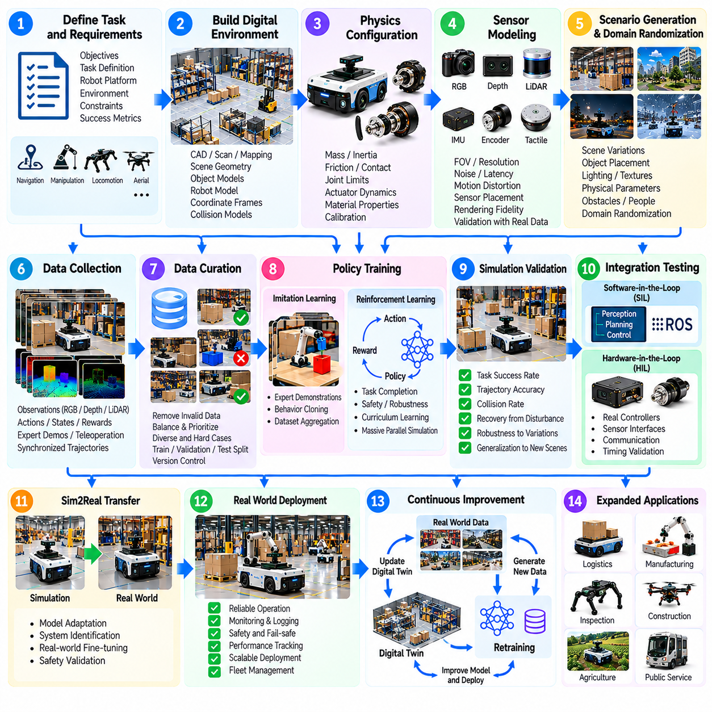{width="7.268055555555556in" height="7.268055555555556in"}

An end-to-end Sim2Real pipeline connects simulation development, synthetic data generation, policy training, validation, and physical deployment into a continuous engineering workflow. Its objective is to transfer robotic capabilities learned in virtual environments into reliable real-world operation. Successful transfer requires coordinated management of geometry, physics, sensing, control, data quality, and safety throughout the development lifecycle.

The pipeline begins by defining operational objectives, robot capabilities, environmental conditions, and measurable acceptance criteria. Target tasks may include navigation, manipulation, locomotion, or coordinated fleet operations. Engineers identify relevant constraints such as payload, speed, accuracy, and obstacle clearance. These requirements determine simulation fidelity, training methods, evaluation scenarios, and deployment boundaries.

Digital environment construction establishes the geometric foundation of the simulation. CAD models, facility maps, object meshes, and robot descriptions define the workspace and its physical entities. Coordinate frames, collision geometries, and sensor mounting positions must remain consistent. Geometric validation compares virtual dimensions and spatial relationships with measurements from the intended operating environment.

Physics configuration introduces mass, inertia, friction, joint limits, actuator dynamics, and contact properties. These parameters determine how robots accelerate, collide, grasp, and interact with surfaces. Initial values may originate from specifications, but physical experiments are necessary for calibration. The simulator should reproduce task-relevant behavior rather than pursue unnecessary physical detail.

Sensor modeling generates observations corresponding to the robot\'s actual perception interfaces. Cameras, LiDAR, depth sensors, inertial sensors, and encoders require appropriate sampling rates, noise characteristics, and latency models. Rendering fidelity is particularly important for vision-based policies. Sensor validation compares simulated measurements with physical recordings under equivalent environmental conditions.

Synthetic scenario generation expands training coverage beyond a limited set of nominal operating conditions. Scene layouts, object positions, lighting, obstacles, payloads, and interaction sequences can be varied systematically. Domain randomization introduces controlled uncertainty into visual and physical parameters. Scenario distributions should reflect realistic operating variability while including selected difficult conditions.

Data collection records synchronized observations, robot actions, environment states, rewards, and task outcomes. Expert demonstrations may originate from scripted controllers, motion planners, teleoperation, or existing robotic policies. Each trajectory should preserve timestamps, coordinate conventions, and simulator configuration metadata. Structured recording enables reproducible training and detailed investigation of failed behaviors.

Data curation removes invalid trajectories, inconsistent annotations, and redundant samples that contribute little learning value. Difficult examples involving occlusion, unstable contact, or unusual disturbances may receive greater priority. Dataset partitioning should prevent closely related scenarios from appearing in both training and evaluation sets. Version control connects each trained model to its underlying data and simulation settings.

Policy development selects learning methods appropriate to the task and available supervision. Imitation learning can reproduce demonstrated behavior, while reinforcement learning improves decisions through interaction and reward feedback. Hybrid approaches combine demonstrations with simulated exploration. Model architectures must match the robot\'s observation space, action interface, and computational limitations.

Massive parallel simulation accelerates training by executing many environments simultaneously. Each instance may vary initial states, physical parameters, task goals, and disturbances. Parallel execution increases experience diversity and exposes policies to rare failure conditions. Training efficiency depends on balancing simulation throughput, physics accuracy, rendering requirements, and the information value of collected experience.

Curriculum learning organizes training from manageable conditions toward more difficult tasks. A manipulation policy may begin with isolated objects before encountering clutter, occlusion, and uncertain contact. A navigation policy may progress from open corridors to dynamic traffic. Gradual difficulty increases can improve learning stability, although evaluation must confirm performance outside the curriculum distribution.

Simulation validation evaluates task completion, trajectory accuracy, collision behavior, recovery capability, and robustness to disturbances. Independent test scenarios are necessary because high training rewards do not guarantee reliable operation. Repeated trials reveal performance variability across initial conditions. Evaluation thresholds should correspond to operational requirements rather than arbitrary simulation scores.

Software-in-the-loop testing connects production software components to simulated sensors and actuators. Navigation stacks, perception modules, planners, and controllers execute through interfaces resembling those used on physical robots. This stage exposes integration errors, message timing problems, and inconsistent coordinate transformations. It also verifies that trained policies operate correctly within the complete software architecture.

Hardware-in-the-loop testing introduces selected physical components while the remaining environment stays simulated. Real controllers, communication interfaces, or embedded computers can process simulated observations and produce control outputs. This configuration helps measure computational latency, scheduling behavior, and interface compatibility. It does not replace physical motion testing but reduces integration uncertainty before deployment.

Sim2Real gap analysis compares simulated predictions with measurements obtained from physical experiments. Differences may involve perception accuracy, wheel slip, actuator delay, contact forces, or trajectory tracking. Engineers classify discrepancies according to geometry, sensing, dynamics, and control. Targeted calibration and model updates are preferable to indiscriminately increasing simulation complexity.

Controlled physical deployment begins with restricted operating conditions and clearly defined safety boundaries. Initial tests may use reduced speeds, simplified tasks, limited workspaces, and human supervision. Real sensor recordings and actuator telemetry are collected during execution. Each test verifies whether simulated performance translates into acceptable physical behavior before operational complexity increases.

Safety validation addresses hazards that learning performance metrics cannot adequately represent. Emergency stopping, collision avoidance, speed limits, workspace restrictions, and fault recovery require independent verification. Simulation supports disturbance injection and rare-event testing, but physical safety mechanisms must remain effective when predictive models fail. Deployment approval should depend on documented safety evidence.

Real-world adaptation uses physical observations to refine simulation parameters, perception models, and control policies. Domain adaptation may reduce visual differences, while system identification updates uncertain dynamic properties. Limited physical fine-tuning can correct systematic policy errors. Adaptation must be evaluated carefully because improvements in familiar conditions may reduce robustness elsewhere.

Operational monitoring extends the pipeline beyond initial deployment. Robot telemetry records task outcomes, intervention events, sensor anomalies, energy consumption, and control performance. Significant failures are reproduced in simulation whenever possible. These observations guide targeted synthetic data generation and subsequent model updates, creating a closed-loop learning process grounded in physical evidence.

Model release management ensures that updated policies remain traceable and reproducible. Each release should identify training datasets, simulator versions, calibration parameters, evaluation results, and supported operating conditions. Regression testing compares new models against established performance baselines. Rollback mechanisms allow operators to restore previously validated behavior if deployment reveals unexpected problems.

A representative end-to-end case study involves an autonomous mobile manipulator transporting objects between workstations. Simulation first models the robot, facility geometry, sensors, and manipulation dynamics. Synthetic demonstrations train navigation and grasping policies, followed by randomized testing and software integration. Controlled physical trials reveal sensor and contact discrepancies that drive further calibration and policy improvement.

The central principle of an end-to-end Sim2Real pipeline is that simulation, learning, testing, and physical operation must function as one traceable development system. Virtual success alone does not establish deployment readiness. Reliable transfer emerges through calibrated models, diverse training data, independent evaluation, staged deployment, and continuous real-world feedback. This integrated approach supports scalable and dependable Physical AI development.
